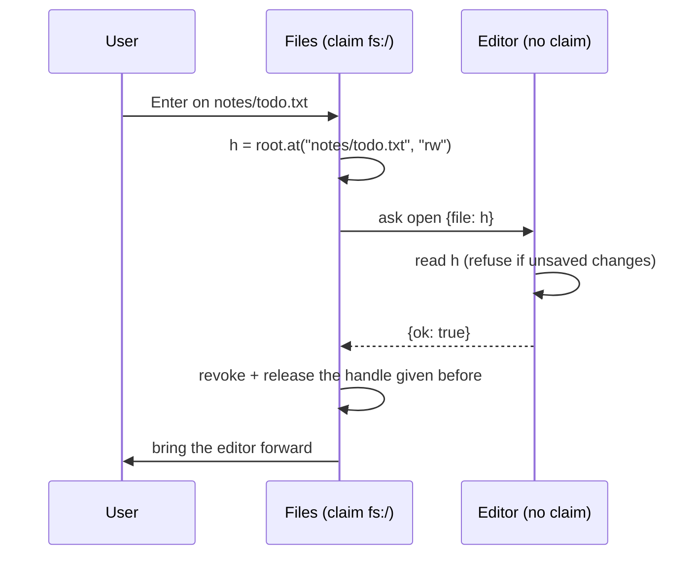
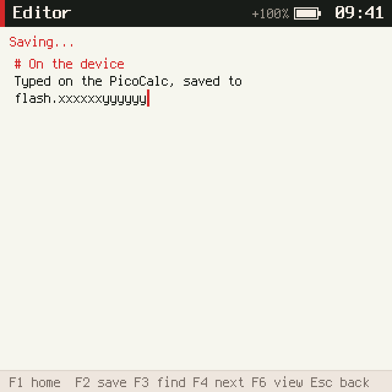
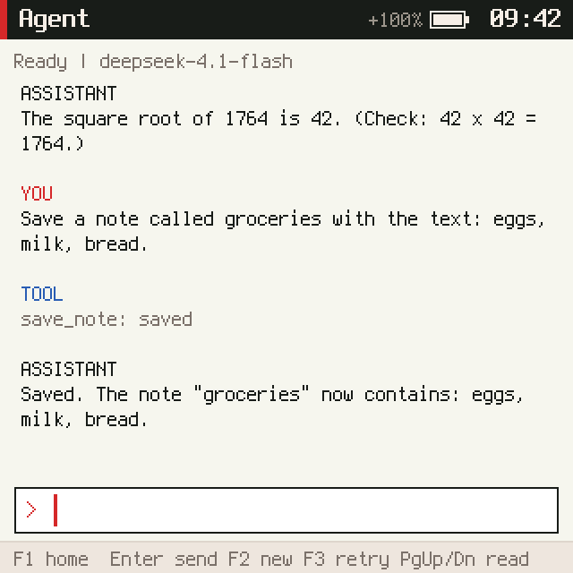
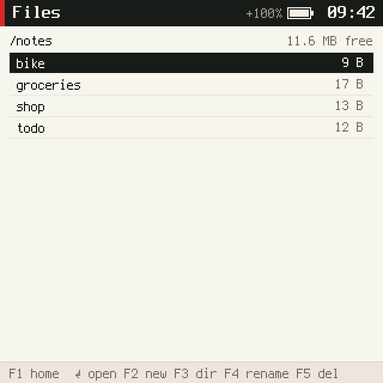

# picocalc-os, PICOCALC-EDIT: an editor, a file browser and the agent's notes as files

This note reports the second of five tickets that turn picocalc-os into a pocket computer; the first,
[[PROJ - picocalc-os - PICOCALC-FS - Files and File Handles on the PicoCalc]], gave it files and file handles,
and [[PROJ - picocalc-os - Project Overview - A JavaScript OS on Two Devices, With an Agent]] describes the project
as a whole. PICOCALC-EDIT adds a text editor for plain text and Markdown, a file browser that opens a file in the
editor by handing it a handle to that one file, and moves the agent's notes out of its 3 KB session record into
ordinary files that the user can open and edit. Everything ran on the PicoCalc's ESP32-P4, where it also exposed
an interaction between flash writes and the kernel's turn budgets.

> [!summary]
> - **The editor holds no file claim.** Files is the only program with access to the filesystem. To open a file
>   it narrows its handle to that file, asks the editor to take it, and revokes the handle it gave before, so the
>   editor can only ever touch the file the user chose last.
> - **The agent's notes are files in `notes/`.** The tools kept their names; a note can be 4,096 characters
>   instead of 1,536, there is no count limit, and notes from older session records moved over on first boot.
> - **A flash write on one core freezes the other.** ESP-IDF parks the second CPU while it erases flash, so a save
>   could stretch a kernel turn past its budget. The file worker now runs on the kernel's core, below its
>   priority, and only between turns.

## Why this ticket exists

A keyboard and a 320×320 screen invite writing, and the agent already kept notes, but those notes lived inside
the agent's private record: at most 8, 1,536 characters each, 3 KB in total, invisible to the user except through
the agent. With files in place, the natural design is one folder of notes that both the user and the agent use.
The editor also had to prove the file-handle design from PICOCALC-FS in a real exchange between two programs.

## What was built

| Part | Summary |
|---|---|
| `textarea` node | A screen node with rows of coloured text, a cursor and highlighted ranges, drawn by the compositor |
| Editor (`js/apps/editor.js`) | Soft wrap at 49 columns, cursor movement by display rows with a goal column, find and find-next, Markdown colours, list continuation and a preview, save through its one handle, cursor position remembered per file |
| Files (`js/apps/files.js`) | Browse, new file, new folder, rename, delete with confirmation, open in the editor |
| Agent notes | `list_notes`, `read_note`, `save_note` on `notes/<name>` through file promises, migration from the old record |
| Home screen | Files (`d`) and Editor (`e`) make the grid 3×3 |

## Implementation details

### The editor's text model

The editor keeps the text as logical lines and the cursor as a line and a column. Only the rows on screen are
wrapped and drawn; a per-line cache records how many rows each line takes, and an edit updates the cache for the
lines it touched. A 64 KB file therefore costs about what a short one does per keystroke, which matters on a
device where JavaScript runs roughly fourteen times slower while Wi-Fi is up and a turn has a budget of tens of
milliseconds.

```text
logical lines   ["# Title", "word word ... (149 chars)", "short"]
row counts      [1, 4, 1]
cursor          (line 1, column 50)  ->  display row 2, column 1
screen          rows top..top+17, the cursor, the find marks
```

Moving up or down converts the cursor to a display row, moves, and converts back, keeping a goal column across
short rows. Lines break at the last space that fits, or hard at 49 columns when a word is longer.

### Opening a file: narrowing, asking, revoking



The kernel's grant rule lets Files pass the handle (it narrowed it) but not the editor, which holds read and
write rights without the grant right. If the editor refuses, for instance because it has unsaved changes, Files
revokes the new handle instead. Both sides release handles they no longer use, because a slot in the kernel's
128-entry handle table is freed only when its last holder lets go.

### The agent's notes as files

The agent claims `fs:/notes`. File operations are promises that settle in a later segment, while the agent's run
loop was synchronous. A small wrapper, `noteOp`, marks the run's tool step busy with a fresh token; the loop waits
while the token is set; a cancel, a failure or a new conversation clears it, so a result that arrives after the
run ended is dropped. A save checks whether the file exists, so the approval reads "Save" or "Replace", and
reports success only after the write has landed.

Older session records still hold notes. At start the agent writes each one to `notes/<name>` unless a file of
that name already exists (the user's file wins), and drops them from the record only after every write
succeeded; a failure retries at the next boot. On the device this moved three notes, `bike`, `shop` and `todo`,
left over from the agent ticket's tests.

Two limits had to move with the note size. Tool arguments were capped at 4,096 bytes, which a 4,096-character
note cannot fit in; the cap is now 16 KB. The approval screen shows an escaped copy of the text, in which every
non-ASCII character becomes `\u{…}`; the agent refuses a note whose review copy would not fit before asking the
user.

### Flash writes and turn budgets on the ESP32-P4

On the device a save takes 520–611 ms: the file layer writes a temporary file, syncs it, removes the old file and
renames, and on FAT with wear levelling each of these rewrites directory and FAT sectors, each an erase of tens of
milliseconds. That is slow but harmless in itself. What was not harmless: once, the compositor crashed with "ran
past its turn budget of 80 ms" just after a save.

The cause is how ESP-IDF writes flash. While it erases or programs, the flash cache is off, and ESP-IDF parks the
other CPU for the duration so it cannot fetch code from flash. The file worker ran on core 0 and the kernel on
core 1, so an erase could freeze a turn in progress and the kernel charged the frozen time to the world. Moving
the worker to core 1, below the kernel's priority, changes the timing:

```text
before  core 0: fs worker erase ........        core 1: turn | frozen ........ | turn continues  -> overrun
after   core 1: turn | (kernel blocked) fs worker erase | next turn starts late but runs whole
```

A flash operation can now delay the next turn but not stretch one. Six saves with a screenshot right after each
ran without a crash; the crash had been rare (about one in eight saves), so the evidence is the scheduling
argument more than the count. Flash auto-suspend would remove the parking altogether, but it depends on the
flash part on the module and stays off.

The same device run found an editor bug: Esc pressed right after F2 arrived before the write had settled, so the
editor warned about unsaved changes, and a second Esc would have shown the old text while the new text was being
written. A save is now explicit state: a second F2 waits, edits made during the write keep the buffer dirty, and
Esc during a save leaves once the write lands.

### On the device







## Tests

- `tests/editor.test.mjs` (10): editing, wrap, cursor movement, find, Markdown, unsaved changes, a save in flight,
  per-file cursor position, keys from other worlds ignored.
- `tests/agent.test.mjs` (30): the note tests now run against a fake notes folder whose writes can be held open,
  plus listing, reading, clipping, name rules, failed writes, replacing, and migration.
- `make test-agent`: the integration tour checks the file `notes/next` and runs a migration from an old record.
- `make test-fs` (9), `make shots` with a new Files and editor script; the host now reports a volume the size of
  the P4's partition, so captures no longer change with the disk the tests run on.

## Current status

- Done: commits `23fc2f7` (editor, Files), `42693d7` (notes as files), `8238911` (device fixes), docs `b674b17`.
  Guide (before) and guide as built with the diary (after) on the reMarkable under `/ai/2026/10/31/PICOCALC-EDIT`.
  Ticket closed.

## Open questions

- Undo in the editor; today a second Esc discards back to the last save.
- Writing small files in place would cut the erases per save, at the cost of the temporary file's crash safety.
- A per-world maximum turn time in `stats` would show budget pressure before it becomes a crash.
- The console's `type` command paces at 90 ms per character; device scripts must wait for it.

## Next

PICOCALC-CALC: a calculator with history and graphing.

## Important files

- `picocalc-os/js/apps/editor.js` — the editor
- `picocalc-os/js/apps/files.js` — the file browser and the open protocol
- `picocalc-os/js/system/compositor.js` — the `textarea` node
- `picocalc-os/js/system/agent.js` — `noteOp`, `noteTool`, `migrateNotes`
- `picocalc-os/port/esp32p4/main/fs_p4.c` — the file worker's core and priority
- `picocalc-os/tests/editor.test.mjs`, `picocalc-os/tests/agent.test.mjs`
- Ticket: `ttmp/2026/10/31/PICOCALC-EDIT--a-text-editor-and-a-file-browser-for-the-picocalc-and-the-agent-s-notes-as-files/`
