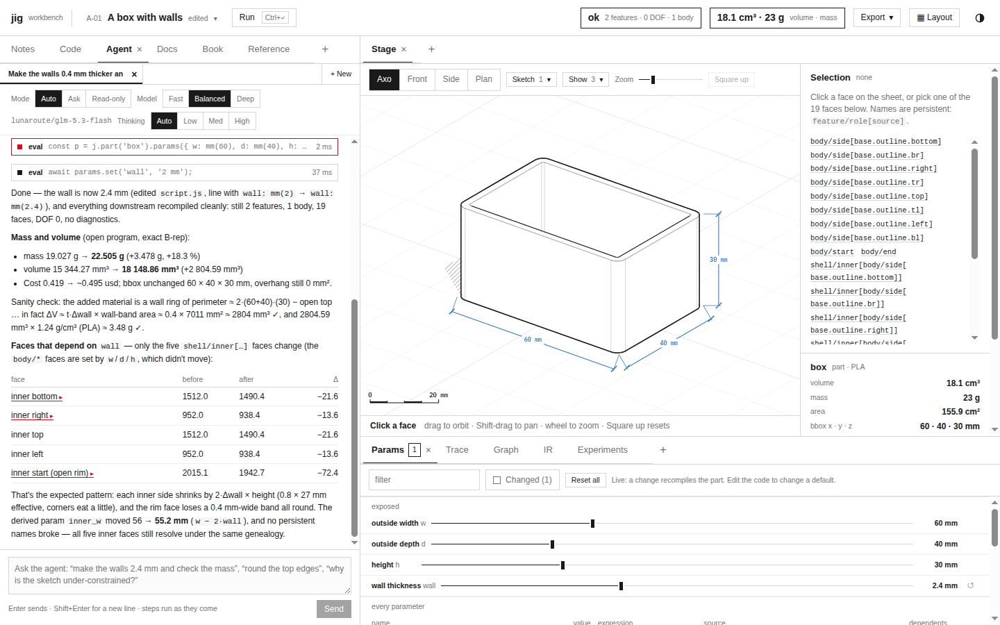
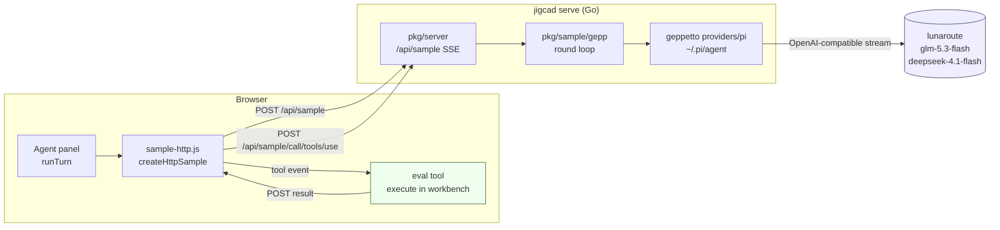
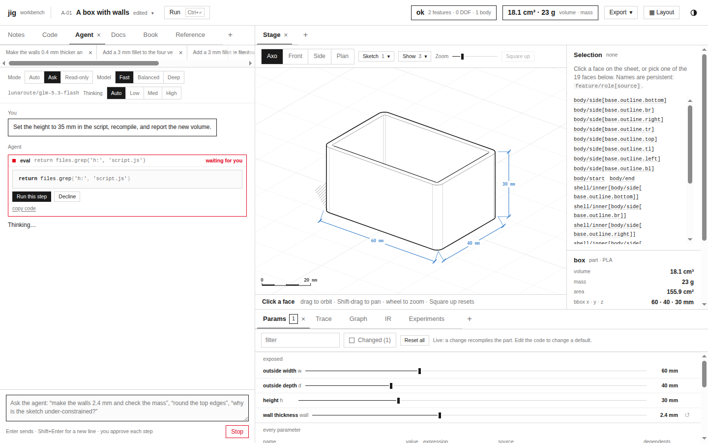
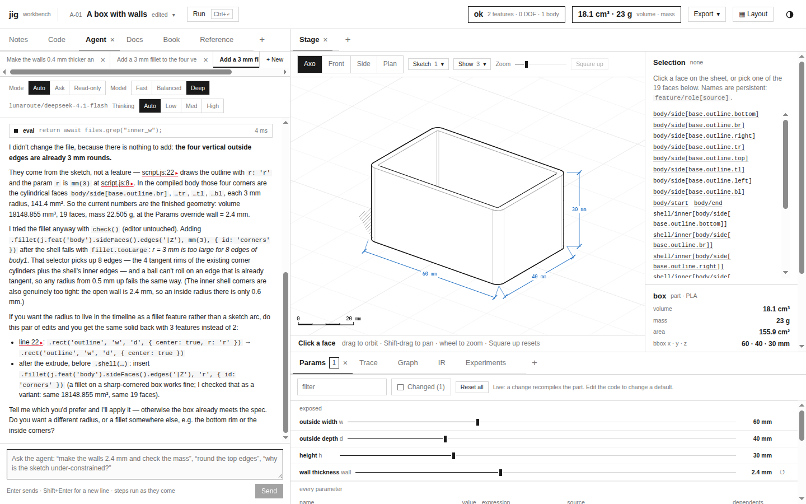

# jigcad: A Go Model Backend for the Workbench Agent

jigcad's workbench has an agent panel. A person types a request ("make the walls 0.4 mm thicker and check the mass"), and a language model edits the part's script, recompiles it, and checks the result with numbers. Until this ticket the panel only worked inside claude.ai, where the page receives a `sample` function from the hosting runtime. This report explains `jigcad serve`, a Go server that gives the same panel the same function from a local process. Model calls go through Pi's agent directory and geppetto's `providers/pi`, and the default models are `lunaroute/glm-5.3-flash` and `lunaroute/deepseek-4.1-flash`. The report follows ticket JIG-002 and the two earlier reports on the Rust compute core, [[PROJECT REPORT - jigcad - Moving the Numeric Core of a Browser CAD Engine into Rust and WebAssembly]] and [[PROJECT REPORT - jigcad - Constraint Equations as Data and a Rust Renderer]].

> [!summary]
> - The agent depends on one contract: `sample(turns, { tools, signal, modelTier, effort, onText })`, where one call is a whole agent turn and the tool rounds happen inside the call. The Go server implements that contract over HTTP and server-sent events, so the panel, the tool and their tests did not change.
> - Tool calls execute in the browser. The server holds each one on a channel and waits until the page posts the result. This is necessary because the tool reads and edits the live workbench and, in Ask mode, waits for the person.
> - The backend is adapted from slop-computer's Pi worker. The one behavioural addition is a user note before the last, tool-less round. Without it, `deepseek-4.1-flash` returned an empty answer after spending 15 rounds exploring.
> - Real turns through lunaroute work on both models: 9 to 12 tool calls per turn, about 25 s, and 194 K to 277 K input tokens, because every round resends the whole conversation. lunaroute caches prompt prefixes automatically, so from the second round on, 94–99 % of those tokens are cache reads (§9.1).



## 1. What the agent asks of a model

The agent panel (`import/jigcad/src/agent/`) is a thin layer over one capability. A turn is built in `turn.js` by `runTurn`. It appends the person's words to the thread, converts the thread into a list of `{ role, content }` turns (`prompt.js`, `toTurns`), and calls `sample` once:

```js
const tool = createEvalTool(host, { getMode, onStep, onUpdate, signal });
const res = await sample(turns, {
  tools: [tool], signal, modelTier: 'default', cache: false,
  onText: ({ text }) => { turn.text = text; onUpdate(); },
});
turn.text = res.text;
```

The tool list has a single entry, `eval`. Its input is `{ code: string }`, the body of an async JavaScript function. It runs in the workbench with the lab API in scope: `files`, `run`, `check`, `program`, `faces`, `params`, `measure` and others. Its result is the returned value printed as YAML, plus any console output. Every call creates a *step* record in the panel. The record shows the code, the result and the time taken, and it holds a snapshot of the files so the person can revert the step.

Two properties of this contract shape everything that follows:

- **The loop belongs to the capability.** `runTurn` does not alternate between "ask the model" and "run the tool". It calls `sample` once and receives a final text. Whoever implements `sample` must run model rounds, deliver tool calls to `tool.execute`, feed the results back, and stop when the model answers without calling a tool.
- **The tool is defined in the page.** `execute` is a JavaScript closure over the live workbench host. A server can know the tool's name, description and input schema, but it cannot run the tool.

The first message of a thread carries the agent's instructions and the Reference: the language reference (`content/docs/reference.md`, 38,907 bytes) and the lab API (`src/agent/reference.md`, 13,581 bytes), about 52 KB, joined by `host.reference()`. (An earlier version of this report gave only the lab API's 13,581 bytes; corrected 2026-10-31.) Every later message carries a short context block (the current preset, the selection, the compile state). All of it travels as plain conversation text, so any chat model with tool calling can serve the agent.

## 2. Architecture

`jigcad serve` is one Go process. It serves the built workbench (`import/jigcad/dist/`) and four API routes. A model call is one long HTTP response. Each tool call inside it is a separate short request from the page.



| Route | Body | Response |
|---|---|---|
| `GET /api/sample/models` | — | `{ available, models, tiers, maxRounds, maxPromptBytes, tools }` |
| `POST /api/sample` | `{ input, modelTier, model?, effort?, tools? }` | `text/event-stream`: `call`, `text`, `thinking`, `tool`, `result`, `error` |
| `POST /api/sample/{call}/tools/{use}` | `{ value, isError }`, at most 32 KB | `{ ok: true }`, or 404 when nothing waits |
| `POST /api/sample/{call}/cancel` | — | `{ ok: true }` |
| `GET /*` | — | the workbench, from `--dist` or the binary's embedded copy |

The Go code has three packages and a command:

| Path | Role |
|---|---|
| `pkg/sample/types.go`, `validate.go` | The contract types (`Request`, `Tool`, `Event`, `Result`, `Failure`, `ToolResult`, `Backend`) and request limits; adapted from slop-computer's `pkg/piworker` |
| `pkg/sample/gepp/backend.go`, `sample.go` | The geppetto backend: tier resolution from Pi's directory, the round loop, the event sink, error classification |
| `pkg/server/server.go` | HTTP handlers, the registry of calls in flight, the SSE writer, the token check, static files |
| `cmd/jigcad/main.go` | `jigcad serve` and its flags |
| `import/jigcad/dist.go`, `embed.go` | `var Dist fs.FS`; with `-tags embed` the built workbench is compiled into the binary |

### One turn over time

The sequence below is the Balanced turn from the screenshot, shortened to one tool round. The important point is that the model's request for a tool and the tool's answer travel on different HTTP requests. They are joined by the call id and the tool-use id.

```mermaid
sequenceDiagram
  participant Page as Page (sample-http.js)
  participant Srv as pkg/server
  participant Loop as gepp round loop
  participant LR as lunaroute
  Page->>Srv: POST /api/sample {input, modelTier, tools:[eval]}
  Srv-->>Page: event: call {call: jc7a…}
  Srv->>Loop: Sample(ctx, req, emit, execute)
  Loop->>LR: round 1 (messages + tools)
  LR-->>Loop: text deltas, tool_call eval{code}
  Loop-->>Page: event: text …
  Loop->>Srv: execute(tool use call_1)
  Srv->>Srv: register channel for call_1
  Srv-->>Page: event: tool {use: call_1, name: eval, input}
  Page->>Page: tool.execute(input) in the workbench
  Page->>Srv: POST /api/sample/jc7a…/tools/call_1 {value, isError}
  Srv->>Loop: ToolResult via channel
  Loop->>LR: round 2 (messages + tool result)
  LR-->>Loop: final text, no tool calls
  Loop-->>Page: event: result {text, modelUsed}
```

## 3. Why tools run in the page

The alternative design would execute `eval` on the server, either by running the workbench headless in Go or by evaluating the code in a JavaScript engine embedded in the server. Both fail on what the tool touches. `eval` code reads the files open in the person's editor, compiles them in the page's Web Worker (which loads OpenCascade and the Rust compute module), changes parameters that the Params view displays, and reads the current selection. In Ask mode the step does not run at all until the person presses "Run this step". All of that state exists only in the browser tab.

The server therefore treats a tool call as a question that it sends to the page. Its `execute` function, which the round loop calls once per tool use, does four things in a fixed order:

```go
execute := func(tctx context.Context, e sample.Event) (sample.ToolResult, error) {
    ch := s.waitTool(c, e.ToolCallID)       // 1. register before telling the page
    defer s.takeTool(c, e.ToolCallID)       // 4. always unregister
    send("tool", map[string]any{"use": e.ToolCallID, "name": e.Name, "input": e.Input}) // 2.
    t := time.NewTimer(toolWait)            // 3. wait: result, 150 s timeout, or cancellation
    defer t.Stop()
    select {
    case res := <-ch:
        return res, nil
    case <-t.C:
        return sample.ToolResult{Value: json.RawMessage(`"The page tool did not answer in time"`), IsError: true}, nil
    case <-tctx.Done():
        return sample.ToolResult{}, tctx.Err()
    }
}
```

The order of steps 1 and 2 matters. If the event went out first, a fast page could post the result before the channel existed, get a 404, and leave the call waiting until the timeout. The channel has capacity 1, and `takeTool` removes the entry under the registry's mutex. The first POST for a tool use therefore delivers its value without blocking. A second POST, or a POST after the timeout, finds nothing and receives 404. A timeout is not treated as a failure of the call. It becomes a tool error that the model reads ("did not answer in time"), and the model can decide what to do next.

The 150 s limit is far above the eval tool's own 25 s timeout. It exists for Ask mode: the screenshot below shows a step waiting for the person while the server holds the model call open.



## 4. The model path: Pi, geppetto and lunaroute

The server does not hold API keys. It reads Pi's agent directory, `~/.pi/agent`, through geppetto's `providers/pi` package, the same way slop-computer does. That directory holds a model catalog (`models-store.json`), provider credentials (`auth.json`; here an OAuth login for lunaroute) and settings. `gepp.New` loads the directory, keeps the models that have credentials, and resolves the three tiers:

| Tier (panel label) | Default model | Flag |
|---|---|---|
| quick (Fast) | `lunaroute/glm-5.3-flash` | `--model-quick` |
| default (Balanced) | `lunaroute/glm-5.3-flash` | `--model-default` |
| complex (Deep) | `lunaroute/deepseek-4.1-flash` | `--model-complex` |

A reference may carry a thinking level (`provider/id:high`). The panel's Thinking control sends `effort`, which the backend maps to the model's supported levels. Each request to lunaroute carries the headers that Pi's lunaroute extension sends: `lunaroute-agent: jigcad` and a per-process session id. Requests from this server can therefore be told apart from Pi's own sessions in lunaroute's records.

For each round, `dir.Resolve(ctx, model.Ref(), …)` returns a geppetto engine for the model's provider. lunaroute speaks the OpenAI chat-completions protocol, so the engine is geppetto's OpenAI-compatible one. The panel shows the model of the selected tier next to the Model control. That value comes from `/api/sample/models`.

## 5. The round loop

`gepp.Backend.Sample` runs a bounded number of geppetto inference calls over one growing `turns.Turn`. In outline:

```go
rounds := clamp(req.MaxRounds, 1, sample.MaxRounds)  // server sends 16; hard cap 32
for round := 0; round < rounds; round++ {
    if contextBytes(t) > 512 KiB { return errContext }      // prompt_too_large
    perRound := budget.next(model.MaxTokens)                 // one 64 Ki output budget per call
    ctx := ctx
    if round < rounds-1 && len(tools) > 0 {
        ctx = tools.WithRegistry(ctx, registry)              // tools offered on all but the last round
    } else if round > 0 && len(tools) > 0 {
        turns.AppendBlock(t, turns.NewUserTextBlock(lastRoundNote))   // jigcad addition, §6
    }
    t = engine.RunInference(withSink(ctx), t)                // streams text/thinking/usage events
    calls := ExtractPendingToolCalls(t)
    if len(calls) == 0 || budget.remaining <= 0 {
        if visible text is empty { return errEmpty }         // empty_completion
        emit(result{Text: visible, ModelUsed: model.Ref(), Truncated: …}); return nil
    }
    results := runTools(ctx, calls)                          // execute() per call, in parallel
    append results to t as tool-use blocks
}
return errRounds
```

Several details are easy to miss:

- **Visible text accumulates across rounds.** The sink appends each round's text deltas to one `visible` string and separates rounds by a blank line. Every `text` event carries the full text so far plus the delta. The panel simply replaces its displayed text.
- **Tools of one round run in parallel.** `runTools` starts one goroutine per tool call (an `errgroup`). The server's per-call tool counter is therefore atomic. In practice the agent's model issues one `eval` per round.
- **Errors are classified, never forwarded.** Provider error strings can quote request content, so `classify` maps them by regular expression to fixed messages with the contract codes `authentication_error`, `rate_limited`, `prompt_too_large` and `upstream_error`. The page receives `{ code, message }` and turns the code into one sentence under the turn (`turn.js`, `NOTES`).
- **Usage stays on the server.** `usage` events are summed into one log line per call and are not sent to the page:

```
sample jc7a71c90ee5e033e2cf340e54 tier=default model=lunaroute/glm-5.3-flash asked="" tools=9 in=194168 out=2397 ms=24149 outcome=ok
```

## 6. The empty last round

The first Deep-tier turn asked deepseek-4.1-flash to add a 3 mm fillet to the four vertical outside edges. It ended with the panel note "The model returned an empty answer". The server log recorded:

```
sample jc5322725601321daec4dfadfb tier=complex model=lunaroute/deepseek-4.1-flash asked="" tools=15 in=342607 out=6075 ms=44946 outcome=empty_completion
```

Fifteen tool calls means fifteen rounds with tools, followed by the sixteenth round, which offers none. The steps were exploration: `faces('%cylinder')`, `faces('|Z')`, `program.bodies()`, `program.ir('L4')`, and several drafts of the script. The model had produced no visible text in any round. When the last round removed the tools, the conversation ended on a tool result with no instruction, and the model returned nothing.

The backend change adds a user turn before the last round of any call that used tools:

> No tool calls are left in this turn. Answer now in plain text from what you have found so far. Say plainly what is done, what you checked, and what is unfinished.

The scripted-provider test `TestLastRoundOffersNoTools` now also asserts that the final request ends with this user message. The same request, repeated after the change, completed in 12 rounds (`in=277239 out=3629 ms=25682 outcome=ok`). The answer in the screenshot below is a good one. It found that the box's outline is drawn with `r: 'r'` and `r = mm(3)`, so the four vertical edges are already 3 mm rounds. It tried an explicit fillet with `check()` without touching the editor and reports the kernel's `fillet.tooLarge` error. It left the file unchanged and described the two edits that would move the radius from the sketch into a fillet feature. The repeated run is not a controlled comparison, because the model also made different choices. What the change guarantees is that the final round always carries an explicit instruction to answer.



## 7. The browser adapter

`import/jigcad/src/host/sample-http.js` is a port of slop-computer's runtime `sample()` (`web/runtime/src/sample.ts`). It leaves out consent prompts, images and result caching. The agent passes `cache: false` and sends no images. The adapter has three parts.

**The probe.** `httpSample()` requests `GET api/sample/models`. If the answer is JSON with `available: true`, it returns the sample function with the answer attached as `.info`; otherwise it returns `null`. The panel's `getSample()` tries `window.claude.use('sample')` first. It probes the backend only when that is absent and the page was loaded over http(s). The workbench therefore keeps working on claude.ai unchanged, and with `jigcad serve --no-models`, or on a static host, it shows its existing "the agent is off here" banner.

**The stream.** The call validates the input (non-empty, turns that start and end with `user`, at most 256 KiB), posts it, and parses the SSE body: it splits on blank lines and reads `event:` and `data:` fields. `call` stores the call id. `text` forwards to `onText`. The first `thinking` event shows "Thinking…" until text arrives. `result` resolves the promise. `error` rejects it with an `Error` whose `.code` is the contract code, and attaches any partial text.

**Tools.** A `tool` event starts `runTool` without awaiting it. The SSE loop must keep reading while the tool runs. `runTool` finds the tool by name, awaits `execute(input, { signal })`, serialises the value, replaces any result over 32 KB with an error string, and posts `{ value, isError }`. If the tool throws, the error message becomes the value with `isError: true`. The model then sees, for example, `Error: faces: selector: unknown token 'shell/*'` and can correct its code. That is exactly what glm-5.3-flash did in the Balanced turn.

**Cancellation** has two paths, and the adapter uses both. Pressing Stop aborts the panel's `AbortController`. The adapter's listener posts `/api/sample/{call}/cancel` when it already knows the call id, and it aborts its own fetch. On the server, the cancel handler calls the call's `context.CancelFunc`. Closing the response also cancels the request context. Either way, the `execute` waiting in `select` returns `ctx.Err()`, the round loop exits, and the log records `outcome=cancelled`. In the live test, Stop was pressed while the second Ask-mode step waited for the person. The panel showed "Stopped.", and the server logged `tools=2 … ms=73428 outcome=cancelled`.

## 8. Access control

The server spends the operator's lunaroute credentials, so anyone who can reach `/api/sample` can run model calls at the operator's cost. Three rules address this:

- The default listen address is `127.0.0.1:8787`. `jigcad serve` refuses to start on a non-loopback address unless a token is set: `--listen 0.0.0.0:8789 is not a loopback address: set --token (or JIGCAD_TOKEN) so others cannot spend the Pi credentials`.
- With `--token T`, every `/api/` request must present `Authorization: Bearer T` or the `jigcad_token` cookie. The token is compared in constant time. Opening `/?token=T` once sets an HttpOnly, SameSite=Strict cookie and redirects (303) to the same address without the token, so the token does not stay in the address bar or the history.
- Static files need no token. They are the public workbench and contain no secrets.

## 9. Measurements

All runs used the A-01 preset ("A box with walls") in the browser, with `jigcad serve` on loopback and lunaroute as the provider.

| Run | Model | Tool calls | Input tokens | Output tokens | Wall time | Outcome |
|---|---|---|---|---|---|---|
| "Reply with exactly: jigcad ok" (curl, no tools) | glm-5.3-flash | 0 | 19 | 6 | 1.1 s | ok |
| same | deepseek-4.1-flash | 0 | 38 | 6 | 0.3 s | ok |
| Walls +0.4 mm, check mass and dependent faces | glm-5.3-flash | 9 | 194,168 | 2,397 | 24.1 s | ok; `wall: mm(2.4)` in the script |
| 3 mm fillet on vertical edges (before the fix) | deepseek-4.1-flash | 15 | 342,607 | 6,075 | 44.9 s | empty_completion |
| same (after the fix) | deepseek-4.1-flash | 12 | 277,239 | 3,629 | 25.7 s | ok; file left unchanged, correctly |
| Height to 35 mm, Ask mode, Stop on step 2 | glm-5.3-flash | 2 | 35,526 | 138 | 73.4 s (person waiting) | cancelled |

Input tokens dominate the totals. Each request carries the whole conversation: the instructions, the 52 KB Reference (once, in the first user message) and the context block, plus every earlier round's tool calls and results. A turn of *n* rounds therefore sends that prefix *n* times. The nine-tool turn made ten model requests, which averaged about 19 K input tokens each and added up to 194 K. Output stays small: the code of each step and the final answer.

### 9.1 Prompt caching

> [!note] Correction (2026-10-31)
> An earlier version of this report said that this path has no prompt caching. That was an assumption carried over from slop-computer's research note, which concerns Anthropic's explicit `cache_control`. It was not a measurement. The measurements below replace it.

lunaroute speaks the OpenAI chat-completions protocol, and like OpenAI it caches prompt prefixes without any request flag. Each response's `usage` reports the hit as `prompt_tokens_details.cached_tokens`. geppetto maps that field into its usage event, and the server's log line now prints it as `cacheRead`. To see the raw usage objects, a small reverse proxy (`scripts/usage-proxy` in the ticket) logged only the `usage` JSON of each streamed response. A probe program (`scripts/cache-probe`) drove the real backend with the lab API reference alone (13.6 KB, about 4,300 tokens) as the prefix and a prompt that forced four tool rounds. Real turns carry the full 52 KB Reference, which is why their per-round input is larger:

| Round | glm-5.3-flash: input / cached | deepseek-4.1-flash: input / cached |
|---|---|---|
| 1 | 4,302 / 0 | 4,639 / 0 (4,608 written to the cache) |
| 2 | 4,333 / 4,096 | 4,832 / 4,608 |
| 3 | 4,353 / 4,096 | 4,894 / 4,864 |
| 4 | 4,373 / 4,352 | 4,948 / 4,864 |
| 5 | 4,393 / 4,352 | 5,002 / 4,864 |

Cache hits come in blocks of 256 tokens (4,096, 4,352, 4,608, 4,864), so the tail since the last block boundary is processed fresh each round. Three further observations define where the cache applies:

- **A second call in the same server process is warm from round 1.** The probe's second call with the same prefix read 4,096 (glm) and 4,608 (deepseek) tokens from the cache in its first round.
- **A new process starts cold.** The backend generates one `x-lunaroute-session` id per process, and the cache follows the session. The same probe run in a fresh process a minute later read nothing from the cache in round 1.
- **Each model has its own cache.** Switching tiers within a session makes the first round of the other model cold.

Real agent turns through `jigcad serve`, on a freshly started server, confirm the effect at full size:

```
sample jcdc79ff… tier=default model=lunaroute/glm-5.3-flash    tools=8 in=170359 cacheRead=149248 out=1650 ms=16668 outcome=ok
sample jce7bd9b… tier=complex model=lunaroute/deepseek-4.1-flash tools=1 in=39988  cacheRead=20224  out=512  ms=3478  outcome=ok
```

The Balanced turn read 88 % of its input from the cache, although it was the server's first call. The Deep follow-up read 51 %. Its first round was cold, because this session had not yet sent the conversation to deepseek, and its second round was warm. The uncached work of a nine-round turn is therefore closer to 20 K tokens than to 194 K. Pi lists lunaroute's cost for both models as 0, so here the cache matters for latency and provider load rather than money. One gap remains: DeepSeek reports cache writes as `created_cache_tokens`, which geppetto does not map, so the server logs `cacheWrite=0`.

The tests that guard the implementation:

- `GOTOOLCHAIN=auto go test ./pkg/...`: slop's scripted-provider suite for the backend (text streaming, tools over rounds, the last round without tools and with the note, failures, cancellation during a tool, model choice, budget), and server tests with a fake backend (tool round trip, cancel while a tool waits, rejections before streaming, no backend, token and static files).
- `node --test import/jigcad/test/agent/*.test.mjs`: 34 tests, including 5 for the adapter against a Node server that speaks the protocol (tool round trip, throwing tool, error codes, abort → cancel POST, probe).

## 10. Where the work ends

The agent now runs end to end outside claude.ai on the operator's own models. The remaining questions concern model behaviour and cost, not the protocol:

- **Round budget per model.** The flash models explore heavily: 9 to 15 eval calls per turn in these runs, many of them reads of the same file or repeated selector queries. Telling the model how many rounds remain, for example in each tool result, might shorten turns more cheaply than raising the limit.
- **Input volume.** The reference travels with every round, but lunaroute's prefix cache serves it from the second round on (§9.1), so trimming it for later rounds would save little. What remains uncached is each round's new tail and the first round after a restart or a tier switch.
- **The models list.** `/api/sample/models` lists every model Pi has credentials for, not only the three tiers. That is useful for an operator and more than a shared deployment should expose.
- **The shared backend.** `pkg/sample` is a copy of slop-computer's backend with marked changes. If that backend moves into geppetto or into a shared module, jigcad should depend on it and keep only `lastRoundNote` and its round limits as configuration.

## Important project docs

- Repository: /home/manuel/code/wesen/go-go-golems/jig
- Ticket: `ttmp/2026/10/31/JIG-002-AGENT-LLM-BACKEND--agent-model-backend-via-geppetto-and-the-pi-provider-slop-computer-pattern/`
  - `reference/01-how-slop-computer-calls-llms…md`: research on slop-computer's geppetto and Pi path, and the model decision
  - `design-doc/01-jigcad-serve-go-model-backend-on-geppetto-and-pi-and-the-browser-sample-adapter.md`: API, decisions D1–D5, results
  - `diary/01-implementation-diary.md`: steps 1–4 with commands, failures and measurements
- Commits: `4c6ba07` (Go backend, server, command), `a7cb8e2` (browser adapter, last-round note), `d6d8d84` (ticket docs)
- Run: `cd import/jigcad && node build.mjs && cd ../.. && GOTOOLCHAIN=auto go run ./cmd/jigcad serve`, then open `http://127.0.0.1:8787/` and the Agent tab
- Source of the adapted code: slop-computer `pkg/piworker`, `pkg/piworker/gepp`, `pkg/server/rt_sample.go`, `web/runtime/src/sample.ts`
