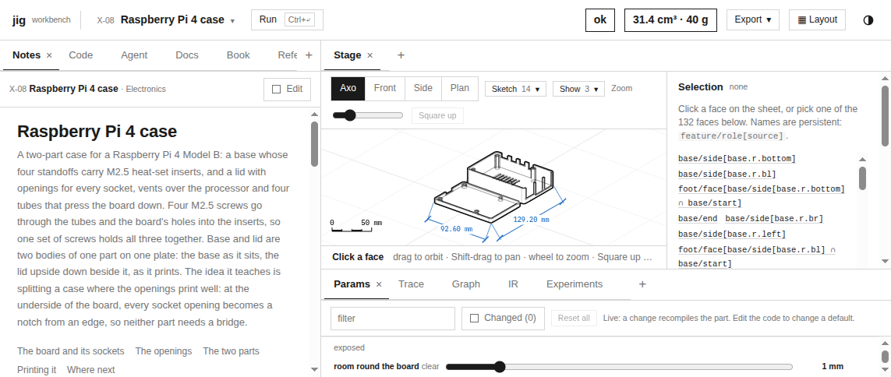
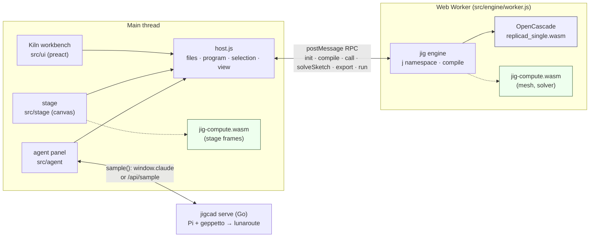
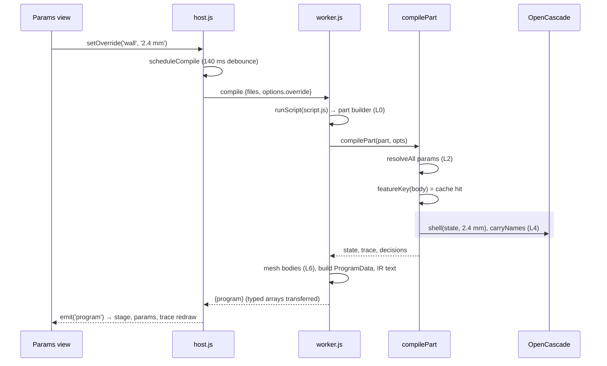
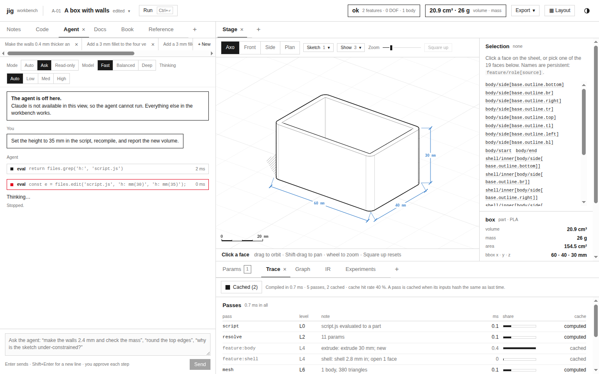
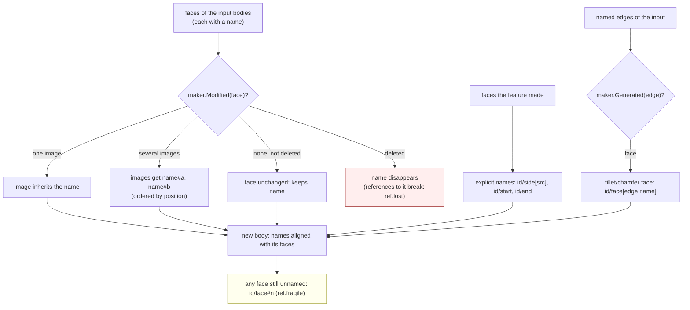
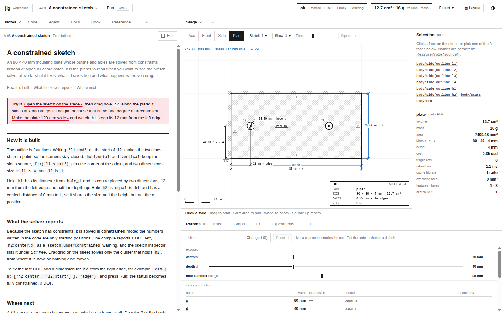
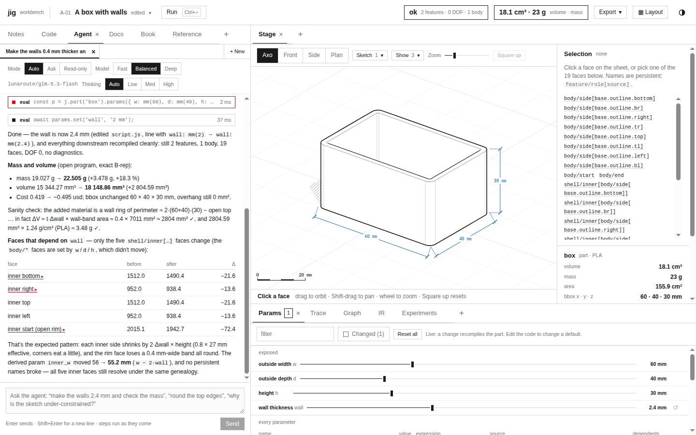

# jigcad: Architecture of a Browser CAD Workbench, from Script to Agent

jigcad is a parametric CAD workbench for 3D-printable parts that runs entirely in a browser tab. A part is a short JavaScript program written against *jig*, a builder language whose values carry units, parameters, sketches with constraints, features with persistent face names, and print settings. A Web Worker compiles the program with OpenCascade, a C++ solid-modelling kernel compiled to WebAssembly, into a plain-data *Program*. The workbench then draws that Program on a software-rendered drafting sheet and shows its parameters, feature graph, trace and seven intermediate representations. A coding agent edits and checks the same program through the same API a person uses.

This report explains the whole system in one pass. Each stage of the path from a script to a printed plate, and from a request typed into the agent panel to a verified edit, is described with real output from the engine. Three earlier reports go deeper into single pieces and are linked where they apply: [[PROJECT REPORT - jigcad - Moving the Numeric Core of a Browser CAD Engine into Rust and WebAssembly]], [[PROJECT REPORT - jigcad - Constraint Equations as Data and a Rust Renderer]] and [[PROJECT REPORT - jigcad - A Go Model Backend for the Workbench Agent]].

> [!summary]
> - **A model is a value.** Every jig builder is immutable. A script returns one builder, and `compile` lowers it through seven inspectable levels, from source (L0) to meshes and print layers (L6). The result is structured-cloneable data with metrics, diagnostics, a trace and recorded decisions.
> - **Names survive edits.** Every face gets a persistent name derived from the history of the OpenCascade operations that made it, such as `shell/inner[body/side[base.outline.bottom]]`. Selectors resolve through these names, so references survive upstream changes, and `why()` reports the full genealogy chain.
> - **Work is cached by content.** Each feature's cache key chains the previous feature's key with the values of exactly the parameters it reads. Changing a wall thickness in the A-01 box recomputes only the shell: 268 ms cold, 86 ms after the change, 3 ms for an identical recompile.
> - **Every layer has a fallback.** The engine runs without the Rust compute module (JavaScript reference paths), the workbench runs before the worker is ready (a mock engine), the sheet keeps the last good drawing when a compile fails, and the agent works on claude.ai or on a local Go server.



## 1. What jigcad is, and how it came to exist

jig began as a language design with no implementation. The specification (`import/jigcad/guides/jig-spec-README.md`, 716 lines, plus 40 example files) describes "a composable grammar for modelling 3D-printable objects": fourteen shared sorts (Quantity, Expr, Point/Vec/Dir, Transform, Datum, Region, Shape, Field, Feature, Selector, Constraint, Pattern, Strategy, Design), eighteen modules from `units` to `process`, seven IR levels, a staging and caching discipline, a table of opinionated printing defaults, and a suite of algebraic laws. Its status line says plainly: "Mode A, examples only… there is no kernel."

jigcad implements that specification for real. `import/jigcad/BUILD.md` is the build contract. It fixes the architecture, the worker protocol, the `ProgramData` shape, the host API and an ownership table that assigns every source path to one builder. The build log (`BUILD-LOG.md`) records how the implementation was produced: by coding agents working in parallel against that contract, in four phases.

| Phase | Agents | Output |
|---|---|---|
| 1. Parallel builders | core, kernel, stage, shell, agent | units, expressions, params, sketch solver (58→61 tests); OpenCascade features, naming, selectors, compile, IR, exports (30 tests); the drafting-sheet renderer (15 tests, 92 sheets); the Kiln workbench (43 screenshot checks); the coding agent (28 tests) |
| 2. Features and content | kernel and UI round 2, five preset writers, book writers | text, threads, involute gears, hinges, dovetails, split-to-fit; 70+ presets with engine bugs reported as reproductions; a textbook of 10 chapters |
| 3. Fixes and polish | kernel round 3, constraints | the writers' bug lists; 71/71 presets compiling; constraint display and selection |
| 4. Book Parts V–VI | seven chapter writers | chapters 11–23 on constraint solving and B-rep kernels, every number taken from a compile |

Two later tickets in this repository changed the system's runtime rather than its features. JIG-001 moved the numeric hot paths that remained in JavaScript into a Rust crate compiled to WebAssembly. JIG-002 gave the agent a local model backend in Go. Both are summarised in §11 and §13.

The content shipped with the workbench is substantial. It includes 72 presets in nine groups: Foundations, First prints, Around the house, Desk and storage, Workshop and repair, Electronics, Mechanisms, Calibration and Design process. It also includes a 23-chapter executable textbook (from "Quantities" to "Building a kernel") and five reference documents.

## 2. System orientation

### 2.1 Terms

The rest of the report depends on a small vocabulary, defined here in dependency order.

- **Builder.** An immutable JavaScript value describing a model: `j.part('box')`, `j.sketch('base', …)`, `j.assembly(…)`, `j.print(…)`. Every fluent method returns a new builder, and there is no `.build()`.
- **Feature.** One modelling operation on a part: extrude, revolve, shell, fillet, hole, and so on. A part's features form its **timeline**, which is applied in order to a set of bodies.
- **Body.** One solid. It holds an OpenCascade `TopoDS_Shape` together with an array of face names aligned with the shape's faces.
- **Persistent name.** A face name derived from the feature that made the face and the geometry it came from: `<featureId>/<role>[<source>]`.
- **Selector.** A lazy, immutable query for faces, edges, vertices or bodies, resolved against named bodies at compile time.
- **Sketch.** A set of 2D entities and constraints on a plane. Its **DOF** (degrees of freedom) is the number of parameters minus the rank of the constraint Jacobian.
- **Program / ProgramData.** The result of a compile: summary, metrics, diagnostics, trace, decisions, parameters, the feature graph, solved sketches, meshed bodies with named faces and edges, print data, and the text of seven IR levels.
- **Host.** The main-thread object (`src/host/host.js`) that owns the open files, the current Program, the selection and the view, and that talks to the worker.
- **Stage.** The drafting-sheet renderer (`src/stage/`), which draws a Program with a software depth buffer and classified line work.
- **Agent.** The panel (`src/agent/`) in which a language model works on the open files through one tool, `eval`.

### 2.2 Architecture



Three properties of this arrangement shape the rest of the design.

- **All solid modelling happens off the main thread.** OpenCascade calls can take hundreds of milliseconds, and a gear or a thread takes seconds. The worker keeps the UI responsive and holds the only copy of the kernel state: the B-rep bodies, the feature cache and the last Program.
- **The Program crosses the thread boundary as plain data.** Meshes travel as transferred typed arrays, and everything else is structured-cloneable. The main thread never touches OpenCascade objects. A question that needs the kernel (`why`, `faces(selector)`, `feature(id)`) is a `call` request answered by the worker against its retained Program.
- **The same API serves the person and the agent.** The agent's `eval` scope is a thin layer over the host (§12), and the language reference shown in the Reference view is the same document appended to the agent's instructions.

## 3. A model is a value

The A-01 preset, "A box with walls", is the running example. It is the whole script:

```js
return j.part('box')
  .params({
    w: mm(60), d: mm(40),
    h: mm(30), wall: mm(2),
    r: mm(3), inner_w: 'w - 2 * wall',
  })
  .expose(['w', 'd', 'h', 'wall'], { labels: {…}, ranges: { w: [mm(30), mm(120)], … } })
  .extrude(
    j.sketch('base', { on: j.plane.XY })
      .rect('outline', 'w', 'd', { center: true, r: 'r' })
      .profiles(),
    'h', { id: 'body' })
  .shell(j.feat('body').endFace(), 'wall', { direction: 'in', id: 'shell' })
```

A script is a *function body*. The worker wraps it as `(async function (j, mm, cm, …, data) { … })` with a `//# sourceURL=script.js` comment, so V8's stack traces name `script.js` lines. Errors are then mapped back to the line and column the person wrote (`runScript` in `src/engine/worker.js`). For syntax errors, V8's `eval` gives no position. The worker then bisects by compiling growing prefixes of the script until the error changes from "unexpected end" to something else.

### 3.1 Units, expressions and parameters

`mm(60)` is a frozen `Quantity` with a canonical value (millimetres, grams, seconds, radians, US dollars) and a sparse dimension map (`{ L: 1 }`). Arithmetic checks dimensions. `mm(2).mul(mm(3))` is an area, and adding a length to a count throws `DimensionError` with a message that names both dimensions. Some units are **symbolic**: `lw(2)` means "two extrusion line widths" and `layer(3)` "three layer heights". They stay symbolic until a printer context resolves them, so one script means the right thing on a 0.4 mm and a 0.6 mm nozzle.

A string in a typed slot is an **expression** over parameters. `'w - 2 * wall'` parses to an AST, and its free names (`w`, `wall`) are its dependencies. Parameters are resolved in layers: defaults, `params`, configurations, overrides from the Params view, and compile-time overrides. Every resolved value keeps its provenance. The L2 IR of A-01 shows this directly:

```
box.w = 60 mm ← params
box.wall = 2 mm ← params
box.inner_w = 56 mm  = w - 2 * wall ← params  (deps: w, wall)
gap.slide = 0.2 mm ← default fit classes (uncalibrated)
```

Cycles are reported with their path (`'wall → floor → wall'`) instead of overflowing a stack. The resolver never throws: a bad parameter becomes a diagnostic, and the rest of the model still compiles.

### 3.2 The four-way slot

The specification's second convention is that every slot accepts four things: nothing (the default), a value, a named strategy, or a lambda `(input, ctx) => out` that receives `ctx.default`. The sketch solver slot is a concrete case. `.solver()` uses dog-leg with a Levenberg–Marquardt fallback, `.solver('lm')` names a strategy, `.solver({ maxIter: 200 })` adjusts the default, and `.solver((cluster, ctx) => cluster.n > 40 ? 'lm' : ctx.default)` wraps it. The rule lets a user refine an opinion without re-implementing it, and the engine records which branch was taken as a **decision** (§4.3).

## 4. The compile pipeline

### 4.1 Seven levels

The compiler lowers a model through seven levels. Each answers one question and has a text dump in the IR view.

| Level | Question | A-01 dump (abridged) |
|---|---|---|
| L0 source | What was asked? | `script.js evaluated to a part` |
| L1 feature graph | Which operations, on what references, in what order? | `box: base(sketch) → body(extrude 30 mm) → shell(shell)` and `shell.open ← j.feat('body')` |
| L2 resolved | What is every parameter, and why? | values with provenance (above) |
| L3 solved sketches | Is each sketch fully constrained? | `base: 4 lines, 4 arcs, 38 → 0 DOF, fully` |
| L4 topology | What solid did each feature make, and where did each face come from? | 19 named faces; Euler–Poincaré check |
| L5 world | Where is every part, and how is it oriented on which plate? | (print jobs and assemblies, §8) |
| L6 products | What goes to the printer? | meshes with deflection, layers, print time |

The levels are not separate passes over separate data structures. They are views onto one compile, recorded as it happens, and the trace ties them together.

### 4.2 The timeline loop and the feature cache

The sequence below follows one edit, a drag of the wall slider in the Params view, from the main thread through the worker and back. Only the shaded step does OpenCascade work.



`compilePart` in `src/engine/compile.js` resolves the parameters (L2) and then walks the timeline. In outline:

```js
let state = emptyState();                          // no bodies
let key = hash(`part:${name}|tol:1e-7 mm|tables:${TABLES_VERSION}`);
for (const f of part.timeline()) {
  const fkey = featureKey(f, key, pc);             // chains the previous key
  let entry = featureCache.get(fkey);
  if (!entry) {
    const st = FEATURES[f.type](state, f, ctx);    // OpenCascade work happens here
    entry = { state: st, notes, decisions, diagnostics, ms };
    cachePut(fkey, entry);                         // LRU of 400 entries, worker lifetime
  }
  state = entry.state; key = fkey;
  trace.push({ pass: `feature:${f.id}`, level: 'L4', cached: !!hit, … });
}
```

The cache key is the important part:

```js
function featureKey(f, prevKey, pc) {
  const names = new Set();
  const c = canon([f.type, f.args, f.opts], s => { for (const n of deps(s)) names.add(n); });
  const vals = [...names].sort().map(n => [n, canon(pc.values[n])]);
  let extra = '';
  if (f.type === 'hole' || f.type === 'add' || c.includes('j.fit.')) extra = `|dir:${buildDir}|fit:${fit.key}`;
  return hashStr(`${prevKey}|${c}|${JSON.stringify(vals)}${extra}`);
}
```

Three facts follow from this function.

1. **The key covers exactly the parameters the feature reads.** While canonicalising the feature's arguments, the function collects the free names of every expression string it meets. Only those names' resolved values enter the hash. The extrude `body` reads `w`, `d`, `r` (through its sketch) and `h`; it does not read `wall`.
2. **The key chains the previous feature's key.** A feature's input is the state the previous feature left, so changing anything upstream changes every key downstream. This gives prefix caching: an edit recomputes the changed feature and everything after it, and nothing before it.
3. **The key includes the fit context only where it matters.** Holes, library items and fit-aware values depend on the printer's fit classes and the build direction, because horizontal holes become teardrops. Other features do not, so recalibrating a printer does not invalidate an extrude.

The program-level keys exclude colour, material and display names. Material changes mass but not geometry, so mass and cost are recomputed from cached solids.

The A-01 measurements, from compiling the preset in Node with the real worker module:

```
cold      268 ms   script 1.0 · resolve 3.5 · feature:body 56.8 · feature:shell 135.6 · mesh 45.8
wall=2.4   86 ms   script 0.3 · resolve 0.9 · feature:body 1.0 (cached) · feature:shell 44.0 · mesh 32.7
same again  3 ms   every feature cached; meshes cached on the bodies
```

The volume moves from 15,344.27 mm³ to 18,148.86 mm³, and the extrude is not recomputed. The Trace view shows the same bookkeeping in the workbench. In this capture the page had recompiled once more after the change, so both features are hits; a pass is cached when its inputs hash the same as last time:



### 4.3 Diagnostics and decisions

A compile produces two kinds of commentary besides geometry. **Diagnostics** are problems with a level, a kind, a location, a message and often a fix: `sketch.underConstrained`, `ref.fragile`, `fillet.tooLarge`, `brep.invalid`, `feature.noEffect`. **Decisions** record each choice the engine made on the user's behalf, with the alternatives and the reason. A-01 produces three:

```json
{"at":"base","kind":"sketch.mode","chose":"explicit","alternatives":["constrained"],"reason":"no constraints: coordinates are fixed"}
{"at":"base/cluster0","kind":"solver","chose":"dogleg","alternatives":["lm","newton"],"reason":"default; converged in 0 iterations, residual 0e+0"}
{"at":"body","kind":"op","chose":"new","alternatives":["join"],"reason":"first solid feature"}
```

Decisions exist because opinionated defaults are only acceptable when they are visible. A person who wonders why an extrude cut instead of joined, or why a hole printed as a teardrop, finds the answer in the Program instead of in the source of the engine. The agent reads the same records.

### 4.4 Validity after every compile

After the timeline, every body is checked against the Euler–Poincaré formula for a solid with shells and handles:

$$V - E + F - (L - F) = 2(S - G)$$

where V, E and F count vertices, edges and faces, L counts face loops, S counts shells and G is the genus. The engine solves for G and requires a whole, non-negative number. A residual means OpenCascade returned a broken solid without failing, for instance a sketch hole tangent to its outline, and the compile reports `brep.invalid` with a fix. A-01's L4 line shows the check passing:

```
box/body1: 19 faces · 48 edges · 32 vertices · 20 loops · Euler–Poincaré 32 − 48 + 19 − (20 − 19) − 2(1 − 0) = 0 ✓ · volume 15,344.3 mm³
```

Degenerate edges, such as a sphere's poles or a cone's apex, are excluded from E, because they are not edges of the boundary graph. An early version counted them and reported false genera. One of the book writers found this, and it was fixed.

## 5. Persistent naming

### 5.1 The problem

Feature-based CAD has a well-known failure called the *topological naming problem*. A fillet that refers to "edge 7" of a body breaks, or silently moves to a different edge, when an upstream change reorders the body's edges. OpenCascade numbers faces in traversal order, and that order changes with almost any edit. jig's answer, following Kripac (1997), is to name every face by its **genealogy**: which feature made it, in which role, from which source.

### 5.2 How names are made

There are two sources of names. A feature names the faces it creates itself. An extrude asks its OpenCascade maker which faces were `Generated` from each sketch edge and names them `<id>/side[<sketch entity>]`, and the caps become `<id>/start` and `<id>/end`. For faces that already existed, `carryNames` in `src/engine/body.js` pushes the old names through the maker's history:

```js
for (const { body } of sources) body.faces.list.forEach((f, i) => {
  const name = body.names[i];
  const mods = hist.modified(f).filter(isFace);       // BRepBuilderAPI history: Modified(face)
  if (mods.length) { for (const m of mods) push(m, { name }); if (mods.length > 1) splits.set(name, …); }
  else if (!hist.isDeleted(f)) push(f, { name });      // unchanged faces keep their name
});
for (const e of explicit) push(e.shape, { name: e.name, explicit: true });   // the feature's own faces
// fillets and chamfers: faces Generated from a named edge get `${featId}/face[${edgeName}]`
```



A face that a later feature splits keeps its name with `#a`, `#b` suffixes, ordered by position. A face with no genealogy at all gets `<featureId>/face#<n>`. Any selector that resolves to such a face raises `ref.fragile`, because nothing guarantees it is the same face after the next edit.

Edges are named from their two faces, with caps last and the rest in alphabetical order: `body/side[base.outline.bottom] ∩ body/start`. A seam (one face meeting itself) and a boundary edge are marked as such.

### 5.3 A-01's faces

These are the nineteen faces of the shelled box as the compile reports them:

| Face | Kind | Area (mm²) | Where it came from |
|---|---|---|---|
| `body/side[base.outline.bottom]` … `[base.outline.left]` | plane | 1620 / 1020 | swept from the four lines of the sketch's rectangle |
| `body/side[base.outline.br]` … `[base.outline.bl]` | cylinder | 141.37 | swept from the four corner arcs (`r: 'r'`) |
| `body/start` | plane | 2392.27 | the extrude's start cap (the floor) |
| `body/end` | plane | 377.13 | the end cap, reduced by the shell to the rim |
| `shell/inner[body/side[…]]` (×8) | plane / cylinder | 1512 / 952 / 43.98 | the shell's offsets of each outer side |
| `shell/inner[body/start]` | plane | 2015.14 | the inner floor |

Two rows deserve attention. `body/end` keeps its name although the shell removed most of it. The rim that remains is OpenCascade's `Modified` image of the original cap, so it inherits the cap's name. Each inner wall is named after the outer wall it offsets, so a selector written against the outer wall can reach its inner partner by name. The agent uses exactly this structure in §12's example to find "every face that depends on the wall".

### 5.4 `why`

`why(target)` turns a name back into its history. Asked about the inner bottom wall, the worker answers:

```json
{
  "target": "shell/inner[body/side[base.outline.bottom]]",
  "kind": "face", "body": "box/body1", "via": "genealogy", "feature": "shell",
  "chain": [
    "shell/inner[body/side[base.outline.bottom]] ← shell: offset of body/side[base.outline.bottom]",
    "  body/side[base.outline.bottom] ← body: swept from sketch entity base.outline.bottom"
  ]
}
```

The A-01 preset's first suggested agent question is "Explain where the name shell/inner[body/side[base.outline.bottom]] comes from". The answer is this chain, read through `eval`.

## 6. Selectors

A selector is an immutable value with a root and a list of steps, resolved at L4 against named bodies (`src/engine/select.js`):

```js
j.feat('body').endFace()                         // a feature-relative root
j.sel.edges('|Z and %line').of(j.feat('body'))   // CadQuery's query mini-language, restricted to one feature
j.sel.faces('%cylinder').radius(mm(3)).expect(4) // filter, then assert the count
```

The query language is borrowed from CadQuery: `+Z` (normal points +Z), `|Z` (parallel to Z), `#Z` (perpendicular), `>Z` / `<Z` (farthest / nearest), `%plane` / `%cylinder` / `%line` / `%circle` (geometry type), combined with `and`, `or` and `not`. Steps add set algebra (`and`, `or`, `minus`, `not`), topology navigation (`faces()`, `edges()`, `adjacent()`, `tangentChain()`, `loop()`), ordering (`largest()`, `sortBy()`, `first()`, `nth()`), genealogy filters (`created(featId)`, `modified(featId)`) and the print-specific `bed()`, which returns faces touching the build plate in the chosen orientation.

Resolution returns the items, a human-readable chain and notes. Two notes protect against silent breakage. `nth(i)` is index-based and always raises `ref.fragile`. `expect(n)` turns a count mismatch into an error at the feature that used the selector, instead of letting a fillet quietly round fewer edges than intended. A selector that resolves to nothing raises `ref.lost` with the fix "check the selector with prog.why(…)".

## 7. Sketches and constraint solving

### 7.1 Two modes

A sketch with no constraints and no dimensions is **explicit**. Its coordinates are fixed, its DOF is 0, and no warning is given. This is the integrator's rule, recorded as a `sketch.mode` decision. Any constraint or dimension makes the whole sketch **constrained**, and its numbers become starting positions for the solver. Helpers such as `rect`, `polygon`, `slot`, `fillet` and `chamfer` add entities *and* the constraints for every dimension they were given, in both modes. That is why A-01's explicit rectangle still reports 38 equations in its L3 dump.

### 7.2 A constrained example

The A-03 preset is a mounting plate solved from constraints:

```js
const plate = j.sketch('outline', { on: j.plane.XY })
  .line('l1', [0, 0], [80, 0])
  .line('l2', 'l1.end', [80, 40])
  .line('l3', 'l2.end', [0, 40])
  .line('l4', 'l3.end', 'l1.start')
  .circle('h1', 2, { at: [12, 20] })
  .circle('h2', 2, { at: [60, 20] })
  .constrain(j.c.fix('l1.start'), j.c.horizontal('l1'), j.c.horizontal('l3'),
             j.c.vertical('l2'), j.c.vertical('l4'), j.c.equal('h2', 'h1'))
  .dim('l1', 'w').dim('l2', 'd').dim('h1', 'hole_d')
  .dim({ h: ['l1.start', 'h1.center'] }, 'edge')
  .dim({ v: ['l1.start', 'h1.center'] }, 'd / 2')
  .dim({ v: ['h1.center', 'h2.center'] }, 0)
```

String references such as `'l1.end'` add implicit coincidences. Expression strings in `.dim` become driving dimensions tied to parameters. The compile's L3 dump counts everything:

```
sketch outline (L3) on XY · solver dogleg · 1 cluster · 1 iterations · residual 0e+0
  entities   l1 line 4 · l2 line 4 · l3 line 4 · l4 line 4 · h1 circle 3 · h2 circle 3   Σ 22
  equations  coincident×4 (8) · fix (2) · horizontal×2 (2) · vertical×2 (2) · equal (1) · length×2 (2) ·
             diameter (1) · distanceX (1) · distanceY×2 (2)   Σ 21
  rank 21 · dof 1 · status under
  profiles   l1+l2+l3+l4∖{h1, h2} 3168.1914 mm²
```

A line has four parameters (two endpoints) and a circle three (centre and radius), so n = 22. The 21 equations are independent (rank 21), so DOF = n − rank J = 1. The diagnostic names the free parameter precisely: `sketch.underConstrained … fix: "free: h2 (1: center.x)"`. The preset leaves it free on purpose. The profile is the outer loop minus the two holes, and its area of 3168.19 mm² equals 80 × 40 − 2π·2.25².

### 7.3 Solving and analysis

`src/engine/sketch/solver.js` splits a system into **clusters**, the connected components of the graph that links parameters through shared equations, and solves each one separately. The default method is dog-leg. Its Gauss–Newton step is the minimum-norm solution of J h = −r through a rank-revealing QR, and Levenberg–Marquardt is the fallback. After the solve, an analysis pass finds the rank, the DOF, which free parameters remain, which constraints are **redundant** (implied by others: a warning, then dropped), and which **conflict**. A conflict is reported as an error with a minimal conflicting set, found by a deletion filter. The fix offered for a conflict is a *driven* dimension showing the value that the other constraints imply.

**Dragging** is a different problem from solving. A drag of a point to a target re-solves only that point's cluster, starting from the current solution, and moves as little as the constraints allow. In A-03, dragging `h2.center` to (40, 30) gives:

```
h2 → c(40, 20) · dof 1 · cluster 0 · 1 iteration · 1.1 ms · residual 3.0e-31
```

The hole follows the pointer along x, its only free coordinate. The y target is ignored, because `distanceY(h1.center, h2.center) = 0` holds h2 on h1's line. This least-change behaviour is what makes dragging an under-constrained sketch on the stage predictable.

### 7.4 Equations as data

Every constraint's residual is built as an expression DAG (`src/engine/sketch/sym.js`) over the parameter vector, for example `horizontal(l1)` ↦ `l1.b.y − l1.a.y`. From one DAG the engine derives two things. One is a JavaScript closure generated by codegen, which keeps the operation order of the hand-written closures it replaced. The other is a linear **tape** of `[op, a, b, v]` instructions that the Rust module evaluates with exact reverse-mode derivatives. The dog-leg, LM and Newton loops, the rank analysis and the drag step all run in Rust on that tape, and whole sketch solves are 2.2–2.5× faster. Solved sketches, and the textbook's 374-line check output, are byte-identical to the JavaScript solver. The design and the parity evidence are in [[PROJECT REPORT - jigcad - Constraint Equations as Data and a Rust Renderer]].

## 8. Printing as a compile target

jig is print-first, so a print job is a builder like any other, and its products are IR levels L5 and L6. The S-01 cable clip shows the main mechanism, **automatic orientation**. `rankCandidates` in `src/engine/print.js` scores 26 candidate build directions (the faces, edges and corners of a cube) and sorts them lexicographically. A part must stand on a face, not an edge or a corner. After that come minimum support volume, then maximum bed contact, then minimum height. The support and contact comparisons use a tolerance band of 2 % (at least 1 unit), so numerically equal candidates fall through to the next criterion. The decision keeps the six best candidates with their numbers:

| Direction | Support volume (mm³) | Bed contact (mm²) | Height (mm) |
|---|---|---|---|
| **−Y (chosen)** | 0 | 240.4 | 12 |
| +Y | 0 | 240.4 | 12 |
| +X | 134.4 | 420 | 18 |
| −Z | 1451.5 | 216 | 35 |
| +Z | 1510.3 | 168 | 35 |
| −X | 1638 | 48 | 18 |

```
L5  orient cable-clip: -Y · support 0 mm³ · bed contact 240 mm² · height 12 mm
    (lexicographic: support 0 mm³ → bed contact 240 mm² → height 12.0 mm (next: +Y, support 0 mm³))
    plate 1: cable-clip/body1 · utilisation 0.01
L6  cable-clip/body1: 68 triangles (deflection 0.05 mm) · 54 edge polylines
    layers: 60 × 0.2 mm · cusp max 0 mm
    supports ≈ 0 mm³ · print time ≈ 12 min · filament ≈ 1.09 m (3.3 g)
```

The ordering is not arbitrary. Removing supports is the dominant cost of an FDM print, bed contact governs first-layer adhesion, and height governs time. The ranking stops at the first criterion that separates the candidates, so −Y beats +X on support alone.

Orientation interacts with geometry, which is why the engine contains a fixpoint. A hole whose axis is perpendicular to the build direction prints without support only as a 45° teardrop, but the build direction depends on the geometry, holes included. `print.js` alternates orientation and teardrop conversion until the orientation stops changing. It records `fixpoint: converged in n` in the trace and raises `fixpoint.notConverged`, with the history of directions, after four iterations. **Fit classes** are part of the same picture. `j.hole.clearance('M3', { fit: 'slide' })` produces d + 2·gap + hole compensation, with gaps that default to press 0.05, snug 0.10, slide 0.20, free 0.30 and print-in-place 0.40 mm per side "until calibrated" by printing a coupon (`j.fit.coupon`) and feeding the measurements to `j.fit.calibrate`. The gaps are ordinary names in expressions (`'w + gap.slide'`), so a part's geometry follows the printer it is compiled for.

Slow print analyses are opt-in. Layer sections and the interference check between moving parts run only on request, a decision taken in kernel round 3 to keep the iteration loop fast.

## 9. The worker protocol and the host

### 9.1 Six operations

Every request is `{ id, op, …args }` and every reply is `{ id, ok, … }`:

| op | Purpose |
|---|---|
| `init` | load OpenCascade (and jig-compute); reply with the version and load time |
| `compile` | files + entry + options (overrides, config, `keep: false` for a what-if) → ProgramData; the worker keeps the Program |
| `call` | `why`, `param`, `ir`, `feature`, `faces`, `sketch`, `metric`, `find` against the kept Program |
| `solveSketch` | a warm-started drag of one sketch point (§7.3) |
| `export` | STL, 3MF, STEP, IR or SVG, each with a report of what was kept, approximated and dropped |
| `run` | an async function body with `j`, the unit names and `compile(text)` in scope, for tests and search |

`ProgramData` is defined field by field in `BUILD.md §3`. Its bodies carry `positions`, `normals`, `indices` and `triFace` (the face index of every triangle), which the stage needs for picking and line classification. Faces carry name, kind, area, centre, normal and axis; edges carry polylines and their two faces.

### 9.2 Degrading instead of failing

The host (`src/host/host.js`) and the engine client (`src/host/engine.js`) are built to keep the workbench usable through every partial failure:

- **Before the worker answers.** Requests go to an in-thread mock engine for up to 12 s, so the shell renders immediately. When `init` arrives, the host recompiles with the real engine and shows a toast ("Engine loaded in … s: recompiled with OpenCascade and jig-compute (Rust)").
- **When a compile fails.** `host.lastGood` keeps the last successful Program. The stage draws it under a failure banner, and the Params view keeps its rows.
- **While typing.** Edits schedule a compile after 140 ms (`DEBOUNCE_MS`), so a burst of keystrokes costs one compile.
- **For what-if questions.** `host.check(files, { keep: false })` compiles a variant without replacing the current Program. The book's figures and the agent's `check()` use it.

## 10. The stage: a drafting sheet in software

The stage (`src/stage/`) does not use WebGL. It draws each view the way a technical drawing is drawn: paper, a floor grid, hatched sun shadows, the parts' paper, tone on selected and overhanging faces, hidden lines dashed, B-rep edges at one stroke weight, silhouettes at a heavier one, overlays, the sketch, and the title block and scale bar. These layers go down in that fixed order (`sheet.js`).

The core is a **software depth buffer** (`raster.js`). Every triangle of every body instance is rasterised at device resolution into two buffers: a depth buffer, where larger values are nearer, and an id buffer holding the global face id (−1 for paper). The id buffer does three jobs. Picking reads it to turn a click into a face name. Line work tests against it. Its covered pixels are the part's paper.

**Line work** (`lines.js`) is the reason for the software approach. Every B-rep edge polyline, and every chain of silhouette mesh edges (where the two triangles of a mesh edge face opposite ways in this view), is sampled every 1.5 device pixels. A sample is visible when it is no deeper than the buffer, within a bias, or when a nearby pixel shows one of the edge's own faces at about its depth. Runs of visible and hidden samples become separate paths. Several refinements came from drawing real OpenCascade output:

- Edges between tangent faces, such as a fillet and its neighbours (within 8°), go to a fainter path.
- A silhouette's weight follows the depth step behind it. A step to paper is the outline, a step of 8 CSS px or more is an inner silhouette, and smaller steps draw soft, so engraved text does not turn into blots.
- Silhouette chains are smoothed where they turn by less than 40°, so the outline of a fillet, sphere or torus shows no mesh facets while real corners stay sharp.

Since JIG-001, the depth and id buffers live in wasm memory, and projection, raster and classification run in Rust on the main thread. The output is bit-identical to the JavaScript reference (181 parity checks). Line work is 1.1–1.7× faster. The raster is not faster at all, because its inner loop is limited by memory writes rather than arithmetic. That negative result is documented in the second Rust report.



## 11. jig-compute: the Rust core

JIG-001 began with a measurement. A CPU profile of compiling all 72 presets attributed 89.0 % of the time to OpenCascade, which was already WebAssembly. Next came `inspect.js` (mesh analyses, 4.6 %), the sketch modules (1.3 %) and the JavaScript side of kernel calls (1.1 %). Rewriting the B-rep kernel was therefore not the target. The target was the numeric work that jigcad's own JavaScript still did.

`jig-compute` (`import/jigcad/rust/jig-compute/`) is a dependency-free Rust crate compiled to `wasm32-unknown-unknown`. It exposes a plain C ABI over linear memory and imports nothing. Its 43 exports fall into five groups:

| Group | Exports (abridged) | Used by |
|---|---|---|
| memory and errors | `jc_alloc jc_free jc_result_ptr jc_error_ptr jc_error_len jc_version` | the JS bridge `src/engine/rs/wasm.js` |
| meshes | `jc_mesh_new/append/concat/free/tris`, `jc_orientation_score jc_mesh_gap jc_mesh_section jc_mesh_sections jc_loops_props` | orientation ranking, supports, gaps, slicing |
| dense linear algebra | `jc_qrcp_rank jc_factor_solve jc_chol_solve` | the sketch solver's steps |
| residual tapes | `jc_tape_new/free jc_tape_jacobian jc_tape_solve jc_tape_drag jc_tape_analyse` | whole sketch solves, analysis, drags |
| stage frames | `jc_frame_new/free/clear jc_frame_depth_ptr jc_frame_id_ptr jc_frame_raster jc_frame_classify` | the stage on the main thread |

Meshes and tapes are referred to by generation-tagged handles. A stale handle is an error, not a use-after-free. Mesh handles are released in bulk at the start of every compile (`resetArena`). The JavaScript implementations remain as the reference and the fallback. `JIG_COMPUTE=js` in Node, `#js-compute` in the URL, or a trap in the module switches the engine back to them. Parity suites compare the two implementations: 4,019 checks for the engine paths and 181 for the stage. Measured speedups are 2.6–7.4× on mesh paths (M-10's orientation ranking from 1,941 ms to 445 ms; X-08's 200 sections from 207 ms to 28 ms) and 2.2–2.5× on sketch solves. The ABI is at version 1.4 and the module is 162 KiB.

## 12. The agent

### 12.1 One tool

The agent panel follows a design guide with a strict rule: the model has exactly one tool, `eval`. Its input is `{ code }`, the body of an async function, and it runs in the page with the **lab scope** in view (`src/agent/scope.js`):

| Name | What it does |
|---|---|
| `files.read/grep/write/edit/rename/remove` | the open preset's files; `edit(path, find, replace)` needs an exact, unique match |
| `run()` | recompile the open files → `{ ok, errors }` with script.js lines |
| `check(variant)` | compile a variant without touching the editor (a what-if) |
| `program.summary/metrics/graph/params/ir/bodies` | the compiled Program |
| `why(target)`, `faces(sel)`, `feature(id)`, `sketch(id)` | kernel questions, answered by the worker |
| `params.set/clear`, `measure.*`, `select`, `view` | the workbench's controls |
| `presets.*`, `exportFile`, `lab` | presets and exports |

`runEval` (`src/agent/evaltool.js`) compiles the code with `new Function(...names, …)` and a `sourceURL`, so errors report the line of the step's own code. It races the code against a 25 s timeout and the Stop signal, renders the returned value as YAML (with `console.log` output above it), and cuts results at 9,000 characters with the instruction "Return less: pick fields, slice arrays." In Read-only mode, the mutating names (`files.write`, `files.edit`, `run`, `params.set` and others) throw. In Ask mode, each step waits for the person to press "Run this step".

Every step records the code, the result, the time, an error flag and a **snapshot** of the files taken before it ran. Any step can be reverted, which restores the snapshot, marks that step and every later one as reverted, and recompiles.

### 12.2 What the model reads

The first user turn of a thread carries the instructions and the language reference (`reference.md`, 13,581 bytes). That reference is the same document the Reference view shows to people, so the two cannot drift apart. The instructions describe a working method: look before changing, edit with exact replacements, run and read errors, verify with numbers, compare before and after, "sweep everything that shares the changed code", say which world a number came from (the open program with overrides, or a `check()` variant), and answer in short markdown with clickable `lab:` links that open a file at a line, select a face or set a parameter. The newest user message starts with a **context block** that lists the preset, its brief, the edited files, the open file, the selection, the compile state and the key metrics.

Earlier turns are compressed. Each past step becomes one line, `[eval] <first line of code> → <result>`, so a long thread does not resend every result in full.

### 12.3 A turn, end to end

The screenshot shows a real turn on `lunaroute/glm-5.3-flash`, asked to "Make the walls 0.4 mm thicker and check the mass and every face that depends on them". It took nine eval steps. The model read the script, measured mass and volume, tried a selector that is not valid syntax (`faces('shell/*')`), received the error as its tool result and switched to other queries, edited `wall: mm(2)` to `wall: mm(2.4)`, and recompiled. It answered with the mass change (19.027 g → 22.505 g), a sanity check of the volume change against the wall-band area, and a before-and-after table of the five inner faces, each name a clickable link. Those faces are exactly the `shell/inner[…]` faces of §5.3.



## 13. Serving the model

The agent depends on one capability, `sample(turns, { tools, signal, modelTier, effort, onText })`. One call is a whole turn, and the tool rounds happen inside it. On claude.ai the page gets that function from `window.claude`. Elsewhere, `getSample()` probes `GET api/sample/models` and uses `jigcad serve`, a Go server (JIG-002).

The server reads Pi's agent directory (`~/.pi/agent`) through geppetto's `providers/pi`, so it holds no keys of its own. It maps the panel's tiers to models: Fast and Balanced to `lunaroute/glm-5.3-flash`, Deep to `lunaroute/deepseek-4.1-flash`. A call is one server-sent-event stream (`call`, `text`, `thinking`, `tool`, `result`, `error`). When the model calls `eval`, the server registers a channel, sends a `tool` event, and waits up to 150 s for the page to post the result. The tool has to run in the page because it edits the live workbench and, in Ask mode, waits for a person. The round loop allows 16 rounds by default. The last round offers no tools and carries a note asking the model to answer from what it found; that note was added after `deepseek-4.1-flash` returned an empty answer when its tools disappeared. Measured turns used 9 to 12 tool calls, took about 25 s, and sent 194 K to 277 K input tokens, because every round resends the conversation. lunaroute caches prompt prefixes per model and per session, and a real eight-tool turn read 88 % of its input from that cache. The details are in [[PROJECT REPORT - jigcad - A Go Model Backend for the Workbench Agent]].

## 14. The executable textbook

The Book view renders 23 chapters written for the workbench. Their figures are not images. A ```` ```figure ```` block is a script body that returns a builder, with directive comments for the view, overlays, zoom and selection. It is compiled in the reader's browser by the same worker and drawn by the same stage. A ```` ```sketch ```` block opens as a scratch preset. One that fails on purpose declares `// expect: <diagnostic kind>`, and the checker verifies that the diagnostic appears.

`tools/book-check.mjs` compiles every block of every chapter and checks the house rules. The guide (`content/BOOK-GUIDE.md`) requires that "every number about jig's behaviour… comes from a compile you ran". The chapters therefore double as a test suite: 159 blocks, all compiling, and identical between the Rust and JavaScript compute paths. They also double as a record of the engine's limits. The writers logged every discrepancy in `BOOK-ISSUES.md`, from a driven angle that reads 150° at a 30° corner to closed splines and sliver profiles. Fixed issues are marked, and open ones stay as documented limitations.

## 15. Verification

| Suite | Command | Result |
|---|---|---|
| core (units, expressions, params, geometry, patterns, sketches) | `node test/engine-core/run.mjs` | 62/62, with and without jig-compute |
| kernel (features, naming, selectors, exports, laws) | `node test/engine/run.mjs` | 42/42 |
| presets | `node tools/preset-check.mjs` | 72/72 compile with no error diagnostics |
| book | `node tools/book-check.mjs` | 159 blocks |
| stage | `test/stage/*` | 20/20 unit; 181 Rust parity checks |
| agent | `node --test test/agent/*.test.mjs` | 34/34 |
| UI | Playwright against `dist/` | 74 screenshot checks (last full run in phase 4) |
| Rust parity | `test/rs/parity.mjs` | 4,019 checks |
| Rust unit | `cargo test` | passing |
| Go backend | `go test ./pkg/...` | passing |

Three kinds of oracle stand behind these numbers. **Closed forms**: extrude and revolve volumes against Cavalieri and Pappus, thread volumes against π·r²·L plus the screw-invariant tooth term, and gear flanks within 1.3e-4 mm of the exact involute. **Structural invariants**: Euler–Poincaré on every body, and inclusion–exclusion on boolean volumes in `j.laws.suite`. **Two implementations**: JavaScript and Rust run the same computations and must agree.

## 16. Design properties that recur

Reading the code end to end, the same few decisions appear in every layer:

- **Values instead of objects with state.** Builders, selectors, quantities and patterns are frozen. That is what makes content hashing, prefix caching, what-if compiles and snapshots cheap and correct.
- **Provenance everywhere.** Parameters know their layer, faces know their genealogy, choices are decisions with alternatives, and every metric carries a fidelity (`exact`, `measured`, approximate). A question about any number has an answer in the Program.
- **Honest lowering.** Exports report what they kept, approximated and dropped. Meshes report their deflection. Overhang checks use exact normals for analytic faces, so an exact 45° chamfer is not flagged.
- **One source for people and the agent.** The reference document, the host API and the `lab:` links serve both readers, so improving the documentation improves the agent.
- **A reference implementation behind every optimisation.** The mock engine behind the worker, the JavaScript paths behind Rust, `lastGood` behind a failing compile, and `window.claude` beside the Go backend. Each fast or remote path has a slower local one that defines what correct means.

## 17. Limitations and open questions

The kernel API marks what is not implemented: implicit fields (`j.field.*`), mesh input (`j.mesh`, `j.load.*`), `deleteFace` and `import`, bevel gears, annular and torsion snaps, bearings, and G-code output. Some print settings (modifiers, seams, brims, ironing) are recorded but not acted on. The book's issue log keeps open problems in the solver (two independent conflicts reported as one set, a finite-difference step that causes false conflicts far from the origin) and in geometry (closed splines, tapered sides as B-splines, a tangent hole that builds a wrong solid and is now only warned about).

Performance is uneven by design. Kernel round 3 was told "correctness yes, deep performance no", so a thread takes one to two seconds to build, and is cached per feature after that. On the agent side, the open questions concern round counts: flash models need many rounds. Input volume matters less than the raw totals suggest, because lunaroute's prefix cache serves 88–99 % of each round's prompt after the first.

## Important project docs

- Repository: /home/manuel/code/wesen/go-go-golems/jig (the app is `import/jigcad`, the language spec `import/jig`)
- Contracts: `import/jigcad/BUILD.md` (architecture, worker protocol, ProgramData, host API, ownership), `src/engine/CORE-API.md`, `src/engine/KERNEL-API.md`, `content/PRESET-GUIDE.md`, `content/BOOK-GUIDE.md`
- History: `import/jigcad/BUILD-LOG.md` (every agent of the build), `INTEGRATION.md`, `BOOK-ISSUES.md`
- Language: `import/jigcad/guides/jig-spec-README.md` and `guides/jig-spec-examples/`
- Key sources: `src/engine/compile.js` (timeline and cache), `body.js` (naming), `select.js`, `sketch/solver.js` and `sym.js`, `program.js` (ProgramData and IR), `worker.js`; `src/stage/raster.js`, `lines.js`, `sheet.js`; `src/agent/evaltool.js`, `scope.js`, `prompt.js`; `rust/jig-compute/src/*.rs`; `pkg/sample/gepp/sample.go`, `pkg/server/server.go`
- Tickets: `ttmp/2026/10/31/JIG-001-RUST-WASM--…/` and `ttmp/2026/10/31/JIG-002-AGENT-LLM-BACKEND--…/` (design docs and diaries)
- Related reports: [[PROJECT REPORT - jigcad - Moving the Numeric Core of a Browser CAD Engine into Rust and WebAssembly]], [[PROJECT REPORT - jigcad - Constraint Equations as Data and a Rust Renderer]], [[PROJECT REPORT - jigcad - A Go Model Backend for the Workbench Agent]]
- Run: `cd import/jigcad && node build.mjs && cd ../.. && GOTOOLCHAIN=auto go run ./cmd/jigcad serve`, then open `http://127.0.0.1:8787/`
