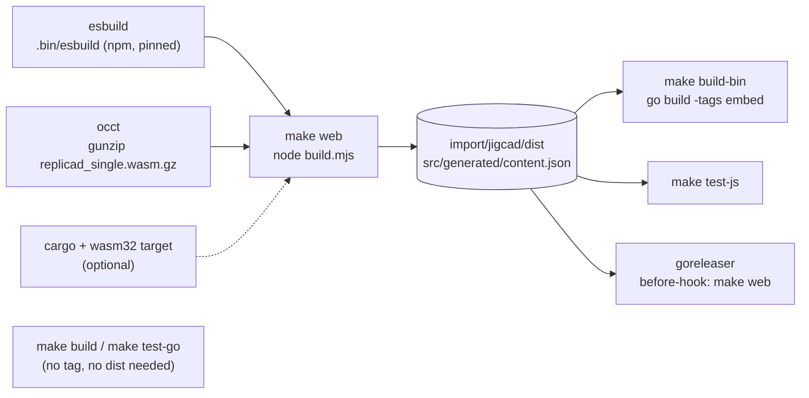

# jigcad: Build, CI and Release Plumbing for a Go Binary That Embeds a WebAssembly Workbench

The jig repository produces one binary, `jigcad`, which serves a browser CAD workbench and runs its agent's model calls. Until ticket JIG-007, building that binary required five manual steps known only from diaries, and nothing checked the code automatically except a developer remembering to run `go test`. This report explains the plumbing added in JIG-007: a Makefile whose targets follow the build's dependency order, a pinned linter, two CI workflows, and a GoReleaser configuration. It also explains why the release is built but not published. The interesting part is not any single file; it is that a Go binary which embeds a JavaScript, Rust and WebAssembly application has a build graph that the standard go-go-golems scaffold does not describe, and each piece of the scaffold had to be checked against that graph.

> [!summary]
> - The binary embeds `import/jigcad/dist/` with `//go:embed all:dist` behind the build tag `embed`. That directory is produced by `node build.mjs`, which needs esbuild, an unpacked OpenCascade wasm file and, optionally, a Rust toolchain with the `wasm32-unknown-unknown` target. Every target that produces or tests the binary therefore depends on `make web`.
> - CI runs the Go tests, builds the workbench with the Rust core, runs every JavaScript suite that needs no network (agent, harness oracles, engine core, engine on OpenCascade: 162 tests in 32 s locally), builds the embedded binary and smoke-tests it over HTTP.
> - GoReleaser builds linux and darwin on amd64 and arm64 with the workbench embedded, and a local snapshot release produced a working archive. Publishing is disabled on purpose: the go-go-golems standard publishes through Vault roles managed in Terraform, and creating them is an authorization decision outside this repository.

## 1. The build graph

### 1.1 What the binary contains

`jigcad serve` serves static files and an HTTP API. The static files are the workbench: `index.html`, `app.js` (the UI bundle, about 1.7 MB), `worker.js` (the engine bundle, about 1.5 MB), `jig_compute.wasm` (the Rust numeric core, 162 KB), `occt/` (OpenCascade compiled to WebAssembly, about 7 MB gzipped) and `fonts/`. The Go package `import/jigcad` decides where they come from:

```go
// dist.go — always compiled
package jigcad
var Dist fs.FS          // nil unless embed.go is compiled in

// embed.go — compiled only with -tags embed
//go:build embed
//go:embed all:dist
var dist embed.FS
func init() { sub, _ := fs.Sub(dist, "dist"); Dist = sub }
```

`cmd/jigcad` uses `--dist DIR` when given, else `jigcad.Dist` when the tag was set, else `./import/jigcad/dist` on disk. The tag exists so that `go build ./...` and `go test ./...` work on a fresh clone where `dist/` does not exist yet: without the tag, nothing refers to the directory. With the tag, compilation fails if `dist/` is missing, which is the correct behaviour for a release.

### 1.2 What produces `dist/`

`import/jigcad/build.mjs` is a Node script. It bundles the UI and the worker with esbuild, copies OpenCascade and the fonts, generates `src/generated/content.json` (the presets and documents), and builds jig-compute with `cargo build --release --target wasm32-unknown-unknown` when cargo is available. Three inputs are not in the repository in usable form:

- **esbuild.** The workbench has no `package.json`; vendored sources live in `vendor/` and are aliased in the build. esbuild itself is not vendored, and `build.mjs` loads it from the path in the `ESBUILD` environment variable.
- **OpenCascade.** `vendor/occt/replicad_single.wasm` is 23 MB, so it is committed gzipped (7 MB). The browser build ships the gzipped file, but the engine's Node tests read the unpacked one.
- **Rust.** Optional. Without cargo, `build.mjs` warns and the workbench runs its JavaScript implementations of the numeric core, which are slower but produce the same results.

### 1.3 The dependency order



Two targets need no web build at all, `build` and `test-go`, because the untagged Go code never touches `dist/`. Every other target that produces or exercises the binary depends on `web`. That includes the JavaScript tests: the evaluation harness loads presets from `src/generated/content.json`, and the engine tests load the unpacked OpenCascade file.

## 2. The scaffold, checked against the graph

go-go-golems repositories start from a common scaffold: a Makefile, a golangci-lint configuration and version pin, lefthook hooks, CI workflows, and a GoReleaser configuration with signing, a Homebrew tap, deb/rpm packages and a package-repository publisher. jig keeps what applies, changes what does not fit the graph, and leaves out what needs credentials.

| Scaffold part | In jig | Reason |
|---|---|---|
| `.golangci.yml` and `.golangci-lint-version` (v2.12.2) | unchanged | the shared lint set: errcheck, govet, ineffassign, staticcheck, unused, exhaustive, nonamedreturns, predeclared, and gofmt |
| Makefile `lint`, `test`, `build`, `build-bin`, `goreleaser` | adapted | `build-bin` needs `web` first; `test` includes the JavaScript suites |
| glazed-lint and logcopter targets | removed | jig has no glazed commands and no logcopter log areas |
| CI smoke test `go run ./cmd/<bin> --help` | replaced | a help screen does not show that the embedded files are present; the new smoke test serves them |
| GoReleaser builds | adapted | `-tags=embed`, `make web` before the build, version set by ldflags |
| signing, Homebrew, deb/rpm, publisher, release workflow | not added | they need credentials (§5) |
| lefthook pre-push snapshot release | not added | with the web build it takes about a minute per push; CI runs the same checks |

The lint configuration found one issue in the existing code: `defer b.Close()` in `cmd/jigcad/main.go` ignored the error. It now reads `defer func() { _ = b.Close() }()`, which states that the error is deliberately discarded at shutdown.

## 3. The Makefile

The Makefile's targets correspond to the nodes of the graph in §1.3:

```make
ESBUILD_VERSION ?= 0.25.12
ESBUILD ?= $(CURDIR)/.bin/esbuild/node_modules/esbuild/lib/main.js

$(ESBUILD):
	npm install --silent --no-audit --no-fund --prefix $(CURDIR)/.bin/esbuild esbuild@$(ESBUILD_VERSION)

$(WEB)/vendor/occt/replicad_single.wasm: $(WEB)/vendor/occt/replicad_single.wasm.gz
	gunzip -kf $<
	touch $@

web: $(ESBUILD) occt
	cd $(WEB) && ESBUILD=$(ESBUILD) node build.mjs

build-bin: web
	GOWORK=off CGO_ENABLED=0 go build -tags embed -ldflags "-s -w -X main.version=$(VERSION)" -o ./dist/$(BINARY) $(CMD_DIR)
```

Three decisions shape it.

**esbuild is installed by version, not vendored.** `build.mjs` already reads `ESBUILD`, so the Makefile installs the pinned version into the git-ignored `.bin/esbuild` and passes the path. A fresh clone builds with Node and npm only, and the bundler version is the same on every machine. The file target makes the install happen once.

**The OpenCascade file is a make target with a dependency.** `gunzip -kf` keeps the archive, and `touch` gives the unpacked file a newer timestamp than the archive, so make does not unpack it again on the next run.

**`test-js` runs every suite that needs no network.** These are the agent tests against the mock host (44), the evaluation harness's self-test, which includes every case's oracle replayed on the real engine (14), the engine-core tests (62), and the engine scripts compiled on OpenCascade with checked volumes, topology and names (42). Together they take 32 s. The agent evaluation against real models is excluded, because it needs lunaroute credentials and model time; its oracle mode is available as `make agent-eval-oracle`.

The binary also gained a version: `var version = "dev"` in `main`, set with `-X main.version=…` by the Makefile (from `git describe`) and by GoReleaser (from the tag), and printed by `jigcad --version`.

## 4. Continuous integration

Two workflows run on pushes to `main` and on pull requests, with read-only repository permissions.

`push.yml` has two jobs. The `go` job runs `make test-go`. The `web` job installs Go, Node 24 and Rust stable with the wasm target, caches the Rust build, and then runs:

```yaml
- run: make web
- run: make test-js
- run: make build-bin
- name: Smoke test
  run: |
    ./dist/jigcad --version
    ./dist/jigcad serve --no-models --listen 127.0.0.1:8787 &
    for _ in $(seq 1 50); do curl -fsS http://127.0.0.1:8787/ -o /dev/null && break; sleep 0.2; done
    curl -fsS http://127.0.0.1:8787/ | grep -q '<title>jig workbench</title>'
    curl -fsS http://127.0.0.1:8787/api/sample/models | grep -q '"available":false'
```

The smoke test checks the two properties a release depends on. The page title shows that the embedded files are served. The models endpoint shows that the API answers, and that `--no-models` reports the agent as unavailable rather than failing. Locally, the same binary started from `/tmp`, where no `import/jigcad/dist` exists on disk, logged `jigcad serving the embedded workbench` and served `jig_compute.wasm` with its full 166,056 bytes.

`lint.yml` runs `make gofmt` and then the golangci-lint action at the version read from `.golangci-lint-version`, so CI and `make lint` use the same linter. Both workflows pass `actionlint`. Its first run flagged one shellcheck warning, an unused loop variable in the wait loop, which is now `_`.

## 5. Release: built but not published

`.goreleaser.yaml` describes the binary completely:

```yaml
before:
  hooks:
    - go mod tidy
    - make web
builds:
  - id: jigcad
    main: ./cmd/jigcad
    env: [CGO_ENABLED=0]
    flags: [-tags=embed, -trimpath]
    ldflags: ["-s -w -X main.version={{ .Version }}"]
    goos: [linux, darwin]
    goarch: [amd64, arm64]
release:
  disable: true
```

The before-hook runs the same `make web` as the Makefile, so a release cannot embed a stale `dist/` left over from an earlier build. `goreleaser check` validates the file. A snapshot release for the local platform (`make goreleaser`) produced `jigcad_0.0.1-next_linux_amd64.tar.gz` containing the binary, `README.md` and `import/jigcad/BUILD.md`, and the binary reported `jigcad version 0.0.1-next`.

`release.disable: true` is a decision, not an omission. Publishing a GitHub release from CI, a Homebrew formula in `go-go-golems/homebrew-go-go-go`, or signed packages needs credentials. The go-go-golems standard keeps them in Vault. Two Terraform-managed roles are bound to the repository, the exact tag ref and the exact workflow ref. A builder role can read only build credentials. A publisher role uses the caller's `GITHUB_TOKEN` for the release and mints a short-lived GitHub App token for the tap. Those roles live in another repository (`terraform/vault/github-actions`), and creating them grants a workflow the right to publish under the organization's name. That is an authorization decision for the repository's owner. A configuration that tried to publish without them would fail on the first tag, or would tempt someone to add a long-lived token as a repository secret. The remaining steps are recorded in the ticket:

1. Decide whether jigcad should have a Homebrew formula. The binary runs models only with a Pi agent directory, so a formula would install a workbench that most users run with `--no-models` or with their own Pi setup.
2. Add `release-jig-builder` and `release-jig-publisher` in Terraform, then review the plan and apply it.
3. Add `release.yaml` calling the shared publisher workflow, remove `release.disable`, and add the `brews` section.
4. Cut a controlled `v0.1.0` and record the run.

## 6. What the ticket established

- **A build graph should be written down as make targets, not prose.** The five manual steps of §1 became four targets with explicit dependencies, and every consumer of the binary depends on `web`.
- **Untagged Go code must not depend on generated files.** Because `embed.go` is behind a build tag, `go build ./...`, `go test ./...` and golangci-lint work on a clone where `dist/` does not exist, and only the targets that produce the binary need Node.
- **A smoke test should check the property the build exists for.** For an embedding binary, that is the embedded files being served from a directory where they do not exist on disk.
- **An unpublished release configuration is better than a half-credentialed one.** The build is fully specified and tested; publishing waits for the roles that make it safe.

## 7. Files

- `Makefile`, `.golangci.yml`, `.golangci-lint-version`, `.goreleaser.yaml`, `.github/workflows/push.yml`, `.github/workflows/lint.yml`, `README.md`.
- `cmd/jigcad/main.go`: `--version`, the errcheck fix.
- `import/jigcad/dist.go`, `import/jigcad/embed.go`, `import/jigcad/build.mjs`: the embedding and the web build the plumbing drives.
- Ticket: `ttmp/2026/10/31/JIG-007-GO-PLUMBING--…` (design doc with the scaffold comparison and the release plan, diary).
- Commit: 58fbabb.
- Related: [[PROJECT REPORT - jigcad - A Go Model Backend for the Workbench Agent]], [[PROJECT REPORT - jigcad - Architecture of a Browser CAD Workbench, from Script to Agent]].
