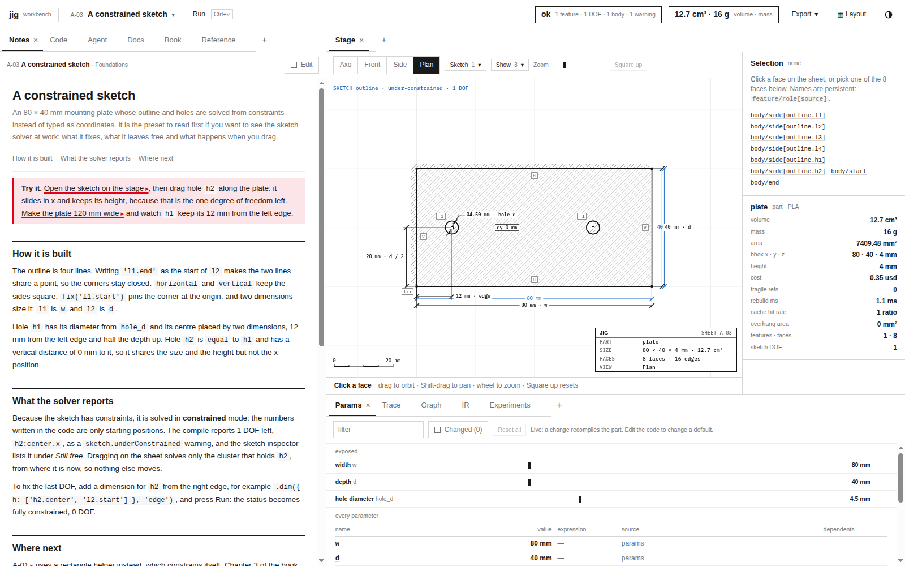
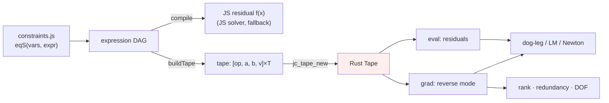
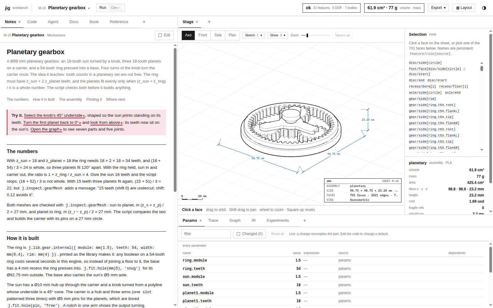

# jigcad: Constraint Equations as Data and a Rust Renderer

This is the second report on moving jigcad's numeric work into `jig-compute`, a Rust crate compiled to WebAssembly. The first report, [[PROJECT REPORT - jigcad - Moving the Numeric Core of a Browser CAD Engine into Rust and WebAssembly]], explained the engine, the binary interface and the mesh analyses. This one covers the two phases that closed ticket JIG-001. The first moved the 2D sketch constraint solver into Rust. Its central problem was that every equation existed only as a JavaScript closure. The second moved the drafting-sheet renderer's depth buffer and hidden-line classification into Rust. Its central result is a negative one, and the report explains why it is still worth recording.

> [!summary]
> - Each constraint equation is now an expression DAG. The JavaScript residual is generated from it by codegen, and Rust receives it as a linear tape with exact reverse-mode derivatives. One definition serves both paths.
> - The dog-leg, Levenberg–Marquardt and Newton loops, the rank/redundancy/DOF analysis and the drag step all run in Rust. Solved sketches and the textbook's 374-line check output are byte-identical to the JavaScript solver, and whole sketch solves are 2.2–2.5× faster.
> - The renderer's frame buffers live in wasm memory, and projection, raster and line classification run in Rust on the main thread. The output is bit-identical (181 checks). Line work is 1.1–1.7× faster; the raster is not, because its inner loop is bound by memory writes.



## 1. What a sketch solve computes

A jig sketch is a set of 2D entities (points, lines, arcs, circles, ellipses, splines) and constraints between them: coincident, horizontal, tangent, distance and so on. The solver turns the sketch into a parameter vector `x`. A point contributes `(x, y)`, a line `(ax, ay, bx, by)`, an arc `(cx, cy, r, a0, a1)`. Each constraint contributes one or more *residuals*, scalar functions that are zero when the constraint holds. A horizontal line gives `by − ay`. A distance of 40 mm between two points gives `hypot(qx − px, qy − py) − 40`.

Solving means finding `x` with all residuals zero, starting from the coordinates written in the script. The engine does this per *cluster*, a connected component of the graph that links parameters through shared equations. For each cluster it runs a trust-region method:

- **Dog-leg** combines a Gauss–Newton step, the minimum-norm solution of `J h = −r` through Householder QR of `Jᵀ`, with a steepest-descent step, inside a radius that grows or shrinks with the agreement between predicted and actual decrease.
- **Levenberg–Marquardt** is the fallback. It solves the damped normal equations `(JᵀJ + μI) h = −Jᵀr` by Cholesky.

After the solve, an *analysis* pass computes three things:

- the rank of the Jacobian `J`, which gives the remaining degrees of freedom as `n − rank`;
- which constraints are redundant, and which earlier constraints imply them;
- which parameters and entities are still free.

The screenshot above shows the result for preset A-03. The analysis found one degree of freedom left, the x position of hole `h2`, and the stage marks the sketch as under-constrained.

## 2. Why the solver could not simply move

Before this phase, each residual was written as a closure in `src/engine/sketch/constraints.js`:

```js
case 'parallel': case 'perpendicular': {
  const dA = dirOf(A), dB = dirOf(B), op = type === 'parallel' ? cross : dot;
  return [eq(uni(A.vars, B.vars), x => { const u = dA(x), v = dB(x); return op(u, v) / ((len(u) * len(v)) || 1e-300); })];
}
```

The solver computed the Jacobian by four-point finite differences of these closures. Rust cannot call a closure that lives in the JavaScript heap, except through an import, which would leave the residual work in JavaScript and add a boundary crossing per evaluation. Moving only the matrix factorisations helps (Section 8 of the first report measured 2.5–2.9×), but the solve loop, the residuals and the Jacobian stay in JavaScript.

What Rust needs is the equation as data. JavaScript has no operator overloading, so the closures cannot be traced by running them with symbolic arguments: `a - b` on two objects calls `valueOf` and yields a number, not an expression. The equations therefore had to be rewritten once, as expressions.

## 3. Equations as expression DAGs

`src/engine/sketch/sym.js` defines immutable nodes `{op, a, b, v}`. The operations are exactly those the closures used:

| Ops | Meaning |
|---|---|
| `c`, `x` | constant, parameter `x[v]` |
| `add sub mul div neg` | arithmetic |
| `sqrt sin cos atan2 hypot` | the `Math` functions used |
| `nz` | the guard `value || 1e-300` before dividing by a length |
| `wrapPi` | angle wrapped to (−π, π] |
| `sweep`, `sweepCCW` | the arc sweep `(a1 − a0) mod 2π`, clamped to 2π near zero |

Entity handles in `system.js` gained a symbolic form `s` beside their numeric `get`. A point is `[X(ix), X(iy)]`, and an arc's start point is `polar(c, r, a0)`. The parallel constraint above becomes:

```js
const ncross = (u, v) => S.div(S.vcross(u, v), S.nz(S.mul(S.vlen(u), S.vlen(v))));
case 'parallel': case 'perpendicular':
  return [eqS(uni(A.vars, B.vars), (type === 'parallel' ? ncross : ndot)(dirS(A), dirS(B)))];
```

Two artefacts come from each expression.

**A JavaScript function, by codegen.** `compile(node)` walks the DAG, gives each shared subexpression a local name and emits a straight-line function with `new Function`. The rewrite mirrors the old closures' operation order exactly. `-q[0] * sp` becomes `mul(neg(q0), sp)`, not `neg(mul(q0, sp))`. Because of that, the generated functions compute the same doubles as the closures did. This was checked directly: the solved sketches of five constraint-heavy presets, dumped with the JavaScript solver before and after the rewrite, are byte-identical.

**A tape for Rust.** `buildTape(roots)` serialises each equation as a contiguous run of instructions, four `f64` each: `[op, a, b, v]`. `a` and `b` are operand indices relative to the equation's start, and `v` is the constant or the parameter index. The equation's value is its last instruction. A tape for many equations is sent as `ops: Float64Array(4·T)` and `starts: Uint32Array(E+1)`.



## 4. Reverse-mode derivatives on the tape

Each residual depends on a handful of parameters, and the Jacobian needs every partial derivative. On a tape this costs one forward pass and one backward pass per equation.

- **Forward pass.** Evaluate every instruction in order into a value array.
- **Backward pass.** Seed the last instruction's adjoint with 1 and walk the instructions in reverse, adding each instruction's adjoint times its local derivative into its operands' adjoints. When the walk reaches an `x` instruction, its adjoint is the partial derivative with respect to that parameter, added into the Jacobian row at the parameter's column.

```rust
match i.op {
    3 => { adj[ia] += g; adj[ib] -= g; }                          // a − b
    5 => { adj[ia] += g / b; adj[ib] -= g * a / (b * b); }        // a / b
    10 => { let d = a * a + b * b; if d > 0.0 { adj[ia] += g * b / d; adj[ib] -= g * a / d; } }  // atan2(a, b)
    11 => { let h = val[k]; if h > 0.0 { adj[ia] += g * a / h; adj[ib] += g * b / h; } }        // hypot(a, b)
    12 => { if a != 0.0 && !a.is_nan() { adj[ia] += g; } }        // nz: identity unless clamped
    14 | 15 => { /* sweep: −1 for a0, +1 for a1, 0 where clamped to 2π */ }
    ...
}
```

The piecewise operations need care:

- `wrapPi` has derivative 1 everywhere it is differentiable.
- `nz` is the identity except where it replaces 0 or NaN with a constant.
- `sweep` is `a1 − a0` modulo 2π, so its derivative is ∓1, except where the raw sweep is under 1e-12 and the function returns the constant 2π.

A native test builds one equation per operation and compares every exact partial with a central difference. On real sketches, the parity suite compares the exact Jacobian with central differences of the generated closure. The worst relative disagreement is 1.07e-8, which is the finite-difference truncation error, not an error in the derivatives.

## 5. The solver loops in Rust

`rust/jig-compute/src/solve.rs` ports `dogleg`, `levenbergMarquardt`, `newton`, the strategy fallback and the drag step literally, with the same constants, the same acceptance tests and the same stall rules. Only the source of the Jacobian differs. The analysis pass (`analyse.rs`) ports the incremental re-orthogonalised Gram–Schmidt that decides rank and redundancy. It also ports the least-squares coefficients that name the constraints implying a redundant one, and the per-entity projector rank that gives each entity's remaining DOF.

The JavaScript side builds one tape per sketch system and remembers each equation's index. When jig-compute is loaded, `solver.js` sends the cluster's columns, its equation indices and the current parameter vector:

```js
function trySolve(sys, x0, cluster, cons, strat) {
  const eqs = eqsOf(cons), ref = tapedRef(eqs);
  if (ref) {
    const o = RS.tapeSolve(ref, Float64Array.from(x0), Uint32Array.from(cluster.cols), tidsOf(eqs), strat);
    if (o) return { ...o, X: Float64Array.from(o.X), x: Float64Array.from(cluster.cols, c => o.X[c]) };
  }
  /* JS solver */
}
```

The conflict search calls `trySolve` repeatedly to find a minimal conflicting set of constraints, so it now runs each candidate solve in Rust as well.

### 5.1 A bug found by porting

A literal port forces every line of the original to be read, and one line turned out to be wrong. When the primary method did not converge, `runStrategy` ran the fallback. If the fallback did no better, its result was rejected. But the shared parameter vector still held the fallback's last point, and `solveCluster` copied the positions from that vector while reporting the primary method's residual. The positions and the residual described two different points. The fix (`F.set(out.x)` after the decision) changed no output on any preset or book sketch. That means the case never arose there, and it shows how a literal port doubles as a code review.

### 5.2 What the measurements say

The decisive result is that the Rust solver with exact Jacobians produces byte-identical solved sketches, rounded to 1e-9, to the JavaScript solver with finite differences. The textbook's checker, which compiles 159 figure and sketch blocks and prints their DOF, status and areas, produces identical 374-line output in both modes. The finite differences had been accurate enough everywhere. The exact derivatives remove the finite-difference step size as a source of false conflicts far from the origin, an issue the textbook's authors had recorded as open.

| Whole sketch solve, 20 repetitions | JavaScript | Rust | Speed-up |
|---|---:|---:|---:|
| A-03 (21 equations, 22 parameters) | 5.33 ms | 2.10 ms | 2.5× |
| M-03 (76 equations, 76 parameters) | 23.19 ms | 10.60 ms | 2.2× |

The first version moved only the loops, and M-03 was 1.1× faster. A profile of 300 re-solves showed that the analysis pass dominated: `analyseCluster` at 15 % of self time, the largest single item. Moving that pass to Rust (`jc_tape_analyse`) produced the 2.2×. The general rule is the one from the first report: when part of a computation moves, measure what remains on the old side before declaring the result.

## 6. The renderer



The stage draws parts as a technical drawing, with silhouettes, hidden lines dashed, hatching and dimensions, in software on a canvas. It runs on the main thread. A frame has three numeric passes:

1. **Raster.** Every triangle of every instance is projected to device pixels and rasterised into a depth buffer and an id buffer that holds the global face id per pixel.
2. **Line work.** Every B-rep edge polyline, and every chain of silhouette mesh edges, is sampled every 1.5 device pixels. Each sample is tested against the depth buffer: it is visible if it is not deeper than the buffer, or if a neighbouring pixel shows one of its own faces at about its depth. Runs of visible and hidden samples become paths.
3. **Paper.** The id buffer becomes the image: covered pixels as paper, some faces hatched.

On a 2400 × 1600 device-pixel canvas with the 38,810-triangle planetary gearbox, the JavaScript passes took 28 ms (raster), 26 ms (line work) and 4 ms (paper).

### 6.1 Frames in wasm memory

The line pass tests thousands of samples against the depth buffer. If the buffer lived in JavaScript, a Rust line pass would need a copy of 3.8 million pixels per frame. The buffers therefore live in wasm memory as a Rust `Frame { depth: Vec<f32>, id: Vec<i32>, bbox }`. JavaScript sees them through typed-array views. The views must survive memory growth, which detaches the `ArrayBuffer` they point into, so the frame's getters compare the current `memory.buffer` and rebuild the views when it has changed:

```js
get depth() { const X = compute(), b = X.memory.buffer;
  if (this._mem !== b) { this._mem = b; this._d = new Float32Array(b, X.jc_frame_depth_ptr(this.fh), this.w * this.h); /* id too */ }
  return this._d; }
```

`buffers()` returns such a frame when jig-compute is active on the main thread. `rasterInstance()` projects and rasterises in one call per instance. `lineWork()` keeps its edge selection and silhouette chaining in JavaScript, but `classify()` now queues each polyline instead of testing it. Two flushes per frame, one after the B-rep edges and one after the silhouettes, send every queued polyline to Rust and replay the resulting runs through the original callbacks in the original order. The paths, the picking segments and their order are therefore the same as before.

### 6.2 Bit-identical, and why it is not faster

Following the JavaScript's arithmetic exactly (f64 math, f32 storage, the same edge functions and pixel-centre offsets) makes the output identical. `test/rs/stage-parity.mjs` compares five programs in four views each. It checks depth and id buffers, projected vertices, visible and hidden runs, picking segments and silhouette counts. All 181 checks are equal.

The timings, median of nine frames with the buffers reused as in the application:

| Program | JavaScript raster · lines | Rust raster · lines | Raster + lines |
|---|---|---|---:|
| M-10, 38,810 triangles | 27.6 · 35.9 ms | 28.4 · 21.6 ms | 1.3× |
| M-07, 22,228 triangles | 11.7 · 11.0 ms | 13.2 · 9.6 ms | 1.0× |
| X-08, 4,948 triangles | 9.8 · 5.7 ms | 10.8 · 5.2 ms | 1.0× |

Line work gains up to 1.7×. In JavaScript it creates closures per sample and grows arrays per polyline, which is the same pattern that made the mesh analyses slow. The raster gains nothing. Splitting the measurement showed the raster call itself at 7.25 ms in Rust against 7.79 ms in JavaScript on X-08. Two optimisations were tried:

- **Removing per-pixel bounds checks.** Iterating over zipped row slices of both buffers checks bounds once per span. No measurable change.
- **WebAssembly SIMD.** With `+simd128` and a branchless span loop, Rust was slightly slower than JavaScript (9.1 against 8.0 ms). The experiment was reverted.

The explanation is in the loop itself:

```rust
for (d, i) in f.depth[a..b].iter_mut().zip(f.id[a..b].iter_mut()) {
    if z > *d as f64 { *d = z as f32; *i = fid; }
    z += gx;
}
```

Per pixel it does one add, one compare and up to two stores into multi-megabyte buffers. V8 compiles the equivalent JavaScript typed-array loop to comparable machine code, and the work is bound by memory traffic, not by instruction count. Rust wins where JavaScript allocates per element, builds string keys or calls closures per sample. It does not win on a tight loop that V8 already compiles well.

The Rust renderer stays enabled. It is correct, it makes line work faster, and it consolidates the numeric code: one core shared by the worker and the main thread, with a byte-identical JavaScript fallback.

## 7. Where the work ends

| Area | Rust path | Speed-up | Check |
|---|---|---:|---|
| Mesh analyses: orientation, supports, gap, sections | yes | 2.6–7.4× | 3,784 parity checks |
| Solver linear algebra | yes | 2.0–3.2× | rank and solutions equal |
| Sketch solve, analysis, drag (tape) | yes | 2.2–2.5× | sketches and book output byte-identical |
| Stage line classification | yes | 1.1–1.7× | 181 stage checks |
| Stage raster | yes | 1.0× | 181 stage checks |
| B-rep modelling | OpenCascade (C++ → wasm) | — | engine 42/42, presets 72/72 |

The module is 162 KiB with no imports, at ABI version 1.4. It loads in the engine worker and on the main thread. Setting `#js-compute` in the page URL, or `JIG_COMPUTE=js` in Node, runs every path in JavaScript.

## Important project docs

- Design guide and diary: `/home/manuel/code/wesen/go-go-golems/jig/ttmp/2026/10/31/JIG-001-RUST-WASM--move-jigcad-computation-and-heavy-lifting-into-a-rust-webassembly-core/` (diary steps 6 and 7 cover this report)
- Expressions: `/home/manuel/code/wesen/go-go-golems/jig/import/jigcad/src/engine/sketch/sym.js`
- Rust: `/home/manuel/code/wesen/go-go-golems/jig/import/jigcad/rust/jig-compute/src/{tape,solve,analyse,raster}.rs`
- Tests: `test/rs/parity.mjs`, `test/rs/stage-parity.mjs`, `test/rs/bench.mjs`, `test/rs/stage-bench.mjs`, `rust/jig-compute/tests/tape.rs`
- Commits: `39f2731` (Phase 4b), `0e0cef4` (Phase 5)

## Related notes

- [[jigcad]]: the jigcad project map, with the other reports and the related CAD/CAM work.
