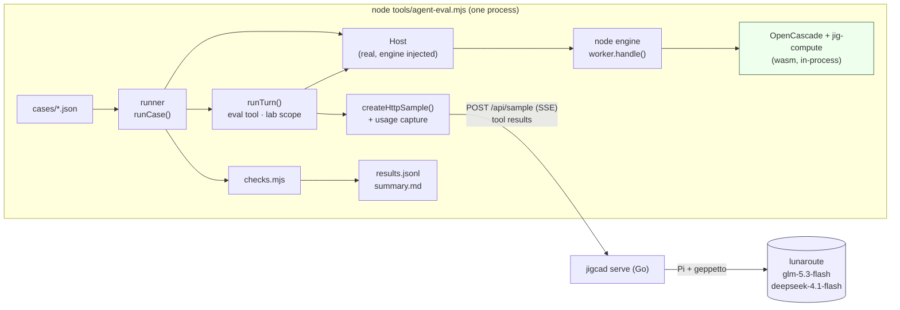
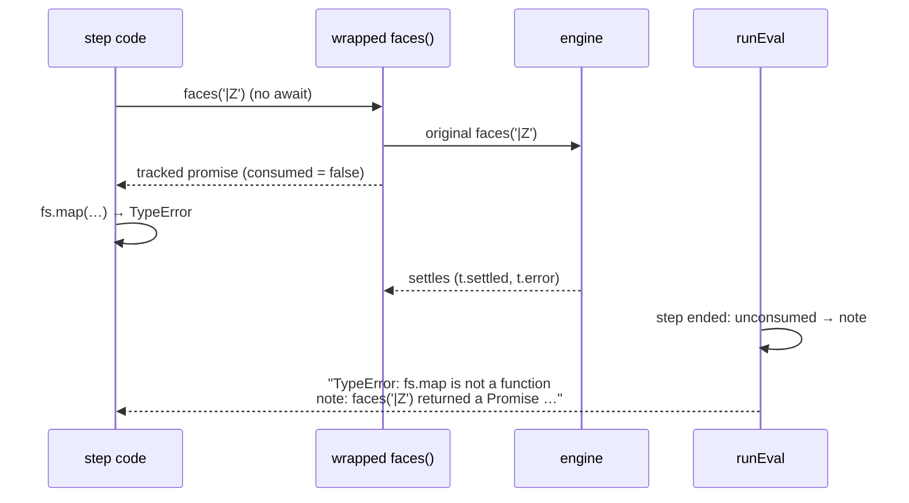

# jigcad: Measuring the Workbench Agent, an Evaluation Harness and a Promise Hint

jigcad's agent edits CAD scripts through one tool, `eval`, which runs JavaScript against the workbench. Until ticket JIG-003, the only evidence that the agent worked was a handful of turns watched in a browser. This report explains the evaluation harness built in JIG-003: what a case is, how a case runs the real agent against the real geometry engine in Node, how checks judge the outcome, and what the first baseline showed. It then follows ticket JIG-004, which used the baseline's clearest finding, unawaited promises in eval code, to change what the model reads after that mistake. The rerun measured the change. The harness drives the agent through the `jigcad serve` backend described in [[PROJECT REPORT - jigcad - A Go Model Backend for the Workbench Agent]], and the system as a whole is described in [[PROJECT REPORT - jigcad - Architecture of a Browser CAD Workbench, from Script to Agent]].

> [!summary]
> - A case is a JSON file: a preset, an optional planted edit, a request, a mode, a list of checks drawn from a fixed vocabulary, and an *oracle*, a scripted turn known to pass. The runner loads the preset into the real `Host` running in Node with OpenCascade and the Rust core in-process, runs one real agent turn against a model through `jigcad serve`, recompiles the final files, and evaluates the checks.
> - The first baseline (14 cases × 2 models × 3 repeats) passed 84 of 84 turns. That number describes the case set more than the models. The step records were more useful: in 79 of 363 steps the model called an async lab function without `await`, and 9 of those calls failed after their step had returned, where the model could not see the failure.
> - JIG-004 wraps every promise a lab function returns. When a step ends with a promise its code never consumed, the result shows a marker instead of `{}` and a note with the fix, and a rejection is reported in the step instead of escaping it. The rerun removed all unhandled rejections; 31 of the 35 runs that received a note did not repeat the mistake.
> - The hint did not make turns shorter or faster. The long turns are long because the model explores engineering alternatives, and the remaining time difference matches a change in backend latency between the two runs. Two of the three recorded failures in the rerun were bugs in the cases' answer checks.

## 1. What is being measured

### 1.1 The agent turn

The agent panel sends a person's request to a language model together with a context block and a reference document. The model answers in text, or it calls the tool `eval` with a block of JavaScript. The page runs the code, sends the result back, and the model continues. One *turn* is everything between the request and the final answer; one *step* is one `eval` call inside it; one *round* is one model call, which ends either with tool calls (another round follows) or with a final answer.

The function that runs a turn is `runTurn` in `import/jigcad/src/agent/turn.js`. It builds the conversation and calls a `sample` function once:

```js
const tool = createEvalTool(host, { getMode: () => settings.mode, onStep: s => turn.steps.push(s), … });
const res = await sample(turns, { tools: [tool], signal, modelTier: settings.tier, onText });
```

`sample` hides the rounds. In the browser it is `createHttpSample(base)` from `src/host/sample-http.js`, which posts the conversation to `jigcad serve`. The server streams events back over server-sent events and asks the page to execute each tool call. When the model has answered, `sample` resolves with the text and, since JIG-003, a `usage` object.

### 1.2 The eval tool and the lab scope

`eval` runs its code as the body of an async function. Its free variables are the names of the *lab scope* (`src/agent/scope.js` `labScope`): `files`, `program`, `run`, `check`, `faces`, `why`, `feature`, `sketch`, `params`, `measure`, `view`, `presets`, `select`, `console` and a few more. A typical step reads, edits and compiles:

```js
files.edit('script.js', 'wall: mm(2)', 'wall: mm(2.4)');
const r = await run();
return { ok: r.ok, mass: program.metrics('mass').mass.value };
```

The returned value is written as YAML and cut at 9,000 characters; a thrown error becomes `Error: …`. The tool has three modes. *Auto* runs every step. *Ask* waits for the person to approve each step. *Read* replaces the editing functions with ones that throw.

Some lab functions return values immediately (`files.read`, `program.metrics`) and some return promises, because they ask the engine worker or compile: `faces`, `why`, `feature`, `sketch`, `check`, `run`, `params.get/set/clear`, `measure.area`, `program.ir`, `presets.load/create` and `exportFile`. This distinction is the subject of the second half of the report.

### 1.3 What a measurement needs

Three properties make an agent change measurable. The same request must run many times against the same state, because a model's output varies from run to run. The judge must be mechanical: a person reading 84 transcripts cannot apply the same standard to all of them. The run must exercise the code the person uses, because an agent tested against an imitation of the workbench is tested against the imitation. The harness is built around these three requirements.

## 2. The harness

### 2.1 One process, real parts

The harness is a Node program, `import/jigcad/tools/agent-eval.mjs`. Inside its process run the real `Host` (`src/host/host.js`), the real agent turn, eval tool and lab scope, the real HTTP adapter, and the geometry engine. The engine is `src/engine/worker.js`, normally a Web Worker, called directly through its `handle()` function, with OpenCascade and jig-compute as WebAssembly in the same process. Model calls leave the process through the same HTTP protocol a browser uses.



Three alternatives were considered and rejected. The existing `test/agent/mock-host.js` imitates a subset of the Host with a compiler that only knows one box; a harness on it would measure the mock. A headless browser driving the page would add rendering, timing and selector fragility, while everything the agent does lives in the Host, the scope, the turn and the adapter, all of which run in Node. Calling the Go backend's `Sample` method from a Go test would skip the SSE protocol, the tool round trips and the adapter, which are part of what the person runs.

Running the Host in Node needed two small changes. The constructor accepts an engine: `new Host({ engine })`, where the harness passes `createNodeEngine()` from `tools/agent-eval/node-engine.mjs`, an object with `ready`, `request(op, args)` and `compute` built on `worker.handle({ id, op, ...args })`. The theme code touches `document`, so that access is now guarded with `typeof document !== 'undefined'`. Node's loader also needed hooks (`tools/agent-eval/loader.mjs`) so that `import x from './reference.md'` and `.json` imports, which esbuild handles in the browser build, return a string and an object.

### 2.2 A case

A case is a JSON file in `test/agent-eval/cases/`. The A-01 preset is a box: 60 × 40 × 30 mm, 2 mm walls, one extrude and one shell. This case plants a bug and asks for a repair:

```json
{
  "id": "a01-fix-bug",
  "preset": "A-01",
  "mode": "auto",
  "tags": ["repair", "diagnostics"],
  "setup": [{ "edit": { "path": "script.js", "find": "'h', { id: 'body' }", "replace": "'height', { id: 'body' }" } }],
  "request": "The part does not compile. Find the problem and fix it.",
  "checks": [
    { "kind": "compiles" },
    { "kind": "metric", "name": "volume", "approx": 15344.27, "tol": 0.1 },
    { "kind": "file", "path": "script.js", "notMatches": "'height',\\s*\\{\\s*id:\\s*'body'" }
  ],
  "oracle": {
    "steps": ["files.edit('script.js', \"'height', { id: 'body' }\", \"'h', { id: 'body' }\");\nconst r = await run(); return { ok: r.ok, errors: r.errors };"],
    "answer": "The extrude used an unknown param 'height'; it is 'h' again and the part compiles."
  }
}
```

The fields have fixed meanings:

- `preset` names a published preset; the runner loads it fresh for every run, so no run sees another run's edits.
- `setup` is a list of edits (`find`/`replace` in a file), whole files, or Params overrides, applied before the turn. It plants the state the request is about.
- `mode` is `auto`, `ask` or `read`. In Ask mode the runner approves every step as soon as the step asks.
- `checks` judge the state after the turn: the final files compiled, the final answer, and the steps.
- `oracle` is a turn that passes the checks. It exists to test the case, not the model (§2.5).

### 2.3 Checks are data

The check vocabulary is fixed and lives in `tools/agent-eval/checks.mjs`. A case cannot run code to judge itself. That makes cases reviewable and countable; a new kind of expectation needs a new check kind with a unit test.

| Kind | Passes when |
|---|---|
| `compiles` | the final files compile without errors |
| `fails { diagnostic? }` | they do not compile, optionally with a diagnostic of that kind |
| `file { path, contains, matches, notMatches }` | the final text of a file satisfies the string and regex conditions |
| `unchanged { paths? }` | the files (or these paths) equal their state before the turn |
| `metric { name, approx/tol, equals, min/max }` | a metric of the final program, such as `volume`, `mass`, `bbox` or `faces`, satisfies the condition; arrays compare element-wise |
| `param { name, … }` | a param's final value satisfies the condition (by full or local name) |
| `sketchDof { id, dof }` | a sketch has that many degrees of freedom left |
| `answer { matches, any, notMatches }` | the final answer matches every regex in `matches`, at least one in `any`, none in `notMatches` (case-insensitive) |
| `steps { min, max }` | the turn used that many eval steps |
| `stepCode { matches }` | some step's code matches |
| `noNote` | the turn ended without a note (no truncation, error or stop) |

The checks judge outcomes, not routes. `a01-fix-bug` does not require a particular edit; any edit that compiles, removes the bad reference and restores the original volume passes.

### 2.4 The runner

`runCase(c, { host, sample, tier, repeat, deadlineMs })` in `tools/agent-eval/runner.mjs` is the whole procedure:

```text
runCase(case):
  host.loadPreset(case.preset); host.resetOverrides()
  apply case.setup; await host.compile()                → on failure: outcome 'setup_error'
  initialFiles ← copy of host.files
  thread ← newThread(); cap ← captureUsage(sample)
  start a deadline timer that aborts the turn
  await runTurn({ host, sample: cap.fn, thread, text: case.request, settings: { mode, tier },
                  reference: host.reference(), signal, onUpdate: approve-if-ask })
  wait one macrotask                                    (late rejections surface here)
  program ← await host.compile()                        (judge what the person would see)
  checks ← evaluate(case, { initialFiles, files, program, turn, steps })
  return { case, tier, repeat, pass: all checks pass, outcome, ms, toolCalls, usage, steps, answer, … }
```

`captureUsage` wraps the sample function and keeps the last call's `usage` or error. The usage numbers come from the server: JIG-003 added a `usage` object (`input`, `cacheRead`, `cacheWrite`, `output`, `rounds`, `toolCalls`, `model`) to the `result` and `error` events of `POST /api/sample`, summed over the rounds of a call. The alternative, parsing the server's log, would tie the harness to log formatting and to a file on the server's machine.

The outcome is `ok`, a code mapped back from the turn's note (`empty_completion`, `rate_limited`, `cancelled`, …), `deadline`, or `setup_error`. `runAll` runs every case × tier × repeat in sequence. Parallel runs would need one process per worker, because the engine keeps one current program per process, and they would provoke lunaroute's rate limits, which would add noise to the measurement. The CLI writes `results.jsonl` (one record per run, appended as runs finish), `summary.md`, `summary.json` and `meta.json`:

```text
node tools/agent-eval.mjs --tiers default,complex --repeat 3 --out DIR [--cases a01-,s01] [--deadline 300] [--oracle]
```

### 2.5 Testing the harness: scripted models and oracles

A harness can be wrong in two ways: the runner or a check misbehaves, or a case expects something impossible. `test/agent-eval/harness.test.mjs` tests both without a network. A *scripted sample* stands in for the model: it executes a fixed list of eval codes through the real tool and then answers.

```js
const scripted = (codes, answer) => async (turns, opts) => {
  for (const code of codes) await opts.tools[0].execute({ code }, { signal: opts.signal });
  opts.onText?.({ text: answer, delta: answer });
  return { text: answer, truncated: false, usage: { input: 1200, cacheRead: 1000, output: 50, rounds: codes.length + 1 } };
};
```

With it, the tests run an edit case on the real engine and expect a pass. They run the same edit against a wrong expectation and expect a failure. They check that read mode refuses edits, that Ask mode approves, and that a deadline produces the outcome `deadline`. The last test replays every case's oracle and requires it to pass. That test caught an impossible check during development. An early `a01-fix-bug` check forbade the string `'height'` anywhere in the script, and the published A-01 script contains `'height'` as a label of the exposed param. No repair could have passed. The check now forbids only the bad extrude argument.

### 2.6 Statistics

Each tier's pass rate is reported with a 95 % Wilson score interval. For `k` passes in `n` runs, `p = k/n` and `z = 1.96`:

```text
centre = (p + z²/2n) / (1 + z²/n)
half   = z · sqrt(p(1−p)/n + z²/4n²) / (1 + z²/n)
interval = [centre − half, centre + half]
```

The Wilson interval is used because the normal approximation (`p ± z·sqrt(p(1−p)/n)`) collapses to a width of zero at `p = 1`, which is exactly where a small, easy case set lands. For 42 of 42 the Wilson interval is 92–100 %: the lower bound is set by the number of runs, not by any failure.

### 2.7 A failure the harness had to survive

The first full baseline run ended after a few cases with Node's default behaviour for an unhandled promise rejection: the process exits. A model had written `faces('shell/inner*')` without `await` and with a selector the engine rejects. The step returned before the promise failed, and nothing held the promise. A browser logs such a rejection to the console and the page continues, so the agent in the panel had been producing these silently all along.

The runner now does what a page does: `trackUnhandled()` installs one `process.on('unhandledRejection', …)` handler that counts rejections and records the last message on the case that was running (`unhandledRejections`, `lastUnhandled` in the record). The rerun completed. The counter turned out to be the start of JIG-004.

## 3. The baseline

### 3.1 Cases and run

The first set has 14 cases: eleven on A-01, two on A-03 (a plate with a constrained sketch) and one on S-01 (a cable clip set up as a print). They cover parameter edits (wall 2.4 mm, height 35 mm, footprint 80 × 50 mm), questions in read mode (volume and mass, why a face has its name), a refusal in read mode, what-if questions answered with `check()` without editing, a change that makes the shell fail, a planted bug, a fillet too large to build, an edit in Ask mode, a degree-of-freedom question and its fix, and a print-orientation question. Every expected number was computed on the engine; for example, a 2.4 mm wall gives a mass of 22.505 g and a 35 mm height a volume of 17,229.93 mm³.

The run: 14 cases × `default` (glm-5.3-flash) and `complex` (deepseek-4.1-flash) × 3 repeats = 84 turns in 11.5 minutes, `jigcad serve` with at most 16 rounds per call.

| Tier | Model | Passed | 95 % CI | Tools (mean / median / max) | Seconds (median / max) | Input tokens (mean) | Cached | Output tokens (mean) |
|---|---|---|---|---|---|---|---|---|
| default | glm-5.3-flash | 42/42 | 92–100 % | 3.6 / 3 / 12 | 3.8 / 25.1 | 84,593 | 98 % | 638 |
| complex | deepseek-4.1-flash | 42/42 | 92–100 % | 5.0 / 3 / 17 | 8.1 / 47.2 | 114,314 | 96 % | 1,554 |

### 3.2 What the numbers say

**The case set cannot separate the models.** Both tiers passed everything. A regression from 100 % to 95 % would fall inside the interval, and a comparison between the two models can only use cost. On cost, glm-5.3-flash was faster (median 3.8 s against 8.1 s) and wrote 2.4× fewer output tokens. deepseek-4.1-flash investigated more before answering questions: on `a01-name-why` it used 10.7 tool calls on average against glm's 2.3.

**Input is large but mostly cached.** A turn sends 85–115 K input tokens, because every round resends the whole conversation, including the 52 KB reference. lunaroute caches prompt prefixes per model and session, and 96–98 % of the input was served from cache. The median uncached input per turn was 939 tokens on glm and 1,309 on deepseek.

**The round limit held.** One deepseek run of `a01-fillet-too-large` used all 16 rounds and still answered completely in the last, tool-less round, which the backend introduces with a note asking for an answer from what was found.

### 3.3 What the steps say

The verdicts were uniform; the step records were not. A regex over the recorded step code counted calls to `faces`, `why`, `feature`, `sketch`, `check`, `run` or `edges` neither preceded by `await` nor returned. It matched in 79 of 363 steps (22 %), on both models. The longest baseline run shows what follows such a call:

```js
// step: the model wants the vertical faces
const fs = faces('|Z');
console.log(Array.isArray(fs), typeof fs);   // → false object
return JSON.stringify(fs);                     // → {}
```

The result is `{}`, because a promise has no enumerable properties and the YAML writer has nothing to write. The model then tried other queries for several rounds before it wrote `await faces('#Z')`. Nine such promises later rejected, in five runs, and those failures never reached the model at all.

## 4. JIG-004: a hint after the mistake

### 4.1 Where to intervene

Two places can address the problem. The reference, which every turn reads, could mark the async functions prominently. Or the eval result, which the model reads after each step, could say what went wrong. The first changes the prompt of every case and its cache prefix, and would mix several effects in one measurement. The second fires only after a mistake. JIG-004 changes only the result, so the rerun isolates one variable: what the model reads after it forgot `await`.

### 4.2 Tracked promises

`runEval` (`src/agent/evaltool.js`) builds a fresh lab scope for each step. JIG-004 wraps that scope: every function, one level into the namespaces (`files`, `program`, `params`, …), is replaced by a function that calls the original and, when the original returns a thenable, returns a *tracked promise* instead.

```js
function track(p, label, promises) {
  const t = { label, consumed: false, settled: false, error: null, p: null };
  t.p = Promise.resolve(p).then(() => { t.settled = true; }, e => { t.settled = true; t.error = e; });
  promises.push(t);
  const tp = {
    then(a, b) { t.consumed = true; return Promise.resolve(p).then(a, b); },
    catch(b)   { t.consumed = true; return Promise.resolve(p).catch(b); },
    finally(f) { t.consumed = true; return Promise.resolve(p).finally(f); },
  };
  Object.defineProperty(tp, TRACKED, { value: t });
  Object.defineProperty(tp, Symbol.toStringTag, { value: 'Promise' });
  return tp;
}
```

The design rests on one property of JavaScript: every way of consuming a promise calls its `then` method. `await x` calls `x.then`. Returning `x` from the async step function resolves the step's own promise with `x`, which calls `x.then`. `Promise.all([x])` calls `x.then`. So a tracked promise knows whether it was consumed without the harness parsing the code. What remains unconsumed when the step ends is a promise the code used as if it were a value: it logged it, stored it, read `.length` from it, called `.map` on it, or ignored it.

The second line of `track` matters as much. It attaches handlers to the original promise once, so a rejection is always handled and stored in `t.error`. No rejection can escape the step any more. The tracker keeps it, and the step can report it.



After the step's code finishes (or throws, or times out), `runEval` looks for tracked promises that are neither consumed nor settled and waits for them for at most one second, so a pending failure can be reported in this step rather than lost. Then it renders the result.

### 4.3 What the model reads

Three things change in the step's text.

1. A tracked promise inside the returned value or a `console.log` argument is written as `<Promise from faces('|Z'): not awaited>` instead of `{}`.
2. Each unconsumed promise produces a note after the value, with the call as written and the fix: `note: faces('|Z') returned a Promise that this step never awaited. Write: const x = await faces('|Z');`. The same call made twice gives one note with `(2×)`.
3. If the unconsumed promise rejected, the note ends with the error.

On the real engine, with the call that ended the first baseline run:

```text
note: faces('shell/inner*') returned a Promise that this step never awaited. Write: const x = await faces('shell/inner*'); It failed: faces: selector: unknown token 'shell/inner*' in 'shell/inner*'
```

The label is the call as written, arguments as compact JSON cut at 60 characters, strings in single quotes. Single quotes are a practical choice: the first version used double quotes, and the YAML writer escaped them (`\"|Z\"`), which made the suggested fix harder to copy.

Five tests in `test/agent/eval.test.mjs` pin the behaviour: an unawaited call gets the marker and the note; awaited, returned, `Promise.all` and `.catch` calls get none; a rejected unawaited call reports its error and produces no unhandled rejection; a `TypeError` comes with the note next to it; a repeated call gets one note.

The tracked promise is a thenable, not a `Promise`, so `x instanceof Promise` is `false`. No lab consumer relies on that, and model code that tested it would see the marker text explaining what the value is.

## 5. The rerun

### 5.1 Numbers

The rerun used the same 14 cases, tiers and repeats as the baseline, through the same server, on the build with the hint. A comparison script (`JIG-004/scripts/01-compare.py`) read both `results.jsonl` files.

| Metric | default: before → after | complex: before → after |
|---|---|---|
| passed, as recorded | 42 → 41 | 42 → 40 |
| passed, corrected checks (§5.3) | 42 → 42 | 42 → 41 (one `rate_limited`) |
| steps | 152 → 145 | 211 → 217 |
| steps with an unawaited async call | 35 → 20 | 44 → 16 |
| steps whose result carried a note | 0 → 26 | 0 → 17 |
| runs that repeated the mistake after a note | – → 2 | – → 2 |
| unhandled rejections | 4 → 0 | 5 → 0 |
| tool calls, mean (max) | 3.62 (12) → 3.45 (13) | 5.02 (17) → 5.17 (22) |
| seconds, median (max) | 3.83 (25.1) → 4.12 (34.9) | 8.10 (47.2) → 10.85 (102.1) |
| seconds per round, median | 1.04 → 1.03 | 1.97 → 2.31 |
| output tokens per second, median | 115 → 100 | 123 → 111 |

### 5.2 What the hint changed

The hint made failures visible, and the model acted on what it read. No rejection escaped a step. 35 of 84 runs received at least one note, and in 31 of them no later step repeated the mistake. The longest rerun turn shows the sequence:

```text
step 2   const e = faces('%cylinder'); return e.map(f => ({ n: f.name, r: f.radius, … }))
      => TypeError: e.map is not a function (line 1)
         note: faces('%cylinder') returned a Promise that this step never awaited. Write: const x = await faces('%cylinder');
step 5   const cyl = await faces('%cylinder'); return cyl.map(f => ({ n: f.name, r: f.radius, a: f.area }))
      => - n: body/side[base.outline.br]
           r: 3 …
```

Steps with an unawaited call fell by 54 % (79 → 36). The fall comes from the repeats: a note after the first mistake stops the second and third. The first mistake still happens, because the model reads the note only after it has made the mistake.

### 5.3 What the hint did not change

**Pass rate.** Three runs failed as recorded, and each failing record's answer and steps were read before counting it. Two answers were correct. deepseek wrote the mass as `$19.03\ \text{g}$` in LaTeX, and the check's regex `19[.,]0\d*\s*g` did not allow the `\ \text{` between number and unit. glm answered the orientation question with "printed on its side … no bridges, no supports", and the check required the axis, `−Y`. Both checks were too strict and were loosened (the second now accepts "on its side"). The third failure was `rate_limited` from lunaroute after six steps. Rescored with the corrected checks, the baseline stays at 84/84 and the rerun is 83/84.

**Turn length.** Mean tool calls barely moved. The longest rerun turn, 22 steps on `a01-fillet-too-large` (deepseek), received one note at step 2. It then spent 16 steps on a different problem: the request asks for a 25 mm fillet on a 40 mm deep box, which cannot be built, and the model searched for the largest radius that works. It ran `check()` with 19, 19.5, 19.9, 20 and 25 mm, read the solver's `fillet.tooLarge` messages ("the largest that works is about 19.922 mm"), and changed the sketch's corner radius to 19.9 mm. That is engineering exploration, and a hint about promises cannot shorten it.

**Time.** The median seconds rose on deepseek (8.1 → 10.9 s), but so did the seconds per model round (1.97 → 2.31 s, +17 %), and output tokens per second fell. The code under test does not change what a round costs, so this is backend latency between the two runs. The per-case tool-call means also move by ±3 between runs for reasons unrelated to the change (`a03-dof-question` on deepseek: 2.3 → 6.3). With three repeats per case, only totals and mechanisms carry a conclusion.

### 5.4 Conclusion

The hint stays. It removes a class of silent failures, costs a closure per scope function per step, adds no prompt text, and broke no check. It is not a speed improvement, and the measurement shows why. A hint that fires after a mistake can save at most the rounds the mistake used to cost, about four in the baseline's worst case, and those rounds are a small part of the long turns.

Preventing the first mistake requires a change the model reads before it writes code. The reference's API table could show async functions with `await` (`await faces(sel)`), as the new `look()` entry already does. That change alters every case's prompt, so it needs its own measurement on a case set that does not pass at 100 %.

## 6. What the two tickets established

- **A model turn can be tested like code.** The case format, the fixed check vocabulary, the oracle per case and the scripted sample make the harness itself testable without a network. The oracle test found an impossible check before any model ran.
- **Records beat verdicts on an easy set.** 84 passes said little; 363 recorded steps showed the Promise problem, its cost and its silent failures.
- **Read every failure before counting it.** Two of three failures in the rerun were case bugs. A harness that reports pass rates without its failing answers reports its own bugs as model behaviour.
- **Measure latency next to time.** Seconds per round separated backend speed from agent behaviour; without it, the rerun would have suggested the hint slowed turns down.
- **Three repeats support totals, not per-case claims.** Per-case means moved by ±3 tool calls between runs of identical code.

## 7. Open questions and next steps

- **Harder cases (JIG-005).** Fourteen harder cases now exist, on assemblies (a gear pair, a rack and pinion, a print-in-place hinge), configs and print jobs, multi-feature edits, a planted sketch conflict, a refusal, and two multi-turn conversations. Each has a trap: an edit that looks complete and is wrong, such as changing a gear's tooth count without its phase offset, which makes the teeth collide. Their baseline is the next measurement.
- **The reference change.** Mark async functions with `await` in the API table, and measure first-attempt misuse on the harder set.
- **Images (JIG-006).** A probe showed that both models read images when lunaroute receives them, and that `jigcad serve` dropped request images because its handler did not decode the field. The fix, tool results with images, and a `look()` function that draws the sheet to a JPEG are in progress; the harness renders `look()` in headless Chrome, because Node has no canvas.

## 8. Important files

- `import/jigcad/tools/agent-eval.mjs`: the CLI.
- `import/jigcad/tools/agent-eval/runner.mjs`: `runCase`, `runAll`, `captureUsage`, `trackUnhandled`, `oracleSample`.
- `import/jigcad/tools/agent-eval/checks.mjs`: the check vocabulary.
- `import/jigcad/tools/agent-eval/report.mjs`: `wilson`, `summarise`, `markdown`.
- `import/jigcad/tools/agent-eval/node-engine.mjs`, `loader.mjs`: the engine and module loading in Node.
- `import/jigcad/test/agent-eval/cases/*.json`, `harness.test.mjs`: the cases and the harness's own tests.
- `import/jigcad/src/agent/evaltool.js`: `runEval`, `track`, `trackScope`, `markPromises`, `promiseNotes`.
- `pkg/server/server.go`: `usage` on `result` and `error` events.
- Tickets: `ttmp/2026/10/31/JIG-003-AGENT-EVAL--…` (intern guide, diary, baseline run) and `ttmp/2026/10/31/JIG-004-PROMISE-HINT--…` (design with results, diary, compare script, rerun).
- Commits: c483a32 (cases and CLI), 7bb981b (unhandled rejections counted), d319ec3 (baseline), f9118b5 (tracked promises), ce3aeac (rerun and results).
