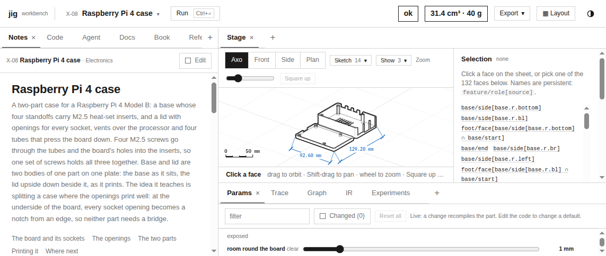
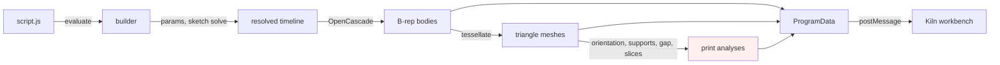
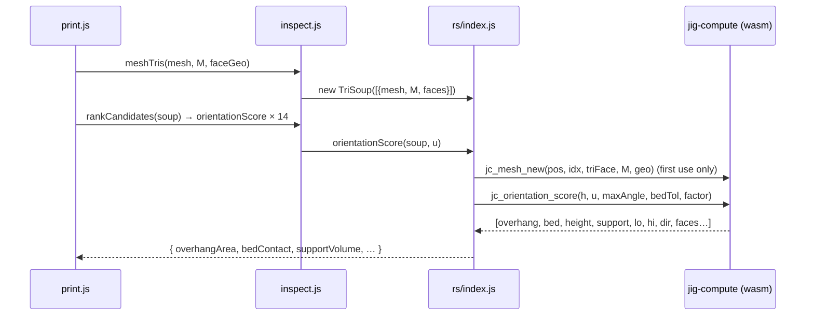
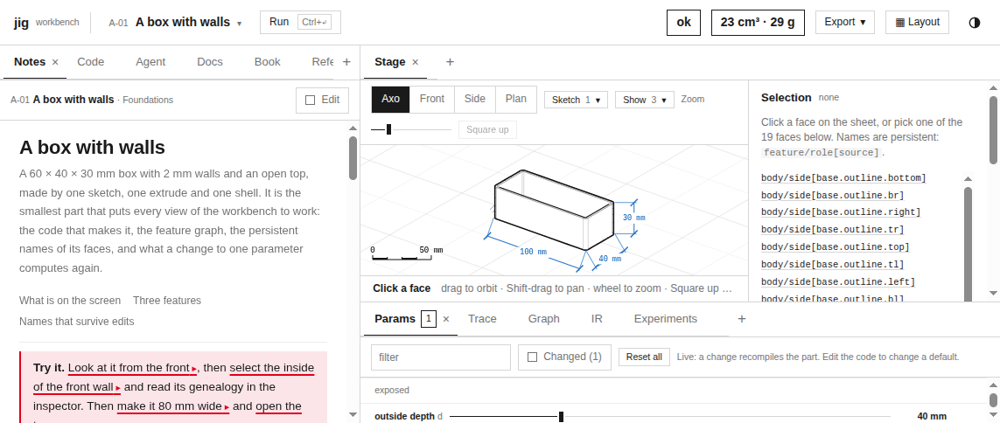

# jigcad: Moving the Numeric Core of a Browser CAD Engine into Rust and WebAssembly

jigcad is a browser workbench for 3D-printable parts. A user writes a short JavaScript program against a builder language called *jig*, and a Web Worker turns that program into solids, meshes, print analyses and a technical drawing. This report explains how the engine computes, why most of its work already ran in WebAssembly before any Rust was written, and how a small Rust crate, `jig-compute`, took over the numeric work that remained in JavaScript. It covers the measurement that shaped the plan, the binary interface between JavaScript and Rust, the ownership model for meshes that live in wasm memory, the algorithms that were ported, and the parity testing that keeps two implementations of the same mathematics in agreement. The work is ticket JIG-001 in `/home/manuel/code/wesen/go-go-golems/jig/ttmp/2026/10/31/`, and it is the first of two reports. This one covers Phases 0 to 4a; the second will cover the solver tape and the renderer.

> [!summary]
> - A CPU profile of all 72 presets attributed 89 % of compile time to OpenCascade, a C++ kernel that already runs as WebAssembly. The Rust work therefore targets the remaining JavaScript hot paths, not the solid modeller.
> - `jig-compute` is a dependency-free Rust crate compiled to `wasm32-unknown-unknown`. It exposes a plain C ABI over linear memory. The module is 92 KiB, imports nothing, and instantiates in 3–10 ms.
> - Mesh analyses, slicing and the sketch solver's linear algebra now run in Rust at 2.6–7.4× the speed of the JavaScript they replace. 3,784 parity checks confirm identical results.
> - The JavaScript implementations remain as the reference and the fallback. A trap or a missing module switches the engine back to them without user-visible change.



## 1. How jigcad computes

The system is easiest to understand as a sequence of representations. Each is produced by one component and consumed by the next.

A *preset* is a folder containing `script.js`, notes and optional data files. The script is the body of a function that returns a *builder*, an immutable value that records intent. Here is the smallest real preset, `content/presets/A-01-box/script.js`:

```js
return j.part('box')
  .params({ w: mm(60), d: mm(40), h: mm(30), wall: mm(2), r: mm(3) })
  .extrude(
    j.sketch('base', { on: j.plane.XY })
      .rect('outline', 'w', 'd', { center: true, r: 'r' })
      .profiles(),
    'h', { id: 'body' })
  .shell(j.feat('body').endFace(), 'wall', { direction: 'in', id: 'shell' })
```

Running this script computes nothing geometric. The values `mm(60)` and `'w - 2 * wall'` are recorded, the sketch is recorded with its constraints, and the timeline holds two features. Computation begins when the worker *compiles* the builder. Compilation resolves parameters, solves each sketch numerically, and builds a boundary representation (B-rep) with OpenCascade. A B-rep describes a solid by its faces, edges and vertices, each carrying an exact curve or surface. Compilation then names every face persistently (`body/side[base.outline.l1]`), meshes each body for display, runs print analyses on the meshes, and packs everything into a plain, structured-cloneable object called `ProgramData`.



Three runtimes take part. OpenCascade is C++ compiled with Emscripten to a 22.9 MB wasm module (`vendor/occt/replicad_single.wasm`). The engine itself is JavaScript running in the worker (`src/engine/*`). The user interface and the drafting-sheet renderer run in JavaScript on the main thread (`src/ui/*`, `src/stage/*`). The red node in the diagram, the print analyses, is where this report's work happened.

## 2. Measuring before porting

The request was to make the tool "run on WebAssembly and Rust, doing all computations and heavy lifting there". Read literally, that means replacing OpenCascade. Before deciding anything, the engine was profiled while compiling every bundled preset:

```bash
node --cpu-prof --cpu-prof-dir=$SCRATCH/prof tools/preset-check.mjs --quiet
node ttmp/.../scripts/01-prof-summary.mjs $SCRATCH/prof
```

The summary script groups the profile's self time by source: each wasm module by its URL, and engine JavaScript by file.

| Category | Self time | Share |
|---|---:|---:|
| OpenCascade (wasm functions and Emscripten glue) | 32,055 ms | 89.0 % |
| `src/engine/inspect.js` (mesh gap, orientation, supports) | 1,657 ms | 4.6 % |
| `src/engine/sketch/*` (solver, linear algebra, profiles) | 467 ms | 1.3 % |
| `src/engine/kernel.js` (JavaScript side of OpenCascade calls) | 379 ms | 1.1 % |
| garbage collector | 264 ms | 0.7 % |

The measurement changes the shape of the project. OpenCascade already is WebAssembly, and it does almost all the work. Rewriting a B-rep kernel in Rust would be a multi-year effort. It would also regress results that the project's textbook verifies to many digits: Pappus volumes of threads, Euler–Poincaré residuals, fillet maxima. The decision record in the design guide (D1) keeps OpenCascade. The Rust work moves the numeric code that the project owns and that still runs as JavaScript. The profile identifies that code exactly: mesh analyses in `inspect.js`, mesh slicing in `print.js`, and the solver's dense linear algebra.

Why are these JavaScript paths slow? The profile's top JavaScript function was the grid builder inside `meshGap` (`inspect.js:147`). Reading the code shows three causes:

- **Allocation per element.** `meshTris` turns every triangle into an object with seven fresh arrays: `{a, b, c, n, area, face, cen}`. Each `V.sub` or `V.cross` call allocates another array. A 20,000-triangle mesh produces about 200,000 short-lived arrays per call.
- **String keys.** Spatial grids key their cells with strings like `"12,-3,7"`, and vertex deduplication keys points with `toFixed(5)` strings.
- **Repeated work.** The print code rebuilds triangle records from the same mesh for each analysis, and ranks fourteen candidate build directions by running a full orientation score for each.

Rust over flat `f64` buffers removes all three causes: no allocation per element, integer cell keys, and one mesh resident in wasm memory for every analysis.

## 3. The boundary between JavaScript and Rust

### 3.1 Why a raw C ABI

The usual way to call Rust from JavaScript is `wasm-bindgen`, which generates a glue file and lets functions take strings, closures and classes. jigcad builds without npm and vendors all its dependencies. `wasm-bindgen-cli` was not installed, and it pins the crate to a CLI version. The data that crosses this boundary is flat numeric arrays: vertex positions, indices, matrices, results. For that, a C ABI is sufficient. Every exported function takes and returns only `i32`, `u32` or `f64`. A pointer is an `i32` offset into the module's single `WebAssembly.Memory`. The crate uses no crates.io dependencies, which keeps the module small and the build offline (decisions D2 and D3).

The compiled module imports nothing, which can be verified directly:

```js
const m = new WebAssembly.Module(fs.readFileSync('jig_compute.wasm'));
WebAssembly.Module.imports(m)   // → []
```

Instantiation is therefore `WebAssembly.instantiate(bytes, {})` in both Node and the worker. The loader, `src/engine/rs/wasm.js`, chooses its source by environment. Node reads the cargo output or `dist/jig_compute.wasm`; the worker fetches `./jig_compute.wasm` beside `worker.js`. The loader checks the ABI major version before accepting the module.

### 3.2 The memory protocol

A call that needs input arrays follows four steps:

1. Call `jc_alloc(nbytes)`, which returns an 8-byte-aligned pointer.
2. Create a typed-array view at that pointer and copy the data in.
3. Call the function with pointers and lengths.
4. Call `jc_free(ptr, nbytes)` for each block.

Variable-length results go into a buffer that Rust owns. The function returns the number of `f64` values, and JavaScript reads them from `jc_result_ptr()`. Failures return a negative number, and the message is at `jc_error_ptr()` / `jc_error_len()`.

The subtle part is memory growth. When Rust's allocator needs more memory, the module calls `memory.grow`. Growth detaches the old `ArrayBuffer`, so any typed-array view created earlier now has length zero. The bridge therefore never keeps a view across a call. `put()` creates each view immediately after its own allocation and writes at once. `result()` creates its view after the call returns and copies the data out:

```js
export function put(X, arr, Ctor) {
  const n = arr.length, bytes = Math.max(8, n * Ctor.BYTES_PER_ELEMENT);
  const p = X.jc_alloc(bytes);                       // may grow memory
  if (n) new Ctor(X.memory.buffer, p, n).set(arr);   // view made after the growth
  return { p, bytes };
}
export function result(X, n) {
  if (n < 0) throw new Error(errorText(X));
  return new Float64Array(X.memory.buffer, X.jc_result_ptr(), n).slice();
}
```

On the Rust side, the result buffer and the error string are thread-local values. `wasm32-unknown-unknown` without atomics is single-threaded, and `thread_local!` compiles to plain statics there:

```rust
thread_local! {
    static RESULT: RefCell<Vec<f64>> = RefCell::new(Vec::new());
    static ERROR: RefCell<String> = RefCell::new(String::new());
}
pub fn set_result(v: Vec<f64>) -> i32 { let n = v.len() as i32; RESULT.with(|r| *r.borrow_mut() = v); n }
```

The release profile sets `panic = "abort"`. A Rust panic becomes a wasm trap, which JavaScript sees as a `WebAssembly.RuntimeError`. The bridge treats a trap as a sign that the module's state cannot be trusted. It disables Rust for the rest of the session, and the calling function falls back to JavaScript.

## 4. Meshes that live in wasm memory

### 4.1 Handles and generations

Copying a mesh into wasm memory for every analysis would waste much of the gain. The print code scores fourteen directions, then slices the same body hundreds of times. Meshes are therefore long-lived objects held in a Rust registry, and JavaScript holds *handles* to them. A handle encodes a slot index and a generation:

```rust
// handle = (generation << 16) | (slot + 1)
pub fn insert(m: TriMesh) -> u32 { /* reuse a free slot, bump its generation */ }
pub fn with<R>(h: u32, f: impl FnOnce(&TriMesh) -> R) -> Option<R> { /* None when the generation differs */ }
pub fn remove(h: u32) -> bool { /* a stale or repeated free is ignored */ }
```

The generation makes two classes of bug harmless. A double free does nothing, because the second call finds a different generation or an empty slot. A stale handle does not silently read another mesh that reused its slot. The lookup returns `None`, which the C ABI reports as an error.

A `TriMesh` stores triangles in world coordinates as parallel vectors: `a`, `b`, `c` vertices, the normal `n`, the area, the face index and the centroid. Building it applies the body's placement matrix (column-major, as in `kernel.js`'s `matApply`). It also replaces the facet normal with the exact surface normal when the face is a plane, cylinder, cone or sphere. That replacement matters for printing. A 45° chamfer tessellated into facets has facet normals scattered around 45°, and some of them would be flagged as overhangs. The exact cone normal is exactly 45°. The face geometry crosses the boundary as 13 `f64` per face: `[kind, hasNormal, n(3), hasAxis, origin(3), dir(3), semiAngle | NaN]`.

### 4.2 TriSoup: keeping the JavaScript interface

Engine code calls `meshTris(mesh, m, faces)` and passes the result to `orientationScore`, `rankCandidates`, `meshGap` or `meshSection`. Changing every caller to manage handles would spread the Rust boundary across the engine. When Rust is active, `meshTris` returns a `TriSoup` instead of an array of records:

```js
class TriSoup {
  parts            // [{ mesh, m, faces }]: what it was built from
  handle()         // live Rust handle, rebuilt from `parts` when stale
  length           // jc_mesh_len
  records()        // JS records { a, b, c, n, area, face, cen }, on demand
  free()
}
```

A search of the engine showed that every consumer of `tris` is one of the four analyses. User code never receives the records. A non-array value is therefore safe, as long as the two places that concatenated per-body arrays with `flatMap` use a TriSoup-aware `catTris` instead. A TriSoup remembers what it was built from, so a stale handle rebuilds itself on next use. That property makes a simple lifetime rule correct: the worker calls `resetArena()` at the start of every compile and frees every handle the previous compile created. Anything that still holds a TriSoup pays one copy to rebuild it and keeps working.



## 5. The ported algorithms

Each algorithm was ported literally, keeping the JavaScript operation order, tolerances and tie-breaking. A literal port is a deliberate choice. It makes a function-by-function parity test possible, and parity is how two implementations of the same mathematics stay correct together. Optimisations that change results, such as a different spatial index, come after parity is established.

### 5.1 Orientation score and support volume

For a candidate build direction `u`, the score answers three questions. How much area faces downward more than the overhang limit? How much area touches the bed? And how much support material would be needed? The support estimate drops a column from each overhanging triangle along `−u`. The column ends at the first upward-facing surface below it, or at the bed:

```
u ← unit(u); lo, hi ← min, max of dot(vertex, u)
s ← sin(maxAngle + 0.5°)                      // 0.5°: facets of an exact 45° cone stay at the limit
for each triangle t:
    d ← −dot(n_t, u)
    if d > 1 − 1e−6 and max dot(vertex_t, u) − lo < bedTol: bedContact += area_t; continue
    if d > s + 1e−9: overhangArea += area_t; over ← over ∪ {t}; faces ← faces ∪ {face_t}
grid ← triangles bucketed in 2 mm cells on the plane ⟂ u
for t in over:
    floor ← highest hit below centroid_t of any upward-facing triangle in centroid_t's cell (ray cast)
    support += area_t · |dot(n_t, u)| · max(0, dot(centroid_t, u) − floor)
```

One detail affects exact parity. JavaScript collects overhanging face ids in a `Set`, and a `Set` iterates in insertion order. The Rust port keeps a `Vec` plus a `HashSet`, so `overhangFaces` comes out in the same order and the arrays compare equal.

### 5.2 Mesh gap

The interference check of print-in-place assemblies needs the smallest distance between two meshes, searched up to a limit `maxD`. Vertex-to-triangle distances alone give wrong answers in two cases. If two meshes pass through each other, every vertex can lie outside the other mesh's triangles, so the distance looks positive although the bodies collide. If one mesh lies wholly inside the other, nothing crosses at all. The algorithm therefore has three stages:

1. **Distances.** For every distinct vertex of A, find the triangles of B in nearby grid cells and take the minimum point–triangle distance. Repeat with B and A swapped.
2. **Crossings.** If the best distance is not yet zero, walk every edge of each mesh in steps of half a cell. For each candidate triangle of the other mesh, run a Möller–Trumbore segment–triangle test that excludes touching at edges and endpoints. Any crossing sets the gap to zero.
3. **Containment.** Cast a skewed ray, direction `(1, 0.000123, 0.000457)`, from one vertex of each mesh. An odd number of crossings with the other mesh means containment and a gap of zero.

The Rust version keys grid cells with `(i64, i64, i64)` tuples instead of strings. During the crossing walk it deduplicates candidate triangles with a stamp array (`mark[k] == stamp`) instead of a fresh `Set` per edge.

### 5.3 Mesh sections

Complex bodies, such as threads and gears, are sliced on their display mesh. A B-rep section of a helical B-spline costs seconds per layer. The section at height `z` collects the segment that each straddling triangle contributes, then chains the segments into loops through a map keyed by endpoint coordinates. Chaining depends on exact endpoint equality, and the JavaScript makes that hold by interpolating every edge from its lexicographically smaller endpoint. Two triangles sharing an edge therefore produce bit-identical points. The Rust port keeps that ordering rule exactly.

### 5.4 Quantised keys and where they could differ

JavaScript deduplicates with `toFixed(5)` and `toFixed(6)` strings. Rust uses `(x * 1e5).round()` integers. The two agree except on exact rounding ties. A tie only changes which of two nearly equal vertices is skipped as a duplicate, and the parity runs on real meshes found no case where it changed a result. This is the kind of difference a literal port has to argue about explicitly, because the parity test can only cover inputs it has seen.

## 6. Parity as the correctness contract

`test/rs/parity.mjs` compiles eight presets with the real engine and runs every analysis on the resulting meshes through both implementations. The presets cover cones, threads, gears, two-body parts and print jobs. The test compares:

- the triangle records (worst coordinate difference below 1e-9; faces and areas equal);
- all fourteen orientation candidates, every score field and the face lists;
- sections at four heights (loop counts, loop lengths and loop areas) and the area properties of each section;
- `catTris` against `flatMap`;
- gaps between body pairs at three limits, and against moved copies of a body at separated, touching and overlapping offsets;
- rebuilding after `resetArena()`, and repeated frees;
- `factorJ`, `qrcp` and Cholesky on sixty random matrices, a third of them rank-deficient.

```
A-01: 1 bodies checked
...
D-10: 1 bodies checked

3784 checks passed, 0 failed · 44314 triangles · 28811 ms · live meshes 1
```

The tolerance is relative, `|a − b| ≤ 1e-9 · max(1, |b|)`, not bitwise. Rust's `f64` and JavaScript's numbers are both IEEE-754 doubles. But `Math.hypot` and the trigonometric functions may differ in the last unit, so a bitwise comparison would fail on correct code. The existing suites ran in both modes as well: core 62/62, engine 42/42 and presets 72/72, with Rust active and with `JIG_COMPUTE=js`.

## 7. Results, and why the whole-suite timing misled

The function-level benchmark, `test/rs/bench.mjs`, uses real preset meshes. Each Rust timing includes copying the mesh into wasm memory.

| Path | JavaScript | Rust | Speed-up |
|---|---:|---:|---:|
| M-10 planetary gearbox, 38,810 triangles: rank 14 orientations with supports | 1,941 ms | 445 ms | 4.4× |
| M-07 spur gear pair, 22,228 triangles: rank orientations | 658 ms | 160 ms | 4.1× |
| X-08 Pi case: 200 mesh sections | 207 ms | 28 ms | 7.4× |
| M-06 threaded jar: mesh gap | 156 ms | 44 ms | 3.6× |
| `factorJ` + solve, 24 × 30, 200 times | 12.2 ms | 4.2 ms | 2.9× |

The first end-to-end measurement contradicted these numbers. Compiling all presets took 44.3 s with Rust and 39.5 s without. Profiling both runs, and splitting wasm self time by module URL rather than lumping it together, explained why:

| Run | OpenCascade module | jig-compute module | `inspect.js` |
|---|---:|---:|---:|
| Rust active | 33,415 ms | 513 ms | — |
| JavaScript only | 39,908 ms | — | 2,210 ms |

OpenCascade's time for identical work varied by about 20 % between runs on this machine. That variation is larger than the entire JavaScript share the port could remove. The Rust module did the ported work in 513 ms, against 2,210 ms in JavaScript. Non-wasm JavaScript time fell from 7.6 s to 4.2 s, a figure that includes less garbage collection. The lesson for this engine is general: when one component dominates and varies, end-to-end wall clock cannot measure changes in the other components. Function-level benchmarks on real inputs, or self time from profiles, can.

## 8. The sketch solver's linear algebra

The sketch solver works per connected cluster of parameters. It uses dog-leg, a trust-region method whose Gauss–Newton step comes from a minimum-norm solve through Householder QR of `Jᵀ` (`factorJ`). It falls back to Levenberg–Marquardt, which solves the damped normal equations with Cholesky (`cholSolve`). The design guide first argued (D6) that moving only these kernels would not pay. Sketch matrices are small, typically under 40 columns, so the cost of copying them seemed likely to equal the cost of factoring them. The benchmark disproved that: Rust is 2.5× faster at 8 × 10 and 2.9× at 24 × 30, copies included. The kernels were moved in `src/engine/sketch/linalg.js`, and the JavaScript bodies remain as `factorJJS` and `cholSolveJS`.

The JavaScript `factorJ` returns an object that factors once and solves lazily. The C ABI factors and solves in one call. The solver's loops perform one solve per factorisation, so the wrapper obtains the rank from that solve. It asks for the null basis, which `dragCluster` needs, with a second call that sets a `want_null` flag. To confirm that nothing changed, the solved sketches of five constraint-heavy presets were dumped in both modes, rounded to 1e-9. The two dumps were byte-identical (34,616 bytes each). That result also shows the Rust QR chose the same pivots as the JavaScript QR.

The kernels are a first step. Residuals and Jacobians are still computed in JavaScript, where each constraint's equations are closures evaluated by four-point finite differences. Moving the whole solve loop requires the equations as data: a residual *tape* of operations over parameter indices, evaluated in Rust with forward-mode dual numbers for exact Jacobians. That is Phase 4b.

## 9. Building and shipping

`build.mjs` now runs `cargo build --release --target wasm32-unknown-unknown` in `rust/jig-compute` and copies the result to `dist/jig_compute.wasm` (`JIG_SKIP_CARGO=1` skips the build). The release profile uses `opt-level = 3`, `lto = true`, `codegen-units = 1`, `panic = "abort"` and `strip = true`. esbuild is not vendored, so the build script reads its path from `ESBUILD` and keeps the old fixed path as a fallback. The worker loads the module in `init` and reports `compute: { kind: 'rust' | 'js', version, ms }`. The workbench header names jig-compute when it is active, and `#js-compute` in the page URL forces the JavaScript path. One trap during browser testing is worth recording: navigating to the same URL with only a new hash does not reload the document. The first check of `#js-compute` was therefore still answered by the old Rust-backed worker, and only a real reload tested the fallback.

The same session restyled the workbench's range inputs as hairline sliders, following a design note. The track is a 1 px rule inked up to the value through a `--p` custom property, and the thumb is a 5 × 12 px square.



## 10. Current status and next steps

**Done:** the crate, the bridge, mesh analyses, slicing, loop properties and the solver kernels in Rust. All suites pass in both modes, and `dist/` ships the module. Commits: `d273ca9`, `50b3bda`, `08247b5`, `8c660e6`.

**Next:**

- **Phase 4b, the solver tape.** Constraint equations become data, Rust computes residuals and dual-number Jacobians, and the dog-leg, Levenberg–Marquardt and drag loops move wholesale into Rust.
- **Phase 5, the renderer.** The stage renderer's software depth buffer and hidden-line pass move into Rust. They run on the main thread, so the module has to be loaded there as well.
- **Orientation ranking.** A batched ranking in Rust would project the mesh once per direction and reuse grids. Support columns still account for most of the 445 ms on the planetary gearbox.

**Open question:** whether a Rust signed-distance-field or mesh kernel should eventually implement the unimplemented `j.field.*` lattices. That would be the first place where Rust takes geometry that OpenCascade does not cover.

## Important project docs

- Design guide: `/home/manuel/code/wesen/go-go-golems/jig/ttmp/2026/10/31/JIG-001-RUST-WASM--move-jigcad-computation-and-heavy-lifting-into-a-rust-webassembly-core/design-doc/01-rust-webassembly-compute-core-analysis-design-and-implementation-guide.md`
- Diary: the same ticket, `diary/01-implementation-diary.md`
- Crate: `/home/manuel/code/wesen/go-go-golems/jig/import/jigcad/rust/jig-compute/src/lib.rs`
- Bridge: `/home/manuel/code/wesen/go-go-golems/jig/import/jigcad/src/engine/rs/index.js`, `wasm.js`
- Tests: `/home/manuel/code/wesen/go-go-golems/jig/import/jigcad/test/rs/parity.mjs`, `bench.mjs`, `sketch-dump.mjs`
