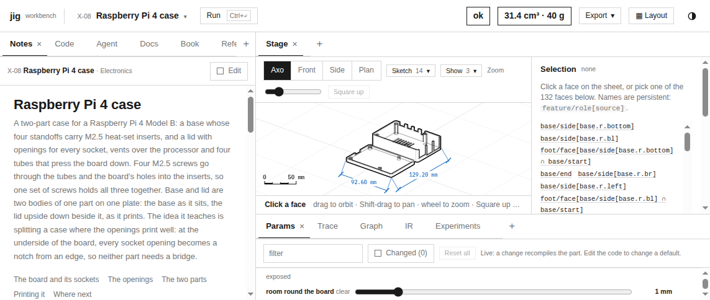
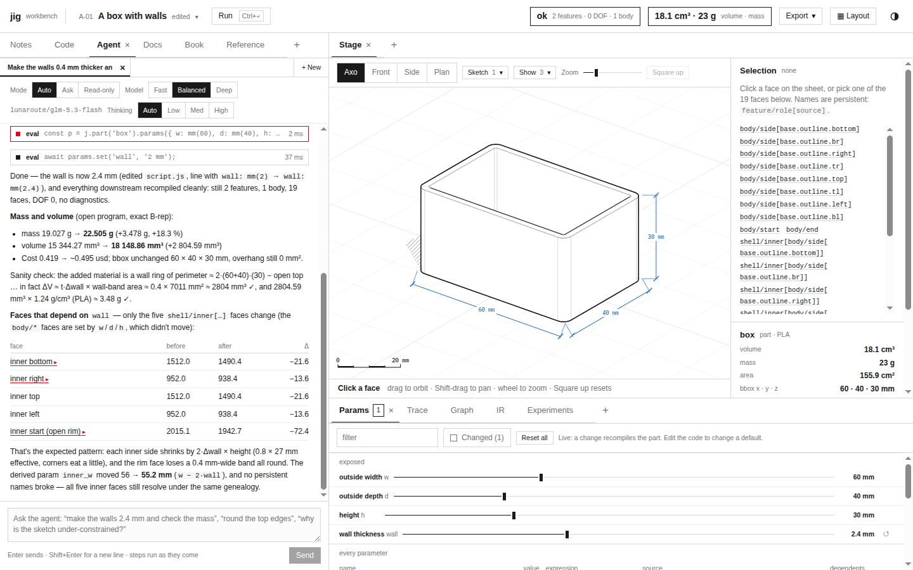

# jigcad: Retrospective of a Rust Compute Core, a Go Agent Backend, and What Measurement Changed

This report reviews one working session on jigcad, the browser CAD workbench described in [[PROJECT REPORT - jigcad - Architecture of a Browser CAD Workbench, from Script to Agent]]. In that session two tickets were planned, implemented and closed. JIG-001 moved the engine's remaining numeric hot paths from JavaScript into a Rust crate compiled to WebAssembly. JIG-002 gave the workbench's coding agent a local model backend in Go, which reaches lunaroute through Pi's credentials. Four earlier reports explain the technical results. This one explains the work: how it was organised, what each phase changed and measured, which plans the measurements overturned, which failures occurred and how they were resolved, and what remains.

The subject is the record more than the code. Every phase ended with numbers, and several of those numbers contradicted the expectation that motivated the phase. The sections below list them, because they are the most reusable part of the session.

> [!summary]
> - **Two tickets, thirteen commits, about 8,100 inserted lines** across a 1,673-line Rust crate, a 506-line JavaScript bridge, a symbolic equation layer, a 1,909-line Go backend, tests, ticket documents and diaries. Four vault reports and this retrospective record the results.
> - **The first measurement redirected the project.** OpenCascade, already WebAssembly, took 89 % of compile time. "Port the CAD tool to Rust" became "move the numeric code jigcad owns into Rust and keep the kernel".
> - **Seven expectations were corrected by measurement.** They concern end-to-end timing, solver speedups, SIMD, drag convergence, round limits and prompt caching. In each case the code or the documents changed to follow the measurement.
> - **Parity was the correctness contract throughout.** Every Rust path kept its JavaScript twin as reference and fallback: 4,019 engine checks, 181 renderer checks, and 159 textbook blocks identical between the two.

## 1. The starting point and the requests

At the start, the repository held an imported jigcad workbench (`import/jigcad`), the jig language specification (`import/jig`), and two commits. The workbench had been built earlier by coding agents against a written contract, `BUILD.md`, which fixes the architecture, the worker protocol, the shape of a compiled Program and the ownership of every source path. It ran entirely in the browser: OpenCascade in a Web Worker, a software renderer on the main thread, and an agent panel that worked only inside claude.ai.

The session's requests arrived in sequence:

1. Create a ticket to make the CAD tool "run using webassembly and rust… to do all computations and heavy lifting". Write an intern-level analysis, design and implementation guide, upload it to a reMarkable tablet, then implement with commits and a detailed diary.
2. Study how slop-computer reaches language models through geppetto and the Pi provider, for use by the jigcad agent.
3. Apply a written specification for hairline sliders to the workbench's sliders.
4. Write a deep-dive vault report, finish the Rust ticket, and use Pi with `lunaroute/glm-5.3-flash` and `lunaroute/deepseek-4.1-flash` for model serving. Then write a second report with screenshots, build the Go serving path with all agent functionality working through lunaroute, and report on that too.
5. Write a whole-system architecture report.
6. Verify whether prompt caching makes the agent's repeated context cheap.

## 2. How the work was organised

The working method was the same for both tickets, and it explains the shape of the record.

- **A docmgr ticket per goal.** Each ticket workspace under `ttmp/2026/10/31/` holds a design document, a diary, a task list, a changelog, scripts and evidence (`various/`). The document front matter relates the primary source files, and `docmgr doctor` validates the metadata before each commit.
- **A design guide before code.** Each guide was written for a reader new to the system. It covers the parts of the system needed to understand the change, then proposes the API, records decisions with context, options and consequences, gives pseudocode, splits the work into phases, and states the test strategy. The JIG-001 guide was uploaded to the reMarkable tablet before implementation began.
- **Commits at phase boundaries.** Each commit closes a phase whose tests pass, with a message stating what changed and what was measured.
- **A diary in investigation format.** Every step records the verbatim user request (once, then by reference), what was done, why, what worked (with the command and its output), what did not work (with the exact error), what was learned, what was tricky, what a reviewer should check, and how to re-run the validation. The two diaries have 7 and 6 steps.
- **A vault report per milestone.** Reports were written in a textbook style without analogies, with screenshots copied into the vault's `_assets/` folder, and committed and pushed separately from the code.

The commit history shows the sequence:

| Commit | Ticket | Content | Lines |
|---|---|---|---|
| `d273ca9` | JIG-001 | ticket, design guide, esbuild path override | +800 |
| `50b3bda` | JIG-001 | jig-compute crate and JS bridge: mesh analyses, slicing, linear algebra | +1,627 |
| `08247b5` | — | hairline sliders | +41 |
| `8c660e6` | JIG-001 | solver `factorJ` / `cholSolve` in Rust | +124 |
| `561d4fe`, `9fe56d3` | JIG-002 | research note; model decision and plan | +349 |
| `39f2731` | JIG-001 | constraint equations as data; solver loops, analysis and drag in Rust | +1,173 |
| `0e0cef4` | JIG-001 | stage depth buffer, raster and line classification in Rust; ticket complete | +597 |
| `4c6ba07` | JIG-002 | Go backend, HTTP server, `jigcad serve` | +2,184 |
| `a7cb8e2` | JIG-002 | browser adapter, last-round note, screenshots | +316 |
| `d6d8d84`, `ff02bbb` | JIG-002 | diary, design-doc results, tasks | +583 |
| `463c46d` | JIG-002 | prompt-cache logging, probe, proxy, measurements | +310 |

## 3. JIG-001: the Rust compute core

### 3.1 Measuring before deciding

The request said "all computations and heavy lifting". The first step was to find out where the computation was. A CPU profile of compiling all 72 presets (`node --cpu-prof tools/preset-check.mjs`) was grouped by source with a ticket script, `scripts/01-prof-summary.mjs`:

| Source | Self time | Share |
|---|---|---|
| OpenCascade (wasm and its glue) | 32,055 ms | 89.0 % |
| `inspect.js` (mesh gap, orientation, supports) | 1,657 ms | 4.6 % |
| `sketch/*` (solver, linear algebra, profiles) | 467 ms | 1.3 % |
| `kernel.js` (JS side of kernel calls) | 379 ms | 1.1 % |
| garbage collector | 264 ms | 0.7 % |

OpenCascade is a C++ B-rep kernel of several hundred thousand lines, already compiled to WebAssembly. Rewriting it in Rust would have been a different project, with no prospect of finishing, and no guarantee of speed, since the code would already be native-compiled wasm. Decision D1 of the design guide therefore narrowed the goal: keep OpenCascade as the kernel, and move into Rust every numeric hot path that jigcad's own JavaScript runs. Those are the mesh analyses, slicing, the sketch solver's linear algebra and loops, and later the renderer's inner loops.

### 3.2 The crate's shape

`import/jigcad/rust/jig-compute` is a Rust crate with no dependencies, built for `wasm32-unknown-unknown`. Four design choices from the guide held for the whole ticket:

- **A plain C ABI over linear memory.** JavaScript allocates with `jc_alloc`, copies typed arrays in, calls an export, and reads results through `jc_result_ptr`. Errors are a pointer and a length (`jc_error_ptr`, `jc_error_len`). The ABI is versioned (`jc_version`, finally 1.4) and has 43 exports.
- **Generation-tagged handles.** Meshes, tapes and render frames live in Rust and are referred to by handles that encode a generation, so a stale handle is a reported error instead of a use-after-free.
- **An arena per compile.** Mesh handles created during a compile are released together at the start of the next one (`resetArena`). JavaScript objects that still hold a mesh rebuild it on demand.
- **The JavaScript implementations stay.** Each ported function keeps its JavaScript original as `*JS`. A dispatcher calls Rust when the module is loaded and JavaScript otherwise. `JIG_COMPUTE=js` (Node), `#js-compute` (browser), `RS.withJs(fn)` (tests) and any trap in the module select the fallback.

### 3.3 Phases and results

| Phase | Content | Result |
|---|---|---|
| 1–2 | crate, bridge, mesh soup type, orientation scoring, mesh gap, sections, loop properties | 2.6–7.4× on mesh paths: M-10 orientation 1,941 → 445 ms, X-08 200 sections 207 → 28 ms |
| 3 | worker wiring, parity suite, benchmark, build integration, browser check | 3,784 parity checks equal; the module loads in 3–10 ms |
| 4a | solver `factorJ` (Householder QR) and `cholSolve` in Rust | 2.9× on the kernels, but little end-to-end gain (§5) |
| 4b | equations as expression DAGs; residual tapes with reverse-mode derivatives; dog-leg, LM, Newton, analysis and drag in Rust | whole sketch solves 2.2–2.5× faster; solved sketches and the textbook's 374-line check output byte-identical |
| 5 | renderer frames in wasm memory; projection, raster and line classification in Rust | bit-identical output (181 checks); lines 1.1–1.7×; raster not faster (§5) |

Phase 4b was the largest change. The sketch solver evaluated each constraint as a JavaScript closure, which Rust cannot call cheaply, so moving the solver loop alone would have meant one boundary crossing per residual evaluation. The fix was to change the representation. Every constraint equation in `constraints.js` now builds an expression DAG (`sym.js`). The JavaScript closure is generated from the DAG, with the same operation order as the hand-written closure it replaced. Rust receives the same DAG as a linear tape of `[op, a, b, v]` instructions and evaluates residuals and exact reverse-mode Jacobians from it. One definition per equation serves both implementations, which is what kept them byte-identical. [[PROJECT REPORT - jigcad - Constraint Equations as Data and a Rust Renderer]] explains the tape and the solver port in detail.

### 3.4 Parity as the contract

Two implementations of the same mathematics drift unless something compares them. Each phase therefore added comparisons, not just tests:

- `test/rs/parity.mjs` runs every ported function on preset-derived inputs through both implementations and compares results. It grew to 4,019 checks, including solved sketches, drags and analyses.
- `test/rs/stage-parity.mjs` compares the renderer's depth buffer, id buffer, line segments and silhouette runs (181 checks).
- The engine suites run in both modes: core 62/62, kernel 42/42, presets 72/72.
- The textbook's 159 executable blocks produce identical output with and without Rust.

The renderer's parity is bit-for-bit, because both sides use f32 in the same order. The solver's parity is exact on solved coordinates, and the drag comparison uses a tolerance explained in §5.

## 4. The side requests

**slop-computer's model path.** The research note (`JIG-002/reference/01-…md`) traced how slop-computer calls models: geppetto's `providers/pi` reads Pi's agent directory (`~/.pi/agent`: model catalog, credentials, settings), a Go server streams one model call per page request as server-sent events, and page-defined tools are executed in the browser while the server waits on a channel. It compared two ways to reuse this in jigcad: hosting the workbench as a slop app (Option A), or a dedicated Go server next to the workbench (Option B). The user chose B, with Pi as the credential source and lunaroute's glm-5.3-flash and deepseek-4.1-flash as the models.

**Hairline sliders.** A one-page specification described thin slider tracks with a square thumb and a filled portion, in the workbench's Kiln style. It was applied to `jig.css`, `kiln.css`, the Params view and the stage's zoom slider, with a `pct()` helper in `ui/common.jsx` for the fill. It was a 41-line commit, verified with screenshots in both themes.

## 5. What measurement changed

This is the central table of the retrospective. Each row is an expectation that a measurement in the session overturned, and the action that followed.

| Expectation | Measurement | Action |
|---|---|---|
| Porting jigcad to Rust speeds up compiles | OpenCascade is 89 % of compile time, already wasm | ported only jigcad's own hot paths; kernel kept (D1) |
| The whole preset suite will compile faster with Rust | Rust run 44.3 s, JS run 39.5 s, but OpenCascade alone varied by about 20 % between runs (33,415 vs 39,908 ms) | judged speed by per-function benchmarks; the profile script now splits wasm modules by URL |
| QR and Cholesky in Rust speed up sketch solving | kernels 2.9× faster; M-03 solve only 1.1× | profiled 300 re-solves: `analyseCluster` (Gram–Schmidt, projector QR) was 15 % self time; ported it, M-03 reached 2.2× |
| The Rust drag matches JS to 1e-6 | residual `[5.2e-25, 5.6e-25, −1.15e-4, 4.99999999868]` after 40 steps, in both implementations | least-change iteration approaches the target asymptotically; tolerance 1e-3, plus a Rust-against-JS drag comparison |
| A tighter raster loop, or SIMD, makes the depth buffer faster | span loop: no change; `+simd128` branchless spans: X-08 9.1 vs 8.0 ms (JS), M-10 18.4 vs 17.4 ms | the loop is bound by memory writes; SIMD reverted, scalar kept, the negative result documented |
| 16 rounds are enough for an agent turn | deepseek-4.1-flash used 15 tool rounds exploring, then returned an empty answer in the tool-less last round | added a user note before the last round asking for a final answer; the same request then finished in 12 rounds |
| The agent's model path has no prompt caching | lunaroute caches prefixes: 94–99 % cache reads from round 2; a real 8-tool turn read 88 % from cache | dropped the plan to trim the reference; the server log now reports cache reads; reports corrected |

Two rows deserve more explanation, because their lessons generalise.

**The end-to-end illusion.** After Phase 3, the suite took longer with Rust than without it, which suggested a regression. Profiling both runs and grouping wasm self time by module URL showed otherwise. Rust's own module took 513 ms against JavaScript's 2,210 ms in `inspect.js`, and the difference in wall time came from OpenCascade, whose time varied by about 20 % between identical runs. A whole-suite timing is a sum dominated by the largest, noisiest term. A change to a 5 % term cannot be seen in it, and it must be measured where it happens.

**The memory-bound raster.** The renderer's raster loop writes a depth and an id value per covered pixel, after a compare. Two optimisations were tried and measured: a span loop with one bounds check per span, and 128-bit SIMD with branchless spans. Neither beat JavaScript, whose JIT compiles the same loop to similar machine code. The cost is the stores to two large buffers, not the arithmetic. The scalar Rust version was kept anyway: it is bit-identical, and it keeps the frame in wasm memory, which line classification reads without a copy. Line classification did get faster (1.1–1.7×), because it does more arithmetic per memory access.

## 6. JIG-002: the Go agent backend

### 6.1 Adapting instead of importing

slop-computer's backend (`pkg/piworker` and `pkg/piworker/gepp`, about 700 lines) already implemented the model-call contract the jigcad agent uses. Importing the module would have brought slop's Go version requirement, its database driver, glazed and its sandbox runtime into jigcad. Decision D1 of the JIG-002 guide was to copy and adapt it, with attribution in the package documentation and a small set of marked changes:

- the lunaroute agent header `jigcad`;
- rounds raised from slop's default 5 and maximum 10 to 16 and 32, because a jigcad turn reads, edits, compiles and checks;
- the authentication message names `jigcad serve`.

slop's scripted-provider test suite came over with the code and passed after one assertion change. That was the evidence that the adaptation preserved behaviour.

### 6.2 The server and the adapter

`pkg/server/server.go` implements four routes on the standard library's mux: models, the streaming call, tool results, and cancel. It also serves static files and checks an optional bearer token. Two details carry most of the correctness:

- **Register before announcing.** The server registers the channel for a tool result before it sends the `tool` event, so a fast page cannot post a result that nobody is waiting for.
- **One taker per tool use.** A buffered channel with capacity 1, removed under a mutex by the first taker, means that a duplicate or late result gets 404 instead of blocking.

`cmd/jigcad serve` binds `127.0.0.1:8787` and refuses a non-loopback address without a token, because the server spends the operator's credentials. In the browser, `src/host/sample-http.js` ports slop's runtime `sample()` onto the HTTP routes. The agent panel uses `window.claude` when it exists and the local backend otherwise, so hosting on claude.ai is unchanged.

### 6.3 Live verification

The backend was tested against a stub provider first. It was then exercised live through lunaroute: text-only calls on both tiers, then real agent turns in the browser driven by Playwright.

| Turn | Model | Tool calls | Time | Outcome |
|---|---|---|---|---|
| walls +0.4 mm, check mass and dependent faces | glm-5.3-flash | 9 | 24 s | ok; file edited, mass and face table correct |
| 3 mm fillet on the vertical edges (first try) | deepseek-4.1-flash | 15 | 45 s | empty completion |
| same, after the last-round note | deepseek-4.1-flash | 12 | 26 s | ok; radius found in the sketch, verified with `check()` |
| Ask mode, Stop on the second step | glm-5.3-flash | 2 | 73 s (person waiting) | cancelled on both ends |

### 6.4 The caching question

After the reports were written, a question from the user exposed an unverified claim in them: "do you mean the reference is attached again (multiple copies) each round? because wouldn't prefix caching otherwise make things reasonably cheap?" The reports and the design document had stated that the path had no prompt caching. The statement came from the slop research note, where it referred to Anthropic's explicit `cache_control` markers. OpenAI-compatible providers cache prefixes without any marker.

The measurement used two small tools stored in the ticket. A reverse proxy (`scripts/usage-proxy`) logs only the `usage` object of each streamed response. A probe (`scripts/cache-probe`) drives the real backend with the agent's reference as the prefix and forces four tool rounds. Plain-HTTP loopback providers are refused by geppetto's Pi provider unless `pi.WithLocalProviders()` is set, so the probe enables that option. No production flag was added for a one-off measurement. The findings:

- From round 2, 94–99 % of the prompt was a cache read on both models, in blocks of 256 tokens.
- A second call in the same server process was warm from round 1. A new process started cold, because the cache follows the per-process `x-lunaroute-session` id, and each model has its own cache.
- A real eight-tool turn on a freshly started server read 149,248 of 170,359 input tokens from the cache (88 %).

The documents were corrected with dated notes, the earlier diary entries were left as written with a new step recording the correction, and the server's log line gained `cacheRead` and `cacheWrite` fields. One gap remains: DeepSeek reports cache writes as `created_cache_tokens`, which geppetto does not map.

## 7. Failures and recoveries

Not every failure in the session was a wrong expectation. Many were ordinary tooling problems, and they are listed here because they recur.

| Failure | Cause | Recovery |
|---|---|---|
| `esbuild not found` | the global npm tools directory had no esbuild | installed esbuild in the scratchpad; `build.mjs` honours an `ESBUILD` path |
| `#js-compute` check ran Rust | changing only the URL hash does not reload the document | `location.reload()` |
| `Cannot assign to read only property 'jc_tape_solve'` | `instance.exports` of a wasm module is frozen | call counters moved into the JS bridge |
| `Could not resolve "node:fs"` in the app bundle | the bridge's Node branch was bundled for the browser | `external: ['node:*']` for the app bundle, as for the worker |
| stage parity failed on runs only | the test compared nested runs one level too shallow | fixed the test helper; all checks equal |
| conversion script `AssertionError` | a generic rename ran before exact replacements, changing the text they matched | exact replacements first |
| every call `upstream_error` in 1 ms through the proxy | geppetto refuses plain-HTTP loopback providers by default | `pi.WithLocalProviders()` in the probe only |
| `pkill -f …` exited 144 and killed its own shell (three times) | the pattern matched the shell's own command line | stop processes by PID from `ps` |
| `node --test test/agent/` failed | Node 24 treats the directory argument differently | `node --test test/agent/*.test.mjs` |

The `pkill` failure is the clearest example of a repeated mistake. It happened three times before the habit changed, and each time it took the rest of a compound command with it, once including a file that was never written.

## 8. The state of the system after the session

| Area | State |
|---|---|
| Engine correctness | core 62/62 and kernel 42/42 in both compute modes; presets 72/72; book 159 blocks identical in both modes |
| Rust core | 43 exports, ABI 1.4, 162 KiB module; 4,019 engine and 181 renderer parity checks; `cargo test` passing |
| Speed | mesh paths 2.6–7.4×, sketch solves 2.2–2.5×, line work 1.1–1.7×, raster at parity |
| Agent backend | `go test ./pkg/...` passing; 34/34 agent tests including 5 for the adapter; live turns on both models; Ask mode and Stop verified |
| Single binary | `go build -tags embed ./cmd/jigcad` (41.6 MB) serves the workbench and the API |
| Documentation | two tickets with guides, diaries, tasks and changelogs; `BUILD.md §8`; five vault reports |

The reports form a set. The first and second cover the Rust work in detail, [[PROJECT REPORT - jigcad - Moving the Numeric Core of a Browser CAD Engine into Rust and WebAssembly]] and [[PROJECT REPORT - jigcad - Constraint Equations as Data and a Rust Renderer]]. The third covers the Go backend, [[PROJECT REPORT - jigcad - A Go Model Backend for the Workbench Agent]]. The fourth describes the whole system, [[PROJECT REPORT - jigcad - Architecture of a Browser CAD Workbench, from Script to Agent]]. This retrospective is the fifth.

## 9. What comes next, and why

The agent works end to end, but the evidence for how well it works is a handful of turns. Every remaining question about it is statistical:

- Is 16 rounds the right limit?
- Should Deep use deepseek or glm?
- Does the last-round note help in general, or only in the one case that prompted it?
- Does a change to the instructions or the reference improve results, or just change them?

One turn per configuration cannot answer these, because the models are not deterministic and the cases differ.

The next ticket, JIG-003, is therefore an **evaluation harness** for the agent. It needs a set of cases, each a preset, a request, a mode and machine-checkable expectations. It needs a headless runner that drives the real agent turn, the real eval tool and the real engine in Node, through the Go backend. And it needs results recorded per model with success, tool calls, rounds, tokens (cached and uncached), time and outcome. With it, the questions above become measurements, which is the same discipline that steered JIG-001 and JIG-002.

## Important project docs

- Repository: /home/manuel/code/wesen/go-go-golems/jig
- JIG-001: `ttmp/2026/10/31/JIG-001-RUST-WASM--move-jigcad-computation-and-heavy-lifting-into-a-rust-webassembly-core/` (design guide with results §12–13, diary steps 1–7, `scripts/01-prof-summary.mjs`)
- JIG-002: `ttmp/2026/10/31/JIG-002-AGENT-LLM-BACKEND--agent-model-backend-via-geppetto-and-the-pi-provider-slop-computer-pattern/` (research note, design doc with D1–D5 and results, diary steps 1–6, `scripts/cache-probe`, `scripts/usage-proxy`, `various/04-prompt-cache-measurements.md`)
- Rust: `import/jigcad/rust/jig-compute/src/`; bridge `import/jigcad/src/engine/rs/`; equations `src/engine/sketch/sym.js`
- Go: `pkg/sample/`, `pkg/sample/gepp/`, `pkg/server/`, `cmd/jigcad/`; browser adapter `import/jigcad/src/host/sample-http.js`
- Tests: `import/jigcad/test/rs/parity.mjs`, `stage-parity.mjs`, `test/engine-core/run.mjs`, `test/engine/run.mjs`, `tools/preset-check.mjs`, `tools/book-check.mjs`, `test/agent/*.test.mjs`, `pkg/**/*_test.go`
