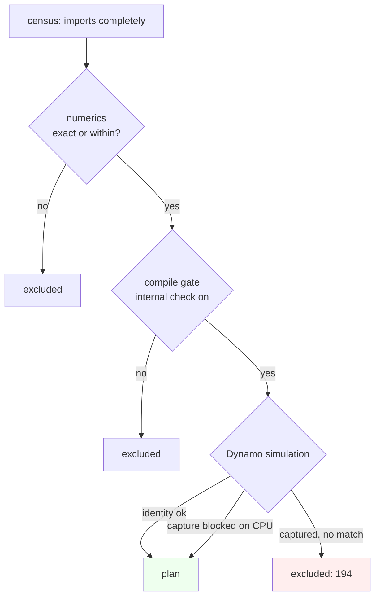

# Kiln: Closing the PassBench Import Gap, Device-Agnostic Shape Propagation, In-Place Ownership and the Pattern Tracer

This article explains how the Kiln PassBench importer went from 1961 to 2058 of 2060 graphs, and from 175 to 199 of 200 complete task families, in one CPU-only wave on the integration branch `integration/kiln-006-011`. The list of new operators is the least interesting part. Most of the 25 blocked families were blocked by four general defects, and each of them looked like a missing operator from the outside:
- metadata propagation depended on which device a tensor named;
- the tracer executed constant constructors instead of recording them;
- the in-place ownership rule was stricter than the semantics required;
- the pattern tracer in the evaluator protocol disagreed with TorchDynamo about what a factory call is.

The article explains each defect from first principles, shows the code that fixed it, and reports the CPU gates that decide which families may be replayed on a GPU.

> [!summary]
> - **The device defect.** FX shape propagation with fake tensors failed on 11 families: the graphs create tensors on `cuda:0`, while the example inputs live on the CPU. The fix propagates on a single-device copy of the graph and copies the metadata back by node name. It works identically on CPU and CUDA hosts.
> - **The tracer defect.** FX symbolic tracing executes `torch.tensor(...)` and `torch.linspace(...)` at trace time. That is the real source of both the "Found no NVIDIA driver" records and the leftover `get_attr _tensor_constantN` records.
> - **The ownership rule.** The in-place rule changed from "the source has one use" to "no alias outside the in-place chain is read later". The rebinding semantics needs exactly this rule, and the change unblocked five families.
> - **The pattern tracer.** The evaluator's pattern tracer (`fx_normalize.trace_pattern`, protocol `kiln-pattern-autowrap/2`) now records factories as calls, the way TorchDynamo captures them. Without that change, no replay of a factory graph can match.

## 1. What "imported" means

PassBench is the benchmark half of PassNet. It has 200 *tasks*, called *families* here. A family is a set of PyTorch FX graphs that share an operator pattern and differ in shapes and dtypes; across the corpus there are 2060 graphs. A family scores only if every one of its graphs is matched, executed and numerically accepted. A family with 10 of 11 graphs importing is worth nothing, so coverage is counted in complete families.

Kiln reaches PassBench through an importer in `integrations/passnet/`. The importer turns one source graph into a Kiln project script in four stages:


A graph is *imported* when `corpus.translate_graph(upstream, graph, 'fake')` returns a script without raising. The import census (`ttmp/2026/11/01/integration-evidence-kiln-006-011/coverage-census-v1/census.py`) runs that call over all 2060 records and keeps each record's error. Importing is necessary but not sufficient. A replayable family must also compile, agree numerically with PyTorch, and be matched by PassBench's matcher in the evaluator, so section 6 adds those gates.

Here is a concrete graph, followed through the whole pipeline. ERNIE-M's embedding prologue (family `64207d746493`, task 13) computes position ids like this:

```python
tmp_11 = torch.ones((1, 15), dtype=torch.int64, device=device(type='cuda', index=0))
tmp_12 = torch.cumsum(tmp_11, dim=1)
tmp_13 = tmp_12 - tmp_11
tmp_13 += 2
tmp_15 = torch.nn.functional.embedding(tmp_13, in_3, 1, None, 2.0, False, False)
```

At the start of this wave the record failed with:

```
RuntimeError: Unhandled FakeTensor Device Propagation for aten.embedding.default,
found two different devices cpu, cuda:0
```

After the wave it imports to:

```js
const v11 = N.expect(N.full([1, 15], 1, "i64"), [1, 15], "i64");
const v12 = N.expect(N.cumsum(v11, 1), [1, 15], "i64");
const v13 = N.expect(N.sub(v12, v11), [1, 15], "i64");
const v14 = N.expect(N.add(v13, N.int(2)), [1, 15], "i64");
const v15 = N.expect(N.embedding(v14, v3), [1, 15, 768], "bf16");
```

Three separate fixes were needed for this one record, one per section that follows. The first was device-agnostic propagation. The second was the in-place rule: `tmp_13 += 2` updates a fresh value. The third was exporting the splat that feeds the scan.

## 2. Device-agnostic shape propagation

The importer needs a shape, dtype and stride for every FX node. It gets them from `torch.fx.passes.shape_prop.ShapeProp`, an interpreter that runs the graph on example inputs and records each node's result metadata. The corpus runs it in *fake* mode. The inputs are `FakeTensor`s, tensors that carry metadata but no storage, so a graph whose real inputs would need gigabytes can still be propagated.

Fake tensors still carry a device, and PyTorch's fake dispatch refuses an operation whose operands sit on two devices. That is exactly what PassBench graphs produce. They were captured on a GPU machine, so they contain literal device arguments:
- `torch.ones(..., device=device(type='cuda', index=0))`;
- `x.to(device(type='cuda', index=0))`;
- `x.to(device=..., dtype=torch.bool)`.

The importer creates its example inputs without a device, that is on the CPU, on every host. So `embedding(cuda_ids, cpu_weight)` fails. The GB10 census of Step 8 showed that a CUDA host does not help: the inputs are still CPU tensors.

Kiln itself has one device. The importer already lowered `x.to("cuda")` as the identity, a value whose shape and dtype are the source's. Metadata propagation should follow the same model. The fix (`fx_export.propagation_copy` and `propagate`) builds a copy of the traced graph in which every device argument names the example inputs' device, runs ShapeProp on the copy, and copies each node's `tensor_meta` back to the original node of the same name:

```python
def propagation_copy(module, device):
    graph, mapping = torch.fx.Graph(), {}
    for node in module.graph.nodes:
        copied = graph.node_copy(node, lambda n: mapping[n])
        if copied.op in ('call_function', 'call_method'):
            copied.args = host_device(copied.args, device)      # torch.device / "cuda:0" / "cpu" -> device
            copied.kwargs = host_device(copied.kwargs, device)
            if copied.op == 'call_method' and copied.target in ('cuda', 'cpu'):
                copied.target, copied.args, copied.kwargs = 'to', (copied.args[0], device), {}
        mapping[node] = copied          # node_copy keeps the name; checked
    return GraphModule(module, graph), mapping

def propagate(module, example_inputs, fake_mode=None):
    copy, mapping = propagation_copy(module, the_single_device_of(example_inputs))
    if fake_mode is None: example_inputs = [clone(v) for v in example_inputs]
    ShapeProp(copy, fake_mode=fake_mode).propagate(*example_inputs)
    for node, copied in mapping.items(): node.meta['tensor_meta'] = copied.meta['tensor_meta']
```

Why a copy and not a rewrite? The exported `kiln-fx/1` graph still says `cuda:0`. Everything downstream sees the source as it was traced: the importer, the reference-domain inference, and later the pattern generator. Only the step that cannot handle two devices sees one.

The `clone` line came from a failed test, not from design. ShapeProp on *real* inputs executes the graph, and a graph with `x /= s` divides the caller's tensor. A numerical test then compared Kiln against PyTorch run on the already-divided input, whose zero rows produced `0/0 = NaN`. Real examples are now cloned before propagation.

## 3. Constants that the tracer executes

FX's symbolic tracer passes *proxies* through `forward` and records every operation a proxy takes part in. A call whose arguments are all Python values does not involve a proxy, so the tracer simply executes it. `torch.tensor(256, dtype=torch.float32, device=cuda)` is such a call. On a host without a driver it raises at trace time ("Found no NVIDIA driver on your system"). On the CPU, `torch.tensor(1.0)` succeeds and its result is stored as a module attribute, which becomes an FX `get_attr _tensor_constant0` node. The importer refuses `get_attr` because the constant's value never reaches the exported graph.

KILN-010 had solved this for `arange`, `zeros`, `ones` and `full`. While tracing, `fx_trace.proxied_factories` replaces those functions with wrappers that emit a `call_function` node targeting the original function, which is also what TorchDynamo captures. This wave adds `torch.tensor` and `torch.linspace` to the same list (`fx_trace.FACTORIES`), and two lowerings:
- `lower_tensor_literal`: a 0-d `N.full([], value, dtype)` of the recorded dtype; data lists are refused.
- `lower_linspace`: PyTorch's symmetric formula for float32. The step `(end - start) / (steps - 1)` is rounded in float. Element i is `start + step*i` for `i < steps // 2`, and `end - step*(steps - 1 - i)` otherwise.

The finding that matters is diagnostic. In the Step 8 census, "driver" records and the leftover `get_attr` records looked like two problems, one about devices and one about constants. They are the same problem: an eager call at trace time.

## 4. In-place ownership: from single use to live aliases

Kiln programs are functional, and PyTorch graphs are not. `tmp_6 *= -3.4e38`, `in_0 /= s` and `relu(t, inplace=True)` update storage. The importer lowers an in-place call as a new value plus *rebinding*: every FX name that denotes the updated storage reads the new Kiln variable from that node on, while earlier reads keep the old one. If the updated storage is a graph input, the program also writes the new value back to that input, which is called an *input mutation*. KILN-009 makes the producing kernel do that write when it can prove the write is safe.

Rebinding is only correct if every name that observes the storage is rebound. A name that aliases the storage without being part of the rebinding is a hazard; `observer = value.view(2, 3)` followed by `value += y` is the standard example. The original rule avoided the question by being strict. An in-place call was accepted only on a single-use input, or on a fresh value that nothing aliased. Five families failed that rule while being perfectly well defined:

| family | source | old refusal |
| --- | --- | --- |
| ConViT (8) | `in_0 /= in_0.sum(-1).unsqueeze(-1)` | input read before the update |
| HRFormer (50) | `in_3 += in_0; in_4 = in_3; in_4 += in_2; relu_(in_4)` | second update of an input chain |
| ERNIE-M (13) | `m = mask.to(torch.float32); m *= -3.4e38` | cast declared `fresh=False` |
| ESM (53) | `ids = arange(0, 9).unsqueeze(0); ids += 2` | view of a fresh value |
| DNLNet (40) | `in_0 /= t; t3 = in_0; t3 /= t4` | second update of an input chain |

The new rule (`fx_import.Context.require_mutation_source`) asks the question directly. Two definitions are needed. The *owners* of a value are the fresh values or inputs whose storage it may share, found by following `alias_sources` (recorded for every result whose operation may alias, `fresh=False`) back through views, and following `roots` through in-place chains. A *live alias* of an owner is any value outside the in-place chain that shares the owner and is read after the current node:

```python
def require_mutation_source(self, source, name):
    chain = self.root(source)                 # in-place chains collapse to their root
    if chain in self.inputs:                  # the input itself, or a chain of updates of it
        if not self.live_aliases(chain, chain): return chain       # -> input mutation
        raise ValueError('in-place update of input ... while a view of it is read later')
    if source in self.fresh and chain not in self.aliased and not self.live_aliases(chain, chain):
        return source
    owners = self.owners(source)              # an untracked view of one fresh value
    if len(owners) == 1 and owner in self.fresh and owner not in self.inputs \
            and not self.live_aliases(owner, chain):
        return source
    raise ValueError('in-place operation requires a fresh unaliased producer or a single-use input')
```

The rule is now explicit about what it protects. Earlier reads of a mutated input are safe under both mutation strategies. The write-back strategy copies after every other kernel. The direct-write strategy proves launch order itself (`packages/kiln/src/std/inplace.js`). Later reads through chain names are safe because they are rebound. Only a live alias outside the chain can observe stale data, and that is the only case refused. Five older tests had pinned the stricter behavior. They now pin the refined one: a live alias is refused and a dead one accepted.

The `live_aliases` check also applies to the plain fresh path. That closed a latent hole. A recorded slice view `v = t[0]`, still read after `t += 1`, used to keep its pre-update value. It is now refused.

## 5. The small lowerings

With the four general defects fixed, the remaining families each needed one operation. They live in `integrations/passnet/fx_coverage.py`, and every one is composed from existing `N.*` operations:

| operation | lowering | family |
| --- | --- | --- |
| `x.exp()` and other unary methods | the `torch.exp` lowering | X-CLIP (84) |
| `x.T`, `x.mT` (`builtins.getattr`) | reversed permutation / last-two transpose | RCLIP (90) |
| `fill_(v)` on `zeros[:, -5:, :]` | slice assignment of a splat through KILN-010's `view_write` | Twins (117) |
| `torch.triu(full, 1)` | `N.select(N.indexValue([R, C], ([i, j]) => j.ge(i.add(1)), "bool"), x, 0)` | OPT (170) |
| `x.tensor_split(2, -1)` | slices, the first `n % k` parts one longer | EVA-02 (179) |
| `torch.conv3d`, stride = kernel | patch reshape, permute, `N.linear`, bias added after narrowing | ViViT (22), VideoMAE (34) |
| `torch.avg_pool1d` | `avg_pool2d` over a unit height axis | SEW (44) |
| bicubic `interpolate` to the input's own size | the input | YOLOS (158) |
| `F.multi_head_attention_forward` | packed in-projection, per-head bmm + softmax, out-projection, rounding after each step | K-Net (194) |
| `pow_(-0.5)`, `== inf` | rsqrt (PyTorch's tensor-scalar pow specializes 0.5/-0.5/-1), `Infinity` literal | GAE (124) |

Two lowerings deserve a comment. The non-overlapping conv3d is exact in structure: every output voxel reads its own patch, so the convolution is a matrix product of patches by the flattened weight. Its bias is added in the source dtype after narrowing the product. That follows `N.conv2d` and ATen, which adds a cuDNN convolution's bias to the already rounded output. The same-size bicubic resize is the identity only for finite inputs. With half-pixel centers the source coordinate of output i is i, every tap weight is 0 except the center's 1, and `0 * inf` would be NaN in PyTorch.

## 6. The gates, and the fifth defect

An imported family is a candidate. Three CPU gates decide whether it is worth GPU time.

- **Numerics** (`coverage-wave-v1/numerics.py`). This gate runs every graph of every candidate family through eager PyTorch and through Kiln's frontend reference and compiled Loop IR, then compares. Eager runs on the CPU propagation copy from section 2, so graphs that name cuda run on a CPU host. Inputs are seeded `randn`, with `randint(0, 2)` for integer and bool inputs.
- **Local compile gate** (KILN-008 `03-local-compile-gate-scan.py`). This gate compiles each graph with the replay's settings and Kiln's internal end-to-end check on.
- **Dynamo matcher simulation** (KILN-005 `658-simulate-pattern-dispatch-identity.py`). This gate generates the pass rules, captures every target graph with TorchDynamo on meta tensors, and checks two things: the first rule that matches carries the graph's own compiled specialization, and it matches exactly once.



The selection rule (`coverage-wave-v1/summarize_gates.py`) treats a blocked capture as missing evidence, not as a failure:

```python
replay = numerics_ok and compiled_ok and mismatched == 0
# numerics_ok: no 'outside' or 'error' verdict, at least one 'exact'/'within'
# mismatched:  graphs that TorchDynamo captured but no rule matched exactly once with its own identity
```

The gates found five more defects. The most consequential is the fifth general defect of this article. The replay evaluator does not trace patterns with PassBench's own tracer. It runs through `integrations/passnet/evaluate_normalized.py`, which replaces every rule's pattern with `fx_normalize.trace_pattern(pattern)`. That function was a plain `torch.fx.Tracer` that autowrapped `operator.iadd`. A pattern that contains `torch.ones(..., device=cuda)` therefore executes the call. On a GPU host it becomes a constant, which can never match the `call_function torch.ones` node that TorchDynamo captures; without a driver it raises. `x /= y` in a pattern fell back to ordinary division. The fix makes `trace_pattern` use `fx_trace.MutationTracer`, with the factory proxies and autowrap of every `operator.i<op>`. The generator (`generate_pass.PreserveInPlace`) now emits `kiln_i<op>` calls for every augmented assignment. The protocol banner is now `kiln-pattern-autowrap/2`. This also answers KILN-010's open question: under `/1`, the pattern tracer could not match factory graphs.

The other four, each a single fix:
- **Pass generator, views.** It dropped `fill_` through a view whose base is read later (Twins). It now follows view chains, as `corpus.eliminate_dead_code` does.
- **Bool arithmetic.** `bool * bool` reached Kiln, which refuses `mul` over bool (TinyLlama's `causal_mask * padding_mask`). It is now logical and over i32.
- **Exporter.** It refused a splat feeding a scan (ERNIE-M's `cumsum(ones)`): "an exported argument must be a program input, a data constant, or an earlier kernel's output". Typed constants are now exported in their storage dtype (`export.constantBytes`).
- **Comparison.** `compare` counted NaN against NaN as a difference (GAE's `rsqrt` of negative random inputs), and it accepted `inf` against `-inf` because `rtol * inf = inf`. Both are fixed.

## 7. Results

The census, re-run on the whole corpus after the importer changes, is the coverage claim:

| | before (Step 8) | after |
| --- | --- | --- |
| graphs imported | 1961 / 2060 | **2058 / 2060** |
| complete families | 175 / 200 | **199 / 200** |
| regressions vs `census.json.gz` | | 0 |

The only remaining family is `262222d765f0` (torchgeometric RECT_L/GAE `_start6_end17_2`). It indexes with a boolean mask, `in_0[:, mask]`, so its output size is data-dependent: `torch.ones((128 + u0,))`, where u0 is a symbolic size known only at run time. A static-shape compiler cannot lower that.

The gates, per family (`coverage-wave-v1/gates.json`):

| task | graphs | numerics | worst rel. diff | compile gate | Dynamo sim (CPU) | plan |
| --- | --- | --- | --- | --- | --- | --- |
| 8 | 3 | exact 2, within 1 (rand) | 8.4e-09 | 3/3 | identity ok | yes |
| 13 | 4 | exact 2, within 2 (base variants at max dim 1024) | 6.3e-05 | 2 with check + 2 --no-check | CPU-blocked | yes |
| 22 | 2 | within 2 | 7.9e-03 (bf16) | 2/2 | identity ok | yes |
| 29 | 11 | exact 11 | 0 | 11/11 | CPU-blocked | yes |
| 30 | 3 | exact 3 | 0 | 3/3 | CPU-blocked | yes |
| 34 | 5 | within 5 | 1.0e-02 (bf16) | 5/5 | CPU-blocked | yes |
| 40 | 6 | within 6 (at max dim 256) | 6.1e-05 | 6/6 | CPU-blocked | yes |
| 43 | 5 | exact 3, within 2 | 7.6e-06 | 5/5 | CPU-blocked | yes |
| 44 | 2 | within 2 | 7.9e-03 (bf16) | 2/2 | identity ok | yes |
| 50 | 2 | exact 2 | 0 | 2/2 | identity ok | yes |
| 53 | 3 | within 3 | 2.6e-04 | 3/3 | CPU-blocked | yes |
| 68 | 3 | exact 3 | 0 | 3/3 | CPU-blocked | yes |
| 70 | 2 | exact 2 | 0 | 2/2 | CPU-blocked | yes |
| 71 | 6 | exact 6 | 0 | 6/6 | CPU-blocked | yes |
| 84 | 2 | exact 2 | 0 | 2/2 | identity ok | yes |
| 90 | 3 | exact 2, within 1 | 8.6e-08 | 3/3 | identity ok | yes |
| 117 | 3 | exact 3 | 0 | 3/3 | CPU-blocked | yes |
| 124 | 4 | exact 1, within 3 | 1.7e-04 | 4/4 | identity ok | yes |
| 129 | 5 | exact 5 | 0 | 5/5 | CPU-blocked | yes |
| 155 | 6 | exact 3, within 3 | 1.3e-04 | 6/6 | CPU-blocked | yes |
| 158 | 2 | within 2 | 6.1e-03 (bf16) | 2/2 | identity ok | yes |
| 170 | 3 | exact 3 | 0 | 3/3 | CPU-blocked | yes |
| 179 | 9 | exact 9 | 0 | 9/9 | identity ok | yes |
| 194 | 3 | within 3 | 1.6e-03 | 3/3 | no match 3/3 | no |

The "worst rel. diff" column is max |kiln - eager| / max(1, max |eager|) over a family's outputs, at both Kiln levels. The tolerances are 1e-4 for f32, 1e-2 for f16 and 4e-2 for bf16. "CPU-blocked" means that TorchDynamo could not capture the graph on a driverless host: these graphs create or move tensors on cuda.

The numerical verdicts compare Kiln with *CPU* eager PyTorch. Bit-exact agreement is common: 62 of the 94 plan graphs are exact. Where the results differ, the difference is at most about one ulp of the output dtype relative to the output's magnitude, which is consistent with a different summation order. The GPU replay decides acceptance with PassBench's own tolerance curve.

The frozen replay plan is `ttmp/2026/10/30/KILN-005--reproduce-passnet-and-evaluate-reusable-kiln-compiler-transformations/sources/coverage-wave-replay-v1/plan.json`. It holds 23 tasks and 94 graphs (sha256 `9f6b0a27…e4e0`), with these graphs per task: 8:3, 13:4, 22:2, 29:11, 30:3, 34:5, 40:6, 43:5, 44:2, 50:2, 53:3, 68:3, 70:2, 71:6, 84:2, 90:3, 117:3, 124:4, 129:5, 155:6, 158:2, 170:3, 179:9. The header follows the earlier mutation replay: a100, separate contraction, tf32, internal check skipped, `mutation_strategy` auto. The plan is frozen but not staged.

## 8. What generalizes

Four lessons from this wave apply beyond PassBench.

- **A fake-tensor propagation must use the same device model as the compiler.** If the compiler treats device moves as identity, propagation must too. Otherwise it fails on graphs that the compiler would handle correctly.
- **An error message names the operation that failed, not the defect.** "Found no NVIDIA driver" and "get_attr `_tensor_constant0`" were the same eager call at trace time. "Single-use input" was a scope decision, recorded as if it were a semantic rule. Reading the failing graphs, not the error counts, is what separated four defects from twenty operators.
- **The evaluator protocol is part of the compiler.** A Kiln-side tracer that runs inside the benchmark (`trace_pattern`) can silently decide that a whole class of graphs never matches. Version it (`kiln-pattern-autowrap/2`), print it in the replay log, and simulate it.
- **A CPU check that cannot run is evidence of nothing.** Fourteen families could not be captured by TorchDynamo on a driverless host. All fourteen are in the plan, because their numerics and compilation pass, and their replay is the first time their match is tested.

## 9. Open questions

- Do the CPU-blocked families match on the GPU with `kiln-pattern-autowrap/2`? Running `658-simulate-pattern-dispatch-identity.py --trace dynamo` on a CUDA host answers this before the replay spends time on them.
- K-Net's `multi_head_attention_forward` (194) imports, compiles and agrees numerically, but no source pattern can match it, because TorchDynamo inlines the Python function. Would generating the pattern from a Dynamo capture of the source, rather than from its AST, be accepted by the protocol?
- The ernie-m-base variants (250002 x 768 embedding) are too large for the CPU reference evaluator, so their internal check fails to allocate. Should the evaluator stream inputs, or should the gate accept a smaller sibling as evidence, as it does here?
- Kiln's reference `relu(NaN)` is 0 and PyTorch's is NaN. The difference did not affect any family here, but it is a semantic gap.
- A data-dependent shape (RECT_L) is the only import blocker left in `hf_fusible_eval_samples_v2`. Covering it would need a symbolic-size extension to Kiln's static shapes.

## Code and evidence

The work is in four local commits on `integration/kiln-006-011` in `/home/manuel/code/wesen/kiln/worktrees/kiln-integration`:

| commit | content |
| --- | --- |
| `13449a1` | propagation copy, factory proxies for `torch.tensor`/`linspace`, `to`/cast freshness, the live-alias in-place rule, pow roots, `fx_coverage.py` lowerings, `test_fx_coverage.py` |
| `e0c2caf` | `trace_pattern` → `kiln-pattern-autowrap/2`, every augmented assignment in patterns, in-place through views, bool and/or, typed export constants, non-finite `compare` |
| `d823fe8` | `kiln_eval.mjs` encodes non-finite outputs as strings (a NaN was `null`) |
| `4dd38ba` | evidence (`ttmp/2026/11/01/integration-evidence-kiln-006-011/coverage-wave-v1/`), the frozen plan and diary Steps 9-11 |

The key files:
- `integrations/passnet/fx_export.py` (`propagation_copy`, `propagate`);
- `integrations/passnet/fx_import.py` (`Context.owners`, `live_aliases`, `require_mutation_source`);
- `integrations/passnet/fx_coverage.py`;
- `integrations/passnet/fx_normalize.py` (`trace_pattern`);
- `integrations/passnet/generate_pass.py`;
- `packages/kiln/src/std/export.js` (`constantBytes`);
- `packages/kiln/src/core/util.js` (`compare`).

The diary is `ttmp/2026/11/01/integration-diary-kiln-006-011.md`, Steps 9-11.

## Related notes

- [[ARTICLE - Kiln - Index Values, Factory Ops and Slice Assignment in a Functional Tensor Compiler]] (KILN-010: the factory proxies and `view_write` this wave reuses)
- [[ARTICLE - Kiln - Writing Mutated Inputs In Place with Proofs Over the Exported Program]] (KILN-009: the direct-write proof that makes the relaxed in-place rule safe under `auto`)
- [[ARTICLE - Kiln - Cumsum as a Scan Primitive, From Masked Reduction to Block Scan]] (KILN-008: the scan whose constant input needed typed export)
- [[ARTICLE - Kiln - Architecture Review of the PassNet Integration and the Contracts That Make Results Compound]]
