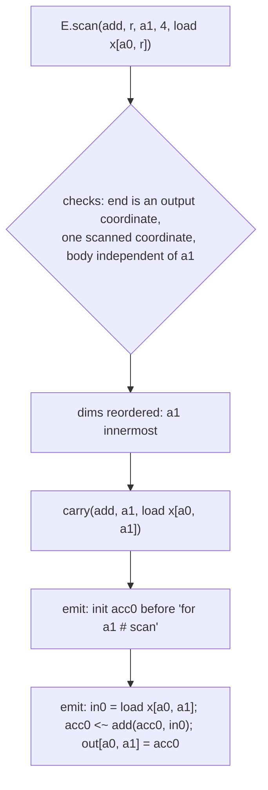

# Kiln: Cumsum as a Scan Primitive, From Masked Reduction to Block Scan

Kiln used to compile `torch.cumsum` as an ordinary reduction: output element `i` of a row summed every element `j` of the row, masked to zero where `j > i`. That formulation reused every part of the compiler and was correct, but it performed `n^2` additions for a row of length `n`, the cost model mapped it onto the matrix-product materializer at long rows, and integer rows of 1,024 or more did not compile at all. KILN-008 replaced it with a scan primitive that runs through all six of Kiln's intermediate representations: a Tensor IR op, a Loop IR expression whose value is defined at every index, a scheduler rule that turns that expression into an accumulator carried along an ordered loop, and two GPU mappings written in existing Kernel IR statements.

This note explains the design from the representation up. It is written for a reader who knows what a prefix sum is and wants to understand how a compiler whose intermediate form is "one pure expression per output element" can express a recurrence without giving up the properties that make that form useful.

> [!summary]
> - A scan is represented as an expression defined at every index (`fold_{r <= i} body`), so fusion, hash-consing and the point reference keep working; only the scheduler knows it is a recurrence.
> - The scheduler makes the scanned coordinate the innermost loop, hoists one `init` above it and emits a `step` inside it; the 2x4 cumsum nest has one load and one addition per position.
> - Two mappings use only existing Kernel IR statements: one thread per row with a serial loop, and one block per row with a chunked Hillis-Steele scan in shared memory and a block-wide carry.
> - The analytic estimate for an 8x4096 cumsum falls from 200.93 us (masked lowering, tiled) to 7.31 us (block scan); 8x1024 int64, which did not compile before, compiles. GPU compile and timing are still open.

## 1. What a scan is, and why Kiln could not say it

A prefix scan takes a sequence `x[0..n)`, an associative operation `op` and its identity `e`, and returns `y[i] = x[0] op x[1] op ... op x[i]` (the inclusive form). `torch.cumsum(x, dim)` is the inclusive scan with `op = +` along one axis, applied independently to every row along that axis. The sequential algorithm is the recurrence `y[i] = y[i-1] op x[i]`: `n - 1` operations and a dependency chain of length `n`.

Kiln's Loop IR describes each GPU kernel as a single scalar expression over its output coordinates `a0, a1, ...`, built from four node kinds: a literal (`num`), a load of an input at index expressions (`in`), a scalar function (`op`) and a reduction `red(fn, r, n, body)`, the fold of `body` over a fresh variable `r` in `0..n`. Two properties of this form carry the rest of the compiler. Expressions are hash-consed up to renaming of bound variables, so identical subcomputations are one value. And a kernel's value at an index is a pure function of that index, which is what lets the fusion pass substitute a producer's expression into a consumer at any index.

Neither property survives a recurrence. "The value at `i` is the value at `i - 1` plus `x[i]`" refers to another output element, not to the index alone. The only way to say "the sum of everything up to `i`" in the old Loop IR was a reduction over the whole row with a mask, which is what the old decomposition in `packages/kiln/src/std/tensor.js` did:

```js
// out[..i..] = sum_j [j <= i] x[..j..], masked through a view of the table [1, 0] indexed by (i - j < 0)
const spread = T.view(xs, wide, (c) => c.slice(0, -1).map((v, i) => (i === a ? c.at(-1) : v)));
const mask = T.view(tensor.const({ data: new Tensor([2], Float32Array.of(1, 0)), shape: [2] }), wide, (c) => [c[a].sub(c.at(-1)).lt(0)]);
const masked = tensor.ew([mask, spread, zero], { fn: "select", dtype: d });
return T.squeeze(T.reduce(masked, typedReducer("add", d), -1), -1);
```

After fusion this became one kernel whose nest, for a 2x4 input, loops over all four positions `r0` for every output `a1`:

```text
for a0 in 0..2:  # free
    for a1 in 0..4:  # free
        acc0 = 0
        for r0 in 0..4:  # reduce
            in0 = load n2[a1 - r0 < 0]
            in1 = load x[a0, r0]
            v0 = select(in0, in1, 0)
            acc0 <- add(acc0, in0)
        out[a0, a1] = acc0
```

The cost model treated this as what it is, a reduction, and at rows of 2,048 or more recognized it as a contraction: `x` (depending on `a0`, `r0`) times a triangular 0/1 matrix (depending on `a1`, `r0`). Cumsum was being compiled as a matrix product.

## 2. The representation: a scan defined at every index

The central decision is to add a Loop IR expression kind whose value is still defined index by index:

```text
E.scan(fn, r, end, n, body)
  value at an output index  =  fold_{r = 0 .. end} body        (inclusive; fn's operation and identity)
  end: an index expression, normally the scanned output coordinate (e.g. a1); n: its extent
```

Mathematically this is a reduction whose trip count is `end + 1`. It is pure in the index, so every expression-level tool still applies: `akey` hash-conses it (with bound-variable renaming inside `end`), `free` returns `free(body) - {r}` plus the variables of `end`, and `substE` substitutes through it. The recurrence appears only when the scheduler decides how to compute the value for every index of a row at once.

`end` is an index expression rather than a coordinate name. That choice turned out to carry the fusion legality rule. When the fusion pass inlines a scan producer into a consumer, it substitutes the producer's output coordinates by the consumer's load indices, and `end` moves with them. If the consumer reads the scan at its own coordinate, `end` stays `a1`. If it reads `cumsum[i - 1]`, `end` becomes `a1 - 1`; if it reduces over the scan (`amax(cumsum(x))`), `end` becomes the reduction variable. A constant `end` (a size-1 axis) folds the scan into an ordinary reduction of `end + 1` terms.

The Tensor IR side is one primitive, `tensor.scan(x, { fn, axis })`, with a reference `scanRef` that runs the left-to-right recurrence using the reducer's JavaScript implementation (exact BigInt for `add_i64`, `Math.fround` after each step for f32). The frontend's cumulative ops share a table:

```js
export const CUMULATIVE = { cumsum: { fn: "add", widen: true }, cumprod: { fn: "mul", widen: true },
                            cummax: { fn: "max", widen: false }, cummin: { fn: "min", widen: false } };
// decomposition, for each entry:
tensor.scan(convert(x, out.type.dtype), { fn: typedReducer(fn, out.type.dtype), axis })
```

Sums and products widen every integer dtype to int64 as PyTorch does; max and min keep their dtype. The lift rule turns `tensor.scan` into a kernel `E.scan(fn, r, a_axis, n, load x[.., r, ..])`.

## 3. Scheduling: from a definition to a carried accumulator

`schedule(expr, shape)` in `packages/kiln/src/std/loop.js` turns an expression into a loop nest: one free loop per non-unit output axis, every reduction placed in the deepest scope that binds its free variables, and every other node placed the same way, which is loop-invariant hoisting. Before this ticket, the loop kinds were `free` (independent iterations) and `reduce` (an accumulator whose value is usable only after the loop).

A scan adds a third kind, `scan`: a loop over an output coordinate whose iterations are ordered. The scheduler does four things with the scans of an expression:

1. It checks them. Every scan must fold along an output coordinate (not a reduction variable), all scans of a kernel must fold along the same coordinate, and a scan body must not depend on the scanned coordinate except through its position variable. Each violation is a `ScheduleError`.
2. It moves the scanned coordinate's loop to the innermost position. Writes go through explicit index expressions, so loop order changes the traversal, not the result.
3. It rewrites each scan into an internal `carry` node whose body is `body[r := a1]`. The ordinary placement rule then puts the body's loads inside the scan loop and hoists what depends only on outer coordinates.
4. It emits `init` for every carry immediately before the scan loop and a new statement `step {name, fn, val}` at the carry's position inside it.



A `step` differs from an `acc` in one respect that every consumer of the nest depends on: after an `acc`, the accumulator is not a usable value until its reduction loop ends; after a `step`, the accumulator is the scan's value at the current position, and later statements of the same iteration (the write among them) read it. The 2x4 cumsum now schedules as:

```text
n2 = loop.kernel k_cumsum_scan(x)  -> (2, 4) f32
    for a0 in 0..2:  # free
        acc0 = 0
        for a1 in 0..4:  # scan
            in0 = load x[a0, a1]
            acc0 <~ add(acc0, in0)
            out[a0, a1] = acc0
```

Kiln checks every GPU kernel against two CPU evaluators. `compileSerial` compiles the whole nest to JavaScript; a `step` compiles exactly like an `acc`. `compilePoint` computes a single output element and is the reference for sampled simulator checks. For a scan kernel it does not use the nest at all: a new function `pointExpr` compiles the expression by its definition, turning each reduction and each scan into an immediately invoked loop (`for (let r = 0; r <= a1; r++) q = R.add(q, body)`). The point reference therefore does not share the carried-accumulator code it checks.

## 4. Fusion: which scans may merge with their neighbors

The position-id idiom of the PassBench corpus is `(cumsum(ids != pad, dim=1) * mask) + 1`. Fusion should make that one kernel: the comparison and conversion inline into the scan body, and the multiply-add epilogue reads the scan at its own coordinate. Other programs must not fuse: `amax(cumsum(ids))` reduces over the scan, and a consumer reading `cumsum[i - 1]` would need two prefixes per position.

With `end` as an index expression, the rule is short. After `inlineInto` builds the fused expression, if it contains a scan, `scanFusionLegal` refuses it (`FusionIllegal`) when it holds a reduction, or when `schedule` refuses it:

```js
function scanFusionLegal(expr, c, p) {
  let red = false;
  walkE(expr, (n) => { if (n.k === "red") red = true; });
  if (red) throw new FusionIllegal(`${p.id} into ${c.id}: a kernel with a scan holds no reduction`);
  try { schedule(expr, c.attrs.shape); }
  catch (e) { if (e instanceof KilnError && e.kind === "ScheduleError") throw new FusionIllegal(`${p.id} into ${c.id}: ${e.message}`); throw e; }
}
```

The "no reduction" clause is stricter than necessary for correctness. It keeps the block-per-row mapping legal for every scan kernel, because that materializer has no cooperative row reduction beside the block scan. The position-id graph of `packages/kiln/test/integer-arithmetic.mjs` now produces:

```text
n33 = loop.kernel k_pos(ids)  -> (2, 6) i64
    for a0 in 0..2:  # free
        acc0 = 0
        for a1 in 0..6:  # scan
            in0 = load ids[a0, a1]
            v0 = ne_i64(in0, 0)
            v1 = to_i32(v0)
            v2 = to_i64(v1)
            acc0 <~ add_i64(acc0, v2)
            v3 = to_i32(acc0)
            v4 = mul_i32(v3, v1)
            v5 = to_i64(v4)
            v6 = add_i64(v5, 1)
            out[a0, a1] = v6
```

and `peak = amax(cumsum(ids))` stays a scan kernel feeding a reduction kernel. A side effect answered an open question of the design guide: the bool-to-int64 conversion before an integer cumsum used to stay a separate kernel, because inlining it into the masked `n x n` body multiplied its work by `n` and the fusion pass's 2 % work guard refused it. In a scan body it runs once per position, and it fuses.

## 5. Two GPU mappings

Kiln's Tile IR attaches a GPU mapping to each kernel through the `MAP` knob. For a scan, `MAP` keeps its meaning of "what one thread or block owns", where a row is every output coordinate except the scanned one. `analyze` in `packages/kiln/src/std/tile.js` records `an.scan = { v, n, rowDims, rows, carries, reductions }` and skips the reduction-row and contraction analyses. Both mappings are written in Kernel IR statements that already existed (`let`, `iset`, `load`, `store`, `sload`, `sstore`, `sync`, `for`, `if`), so the CUDA, WGSL and simulator emitters needed no change.

| MAP | owner | algorithm | work per row | dependency chain per row |
|---|---|---|---|---|
| `thread` | one thread per row | serial loop, register carry | n | n |
| `row` | one block of T threads per row | chunks of T positions; Hillis-Steele scan of each chunk in shared memory; block-wide carry | n log2 T | (n / T) log2 T |

`emitNest` in `packages/kiln/src/std/kernel.js` calls a mapping's `onScan` hook for a loop of kind `scan` and throws a `MaterializeError` when a mapping has none. The three pre-existing materializers have none, so none of them can parallelize an ordered loop by treating it as a free one.

### 5.1 One thread per row

`matScanThread` decodes the flat thread index over the row dimensions, guards `e < rows`, and emits the scan loop as a serial `for`. For the 2x4 cumsum:

```text
e = 1024 * bid + tid
if e < 2:
    acc0 = 0
    for a1 = 0; a1 < 4; a1 += 1:
        in0 = load x[a1 + 4 * e]
        acc0 = add(acc0, in0)
        out[a1 + 4 * e] = acc0
```

This mapping does the minimum work per row and its loads are independent across threads. Its weakness is the address pattern of a last-axis scan: adjacent threads read addresses `n` elements apart. For a scan along a non-last axis (for example axis 0 of a 16x65536 tensor), adjacent threads read adjacent addresses, and this mapping is the right choice.

### 5.2 One block per row

`matScanRow` turns the scan loop into a uniform loop over chunks of T positions; thread `tid` owns position `p = c0 + tid`. The statements between steps run under the guard `p < n`. Each `step` becomes an inclusive Hillis-Steele scan of the chunk in a shared array, then a combination with a carry that every thread holds:

```text
carry := e                                   # the init emitted before the scan loop
for c0 = 0; c0 < n; c0 += T:                 # uniform loop: every thread iterates
    p := c0 + tid
    x := e
    if p < n:  { body statements; x := step value }   # the identity past the end of the row
    s[tid] := x
    sync
    for d in 1, 2, 4, ..., T/2:              # unrolled at materialization time
        y := e
        if tid >= d:  y := s[tid - d]
        sync
        if tid >= d:  { x := op(y, x); s[tid] := x }
        sync
    prefix := op(carry, x)                   # the scan through position p
    carry  := op(carry, s[T - 1])            # the carry past this chunk
    if p < n:  { epilogue statements reading prefix; write }
    sync                                     # the next chunk rewrites s
```

The Hillis-Steele scan does `log2 T` rounds; in round `d` every thread at index `t >= d` adds the value at `t - d`. It performs `T log2 T` operations, against the Blelloch scan's roughly `2T`, but every round has the same shape and all threads stay active. The kernel is memory bound for reasonable row lengths (one load and one store per element against a few shared-memory operations per round), so the simpler algorithm was chosen.

Three details carry the correctness of this kernel:

- Positions past the end of the row contribute the identity, and their threads still execute every barrier. Every `sync` is in code that all threads of the block reach: the chunk loop has constant bounds and no `if` contains a barrier.
- The prefix for a position is a new name (`acc0_p` in the generated code), because statements after the step read the prefix while the carry `acc0` advances by the chunk total. The materializer copies the value map per chunk and binds the step's name to the prefix for the rest of the iteration.
- Each carried value has its own shared array (`s_scan0`, `s_scan1`, ...), so an int64 scan and an f32 scan in one kernel never share a typed array.

The generated CUDA for the int64 position ids at 2x64 with T = 32 begins:

```cuda
__shared__ long long s_scan0[32];
long long in0 = 0, v2 = 0, acc0_x = 0, acc0_y = 0, acc0_p = 0, acc0_t = 0, acc0 = 0, v5 = 0, v6 = 0;
acc0 = 0LL;
for (int c0 = 0; c0 < 64; c0 += 32) {
    p = (c0 + tid);
    acc0_x = 0LL;
    if ((p < 64)) {
        in0 = src0[((64 * bid) + p)];
        v0 = ((in0) != (0LL));
        v1 = ((int)(v0));
        v2 = ((long long)(v1));
        acc0_x = v2;
    }
    s_scan0[tid] = acc0_x;
    __syncthreads();
    ...
```

## 6. The cost model

`estimateScan` gives each mapping its own counts, which the existing `timeModel` converts to microseconds. For the thread map, each warp owns up to 32 rows and walks the scan loop serially, so a statement in the loop costs one warp instruction per position per warp, and a load's sectors follow the stride between adjacent rows. For the row map, each chunk runs the body once per thread and each step adds `4 + 3 log2 T` instructions, `2 + 2 log2 T` shared-memory wavefronts and `2 log2 T + 2` barriers.

The first version ranked the two mappings the wrong way for a single long row. The time model rewards more threads per block with better latency hiding and cannot see that a 1,024-thread block over one row has 1,023 idle threads, so one row of 32,768 chose the serial loop at TPB = 1024 (39.53 us). The fork now offers the thread map only block sizes up to the row count. A second correction caps a contiguous load's sector count at the warp's footprint, because consecutive positions of one thread read the same 32-byte sector from L1.

The resulting estimates on the A100 target, against the masked lowering's:

| shape, dtype | masked lowering | scan mapping | estimate |
|---|---|---|---|
| 8x512 f32 | row, 14.87 us | row, T = 512 | 3.38 us |
| 8x4096 f32 | tiled, 200.93 us | row, T = 1024 | 7.31 us |
| 64x2048 f32 | tiled, 136.85 us | row, T = 1024 | 4.91 us |
| 1x32768 f32 | row, 6334.09 us | row, T = 1024 | 40.99 us |
| 8x1024 i64 | did not compile | row, T = 1024 | 3.70 us |
| 16x65536 f32, axis 0 | (not probed) | thread, T = 32 | 8.61 us |

Because the PassNet cost gate sums these estimates over a compiled program (`predictedCost`), it sees the cheaper scan without any change of its own. One prediction of the design guide did not hold: for 4,096 rows of 16 along the last axis the model prefers the block mapping (3.48 us, launch bound) over the serial loop (5.10 us). The serial loop's strided per-thread stores against one coalesced warp per row is a real trade-off that only a GPU measurement can settle, so the model was not tuned to the guess.

## 7. Validating without a GPU

No CUDA compiler is installed on the development machine, so every check of this ticket runs on the CPU: the two Loop IR evaluators, Kiln's lockstep SIMT simulator (which executes one block at a time, every statement for all active threads before the next, with masks for divergent branches), CUDA and WGSL source assertions, the cost model, and PyTorch on CPU through the PassNet importer.

f32 scans are order sensitive, and neither mapping adds in the reference's left-to-right order, so `packages/kiln/test/scan.mjs` compares simulated output against an f64 reference with a bound that grows with the mapping's combine depth:

```text
|got_i - ref_i| <= 2 * depth * 2^-24 * sum_{j <= i} |x_j|
depth = n                          (thread map)
depth = ceil(n / T) + log2 T + 1   (row map)
```

The grid covers `(1,1)`, `(3,31)`, `(4,256)`, `(2,257)`, `(1,32768)`, `(4096,16)`, `(5,300)` and `(300,5)` along axis 0, and `(3,40,7)` along axis 1, with every block size the fork offers: 21 distinct kernels, all within the bound and all free of out-of-bounds accesses and of barriers in divergent code. Making the Hillis-Steele loop stop one round early fails the bound (`1.3152656555175781 vs 1.2024062797427177` at position 16 of a 31-element row).

Removing the barrier at the end of each chunk did not fail the first version of the test. In lockstep execution the read of `s[T - 1]` finishes for every thread before any thread stores the next chunk's value, so the simulator cannot exhibit that race; it detects barriers in divergent code, not missing barriers. The test now includes a structural check: it walks the chunk loop twice as a cycle and reports any shared store and shared load of the same array within one barrier interval unless both index `tid`. Both barrier deletions fail it.

Integer kernels cannot yet run in the simulator, whose per-thread arrays are `Float32Array` (that support is ticket KILN-010's). Integer scans are therefore checked through the Loop IR: the pipeline's Loop IR evaluation equals the frontend reference bit for bit for int64, int32 and bool inputs (with values past 2^53 and wrapping at 2^63), and `compileSerial` equals `compilePoint` at every element. Two PyTorch-on-CPU tests in `integrations/passnet/test_fx_compose.py` add a 2x2048 position-id model (exact) and an f32 model with two cumsums along different axes, which must not fuse into one kernel.

The corpus programs that use cumsum also pass a CPU gate. A copy of KILN-005's local compile gate (`scripts/03-local-compile-gate-scan.py` in the ticket) exported and compiled every graph of the eleven typed-slice3 tasks with the replay's settings and Kiln's internal end-to-end reference check: 51 of 51 graphs compiled. Each of the seven graphs of tasks 28 and 64 compiles its position ids into one fused scan kernel (for example `k_ew_cast_cumsum_scan` on a 2x1024 input, `MAP=row, TPB=1024`).

## 8. A shared defect fixed on the way

The integer failure at long rows was not in cumsum. `matTiled`'s operand staging named its temporary `"tv"` for every operand. The masked cumsum's mask operand is an f32 table view and its data operand is int64, so one name received two dtypes and Kernel IR typing refused it (`tv holds both i64 and f32 values in k_cumsum_reduce`). Each operand now gets a fresh name (`tv0`, `tv1`). Because the scan removes cumsum from the tiled path, the regression test `packages/kiln/test/tiled-mixed-dtype.mjs` builds the masked integer contraction directly in Tensor IR and pins `MAP=tiled`.

## 9. Current status

Implemented on branch `impl/kiln-008-cumsum-scan` in `/home/manuel/code/wesen/kiln/worktrees/kiln-008-cumsum-scan`, with all 50 Kiln test files and 180 PassNet tests passing:

- `packages/kiln/src/std/tensor.js`: `scanRef`, `tensor.scan`, the `CUMULATIVE` ops and their decomposition.
- `packages/kiln/src/std/loop.js`: `E.scan`, the scan handling in `schedule`, `step`, `pointExpr`, `liftScan`, `scanFusionLegal`.
- `packages/kiln/src/std/tile.js`: `an.scan`, `legalMaps`, the TPB filter, `launch`, `estimateScan`, `printTile`.
- `packages/kiln/src/std/kernel.js`: `onScan` in `emitNest`, `matScanThread`, `matScanRow`, the per-operand `tv` fix.
- `integrations/passnet/fx_import.py`: `torch.cumprod` and the values of `torch.cummax`/`torch.cummin`.
- Ticket: `ttmp/2026/11/01/KILN-008--kiln-cumsum-as-a-scan-primitive-intern-analysis-design-and-implementation-guide/` (design guide, diary Steps 4-8, probes `02-scan-mapping-estimates.mjs` and `03-local-compile-gate-scan.py`).

## 10. Open questions and next steps

- **GPU compile and timing.** The emitted CUDA has not been compiled with NVRTC. The KILN-005 typed-slice3 replay (whose families 28 and 64 use cumsum for position ids) must be rerun, and the two mappings timed against the masked lowering and PyTorch's CUDA cumsum at 8x512, 64x2048, 1x32768 and 4096x16.
- **Barrier cost.** The block scan uses two barriers per round, 20 per chunk at T = 1024. A double-buffered variant halves that and is the first candidate if timings show barrier cost.
- **Integer simulation.** Once KILN-010's integer simulator lands, the integer scan kernels should run through the same simulator grid with exact comparison.
- **Longer-range parallelism.** A single row still uses one block, so at most one SM. A warp-shuffle mapping needs a Kernel IR shuffle statement; a decoupled look-back mapping (Merrill and Garland, 2016) needs global status flags and memory ordering, which Kernel IR does not have.
- **More scans.** `logcumsumexp` needs a `logaddexp` reducer whose identity `-inf` combines with itself without producing NaN; exclusive and reverse scans need only an attribute and a different statement order or loop direction.
