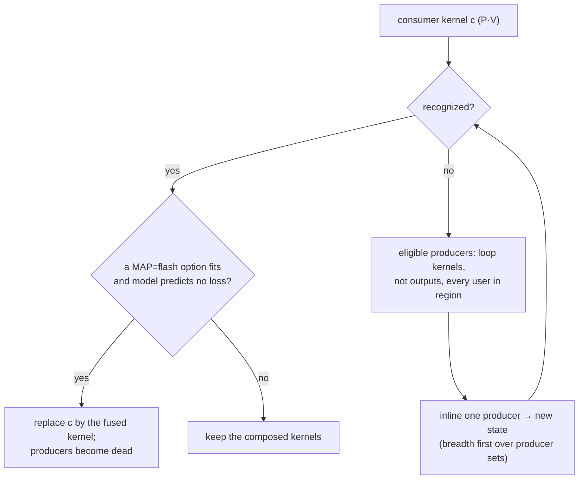

# Kiln: Fused Attention as a Recognized Expression and an Online-Softmax Kernel

Kiln compiles PyTorch's `scaled_dot_product_attention` (SDPA) as a composition: one matrix product for the scores, a softmax, and a second product with the values. Its fusion pass turns that composition into three GPU kernels, and the middle one writes and reads the full L×S score matrix of every head through global memory. This report describes how the composition became one kernel. The fused computation is not a new primitive in Kiln's intermediate representation; it is an ordinary Loop IR expression that a recognizer identifies, a new GPU mapping (`MAP=flash`) schedules, and a materializer spells out as an online softmax over tiles of keys. Everything was built and checked on a machine without a GPU: the reference evaluator, the SIMT simulator and NVRTC (CUDA C++ to PTX) all run on a CPU.

> [!summary]
> 1. After full inlining, attention is already one Loop IR expression whose serial evaluation is the reference. `packages/kiln/src/std/attention.js` recognizes it (scores, softmax statistics, values, epilogues) and a `loop/attention` pass inlines the smallest producer region the recognizer accepts, when a flash option fits the target and the model predicts no loss.
> 2. `MAP=flash` (`flash.js`, `flash-kernel.js`) gives each thread an RM×KN tile of scores and an RM×DPT tile of output accumulators, keeps per-row running maxima and sums, and passes probabilities through shared memory. 118 pinned options pass the simulator against the Loop IR reference, including ragged shapes and fully masked rows; 99 kernel variants compile with NVRTC for `compute_121` and `compute_89`.
> 3. A CPU dry run of the new probe showed that PyTorch returns 0, not NaN, for a fully masked attention row. The SDPA lowering now uses a softmax whose maximum and sum are floored, which is bit-identical on every other row.

## 1. The terms this report depends on

Kiln is a compiler written in JavaScript. A program passes through six intermediate representations (IRs): the PyTorch-like `nn` level, Tensor IR (five primitives: `const`, `ew`, `reduce`, `view`, `gather`), Loop IR, Tile IR, Kernel IR and the final `gpu` level with CUDA and WGSL source. Three of them matter here.

A **Loop IR kernel** (`loop.kernel`, `packages/kiln/src/std/loop.js`) holds one expression over its output coordinates `a0, a1, …`. Expressions have four constructors: a constant, a load `in_i[idx]`, a scalar operation `op(fn, …)`, and a reduction `red(fn, r, n, body)` over a fresh variable `r < n`. Expressions are hash-consed up to renaming of reduction variables, so two structurally equal reductions are the same object and have the same key. `schedule(expr, shape)` turns an expression into a loop nest, placing each value at the outermost loop where its variables are bound, and `compileSerial` compiles that nest into a JavaScript function with FP32 rounding after every operation. That function is the reference every GPU schedule is checked against.

**Fusion** replaces a load of a producer kernel by the producer's expression at that index (`inlineInto`). The standard rule accepts an inlining only when the estimated serial work grows by at most 2 %.

A **Tile IR kernel** adds a *mapping*: `MAP=thread` (one thread per output), `MAP=row` (one block per row, cooperative reductions) or `MAP=tiled` (a register-tiled contraction). An analytic cost model (`tile.js estimate`) predicts each option's time on a target, and the decider picks among legal options by pins, measured evidence, then the model. The **Kernel IR** materializer turns the chosen mapping into statements: integer and float assignments, global and shared-memory loads and stores, barriers, loops and conditionals.

## 2. Why attention was three kernels

For one head, with L queries, S keys, inner-product length E and value width D:

```
scores[i, j] = epi(Σ_e q[i, e] · k[j, e])          epi: scale, additive mask, or select(mask, s, -inf)
P[i, j]      = exp(scores[i, j] − M_i) / Λ_i        M_i = max_j scores[i, j],  Λ_i = Σ_j exp(scores[i, j] − M_i)
out[i, d]    = Σ_j P[i, j] · v[j, d]
```

The softmax needs the row maximum before it can exponentiate. If the fusion rule is told to accept every inlining, the whole computation becomes one Loop IR expression, and its serial evaluation matches the three-kernel version. Its schedule is the problem: the score is an inner product of length E that appears three times, once inside the maximum, once inside the sum and once inside the P·V reduction, and the last copy sits inside the loop over the output column d. A single fused kernel under the existing mappings recomputes every score D times; the model predicted 1543 µs against 44 µs for the three kernels at a BERT shape. The 2 % guard was right to refuse.

What was missing was a mapping that computes each score once and shares it across all output columns of its row. That mapping is the online softmax.

## 3. The online softmax

The online softmax (Milakov and Gimelshein, 2018) processes a row in blocks of keys and keeps three running quantities per query row: the maximum m seen so far, the sum l of `exp(s − m)`, and the output accumulator `acc[d] = Σ exp(s − m)·v[·, d]`. When a block raises the maximum to m′, the old sum and accumulator are rescaled by α = exp(m − m′):

```
m = -inf; l = 0; acc[0..D) = 0
for each key block J:
    m'  = max(m, max_{j∈J} s_j)
    α   = exp(m − m')
    l   = α·l + Σ_{j∈J} exp(s_j − m')
    acc = α·acc + Σ_{j∈J} exp(s_j − m')·v[j, ·]
    m   = m'
out = acc / l
```

In exact arithmetic this equals the three-pass softmax. In FP32 it differs by reordering error, measured at about 1e-6 in the ticket's earlier experiment. FlashAttention (Dao et al., 2022) applies it to attention: a block of queries stays on chip, blocks of keys and values stream through shared memory, and no L×S matrix reaches global memory.

The design decision that shapes the implementation is to leave the IR alone. The fused expression is still the three-pass formula; the online softmax exists only inside one mapping. Every consumer of a kernel's expression (identities at four IR levels, evidence records, the work estimate, and the simulator check that compares sampled outputs with `compilePoint(schedule(expr))`) keeps working unchanged, and the flash kernel is checked against the three-pass reference with a tolerance rather than bit equality.

## 4. Recognizing the expression

`matchSoftmaxContraction(expr, shape, inShapes)` in `attention.js` returns null or a description of the parts. It looks for a sum X over a key variable j whose body is a product of a probability term and a value term, and accepts two forms of the probability:

```
normalized:    X = Σ_j (exp(sub(s(j), M)) / Λ) · V(j, d)              out = post(X)
unnormalized:  X = Σ_j exp(sub(s(j), M)) · V(j, d)                   out = post(X / Λ)
where M = max_j s(j) and Λ = Σ_j exp(sub(s(j), M))
```

"The same score" is decided by keys. Each reduction's bound variable is substituted by a fixed marker variable `__j`, and the score inside the maximum, inside the sum and inside X must then have the same key. The score itself must contain exactly one reduction, the inner product `Σ_e A(e)·B(j, e)`, where A does not read j. Everything around it is the score epilogue `epi` (scale, mask, select), and everything around the core is the `post` expression (for example a narrowing round to f16). Neither may contain another reduction.

The coordinates are then classified. The value width coordinate d is the one output coordinate that V reads and the score does not. The block row coordinate i is a coordinate that the scores read and neither keys nor values read, so a block of BR consecutive query rows can share every staged key and value. The remaining coordinates are batch positions decoded from the block index.

The recognizer returns fragments with holes: the raw inner product inside `epi`, and the normalized core inside `post`. Each hole is represented as a load of a negative input index (`E.load(-2, [])`, `E.load(-1, [])`), which hash-conses like any other node. The materializer binds holes by identity and throws on an unbound one, so a marker can never reach generated code.

Two recognizer bugs appeared in testing and are instructive:

- A size-1 output coordinate is spelled `a0` by one view and the constant `0` by another, so the three copies of the score had different keys in a hand-written unnormalized variant. The recognizer now substitutes every size-1 output coordinate by 0 first.
- That fix made a single-query input (L = 1) lose its query coordinate, which had become a constant. The block row now falls back to any row coordinate that keys and values ignore.

## 5. Forming the expression

Ordinary fusion leaves attention as two or three kernels. The `loop/attention` pass runs after it and, for each candidate consumer whose region contains a `max` reduction, searches for the smallest set of producers whose inlining the recognizer accepts:



Two choices deserve their reasons. The design document placed the rule before ordinary fusion in the same pass. Kiln's fixpoint scan applies rules node by node, so "before" has no fixed meaning there, and because inlining is substitution the fully inlined expression of a region does not depend on how ordinary fusion partitioned it. Running afterwards only makes the search smaller. Second, the search stops at the smallest accepted set. Inlining every dominated producer would also pull a Q, K or V projection into the region; a projection is a matrix product, its reduction lands inside an operand fragment, and the recognizer would refuse the whole region. The search is bounded at six kernels and 48 states.

The rule fuses only when the cheapest flash option is predicted no slower than the sum of the composed kernels' cheapest options (`tile.js bestEstimate`). On the GB10 target this keeps D = 128 at L = S = 256 composed. The pipeline option `pipeline({ attention: "composed" | "fused" })` defaults to composed until the GPU replay qualifies the kernel, because a lockstep simulator cannot observe races between threads of one block.

## 6. The flash kernel

A block owns BR consecutive query rows of one batch position. Its threads form G = BR / RM row groups of TPR = TPB / G lanes. Lane `lane` of group g owns the rows `g + k·G` (k < RM), the keys `lane + n·TPR` of every key tile (n < KN = BC / TPR), and the output columns `lane + q·TPR` (q < DPT = ⌈D / TPR⌉).

```
sQ ← A(i, e) for the block's BR rows                                               sync
m_k = -inf (or the floor), l_k = 0, acc_kq = 0
for j0 in 0..S step BC:
    sK ← B(j, e), sV ← V(j, d) for the tile's keys (zero beyond S)                  sync
    s_kn = epi(Σ_e sQ[r_k, e]·sK[c_n, e]) in registers; sM[r_k, lane] = max_n s_kn  sync
    m'_k = max(m_k, max_t sM[r_k, t]);  α_k = exp(m_k − m'_k)
    sP[r_k, c_n] = exp(s_kn − m'_k);  l_k = α_k·l_k;  acc_kq = α_k·acc_kq           sync
    for c in 0..BC: p_k = sP[r_k, c]; l_k += p_k; acc_kq += p_k · sV[c, d_q]
    m_k = m'_k                                                                       sync
out = post(acc_kq / l_k)
```

Several properties of this structure are what make it correct, and each was a deliberate choice:

- Every lane of a row group reads the same partial maxima and the same probability row in the same order. The maximum is exact in any order, and the sum l is accumulated identically, so all copies of m and l agree bit for bit without a lane-0 broadcast.
- Barriers are never inside a guard. Bounds conditions (`i < L`, `j < S`, `d < D`) wrap loads, epilogues and stores only; the simulator flags a barrier reached by part of a block, and every test passes that check.
- A row whose scores are all −inf keeps p = 0 and α = 1 through a guard on `m′ > −inf`, so a plain softmax ends in 0/0 = NaN, as its three-pass reference does.
- The inner product sums e from 0 to E − 1 sequentially with the expression's own operation spelling (`mul_rn` and `add` under separate rounding), so scores are bit-identical to the reference; only the online rescaling reorders arithmetic.

The first version followed the design document's pseudocode: one score per lane per step, and every lane re-reading the whole BC-wide score row. The model said it was bound by shared memory: 1039 µs against 1167 µs for the composed path at B = 1, H = 16, L = S = 1024, D = 64. A SIMT inner product whose operands both come from shared memory performs `RM·KN / (RM + KN)` multiply-adds per shared load in the score phase and `RM·DPT / (RM + DPT)` in the P·V phase, so the rewrite register-tiles both. Replacing the BR×BC score tile with per-lane partial maxima (`sM`, BR×TPR floats) freed enough of the 48 KiB of static shared memory for larger tiles. Strides keep a warp's accesses in distinct banks: Q and K rows have odd stride E + 1, and probability rows have a stride congruent to TPR modulo 32.

Predicted times on the GB10 target (analytic model, not measured):

| shape B, H, L, S, D | composed | fused, chosen option | DRAM composed → fused |
|---|---:|---:|---|
| 2, 12, 128, 128, 64 (BERT) | 44.1 µs | 20.2 µs (BR 32, BC 32, TPB 256) | 9.13 → 3.13 MB |
| 1, 2, 512, 512, 64 (PassBench family 5) | 55.7 µs | 45.8 µs (BR 16, BC 64, TPB 256) | 10.00 → 2.22 MB |
| 1, 16, 1024, 1024, 64 | 1166.8 µs | 622.8 µs (BR 32, BC 32, TPB 256) | 276 → 39.4 MB |
| 1, 8, 256, 256, 128 | 63.1 µs | not fused (flash 71.4 µs) | unchanged |

The kernel remains shared-memory bound in the model: about two multiply-adds per shared load is what FP32 SIMT reaches within 48 KiB. Allowing eight rows per thread did not help, because 64-thread blocks with 45 KiB of shared memory leave too few warps per SM.

## 7. The seam for tensor cores

KILN-006, built in parallel, exposes warp-level tensor-core helpers (`mmaAccumulators`, `mmaWarpStep`, `mmaAccElements`) with the invariant that every warp executes each `mma` with all 32 lanes active. The flash kernel is written against two product operations in `flash-kernel.js`:

- `scores(kb, ctx)` returns the inner products a thread holds as elements `{ slot, row, key, value }`, the shape `mmaAccElements` returns; the epilogue, partial maxima and probabilities iterate over elements. It is called outside every guard.
- `pv(kb, ctx)` performs the whole key-tile P·V update from `sP` (row-major `[row][key]`) and `sV` (row-major `[key][d]`).

The known obstacle to chaining two tensor-core products is that the first product's accumulator layout is not the second product's A-operand layout. Probabilities already pass through `sP` here, so that obstacle does not arise. An `mma` implementation still needs its own thread geometry, a K tile staged `[e][key]` (the B layout `mmaWarpStep` reads) and partial maxima keyed by an element's row.

## 8. A correctness gap found by a probe run on the CPU

Probe 676 is the design's Phase 0: for f16 and bf16 inputs, which SDPA backend PyTorch runs and where it rounds the probabilities, and what it returns for a fully masked row. It is meant for the GPU host, but it also runs on a CPU. The dry run with torch 2.11 answered the last question for the CPU already: every backend that runs returns 0 for a row whose mask removes every key, with a bool mask or an additive −inf mask, in f32, f16 and bf16. Kiln's composed lowering produced NaN there, and the design document had assumed NaN.

The lowering now uses `N.safeSoftmax`:

```js
safeSoftmax: (x, dim = -1) => {
  const e = N.exp(N.sub(x, N.max(N.amax(x, dim), -3.4028234663852886e38)));   // max floored at -FLT_MAX
  return N.div(e, N.max(N.sum(e, dim), 1.1754943508222875e-38));               // sum floored at FLT_MIN
}
```

On any row with a finite score the floors never bind: the maximum is above −FLT_MAX, and the sum is at least 1 because the maximum contributes exp(0). The result is bit-identical there. On a fully masked row the shifted scores are −inf, every exponential is 0, and 0 divided by FLT_MIN is 0. A comparison-and-select formulation would have been the obvious alternative, but a comparison produces a bool value, which the SIMT simulator cannot store yet; the floors use only float operations. The recognizer accepts `max(red, c)` in both places, and the flash kernel reproduces the floors by starting m at the floor and dividing by `max(l, floor)`. The importer test now compares a fully masked bool row and a fully −inf additive row with PyTorch, for both the composed and the fused compile.

## 9. How it was checked without a GPU

| check | where | result |
|---|---|---|
| recognizer fields and refusals (softmax only, product only, log-softmax, softmax over the other axis) | `packages/kiln/test/attention.mjs` | pass |
| fused Loop IR against the frontend reference | same | max abs < 1e-6 |
| fork leaves equal `flashOptions`; every option under the target's shared-memory limit (gb10, WebGPU defaults; D = 64, 128) | same | pass |
| `simulateKernel` on every legal option of six shapes (ragged L, S and D; E ≠ D; masks; f16; WebGPU) | same | 118 options, max abs < 1e-5 |
| `simulateFull` element by element against `runSerial` with fully masked rows (safe → 0, plain → NaN) | same | pass |
| importer's SDPA against PyTorch, composed and fused, including fully masked rows | `integrations/passnet/test_fx_compose.py` | atol 1e-5 |
| CUDA C++ to PTX with NVRTC, 99 variants | ticket `scripts/04-…mjs`, `scripts/05-nvrtc-compile.py` | 99/99 for `compute_121` and `compute_89` |

Two limits of this evidence are known. The SIMT simulator executes a block in lockstep, so a missing barrier would still pass; the barrier placement above is argued, not tested. And bool-mask kernels cannot run in the simulator at all (no bool storage, owned by KILN-010); they are covered by Loop IR evaluation and NVRTC only.

## 10. Open questions and remaining GPU work

- **Probe 676 on the GB10.** Which f16/bf16 backend runs on sm_121, where it rounds P, and whether the GPU backends also return 0 for fully masked rows. If one returns NaN, the lowering must follow the backend the evaluator uses.
- **Registers and spills.** `ptxas` on the GPU host for `sources/nvrtc-flash-v1/flash-kernels.json`.
- **Replay.** PassBench family 5 with `attention: "fused"` against `"composed"` (`evaluate_tasks.py` plan key `attention`, or `corpus.py compile --attention fused`), then the default flip if accepted graphs do not regress.
- **The end-to-end export check.** The fused expression's serial reference costs O(L·D·S·E), so `kiln-export` skips its internal check at realistic shapes. An evaluator that hoists the score out of the column loop would be exact, because each column's accumulation order over keys is unchanged.
- **Tensor cores.** An `mma` product behind the seam once KILN-006 merges, and dynamic shared memory above 48 KiB.

## Source map

- `packages/kiln/src/std/attention.js` — `matchSoftmaxContraction`, `floored`, `regionSearch`, `createAttentionRule`.
- `packages/kiln/src/std/flash.js` — `flashGeometry`, `flashLayout`, `flashOptions`, `flashCounts`, `printFlash`.
- `packages/kiln/src/std/flash-kernel.js` — `matFlash`, `products.simt`.
- `packages/kiln/src/std/tile.js` — `MAP=flash`, knobs `BR`, `BC`, `RM`, `bestEstimate`; `kernel.js` dispatch; `emmy.js` `attention` option.
- `packages/kiln/src/std/tensor.js` — `N.safeSoftmax`; `integrations/passnet/fx_compose.py` — `lower_sdpa`.
- Ticket: `ttmp/2026/11/01/KILN-007--kiln-fused-attention-intern-analysis-design-and-implementation-guide/` (design doc Section 13, diary Steps 6-10, probe 676, NVRTC logs).
