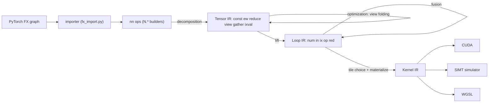

# Kiln: Index Values, Factory Ops and Slice Assignment in a Functional Tensor Compiler

Kiln compiles a tensor program into GPU kernels by representing each kernel as one scalar expression over its output coordinates. Until KILN-010 those coordinates existed only as *addresses*: they appeared inside the index expressions that say which element a load reads, and no scalar computation could use a coordinate as a *value*. PyTorch programs use coordinates as values all the time. `torch.arange(n)` is the coordinate itself; `meshgrid`, relative-position tables, causal masks and `argmax` are arithmetic on coordinates. This note explains how one new expression kind, the index value, closes that gap through every stage of the compiler, and how the frontend features built on it (factory ops, slice assignment, argmax, causal attention) were made to agree exactly with eager PyTorch.

> [!summary]
> - A Loop IR leaf `E.ix(e, dtype)` evaluates the integer index expression `e` at the current loop coordinates. It is a load without memory: every stage that rewrites a load's index expression rewrites `e` the same way.
> - `tensor.ixval` is the Tensor IR tensor of such values. Views of it fold by substitution, so `arange → meshgrid → stack → flatten → permute` chains collapse into one integer expression and no index table ever exists in memory.
> - Slice assignment `x[region] = y` is functional: `select(in_region(c), y[clamp(c − start) / step], x[c])`. The importer records basic-index views of freshly allocated tensors and turns `setitem` and in-place arithmetic on those views into assignments to the root.
> - The 20 corpus graphs previously blocked by `get_attr` constants or `new_zeros` all import; for the float32 variants, Kiln's frontend reference and its compiled Loop IR equal eager PyTorch exactly on every factory output, including BEiT-large's 1,050,625-element relative-position table. The full 2060-record import census moves from 1931 to 1961 imported with zero regressions. GPU compilation and PassBench replays remain to be run.

## 1. Background: what a Kiln kernel is

The terms in this section are used throughout the rest of the note, so they are defined in dependency order.

An **index expression** (module `packages/kiln/src/core/ix.js`) is an immutable integer expression. Its leaves are constants `C(v)`, variables `V(name)`, and a data-dependent leaf `LD(i, idx)` meaning "the integer stored in kernel input `i` at index `idx`" (how gathers read their indices). Its operators are `+`, `*`, floor `/` and `%`, `min`, `max`, the comparisons `<`, `<=`, `==` (which evaluate to 0 or 1), and `&&`, `||`. Every constructor simplifies: sums normalize to coefficient-times-term plus a constant, and division by a constant cancels what divides exactly.

The **coordinate variables** of a kernel are `a0 … a{n−1}`, one per output axis. A **reduction variable** `r<k>` is bound by one reduction loop.

A **Loop IR expression** has four kinds before this work: `num` (a literal), `in` (input `i` read at index expressions `idx`), `op` (a scalar function applied to sub-expressions) and `red` (a reduction binding a variable over `[0, n)`). Expressions are hash-consed up to renaming of reduction variables, so two copies of the same reduction are one value. Scheduling places each node at the outermost loop where all its free variables are bound, which is loop-invariant hoisting.

Below Loop IR, the **Kernel IR** (`kernel.js`) makes threads, shared memory and flat addresses explicit, and three **emitters** (`emit.js`) render it: CUDA C++, WGSL, and a lockstep SIMT simulator written in JavaScript that the test suite uses to check kernels on a machine without a GPU.



## 2. The problem: coordinates that are values

Consider `out = x + torch.arange(4)` with `x` of shape `[3, 4]`. The value added at output coordinate `(a0, a1)` is `a1`. Before KILN-010 there were two ways Kiln could have represented it, and the codebase already used both as workarounds elsewhere:

- **A data table.** Materialize `[0, 1, 2, 3]` as a constant buffer and load it. The cumsum lowering did exactly this with a two-element table `[1, 0]` indexed by a comparison, and concatenation loaded a 0/1 mask the length of the concatenation axis. Tables cost a buffer and a load per element, and BEiT-large's relative-position table would need 1,050,625 int64 values, 8.4 MB.
- **An implicit iota input.** Pretend a load exists from a buffer whose element `i` is `i`. Every stage would believe a memory access happens, which corrupts the cost model and the shared-memory staging analysis.

Neither is the computation PyTorch performs. The research for this ticket also showed why the corpus contained these tables at all: Kiln's symbolic tracer passes proxies only for a forward's tensor arguments, so `torch.arange(24)` received a Python integer, ran eagerly, and its input-independent result reached the graph as a `get_attr` constant `_tensor_constant0`. TorchDynamo, which feeds the evaluation harness, keeps the factory calls as nodes. Seventeen graphs in three model families (BEiT, ConViT, MPNet) were blocked by that `get_attr`, and three more by an unregistered `new_zeros`.

## 3. The index value

The design adds one expression kind:

```js
// loop.js
E.ix(e, dtype)   // value of the index expression e at the current coordinates; dtype i64, i32 or bool
```

The rule that makes this a small change instead of a large one is that **an index value behaves like a load with no memory access**. Its expression contains coordinates, reduction variables and possibly `LD` terms, exactly like a load's index expressions, so every stage that rewrites a load's index rewrites an index value's expression the same way. The table lists every site.

| Stage | Behavior for `ix` |
|---|---|
| hash-consing key (`akey`) | `ix:<dtype>:<key of e>`, with bound reduction variables renamed to de Bruijn distances like `in` |
| `free` | the variables of `e` |
| `substE` | `E.ix(subst(remapLoads(e), env))` |
| `schedule` | named `x0, x1, …`; emitted as a `let` |
| `workOf` | weight 1 (integer arithmetic, not memory) |
| `compileSerial`, `compilePoint` | exact JS, `BigInt(...)` for i64 |
| fusion `inlineInto` | `E.ix(remapIdx(subst(e, ren)))` |
| Kernel IR `emitNest` | `{k:"ix", e: subst(e, ctx.env)}` |
| `valueTypes` | the declared dtype |
| CUDA | `((long long)(…))`, `((int)(…))`, `((…) != 0)` |
| simulator | exact JS over per-thread integer arrays |
| WGSL | refused by name |
| tiled contraction test | an `ix` in or hoisted into the contraction body disqualifies `MAP=tiled` |

The fusion case is the one where a missed rewrite would be silent. Fusion renames reduction variables so that two inlined reductions never share a name, and it renumbers inputs when argument lists merge. An index value that skipped either rewrite would refer to another loop's variable or another input. The test `packages/kiln/test/index-values.mjs` covers each site: α-equivalent reductions over `E.ix(r)` intern to one value, an index value inside a reduction body is scheduled inside that loop under both `MAP=thread` and `MAP=row`, and one in the epilogue of a tiled matrix product reads the tile's coordinates.

Two invariants are checked when the node is built or scheduled. A bool index value must be a predicate (a comparison, `&&` or `||`), so its value is 0 or 1. And because the kernel computes index arithmetic in 32-bit `int` before widening, `schedule` computes the interval of every subexpression over the loop extents and refuses any that leaves int32, naming the expression.

### 3.1 Signed division

`IX.emit` spelled `/` and `%` with C's truncating operators, which is correct for addresses because coordinates are nonnegative. Index values are not addresses: BEiT computes `i − j`, which is negative for half the table, and then divides and takes remainders. The emitter gained a `signed` flag. With it, any dividend whose interval (all variables nonnegative) may be negative is spelled with floor semantics:

```c
// floor((i - j) / 3) for an index value; e / 5 and e % 5 decode coordinates and stay truncating
x0 = ((long long)((((-1*(e%5)) + (e/5)) - ((((-1*(e%5)) + (e/5)) % 3) + 3) % 3)) / 3)));
```

Without the flag the output is byte-identical to before, so no existing kernel changes.

### 3.2 The simulator learns integers

The SIMT simulator was float-only: integer temporaries were removed from the list of float temporaries and never declared, inputs were always `Float32Array`, and the output was a `Float32Array`. No integer kernel had ever been simulator-checked, and gathers had no simulator spelling for their data-dependent index. KILN-010 gives every temporary, shared array and output a typed array of its static type (`BigInt64Array` for int64, `Int32Array`, `Uint8Array`), converts number operands to BigInt on assignment into int64 storage, spells `LD` terms as reads of the integer input, and compares integer outputs exactly against the Loop IR reference. Float inputs keep the shared seeded values so that GPU runs and the browser compare against the same references.

The same change fixes a second limitation. Row reductions combined partial results through one shared array named `s_red`, and the type checker refused a shared array holding two dtypes, so a kernel with an f32 and an int64 row reduction could not use the row mapping. Each accumulator dtype now has its own array (`s_red` for f32, keeping every existing kernel's source unchanged, and `s_red_i64`).

## 4. Index tensors and factories

`tensor.ixval { shape, map, dtype }` is the Tensor IR tensor whose element at `c` is `map.exprs[0]` at `c`. One optimization rule does most of the work:

```text
fold_view_of_ixval:  view(ixval(e), m)  →  ixval(subst(e, {a_j: m_j}))
```

Because `meshgrid`, `stack`, `flatten`, `permute`, `unsqueeze`, `repeat` and `view(-1)` all lower to views, a chain of them over `arange` collapses into one index expression before lifting. Lifting turns an `ixval` operand of an elementwise op directly into `E.ix`, the way a splat constant becomes `E.num`. The factory builders are thin:

```js
N.arange(start, end, step, dtype)   // ixval(start + step * a0); a floating dtype converts exact integers
N.full(shape, value, dtype)         // typed splat; zeros/ones are N.full(shape, 0|1, dtype)
N.indexValue(shape, fn, dtype)      // ixval over a lambda of coordinates
N.causalMask(L, S)                  // N.indexValue([L, S], ([i, j]) => j.le(i), "bool")
```

The two data-table workarounds disappear. Cumsum's mask is the bool index value `j <= i`, and concatenation's mask is `start <= c < start + width`; both kernels lose an input buffer. Concatenation also now accepts integer and bool dtypes, which BEiT needs because `torch.stack` of two int64 grids lowers through it.

## 5. Slice assignment in a functional IR

Kiln values are immutable, while PyTorch's `x[index] = y` writes into storage. The design represents the write as a new value equal to `x` outside the region and to `y` (broadcast and converted to `x`'s dtype) inside it:

```text
nn.assign(x, index, y):          index: one entry per axis, {at: k} or {slice: [start, stop, step]}
  R       = region shape (slice lengths; `at` axes dropped)
  inR(c)  = AND over axes:  at → c == k
                            slice → start <= c && c <= last && (c - start) % step == 0
  read(c) = y_R[ min(max(c - start, 0) / step, len - 1) per slice axis ]
  out     = select(ixval(inR), read, x)
```

Two details matter. `select` evaluates both operands, so the read of `y` happens at every coordinate, including those outside the region, and must stay in bounds; clamping every read is the same rule the concatenation lowering already followed. Clamping *before* dividing keeps the dividend nonnegative, so truncating and floor division agree and the address spelling stays cheap. The instrumented simulator reports any out-of-bounds access, and the assignment tests run with it.

### 5.1 Writes through views in the importer

The BEiT graph writes through views:

```python
t = rel.permute(1, 2, 0).contiguous()   # a copy: fresh storage
v = t[:, :, 0]                           # a view of t
v += 23                                  # writes into t
t[:, :, 0] = v                           # setitem: writes into t again
```

The importer already had an ownership rule for in-place calls: a call may update a single-use input or a fresh value that nothing aliases. A `getitem` was an alias, so `v += 23` was refused. KILN-010 adds a second, tracked kind of alias. When `getitem` has a basic index (integers, slices with positive step, `None`, one `...`) and its source is a fresh, unaliased root, the importer records a `View(root, entries, axes)` (`integrations/passnet/fx_assign.py`): per root axis either `('at', k)` or `('slice', start, stop, step)`, and per view axis either a root axis or an inserted `None`. Views of recorded views compose.

```mermaid
sequenceDiagram
  participant G as FX node
  participant C as importer Context
  participant K as Kiln script
  G->>C: getitem t[:, :, 0]
  C->>C: views[v] = View(t, [all, all, at 0])
  G->>C: iadd v, 23
  C->>K: v1 = N.add(v, 23)
  C->>K: t1 = N.assign(t, [all, all, {at: 0}], v1)
  C->>C: rebind t → t1; re-derive live views of t from t1
  G->>C: setitem t[:, :, 0] = v
  C->>K: t2 = N.assign(t1, [all, all, {at: 0}], v)
```

After each write, every name of the root reads the new value, and every recorded view that a later node still reads is re-derived from it, so a later read of `v` sees the root's current contents. Any other alias (a `permute`, a `reshape`, a `.view(…)` of a tracked view) marks the root aliased, and a later write through any path is refused with the existing message. `contiguous()` became a copy with fresh storage when its source's strides are not row-major, and an alias otherwise, which is what PyTorch does.

One defect surfaced only once writes through views were traceable: the corpus dead-code eliminator kept an in-place call only if the written node itself was read later. `p = t.permute(1, 0); p[0] = 1; return t` lost its write, because `p` had no later reader. The observability test now follows view operations up to their source, over-approximating: keeping a node can only produce an explicit refusal, while erasing it drops a write.

### 5.2 Keeping factories in the trace

`fx_trace.py` replaces `torch.arange`, `torch.zeros`, `torch.ones`, `torch.full` and `torch.meshgrid` for the duration of one `trace` call with wrappers that emit `call_function` nodes targeting the original functions, and restores them in a `finally`. `MutationProxy` gains `__setitem__`, which FX's `Proxy` lacks, recording `operator.setitem`. The importer then lowers the factories from the recorded result metadata (`arange` with integer arguments, `zeros/ones/full`, `*_like`, `new_zeros/new_full`, `meshgrid` with `ij` and `xy` indexing) along with `repeat`, `repeat_interleave`, `where`, integer `abs`, integer `x ** 2` and integer sums.

## 6. Consumers: argmax and causal attention

Kiln's reducers are scalar, so argmax has no pair accumulator. It is expressed as one integer reduction over an index-valued key, which gives PyTorch's tie and NaN rules from `min`:

```text
m      = max_r x[r]
key(r) = isnan(x[r]) ? r : (x[r] == m ? n + r : 2n)
k      = min_r key(r)
idx    = k < n ? k : k - n          # first NaN if any, else first maximum
```

On the probe rows `[1, 3, 3, 0]`, `[nan, 2, nan, 5]`, `[5, 2, nan, 5]` and `[2, 2, 2, 2]`, Kiln, `torch.max(x, -1).indices` and `torch.argmax` all give `[1, 0, 2, 0]`. Under `MAP=row`, the generated kernel contains both `__shared__ float s_red[…]` and `__shared__ long long s_red_i64[…]`, which is the mixed-dtype combine the per-dtype arrays of Section 3.2 enable.

Causal attention (`scaled_dot_product_attention(…, is_causal=True)`) becomes `select(N.causalMask(L, S), scores, −inf)`. PyTorch's mask keeps key `j` for query `i` when `j <= i`, top-left aligned when `L ≠ S`; the importer test checks (L, S) = (3, 5), (4, 4) and (5, 3) against PyTorch.

## 7. Results

All results were produced on a CPU-only machine (torch 2.11.0+cu130 on CPU). The evidence files are in the ticket directory `ttmp/2026/11/01/KILN-010-…/sources/`.

**The 20 target records** (`scripts/06-import-census-and-reference.py` → `import-census-v1.json`): 20 of 20 import. For each float32 variant, Kiln's frontend reference and compiled Loop IR were compared with eager PyTorch on seeded inputs:

| Graph | Factory output | Kiln vs PyTorch | Other outputs |
|---|---|---|---|
| BEiT base-384 | int64 `[332929]` | exact | exact |
| BEiT large-512 | int64 `[1050625]` | exact | exact |
| ConViT tiny / small | float32 `[1, 196, 196, 3]` | exact | layer norm within 5.7e-6 |
| MPNet (all-mpnet-base-v2) | int64 `[7, 7]` | exact | layer norm within 2.4e-6 |
| GAE | float32 zeros `[1000, 16]` | exact | exact |

Compiled to GPU kernels and simulated, BEiT's table is one zero-input thread-mapped kernel (`k_out1 … ins [] out i64 332929 sim true integer values equal`), and ConViT's is one zero-input kernel as well.

**The full census** (`scripts/07-full-census-regression.py` → `census-regression-v1.json`), all 2060 records of the KILN-005 views-ops census:

```text
imported before 1931   imported now 1961   imported → blocked 0
blocked → imported 30  (20 targets + 10 formerly "Found no NVIDIA driver")
```

The ten extra imports had factory calls with `device='cuda'` that previously ran eagerly during tracing on a machine without a GPU; their numerics need the GPU host.

**Test suites:** `packages/kiln` 49 of 49 test files; `integrations/passnet` 186 tests.

## 8. What remains, and open questions

- **GPU validation.** NVRTC compilation of the new kernel shapes (index values under thread, row and tiled maps; the BEiT and ConViT tables; argmax with two combine arrays; causal attention), and PassBench replays of the three families. These are the only parts of the work that cannot run on CPU.
- **Pattern matching (Q1).** PassBench rule patterns are traced by `fx_normalize.trace_pattern` with a plain `torch.fx.Tracer`. If that tracer folds the factory region into a `get_attr`, the pattern cannot match a Dynamo target graph that contains `arange` nodes. Whether the pattern tracer needs the same factory wrappers decides whether these graphs can be claimed in PassBench.
- **Index arithmetic quality.** The fused BEiT kernel is correct and loads nothing, but it carries nested clamps such as `min(max(min(max(…, 0), 575), 0), 575)` and terms like `(clamped / 576) % 2` that an interval-aware simplifier would fold to constants.
- **WGSL.** Index values are refused in WGSL, so cumsum and concatenation kernels, which used to load tables, are now CUDA-only until WGSL spells i32 and bool index values.
- **NaN values of `max(dim)` (Q2).** The indices are PyTorch-exact; the values still follow Kiln's `max` reducer, which drops a NaN held in the accumulator.

## 9. Where to read the code

- `packages/kiln/src/std/loop.js` — `E.ix`, `checkIxRange`, `inlineInto` case `"ix"`, `lift_ixval`.
- `packages/kiln/src/core/ix.js` — `emit(…, signed)`.
- `packages/kiln/src/std/kernel.js`, `emit.js`, `program.js` — Kernel IR `ix`, per-dtype `s_red`, the typed simulator, `simInputs`, `checkExact`.
- `packages/kiln/src/std/tensor.js` — `tensor.ixval`, `fold_view_of_ixval`, `nn.arange`, `nn.assign`, `nn.argmax`, `nn.repeat`.
- `integrations/passnet/fx_trace.py`, `fx_assign.py`, `fx_import.py` — factory-preserving tracing, view regions, `write_region`, `lower_setitem`.
- Tests: `packages/kiln/test/index-values.mjs`, `integrations/passnet/test_fx_factories.py`.
- Ticket: `ttmp/2026/11/01/KILN-010-…/design-doc/01-…md` (design guide) and `reference/01-diary.md` (Steps 6–9 record the implementation).

## Related notes

- [[kiln|Kiln MOC]] — reading map of all Kiln compiler and PassNet notes, grouped by question.
