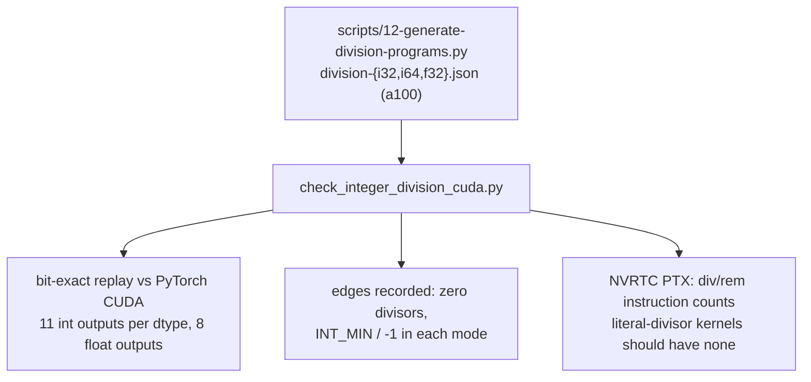

# Kiln: Integer Floor Division and Modulo, Signs, Overflow and Exact Literals

Kiln could add, subtract, multiply, compare and convert integer tensors exactly, but it refused every division: `a // b`, `a % b`, `torch.div(a, b, rounding_mode="trunc")`, `torch.fmod`, and even plain `a / b` on integers all failed with `div over i64 values is not lowered`. KILN-011 adds the four rounded divisions as typed scalar functions over int32 and int64, resolves integer true division to float32 division as PyTorch does, adds the float32 forms of the same four functions, and teaches the PassNet importer every FX spelling of them. Before any of that could work, it fixed the loop-level constant folder and the serial evaluator, which both lost int64 precision.

This note explains the work from the arithmetic up. The difficulty is not the amount of code; it is that the obvious spellings are wrong for half of all sign combinations, and that the corpus data never exercises those combinations.

> [!summary]
> - C and CUDA integer `/` and `%` truncate toward zero; Python and PyTorch `//` and `%` round toward negative infinity. They differ exactly when the remainder is nonzero and its sign differs from the divisor's, and the correction is one subtraction.
> - Each operation is a typed `FNS` entry with an exact JS reference (BigInt for int64) and a CUDA device helper that makes `INT_MIN / -1` explicit, because that case is undefined behavior in C.
> - Integer literals had to become exact first: the folder rounded int64 results through `Number()`, the intern key merged literals that share a double, and the serial evaluator rounded every literal through `Math.fround`, so `x + 16777217` evaluated to `x + 16777216`.
> - On CPU, 31974 int32/int64 cases and 100576 float32 pairs agree with PyTorch, and 25 of 25 upstream graphs that divide tensors import and agree exactly. NVRTC compilation and GPU replay are still open.

## 1. Two definitions of integer division

Every integer division produces a quotient `q` and a remainder `r` with `a == q * b + r` and `|r| < |b|`. The identity alone does not determine `q`: for `a = -7, b = 2`, both `q = -3, r = -1` and `q = -4, r = 1` satisfy it. A definition of division is a rule that chooses one of the two candidates.

- **Truncating division** rounds the true quotient toward zero. The remainder then has the sign of the dividend `a`. C, C++, CUDA, JavaScript `BigInt` and the x86 `idiv` instruction use it. PyTorch exposes it as `torch.div(a, b, rounding_mode="trunc")` and `torch.fmod(a, b)`.
- **Floor division** rounds the true quotient toward negative infinity. The remainder then has the sign of the divisor `b`. Python uses it for `//` and `%`, and PyTorch follows Python for `//`, `torch.floor_divide`, `torch.div(..., rounding_mode="floor")`, `%` and `torch.remainder`.

The two agree whenever the true quotient is nonnegative or exact. They disagree when the operands have opposite signs and the division is inexact. The sign table that the KILN-011 tests use, observed on PyTorch 2.11 CPU, makes the pattern visible:

| `a` | `b` | `a // b` | trunc | `a % b` | `fmod` |
|---:|---:|---:|---:|---:|---:|
| 7 | 2 | 3 | 3 | 1 | 1 |
| -7 | 2 | -4 | -3 | 1 | -1 |
| 7 | -2 | -4 | -3 | -1 | 1 |
| -7 | -2 | 3 | 3 | -1 | -1 |
| 6 | -3 | -2 | -2 | 0 | 0 |
| 1 | -5 | -1 | 0 | -4 | 1 |

The rows with `-7, 2` and `7, -2` are the whole problem. In the PassNet corpus, every use of tensor floor division or modulo has a nonnegative dividend and a positive literal divisor (`idx // 80` and `idx % 80` in yolov10l, `pos % 16` in long-t5). On that data, a kernel that spells `//` as C `/` passes every replay and is still wrong.

## 2. The correction, derived once

C guarantees `a == q * b + r` with `q` truncated and `r` either zero or of the sign of `a`. The floor quotient differs from `q` exactly when `r != 0` and `r` and `b` have opposite signs; in that case the true quotient is negative and not an integer, so the floor is one below the truncation. Substituting `q - 1` into the identity gives the matching remainder:

```text
a == q * b + r == (q - 1) * b + (r + b)
```

`r + b` has the sign of `b` and magnitude below `|b|`, which is the floor remainder. Floor division therefore costs one truncating division (which also yields `r`), a sign test and a conditional subtraction. Kiln encodes the predicate once in the JS reference:

```js
// packages/kiln/src/std/fns.js
const stepsDown = (r, b) => r != 0 && (r < 0) !== (b < 0);
floordiv:  (a, b) => { ...; const q = a / b; return wrap64(stepsDown(a % b, b) ? q - 1n : q); },
remainder: (a, b) => { ...; const r = a % b; return stepsDown(r, b) ? r + b : r; },
truncdiv:  (a, b) => { ...; return wrap64(a / b); },
fmod:      (a, b) => { ...; return a % b; },
```

JavaScript `BigInt` `/` and `%` truncate, so the int64 `truncdiv` and `fmod` are the bare operators. The int32 references use numbers: `Math.trunc(a / b)` is exact for int32 operands because the true quotient of two integers below `2^31` in magnitude is either an integer or at least `2^-31` away from one, which is far above double precision, and `a - q * b` is exact because `|q * b| <= |a|`.

An alternative spelling of the floor remainder, `((a % b) + b) % b`, already exists in Kiln's index algebra (`packages/kiln/src/core/ix.js`). It costs two divisions and can overflow in `a % b + b` when `b` is near the type's limit. The value-level functions do not reuse it.

## 3. The two edge cases: zero and `INT_MIN / -1`

Two inputs fall outside the identity. A zero divisor has no quotient. PyTorch CPU raises `RuntimeError: ZeroDivisionError` for all four integer operations; C and CUDA leave it undefined. Kiln's references raise `KilnError("ZeroDivisionError", "integer division by zero")`, a literal zero divisor is refused when the operation is built, and kernels leave the case unspecified, because a guard would cost a compare and select per element to produce a value no PyTorch program can rely on.

The second case is `INT_MIN / -1`. The true quotient is `2^63` (or `2^31`), one above the largest representable value. PyTorch special-cases floor division and returns `INT_MIN`; its trunc path executes the raw x86 `idiv`, which traps: `torch.div(torch.tensor([-2**31], dtype=torch.int32), torch.tensor([-1], dtype=torch.int32), rounding_mode='trunc')` kills the Python process with exit status 136, which is SIGFPE. In C the expression is undefined behavior, so a CUDA kernel must not compute it with `/`. Kiln defines the result by two's-complement wrapping (`BigInt.asIntN(64, ...)`, `| 0`), which gives `INT_MIN` for both quotients and `0` for both remainders, and the CUDA helpers make the divisor `-1` explicit:

```c
__device__ __forceinline__ long long kiln_floordiv_i64(long long a, long long b) {
  if (b == -1) return (long long)(0u - (unsigned long long)a);   // -a, wrapping INT64_MIN to itself
  long long q = a / b, r = a % b;
  return q - (long long)((r != 0) & ((r ^ b) < 0));               // inexact and signs differ: step down
}
__device__ __forceinline__ long long kiln_remainder_i64(long long a, long long b) {
  if (b == -1) return 0;
  long long r = a % b;
  return r + (((r != 0) & ((r ^ b) < 0)) ? b : 0);
}
```

Unsigned negation is defined modulo `2^64`, so `0u - (unsigned long long)a` is the wrapping negation without undefined behavior. `(r ^ b) < 0` tests whether the sign bits of `r` and `b` differ, without a branch; the `&` with `r != 0` discards it when the division is exact. For a literal divisor, which is every corpus case, the compiler folds the `b == -1` test and replaces the division with a multiply-high sequence. That claim is a prediction about NVRTC until the PTX is inspected on the GPU host.

## 4. Where the functions live in Kiln

Kiln compiles a traced program through a frontend graph of `nn.*` operations, a Tensor IR, a Loop IR in which each kernel is one hash-consed scalar expression over its output coordinates, and a Kernel IR that the emitters print as CUDA, WGSL or a JS simulator. Every scalar operation at every level is one entry in a single table, `FNS` in `packages/kiln/src/std/fns.js`. A **typed** entry declares its operand dtype (`args`) and result dtype (`type`); an untyped entry computes in float32. The tensor level resolves PyTorch's type promotion into typed function names, so that after lowering every kernel value has one static dtype.


The work added these pieces, each in the shape the existing typed functions already had:

- Eight typed entries `{floordiv, remainder, truncdiv, fmod}_{i32, i64}` with `c: "kiln_<op>_<t>({0}, {1})"`, `w: null` (WGSL has no integer storage in Kiln) and a `helper` field naming the device function.
- Four untyped float32 entries with the same names and no suffix (Section 7).
- A `CUDA_HELPERS` table in `fns.js` and a collection step in `toCuda` (`packages/kiln/src/std/emit.js`) that walks the kernel body, gathers the `helper` of every applied function and emits each definition once. The TF32 rounding helper, which `toCuda` used to find with a string search, moved into the same table.
- Resolution rules in `resolveEw` (`packages/kiln/src/std/tensor.js`): `div` over an integer or bool promoted dtype becomes float32 division with both operands converted; the four divisions refuse bool and float16/bfloat16; a literal zero integer divisor raises `ZeroDivisionError`; `floor` of an int32 or int64 tensor resolves to `copy`.
- `N.floordiv`, `N.remainder`, `N.fmod`, and a third argument to `N.div`: `null` for true division, `"floor"` or `"trunc"`.

The resolution of a concrete call shows promotion at work. With `y` an int32 tensor, `N.floordiv(y, N.int(3))` resolves to `{ fn: "floordiv_i32", casts: [null, "i32"] }`: a Python int scalar does not widen an int32 tensor. `N.div(x_i64, y_i32)` resolves to `{ fn: "div", casts: ["f32", "f32"] }`, which reproduces PyTorch's precision loss exactly: `(2^24 + 1) / 1` is `16777216.0`.

## 5. Exact literals, the prerequisite

Integer division made an existing defect visible. Loop IR literals are interned nodes `{ k: "num", v }` with a JavaScript number `v`. Three places treated that number as the literal's value:

1. `E.op` folds an application whose operands are all literals. For a typed integer function it computed the BigInt result and stored `Number(result)`, so `E.op("add_i64", E.num(2**60), E.num(1))` folded to `1152921504606847000` instead of `1152921504606846977`.
2. The intern key of a literal was `"#" + v`, so two int64 literals that round to the same double became one node.
3. The serial evaluator, which compiles a loop nest to JavaScript and serves as the CPU oracle for every GPU schedule, spelled every literal operand as `Math.fround(v)`. For `N.add(x_i64, N.int(16777217))` the reference returned `16777217n` and the loop level `16777216n`.

A fourth defect appeared while testing the fix: the frontend rules that fold constant views and constant arithmetic (`foldSplatView`, `foldSplatEw`) built their result constants without a dtype, so a folded int64 scalar became a float32 constant holding a BigInt, and the graph printer crashed with `TypeError: Cannot convert a BigInt value to a number`. Running the old code on `N.add(x, N.add(N.int(3), N.int(1)))` over int64 reproduces the crash, independent of magnitude.

The fix gives a literal an optional exact form and makes every consumer honor it:

```js
// packages/kiln/src/std/loop.js
num: (v) => typeof v === "bigint" ? intern({ k: "num", v: Number(v), exact: String(v) }) : intern({ k: "num", v: +v }),
// akey: an exact literal keys by its digits, so it never merges with a number or another i64
case "num": return o.exact != null ? "#" + o.exact + "n" : "#" + o.v;
// E.op folding: operands as BigInt when exact; no Number() on the result
if (INTEGER_DTYPES.has(spec.type)) return E.num(spec.js(...a.map(litValue)));
// the evaluator: exact literals are BigInts, integer-context literals are raw, the rest round to f32
const jsLiteral = (o, spec) => o.ref ?? (o.exact != null ? `(${o.exact}n)` : INTEGER_DTYPES.has(spec?.args) ? `(${o.num})` : `(${Math.fround(o.num)})`);
```

The schedule carries `exact` into Kernel IR, where the existing `kx.num` already supported it, and the CUDA literal printer `ilit` prints `1152921504606846977LL`. The splat folds keep their dtype, and scalar conversion at compile time accepts BigInt values. A folded division by zero now raises a `KilnError` instead of a raw `RangeError` from BigInt arithmetic.

## 6. A worked example through the pipeline

The yolov10l sole-op graphs compute `idx % 80` and `idx // 80` on an int64 tensor of shape `[1, 300]`. The importer emits:

```js
const v1 = N.expect(N.remainder(v0, N.int(80)), [1, 300], "i64");
```

`promoteDtypes` sees a dimensioned int64 tensor and an int scalar; the result is int64 and the function is `remainder_i64`. The frontend reference evaluates the BigInt function per element: `179n` gives `19n`, and a dividend of `-1n`, which the corpus never contains, gives `79n`. Lowering produces `E.op("remainder_i64", load(0, [a1]), E.num(80n))`, the int64 splat being an exact literal. The kernel emitted for the same program on a `[1, 6]` test input (`packages/kiln/test/integer-division.mjs`) is:

```c
__device__ __forceinline__ long long kiln_remainder_i64(long long a, long long b) { if (b == -1) return 0; long long r = a % b; return r + (((r != 0) & ((r ^ b) < 0)) ? b : 0); }
extern "C" __global__ void __launch_bounds__(1024) k_cls__1jjlhw2yj7f(const long long* __restrict__ src0, long long* __restrict__ dst) {
    ...
        in0 = src0[e];
        v0 = kiln_remainder_i64(in0, 80LL);
        dst[e] = v0;
}
```

## 7. Float operands: floor division is not `floor(a / b)`

The first slice refused float operands; one corpus graph (Mask2Former, `float32 // 2`) needed them. The obvious implementation `floor(a / b)` is wrong because the quotient is rounded before it is floored: in float32, `1 // 0.1` is `9` in PyTorch while `floor(1 / 0.1f)` is `10`, since `0.1f` is slightly above one tenth and `1 / 0.1f` rounds up to exactly `10`. Across 100576 test pairs, the two definitions disagree on 2402. PyTorch computes `(a - fmod(a, b)) / b` with fix-ups, in `c10::div_floor_floating` (`torch/include/c10/util/generic_math.h`), so that `a == (a // b) * b + a % b` holds as closely as float arithmetic allows. Kiln ports that function, rounding each step to float32 in JS with `Math.fround` and spelling it as a CUDA helper:

```text
floordiv_f32(a, b):
  if b == 0: return a / b                      # IEEE: inf, -inf or nan
  mod = fmod(a, b)                             # exact
  div = (a - mod) / b                          # each step rounded to f32
  if mod != 0 and sign(b) != sign(mod): div -= 1
  if div == 0: return copysign(0, a / b)
  fl = floor(div); if div - fl > 0.5: fl += 1  # div is within rounding of an integer
  return fl
```

Rounding a double result to float32 is correct here because a double has more than `2p + 2 = 50` significand bits for float32's `p = 24`, so double rounding is innocuous for `+`, `-`, `*` and `/`; JS `%` is the exact IEEE remainder, the same function as C `fmodf`.

The remainder took one decision. PyTorch's header function `div_mod` returns `copysign(0, b)` for an exact division, but PyTorch CPU returns fmod's zero, which carries the dividend's sign (`-2.0 % 1.0 == -0.0`). Kiln follows the observed kernel behavior; on the 100576 pairs there is no signed-zero difference. The comparison also found 608 `fmod` and 608 `%` cases where PyTorch CPU returns NaN and Kiln returns a finite value. Every one has a quotient `|a / b|` that overflows float32 (the smallest `log2|a / b|` among them is 128.1, for example `fmod(1e30, 1e-30)`), and a one-element tensor gives the exact answer, so the NaN comes from PyTorch's vectorized CPU path, which computes through the quotient. Kiln keeps C `fmodf` semantics, which is what the CUDA spelling computes.

Float16 and bfloat16 floor division are refused: PyTorch runs the same algorithm on the narrow type, rounding every step, while Kiln's untyped functions compute in float32 and round once.

## 8. The importer

The PassNet importer (`integrations/passnet/fx_import.py`) maps each FX node through a registry of operations. A new `division` operation covers `_operator.floordiv`, `_operator.mod`, `torch.floor_divide`, `torch.remainder`, `torch.fmod`, `torch.div` and the methods `floor_divide`, `__floordiv__`, `remainder`, `__mod__`, `fmod` and `div`, with the `rounding_mode` keyword accepted only for `div`. In-place `//=` and `%=` (`_operator.ifloordiv`, `_operator.imod`) join the existing in-place arithmetic. The lowering checks three things before emitting `N.floordiv(...)` and its siblings: two positional operands, a tensor result (a SymInt node has no `tensor_meta`, which keeps shape arithmetic out of the tensor lowering), and an int32, int64 or float32 result for the rounded forms.

## 9. Results on CPU

| Check | Result |
|---|---|
| Integer references vs PyTorch CPU (`scripts/05`) | 31974 cases, 0 mismatches; zero divisor raises in 8/8 functions |
| Emitted int helpers, host gcc with UBSan (`scripts/06`) | 31976 cases, 0 mismatches |
| Float references vs PyTorch CPU (`scripts/10`) | 100576 pairs: 0 mismatches; 608 quotient-overflow cases per remainder function |
| Emitted float spellings, host gcc (`scripts/11`) | 100576 pairs, 0 differences from the JS references |
| Upstream tensor-division graphs (`scripts/07`) | 25 of 25 import; 25 of 25 exact at frontend and loop levels |
| Census graphs with `//` or `%` that imported before (`scripts/08`) | 30 of 30 still import |
| `packages/kiln` suite | 51 files pass |
| `integrations/passnet` pytest | 180 pass |

The scripts live in `ttmp/2026/11/01/KILN-011--kiln-integer-floor-division-and-modulo-intern-analysis-design-and-implementation-guide/scripts/` in the worktree. The host gcc checks validate the C logic of the emitted text, not NVRTC's code generation.

## 10. What remains on the GPU host



The replay script `integrations/passnet/check_integer_division_cuda.py` and its fixtures are committed but have not run. Running them answers the questions the CPU host cannot: what PyTorch CUDA returns for integer division by zero and for `INT_MIN / -1` in trunc mode, whether float `%` on CUDA keeps the dividend-signed zero, whether `fmodf` on CUDA is exact at quotient overflow, and whether NVRTC removes the division for literal divisors. The `flops` values of the new functions (20 for int32, 60 for int64) are unmeasured placeholders.

## 11. Open questions

- The exporter's end-to-end check fills integer inputs with zeros unless a project supplies reference data, so any program that divides by integer data fails the check with `integer division by zero`. Corpus graphs divide by literals; a graph with a data divisor would need nonzero reference inputs.
- The importer spells Python ints as `N.int(v)` with a JavaScript number, so a Python int above `2^53` is already rounded in the generated script. Kiln's literals are now exact internally; the importer could emit BigInt literals if a corpus graph ever needs them.
- The 25 graphs that divide tensors are sole-op graphs, outside the PassBench evaluation population. This work makes the importer honest about them; it changes no benchmark count.

## Source files

- `/home/manuel/code/wesen/kiln/worktrees/kiln-011-floordiv-mod/packages/kiln/src/std/fns.js`: `INTEGER_DIVISION`, `stepsDown`, `floordivF32`, `remainderF32`, `CUDA_HELPERS`.
- `/home/manuel/code/wesen/kiln/worktrees/kiln-011-floordiv-mod/packages/kiln/src/std/loop.js`: `E.num`, `litValue`, `akey`, `jsLiteral`, `splatLiteral`.
- `/home/manuel/code/wesen/kiln/worktrees/kiln-011-floordiv-mod/packages/kiln/src/std/tensor.js`: `resolveEw`, `N.div`, `foldSplatView`, `foldSplatEw`, `convertScalar`.
- `/home/manuel/code/wesen/kiln/worktrees/kiln-011-floordiv-mod/packages/kiln/src/std/emit.js`: `cudaHelpers`.
- `/home/manuel/code/wesen/kiln/worktrees/kiln-011-floordiv-mod/integrations/passnet/fx_import.py`: `lower_division`.
- Tests: `packages/kiln/test/integer-constant-folding.mjs`, `integer-division.mjs`, `float-division.mjs`; `integrations/passnet/test_fx_import.py::test_integer_division`, `test_fx_compose.py::test_integer_division_matches_torch`, `test_float_division_matches_torch`.
- Ticket: design guide and diary (Steps 7-11) under `ttmp/2026/11/01/KILN-011--...`.

## Related notes

- [[kiln|Kiln MOC]] — reading map of all Kiln compiler and PassNet notes, grouped by question.
