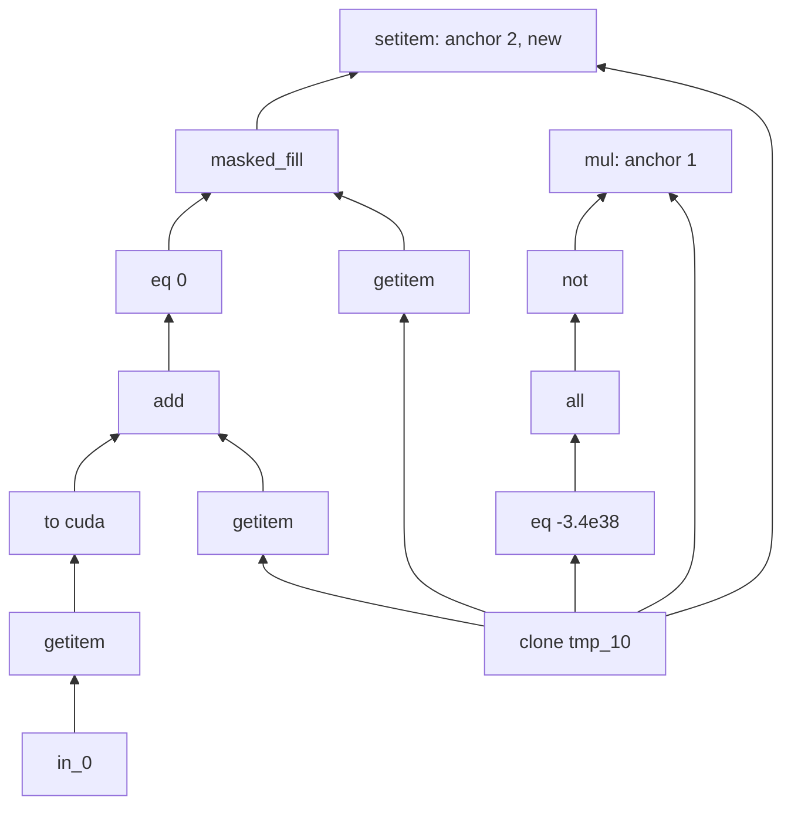

# Kiln: Seven Unaccepted PassBench Families, Whose Rounding Disagrees and Why

The coverage-wave replay on the Kiln integration branch accepted 16 of 23 newly importable PassBench families. This article diagnoses the other seven. Three of them had defects in Kiln:
- a match pattern that the matcher could not traverse;
- a constant whose CUDA semantics Kiln got wrong;
- a constant folding that dropped a rounding step.

The other four fail because the evaluator's own reference (cuDNN and cuBLAS) rounds differently from the correctly rounded value that Kiln computes, at a tolerance that leaves no room for a one-ulp disagreement. One family matches "twice" only because TorchDynamo compiles the graph twice. The article follows each family from the symptom in the replay log to a measurement that names the responsible rounding point. It then states what was fixed, what cannot be fixed by a compiler, and why.

> [!summary]
> - **A match pattern must make every node reachable backwards from what it returns.** `x[i] = v` traces to an `operator.setitem` node with no users. PyTorch's `SubgraphMatcher` never visits it and raises `KeyError: in_0` for an argument only the write reads (family 170). The generator now binds every slice assignment to a name and returns it (`kiln-pattern-autowrap/3`).
> - **A 0-d CUDA tensor and a 0-d CPU tensor are different operands on CUDA.** `x_bf16 / torch.tensor(0.05, device='cuda')` divides by `bf16(0.05) = 0.050048828125`; with a CPU tensor or a Python number the divisor is `float32(0.05)`. Kiln had the CPU semantics. Together with a constant-folding bug, that broke DNLNet (family 40).
> - **Two disagreements are the reference's.** cuDNN's conv outputs are not correctly rounded, and cuBLAS's `linear` for GAE's shape is a split-K reduction with partial sums rounded to bf16/f16. At PassBench's tolerance −5 (`atol = 1e-5`), even the exactly computed graph fails against that reference (families 22, 34, 44, 124).
> - **Some failures are protocol properties.** Family 29 matches once per compilation and compiles twice: the source turns grad mode off, and Dynamo's guard recompiles. DNLNet's f16 graphs overflow their shared input to `inf` during the compiled phase, so every compiler and eager itself return NaN.

## 1. The acceptance criterion, precisely

A PassBench *family* is a set of graphs (here 2 to 11) that share an operator pattern and differ in dtype and shape. Kiln participates by generating one *rule* per distinct computation: a match pattern extracted from the source `forward`, and a replacement that calls a Kiln-compiled program. The evaluator (`pass_bench/torch/test_compiler.py`) compiles the source model with `torch.compile` and a pass-manager backend. The backend rewrites the TorchDynamo graph with the rules, runs the compiled model 20 + 100 + 1 times, runs the eager model 20 + 100 + 1 times on the *same* input tensors, and compares the two last outputs.

Kiln's audit (`integrations/passnet/summarize_task_run.py`) accepts a graph when three conditions hold:

```text
accepted(graph) = execution_ok
                  and count("Applied 1 replacements" in the graph's log block) == 1
                  and correct at tolerance -5
accepted(family) = all graphs accepted
```

Correctness at tolerance *t* is `torch.allclose(compiled, eager, rtol, atol)` for every output, with (rtol, atol) from `pass_bench/datatype_tolerance_config.get_precision`:

| dtype | rtol at −5 | atol at −5 | one ulp relative |
|---|---|---|---|
| float16 | 1.0e-3 | 1e-5 | 2^-11 ≈ 4.9e-4 |
| bfloat16 | 1.58e-2 | 1e-5 | 2^-8 ≈ 3.9e-3 |
| float32 | 1.3e-6 | 1e-5 | 2^-24 ≈ 6e-8 |

Two consequences follow from the table and recur throughout the article. A one-ulp error in a *final* rounding always passes, because one ulp is less than rtol. But an output that is the small difference of larger rounded terms meets the absolute floor `atol = 1e-5` first, and a one-ulp disagreement in an *intermediate* value can grow to several ulps of the output. Passing at −5 therefore requires agreement in every rounding point that feeds a cancelling or amplifying operation, not just a small error.

The seven failures, as Step 12 of the integration diary recorded them:

| family | model | replay | symptom |
|---|---|---|---|
| 29 | TinyLlama/SmolLM3 masks | 0/11 | correct at −5, but `matches=2` per graph |
| 170 | OPT causal mask | 0/3 | `BackendCompilerFailed`, rule crashes with `KeyError: in_0` |
| 22 | ViViT patch embedding | 0/2 | correct only at −3 / −4 |
| 44 | SEW positional conv | 0/2 | correct only at −3 / −4 |
| 124 | GAE / RECT_L | 2/4 | the two GAE graphs correct only at −3 / −4 |
| 34 | VideoMAE tubelets | 1/5 | three correct only at −4, one `Eager model execution failed` |
| 40 | DNLNet attention softmax | 2/6 | two correct only at tolerance 1, two never |

## 2. Family 29: one match per compilation, two compilations

The log block of every family-29 graph contains `Applied 1 replacements with KilnPattern0000.` twice, with all six rules attempted between the two lines. Two occurrences of the pattern in one graph would show up as `Applied 2 replacements` in one pass. What the log shows is the pass manager running twice, so the backend was invoked twice. Running one graph in the evaluator image with `TORCH_LOGS=recompiles` shows why:

```text
[PassMgrBackend] Applied 1 replacements with KilnPattern0000.
[0/1] [__recompiles] Recompiling function forward in .../TinyLlama-1.1B-Chat-v0.4_start3_end24_1/model.py:6
[0/1] [__recompiles]     triggered by the following guard failure(s):
[0/1] [__recompiles]     - 0/0: GLOBAL_STATE changed: grad_mode
[PassMgrBackend] Applied 1 replacements with KilnPattern0000.
```

The source graph contains `_set_grad_enabled = torch.set_grad_enabled(False)`. The first compiled call runs with grad mode on, and TorchDynamo guards the compiled frame on that global state. The call itself turns grad mode off, so the second call fails the guard and the frame is compiled again. Both compilations see the same computation and apply the same rule with the same specialization. The CUDA-capture matcher simulation (`658-cuda-capture.py`) calls the compiled model once, which is why it reported one match.

No generator change can prevent this. The recompile is caused by a global side effect outside the matched subgraph. The only generator-side remedy would be a pattern that captures and drops `set_grad_enabled(False)`, which changes the program's observable global state. The family is correct at −5 on all 11 graphs and PassBench's own scorer gives it 1.018. Whether Kiln's audit should count matches per backend invocation is a protocol decision. It is recorded as an open question, not implemented.

## 3. Family 170: a pattern node that nothing reads

### 3.1 How `SubgraphMatcher` searches

PyTorch's `torch.fx.passes.utils.matcher_utils.SubgraphMatcher` finds a pattern in a target graph by starting from the pattern's *anchors* and walking backwards. Anchors are the nodes the pattern returns that have no other user. Each anchor is paired with a candidate target node of equal operation, and the matcher then recursively matches their arguments. After a complete match, it lists the target nodes that correspond to the pattern's placeholders:

```python
match.placeholder_nodes = [match.nodes_map[pn] for pn in self.pattern_placeholder_nodes]
```

A pattern node that no anchor depends on is never visited. If a placeholder is read only by such a node, `nodes_map` has no entry for it, and the comprehension raises `KeyError` with the placeholder's name.

### 3.2 The family-170 pattern

The OPT mask graph builds a causal mask, writes a masked version of a slice back into it, and returns a function of the written tensor:

```python
tmp_10 = tmp_9.clone()
tmp_12 = in_0[:, None, None, :]
tmp_14 = tmp_10[..., :21] + tmp_12.to(cuda)
tmp_17 = tmp_10[..., :21].masked_fill(tmp_14 == 0, -3.4e38)
tmp_10[..., :21] = tmp_17                 # operator.setitem: no result, no users
tmp_22 = tmp_10.mul(~torch.all(tmp_10 == -3.4e38, dim=-1, keepdim=True))
return (tmp_22,)
```

The data dependence of `tmp_22` on `in_0` runs through the write, which is a mutation of `tmp_10` and not an edge in the FX graph. Walking back from `tmp_22` reaches `tmp_10 = clone(...)` and stops. `in_0` is never matched:

```text
File ".../matcher_utils.py", line 376, in <listcomp>
  match.nodes_map[pn] for pn in self.pattern_placeholder_nodes
KeyError: in_0
```

The pass manager reports this as `Pass KilnPattern0000 CRASHED with error: in_0`, and Dynamo turns it into `BackendCompilerFailed`. `operator.setitem` is impure in torch.fx, so the matcher's "pattern has dead code" assertion does not catch it.

### 3.3 The fix: return the write

Kiln already had the mechanism for this. An in-place call whose result is unused (`tmp_4 = tmp_2.masked_fill_(...)`) is kept and returned by the pattern, and the compiled program returns the same value, so the matcher reaches it. A slice assignment needs the same treatment, but `x[i] = v` has no result to return. The generator therefore rewrites it into a bound call of the directly imported `operator.setitem`:

```python
# generate_pass.extract_pattern, PreserveInPlace.visit_Assign
#   x[index] = value   ->   kiln_setitem_K = kiln_setitem(x, index, value)
from operator import iadd as kiln_iadd, setitem as kiln_setitem
...
kiln_setitem_0 = kiln_setitem(tmp_10, (slice(None), slice(None), slice(None), slice(None, 21)), tmp_17)
...
return (tmp_22, kiln_setitem_0)
```

`fx_normalize.trace_pattern` autowraps `operator.setitem` like the `operator.i<op>` functions, so the call is traced as a node with a result. TorchDynamo records the same target, `call_function operator.setitem`. With two anchors, `tmp_22` and the write, the backward search covers the whole pattern.



The replacement must return as many values as the pattern. The write's value is `None` at run time, and its target node has no users, so the compiled program does not compute anything for it. `corpus.expose_inplace_results` appends the setitem node to the traced graph's outputs. `fx_import` binds that node to a sentinel and records the output leaf as `{'none': True}`. `dispatch.restore_outputs` returns `None` there, and `count_outputs` counts it as 0. Upstream's `_replace_pattern` then binds the unused target node to a dead `getitem` of the replacement's tuple.

One detail cost a debugging round. FX *code generation* binds a setitem node to its receiver (`clone[...] = 0; setitem = clone`), so an eager run of the exposed graph returns the tensor, not `None`, in that slot. The numerical check therefore skips `{'none': True}` slots instead of comparing them.

### 3.4 Result

| check | before (4dd38ba) | after (26243a3) |
|---|---|---|
| CUDA-capture 658 | 0/3, `KeyError: in_0` | 3/3 identity ok, one match each, specializations 0/1/2 |
| CPU compile gate | 3/3 | 3/3 |
| eager CPU numerics | — | exact on 3/3 |
| evaluator, single graph | `CRASHED with error: in_0` | `Applied 1 replacements`, `[equal]: 1`, `status: success` (3/3) |

## 4. Families 22, 44, 34 and 124: whose contraction is correctly rounded?

### 4.1 Method: hybrids

A graph-level maximum difference cannot tell an accumulation-order difference in a convolution from a bias-placement or LayerNorm difference. The localizer (`coverage-fix-v1/localize.py`) answers a sharper question: if eager PyTorch computed exactly one node correctly rounded, would it agree with Kiln? It interprets the traced source graph eagerly on the evaluator's inputs, except at a chosen node, which is computed from its eager arguments in float64 and rounded to its eager dtype:

```python
class Hybrid(torch.fx.Interpreter):
    def run_node(self, n):
        result = super().run_node(n)                     # eager value (dtype, eager algorithm)
        if n.name in self.targets:
            args, kwargs = self.fetch_args_kwargs_from_env(n)
            wide = getattr(self, n.op)(n.target, upcast(args, float64), upcast(kwargs, float64))
            result = like(wide, result)                  # round once to the eager dtype
        return result
```

For each hybrid it counts the output elements that differ from Kiln and from eager, and how many of those fail PassBench at −5. For each output it also counts how many elements of Kiln and of eager equal the float64 reference rounded to the dtype ("correctly rounded"). In-place nodes are never replaced.

### 4.2 What the hybrids show

| family, dtype | Kiln vs eager: differ / fail at −5 | conv or linear @f64 hybrid vs Kiln | same hybrid vs eager |
|---|---|---|---|
| 22 ViViT, f16 | 5571 / 175 (LayerNorm output) | 1493 / 45 | 5415 / 161 |
| 44 SEW, f16 | 154 / 11 | 48 / 0 | 141 / 11 |
| 34 VideoMAE, f16 | 237 / 23 | 47 / 5 | 236 / 26 |
| 124 GAE, bf16 | 6428 / 672 | 0 / 0 | 6428 / 672 |

In every row, replacing the single contraction by its correctly rounded value moves eager most of the way to Kiln. The last column says the same thing from the other side: the correctly rounded contraction itself fails PassBench against eager at −5. The `all@f64` hybrid (every node correctly rounded) also fails, for example 161 elements for ViViT f16. In GAE, Kiln's `linear` output equals the correctly rounded value in 16000 of 16000 elements, and eager's in 9572.

The amplification follows from §1. In ViViT and SEW, the conv output feeds a LayerNorm, which multiplies a one-ulp input disagreement by `1/σ` of the row (worst element: Kiln 3.1484375, eager 3.15234375, float64 3.15011). In VideoMAE, the output is `conv + position_embedding`, which cancels toward zero at some elements, where `atol = 1e-5` decides.

### 4.3 Which formula reproduces the reference?

A rounding difference is a Kiln defect only if PyTorch's result follows a rule that Kiln could adopt. `coverage-fix-v1/probe-reductions.py` tests candidate computations for each contraction against the eager output, element by element:

| candidate | GAE linear bf16 | GAE linear f16 | VideoMAE conv3d f16 (no bias) |
|---|---|---|---|
| correctly rounded (f64 once) | 9560 / 16000 | 9556 / 16000 | 1200975 / 1204224 |
| float32 accumulation | 9560 | 9556 | 1200975 |
| reduced-precision reduction off | 9560 | 9558 | 1195630 |
| split-K, chunk 8: chunk sums rounded to dtype, summed in f32 | **16000** | **15998** | 689002 |
| split-K, chunk 8, summed sequentially in dtype | 10799 | 10663 | 140000 |
| sequential accumulation in dtype | 4336 | 4327 | 51216 |

For GAE's `[1000, 32] × [32, 16]`, cuBLAS (under PyTorch's default `allow_bf16_reduced_precision_reduction = True` and `allow_fp16_reduced_precision_reduction = True`) computes exactly a split-K reduction: the K = 32 products in four chunks of 8, each chunk sum rounded to the storage dtype, the four partial sums added in float32. With the flags off, eager is correctly rounded, like Kiln. The RECT_L graphs of the same family use a different shape, get a different kernel, and agree with Kiln.

For the convolutions, no tested formula reproduces cuDNN. The correctly rounded value is the closest candidate and still misses 3249 of 1204224 elements (VideoMAE f16). That is the signature of an algorithm choice inside cuDNN (accumulation order and blocking) that is not a rounding *rule*.

The bias question that Step 9 of the diary left open is settled by the same probe. For every conv in these families, `eager_without_bias + bias` (rounded in the dtype) equals eager on every element. cuDNN adds the bias in a separate, dtype-rounded step, which is Kiln's policy.

### 4.4 Verdict

None of these four families exposes a Kiln rounding policy defect. Matching the reference would require Kiln to emulate a vendor kernel choice: split-K-8 for the exact GEMM shapes for which cuBLAS on GB10 selects it, and an unknown order for cuDNN. That makes Kiln less accurate, and it is tied to one library version on one GPU. No code was changed for them.

Family 34's fifth failure is unrelated to numerics. The eager phase, which runs after Kiln's compiled phase, failed PyTorch's own timing check (`Environment fluctuation detected. IQR/median = 22.3% (threshold: 20%)`); the last ~25 eager trials rose from 0.88 ms to about 1.1 ms.

## 5. Family 40: DNLNet, two defects behind a softmax

### 5.1 The graph and the protocol

```python
def forward(self, in_0):                       # [12, 4096, 4096] etc., dtype per variant
    tmp_2 = torch.tensor(256, dtype=float32, device=cuda) ** torch.tensor(0.5, device=cuda)
    in_0 /= tmp_2                              # in-place: the evaluator's input tensor changes
    tmp_3 = in_0
    tmp_3 /= torch.tensor(0.05, device=cuda)
    return (tmp_3.softmax(dim=-1),)
```

Each call multiplies the input by 1/(16 · 0.05) = 1.25 in place. Because the compiled phase and the eager phase share one input dictionary, the compiled model's 121 calls see the input scaled by 1.25^0 … 1.25^120, and the eager phase starts from 1.25^121. The compared outputs come from different input states. For f32 and bf16 that is harmless: after ~120 scalings every row is saturated, and both softmaxes are exact one-hot vectors at the same positions, provided both sides compute every scaling bit for bit. For f16 the input overflows to `inf` during the compiled phase (absmax after the Kiln phase: `Infinity`), `inf − inf` in the softmax gives NaN, and both Kiln and eager return all-NaN tensors, which `allclose` rejects at every tolerance. No correct compiler can pass those two graphs.

### 5.2 A single call hides the defect

At full size on GB10, one Kiln call and one eager call on clones of the same input agree at −5 (max |Δ| 1.9e-6 bf16). The mutated *input*, which PassBench never compares directly, differed in 24928675 of 201326592 elements (bf16, 12%) and 66677837 (f16, 33%). Those differences compound over the protocol's calls, and the outputs then diverge (bf16: 4169 differing elements, max 0.833, correct only at tolerance 1).

### 5.3 The CUDA semantics of a 0-d tensor operand

`coverage-fix-v1/probe-zero-dim.py` measures, for add, sub, mul, div, the reversed forms and in-place division, which value of a 0-d operand PyTorch uses beside a dimensioned bf16 or f16 tensor:

| device of the op | 0-d operand | value used |
|---|---|---|
| CUDA | 0-d CUDA tensor | the operand converted to the tensor's dtype (42 of 42 cases) |
| CUDA | 0-d CPU tensor | its float32 value (add, sub, mul, rsub) |
| CUDA | Python number | its float32 value (add, sub, mul, rsub) |
| CPU | 0-d CPU tensor | its float32 value |

The reason is TensorIterator's treatment of operands. A CPU scalar (a 0-d CPU tensor, or a wrapped Python number) is passed to the CUDA kernel as an opmath scalar. A 0-d CUDA tensor is an ordinary operand, and ordinary operands are converted to the common dtype, which is the dimensioned tensor's bf16. So `in_0 /= torch.tensor(0.05, device='cuda')` divides by `bf16(0.05) = 0.050048828125`, a relative difference of 9.8e-4 from `float32(0.05)`.

Kiln's importer propagates metadata on a CPU copy of the graph, so that the import is identical on CPU and CUDA hosts (Step 9 of the integration diary). Kiln's elementwise semantics use the float32 value of a 0-d floating operand. The combination silently adopted CPU semantics for a constant the source places on CUDA.

### 5.4 Fix 1: the importer infers source devices

`fx_import.source_device(ctx, node)` assigns each FX value the device the source program gives it:

```text
source_device(node):
  placeholder                         -> cuda      # the evaluator's inputs
  call_method cuda / cpu              -> that device
  any device argument (device=..., .to('cuda'), .to(device(...)))  -> the last one named
  factory without a device argument   -> cpu       # torch.tensor(0.05) is a CPU tensor
  anything else                       -> cuda if any tensor argument is on cuda, else cpu
```

`cuda_scalar_operand(c, j, text)`, called from the shared `operand()` helper of the binary, in-place, true-division and comparison lowerings, rewrites operand j as `N.cast(v, "bf16")` (or `"f16"`) when all of the following hold:
- it is a 0-d floating tensor on CUDA;
- the other operand is dimensioned and has a low-precision dtype;
- the two dtypes differ.

A scan of all 2060 census graphs (`zero-dim-cast-scan.json`) shows that the rule changes exactly the four low-precision DNLNet graphs.

### 5.5 Fix 2: a bf16 constant must hold a bf16 value

With fix 1 alone, the GPU result did not change (the mutated input still differed in 24922534 elements). The generated kernel showed why:

```c
v0 = (in0 / 16.0f);
v1 = __bfloat162float(__float2bfloat16_rn(v0));
v2 = (v1 / 0.05f);            // the N.cast(0.05, "bf16") was folded away
```

Kiln's `convert` (`packages/kiln/src/std/tensor.js`) folds a cast of a splat constant into a new constant through `convertScalar`, which returned `Number(v)` for floating targets. A constant labeled bf16 kept the value 0.05, and code generation prints values as float literals. The same held for `N.full(shape, v, "bf16")`. The fix rounds finite values to the target dtype when such a constant is created:

```js
const lowPrecisionValue = (v, dtype) =>
  (dtype === "f16" || dtype === "bf16") && Number.isFinite(Number(v)) ? roundToDtype(Number(v), dtype) : v;
```

The kernel now divides by `0.050048828125f`. The npm test `low-precision-constants.mjs` checks the literal, and it fails against the old `tensor.js`.

### 5.6 Result at full size

| graph | mutated input differ | protocol: 121 Kiln calls, then 121 eager | evaluator run (20 + 100 + 1) |
|---|---|---|---|
| bf16 [12, 4096, 4096], before | 24928675 | fail at −5 (4169 differ) | — |
| bf16 [12, 4096, 4096], after | 0 | pass, 0 differ | — |
| bf16 [2, 4096, 4096], after | 0 | pass, 0 differ | `[equal]: 1`, success |
| f32 [12 / 64, 4096, 4096], after | 0 | pass, 0 differ | — |
| f16 [12 / 16, 4096, 4096], after | 0 | all NaN in Kiln and eager | `[equal]: 0` at every tolerance |

The family can reach at most 4 of 6 graphs, and it is not acceptable as a family under this protocol.

## 6. What generalizes

- **Measure the mutated state, not only the outputs.** A softmax, a mask or an argmax can hide a wrong in-place update in a single call. A benchmark that reuses its inputs across calls turns that hidden error into an output error.
- **"Correctly rounded" is not the same as "agrees with the reference".** At tight absolute tolerances, a compiler that is more accurate than the vendor library fails wherever the output cancels or is normalized. A rounding-point localization (the hybrid method) separates "my rounding is wrong" from "the reference rounds differently" with a count rather than an opinion.
- **Device is part of operand semantics.** A metadata pipeline that erases devices for portability needs a separate record of the source's devices wherever PyTorch's arithmetic depends on them.
- **A pattern is a graph search, not a text match.** Every node of a match pattern must be reachable backwards from a returned node. Side-effect nodes (slice assignment, unused in-place results) have to be returned explicitly.

## 7. Open questions

- **Per-compilation match counting.** Should the audit accept a graph whose every backend invocation applies exactly one replacement (family 29, 11/11 correct at −5)? This is a protocol decision.
- **The reference's reduced-precision reductions.** Running eager with `allow_{bf16,fp16}_reduced_precision_reduction = False` would make GAE's reference correctly rounded. It would not fix cuDNN's convs, and it changes the evaluator.
- **Python-number division on CUDA.** `x_bf16 / 0.3` on CUDA matches neither float32 division (258984 of 262144 elements) nor the dtype divisor, which is consistent with multiplication by a float32 reciprocal. Kiln divides. No current family depends on it.
- **Shared mutated inputs between phases.** Under PassBench's protocol, DNLNet's f16 graphs are unacceptable for every compiler that preserves the source's input mutation.

## Code and evidence

- Repository and branch: `/home/manuel/code/wesen/kiln/worktrees/kiln-integration`, `integration/kiln-006-011`. Commits:
  - `fae3401`: slice assignments in patterns, `kiln-pattern-autowrap/3`;
  - `26243a3`: 0-d CUDA operands, low-precision constants;
  - `958a29a` and `ca11166`: plan and diary.
- Pattern fix: `integrations/passnet/generate_pass.py` (`SETITEM`, `PreserveInPlace.visit_Assign`), `fx_normalize.py` (`trace_pattern`), `corpus.py` (`expose_inplace_results`), `fx_import.py` (`NO_RESULT`), `dispatch.py` (`count_outputs`, `restore_outputs`); tests in `test_pass_generation.py`.
- Device fix: `integrations/passnet/fx_import.py` (`source_device`, `cuda_scalar_operand`); tests in `test_fx_devices.py`. Constant fix: `packages/kiln/src/std/tensor.js` (`lowPrecisionValue`); test `packages/kiln/test/low-precision-constants.mjs`.
- Diary: `ttmp/2026/11/01/integration-diary-kiln-006-011.md`, Steps 13–16.
- Evidence: `ttmp/2026/11/01/integration-evidence-kiln-006-011/coverage-fix-v1/` (with `SHA256SUMS`):
  - `family29-recompile.log`;
  - `localize.py` and `localize-*.json`;
  - `probe-reductions.{py,log}`;
  - `probe-zero-dim.{py,log,json}`;
  - `probe-dnlnet.py`, `probe-dnlnet-4dd38ba.log`, `probe-dnlnet-fixed.log`;
  - the scans `zero-dim-cast-scan.json` and `low-precision-constant-scan.json`;
  - `compile-gate.json`, `sim-fix-*-simulation.json`, `e2e-*.log`.
- Frozen re-replay plan (not launched): `ttmp/2026/10/30/KILN-005--reproduce-passnet-and-evaluate-reusable-kiln-compiler-transformations/sources/coverage-fix-replay-v1/plan.json`, 2 tasks (40: 6 graphs, 170: 3 graphs), sha256 `39a00cbf…92f3a8`.

## Related notes

- [[kiln|Kiln MOC]] — reading map of all Kiln compiler and PassNet notes, grouped by question.
- [[ARTICLE - Kiln - Closing the PassBench Import Gap, Device-Agnostic Shape Propagation and In-Place Ownership]]
- [[ARTICLE - Kiln - Index Values, Factory Ops and Slice Assignment in a Functional Tensor Compiler]]
- [[ARTICLE - Kiln - Writing Mutated Inputs In Place with Proofs Over the Exported Program]]
