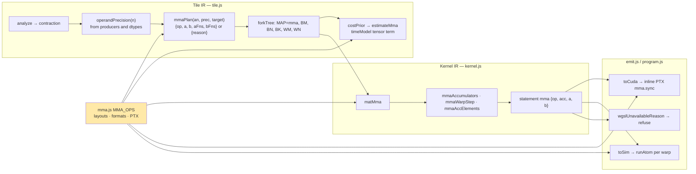

# Kiln: Tensor-Core Matrix Products, Built and Checked Without a GPU

Kiln compiles every matrix product, whether it comes from `linear`, `matmul`, `bmm` or a pointwise convolution, into a CUDA kernel in which each multiply-add is one FP32 instruction executed by one thread. NVIDIA GPUs since Volta also have tensor cores, which compute a small matrix product for a whole warp in one instruction at several times the FP32 rate. The PyTorch reference that PassBench compares Kiln against uses them whenever operand types permit, and Kiln's matrix-heavy graphs score between 0.01 and 0.17 against it. This report describes a new GPU mapping, `MAP=mma`, that lowers recognized contractions to PTX `mma.sync` with TF32, f16 or bf16 operands and FP32 accumulation. The development machine has no GPU and no CUDA toolkit, so the work was built so that every part except compilation and speed could be checked on a CPU: the warp-collective instruction is emulated inside Kiln's JavaScript SIMT simulator from the same layout table that drives code generation.

> [!summary]
> One table in `packages/kiln/src/std/mma.js` defines the three atoms (`m16n8k8.tf32`, `m16n8k16.f16`, `m16n8k16.bf16`): shapes, operand formats, per-lane fragment layouts and PTX strings. The materializer, the CUDA emitter, the simulator and the cost model all read it. A kernel is legal for tensor cores when its reduction is a sum of `mul(A, B)` whose two operands provably arrive in a tensor-core format; then the tensor-core kernel sums exactly the products the reference sums, and only FP32 accumulation order can differ. Pinned `MAP=mma` kernels for TF32, f16 and bf16 products, batches, tile tails and fused epilogues pass the simulator against the Loop IR reference, and the default compile is byte-identical to the base revision on 36 program/target/precision combinations. NVRTC compilation, the hardware layout check and GB10 throughput are packaged as launcher fixtures for the GPU host.

## 1. What a tensor-core instruction requires

Three properties of `mma.sync.aligned` shape every design decision below, so they come first.

The instruction is *warp-collective*. The 32 threads of a warp jointly hold the A, B, C and D matrices of one atom, each thread holding a few elements in registers called its *fragment*. A single thread cannot compute its part alone, and all 32 lanes must execute the instruction together; the `.aligned` qualifier makes a divergent execution undefined.

The fragment layout is fixed by the PTX ISA. With `g = lane >> 2` and `t = lane & 3`, lane `l` of an `m16n8k8.tf32` atom holds A elements at rows `g` and `g+8`, columns `t` and `t+4`; B elements at rows `t`, `t+4` of column `g`; and C/D elements at rows `g`, `g+8`, columns `2t`, `2t+1`. The `m16n8k16` layouts for f16 and bf16 are similar with two elements per 32-bit register. Every piece of code that addresses a fragment must agree with this table, and a mistake in it produces a kernel that is wrong in a consistent, plausible-looking way.

The operands must be representable. A TF32 operand is an FP32 bit pattern of which the hardware uses the sign, exponent and top 10 mantissa bits. The PTX ISA leaves undefined what happens when the low 13 bits are not zero. An f16 or bf16 operand must be an f16 or bf16 value. The product of two such operands has at most 22 significant bits and is exact in FP32; only the accumulation is inexact, and the PTX ISA promises neither an order nor round-to-nearest after each addition.

## 2. Where the new mapping sits in Kiln

Kiln lowers a program through six IRs: nn, Tensor, Loop, Tile, Kernel and gpu. There is no matrix-product op below the nn IR. `lowerLinear` rewrites `linear(x, w)` into two views over a common `[…, K, N]` work shape, an elementwise multiply and a sum over K, and Tile IR's `analyze` (`packages/kiln/src/std/tile.js`) later recognizes that pattern as a *contraction*: one reduction at the innermost output scope whose body reads A operands (varying with the row variable) and B operands (varying with the column variable). The existing `MAP=tiled` uses that analysis to write a register-tiled CUDA-core GEMM. `MAP=mma` is a fourth mapping beside `thread`, `row` and `tiled`, built on the same analysis.



The highlighted node is the point of the design: no consumer restates a layout formula. Kernel IR addresses fragments through `fragmentIx(op, which, slot, lane)`, which derives Ix index expressions from the numeric table by sampling it at `(g, t) = (0,0), (1,0), (0,1)` and then verifying the affine form over all 32 lanes.

## 3. Legality: following values, not options

A tensor-core kernel computes what Kiln's reference computes only if each operand value is already in the operand format. Kiln's frontend produces that situation in two ways. Under `--matmul-precision tf32`, `tf32Pass` wraps each matrix-product operand in `round_tf32` (round to nearest, ties to even, as probe 671 showed cuBLAS does); for f16 and bf16 graphs, the FX importer widens half-precision storage to FP32 with a cast that survives fusion as `copy`. In both cases the legality question is about values, so `mmaPlan` reads values.

The design guide assumed the TF32 rounding always stays in a separate kernel, because inlining it would repeat it N times per element and the fusion work guard rejects that. The first tail test showed the assumption is size-dependent: for a 33×19×17 product the guard accepts it, and the contraction body becomes `mul(round_tf32(in0[a1, r]), round_tf32(in1[a0, r]))`. The implemented rule therefore treats each operand as a load under a chain of format functions:

```text
operandChain(x):
    fns ← []
    while x is op f(y) with f ∈ {copy, round_tf32, round_f16, round_bf16}:
        fns.prepend(f); x ← y
    if x is not a load: fail
    format ← the outermost rounding in fns (tf32 | f16 | bf16), or none
    return {load: x, fns, format}

mmaPlan(an, prec, target):
    require an.contraction, target.sm ≥ 80
    require exactly one A load and one B load, reduction fn = add
    require body = mul(chainA, chainB) with chainA.load = A, chainB.load = B (either order)
    pa ← chainA.format ?? prec[A.i];  pb ← chainB.format ?? prec[B.i]
    require pa = pb ∈ {tf32, f16, bf16}
    return {op: OP_FOR_PRECISION[pa], a: A.i, b: B.i, aFns: chainA.fns, bFns: chainB.fns}
```

`prec` comes from `operandPrecision(n)`, computed in the schedule rule where producers are visible: `f16`/`bf16` for half storage, `tf32` for an FP32 input whose producer kernel's root expression is `round_tf32`, otherwise the storage dtype. It is stored on the `tile.kernel` as `inPrecisions`, an attribute excluded from kernel identity. A graph input is never `tf32`, even if its values happen to be representable, because the IR has no way to state that. A product the program pinned to `"highest"` never receives a `round_tf32` and so never becomes legal, which is the reason the guide rejected a pipeline-flag rule. When the chain contains a rounding, the tile loader applies it once per staged element, which is the guide's deferred "rounding during staging" obtained wherever fusion already chose to inline.

Refusals carry reasons in the style of `wgslUnavailableReason`: `mixed operand precisions f16, bf16`, `reduction max is not a sum`, `body is not mul(A, B) up to copy and format rounding`, `target webgpu has no mma.sync (sm 0)`.

## 4. The Kernel IR statement and three emitters

Kernel IR gains one statement:

```text
mma {op, acc: [4 names], a: [aElems names], b: [bElems names]}     acc ← A·B + acc   (warp-collective)
```

Every name is an ordinary f32 temporary holding one *element*, not one register. That choice keeps packed types out of Kernel IR, `valueTypes` and the simulator; only the CUDA emitter knows registers exist.

**CUDA.** `cudaMma(s)` in `packages/kiln/src/std/emit.js` renders inline PTX with the accumulators as read-write `"+f"` operands. TF32 elements are passed as their bit patterns (`__float_as_uint`), which is correct only because legality guarantees the low 13 bits are zero; f16 and bf16 pairs are packed by helpers emitted once per kernel, with element `2j` in the low half as the PTX ISA requires:

```cuda
__device__ __forceinline__ unsigned kiln_pack_bf16(float lo, float hi) { __nv_bfloat162 h = __floats2bfloat162_rn(lo, hi); return *reinterpret_cast<unsigned*>(&h); }
asm volatile("mma.sync.aligned.m16n8k16.row.col.f32.bf16.bf16.f32 {%0,%1,%2,%3}, {%4,%5,%6,%7}, {%8,%9}, {%0,%1,%2,%3};\n"
  : "+f"(c0), "+f"(c1), "+f"(c2), "+f"(c3)
  : "r"(kiln_pack_bf16(a0, a1)), "r"(kiln_pack_bf16(a2, a3)), "r"(kiln_pack_bf16(a4, a5)), "r"(kiln_pack_bf16(a6, a7)),
    "r"(kiln_pack_bf16(b0, b1)), "r"(kiln_pack_bf16(b2, b3)));
```

**WGSL.** There is no lowering; `wgslUnavailableReason` returns `tensor-core mma (<op>) has no WGSL lowering`, so the program carries `wgsl: null` for that kernel exactly as it already does for kernels using `add_rn`. WebGPU targets never see the mapping, because their spec has `sm: 0`.

**The simulator.** Kiln's simulator runs one block at a time in lockstep: each statement executes for all active threads before the next. That property, chosen originally to model barrier-correct kernels, is what makes a faithful warp-collective emulation possible: when the `mma` statement runs, all 32 lanes' fragment values are already in the per-thread `Float32Array`s. The generated code for one statement is

```text
for each warp w of the block:
    active ← number of active lanes in w under the current mask
    if active = 0: continue
    if active ≠ 32: report "a warp-collective mma runs with <active> of 32 lanes active"; continue
    violation ← runAtom(op, w, acc arrays, a arrays, b arrays, order)
    if violation: report "operand A slot 1 of lane 7 ... is 1.0000009, not representable in tf32"
    count one warp instruction and 2·m·n·k tensor flops
```

`runAtom` gathers A (m×k), B (k×n) and C through the layout table, checks representability of every operand (`roundTf32(x) === x`, `roundToDtype(x, "f16") === x`, …), computes each `D[i][j] = C[i][j] + Σ_k A[i][k]·B[k][j]` with exact products and an explicit accumulation order, and scatters D back. In an instrumented run violations are recorded and fail `simulateKernel`'s check; in an uninstrumented run they throw.

The accumulation order is a parameter because the hardware's is unspecified. `sequential` (ascending k, `Math.fround` after each addition, the Loop IR reference's own order) is the default; `reverse` and `pairwise` bound reordering effects; `chunk-rz` models a truncating multi-term adder of the kind Fasi et al. (2021) measured on V100, T4 and A100, summing each chunk of four products with the running value and rounding toward zero. The last is labelled a model throughout; it decides nothing by default.

## 5. The materializer

`matMma` (`packages/kiln/src/std/kernel.js`) follows the structure of `matTiled`. A block computes a `BM×BN` output tile and is split into `(BM/WM)·(BN/WN)` warps; warp `(wm, wn)` owns a `WM×WN` tile of `(WM/16)·(WN/8)` atoms.

```text
matMma(an, kn = {BM, BN, BK, WM, WN}, plan):
    lay ← mmaSmemLayout(op, kn)                 # padded strides ldA = BK+padA, ldB = BN+padB
    decode bid → (bz, bm, bn); tid → warp, lane; warp → (wm, wn)
    acc ← mmaAccumulators(MI, NI)              # MI·NI·4 f32 temporaries = 0
    for k0 in 0..K step BK:
        cooperative guarded load of A[bm·BM.., k0..] → sA[r·ldA + k], zero outside M, K, applying plan.aFns
        cooperative guarded load of B[k0.., bn·BN..] → sB[k·ldB + c], zero outside K, N, applying plan.bFns
        sync
        for ks in 0..BK/op.k:                   # unrolled in Kernel IR
            mmaWarpStep(lane, acc, A at (wm·WM, ks·op.k), B at (ks·op.k, wn·WN))
        sync
    for each (mi, ni, i, row, col) in mmaAccElements(acc, lane):
        m ← bm·BM + wm·WM + row;  n ← bn·BN + wn·WN + col
        if m < M and n < N: emit the Loop IR epilogue with C ↦ acc[mi][ni][i]
```

Two invariants carry the correctness argument. The atoms run unguarded, so no warp is ever divergent at an `mma`; tails are handled by zero fill of the shared tiles, which makes every out-of-range product exactly zero. The epilogue is every Loop IR statement outside the contraction, emitted per held accumulator element, so a bias, an activation, a residual add or a final `round_f16` all work without special cases.

The shared-tile padding is chosen by `mmaSmemLayout` from `{0, 4, 8}` words to minimize the summed bank-conflict degree of one k-step's fragment reads, with the same `bankDegree` function the simulator's metrics use. For TF32 with `BK = 8`, an unpadded stride of 8 gives 2-way conflicts (lanes with `g` and `g+4` hit the same bank), and a stride of 12 makes the A fragment reads conflict-free.

The three helpers `mmaAccumulators`, `mmaWarpStep` and `mmaAccElements` are exported with a documented contract (every warp executes each `mma` with 32 active lanes) because KILN-007, fused attention, will multiply shared-memory tiles in the same way. Attention adds one problem this report does not solve: the C/D layout is not the A layout, so feeding a softmax result into the second product needs either a shared-memory round trip or a register re-layout helper.

## 6. The cost model, and a design assumption that did not hold

`estimateMma` in `tile.js` counts what `matMma` writes: `2·batches·Mp·Np·Kp` tensor flops, global traffic of the tile loads, shared-memory wavefronts of the padded stores and fragment reads, warp instructions for loads, atoms and f16/bf16 packing, and the scalar epilogue. `timeModel` gains a `tensor` resource, `tensorFlops / (rate·10⁶)`, present only for kernels with tensor flops, so every existing estimate is unchanged. On a pinned 256×192×320 TF32 kernel the estimate and the instrumented simulator agree exactly on tensor flops (31,457,280) and shared-memory wavefronts (53,760), within 0.4 % on warp instructions and within 13 % on traffic.

The guide proposed using the FP32 peak as a pessimistic tensor rate until GB10's rates are measured, on the claim that `MAP=mma` would then never be predicted faster than a CUDA-core kernel. The model refutes the claim:

| target | n (TF32 n×n×n) | best `tiled` (µs) | best `mma` (µs, bound) | chosen by default |
|---|---|---|---|---|
| gb10, no tensor rate (FP32-peak prior) | 128 | 4.76 | 5.82 (dram) | tiled |
| gb10, no tensor rate (FP32-peak prior) | 1024 | 253.95 | 86.00 (tensor) | tiled, by the gate |
| A100-like test spec with rates 156/312/312 | 128 | 5.93 | 3.73 (launch) | mma |
| A100-like test spec with rates 156/312/312 | 1024 | 243.98 | 42.44 (smem) | mma |

`tiled` is shared-memory bound in the model, while an atom needs six fragment loads per 1,024 multiply-adds; the shared-memory term alone makes `mma` three times faster at equal compute rate. The prior therefore cannot be what keeps default compiles unchanged. `costPrior` instead returns `Infinity` for an `mma` option when the target has no measured rate and other mappings compete; when `MAP=mma` is pinned, every option is `mma` and the model ranks the remaining knobs with the prior. No real spec carries rates yet, A100 included, for two reasons: a new spec field changes `specHash` and with it the content ids of simulated records, and datasheet rates would switch default A100/H100 compiles to kernels no NVRTC has compiled. Tests use a derived spec.

## 7. Keeping everything else identical

Two mechanisms protect existing behaviour, and both are tested.

The fork tree is built from levels of knob values, and `k.knobs.canonical` keys evidence records by every key of an option's knob object. Adding `WM`/`WN` levels that set `0` on every option would leave `canonRow` strings unchanged while silently orphaning every stored measurement. `expandFork` in `packages/kiln/src/core/kiln.js` now treats a level value of `undefined` as "this knob does not apply", and the `WM`/`WN` levels return `[undefined]` off `MAP=mma`.

The simulator's seeded inputs are uniform FP32 values, which a TF32 atom must reject. `simulateKernel` therefore rounds a tensor-core kernel's A and B inputs to the operand format through `operandInputs` (`packages/kiln/src/std/program.js`), but only for inputs whose rounding happened in the producer; the seeds and the content-id protocol are untouched. A test removes that knowledge from a kernel and confirms the check fails with `not representable in tf32`.

A comparison script compiled attention, a SwiGLU MLP, linear+ReLU, a 1024³ matmul, an f16 linear and a 1×1 convolution for GB10, A100 and RTX 5090 under `highest` and `tf32`, and printed each kernel's identity, row, knob object, CUDA hash, WGSL hash and the program's predicted cost. Against `git archive 373766b` the 123-line outputs are identical.

## 8. Results

| Check | Result |
|---|---|
| `test/mma-layout.mjs` | every A, B, C/D layout is a bijection; the emulated atom equals an independent sequential FP32 sum bit for bit; four orders within bound; violations reported with lane and slot |
| `test/mma-kernel-ir.mjs` | hand-written two-warp atom per op simulates to `atomReference`; CUDA text, constraint list, packing helpers and includes; WGSL refusal; partial warp reported |
| `test/mma-kernel.mjs` | pinned `MAP=mma`: TF32 512×256×384 linear+bias+ReLU (`maxAbs 0` sequential, all orders pass), three explicit warp-tile shapes, f16 and bf16 linear, batched `[4,96,80]@[4,80,72]`, tails 33×19×17 (TF32 with fused rounding, f16), bias+GELU, scale+residual; nine refusals |
| `test/mma-cost.mjs` | ranking with rates; no `mma` without rates; estimate vs simulator counts; `predictedCost` includes `mma` |
| `cd packages/kiln && npm test` | all 52 passed (48 before) |
| `cd integrations/passnet && python3 -m pytest -q` | 177 passed, 7 subtests passed |

One simulated result is a warning rather than a pass. Under `chunk-rz`, a 64×K×64 TF32 product fails the 2e-3 relative check at K = 4096 (max abs diff 1.5e-3) and at K = 16384 (1.2e-2), while the reordering models pass with errors near 1e-4. A truncating adder biases every chunk in the same direction, so the error grows linearly in K instead of as √K. Whether GB10 behaves like the model is a hardware question; the `mma-large-k` fixture measures it, and the mitigation, several accumulator sets over K combined with FP32 adds, would be a knob rather than a redesign.

## 9. What remains for the GPU host

The ticket script `ttmp/2026/11/01/KILN-006--…/scripts/02-mma-gpu-fixtures.mjs <dir>` writes launcher round-trip fixtures in the format of `runtime/test/fixtures.mjs`, so the existing command `python3 runtime/python/kiln_launch.py check-fixtures <dir> --backend cuda` validates them:

- `probe-tf32`, `probe-f16`, `probe-bf16`: one warp, one hand-written atom per op, fragment loads straight from global memory through the layout table, inputs rounded in the kernel. A transcription error in `MMA_OPS` permutes products and fails by O(1). This is the only check of the layout table against silicon.
- `mma-linear-relu`, `mma-linear-64x64`, `mma-large-k`, `mma-bmm`, `mma-tails`, `mma-bias-gelu`: whole TF32 programs with `MAP=mma` pinned, expected values from Kiln's Loop IR reference. Passing them shows NVRTC accepts the inline PTX for `sm_121` and the kernels agree with Kiln's semantics.

After that: measure GB10's dense TF32/f16/bf16 rates with FP32 accumulation and set `SPECS.gb10.mma`; replay tasks 5, 32, 52 and 72 and the TF32 P0 families with `--param MAP=mma` against the unchanged baseline under the KILN-005 protocol; and recalibrate `estimateMma` from measured kernels. f16 and bf16 programs cannot go through `check-fixtures` yet, because the Python launcher packs only f32 and u8 inputs and reads outputs as f32; they go through the PassNet `TorchProgram` path.

## 10. Open questions

1. Does the PTX ISA bundled with the GB10 host's CUDA 13 document the same `m16n8k8`/`m16n8k16` layouts? The probes answer it empirically.
2. Does GB10's FP32-accumulate adder truncate, and at what chunk width? If so, split-K accumulators become necessary for PassBench's largest K.
3. Which warp tiles does the hardware prefer? At the FP32-peak prior the model favours small `16×8` warp tiles; register pressure and occupancy at `64×64` (128 accumulators per lane) are unmeasured.
4. Should NVRTC's include path for `cuda_fp16.h`/`cuda_bf16.h` be passed by `check-fixtures`? Existing half-precision kernels share the dependency.
5. How should KILN-007 move an accumulator fragment into an A fragment for the second product of attention?

## Sources

- Implementation: `/home/manuel/code/wesen/kiln/worktrees/kiln-006-tensor-cores`, branch `impl/kiln-006-tensor-cores`, commits `34c9444` (Phase 1), `ad0013c` (Phase 2), `eb71719` (Phase 3), `13a3767` (Phase 4), `33f1f5c` (fixtures), `33327e7` (guide addendum).
- Files: `packages/kiln/src/std/mma.js`, `tile.js` (`operandPrecision`, `operandChain`, `mmaPlan`, `forkTree`, `estimateMma`, `costPrior`), `kernel.js` (`KB.mma`, warp-tile helpers, `matMma`), `emit.js` (`cudaMma`, simulator `mma` case, `SimMetrics.mma`), `program.js` (`operandInputs`), `core/kiln.js` (`expandFork`), `export.js`.
- Ticket: `ttmp/2026/11/01/KILN-006--kiln-tensor-core-matrix-products-intern-analysis-design-and-implementation-guide/` — design guide (Section 13 lists the deviations), diary Steps 6-10, script 02.
- NVIDIA, *Parallel Thread Execution ISA*, "Warp-level matrix multiply-accumulate instructions". M. Fasi, N. J. Higham, M. Mikaitis, S. Pranesh, "Numerical behavior of NVIDIA tensor cores", PeerJ Computer Science, 2021.
