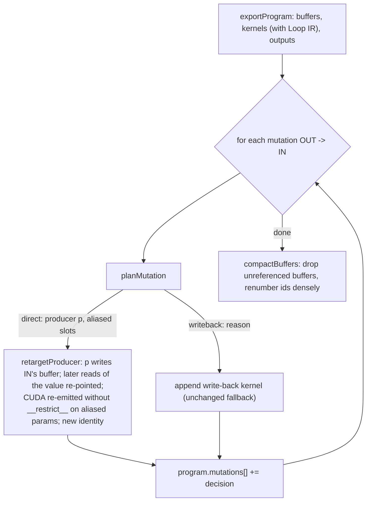
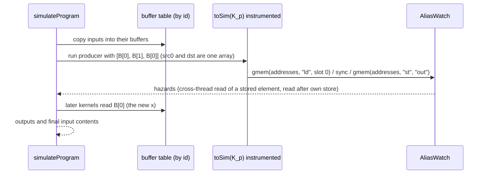

# Kiln: Writing Mutated Inputs In Place, with Proofs Over the Exported Program

Some PyTorch graphs update one of their inputs in place: `x.relu_()`, `x += y`, `F.silu(x, inplace=True)`. A Kiln program compiled for PassBench has to perform that update itself, because PassBench hands the replacement tensors that refuse every operation except tensor factories. Until this work, Kiln did it with a *write-back kernel*: one extra copy kernel at the end of the program that moves the new value from a scratch buffer into the input's storage. This report describes the change that removes that kernel. The kernel that computes the new value now stores it directly into the input's buffer whenever a static proof over the exported program shows that doing so cannot change any value any thread reads.

The report also covers family 162 of the PassBench corpus, which PassBench never evaluated because its generated rule could not be constructed. Two independent matcher problems blocked it: a pattern node without users, and two spellings of `x == 0`. Both are fixed.

> [!summary]
> The proof has a launch-order half (no kernel launched after the producer reads the input) and an in-kernel half (each element of the input is read only by the thread that stores it, before it stores it, or before a block barrier the store follows). The in-kernel half enumerates every store address of the launch instead of trusting structural rules about loops. On the 16 input-mutation tasks, 113 of 114 mutations now write in place, a CPU oracle with real buffer aliasing found no hazard, and family 162's rule selects its own program in 6 of 6 graphs on meta tensors. NVRTC compilation and PassBench acceptance remain GPU work.

## 1. The problem in one example

Take the graph `x += y; out = x * 2`. The importer (`integrations/passnet/fx_import.py`) records that input `x` is mutated and adds a program output `__mut0` that holds the new value. The exporter (`packages/kiln/src/std/export.js`) used to produce this kiln-program/1 artifact:

```text
x is buffer 0, y is buffer 1
  0 k___mut0     reads [*0, 1]   writes 2      s = x + y
  1 k_out        reads [2]       writes 3      out = s * 2
  2 k_writeback  reads [2]       writes *0     x <- s
outputs: out -> 3, __mut0 -> 0
```

Three terms make this readable. A **kiln-program/1** artifact lists kernels in launch order; each kernel record names the buffer bound to each source parameter (`reads`) and the one buffer it stores to (`writes`). The CUDA launcher runs the kernels in that order on one stream, so launch order is execution order. The **producer** of a mutation is the unique kernel that writes the buffer holding the new value (kernel 0 above). The **write-back** is kernel 2, a thread-per-element copy.

The write-back is correct because nothing runs after it. It also costs one launch, one full read and one full write of the tensor, and one scratch allocation the size of the input, on every call. For the small subgraphs PassBench measures, the launch alone is a large share of the time. After this change the same graph exports as:

```text
  0 k___mut0__<id>  reads [*0, 1]  writes *0   x <- x + y   (no __restrict__ on src0 and dst)
  1 k_out           reads [*0]     writes 2    out = x * 2
outputs: out -> 2, __mut0 -> 0
```

The scratch buffer is gone, kernel 1 reads the updated `x` (which is the value it needs), and the program has one launch fewer.

## 2. What could go wrong

Writing into an input while other code may still read it can change results in two ways, and the proof must exclude both.

The first is across launches. If some kernel launched *after* the producer reads `x` and expects the original value, overwriting `x` early changes what it reads. Kiln's fusion creates exactly this situation: a consumer may recompute the producer's expression from `x` instead of reading the producer's output. The importer accepts an input mutation only when the input's sole FX use is the in-place call, so every such later reader is a fusion artifact, not source semantics.

The second is inside the producer. Consider the fused kernel for `x <- x - mean(x, -1)`:

```c
for (int r0 = 0; r0 < 8; r0 += 1) { in1 = src0[((8 * (e / 8)) + r0)]; acc0 = (acc0 + in1); }   // whole row
v0 = (0.125f * acc0);
in0 = src0[((e % 8) + (8 * (e / 8)))];
dst[((e % 8) + (8 * (e / 8)))] = (in0 - v0);                                                  // own element
```

Thread `e` reads its whole row and writes one element. If `dst` were `src0`, another thread of the same row could store before thread `e` finished summing, and thread `e` would sum a mixture of old and new values. Nothing in the program order of one thread reveals this; it is a property of how threads interleave.

## 3. The proof

The analysis lives in a new module, `packages/kiln/src/std/inplace.js`, and runs inside `exportProgram` after kernels and buffers are assigned. It is a pure function of the export's own records, so it can be unit-tested on synthetic kernel lists and its decision can be recorded rather than applied.



### 3.1 Launch order

`planMutation` refuses, with a recorded reason, when the value is not computed by exactly one kernel that has Loop IR, when another output also names the value's buffer (returning the caller's input tensor where PyTorch returns a fresh one would be an observable aliasing change), when some kernel already writes the input, or when any kernel launched after the producer reads the input:

```text
p := the kernel with writes == value buffer
for q in p+1 .. last:
  if input buffer in kernels[q].reads: refuse("kernel q reads IN after producer p")
slots := source parameters of p bound to the input buffer
if slots nonempty: require sameIndexSlots(K_p, slots)
```

Kernels launched before `p` may read the original freely, because they finish before `p` starts. Kernels after `p` that read the value are re-pointed from the scratch buffer to the input buffer, where the value now lives.

### 3.2 Inside the producer

The design guide's first-slice rule required the load from `x` and the single store to sit in the same statement list with structurally equal index expressions (`IX.keyOf` over the normalized index algebra), and refused any store inside a loop. A table over the corpus showed that this rule refused 25 of 114 mutations, for two reasons: almost every refusal was a *coarsened* kernel, which loops over four elements per thread, and the rest were *row kernels*, in which every thread of a block reads the block's element and one thread stores it after a reduction. The implemented rule handles both without guessing.

**Distinct store addresses.** The new function `storeInjective(K, path)` enumerates every address the producer's single store writes over the whole launch: every block, every thread, and every iteration of every loop on the path to the store, under every branch condition on that path. It compiles that walk into a small JavaScript function (index arithmetic through `IX.emit(e, "js")`), marks each address in a byte array, and fails on the first repeated or out-of-range address. The walk is bounded at 2^26 (thread, iteration) pairs; past that the proof gives up and the write-back stays.

For a coarsened `relu_` the walk covers this loop structure, with `e` distinct for every `(bid, j, tid)`:

```c
for (int j = 0; j < 4; j += 1) {
    e = (((256 * bid) + (64 * j)) + tid);
    if ((e < 2457600)) {
        in0 = src0[f(e)];
        v0 = fmaxf(in0, 0.0f);
        dst[f(e)] = v0;
    }
}
```

Why distinct addresses suffice for the same-list case: if every load from `x` reads the address the same (thread, iteration) is about to store, and no two (thread, iteration) pairs store the same address, then each element of `x` is read by exactly one pair, and that pair reads it before writing it. No other thread can observe the write, and no iteration of the same thread rereads an element it already wrote. The original kernel's race freedom is not assumed; it is checked.

**The barrier clause.** The row kernels of families 57 and 111 have this shape:

```c
in0 = src0[g(bid)];                       // every thread of block bid reads x[g(bid)]
for (...) { acc += ...; }                 // reduction over other inputs
__syncthreads(); s_red[tid] = acc; __syncthreads(); ...   // shared-memory tree
if ((tid == 0)) { dst[g(bid)] = in0 + s_red[0]; }        // one thread stores x[g(bid)]
```

A load outside the store's branch is admitted when it is at the kernel's top level, its index depends on the block index only, a top-level `__syncthreads()` lies between it and the branch holding the store, and that branch consists of `if`s only. Every thread of the block then reads the element before a barrier that every thread executes, the store follows the barrier, and the enumeration shows that no other block stores that element.

The complete in-kernel rule, as implemented in `sameIndexSlots`:

```text
sameIndexSlots(K, slots):
  exactly one store st
  no index expression reads an aliased slot through a data-dependent term   # a gather through x
  for each load ld from an aliased slot:
    keyOf(ld.idx) == keyOf(st.idx)
    either  ld is in st's statement list, before st, and nothing between them reassigns a variable of st.idx
    or      ld is at top level, vars(ld.idx) ⊆ {bid}, a top-level sync lies between ld and st's branch,
            and st's branch is made of ifs only
  storeInjective(K, path to st)
```

Each clause has a unit test in `packages/kiln/test/inplace.mjs` that removes it and expects a refusal: a neighbour load, a load after the store, two stores, a loop that rewrites the element it read, a sibling branch, a reassigned index variable, a gather through `x`, a barrier-less row kernel, every thread of a block storing the block's element, an out-of-range address, and the enumeration limit.

## 4. The rewrite

`retargetProducer` changes four things. The producer writes the input's buffer. Kernels after it read the input buffer where they read the value. The mutation output names the input buffer, so the runtime returns the caller's own tensor, which is what the dispatcher asserts (`outputs['__mut0'] is inputs[0]`). The producer's CUDA is re-emitted with `toCuda(K, { alias: slots })`:

```c
extern "C" __global__ void __launch_bounds__(1024) k___mut0__<id>(float* src0, const float* __restrict__ src1, float* dst)
```

`__restrict__` tells the compiler that no other pointer reaches the object, and `const __restrict__` additionally allows loads through the non-coherent read-only path. Binding one buffer to `src0` and `dst` breaks both promises, so the aliased source loses both qualifiers and `dst` loses `__restrict__`; unaliased parameters keep theirs. With `alias = []` the emitter's output is byte-identical to before, which a test checks over twelve kernels. The in-place kernel is a different executable, so it gets its own identity, `hash(identity + "|inplace:" + slots)`, and records the relation in `inPlace: { input, slots, of }`. It is marked CUDA-only, as the write-back already was.

Finally `compactBuffers` removes the now unreferenced scratch buffer and renumbers buffer ids densely, because both launchers index their pointer tables by buffer id. Every decision lands in the artifact:

```json
"mutations": [{ "output": "__mut0", "input": "x", "strategy": "direct", "producer": "k___mut0__3eqi1z5z89", "slots": [0] }]
```

and a refusal carries its reason, for example `producer 0: a load from slot 0 reads index 8 * (e / 8) + r0, the store writes e % 8 + 8 * (e / 8)`. `exportProgram(..., { mutationStrategy: "writeback" })`, exposed as `kiln-export --mutation-strategy writeback` and `corpus.py compile --mutation-strategy writeback`, forces the old program and records what `auto` would have chosen, which is the A/B arm for GPU timing.

## 5. A CPU oracle that sees aliasing

Kiln's SIMT simulator (`toSim` in `packages/kiln/src/std/emit.js`) executes one block at a time in lockstep: every statement runs for all active threads before the next. That is the semantics of a race-free kernel, and it is exactly why the simulator alone cannot validate an in-place kernel. In the mean-subtract example, every thread's reduction loop finishes before any thread stores, so a simulated in-place run gives the right answer while the real kernel races.

The new `simulateProgram(program, inputs, { instrument })` in `packages/kiln/src/std/program-sim.js` therefore does two things. It runs the exported kernels in launch order over one buffer table indexed by buffer id, so a kernel bound to the same buffer twice really shares one array. In instrumented mode it also records, for every kernel that writes a buffer it reads, which global thread loaded and which stored each address, split into barrier epochs per block. It reports a hazard when a thread reads an element another thread stores (unless both are in one block and the read is in an earlier epoch than the store), and when a thread reads an element after storing it. To make this possible, the instrumented simulator now passes the parameter slot of each global access to its metrics object, a one-argument change.

The detector is checked in both directions. A deliberately forced in-place mean-subtract is flagged (`thread 1 reads element 0, which thread 0 stores with no barrier between`). Before epochs were added, the detector also flagged the correct row kernels, which is how the barrier model was found to be necessary.



## 6. Results on the input-mutation corpus

`scripts/05-mutation-plan-table.py` in the KILN-009 ticket exports and compiles the 14 input-mutation families of the KILN-005 write-back replay plus families 57 and 162, with the settings of KILN-005's local compile gate (a100 spec, contraction separate, FP32 products, internal reference check on). Every graph compiled.

| Rule | direct | write-back | Write-back reasons |
|---|---|---|---|
| First slice (guide Decision 7.2) | 89 | 25 | store inside a loop (22), load outside the store's branch (3) |
| Enumerated addresses + barrier clause | 113 | 1 | more than 2^26 (thread, iteration) pairs to enumerate (task 57, graph 000) |

`scripts/06-oracle-over-corpus.mjs` compiles each graph in process, exports it under both strategies, runs both on the oracle with the project's inputs, and requires no hazard in the `auto` arm and bitwise-equal outputs and final inputs between arms. Because both arms run the same kernels on the same simulator, any difference can only come from where the value is written.

| Oracle outcome | Programs |
|---|---|
| ok (no hazard, bitwise equal) | 84 |
| hazard | 0 |
| differs | 0 |
| skipped, over the 2^24 simulated-thread budget | 20 |
| simulator error (`bool` typed values in task 45, not yet supported by `toSim`) | 10 |

The ten simulator errors are a known gap in the SIMT simulator's typed values, which ticket KILN-010 owns. The twenty skipped programs are large (up to 2.6·10^8 simulated threads); their store addresses were still enumerated by the static proof, which covers at most 6.7·10^7 pairs per kernel.

## 7. Family 162: two matcher blockers

Family 162 (the jina reranker) failed in every PassBench log with `SubgraphMatcher cannot be initialized with an pattern with dead code`, although Kiln had compiled all six graphs. The source contains:

```python
tmp_3 = in_0.__eq__(0)
tmp_4 = tmp_2.masked_fill_(tmp_3, 1);  tmp_3 = tmp_4 = None
tmp_5 = tmp_2.unsqueeze(0)
...
return (tmp_13, tmp_7)
```

**The unused in-place result.** `generate_pass.drop_dead_statements` correctly keeps the `masked_fill_` statement, because its receiver `tmp_2` is read later. Its result `tmp_4` is unused, and `torch.fx`'s `Node.is_impure` returns false for every `call_method` node, so the matcher sees a node without users and refuses the pattern. The fix returns kept in-place results that nothing reads. `drop_dead_statements` now returns their names in statement order and `extract_pattern` appends them to the return tuple; `corpus.expose_inplace_results` appends the same FX nodes, in graph order, to the traced graph's output right after dead-code elimination, so the compiled program has a real third output. Both sides use one keep rule (`corpus.inplace_node`), and `output_permutation` stays the identity. `scripts/07-census-inplace-agreement.py` checks the two sides over all 2060 graphs of the 200 eval samples: they agree, by operation and order, on all 1984 graphs where both sides parse. Ten graphs have such results (families 124 and 162, all `masked_fill_`).

**The `__eq__` spelling.** With the dead-code error gone, the pattern still matched nothing. Symbolic tracing of the pattern dispatches `in_0.__eq__(0)` through the proxy's magic method and records `call_function operator.eq`; TorchDynamo records `call_method __eq__`. `fx_normalize.canonicalize_spellings`, which already unifies `sigmoid` and `tanh` spellings, now rewrites the two-argument `call_method` comparison dunders `__eq__ __ne__ __lt__ __le__ __gt__ __ge__` to the corresponding `operator` functions.

The generated rule for 162 now returns `(tmp_13, tmp_7, tmp_4)`, and its manifest records three outputs with the identity permutation. The family's graphs call `.to(device('cuda'))`, so TorchDynamo cannot capture them without a CUDA driver. `scripts/08-match-generated-rules-meta-device.py` substitutes the meta device in the rule and the source, captures on meta tensors, normalizes, and applies the upstream matcher with PassBench's settings: 6 of 6 graphs select their own specialization exactly once, with returning nodes `['tmp_13', 'tmp_7', 'tmp_4']`. This checks structure only.

## 8. What the CPU evidence does and does not show

The CPU evidence shows that the analysis decides as designed, that the rewritten programs compute the same values as the write-back programs on the oracle, that no thread in any simulated in-place kernel reads an element another thread writes outside the barrier rule, and that family 162's rule matches its graphs structurally. It does not show four things, and each needs the GPU host:

- That NVRTC compiles the in-place kernels (the `const`/`__restrict__` removal) for the target architecture.
- That PassBench accepts the 14 input-mutation families and family 162 under `--mutation-strategy auto`. The expected outcome is unchanged acceptance for the eight families that pass today, the accumulating families (57, 94, 111, 172, 176) still failing for PassBench's shared-input reason, and family 162 newly evaluated.
- That the direct write is faster than the write-back. Dropping `__restrict__` loses the read-only data path for the aliased source; the saved launch and copy usually dominate for small producers, but this must be measured on the same host with both strategies.
- That samples 13, 124 and 170, which also call comparison dunders and cannot be captured or imported on this CPU host, still select only their own rules after the spelling change.

## 9. Open questions

1. `storeInjective` evaluates index arithmetic with JavaScript floor division and `%`, which agree with CUDA only for nonnegative operands. It refuses negative final addresses, and Loop IR coordinates are nonnegative by construction, but a negative intermediate that becomes a valid address would be evaluated differently. Should the enumeration refuse any negative intermediate?
2. Should `auto` stay the default before GPU timing confirms a net gain, or should corpus compilation pass `--mutation-strategy writeback` until then?
3. A sampled-block oracle mode would cover the twenty programs over the simulation budget; is that worth building, given that the static proof already enumerates their addresses?

## 10. Where to look

- `packages/kiln/src/std/inplace.js`: `planMutation`, `sameIndexSlots`, `storeInjective`, `retargetProducer`, `compactBuffers`.
- `packages/kiln/src/std/export.js`: the mutation loop, `loopIrOf`, `mutationStrategy`.
- `packages/kiln/src/std/emit.js`: `toCuda(K, { alias })`; the slot argument of instrumented `gmem`.
- `packages/kiln/src/std/program-sim.js`: `simulateProgram`, `AliasWatch`.
- `packages/kiln/test/inplace.mjs`: unit, refusal and oracle tests (80 checks).
- `integrations/passnet/generate_pass.py`, `corpus.py`, `fx_normalize.py`, `test_pass_generation.py`: the family 162 fixes.
- `ttmp/2026/11/01/KILN-009--kiln-direct-writes-of-mutated-inputs-intern-analysis-design-and-implementation-guide/`: design guide, diary (Steps 6-9 cover this implementation), scripts 05-08, and the evidence under `sources/`.
- Validation at `78f5f1b`: `packages/kiln` `npm test` → all 49 passed; `integrations/passnet` `pytest -q` → 180 passed.
