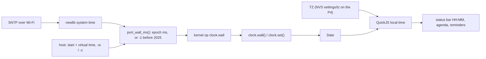
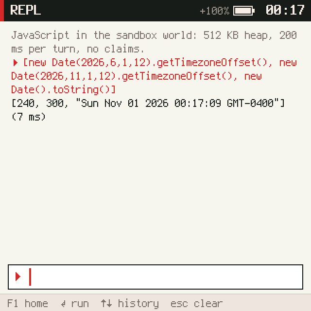
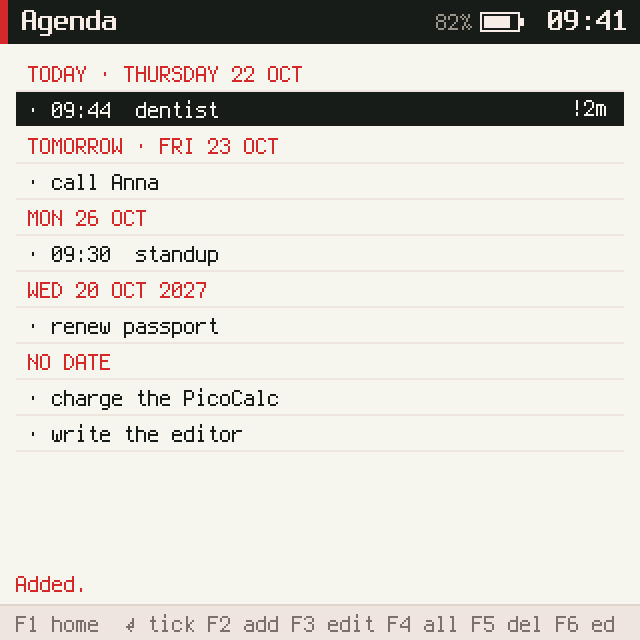
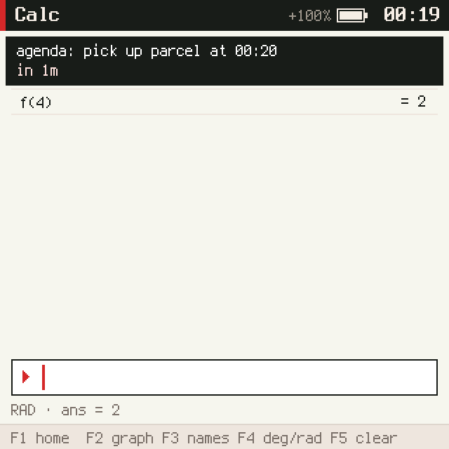

# picocalc-os, PICOCALC-AGENDA: real time and an agenda on the PicoCalc

This note reports the fourth of five tickets that turn picocalc-os into a pocket computer; see
[[PROJ - picocalc-os - Project Overview - A JavaScript OS on Two Devices, With an Agent]] for the project and
[[PROJ - picocalc-os - PICOCALC-EDIT - Editor, Files and Notes on the PicoCalc]] and
[[PROJ - picocalc-os - PICOCALC-CALC - A Calculator and Plotter on the PicoCalc]] for the tickets before it. The
request was a todo list and agenda with reminders on the network clock. It turned out that no program on the
device could know the date: every world believed it was 22 October 2026, 09:41 UTC, plus the time since boot. So
half of the ticket is time itself, including a daylight-saving bug in the JavaScript engine's port to the P4.

> [!summary]
> - **Worlds have a real clock now.** The kernel exposes the wall clock, unknown until SNTP sets it; `Date` uses
>   it; the device has a time zone; the status bar shows local time, or `--:--` before the network has set the
>   clock.
> - **QuickJS on ESP-IDF was an hour off in summer.** Its time-zone offset came from `mktime` on UTC fields with
>   daylight saving time switched off. It now uses the difference of the broken-down fields, and the device reports
>   240 minutes for July and 300 for December in New York.
> - **The agenda is a view of a plain file.** Tasks live in `notes/todo.txt`, which the editor and the agent can
>   also change; every edit re-reads the file and changes only the line it means. Reminders are banners the
>   compositor shows over whatever app is in front.

## Why this ticket exists

Reminders need the real local time. The P4 had it, from SNTP, but only TLS used it. The prelude's `Date` returned a
fixed boot time plus the time since boot. That kept host screenshots identical from run to run, and it meant no
app could tell what day it was.

## Implementation details

### Time from the port to `Date`



When the clock is unknown, `Date` keeps the old made-up time, so programs that only format a time keep working,
and programs that act on dates check `clock.set()` first. On the host the default start is still the old boot time
in UTC, so no existing screenshot changed; tests pass `-w 2026-07-01T12:00 -z EST5EDT,M3.2.0,M11.1.0` when they
need a particular date and zone.

The time zone is a C-library setting, not a JavaScript one. QuickJS asks `localtime` for the offset of every
instant it converts, so a POSIX zone with rules, like `EST5EDT,M3.2.0,M11.1.0`, gives correct local times on
both sides of a daylight-saving change. On the P4 it is stored in NVS under `settings`, kept apart from the network
credentials so that `net forget` leaves it alone. It is set with the console command `tz` or with
`provision_agent.py --tz host`, which reads the rule from the footer of the laptop's `/etc/localtime`.

### The daylight-saving bug

newlib's `struct tm` has no `tm_gmtoff`, so the port computed the offset as
`mktime(gmtime(t)) - mktime(localtime(t))`. `gmtime` marks its result as standard time, and `mktime` then reads
the UTC fields as standard local time, an hour away from the truth whenever summer time is in effect. A short C
program in the ticket demonstrates it, and the fix subtracts the broken-down fields instead:

```c
gmtime_r(&ti, &g); localtime_r(&ti, &l);
days = l.tm_yday - g.tm_yday;  if (l.tm_year != g.tm_year) days = l.tm_year > g.tm_year ? 1 : -1;
res = -((days * 24 + l.tm_hour - g.tm_hour) * 60 + l.tm_min - g.tm_min);
```



### Notifications

Any world can now send the compositor `notify` with a text. The banner always begins with the sending world's
name, so no world can speak for another or for the system. Crash banners come first, an interrupted notification
goes back to the front of the queue, and at most four wait, one per world.

### The agenda and its file

```text
- [ ] dentist @2026-11-03 14:30 !15m
- [ ] call Anna @2026-11-02
- [x] charge the PicoCalc
- write the editor                  (a plain list item is an open task)
```

Typing `dentist @tue 2pm !15m` writes `@2026-11-03 14:00 !15m` into the file; the agenda understands `today`,
`tomorrow`, weekday names, `+3d`, `+2w`, `11-15` and full dates, with times like `14:30`, `9`, `2pm` or `9:15am`.
Because the editor and the agent can change the file too, the agenda never writes from memory. Every change reads
the file, looks for the exact line it displayed, changes that line, and writes the file back. If the line has
changed in the meantime, the agenda reloads instead of overwriting someone else's edit.



Reminders are checked every 15 seconds in the background. A task with a time is reminded at its time less its
lead; each reminder fires once, which is remembered across reboots; one that came due while the device was off is
shown if it is less than two hours late; and nothing fires while the clock is unknown. Every five minutes the
background tick also re-reads the file, so a task the agent added is reminded even if the agenda was never opened.

## On the device

| What (ESP32-P4) | Result |
|---|---|
| Status bar before SNTP / after, no zone / after `--tz host` | `--:--` / 04:16 (UTC) / 00:17 |
| `getTimezoneOffset()` July / December / now | 240 / 300 / 240, "Sun Nov 01 2026 00:17:09 GMT-0400" |
| A task at 00:20 with `!1m` | banner "agenda: pick up parcel at 00:20 / in 1m" at about 00:19:10, over the calculator |
| After a software reboot | the time is kept; the reminder did not fire again |



## Tests

- `make test-clock` (4): the default clock and zone, a zone with daylight saving time, an unknown time, a bad `-w`.
- `tests/agenda.test.mjs` (9): line parsing, date expressions including month and year ends, grouping, keys,
  concurrent edits, reminders in New York time across the end of daylight saving time, background re-reading,
  opening the file in the editor.
- A notification test in `tests/compositor-auth.test.mjs`; `scripts/agenda.txt` ends with a reminder banner.

## Current status

- Done: `0470bed` (clock, zones, DST fix, notifications), `dc0dfa8` (agenda), `a5c90cf` (provisioning and device
  check), docs `e53e628`. Guide before and guide as built with the diary on the reMarkable under
  `/ai/2026/11/01/PICOCALC-AGENDA`. Ticket closed.

## Open questions

- The PaperS3 has a BM8563 real-time clock that `port_wall_ms` does not read yet.
- Repeating tasks and snoozing a reminder.
- The device was checked on both sides of the 1 November change, not across it.

## Next

PICOCALC-SYS: settings (Wi-Fi, provider and time zone on the device), Wi-Fi status, a log viewer and an app loader.

## Important files

- `picocalc-os/nucleus/vm.c` — `clock.wall`, `clock.zone`
- `picocalc-os/host/port_host.c`, `picocalc-os/host/main_host.c` — the host clock, `-w`, `-z`
- `picocalc-os/port/esp32p4/main/store_p4.c`, `port_p4.c` — the zone setting, the wall clock
- `picocalc-os/third_party/quickjs/quickjs.c` — `getTimezoneOffset` on ESP-IDF
- `picocalc-os/js/prelude.js`, `picocalc-os/js/system/compositor.js` — `clock`, `Date`, the status bar, `notify`
- `picocalc-os/js/apps/agenda.js`, `picocalc-os/tools/provision_agent.py`
- Ticket: `ttmp/2026/11/01/PICOCALC-AGENDA--a-todo-list-and-agenda-with-reminders-on-the-network-clock/`
