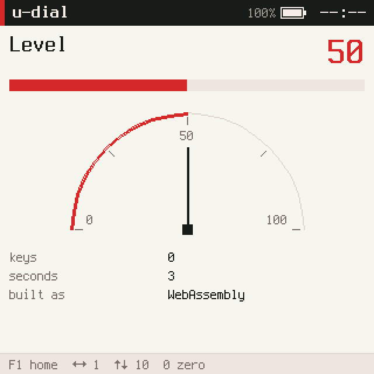
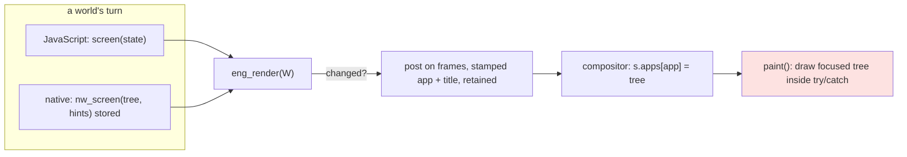
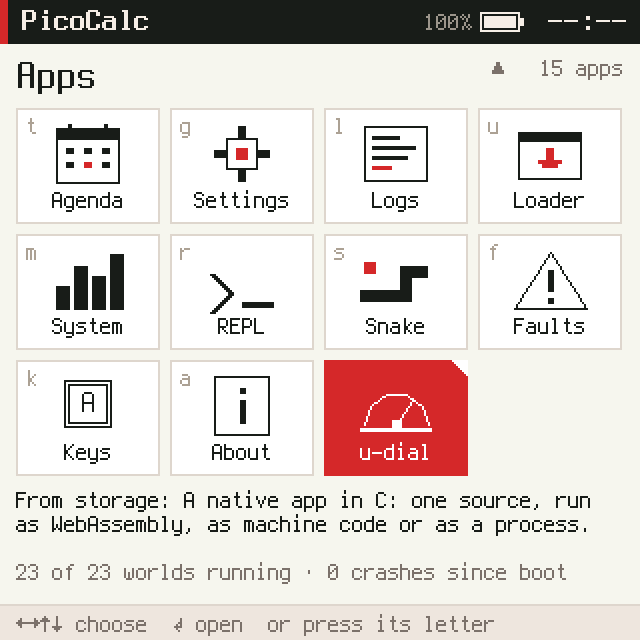
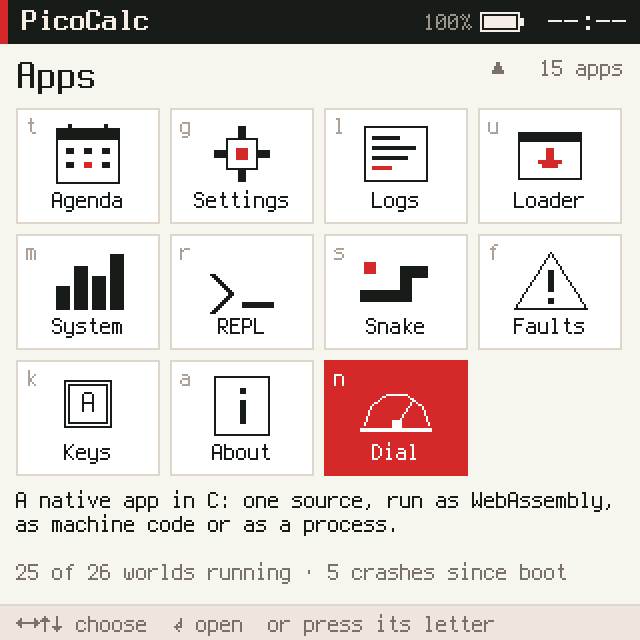

# picocalc-os, PICOCALC-APPUI: native screens and apps that bring their own icons

After [[PROJ - picocalc-os - PICOCALC-NATIVE - WebAssembly and Machine Code on the P4]], a world written in C could
run as a host process, as WebAssembly or as machine code on the ESP32-P4, receive keys and send messages, but it
could not show anything: only JavaScript worlds had a screen. The home screen had a second limit: it was a fixed
table of fourteen apps in `js/apps/launcher.js`, so an app started from storage
([[PROJ - picocalc-os - PICOCALC-LOADER - Apps from Storage, Without Claims]]) never appeared on it. This ticket
removes both limits. A native world now hands the kernel a tree of ui nodes with one system call, and every app,
JavaScript or native, declares its own title, icon, description and shortcut letter; the launcher builds its grid
from the running worlds. The demonstration is Dial, one C source that runs in all three native builds and on the
device. The project overview is [[PROJ - picocalc-os - Project Overview - A JavaScript OS on Two Devices, With an Agent]].

> [!summary]
> - **A native app has a screen.** `nw_screen(tree, hints)` stores a JSON tree that the kernel posts after the
>   event, exactly like a JavaScript app's frame: deduplicated, retained for a restarted compositor, stamped with
>   the world's name. `sdk/nw_ui.h` writes trees without a C library.
> - **Apps describe themselves; the launcher has no list.** `.icon()/.about()/.key()` in JavaScript and
>   `nw_icon/nw_about/nw_key/nw_title` in C, checked by the kernel at start. The launcher shows the worlds of kind
>   `app` in manifest order, then the apps from storage, and the home screen is byte-identical to before.
> - **Untrusted apps stay recognisable and harmless.** An app from storage is labelled by its world name, has no
>   letter and a corner mark; the launcher sanitises every icon; the compositor draws each app's tree inside a guard.

## Why this project exists

The user asked whether WebAssembly and ELF apps could show an icon or any UI, and then asked for it. The question
had a short answer in the code: a native world's engine had no render function (`eng_render()` returned `NULL` for
it), and the launcher's grid came from a constant array. Both were consequences of an earlier order of work rather
than design decisions, and both had to change together, because a native app with a screen that cannot be launched
is not much use.

## Current project status

The ticket is closed. Commits in `/home/manuel/code/wesen/2026-10-20--ds-js-os`:

| Commit | Change |
|---|---|
| `fce602a` | ticket and intern guide (uploaded to the reMarkable) |
| `374e71d` | Phase 1: `NW_SCREEN`, `NW_PRESENT`, `kernel_present()`, `sys.worlds(fields)`, `sdk/nw_ui.h` |
| `4e17af2` | Phase 2: the fourteen apps declare icon, description and letter |
| `caa81ce` | Phase 3: the launcher from the worlds; the compositor's mark and drawing guard |
| `df0bec6` | Phase 4: Dial in three builds; end-to-end and presentation tests |
| `d90901e` | the Loader brings a WebAssembly app forward when it says it is an app |

Every host suite passes (native 34 tests on both engines, system 26, apps 75, and the rest); the launcher's
screenshots did not change by a byte. On the device, Dial ran as machine code in the ELF firmware and from
`apps/dial.wasm` through the Loader on the normal firmware.



## Implementation details

### The screen was already data

Apps in picocalc-os never draw. After each turn, the kernel asks the world for its screen (a tree of ui nodes such
as `col`, `text`, `bar`, `canvas`), and if the JSON differs from the last one it posts it on the `frames` channel,
named and titled by the kernel. The compositor keeps the last tree of each app and draws the focused one. Giving a
native world a screen therefore needed no new pipeline: the world stores a tree, and the render step reads it.

```c
// nucleus/native.c, simplified
case NW_SCREEN:                                   // nw_screen(tree, hints)
  tree must be strict JSON and an object;  hints: text, at most 120 bytes;  both at most 16 KB
  W->nat->screen = {"tree": <tree>, "hints": "<hints>"};  W->has_screen = true;
char *nat_render(world_t *W) { return W->nat->screen ? xstrdup(W->nat->screen) : NULL; }
// nucleus.h: eng_render(W) = W->engine == ENG_JS ? vm_render(W) : nat_render(W)
```

Because the stored tree goes through the same step, a native screen is deduplicated, becomes the world's retained
post (PICOCALC-FRAMES), and cannot claim another app's name.



### What an app shows on the launcher

Presentation is declared in the app's own code at start, and the kernel keeps it in `world_t` (`icon`, `about[160]`,
`key[2]`), cleared at every boot so a restart declares again. One kernel function validates both languages:

```c
int kernel_present(world_t *W, const char *field, const char *value, char *why, size_t n);
// title: 1-31 bytes of plain text;  icon: a JSON array, at most 1024 bytes;
// about: at most 159 bytes of plain text;  key: one of a-z, 0-9
```

A JavaScript app writes `.key("x").about("…").icon([...])` in its builder chain; the prelude returns them from
`__init()` and `read_meta()` passes them to `kernel_present()`, failing the start with the reason. A native app calls
`nw_title`, `nw_icon`, `nw_about`, `nw_key` in `nw_init` (one system call underneath, refused after init).
`sys.worlds("name,title,icon,about,key")` reports them; the three new fields appear only when asked for, so the
System app's frequent polling did not grow.

### The launcher without a list

Validation is split three ways, each part checking what it can: the kernel checks shape and size, the launcher
checks what an icon draws, and the compositor survives what neither caught.

```js
// js/apps/launcher.js, simplified
function lnRefresh(s) {                       // on start, on focus, and when apps come or go
  const ws = sys.worlds("name,kind,title,state,user,icon,about,key");
  s.apps = ws.filter(w => w.kind === "app" && w.name !== self && !(w.user && w.state === "stopped"))
    .map(w => ({ app: w.name, label: w.title,
                 key: !w.user && first claim on w.key ? w.key : "",
                 about: (w.user ? "From storage: " : "") + w.about,
                 ops: lnOps(w.icon) || undefined, icon: ops ? undefined : first letter,
                 mark: w.user || undefined }));
}
function lnPoll(s) {                          // every 2 s: names and states only
  const ws = sys.worlds("name,kind,state,user");
  if (names(ws) !== s.names) lnRefresh(s); else count(s, ws);
}
// lnOps: fill/rect/line/text only; numbers finite, rounded, clamped to the 40 x 30 box; palette colours or #rrggbb;
// fonts s m mb l xl; text of 1-3 characters; at most 32 operations; nothing left -> a letter instead
```

Order comes from the manifest: `sysmon` moved after `loader` in `js/system.json`, which made manifest order equal to
the old hand-made order. The fourteen apps carry the exact values the old table had, so the screenshot suite became
the regression test: `01-home`, `02-home-repl` and `90-home-row4` are byte-identical. An app from storage is shown
under its world name (the kernel forces `u-` worlds' titles), with an 8-pixel corner mark and no letter; a letter it
declares is ignored, so `g` still opens the real Settings.



### A guard in the compositor

The compositor is a single world every app depends on. Before this ticket a malformed tree from any app (say a
`grid` whose `items` is `null`) threw inside `paint()` and crashed the compositor, taking every app's screen with it
until supervision restarted it. Native trees are hand-written JSON, and apps from storage are untrusted, so this
had to become local. Drawing now happens inside `try`/`catch`, and the body shows "Broken's screen could not be
drawn" with QuickJS's message. An end-to-end host test runs the whole system with such an app, opens it by its letter, and then
opens Calc.

### Dial

`natives/dial.c` shows a level from 0 to 100 as a number, a bar and a gauge on a canvas, with counters for keys and
seconds and the build it was compiled as. It uses only the SDK, `nw_json.h`, `nw_ui.h`, `snprintf`, `vsnprintf`,
`strcmp` and `strlen`, which the firmware exports to ELF modules, and no maths library: the gauge's points come from
a table of cos(9k°)×1000 and integer interpolation between steps.

```c
static const short C9[11] = { 1000, 988, 951, 891, 809, 707, 588, 454, 309, 156, 0 };
static void arc(int i, int r, int *x, int *y) {     // step i of 20 along the half circle
  int c = i <= 10 ? C9[i] : -C9[20 - i], s = i <= 10 ? C9[10 - i] : C9[i - 10];
  *x = CX - r * c / 1000; *y = CY - r * s / 1000;
}
```

The same source is built by `make natives wasm` and by the P4's ELF build (`nat-dial` in
`optional/native_elf/system.elf.json`).



### Measurements that changed the design

The first launcher read everything every two seconds. The host prints a world table during the screenshot runs;
the launcher's row said 2.76 ms of CPU at the first frame against 0.42 ms for the old launcher, and 30 ms after
13 turns against 4.35 ms. Measuring variants on copies of `js/` (no sanitising, no icons kept, plain loops)
showed that sanitising cost about 2.2 ms per full read in native calls on the virtual clock, not in closures, so
the fix was to read icons less often, not to write the sanitiser differently. Icons can only change when a world
starts, so the poll now reads names and states, and the icons are read on start, on focus, and when the set of apps
changes.

On the device a turn of Dial costs about 1.3 ms as machine code (24.72 ms over 19 turns) and about 20 ms in WAMR's
interpreter (393.8 ms over 20 turns), mostly `vsnprintf` building the canvas; the budget for apps from storage is
50 ms.

### The Loader

Running Dial from storage showed a rule left over from before: the Loader opened a JavaScript app after starting
it but never a WebAssembly one, because such a world had no screen and opening a driver module would show
"starting …" forever. It now opens a started module when `sys.worlds` reports its kind as `app`; drivers and
services are started without being opened, and autostart opens nothing.

## Important project docs

- `ttmp/2026/11/01/PICOCALC-APPUI--native-worlds-with-a-screen-and-apps-that-bring-their-own-launcher-icons/design-doc/01-native-screens-and-app-icons-analysis-design-and-implementation-guide.md`
  (intern guide: the screen pipeline, the native ABI, the launcher, six decision records; a status note at the top)
- the ticket's `log/01-diary.md` (steps 1–6, with the measurements) and `various/` (both device captures)
- `picocalc-os/README.md` ("The world API", "Native worlds"), `picocalc-os/sdk/nw.h`, `picocalc-os/sdk/nw_ui.h`

## Open questions

- Keeping freshly built arrays in the launcher's state costs 13–24 KB more heap than keeping the arrays
  `JSON.parse` made, for the same values; the launcher sits at 268.6 KB of its 384 KB limit. The cause was not found
  without instrumenting QuickJS's allocator.
- A JavaScript `.title()` is still truncated rather than checked; only native titles go through the kernel's check.
- The Loader decides whether to open a module 300 ms after starting it; a module with a slow `nw_init` is started
  and not opened.

## Near-term next steps

- The PaperS3's separate launcher (`js-papers3/`) could build from `sys.worlds` the same way.
- A native app's canvas is built with `vsnprintf` on every frame; a WebAssembly app that redraws often would want
  a cheaper writer for numbers.

## Project working rule

When a refactor is meant to change nothing visible, make the screenshots the test before writing it: copying the
fourteen icons verbatim into the apps first turned "the new launcher is right" into "no capture changed by a byte".
