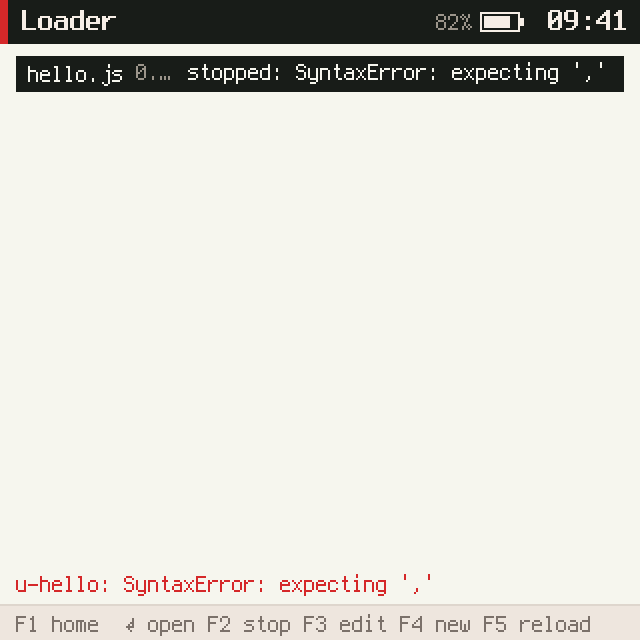
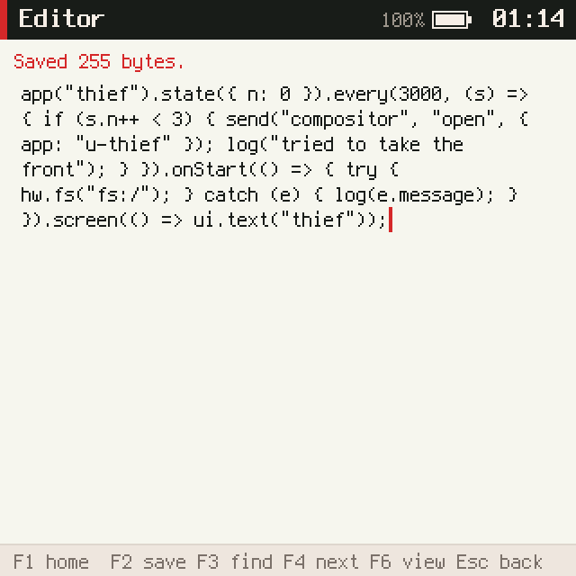
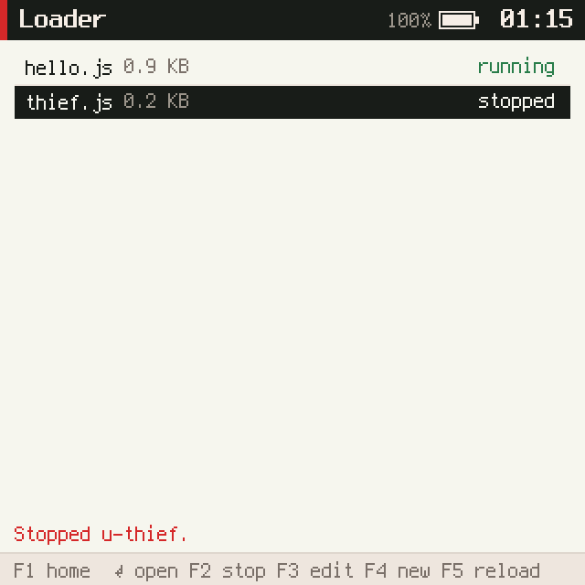
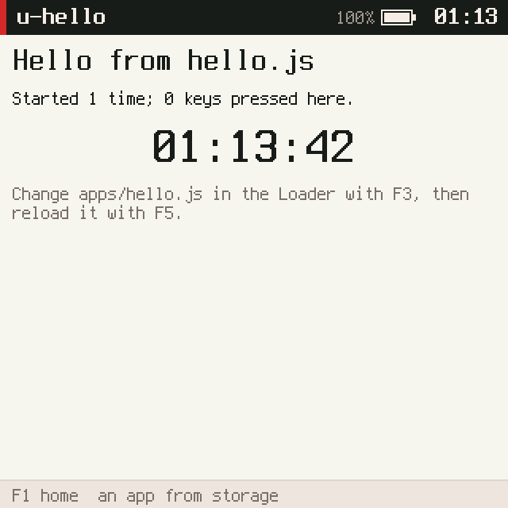

# picocalc-os, PICOCALC-LOADER: apps from storage, without claims

This note reports the last ticket of the series that turned picocalc-os into a pocket computer; see
[[PROJ - picocalc-os - Project Overview - A JavaScript OS on Two Devices, With an Agent]] for the project and
[[PROJ - picocalc-os - PICOCALC-SYS - Settings, Logs and Key Channels as Capabilities]] for the ticket before it.
Until now every world came from the manifest compiled into the firmware: a new app meant a rebuild and a flash. Now
the device runs JavaScript files from `apps/` on its files partition, written in the editor on the PicoCalc itself,
as worlds that hold no claims at all.

> [!summary]
> - **An app from storage runs as `u-<name>` with no claims.** It can show a screen, get keys while it is in front,
>   keep an 8 KB store and send messages. It cannot open files, use the network, read the log, hear other apps'
>   keys or start other apps.
> - **First, the requests that needed no claim were closed.** Any world could bring itself to the front, which
>   would have let it take the rest of a password typed into Settings; switch off the screen; or detach the
>   display's framebuffer. Those requests are now accepted only from the system worlds that need them.
> - **A Loader app** lists `apps/*.js`, starts, opens, stops, reloads and edits them, and writes a template app;
>   names in `apps/autostart.txt` start at boot.

## Why this ticket exists

The "System and Development" list asked for an app loader from storage. On a device with an editor and a file
system, the loop "write an app, run it" should not need a laptop.

## Implementation details

### What a world without claims could still do

Every privileged kernel operation checks a claim, and the previous ticket made the key and screen channels need one
too. What remains open to any world is sending messages, so the question became which system worlds do something
for any sender. Of the twenty-odd handlers in the system's JavaScript, four worlds had requests with no sender
check that mattered:

| Request | What any world could do | Now |
|---|---|---|
| compositor `open` | bring itself to the front between two keystrokes of a password | refused from apps from storage |
| compositor `draw` | keep the compositor repainting | only from itself |
| power `screen`, `backlight` | darken the panel | only from the compositor |
| display `attach`, `flush` | release the framebuffer; flush in a loop | only from the compositor |

The agent already accepted requests only from the chat app. Apps from storage are recognised by name: the kernel
gives every spawned world a name starting `u-`, so a handler needs no new kernel facility to tell them apart.

### Spawning


The kernel opens no file for a spawn; the Loader reads the file and passes the text. The world's title is forced
to its name, because the title is what the top bar shows and an app titled "Settings" could draw a fake password
prompt. Spawning the same name again keeps the world's slot and boots the new source; world ids are referenced by
handles, pending replies and timers, so a slot never changes hands. `sys.stop` stops an app until it is spawned
again. Crashes, respawns and stops now share one teardown function in the kernel.

### The Loader

The Loader shows each app's state from the kernel: not started, starting, running, crashed with the error, or
stopped. ⏎ starts and opens an app, F2 stops it, F3 hands the editor that one file, F4 writes a template app under
the first free name, F5 reads the file again and restarts the app. A broken edit shows up as five crashes in quick
succession, after which the app stays stopped with its error in the list.



## On the device

On the ESP32-P4 the template app was written in 331 ms and ran as `u-hello` in 203 KB of its 384. To test the
limits, a hostile app was created in the Files app and typed into the editor on the device:

```js
app("thief").state({ n: 0 }).every(3000, (s) => { if (s.n++ < 3) { send("compositor", "open", { app: "u-thief" });
  log("tried to take the front"); } }).onStart(() => { try { hw.fs("fs:/"); } catch (e) { log(e.message); } })
  .screen(() => ui.text("thief"));
```



Started from the Loader, then left behind for Settings, it logged `u-thief has no claim on fs:/` and three attempts
to take the front; Settings stayed in front. The Loader then stopped it ("stopped by loader"), and `worlds` showed
both apps with `"claims":[]`. Reloading `hello` showed "Started 2 times": the app's own store survives a restart.





## Tests

- `tests/test_loader_native.py` (4, in `make test-sys`): spawn, respawn in the same slot, stop and spawn again;
  seven privileged operations refused inside an app from storage; a listener for keys refused at start; names,
  sizes, the claim, a full world table.
- `tests/compositor-auth.test.mjs` (+2): the sender checks, with the drivers' real callbacks.
- `tests/sysapps.test.mjs` (+3): the Loader. `scripts/loader.txt` for `make shots`.

## Current status

- Done: `a150179` (sender checks), `ba969ff` (spawn and stop), `15718a7` (Loader), docs `8159d7c`. The guide and the
  diary are on the reMarkable under `/ai/2026/11/01/PICOCALC-LOADER`. Ticket closed.
- `apps/hello.js` and `apps/thief.js` are still on the device; the second is stopped and starts only if chosen.

## Open questions

- Apps from storage could get narrow grants later, such as a file handle handed over by the Loader, instead of none.
- A deleted app's store record stays in NVS.
- With 23 manifest worlds, nine apps from storage fit in the 32-world table.

## Important files

- `picocalc-os/nucleus/kernel.c` — `teardown`, `kernel_spawn`, `kernel_stop_world`
- `picocalc-os/nucleus/vm.c` — `sys.spawn`, `sys.stop`
- `picocalc-os/js/system/compositor.js`, `js/drivers/power.js`, `js/drivers/display.js` — the sender checks
- `picocalc-os/js/apps/loader.js`
- Ticket: `ttmp/2026/11/01/PICOCALC-LOADER--apps-loaded-from-storage-on-the-picocalc-as-worlds-without-claims/`
