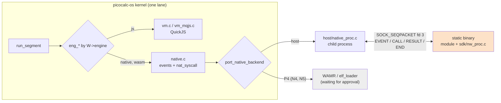

# picocalc-os, PICOCALC-NATIVE: native worlds, binaries in a sandbox

This note reports the ticket that lets picocalc-os run worlds written as binaries, compiled C and C++ today and
WebAssembly next, beside its JavaScript worlds. See
[[PROJ - picocalc-os - Project Overview - A JavaScript OS on Two Devices, With an Agent]] for the project, and
[[PROJ - picocalc-os - PICOCALC-LOADER - Apps from Storage, Without Claims]] for the capability model native worlds
inherit.

A native world is an ordinary world to the rest of the system. It has a mailbox and takes turns under a budget. It
holds claims and handles, provides and needs channels, and is supervised and restarted when it crashes. It talks to
JavaScript worlds with the same messages and asks. What changes is the engine that runs its code and what isolates
that code. On the Linux host a native world is a child process under a seccomp filter. On the ESP32-P4, which has no
MMU, the design is WebAssembly for untrusted code and supervised machine code for trusted drivers; both wait for
approval to build third-party code.

> [!summary]
> - **An engine per world.** A manifest entry may say `"engine": "native"`. The kernel reaches every engine through
>   seven `eng_*` functions. JavaScript worlds are unchanged, and `nucleus/native.c` turns kernel messages into
>   events for a native backend and carries out the binary's 19 system calls with the same claim checks as the
>   JavaScript operations.
> - **As isolated as the host allows.** A binary runs from a memfd with one descriptor (a socket). A seccomp filter,
>   installed before the exec, kills it for files, sockets, processes and exec. rlimits bound its memory, and its
>   turn budget is enforced in real time.
> - **The boundary is the data too.** Payloads from a binary must be strict JSON with no `"$h"` keys. Without that,
>   a binary could crash a JavaScript receiver inside its own turn, or make it revive a handle it was never given.

## Why this ticket exists

The request was "add support for loading binary drivers/processes that communicate with the JS processes, and are
similarly sandboxed to the extent of the capabilities of the hardware", with the follow-up "binary can be WASM or
legit compiled C++ or stuff". PICOCALC-SCI had just measured about 5 µs per closure node on the P4. Drivers and
numeric work that JavaScript is too slow for need a way in that does not give up the capability model.

## Architecture



The kernel already reached JavaScript through seven functions (`vm_create`, `vm_dispose`, `vm_begin_segment`,
`vm_steps`, `vm_dispatch`, `vm_settle`, `vm_render`). The seam is a second implementation of them, chosen per world.
Native and JavaScript worlds therefore share one scheduler, one supervisor and one set of claims. A native world
renders nothing, and its cost on the virtual clock is the real time it took plus a microsecond per system call.

## Implementation details

### A turn of a native world

A kernel message becomes an event: `NW_MESSAGE` (type, JSON payload, sender, ask flag), `NW_TICK`, `NW_START`,
`NW_SETTLE` (an asynchronous call finished) or `NW_INIT` (once per boot, the only time declarations are allowed).
The binary's handler returns `NW_DONE` or `NW_LATER`. `NW_LATER` leaves an ask open. A later settle answers it
with `nw_reply`, or ends it with null by returning `NW_DONE`.

```text
nat_dispatch(W, m):
  e = event from m
  r = backend.event(W, e)            the binary runs; each nw_* call → nat_syscall(W, call)
  r < 0          → crash (W->last_error, or W->overrun when the budget ran out)
  r == NW_LATER  → the turn stays open (W->turn_async)
  otherwise      → the turn ends; an unanswered ask gets null
```

`nat_syscall` mirrors the JavaScript operations: `send` and `ask` need a world that exists, `publish` a channel the
world provides (and its claim, if guarded), `nw_i2c_open` the claim `i2c0:0x1f`, and `nw_i2c` a handle the world
holds. Store saves are deferred to the end of the segment like every other effect, so a crashed turn leaves nothing
behind.

### The host process

```text
proc_load:   memfd ← the manifest file's bytes (must start with \x7fELF); socketpair; fork
  child:     memfd → fd 4 (close-on-exec); socket → fd 3; /dev/null → 0, 1, 2; close_range(5, ~0)
             rlimits: DATA mem_kb + 512 KB, AS mem_kb + 64 MB, NOFILE 5, FSIZE 0, CORE 0, STACK 1 MB
             seccomp filter (NO_NEW_PRIVS); execveat(4, "", AT_EMPTY_PATH)
proc_event:  send EVENT; loop: poll(socket, budget left)
             timeout → SIGKILL, overrun   |   EOF → reap, say why it died
             CALL → nat_syscall → RESULT   |   END → memory from /proc/<pid>/statm, return the status
```

The filter has three outcomes:

- **Allow** reads and writes on descriptor 3, memory management, the clock, signals to itself, `prlimit64` on
  itself, `execveat` on descriptor 4 only, and what a static C or C++ runtime needs to start.
- **Return an error** for calls a C library makes on its own and that reach nothing: `readlinkat` of
  `/proc/self/exe` at start, stdio's `fstat` and `ioctl` on standard output, reads and writes on other descriptors.
  A module that calls `printf` does not crash; the output goes nowhere.
- **Kill** for everything else.

Each argument check is a self-contained BPF block that compares all 64 bits, so `write(0x100000003, …)` does not pass
as descriptor 3.

### Three things the first runs taught

The first test run killed every binary before `nw_init`. `strace` showed static glibc reading `/proc/self/exe` at
start-up. That call now fails with ENOENT instead of killing, and the runtime carries on.

The second run reported every kill 100 ms late, as an overrun. This machine's `core_pattern` pipes dumps to apport
with `core_pipe_limit` 10. For a piped core pattern the kernel ignores `RLIMIT_CORE` 0 and holds the dying process
until the handler has read it. The process runtime (`sdk/nw_proc.c`) now calls `prctl(PR_SET_DUMPABLE, 0)` in a
constructor that runs before the module's own. Setting the flag before the exec would not work, because exec resets
it.

Reviewing the filter found two holes, both closed:

- `execveat` was allowed with any arguments, so a binary could exec `/bin/sh` by path.
- `prlimit64` was allowed on any pid, so a binary could change picocalc-host's limits.

### The SDK

`sdk/nw.h` is the C/C++ API: `nw_init`, `nw_on_event`, and the calls (`nw_send`, `nw_ask`, `nw_reply`,
`nw_publish`, `nw_every`, `nw_sleep`, `nw_i2c_open`, `nw_i2c`, `nw_store_*`, …). `sdk/nw_json.h` provides small
JSON readers with no allocation and no libc, which the WebAssembly modules will need. A module links statically with
`sdk/nw_proc.c`:

```sh
gcc -static -Isdk -o build/natives/echo natives/echo.c sdk/nw_proc.c
g++ -static -Isdk -o build/natives/battery natives/battery.cc nw_proc.o
```

`natives/battery.cc` is a real driver in C++. It reads the keyboard controller's battery register through its claim
every two seconds and publishes `battery` on a change. A `level` ask that arrives during a read is answered when that
read settles.

## Measurements (host)

| What | Time |
|---|---|
| load (memfd, fork, exec) and `nw_init` with four calls | about 0.6 ms |
| one system call | 10–20 µs |
| a JavaScript ask answered by a native world | about 150 µs |
| a sandbox kill, attempt to crash report | about 70 µs |

## Tests

`make test-native` runs 12 tests (`tests/test_native_worlds.py`):

- asks are answered now, later through a settle, or refused;
- strict payloads are enforced;
- channels and timers work, and declarations are allowed only at init;
- storage, messages both ways with JavaScript, and I2C through a claim work, and a forged handle fails;
- a segfault crashes only the native world, which restarts, and a busy loop is killed at its budget;
- a 64 MB allocation fails inside the process, and `printf` fails quietly;
- seven escape probes are killed and stopped after five crashes: `open`, `socket`, `fork`, `execve`, `execveat`
  by path, `kill` of another process and `prlimit64` of another process;
- a file that is not ELF, and an engine the board lacks, fail at boot;
- the C++ driver works.

The suite passed six times in a row and passes on the sanitizer build with no reports. All earlier suites pass
unchanged. The P4 firmware with the new seam was flashed to the PicoCalc and ran 22 JavaScript worlds with no crash.

## Current status

- N1 (the engine seam and system calls) and N2 (the host process backend, the SDK, the examples and the tests) are
  done: commits `4b3ce2f`, `199694d` and docs `8ffc032`.
- N3 (WebAssembly on the host through WAMR), N4 (WebAssembly on the P4) and N5 (trusted machine code on the P4
  through Espressif's `elf_loader`) are designed in the guide. They wait for approval to build third-party code:
  the session's permission policy refused building WAMR as external code.

## Open questions

- Passing handles to and from native worlds (grants on send, publish and reply).
- A seccomp filter for aarch64 hosts; on other architectures the backend refuses to run binaries at all.
- Memory is measured as RSS at the end of a turn; inside a turn only the rlimits bound it.
- On the P4, real isolation of machine code would need U-mode, PMP entries ahead of ESP-IDF's locked ones and an
  `ecall` gate, which is out of scope. Machine code there is for trusted, manifest-only drivers.

## Important files

- `/home/manuel/code/wesen/2026-10-20--ds-js-os/picocalc-os/nucleus/native.c`: events, system calls, the payload
  validator.
- `/home/manuel/code/wesen/2026-10-20--ds-js-os/picocalc-os/host/native_proc.c`: the process, rlimits, the filter,
  turns over the socket.
- `/home/manuel/code/wesen/2026-10-20--ds-js-os/picocalc-os/nucleus/nucleus.h`: `eng_*`, `native_backend_t`,
  `nw_call_t`.
- `/home/manuel/code/wesen/2026-10-20--ds-js-os/picocalc-os/sdk/`: `nw.h`, `nw_json.h`, `nw_wire.h`, `nw_proc.c`.
- `/home/manuel/code/wesen/2026-10-20--ds-js-os/picocalc-os/natives/`: `echo.c`, `probe.c`, `battery.cc`.
- `/home/manuel/code/wesen/2026-10-20--ds-js-os/picocalc-os/tests/test_native_worlds.py`.
- Ticket: `/home/manuel/code/wesen/2026-10-20--ds-js-os/ttmp/2026/11/01/PICOCALC-NATIVE--native-worlds-binary-drivers-and-processes-that-talk-to-the-js-worlds-sandboxed-as-far-as-the-hardware-allows/`
  (guide with an as-built chapter, diary).
