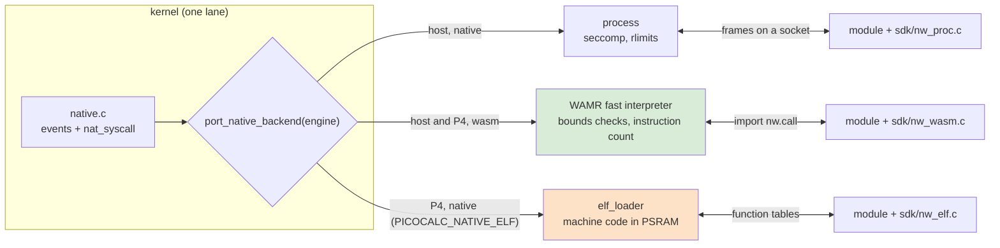

# picocalc-os, PICOCALC-NATIVE: WebAssembly and machine code on the P4

This note follows [[PROJ - picocalc-os - PICOCALC-NATIVE - Native Worlds, Binaries in a Sandbox]], which reported the
first half of the ticket: native worlds as Linux processes under seccomp on the host. That note ended with three
steps waiting for approval to build third-party code. The approval came, and all three are now built and have run on
the hardware: WebAssembly worlds on the host (N3), WebAssembly worlds and WebAssembly apps from storage on the
ESP32-P4 (N4), and machine-code drivers on the P4 through Espressif's `elf_loader` (N5). The project overview is
[[PROJ - picocalc-os - Project Overview - A JavaScript OS on Two Devices, With an Agent]].

> [!summary]
> - **One module source, three engines.** `natives/echo.c` builds as a static Linux binary, as a WebAssembly module
>   and as a P4 ELF module, and passes the same asks in each. Only the way `call()` reaches the kernel differs.
> - **WebAssembly is the P4's isolated option.** WAMR's interpreter confines a module to its own memory and its two
>   imports, and an instruction count bounds its turn. Modules may be started from storage.
> - **Machine code is trusted, firmware-only, and 26 times faster.** The kernel accounts for an ELF module (what it
>   links to, its memory, its time) but cannot confine it. A store to address 0 panics the board.

## Why this follow-up exists

The ticket's request was binary drivers and processes "similarly sandboxed to the extent of the capabilities of the
hardware", and the follow-up said "binary can be WASM or legit compiled C++ or stuff". The ESP32-P4 has no MMU, so
the host's answer (a process and a system-call filter) does not carry over. It needs two answers instead. Code the
kernel does not trust runs in an interpreter that checks every memory access. Code the kernel does trust, a driver
built with the firmware, may run as machine code, provided the kernel keeps its accounting and its policy honest about
what it cannot prevent.

## Architecture



| | process (host) | WebAssembly (host, P4) | machine code (P4) |
|---|---|---|---|
| memory protected by | the MMU | the interpreter's bounds checks | nothing |
| calls limited by | seccomp | imports, checked before it runs | a symbol list, checked at load |
| turn budget | real time, killed | instruction count | real time, checked after the turn |
| a bad access | the world crashes | the world crashes | the board panics and reboots |
| from storage | no | yes | never |

## Implementation details

### WebAssembly worlds (N3, N4)

WAMR 2.4.5 is vendored as a subset (`third_party/wamr/`, written by `tools/vendor-wamr.sh`): the fast interpreter
with instruction metering, without AOT, JIT, WASI or its libc. The backend, `nucleus/native_wasm.c`, gives a module
exactly two imports. `nw.call` takes the wire's CALL frame as arguments, and its WAMR signature `"(iiiI*~*~*~*~)I"`
makes WAMR check every pointer-and-length pair against the module's memory before the kernel sees it. `nw.error`
returns why the last call failed. Before it runs any of a module's code, the kernel walks its imports and refuses
anything else (`it imports the function wasi_snapshot_preview1.path_open, which picocalc-os does not provide`).
The exceptions are five WASI stubs that wasi-libc's stdio links even for `snprintf`; they fail with EBADF.

The turn budget is an instruction count: `budget_us × 1000 / PROFILE.wasm_ns_per_op`. WAMR's fast interpreter kept
the remaining count in a local and never wrote it back, so the kernel could not charge what a turn used. Patch 0001
writes it back.

On the P4 the same files build with WAMR's ESP-IDF platform layer, plus two more patches. One puts module memory in
PSRAM. The other cost a reboot loop: WAMR's `os_self_thread()` called `pthread_self()`, which asserts on any FreeRTOS
task that pthread did not create, and the kernel's task is one. The first module load rebooted the board. With the
module in `apps/autostart.txt`, it rebooted on every boot. A script that truncated `autostart.txt` every 250 ms
through the console broke the loop, and patch 0003 returns the FreeRTOS task handle instead. Since then every device
run truncates `autostart.txt` itself.

Apps from storage go through the Loader. It opens `apps/name.wasm` and passes the read handle to `sys.spawn`. The
kernel reads the bytes itself and picks the engine from their content (`\0asm` for WebAssembly, UTF-8 text for
JavaScript, anything else refused, ELF included). JavaScript never holds the bytes.

### Machine code (N5)

An opt-in build (`-D PICOCALC_NATIVE_ELF=ON`) adds `elf_loader` 2.0.0 and a second manifest compiled into the
firmware, `optional/native_elf/system.elf.json`. Modules are C, linked with `sdk/nw_elf.c` as position-independent
shared objects by the firmware's own compiler:

```text
riscv32-esp-elf-gcc -march=rv32imafc_zicsr_zifencei -mabi=ilp32f -Os -fPIC -shared -nostartfiles -nostdlib
    -e app_main -Wl,--gc-sections -fvisibility=hidden -Wl,--strip-all -Wl,-z,max-page-size=16
    -Isdk -o echo.elf natives/echo.c sdk/nw_elf.c
```

The loader copies the module into PSRAM, relocates it and calls `app_main(2, argv)`. `argv[0]` is the kernel's table
(`call`, `error`) and `argv[1]` the module's (`init`, `event`), which the entry fills in. From then on everything is
a function call on the kernel's task.

```text
elf_load(W):   check \177ELF, 32-bit, EM_RISCV, float ABI single
               esp_elf_relocate(image) with resolve():   memcpy … vsnprintf (22), malloc/calloc/realloc/free (charged),
                                                          libgcc's soft-float and 64-bit helpers (in the P4's ROM)
               a symbol it does not have → "it links to path_open, which picocalc-os does not give a module"
               esp_elf_request(argc 2, {kernel table, module table}); check the module table
elf_event(W):  now = W; t0 = clock; module.event(...); took = clock − t0
               took > budget → overrun (the world crashes and is restarted)
elf_unload(W): free every block the module still holds; esp_elf_deinit
```

The resolver is the module's whole contract with the firmware. A module that wants a socket or a thread fails at load
and names the symbol. It is a contract, not a wall, because machine code can compute an address and jump to it. The
allocator is real accounting: each block carries a 16-byte header linking it into the world's list, the world is
charged for it, a request past `mem_kb` returns NULL, and a crash or restart frees everything.

Three details took more care than the rest:

- **Soft-float.** libgcc.a is not position-independent (`relocation R_RISCV_HI20 … recompile with -fPIC`), so a
  module cannot carry its own double-precision helpers. On the P4 they are mask-ROM functions (`4fc00868 A
  __adddf3`), and the resolver hands those out.
- **Segment padding.** The default linker script aligns the data segment to 4 KB, and the loader allocates the gap.
  `-z max-page-size=16` makes code and data contiguous; nat-echo went from 13.5 KB to 9.5 KB.
- **Bundling build outputs.** The firmware's file table is generated in `main`, and a custom command in another
  component cannot feed it. The modules are compiled in `main/CMakeLists.txt` and passed to `bundle_js.cmake` as
  `EXTRA` `name=path` entries.

The failure mode was confirmed rather than assumed. Through the REPL, `sleep(4000).then(()=>ask("nat-echo","segv",0))`
was typed, and the keyboard bus was held before the timer ran out so the reset could not cut an I2C transaction. The
board printed `Store access fault`, with `MEPC 0x4862350a` in the module's PSRAM segment and `MTVAL 0`, and rebooted
with `SW_CPU_RESET`. All worlds came back.

## Measurements (ESP32-P4, 360 MHz)

| What | Result |
|---|---|
| bench loop, 16,000 xorshift iterations, WebAssembly | 13,884 µs (69 ns per instruction) |
| the same loop, machine code from PSRAM | 535 µs (33 ns per iteration) |
| 1,000,000 iterations, machine code | 33.5 ms; 3,000,000 overran a 50 ms budget and restarted |
| `echo.elf` / `bench.elf` in memory | 10.6 KB / 2.7 KB |
| ELF option, image size | +39 KB (2,652,592 against 2,612,896 bytes) |
| I2C read of the keyboard controller through an ELF world's claim | register 0x0B = 100 |

On the host, a JavaScript world's ask of an echo service costs 16.7 µs when the service is JavaScript, 31.6 µs when
it is WebAssembly and 49.9 µs when it is a process.

## A finding outside the ticket: the P4's layout sensitivity

The P4's JavaScript speed depends on where code and data sit in memory, and N5 produced the clearest case so far. The
ELF backend keeps a 16 KB static result buffer, as the WebAssembly backend does. Allocating it lazily in PSRAM
instead, with nothing else changed, made the kernel's boot calibration loop take 1,604 ms instead of 113 ms on three
boots. Restoring the static buffer brought back 113 ms on two more. fib(20) did not move (31.4 against 30.8 ms). The
calibration runs before any world or module exists, so this is layout alone.

The loop's sum passes 2³¹ after about 65,000 iterations, so the rest of its additions are floating point, while fib
stays in integers. The soft-float routines are in ROM, and N4 showed register-only loops and random PSRAM reads run
at the same speed in fast and slow images. That leaves conflicts in the 128 KB L2 cache, which flash code and PSRAM
data share, as the leading suspect. The buffer stays static, with the measurement written next to it in a comment,
and the effect deserves its own ticket.

## Current status

- N1–N5 are done.
  - Code: `4b3ce2f`, `199694d` (N1, N2); `4dd164e`, `899358a` (N3); `9d66b95`, `7ba759e` (N4); `bb55c32` (N5).
  - Docs: `f048b11` (diary step 7, guide chapter 16).
- Host: 25 native tests (process and WebAssembly, with the escape probes) pass, also on the sanitizer build; every
  other suite and the screenshots are unchanged.
- The PicoCalc runs the ELF build: three ELF worlds (`nat-echo`, `nat-bench`, and `nat-import`, which is refused at
  load and stops after five tries) beside the 22 JavaScript worlds.
- The guide (with the as-built chapter) and the diary were uploaded to the reMarkable as "PICOCALC-NATIVE Guide and
  Diary N1-N5 as built".

## Open questions

- What makes the P4's JavaScript speed swing 3–14× with layout, and can placement be pinned so that it stops
  depending on unrelated changes?
- C++ modules for the ELF engine need a small runtime (out-of-line `std::string`, a throw that aborts) and something
  to run static constructors.
- `elf_loader`'s own symbol tables are unused once our resolver is installed; turning them off may recover part of
  the 39 KB.
- Handles in messages to and from native worlds are still not passed.
- A real sandbox for machine code on the P4 (U-mode, PMP entries ahead of ESP-IDF's, an `ecall` gate) remains out of
  scope.

## Project working rule

A binary from storage must be one the kernel can confine. Machine code is never started from a file, and the
firmware's own manifest is the only place that can name it.

## Important files

- `/home/manuel/code/wesen/2026-10-20--ds-js-os/picocalc-os/nucleus/native_wasm.c`: the WebAssembly backend.
- `/home/manuel/code/wesen/2026-10-20--ds-js-os/picocalc-os/port/esp32p4/optional/native_elf/native_elf_p4.c`: the
  ELF backend (resolver, allocator, events, and the trust boundary in its header comment).
- `/home/manuel/code/wesen/2026-10-20--ds-js-os/picocalc-os/sdk/`: `nw_wasm.c`, `nw_elf.h`, `nw_elf.c`,
  `nw_calls.inc`.
- `/home/manuel/code/wesen/2026-10-20--ds-js-os/picocalc-os/third_party/wamr/patches/`: the three WAMR patches.
- `/home/manuel/code/wesen/2026-10-20--ds-js-os/picocalc-os/port/esp32p4/main/CMakeLists.txt` and
  `bundle_js.cmake`: WAMR on the P4, the ELF modules and their bundling.
- `/home/manuel/code/wesen/2026-10-20--ds-js-os/picocalc-os/port/esp32p4/README.md`: how to build with
  `PICOCALC_NATIVE_ELF`.
- Ticket: `/home/manuel/code/wesen/2026-10-20--ds-js-os/ttmp/2026/11/01/PICOCALC-NATIVE--native-worlds-binary-drivers-and-processes-that-talk-to-the-js-worlds-sandboxed-as-far-as-the-hardware-allows/`
  (guide chapter 16, diary steps 5–7).
