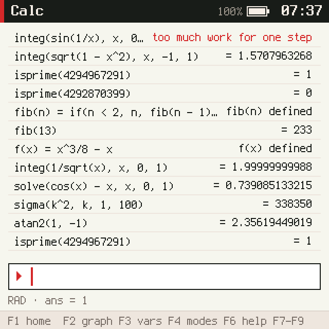
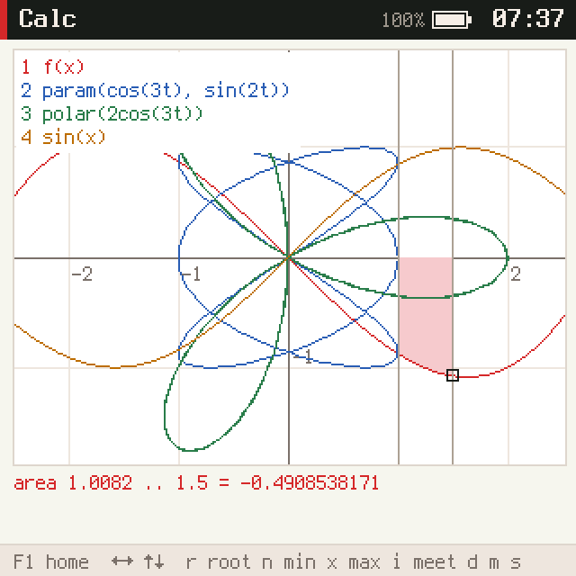
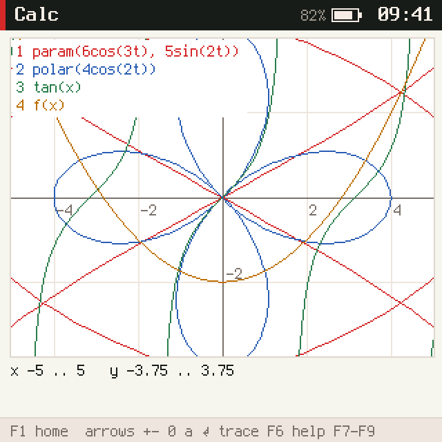
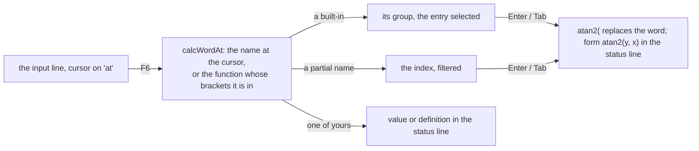
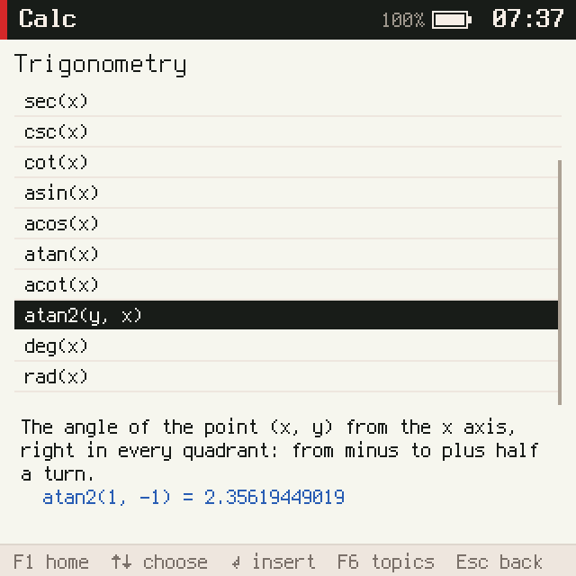
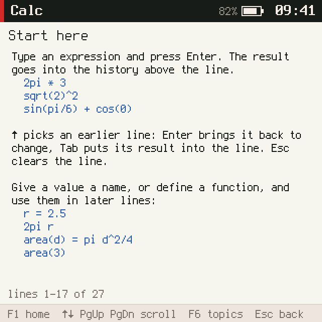
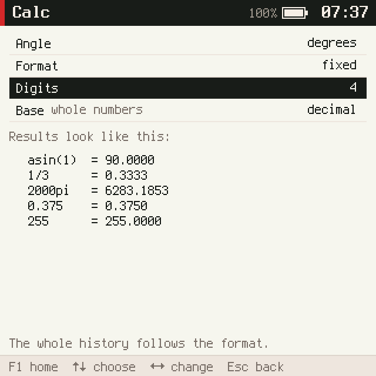

# picocalc-os, PICOCALC-SCI: a graphing scientific calculator with help pages

This note reports the ticket that turned the PicoCalc's calculator into a graphing scientific calculator. See
[[PROJ - picocalc-os - Project Overview - A JavaScript OS on Two Devices, With an Agent]] for the project, and
[[PROJ - picocalc-os - PICOCALC-CALC - A Calculator and Plotter on the PicoCalc]] for the calculator it extends.

The calculator now covers 52 functions and 16 physical and mathematical constants. It has calculus and a solver,
user functions of up to four variables, angle and display modes, and four curves on a graph (functions, polar and
parametric). The graph supports root, extremum, intersection, slope and area analysis, a table and a window page.
F6 opens help with a reference entry for every built-in name. Measuring it on the ESP32-P4 changed how the
calculator limits its own work.

> [!summary]
> - **One app, four layers.** The engine parses a line once, compiles it into closures over cells, and runs
>   calculus forms over those closures. The graph samples the same closures in slices. The help is data: a
>   77-entry reference whose examples are worked out live, and seven guides.
> - **The help is tested against the engine.** Every built-in has exactly one entry. Every example must give its
>   stated result, and every example in the guides must run. That test found a false claim in the guides, which
>   led to a change in the integrator.
> - **The device set the limits.** On the P4, doubles are emulated in software and a closure node costs about
>   5 µs, not the fraction of a microsecond the first design assumed. A line is now limited by the clock as well as
>   by fuel. The calculator gets a 200 ms turn, and two hot paths were rewritten.



## Why this ticket exists

The request was "Update the calculator to be a graphing scientific calculator with help pages and all". The
previous calculator evaluated expressions with one-argument functions and plotted up to three functions of x. A
graphing scientific calculator in the TI or Casio sense needs more functions, calculus, more kinds of curves and
analysis. On a device without a manual, it also needs a way to look up what each function does and how to type it.

## Implementation details

### The engine: closures over cells

A line is tokenized, parsed by a Pratt parser into a tree, and compiled into JavaScript closures, one per node. A
plot can therefore evaluate an expression three hundred times without parsing it again. The new requirement was
several bound names at once: `f(x, y)`, `integ(t^2, t, 0, x)` inside a plot of x, and recursion. Every bound
name is resolved at compile time to a **cell**, an object `{ v }`. A reference compiles to `() => cell.v`, and
whoever binds the name sets the cell and restores it afterwards.

```text
compile(node, scope)              scope: name -> cell
  number            -> () => n
  bound name        -> () => cell.v
  variable          -> () => s.vars[name]        read when it runs
  integ(f, t, a, b) -> body = compile(f, scope + {t: cell})
                       at(t) = burn(size); old = cell.v; cell.v = t; try body() finally cell.v = old
                       () => calcInteg(at, [a(), b()])
```

The calculus forms work on `at`:

- `deriv` uses Richardson extrapolation of central differences.
- `integ` is adaptive Gauss–Kronrod 7/15 with up to 100 intervals.
- `solve` runs the secant method from a guess, or searches outward for a sign change and bisects it, refusing
  poles.
- `sigma` and `prod` are loops of at most 10,000 terms.
- Comparisons give 1 or 0, and `if` evaluates only the branch it takes, so functions can recurse:
  `fib(n) = if(n < 2, n, fib(n - 1) + fib(n - 2))`.

Display formats (normal, fixed, scientific, engineering, fraction) and integer bases (hex, binary, octal) apply to
stored values. Changing the format redraws the whole history.

### Graphing

Up to four curves are sampled in slices by a detached `sleep().then` chain, so keys keep arriving while a curve is
drawn:

- functions of x, one per column;
- `polar(r)` and `param(x, y)`, at 306 values of t.

Parametric segments are clipped to the canvas with Liang–Barsky. Trace analysis works on a function curve:

- a root, from a sign change among the samples, then bisection;
- a minimum or maximum, from a sample extremum, then a golden-section search;
- the intersection with the next curve;
- dy/dx at the cursor;
- the area from a mark to the cursor, shaded.





### Help



Each reference entry is `[name, form, sentence, example, result]`. The help page shows the example worked out
now, in the current modes, so `atan2(1, -1)` reads 2.35619449019 in radians and 135 in degrees. The `result` field
exists for the test, which keeps the source honest. The guides cover:

- Start here
- Keys
- Numbers and operators
- Variables and functions
- Calculus and solving
- Graphing
- Modes and formats

Their examples are run in order by a test, and their factual claims are checked as well. That is how the claim "an
infinite end is fine" turned out false: the integrator stopped after 30 intervals, while a 1/√x end needs about
50 halvings.





F4 is now a modes page with a preview of how results will look:



## On the device: what the measurements changed

The first design limited work with **fuel**, a count of closure nodes, set to 200,000 and "calibrated on the P4"
to stay under an 80 ms turn. It had never been measured. With a temporary timing log around the evaluation, the
P4 showed:

- **About 5 µs per node.** The P4's FPU is single-precision, so every JavaScript double operation is emulated in
  software. 200,000 units would have been about a second.
- **`isprime(9999999967)` crashed the world.** Its trial-division loop burned no fuel:
  `calc crashed handling key: ran past its turn budget of 80 ms`.
- **Every trace key took 115–128 ms with four curves.** The polylines of all four curves were rebuilt after each
  analysis key and after each sampling slice.
- **At 80 ms, the help's own examples did not fit:** `fib(15)` and `integ(1/sqrt(x), x, 0, 1)`.

The changes:

| Change | Why |
|---|---|
| `calcBurn` also reads the clock every 1000 units and stops a step after 120 ms | fuel sees neither the garbage collector nor the solvers' bookkeeping |
| calc's turn budget 80 → 200 ms in the manifest | the work happens only when a line is entered or an analysis key is pressed; typing, help and plotting turns stay at 2–20 ms |
| `CALC_FUEL` 200,000 → 30,000; a plot cell 20,000 → 5,000 | about 120 ms and 25 ms on the device; fuel stays the deterministic limit for Node tests |
| user-function calls cached by name, no closures per call | `fib(15)`: about 240 → 119 ms |
| `isprime` up to 2^32, burning fuel | the largest primes there take 78 ms |
| incremental polylines; analysis keys recompose only shading and mark | 115–128 → 3–15 ms |

| Measured on the P4 | |
|---|---|
| `integ(1/sqrt(x), x, 0, 1)` | 56 ms → 1.99999999988 |
| `fib(15)`, `sigma(k^2, k, 1, 5000)` | 119 ms, 75 ms |
| A nested singular integral | stops cleanly at 133 ms: "too much work for one step" |
| Four curves | 1.2 s in 10 slices, slowest 16 ms |
| Help pages | 4–10 ms a turn |
| Start / heap | 276 ms; 573 KB at start, up to 780 KB of 1 MB in use |

## Tests

- `tests/calc.test.mjs`: 27 tests. 13 are from PICOCALC-CALC; the new ones cover the engine, graphing, the help
  reference and guides, F6 and completion, and the modes page.
- `scripts/calc.txt` produces captures 60–73 and 75–79 in `make shots`.
- The other suites are unchanged and pass: editor, agenda, sysapps, agent, chat-ui, compositor-auth, clock, sys,
  fs.

## Current status

- **Commits:** `0150e14` (engine), `edbe092` (graphing), `0501a03` (help and modes), `267ed70` (measured on the
  P4).
- **reMarkable:** the guide and diary are under `/ai/2026/11/01/PICOCALC-SCI`, as "PICOCALC-SCI Calculator Guide
  and Diary". The earlier "Scientific Calculator Guide" upload is also there.

## Open questions

- The 200 ms budget means no other world runs while a heavy line is computed. That is acceptable for an app the
  user is waiting on, but it is a choice.
- Compiling expressions to JavaScript source instead of closure trees would cut the cost per node, if the engine
  allows `Function`.
- The heap at start is mostly the 94 KB source and its compiled form; the help text could be moved out.

## Important files

- `picocalc-os/js/apps/calc.js`: the engine, graphing, help and modes
- `picocalc-os/tests/calc.test.mjs`, `picocalc-os/scripts/calc.txt`
- `picocalc-os/js/system.json`: calc `mem_kb` 1024, `budget_ms` 200
- `picocalc-os/js/system/compositor.js`: `ui.lines` with `visible`
- Ticket: `ttmp/2026/11/01/PICOCALC-SCI--a-graphing-scientific-calculator-with-help-pages-for-the-picocalc/`
