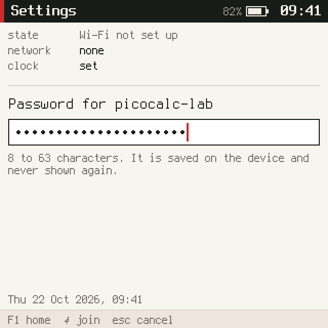
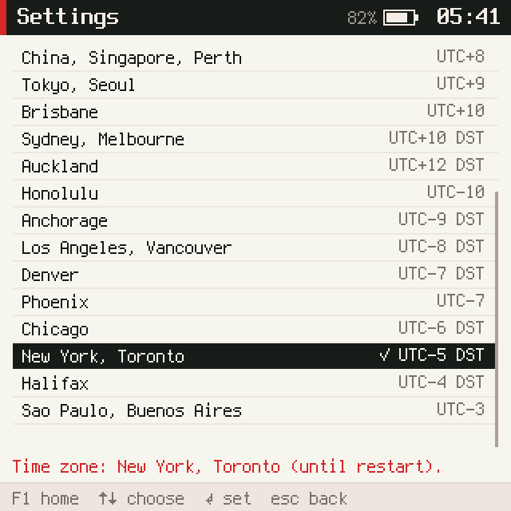
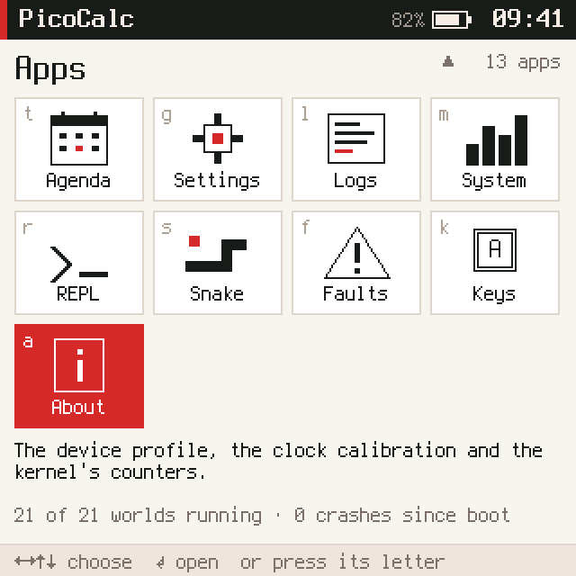
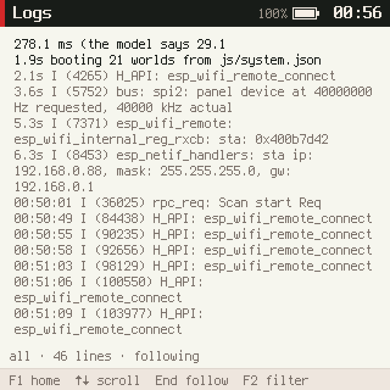
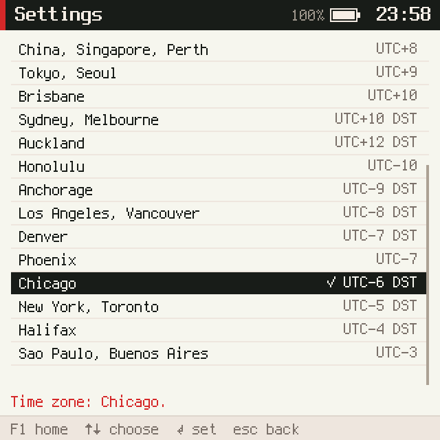

# picocalc-os, PICOCALC-SYS: settings, logs, and key channels as capabilities

This note reports the fifth ticket of the series that turns picocalc-os into a pocket computer; see
[[PROJ - picocalc-os - Project Overview - A JavaScript OS on Two Devices, With an Agent]] for the project and
[[PROJ - picocalc-os - PICOCALC-AGENDA - Real Time and an Agenda on the PicoCalc]] for the ticket before it. The
request was the "System and Development" tools: settings for Wi-Fi and the provider on the device, the Wi-Fi status
and a log viewer. The app loader from storage became its own ticket. Typing a Wi-Fi password on the device turned
the first part of the work into a security fix: any world could listen to every keystroke.

> [!summary]
> - **Keys and screens are capabilities now.** A world must hold the claim `keys.raw` to hear or send keystrokes,
>   and `frames.read` to see other apps' screens; on the PaperS3, `touch.raw` for touches. Before, declaring
>   `.needs("keys")` was enough.
> - **Settings joins Wi-Fi from the device.** It shows the station, scans, takes a password typed as dots, and sets
>   the time zone. The password goes to native storage and no operation gives it back. The API key and the endpoint
>   stay serial-only, by design.
> - **The kernel keeps its log.** The last 256 lines, the ESP-IDF's included, are readable by a Logs app with its
>   own claim.

## Why this ticket exists

The PicoCalc could not join a network or show what it was doing without a laptop on its serial port. Credentials
were set with `tools/provision_agent.py` over USB, and the kernel log went to the UART only.

## Implementation details

### Guarded channels

A channel is a broadcast: a world declares `.provides("keys")` to publish and `.needs("keys")` to receive, and
`kernel_publish` delivered to every world whose own code declared the need. The compositor defended itself by
ignoring keys not sent by the world named `keyboard`, but nothing stopped a world from listening. A game that added
`.needs("keys")` would have seen the password typed into Settings.

The kernel now has a short table of guarded channels and the claims they take:

```c
static const struct { const char *channel, *claim; } GUARDED[] = {
  { "keys", "keys.raw" }, { "frames", "frames.read" }, { "touch", "touch.raw" },
};
```

A world that needs or provides one without the claim fails to start, with a message naming the claim
("the channel "keys" takes the claim keys.raw, which the manifest does not give spy"). The check sits in
`boot_world`, which runs after either JavaScript engine has read the world's declarations, so the PicoCalc
(QuickJS) and the PaperS3 (MicroQuickJS) both get it. `kernel_publish` and both `publish` operations check again.
Claims come from the manifest, which the user controls; a world cannot grant itself one. Debug trace lines no
longer print the payload of key messages.

### The log ring

`klog` now also writes into a ring of the last 256 lines of at most 120 bytes, numbered from 1. A reader asks for
the lines after the last number it has, and the answer includes the oldest number still kept, so the reader knows
when lines were overwritten. On the P4 a hook on the ESP-IDF's log output adds the Wi-Fi and file-system lines too.
Those come from other FreeRTOS tasks, so the ring is behind a critical section; a simple spin flag could deadlock,
because the kernel task (priority 5) shares a core with the file worker (priority 4).

Reading the log takes a new claim, `sys.log`, not the existing `sys.read`: the agent holds `sys.read` and sends what
it reads to a model provider, while log lines carry whatever worlds print.

### Wi-Fi from the device


The kernel has four new operations: `net.info`, `net.scan` and `net.scanResult`, `net.join`, and `clock.setZone`.
On the P4 the blocking parts run on the network worker that already served the agent's HTTPS requests, woken by
two new notify bits. A scan waits for the driver's scan-done event; a join writes the network to NVS, as the
console's `net ssid` and `net password` do, and connects. When the station gives up it names the reason ("wrong
password?", "network not found"). The host build simulates three networks on its virtual clock, so the tests and
screenshots come out the same every run.

The password is checked in the kernel (8 to 63 printable characters, or 64 hex digits), copied once into the port
and wiped from the operation's buffer and from the worker's slot. Settings draws it as dots, so neither the frame on
the `frames` channel nor a screenshot carries it, and clears it after the join, on Esc and when the app loses focus.
A long key press sends a second "hold" event; the password field ignores it, because a doubled character behind dots
would be invisible.

**The provider stays serial-only.** The API key is too long to type on the keyboard. The endpoint is not secret, but
it decides where the key is sent: a world that could change it could send the key to its own server. Settings shows
the provider's host, the API dialect, the model and whether a key is provisioned. The model is chosen in the chat
with `/model`, as before.





### Logs and the launcher

Logs reads the ring while it is in front, marks where lines were lost ("… 44 lines are gone"), colours crashes,
failures and ESP-IDF warnings, and filters by all, problems, kernel or ESP-IDF lines. Scrolling back holds the view
still while new lines arrive. With Settings and Logs the launcher has thirteen apps; it shows three rows of four and
scrolls by rows, with arrows and the app count beside the title.



## On the device

| What (ESP32-P4) | Result |
|---|---|
| Boot | 21 worlds, no crash, no channel refused |
| Scan | a full screen of networks over ESP-Hosted, strongest first, ours marked |
| Join with a wrong password, on purpose | "Wi-Fi gave up: wrong password? (reason 205)" after six attempts in about 20 s |
| Restore | `provision_agent.py --wifi-from-nm yolobolo --skip-token`, up again 6 s later |
| Zone | Chicago showed 23:58 while New York was 00:58; saved in NVS; set back |
| Logs | kernel and ESP-IDF lines, seconds since boot before SNTP, wall times after |

The failure test used our own network, so no password was tried on anyone else's, and the real password came back
from the laptop's NetworkManager through the provisioning tool, which never prints it. The scan captures show
neighbours' network names and are not reproduced here.





Two things came from the device. Settings had stopped following a join after 20 s, while the station was still
retrying, and left "Still trying" under a state that already said it had failed; it now follows a join for up to
90 s. And the screenshot tool failed on the network list. I first blamed log lines splitting the base64 stream; the
raw stream showed instead that the busy screen took more than 5 s at 115200 baud and the capture window had closed
first.

## Tests

- `make test-sys` (11): guarded channels for listeners and providers, open channels, the ring (UTF-8 cuts, paging,
  loss, the claim), scan and joins on the simulated station, validation, claims, the zone; neither password ever
  appears in the UART log.
- `tests/sysapps.test.mjs` (8, in `make test-apps`): Settings, Logs and the launcher in Node VMs.
- `scripts/settings.txt` and `scripts/logs.txt` for `make shots`.

## Current status

- Done: `a8b4989` (guarded channels), `7961ced` (log ring), `5c5c386` (network and zone operations), `fe411b0`
  (Settings), `c095d0c` (Logs, launcher), `cdbdabb` (fixes from the device run). The guide and the diary are on
  the reMarkable under `/ai/2026/11/01/PICOCALC-SYS`.

## Open questions

- A join with the real password typed on the PicoCalc by a person has not been done yet; the device test typed a
  wrong one.
- Reason 205 (`CONNECTION_FAIL`) is what ESP-Hosted reports for a wrong password, but it covers other failures too.
- Channels other than the three guarded ones are open to any world.

## Next

PICOCALC-LOADER: apps loaded from storage as worlds without claims.

## Important files

- `picocalc-os/nucleus/kernel.c` — guarded channels, the log ring
- `picocalc-os/nucleus/vm.c`, `picocalc-os/nucleus/util.c` — the operations and their checks
- `picocalc-os/port/esp32p4/main/agent_p4.c`, `port_p4.c`, `store_p4.c` — scan, join, info, the log hook, the zone
- `picocalc-os/host/net_host.c` — the simulated station
- `picocalc-os/js/apps/settings.js`, `logs.js`, `launcher.js`
- Ticket: `ttmp/2026/11/01/PICOCALC-SYS--settings-wi-fi-status-and-a-log-viewer-for-the-picocalc-with-key-and-screen-channels-as-capabilities/`
