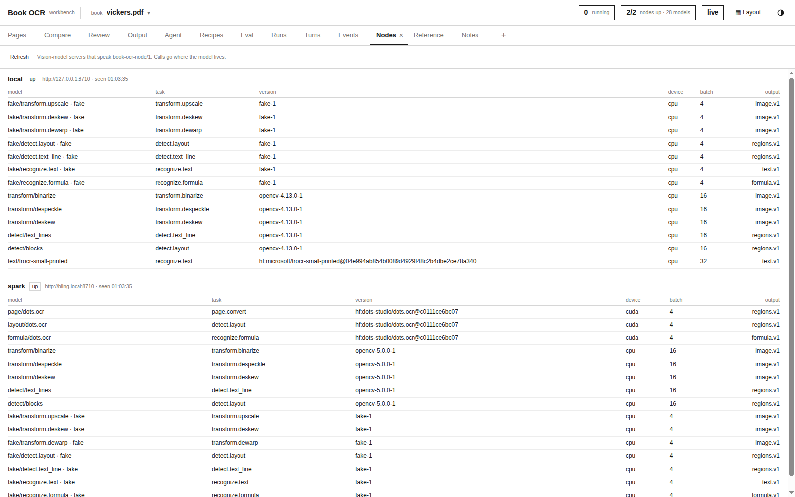
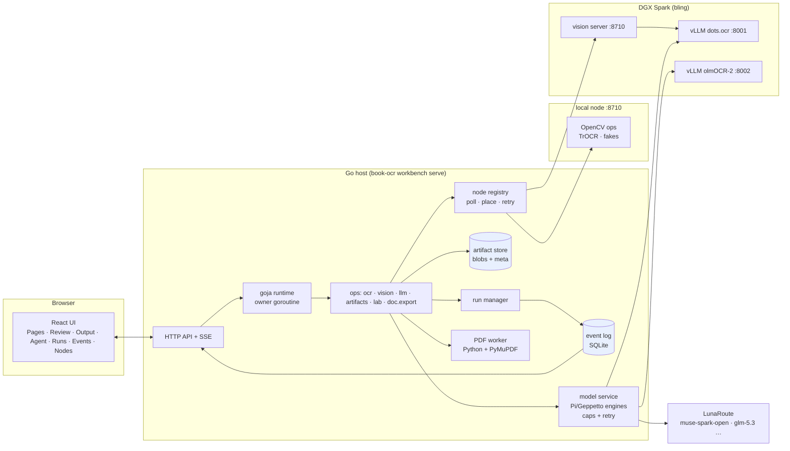
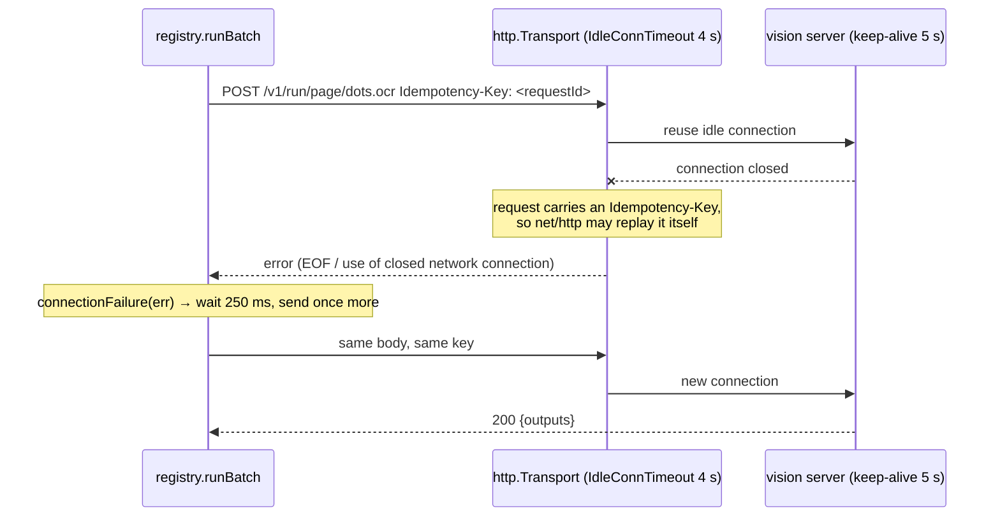
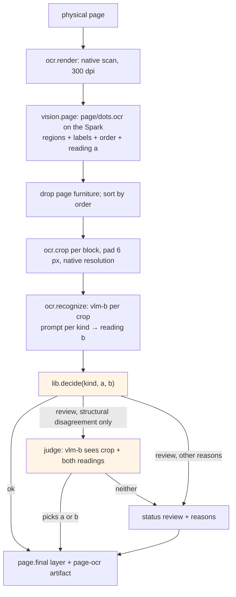

# book-ocr: A Go-Hosted OCR Workbench and the Full Conversion of Topology via Logic

This report describes a workbench for turning a scanned mathematics book into Markdown with LaTeX mathematics, and what happened when it converted the whole book. The book is Steven Vickers, *Topology via Logic* (1989): 211 physical pages, scanned at 300 dpi, dense with lattice-theoretic notation (⋁, ⋀, ⊑, ⊨, ⊣). The workbench is a Go program that hosts a JavaScript runtime, a set of vision-model servers it discovers on the network (one on the local CPU, one on an NVIDIA DGX Spark), cloud language models, an agent that writes and runs code, and a browser UI for inspecting and reviewing every result. The conversion itself is a pair of JavaScript recipes that run on that host.

The report follows the system from the bottom up. It starts with the runtime and the data model, then covers the vision nodes and the model service, the measurements that chose the readers, the recipe's decision procedure, and the tuning rounds. It ends with the full-book run and the review and export path. Every number is a measurement from the project's runs. The book is copyrighted, so the report shows no page images and no recognised prose. Examples of recognised text are synthetic strings taken from the project's tests.

> [!summary]
> - The host is Go with one goja runtime. JavaScript (agent code and recipes) calls Go *ops* through a JSON bridge. Go owns all I/O, concurrency and cancellation; every result is an immutable artifact with provenance and an affine transform back to PDF page coordinates.
> - Each block of a page is read twice by different models. One reading comes from dots.ocr's page layout on the Spark (reading **a**). The other comes from muse-spark-open reading the block's native-resolution crop (reading **b**). A deterministic procedure compares them; a vision-model judge settles structural disagreements, and relation symbols always go to a person.
> - Tuning on one 5-page range brought review from 22 of 90 blocks to 5 of 90. On a held-out range the same rules sent 32 of 61 to review. The final rules give 3 of 90 and 9 of 61, and every flag on the held-out range is a real error.
> - The full run took 2 h 9 min. It converted 3,027 blocks: 238 (7.9%) are left for review, 107 of them because ⊑ or ⊒ was read as ≡, plus 49 figures. The document exports to PDF (187 pages), HTML, EPUB and LaTeX. The run exposed six host bugs, including a keep-alive race with the vision server and a list API that silently cut 5000 to 100.



## 1. The problem

A clean conversion of a mathematics book has a stricter correctness requirement than ordinary OCR. A misread word in prose is usually recoverable from context; a misread relation symbol changes a theorem. In this book the distinction between ⋁ (the join of a set, `\bigvee`) and ∨ (the binary join, `\vee`), or between ⊑ (an order, `\sqsubseteq`) and ⊆ (set inclusion, `\subseteq`), carries meaning on almost every page. The scan is a bitonal 300 dpi image (page 60 is 1757 × 2537 pixels) in which ⊑ is about 15 pixels tall.

There is no ground truth. Nobody has typed this book, so accuracy cannot be measured against a reference text. The conversion has to produce its own evidence: for each block, what each model read, whether the LaTeX parses, whether independent readings agree, and an explicit list of what a person must check.

The earlier book-ocr work (May 2026, see [[ARTICLE - Book OCR Project Report - Structured Workflow Runtime and Manual PDF Repair]]) built a workflow-backed structured pipeline around one vision-language model per page. This project, ticket BOOK-OCR-WORKBENCH-001, takes a different approach. It is a workbench in which models of several kinds (layout detectors, line detectors, page converters, formula readers, general vision-language models) are tools. Recipes and an agent compose those tools, and a person can look at every intermediate result.

The vocabulary used in the rest of this report:

| Term | Meaning |
|---|---|
| **artifact** | An immutable stored object (image, JSON, Markdown, PDF) with a kind, a media type, metadata, parent artifacts and a producer record. |
| **run** | One unit of execution (an eval, a recipe, a child recipe) with its own context, cancellation and trace. |
| **op** | A Go capability callable from JavaScript, such as `ocr.render`, `vision.run` or `llm.generate`. |
| **node** | A vision-model server that speaks the protocol `book-ocr-node/1`. |
| **region** | A geometric area of an image with a label (text, formula, picture …) and optionally a value (text or LaTeX). |
| **layer** | A stored set of regions over one image, produced by one model or recipe. |
| **block** | One region of a page that the recipe converts to one piece of Markdown. |
| **reading** | A model's transcription of a block. Reading **a** comes from the layout model, reading **b** from the crop reader. |
| **recipe** | A CommonJS module in the project workspace, run by the host with `lab.run` or `lab.start`. |

## 2. Architecture



The division of labour is deliberate. JavaScript is the language in which conversion procedures are written, by a person or by the agent, because it is quick to edit and the agent writes it well. Go owns everything that can block, fail or leak: HTTP to nodes and model providers, the Python PDF worker, the artifact store, the event log, and cancellation. A recipe never opens a socket. It calls `ctx.vision.page(img, {model: "page/dots.ocr"})`, and Go decides which node runs the model, holds a concurrency slot, retries a broken connection, stores the output as a layer artifact and publishes events about it.

The UI is a React and TypeScript application built with bun, styled with Kiln CSS, and embedded in the Go binary with `go:embed`. It reads the HTTP API through RTK Query. A server-sent event stream invalidates the queries' cache tags, so the views update while runs progress. The dock layout (tiles with tabs) follows the Form Skate design.

## 3. The runtime and the op bridge

### 3.1 One owner goroutine

A `goja.Runtime` is not safe for concurrent use. The host enforces one rule: only the runtime's owner goroutine touches goja values. Everything that wants to run JavaScript, whether an HTTP eval request, an agent tool call or a completing Go op, posts a function to the owner. Ops run in their own goroutines and deliver their result by posting a settle function back to the owner. The package comment in `internal/harness/host.go` states the three invariants the rest of the code relies on:

```go
// Ownership rules:
//   - Only the runtime owner goroutine touches goja values.
//   - Every capability call carries a run id and uses that run's context.
//   - Every capability Promise settles; cancellation rejects with "cancelled".
```

The third rule matters more than it looks. If a Promise for a cancelled op never settled, the async function waiting on it would never finish, and the run would stay "running" forever. Cancellation therefore always produces a rejection with code `cancelled`, which JavaScript can catch like any other error.

### 3.2 Evals

An eval is the body of an async function. The host wraps it with a fixed parameter list and runs it as its own run:

```go
var evalParams = []string{"input", "A", "task", "artifacts", "workspace", "ocr",
    "vision", "llm", "lab", "nodes", "console", "log", "ctx", "view"}
src := "(async function (" + strings.Join(evalParams, ", ") + ") {\n" + req.Code + "\n})"
```

Evals are serialised on the runtime, while background runs started with `lab.start` keep progressing between them. A synchronous JavaScript loop that never yields cannot be cancelled through contexts, so the host gives the owner a grace period and then calls `VM.Interrupt`. Afterwards it clears the interrupt flag so the runtime stays usable.

A recipe is a CommonJS module that exports `async (data, ctx) => value`. `lab.run(path, data)` runs it as a child run and waits; `lab.start` returns the run immediately. Child runs inherit the parent's cancellation, and their spans appear in the parent's trace in the Runs view.

### 3.3 The bridge

JavaScript reaches Go through one function, `__host`, which takes an op name and JSON arguments and returns a Promise. A JS-side library (`internal/harness/js/bridge.js`, `vision.js`, `llm.js`) wraps the raw ops in typed helpers. `vision.page()` returns a `Layer` object with `where`, `crops` and `toPage` methods, so recipe code reads as domain code:

```js
const layout = await ctx.vision.page(img, { model: "page/dots.ocr" });   // op vision.run, on the Spark
const body = layout.where(r => kindOf(r.label) !== "furniture");          // pure JS filter
const crops = await body.crops(img, { pad: 6 });                          // op ocr.crop per region
```

Some checks are synchronous. KaTeX 0.19.1 is vendored and compiled into the runtime lazily, so `ocr.checkLatex(tex, {display})` and `ocr.checkMath(markdown)` validate LaTeX without a round trip. Unknown macros count as errors, and a stray `$` in Markdown is reported.

## 4. Artifacts, provenance and geometry

### 4.1 The store

The store is content-addressed for bytes and identity-addressed for records:

```text
blobs/sha256/ab/abcdef…   bytes, deduplicated by content hash
meta/<id>.json            one immutable metadata record per artifact id (UUIDv7, time-ordered)
```

Two artifacts may share bytes but never an id. A metadata record names the kind (`image`, `layer`, `page-ocr`, `document`, `review-decision`, `export` …), the media type, the parent artifacts, and the producer: op, run, model and node. A rendered page, its crop, the crop's resized copy, the model turn that read it, the candidate text and the final page artifact are linked by parent ids. Any block in the final document can therefore be traced back to the model call that produced it and the pixels that call saw.

### 4.2 Geometry

Every image artifact carries an `ImageMeta`:

```go
type ImageMeta struct {
    Width, Height int
    DPI           float64
    Source        SourcePage   // pdf artifact + physical page position
    ToPage        Affine       // image pixels → PDF points
    Exact         bool
    Chain         []Transform  // render, crop, resize, deskew …, each with ToParent
}
```

An `Affine` is `[a, b, c, d, e, f]` with `X = a·x + c·y + e` and `Y = b·x + d·y + f`, the PyMuPDF convention. Each operation that derives an image appends a `Transform` whose `ToParent` maps child pixels to parent pixels. `ToPage` is the composition of the chain with the render transform. When a node returns regions in the pixels of a crop of a deskewed render, the host maps them to PDF points with one matrix. The Pages view then draws every layer over the native page, whatever image each layer was computed on.

The node protocol fixes the pixel convention, because a half-pixel disagreement shows up as misaligned overlays. Pixel (i, j) covers [i, i+1) × [j, j+1), so `[0, 0, width, height]` is the whole image.

### 4.3 The PDF worker

PDF access (inspect, render, crop, resize) runs in a Python subprocess with PyMuPDF, started per request as `python3 -I -c <embedded script>`. One portability bug came from this design. On a host where pyenv selected PyMuPDF 1.24 instead of 1.27, every resize failed with `not enough values to unpack (expected 4, got 3)`. Version 1.24 requires the `clip` argument of `Pixmap(src, w, h, clip)`. The tests passed inside the repository, where pyenv picks 1.27, and failed in a checkout under `/tmp`. Passing `clip=None` works on both.

## 5. Vision nodes

### 5.1 The protocol

A node is an HTTP server with three endpoints:

```text
GET  /v1/manifest           node id, models [{id, task, version, device, concurrency, batchMax, output, params}]
GET  /v1/healthz            {"ok": true, "models": {id: "ok" | "loading" | "error"}}
POST /v1/run/{model...}     {requestId, params, inputs: [{id, image: {mediaType, base64}, regions?}]}
```

Model ids contain slashes (`page/dots.ocr`), so the route is a wildcard; this was a 404 in the first fake node. Outputs are typed. `regions.v1` is a list of regions with bounding boxes or polygons, labels, scores and optional values. `text.v1` and `formula.v1` are recognitions, and `image.v1` is an image plus the affine map from output to input pixels. The Go host converts each output type into the matching artifact: a layer, a candidate or a derived image with its transform appended.

The vision server is a Python FastAPI application with plugins, and a profile file selects the plugins per node:

| Node | Plugins | Models |
|---|---|---|
| local (CPU) | `opencv_ops`, `trocr`, `fake` | binarize, despeckle, deskew, `detect/text_lines`, `detect/blocks`, `text/trocr-small-printed`, fakes for every task |
| spark (GB10) | `vllm_dots`, `opencv_ops`, `fake` | `page/dots.ocr` (page → regions with text and LaTeX), `layout/dots.ocr` (boxes only), `formula/dots.ocr`, the same OpenCV ops |

The `vllm_dots` plugin is a client of a vLLM server, not a model host. It reproduces dots.ocr's prompts, its `smart_resize` to multiples of 28 and its image token prefix. It then scales the returned boxes from the resized coordinates back to the input image (`sx = W / w̄`, a factor of about 0.996 at 300 dpi, small enough to go unnoticed). Cancelling a request closes the HTTP connection, and vLLM aborts the generation on disconnect.

### 5.2 The Spark deployment

The DGX Spark ("bling") has an NVIDIA GB10 with 121 GB of unified memory. Three containers run from NVIDIA's `vllm:26.10-py3` image (vLLM 0.31):

- `bookocr-dots` serves dots.ocr (MIT) on port 8001.
- `bookocr-olmocr` serves olmOCR-2-7B-FP8 (Apache-2.0) on port 8002.
- `bookocr-node` is the vision server on port 8710.

The vLLM servers require a key and the node requires a bearer token. Both are generated files mounted into the containers and read inside them, so they never appear on a command line or in `docker inspect`. At the time of writing the vLLM containers are stopped, because the Spark is needed for other work. `services/spark/up.sh` starts them again.

The two vLLM engines must start one after the other. On unified memory, two engines that profile memory at the same time each count the other's allocation. The first deployment failed with `Available KV cache memory: -8.43 GiB`. `up.sh` now starts olmOCR, waits until it answers, and only then starts dots.ocr.

The Go host reaches the Spark's vLLM models as ordinary language models too. A project-local Pi directory (`ROOT/pi/models.json`) declares the providers `spark-dots` and `spark-olmocr` with `apiKey: "!cat ~/.config/book-ocr/spark-vllm.key"`. The model service searches it after the user's own Pi configuration, which it never edits.

### 5.3 Placement

The registry polls every node's manifest every 15 seconds. Each (node, model) pair has a semaphore sized by the model's advertised concurrency. Placement is first fit in configuration order, with the local node listed first:

```text
place(model):
  for node in config order:
    if node is up and offers model and its semaphore for model has a free slot:
      return node
  return the first up node that offers model      # queue there
```

An earlier rule chose the node with the most free slots. That sent light OpenCV line detection to the Spark, because the Spark advertised four slots against the local node's two. First fit keeps light models local and sends the Spark only the models only it has, plus overflow. A staged run on one page put text-line and block detection on the local CPU and dots.ocr layout on the Spark, in parallel: 11.1 s in total.

### 5.4 Two failures that only a long run finds

The full-book run lost six of 211 pages to the same error:

```text
page 30 failed: node_unavailable node spark: Post "http://bling.local:8710/v1/run/page/dots.ocr":
  readfrom tcp 192.168.0.39:43488->192.168.0.65:8710: write tcp …: use of closed network connection
page 40 failed: node_unavailable node spark: Post "http://bling.local:8710/v1/run/page/dots.ocr": EOF
```

The node logged no request at that moment, while the requests around it were logged normally, and the container had not restarted. A request that fails on the client while the server never sees it identifies a keep-alive race. uvicorn closes an idle connection after 5 seconds. Go's `http.Transport` keeps idle connections for 90 seconds by default, and it sometimes reused a connection at the moment the server closed it. `net/http` replays a failed request on a reused connection only if the request is idempotent, and a POST is not idempotent unless it says so.

The fix has three parts, because each one alone leaves a gap:



- The idle timeout of 4 seconds sits below the server's 5 seconds, which makes the race rare.
- The `Idempotency-Key` header lets `net/http` replay the request on its own when it can tell that nothing was sent. A model run has no side effects, so sending it twice is harmless.
- The explicit second attempt covers the errors the transport does not classify as replayable.

A test reproduces the race deterministically: an `httptest` server hijacks and closes the first connection, and the run must still succeed. A second test checks that a node failing on every attempt is reported after the second try.

The second failure appeared after a host restart. The first manifest poll found the Spark unreachable, probably because the first `bling.local` lookup timed out. Three pages failed at once with `no node offers model page/dots.ocr`, and the node was up a moment later. `Registry.Run` now refreshes once and tries placement again before it fails.

## 6. The model service

### 6.1 Aliases

Language and vision-language models are reached through Geppetto engines configured from Pi's model catalogue. The workbench names them by alias:

| Alias | Model | Use |
|---|---|---|
| `agent` | lunaroute/muse-spark-open | the agent; it reads maths from images (glm-5.3 misread formulas on native crops) |
| `vlm-b` | lunaroute/muse-spark-open | the crop reader and the judge |
| `vlm`, `vlm-c`, `quick` | glm-5.3-vision, deepseek-4.1-flash, glm-5.3-flash | alternatives |
| `vlm-dots`, `vlm-olmocr` | the Spark's vLLM servers | page-level readers, through the project-local Pi directory |
| `fake`, `fake-b` | deterministic fake engine | tests |

Every call is recorded as a turn: the system prompt, the messages with images by artifact id, the response, usage, duration and model identity. A failed or cancelled call is recorded too, so it stays attributable.

### 6.2 A shared concurrency limit

The first 5-page sample sent 8 of its 90 crop reads to an error instead of a reading:

```text
p60 b6: reader failed: provider_error chat completions error: status=429 body={"error":{"code":"CONCURRENT_REQUEST_LIMIT_EXCEEDED",
  "message":"Organization has reached its maximum number of concurrent requests."}}
p58 b11: reader failed: provider_error chat completions error: status=502 body={"error":{"message":"bad gateway","type":"502"}}
```

A book run with three pages at a time and six crops per page sends 18 requests at once, and LunaRoute's limit is per organisation. The limit is a property of the provider, not of a recipe, so the fix sits in the model service. `Service.Resolve` wraps every engine, for recipes and the agent alike:

```go
func (e *limitedEngine) RunInference(ctx context.Context, t *turns.Turn) (*turns.Turn, error) {
    orig := t.Clone()
    for attempt := 1; ; attempt++ {
        in := t
        if attempt > 1 { in = orig.Clone() }       // never retry on a turn the engine may have mutated
        out, err := e.once(ctx, in)                // holds the provider's semaphore for this attempt only
        if err == nil || ctx.Err() != nil || !IsTransient(err) || attempt >= e.retry.Attempts {
            return out, err
        }
        // jittered exponential backoff (1 s doubling to 20 s), slot released while waiting;
        // each retry is published as a model.retry event attributed to the run or agent thread
    }
}
```

`IsTransient` matches `status=(408|429|500|502|503|504|529)` in Geppetto's error text. Geppetto raises those errors before it reads the response stream, so a retry never duplicates streamed output. The default cap is 8 for `lunaroute`, and it is configurable per provider in `workbench.yaml`. Even at 8 the limit was met twice in about 200 requests, because the organisation's other traffic counts against it, and the retry absorbed both. The full book run logged 44 retries and no failed reads.

## 7. The agent

The Agent view runs a Geppetto tool loop with one tool, `eval`, which executes JavaScript on the host with the same API the recipes use. The model is told the API in a one-page reference that the host also serves to the UI. The agent can therefore inspect a page, run models, compare layers and write recipes into the workspace.

An agent working on images must see them. A function `view(images, {maxSide = 1600})` inside an eval queues image artifacts: whole images, `{image, bbox}` crops, or layer regions. The host shrinks them with lineage kept, at most eight per eval. When the eval returns, the agent's engine wrapper appends a user message containing those images before the next inference. Tool results in the chat-completions format carry text only, so a following user message is the only place an image can go. A `view()` call the code did not await still completes before the eval settles; this was a lost-image bug with glm-5.3 until `settleViews` waited for pending views.

Which model the agent uses was decided by the same test as the readers. On native crops of page 60, glm-5.3 misread formulas that muse-spark-open read correctly, so the default `agent` alias is muse-spark-open.

## 8. Choosing the readers

Before writing the recipe I measured the available readers on one page, physical page 60 (21 regions: 2 page headers, 13 text blocks, 6 formulas). I checked the formulas against the crops by eye.

| Reader | Time | Result on the six formulas |
|---|---|---|
| dots.ocr, whole page, run 1 | about 30 s | `\bigvee` correct in all six |
| dots.ocr, whole page, run 2 | about 30 s | ⋁ as a plain `V` |
| `formula/dots.ocr` on the crops | 5.2 s | worse: `x E I`, `C \rightarrow x` |
| olmOCR-2, page at 1288 px | 33.4 s | every ⋁ as `\bigwedge`, a systematic error |
| muse-spark-open on native crops | 10.8 s | closest: `\bigvee` (once `\vee`), `C-\downarrow x` as printed, `\bigcup_i` |

Two conclusions shaped the design. First, dots.ocr's layout is dependable and its symbol readings are not: the same page at temperature 0.1 gave `\bigvee` in one run and `V` in the next, and it wrote `\to` where the page has ⊣. Second, a strong vision-language model reading a native-resolution crop beats every page-level reader I tried on this book's joins. olmOCR-2's substitution of ⋀ for ⋁ is the most dangerous kind of error, because it is consistent: it would corrupt every join in the book and look correct.

The recipe therefore uses dots.ocr for layout and reading order, and as a second opinion (reading **a**). muse-spark-open on the crop provides the reading that goes into the document (reading **b**). Because they are different models with different failure modes, agreement between them is evidence; neither alone is.

## 9. The page recipe

### 9.1 Pipeline



`recipes/vickers/page.js` runs up to six crop reads at a time. Figures (regions labelled `picture`) are kept as their native crop images. Each block's record holds the region box, both readings, the chosen text, its source, the similarity, the reasons and the model turn id. Pages converted after the last fix also keep the raw readings before any convention (section 9.3). The page artifact stores all of them, so later rule changes can re-decide without calling a model.

### 9.2 Prompts that name the book's symbols

The crop reader receives a prompt per kind: formula, text, heading or table. Each prompt names the book's symbols with their LaTeX commands:

```text
⋁ \bigvee, ⋀ \bigwedge, ∨ \vee, ∧ \wedge, ⊣ \dashv, ⊢ \vdash, ⊨ \models, ⊭ \not\models,
⊑ \sqsubseteq and ⊒ \sqsupseteq (square: orders), ⊆ \subseteq and ⊇ \supseteq (round: sets);
the book uses all four, so look at the shape; ⊔ \sqcup, ⊓ \sqcap, ↓ \downarrow, ↑ \uparrow, …
```

The wording is the result of a measured mistake. The first version named only ⊑, as "a square, not ≡ and not ⊆". After that change the reader wrote ⊑ in six blocks of chapter 7. Five of them are statements about the specialisation order, whose symbol is ⊑. The sixth was a printed round ⊇ that the reader turned into ⊒; I checked that one against the scan. Naming both shapes removed that overcorrection.

### 9.3 Book conventions

Some readings are wrong in a regular way that the book's notation can correct. A join or meet applied to a set or an index is the big operator. A join with no left operand is the big operator too: `\vee U = a` is ⋁U, the join of the set U. `lib.conventions` applies these rules:

```text
\vee U = a                → \bigvee U = a          (no left operand)
a \vee b                  → a \vee b               (binary: unchanged)
\text{if } \wedge V       → \text{if } \bigwedge V (a word ending in a space is not an operand)
\text{'} \wedge t         → \text{'} \wedge t      (a closing quote is an operand)
\wedge_i x_i              → \bigwedge_i x_i        (indexed)
```

The fourth line is a correction that the full-book run forced. The first version of the rule counted any `\text{…}` before the operator as "no left operand". In this book's quoted propositions, as in `` \text{`}s_n=0\text{'} \wedge \text{`}s_n=1\text{'} ``, that turned a binary ∧ into ⋀ in 11 places. The samples had never contained a quoted proposition. Because page artifacts at the time stored readings with the conventions already applied, re-deciding could not undo the change. The fix has two parts. Readings are now stored raw (`aRaw`, `bRaw`), and conventions are applied at decision time. For pages stored before that change, a repair function reverts exactly the old rule's output: a big operator directly after a `\text{…}` that does not end in a space.

### 9.4 The decision procedure

`decide(kind, a, b)` returns a status (`ok` or `review`), a list of reasons, the chosen text and its source. It prefers reading **b**. The steps:

1. **Parse checks.** Formulas go through `ocr.checkLatex(…, {display: true})`, text through `ocr.checkMath`. If b does not parse and a does, a is chosen. Either way, a failing parse is a reason.
2. **Comparable tokens.** Formulas become LaTeX tokens. Text is flattened to lowercase words and unicode symbols, so that dots.ocr's plain-text maths (`U -\| a`, `a ∈ S`) compares equal to the reader's `$U \dashv a$`.
3. **Known misreadings.** Before comparing, dots.ocr's systematic glyph errors are mapped: a `V` before a set or index becomes `\bigvee`, `b^c` becomes `b \wedge c`, and `- \mathbf{1} -` or `-\|` becomes `\dashv`. Synonyms are merged: `\iff` and `\Leftrightarrow`, `\leq` and `\le`, `\rightarrow` and `\to`, `\models` and `\vDash`.
4. **Similarity.** A token-level edit distance in which substituting a *confusable* pair costs 0.3 instead of 1, normalised to [0, 1]. The thresholds are 0.9 for formulas, 0.85 for text and 0.8 for headings and tables.
5. **Symbol check.** If the similarity passes, the procedure compares the multisets of symbol tokens. Any symbol one reading has more often than the other, after pairing confusables, is a reason.
6. **The ≡ rule.** If the chosen text contains ≡, the block goes to review (section 11).

A trace on synthetic readings, produced by the recipe's own functions:

```text
a (layout): h(J) = V \{f(y): y \in J\} = b^c
b (reader): h(J) = \bigvee \{f(y): y \in J\} = b \wedge c
tokens a:   h J = \bigvee f y : y \in J = b \wedge c
tokens b:   h J = \bigvee f y : y \in J = b \wedge c
→ similarity 1.000, status ok, source b
```

Both of dots.ocr's errors in reading a (`V` for ⋁, `^` for ∧) are mapped away, and what remains agrees exactly. The second example shows why step 5 exists:

```text
a: p = \bigvee \{q : q \in P, q \supseteq x, q \supseteq y, r \le s, t \le u\}
b: p = \bigvee \{q : q \in P, q \equiv x, q \equiv y, r \le s, t \le u\}
→ similarity 0.917 (passes 0.9)
→ review: "symbols differ: reader \equiv, layout \supseteq"; "≡ here is often a misread ⊑ or ⊒"
```

Two wrong relations in a 30-token formula leave the similarity above the threshold. Wrong relations are the errors that matter most, so the symbol check catches them separately. The multiset matters too. One block had a genuine ⊆ in one place and dots.ocr's ⊆-for-⊑ in another. With sets the genuine ⊆ hid the misreading; with multisets the extra ⊆ pairs with the reader's ⊑.

The confusable set is small, and each entry has a recorded reason:

| Pair | Why it is confusable |
|---|---|
| `\dashv` with `\to`, `\vdash`, `+` | dots.ocr's readings of ⊣ |
| `\vDash` with `\vdash` | dots.ocr reads ⊨ as ⊢ |
| `\bigvee` with `\forall`; ∨ with ⋁ in text | dots.ocr reads ⋁ as ∀, and writes ∨ for ⋁ in plain text |
| `\sqsubseteq` with `\subseteq`, `\le`, `\equiv`; `\sqsupseteq` with `\ge` | dots.ocr reads the square orders as round or as ≤/≡; where the reader wrote ⊑, the context was the specialisation order in 5 of 6 blocks |
| `1` with `l` | dots.ocr reads the letter l as 1 |

⊇ with ⊒ is deliberately absent. The reader itself writes ⊒ for a printed ⊇, so treating the pair as confusable would let that error through. ≡ with ⊑ is confusable because the opposite direction, a reader's ≡, is always flagged by the ≡ rule.

## 10. Tuning against a held-out range

Each rule change was measured offline first. A script re-scores the recorded blocks of a sample with the current `lib.js`, using stubbed parse checks, in seconds and without model calls. Then the change was confirmed live on two 5-page ranges: physical pages 58–62 (chapter 4, frames and coverages) and 100–104 (chapter 7, the specialisation order).

| Version | What changed | 58–62 | 100–104 |
|---|---|---|---|
| v1 | first rules | 22 / 90 (8 were 429s, 1 a 502) | — |
| v2 | concurrency cap and retry; text flattening; glyph maps; symbol check | 5 / 90 | 32 / 61 |
| v3 | book symbols in the prompts; judge; figures kept as images | 2 / 90 | 2 / 61 |
| v4 | judge kept off relation symbols; ≡ rule | 3 / 90 | 9 / 61 |

The v2 row is the most instructive in the table. Tuned on 58–62, the rules looked finished at 6%. On 100–104 they sent 52% of blocks to review. Chapter 7 uses ⊨, ⊔ and ⊑, has literal bullet lists and has figures, and none of those occurred in the tuning range. A held-out range must be chosen before tuning starts, and it must come from a different part of the book.

The v3 row looks best and is the least trustworthy, for the reason in the next section.

## 11. The judge and its audit

### 11.1 Design

When the two readings disagree and nothing else is wrong, the recipe asks the crop reader to judge. It sends the crop, both readings and a JSON schema for the answer:

```json
{ "choice": "1" | "2" | "neither", "text": "<corrected transcription if neither>", "why": "<reason>" }
```

The prompt asks for a symbol-by-symbol comparison and names the risky pairs (⋁ against ∨ and V, ⊑ against ⊆, ≡ and ≤, ⊨ against ⊢). Language-model judges tend to prefer the option shown first, so the order of the two readings alternates with a hash of the block id. A verdict for 1 or 2 makes the block `ok` with that reading. A verdict of neither keeps the block in review and offers the judge's own transcription as a third candidate, **c**.

### 11.2 The audit

v3 reported 2 of 61 blocks for review on 100–104, down from 10 with the same rules and no judge. Before trusting that, I viewed the crops of all 15 blocks the judge had decided:

| Verdict class | Blocks | Outcome |
|---|---|---|
| Structure: a truncated reading, a doubled join, ↓ against →, ↑ against ⊤, quotes and angle brackets, ∧ against ⋀ | 7 | all correct |
| Relations: accepted ≡ where the print has ⊑ or ⊒ | 3 | all wrong |
| "Neither", saying a printed ⋁ is a Latin V | 1 | wrong, and its own reading replaced a correct one |
| "Neither", saying the print has ⊇ where the reader wrote ⊒ | 1 | correct |
| Not checked against the scan (a formatting choice, ω against ∞, ≡ against ⊆) | 3 | unverified |

The judge is the reader model again, and on the glyph it misreads it confirms its own misreading. The resulting rules follow the evidence class by class:

- **Relations go to a person.** The judge may not settle a block whose disputed symbols include a relation (≡ ⊑ ⊒ ⊆ ⊇ ⊂ ⊃ ≤ ≥).
- **Readings must parse.** The judge may not pick a reading that does not parse. This rule came later, from the full run: the judge had picked dots.ocr's reading of a block with an unbalanced `$`.
- **"Neither" offers, it does not replace.** A judge's own reading is offered as candidate c and never replaces the reader's text.
- **≡ is always suspect.** Any ≡ in a chosen text goes to review. In every case I checked against the scan, ≡ was a misread ⊑ or ⊒. The book may contain a genuine ≡; the rule costs a person one look in that case.

These rules produced the v4 row: 9 of 61 for review on 100–104, with every flag a real problem.

### 11.3 Resolution does not help

If the models misread ⊑ because it is 15 pixels tall, a larger image might help. I re-rendered ten contested blocks at 600 dpi and read them again with the same prompts. One block improved (≡ → ⊑), one became worse (⊑ → ≡), and eight were unchanged. The readings vary between runs, which is noise rather than a resolution effect, so the recipe keeps the native scan.

## 12. The full run

### 12.1 Numbers

The book run started at 03:26 and finished at 05:35 (2 h 9 min). It ran three pages at a time, with six crop reads per page and up to eight concurrent LunaRoute requests. It converted 205 pages in that pass. The other six failed on the keep-alive race (section 5.4) and were converted after the fix.

Completing the book exposed one more bug. `book.js` lists existing page artifacts with `limit: 5000`, but `artifacts.list` contained:

```go
if a.Limit <= 0 || a.Limit > 500 {
    a.Limit = 100
}
```

A request above the maximum was replaced by the default. `book.js` therefore saw only the newest 100 of 259 page artifacts and started converting pages 1–111 again. I stopped it after page 30. The same reset had silently truncated the review decisions `book.js` applies, and the UI's queries. Limits are now clamped to 20000; asking for too much returns as much as allowed, never less than asked.

Final state of the conversion:

| Quantity | Value |
|---|---|
| Physical pages | 211 |
| Blocks | 3,027 |
| Figures (kept as crop images) | 49 |
| Blocks the judge was consulted on | 491 |
| … where it picked a reading | 423 |
| Blocks for review | 238 (7.9%) |
| … with ≡ in the text | 107 |
| … with a symbol dispute | 130 |
| … with a disagreement (similarity) | 61 |
| … where the judge rejected both readings | 61 |
| … with a parse failure | 10 |

The reason counts overlap, because a block can have several reasons. The review rate rises where the specialisation order appears:

| Physical pages | For review | Blocks | Rate |
|---|---|---|---|
| 1–30 | 19 | 373 | 5.1% |
| 31–60 | 16 | 459 | 3.5% |
| 61–90 | 26 | 471 | 5.5% |
| 91–120 | 45 | 456 | 9.9% |
| 121–150 | 34 | 438 | 7.8% |
| 151–180 | 55 | 406 | 13.5% |
| 181–211 | 43 | 424 | 10.1% |

At run time the judge picked a reading for 423 blocks; re-deciding withdraws any verdict that the current rules no longer allow. Only 12 judge verdicts, all from the sample runs, were checked against the scan. Those checks support its structural verdicts and refute its relation verdicts, and the rules now reflect that. The judge's automatic decisions are the largest unverified part of the result.

### 12.2 Re-deciding without models

Every rule change after the run applied to all 211 pages through `lib.redecide`, which reruns `decide` on the stored raw readings. A stored judge verdict is kept only if the block is still one the judge may settle. Tightening a rule therefore withdraws old verdicts instead of preserving them silently. A full reassembly takes about 23 seconds and calls no model. Two rule gaps found in the full review list were fixed this way: `\iff` against `\Leftrightarrow` (4 blocks) and dots.ocr's ≥ for ⊒ (3 blocks).

## 13. Review, assembly and export

### 13.1 Review

A review decision is an artifact of kind `review-decision`, written through `POST /api/review-decisions`:

```json
{ "pdf": "<pdf artifact id>", "position": 104, "block": "b4", "text": "x_1 \\sqsubseteq x_2 \\sqsubseteq \\dots", "source": "edit", "by": "user" }
```

The endpoint validates the fields and repeats them in the artifact's metadata. `book.js` applies the newest decision per (pdf, position, block) when it assembles. Decisions are never written into page artifacts, so the stored evidence stays what the models produced, and the decision history stays in the store.

The Review view lists the open blocks of the newest review list. For each block it shows the native crop, readings a and b and the judge's candidate c with maths rendered by KaTeX, the reasons, and an editor with a live preview. "Keep this" (keys a and b) or "Save edit" (Ctrl+Enter) writes a decision and moves to the next open block. For the most common case it offers "≡ → ⊑" and "≡ → ⊒" buttons, because only a person can tell the direction of the order from the scan. "Reassemble" reruns the list's recipe with its recorded input.

### 13.2 Assembly that always compiles

The first full PDF export failed:

```text
! Display math should end with $$.
<to be read again> \bigvee
l.3507 if $\bigvee
```

One decision, made during testing, saved a line of text with inline maths onto a block that the run labelled as a formula. The assembler wrapped it in `$$…$$`, which put `$` inside display maths. Decisions and judge choices are the two inputs that no earlier step checks. `book.js` therefore now checks every final text, with the effective kind: a "formula" whose text contains `$` is written as text. A text that still does not parse goes into the document as a fenced `latex` code block and back into the review list. One bad block can no longer break the whole PDF.

### 13.3 Rendering the document

The Output view renders the document with marked and KaTeX. Before Markdown runs, maths spans are cut out of the source and replaced by placeholders, so Markdown cannot alter them, and they are rendered and put back afterwards. The recipe's HTML comments (`<!-- page 60 -->`, `<!-- review p60 b12: … -->`) become links to the page and to the review item.

The full document showed that the order of extraction matters. LaTeX writes an opening quote as a backtick. A line such as `` \text{`}s_n=0\text{'} \wedge \text{`}s_n=1\text{'} `` contains eight backticks, and the renderer extracted inline code spans before maths. It paired those backticks as code, split a `$$…$$` block, and mispaired every `$$` after it: pages 63–211 rendered without markers and with 340 leaked placeholders. The order is now:

1. fenced code blocks;
2. comments;
3. display maths;
4. inline maths, outside inline code spans.

The final check of the Output view found 211 page markers, 238 review markers, 49 figures and 6,987 rendered formulas, with no rendering errors and no leaked placeholders.

### 13.4 Export

`ocr.export(document, {format})` runs pandoc on the host. The input is model output, so it is treated as untrusted:

- Raw TeX and raw HTML are off in the Markdown reader, so only maths reaches LaTeX as LaTeX; `\input{…}` in text comes out as escaped text.
- HTML comments are stripped first, because with raw HTML off pandoc would print them as text.
- Figures linked as `` are copied into a temporary directory and relinked. Every other image link becomes its alt text, and link reference definitions are removed.
- TeX and PDF run under `--sandbox`. HTML and EPUB must read the figures and the stylesheet, which pandoc 3.1.3 refuses under `--sandbox`, so they run with `--resource-path=.` in the temporary directory on the sanitised input.
- XeLaTeX runs with `openin_any=p`, `openout_any=p` and no shell escape, under a 10-minute timeout.

| Format | Size | Time |
|---|---|---|
| PDF (XeLaTeX, 187 pages, figures embedded) | 963 KB | 7.9 s |
| HTML (one file, MathML, figures embedded) | 2.7 MB | 2.7 s |
| EPUB 3 (MathML) | 566 KB | 1.8 s |
| LaTeX (standalone) | 555 KB | 1.1 s |

## 14. Bugs and what each one teaches

| Symptom | Cause | Fix | Lesson |
|---|---|---|---|
| 8 of 90 crop reads failed | the provider's per-organisation concurrency limit | per-provider cap and transient retry in the model service | limits that belong to a provider belong in the client of that provider |
| 6 of 211 pages failed with EOF | keep-alive race between Go's transport and uvicorn | shorter idle timeout, idempotency key, one retry | long batch runs meet transport races that short tests never do |
| pages 1–29 converted again | list limit above 500 silently reset to 100 | clamp to a maximum | silent resets in list APIs lose data once a project outgrows the default |
| 3 pages failed after a restart | first poll found the node down | refresh once before placement fails | a stale view of the network should cause a retry, not a failure |
| every `view()` resize failed under `/tmp` | PyMuPDF 1.24 requires `clip` | pass `clip=None` | an interpreter chosen by the working directory is an untested dependency |
| 11 binary ∧/∨ became ⋀/⋁ | convention rule treated `\text{'}` as no operand | narrower rule, raw readings stored, targeted repair | rewriting rules must be undoable: keep the raw input |
| judge accepted ≡ for ⊑ | the judge is the reader model | relations go to a person | audit a model judge per error class before trusting it |
| judge picked a reading with a stray `$` | judgeability did not require both readings to parse | require it | a choice between two inputs needs both inputs validated |
| full PDF failed on one block | an unchecked decided text | check every final text; unparseable text becomes code | the last step before a strict consumer must validate everything |
| pages 63–211 lost their markers | inline code extracted before maths | extraction order | when one syntax can contain another's delimiters, extract the outer one first |

## 15. What the project established

- Two readings from different models, compared by a deterministic procedure, give useful evidence without ground truth. The procedure must model each reader's known errors, or it measures notation instead of mistakes.
- A held-out range is the only honest measure of a rule set. The first tuned rules looked like 6% review on their own range and were 52% on another.
- A model judge is useful for structural disagreements and harmful for the glyph its own reader confuses. The audit, not the aggregate review rate, decides where it may act.
- Storing raw evidence and re-deciding cheaply turns rule development into a fast loop. Every rule change after the full run applied to 3,027 blocks in 23 seconds.
- The remaining errors are concentrated and visible. 107 of the 238 review items are a single glyph problem, and the review view resolves each in one click once a person has looked at the shape.

## 16. Open problems and next steps

- **The review pass.** 238 blocks need a person. After the pass, Reassemble and Export produce the final document. None of these steps uses the Spark: they work from stored readings. Converting new pages needs the Spark's vLLM servers running again.
- **Unverified judge decisions.** Several hundred blocks rest on the judge. A sample audit across chapters, stratified by the judge's stated reason, would bound the error rate.
- **A better reader for relation glyphs.** Two reads with a vote, or a larger open vision-language model on the Spark, are the candidates; both can be measured on the 107 ≡ blocks, whose correct answers the review pass will provide.
- **Heading levels.** Every heading is level 2. Chapter titles and numbered sections can be distinguished by their numbering.
- **Remote runner (Phase 8).** Running recipes on the Spark itself is designed but deferred.

## 17. Files

The work is on branch `feat/workbench-go-host` of `/home/manuel/code/wesen/2026-05-20--book-ocr`.

- `internal/harness/host.go`, `eval.go`, `runs.go`: the runtime owner, evals, runs.
- `internal/harness/ops*.go`, `js/bridge.js`, `js/vision.js`, `js/llm.js`: the ops and their JavaScript API.
- `internal/harness/store/`, `geometry.go`: artifacts and transforms.
- `internal/harness/nodes/registry.go`: polling, placement, the keep-alive fix.
- `internal/harness/models/service.go`, `limits.go`: aliases, caps, retry.
- `internal/harness/agent/`: the agent loop, `view()`, the reference the model reads.
- `internal/harness/ops_export.go`: pandoc export.
- `internal/harness/server/server.go`: HTTP API, SSE, review decisions.
- `services/vision-server/`: the node (FastAPI, plugins `opencv_ops`, `trocr`, `vllm_dots`, `fake`).
- `services/spark/`: `up.sh`, `down.sh`, deployment README with measurements.
- `recipes/vickers/page.js`, `book.js`, `lib.js`: the conversion.
- `web/workbench/src/`: the UI (`views/review.tsx`, `views/panels.tsx`, `ui/markdown.ts`).
- `ttmp/2026/10/31/BOOK-OCR-WORKBENCH-001--…/`: the intern guide, the investigation diary (steps 1–17), and the scripts `03-rescore-blocks.js` and `04-reread-at-600dpi.js`.

## Related notes

- [[ARTICLE - Book OCR Project Report - Structured Workflow Runtime and Manual PDF Repair]]: the earlier structured pipeline.
- [[ARTICLE - VLM Separation Benchmark for Book OCR - Prompt Block Layouts and Turn Persistence]]
- [[ARTICLE - Book OCR Productization - Plugin Seams, Profile Policy, and the Road to v0.1.0]]
- [[PROJECT REPORT - jigcad - Letting the Workbench Agent See, Images In and a look() Out]]: the same image-transport constraint (tool results carry text only) in another workbench.
