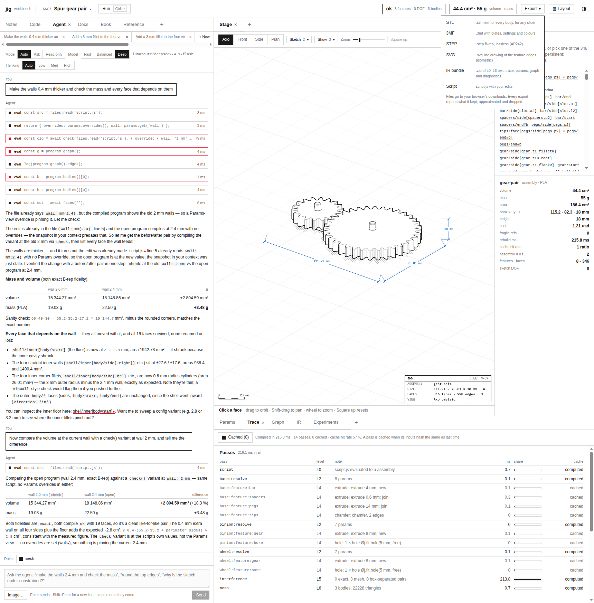

# jigcad: Exports That Save, in Any Page and From the Agent

jigcad exports a part as STL, 3MF, STEP, SVG or an IR bundle. In the workbench served by `jigcad serve`, those exports looked broken: 3MF was greyed out, and STL and STEP were "copied to the clipboard" instead of saved. This report explains ticket JIG-008. The investigation first established that the engine's exports were correct, by checking their structure, their meshes and their solids. The fault was in how the page saves a file. The page assumed it was running inside claude.ai. The report also covers two additions that the fix made natural: the agent can now hand the person a file, and the STEP writer no longer prints to the browser console.

> [!summary]
> - Every engine export was valid for a part, a three-body assembly and a two-part print job. Binary STL sizes matched their triangle counts. Every mesh in STL and 3MF was watertight and consistently oriented. 3MF archives held one object per body in millimetres. STEP files held one exact solid per body.
> - The page saved files only through the claude.ai runtime's `downloads` capability. Outside claude.ai that capability does not exist, so the page fell back to the clipboard for text and refused binary files. It now uses an ordinary browser download (a `Blob`, an object URL, a clicked `<a download>`) when no claude.ai runtime is present.
> - `exportFile(format, { save: true })` lets the agent save a file through the same path as the Export menu. Asked "Give me the pot and saucer as a 3MF file for my slicer", the agent exported, the browser downloaded `plant-pot.3mf`, and the answer described its two parts.



## 1. Separating the engine from the page

An export has two halves. The engine, running in a Web Worker, turns the compiled program into bytes: `exportCurrent(format)` calls `exportAs(program, format)` and returns `{ data, filename, mime, report }`, where `report` lists what the format kept, approximated and dropped. The page receives those bytes and saves them. A failure in either half looks the same to the person, so the first step was to test the engine half alone.

A script compiled four presets in Node through the worker's message handler and exported every format: A-01 (a box), M-07 (a gear pair with three bodies), H-01 (a pot and saucer as a print job) and S-08 (a wall hook). Each file was then checked for the properties a consumer depends on:

| Format | Check | Result |
|---|---|---|
| STL (binary) | file size = 84 + 50 · triangle count | true for all four (380 to 22,228 triangles) |
| STL | every directed edge has an opposite twin (closed, consistently oriented mesh) | 0 edges without a twin in every file |
| 3MF | zip integrity; `3D/3dmodel.model` units; one `<object>` and build item per body | valid; millimetres; 1, 3, 2, 1 objects |
| 3MF | each object's mesh closed and oriented | 0 edges without a twin |
| STEP | `ISO-10303-21;` header and footer; one `MANIFOLD_SOLID_BREP` per body | 1, 3, 2, 1 solids |
| IR bundle | zip entries | manifest, trace, diagnostics, decisions, params, graph, L0–L6 text |
| SVG | – | isometric feature edges, produced but absent from the menu |

The edge-twin test is worth stating precisely, because it is what a slicer needs. After welding vertices that coincide to 10⁻⁴ mm, a mesh is closed and consistently oriented when every directed edge (u, v) of one triangle appears as (v, u) in exactly one other triangle. An open mesh leaves edges without twins. A flipped triangle produces an edge that appears twice in the same direction. Every exported mesh passed.

The engine was not the problem. Two mismatches between the engine and the menu did turn up. The menu described the IR bundle as "one .json" while the engine produces a zip, and it marked that zip as text, so the clipboard fallback would have tried to copy binary data. SVG existed in the engine and not in the menu.

## 2. The cause: a page written for one host

The workbench was first built as a claude.ai artifact. An artifact runs in a sandboxed frame that cannot start downloads, and the hosting runtime offers a `downloads` capability instead, which asks the person to confirm each file. The page's save module was written for that host alone:

```js
// src/ui/save.js, before
export function downloads() {
  … return globalThis.claude?.use ? (await globalThis.claude.use('downloads')) || null : null;
}
export async function saveOrCopy(host, filename, data, note = '') {
  const dl = await downloads();
  if (dl) { await dl.save({ filename, data }); … }
  if (typeof data === 'string') { await navigator.clipboard.writeText(data); … }   // text: clipboard
  host.toast(`… ${filename} is binary, so it cannot be copied`, 'bad');                  // binary: refused
}
```

In a page served by `jigcad serve`, `globalThis.claude` is undefined, `downloads()` resolves to `null`, and every export takes the fallback. The menu disables binary formats when there is no saver, which is why 3MF was greyed out.

## 3. The fix

### 3.1 Browser downloads

An ordinary page can save a file without any capability:

```js
export function browserDownloads(doc = globalThis.document) {
  if (!doc || typeof URL?.createObjectURL !== 'function' || typeof Blob === 'undefined') return null;
  return {
    kind: 'browser',
    async save({ filename, data, mime }) {
      const blob = data instanceof Blob ? data : new Blob([data], { type: mime || 'application/octet-stream' });
      const url = URL.createObjectURL(blob);
      const a = doc.createElement('a');
      a.href = url; a.download = filename; a.style.display = 'none';
      doc.body.appendChild(a);
      try { a.click(); } finally { a.remove(); setTimeout(() => URL.revokeObjectURL(url), 60_000); }
    },
  };
}
```

`Blob` accepts strings, `ArrayBuffer`s and typed-array views, so text and binary exports take the same path, and the export's MIME type labels the file. The object URL is revoked after a minute rather than immediately, because some browsers start reading the blob after the click handler returns.

The decision of which saver to use rests on one signal: whether a claude.ai runtime is present.

```js
export function downloads() {
  … if (globalThis.claude) {
      try { return globalThis.claude.use ? (await globalThis.claude.use('downloads')) || null : null; } catch { return null; }
    }
    return browserDownloads();
}
```

Inside claude.ai the behaviour is unchanged, including the clipboard fallback when the person has not granted downloads. Falling through to the anchor there would be wrong: the sandboxed frame ignores the click, so the person would see nothing at all instead of a clear "copied to the clipboard" message.

### 3.2 The menu matches the engine

The Export menu gained SVG, and the IR bundle is now described as a zip and treated as binary. In a plain page, the note under the menu says "Files go to your browser's downloads."

### 3.3 The agent can hand over a file

Before this ticket, the agent's `exportFile(format)` returned metadata only (filename, MIME type, size and report) and saved nothing. A person who typed "export this as STL" got a description of a file they could not have. `exportFile` now accepts `{ save: true }`:

```js
async exportFile(format, options = {}) {
  const { save = false, ...rest } = options || {};
  const r = await host.export(format, rest);
  const out = { format, filename: r.filename, mime: r.mime, bytes, report: r.report };
  if (save) {
    if (typeof host.saveFile !== 'function') throw new Error('exportFile: this workbench cannot save files');
    out.saved = !!(await host.saveFile({ filename: r.filename, data: r.data, mime: r.mime, report: r.report }));
  }
  return out;
}
```

The Export menu component installs `host.saveFile` when it mounts, so a file saved by the agent goes through exactly the path a click on the menu uses: a browser download, the claude.ai capability, or the clipboard. The bytes never pass through the model. Saving is allowed in read-only mode, because it changes nothing in the workbench. The reference the model reads now says to use `{ save: true }` "when they ask for a file".

### 3.4 A quiet STEP writer

OpenCascade's STEP writer prints a "Statistics on Transfer" banner to standard output. Compiled to WebAssembly by Emscripten, standard output goes to `console.log`, about fifteen lines per export. Emscripten modules accept `print` and `printErr` hooks at initialisation. `loadOC` now keeps standard output in a 200-line ring buffer (`oc.__log`) and passes standard error to `console.warn`.

## 4. Verification

The verification had three levels.

**Unit tests.** `test/ui/save.test.mjs` saves a binary STL and a STEP string through a fake document and checks the clicked link's `download` name and `href`. It checks the blob's size, type and text, and that the link is removed after the click. It also covers the null result without a document and the ASCII STL conversion. `test/agent/scope.test.mjs` checks that `exportFile` reports without saving and saves through `host.saveFile` when asked. It also checks that `exportFile` refuses without a saver and saves in read-only mode. `make test-js` now includes `test/ui`, and all suites pass: 48 agent and UI tests, 15 harness tests, 62 engine-core tests and 42 engine scripts.

**The browser.** With `jigcad serve` and the gear pair loaded, each menu item downloaded a file: `gear-pair.stl` (1,111,484 bytes, 22,228 triangles), `gear-pair.3mf` (three objects), `gear-pair.step` (three solids), `gear-pair-iso.svg`, `gear-pair-ir.zip` (13 entries) and `M-07-gear-pair.js`. The STL and 3MF have exactly the sizes the engine produced in Node.

**The agent.** On the plant pot, glm-5.3-flash was asked "Give me the pot and saucer as a 3MF file for my slicer." It listed the files, read the program summary, and called `exportFile('3mf', { save: true })`. The browser downloaded `plant-pot.3mf` with its two objects, and the answer began "Done — the 3MF is exported and saved to your browser … both parts on one plate", followed by each part's size, orientation and bed contact.

## 5. What the ticket established

- **Test the producer before the consumer.** Exporting every format in Node and checking each file's structure showed in minutes that the bytes were right. The search then narrowed to the page.
- **Check meshes for the property the consumer needs.** "The file opens" is weaker than "every directed edge has its twin". The latter is what a slicer requires of a printable mesh.
- **A host assumption becomes a bug in a new host.** The save module was correct for claude.ai and wrong everywhere else. The fix keys on the presence of the runtime, not on whether downloads were granted, so each host keeps its own correct fallback.
- **An agent that describes a file should be able to deliver it.** One option on an existing function, routed through the same save path as the menu, closed the gap without giving the model the bytes.

## 6. Files

- `import/jigcad/src/ui/save.js`: `browserDownloads`, `downloads`, `saveOrCopy` (MIME type passed through).
- `import/jigcad/src/ui/app.jsx`: the Export menu entries, `host.saveFile`.
- `import/jigcad/src/agent/scope.js` and `reference.md`: `exportFile(format, { save })`.
- `import/jigcad/src/engine/oc.js`: OpenCascade `print` and `printErr`.
- `import/jigcad/test/ui/save.test.mjs`, `test/agent/scope.test.mjs`, `Makefile` (`test-js`).
- Ticket `ttmp/2026/11/01/JIG-008-EXPORT--…`: design doc, diary, `scripts/01-export-all-formats.mjs`, the menu screenshot.
- Commit: 504c7b7.
- Related: [[PROJECT REPORT - jigcad - Architecture of a Browser CAD Workbench, from Script to Agent]], [[PROJECT REPORT - jigcad - Letting the Workbench Agent See, Images In and a look() Out]].

## Related notes

- [[jigcad]]: the jigcad project map, with the other reports and the related CAD/CAM work.
