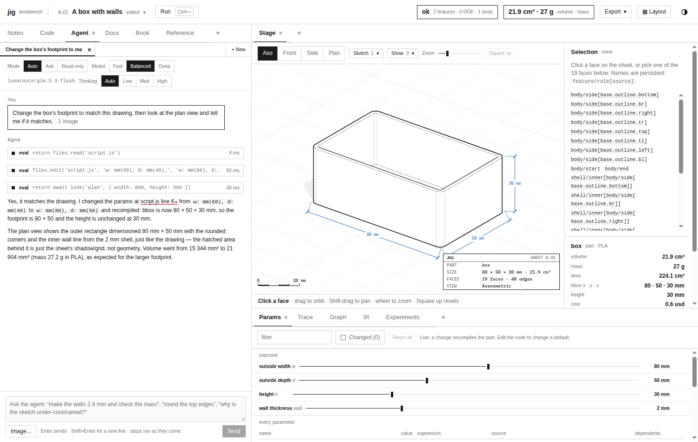
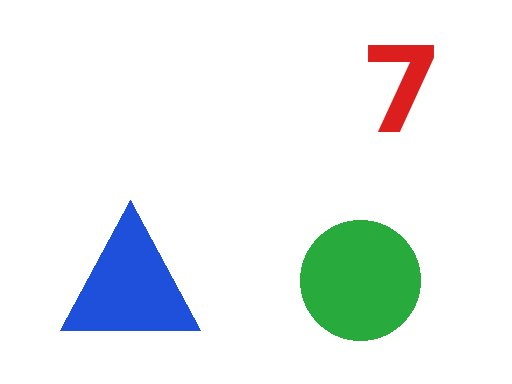
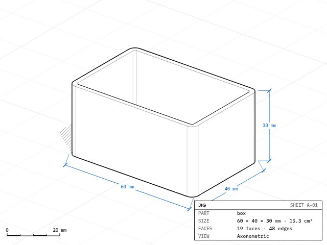
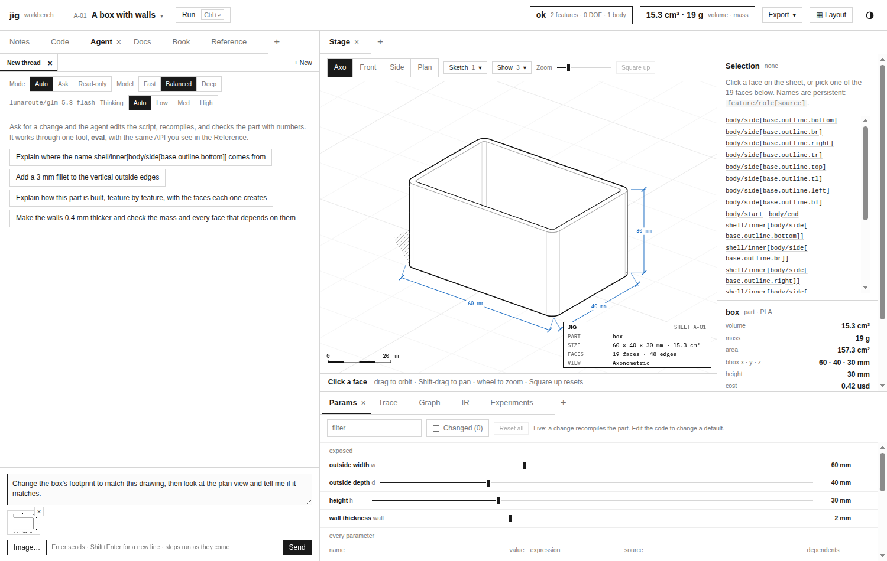
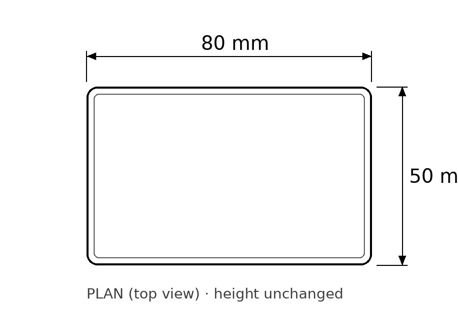
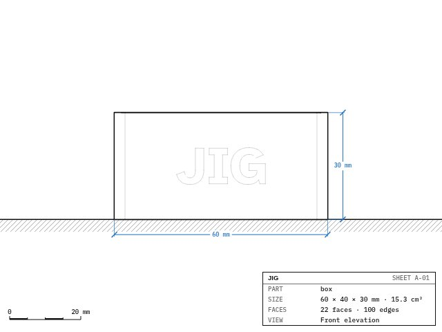
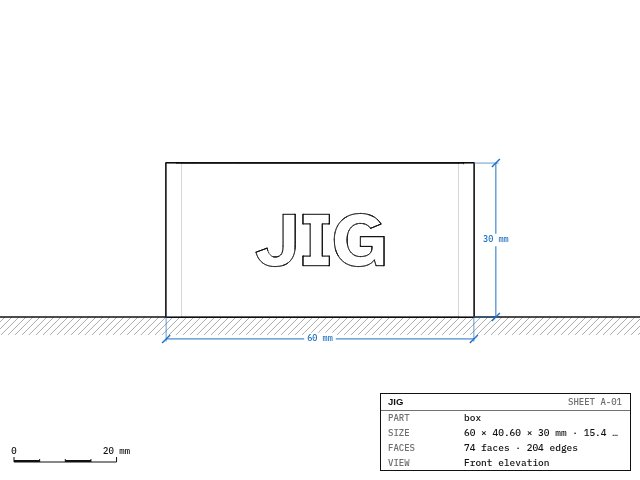

# jigcad: Letting the Workbench Agent See, Images In and a look() Out

jigcad's agent works on a CAD part through data: the script, metrics, face names and diagnostics. It never saw the drawing the person sees. Ticket JIG-006 added images in both directions. A person can paste or attach a picture to a message. A lab function, `look()`, draws the workbench's sheet to a JPEG that the model receives after its tool call. The evaluation harness renders `look()` in headless Chrome so that visual cases can be measured like the others. This report explains the transport, which needed one fix that a probe found and one rule that the APIs impose. It then covers the drawing path, the harness, and what 74 measured turns showed. One of those turns is the most instructive result: the model trusted a correct picture over a warning it never read.

> [!summary]
> - Both lunaroute models (glm-5.3-flash, deepseek-4.1-flash) read images correctly when they receive them. `jigcad serve` did not pass them on: its request handler did not decode the `images` field, although the layer behind it validated and attached images. A 49-token input count for a request carrying a 9.9 KB image exposed it.
> - Tool results in the Chat Completions format carry text only. An image produced by `look()` therefore travels as a user message placed after the round's tool results, with a caption naming the tool call it belongs to. At most eight images stay in a call's conversation, and images are never removed once attached, so the prompt-cache prefix stays stable.
> - `look(view?, { width, height })` draws with the stage's own `draw()` on an offscreen canvas, so the person's view does not move. In the harness, Node has no canvas, so the drawing happens in the real workbench page in headless Chrome, driven over the DevTools protocol with Node's built-in WebSocket.
> - The visual cases passed 17 of 18 runs. On 56 ordinary runs the agent looked unprompted 7 times, always after an edit whose shape mattered. The one failure: glm engraved with a negative depth, the engine warned "the cut removes no material", `run()` reported only "warnings: 1", and the picture, which shows imprinted letters exactly as it would show cut ones, convinced the model that it had succeeded.



## 1. Why the agent needs pictures

Two kinds of request need the drawing rather than data about it.

The first comes from the person. "Make the footprint match this drawing", with a sketch or a photo. "This edge looks wrong", with a screenshot. The information is in the image and nowhere else.

The second comes from the agent's own work. After an edit that compiles, metrics confirm that numbers changed, but some mistakes produce correct-looking numbers: text engraved mirror-reversed, a hole on the wrong face, a fillet on the wrong edges. A drawing shows those at once. The question this ticket had to answer was whether the models would use that.

## 2. The transport

### 2.1 A probe before a design

Before designing anything, I tested whether the models accept images at all. The test image has unambiguous content: a 512 × 384 JPEG with a blue triangle at the bottom left, a green circle at the bottom right, and a red digit 7 at the top right. The question allows an escape: "List every shape … If you cannot see an image, say NO IMAGE."



Sent to lunaroute's `/v1/chat/completions` directly, with the image as an `image_url` data URL, both models described all three shapes, their colours and positions, and the digit, at 307 and 252 prompt tokens. Sent through `jigcad serve`, glm answered "NO IMAGE" after 49 input tokens.

The token count located the fault. A 9.9 KB image costs a few hundred tokens, so 49 tokens meant the image never reached the model. Reading the path from the outside in:

```text
POST /api/sample {input, modelTier, images}
  → Server.start: decodes struct { Input, ModelTier, Model, Effort, Tools }       ← no Images field: dropped here
  → sample.Request{ Images }   → sample.ValidateRequest: ≤ 4, JPEG, ≤ 8 MiB         (never reached)
  → gepp.toTurn: images join the last user turn as a multimodal block              (never reached)
  → geppetto's OpenAI converter: user block with images → image_url parts          (never reached)
```

Everything behind the HTTP handler already supported images. I had said earlier in the project that "the backend already supports images"; that was true of the sample layer and false of the API. The fix is one struct field and a larger body limit. After it, the same probe through `jigcad serve` returned correct descriptions on both models (317 and 263 input tokens).

### 2.2 Images produced by tools

`look()` runs inside an `eval` tool call, so its image belongs to a tool result. The Chat Completions format gives tool messages text content only. lunaroute's Anthropic-format endpoint does accept image blocks inside `tool_result`, but it replaces them with placeholders before they reach these models. The image must therefore travel as a user message, and the only valid place for one is after the round's tool messages:

```text
assistant: tool_call eval { code: "return await look('front')" }    (call_1)
tool:      "image 1: front view, 640 × 480 px, 21 KB, attached after the tool results"
user:      "Images from the tool calls above, in order:\n1. from eval call call_1"  [image_url data:image/jpeg…]
assistant: …
```

The pieces are:

- The page posts a tool result as `{ value, isError, images }`. The server accepts at most two images per result, 4 MiB together, JPEG only.
- `sample.ToolResult` gained `Images`. The backend's `runTools` collects each call's images, and after appending the round's tool-use blocks, `imageBlock` adds one user block with a caption line per image and the images themselves.
- geppetto's OpenAI converter already buffers user blocks while tool results are pending, so the user message lands after the tool messages without changes there. A test against a fake provider asserts the role order `user, assistant, tool, user`.
- A call keeps at most eight images, counting the request's own. Further images, and any image sent to a model without image input, are named in the caption as not attached, with the reason.

Images are never removed from a call's conversation once attached. Removing old images would save tokens on later rounds, but it would change the prompt's prefix, and lunaroute's prompt cache, which serves 94–99 % of input tokens from the second round on, works on prefixes. Removing an image early in the conversation would turn every later round into a full re-read.

A second probe tested this path with the real models. A fake tool returned the shapes image from a `look()` call. glm described it with pixel coordinates ("Blue triangle — lower-left area (~130, 270)"), and deepseek began with "The picture did reach me".

## 3. Drawing: look()

### 3.1 In the page

The stage draws the sheet with `draw(canvas, program, view, options)` from `src/stage/sheet.js`: a software depth buffer, hidden-line edges, dimensions, the title block, all on a 2D canvas. `look()` reuses it on a canvas that is never attached to the page:

```js
async renderView({ view = null, width = 640, height = 480, overlays = null, quality = 0.85 } = {}) {
  const name = view || this.view.name || 'axo';
  if (this.viewRenderer) return this.viewRenderer({ files, overrides, view: name, width, height, overlays });
  if (typeof document === 'undefined') throw new Error('look: this workbench cannot draw here');
  const prog = this.program?.ok !== false ? this.program : this.lastGood;
  const { draw } = await import('../stage/sheet.js');
  const v = name === this.view.name ? { ...this.view } : { ...this.view, name, ...squareView() };
  const canvas = document.createElement('canvas');
  draw(canvas, prog, v, { width, height, dpr: 1, overlays: v.overlays, colorsFrom: document.documentElement });
  const url = canvas.toDataURL('image/jpeg', quality);
  return { mimeType: 'image/jpeg', data: url.slice(url.indexOf(',') + 1), width, height, view: name };
}
```

The picture is the same sheet the person sees, title block included, and drawing it does not move the person's view. Like the stage, it draws the last program that compiled when the current one failed.



The method was first named `host.snapshot`. Three tests failed with `Cannot read properties of undefined (reading 'width')` before the cause was clear: the eval tool already calls `host.snapshot()`, without arguments, to save the files before each step so that a step can be undone. It is now `renderView`.

### 3.2 In the lab

```js
const line = await look('front', { width: 800 });
// → "image 1: front view, 800 × 600 px, 25 KB, attached after the tool results"
```

The function accepts the four named views (`axo`, `front`, `side`, `plan`), clamps sizes to 64–1600 px, allows two images per step, and works in read mode because it changes nothing. It pushes the image into the step's image list. The eval tool returns `withImages(text, images)`, an object whose images sit under a registered symbol, and the HTTP adapter posts them next to the text. The reference the model reads gained one row: what `look()` does, that the image arrives after the tool results, and when looking is useful ("engraved text, which face a hole is on, which edges a fillet took").

### 3.3 In the panel

The composer accepts pasted images and has an `Image…` button. Each image is drawn into a canvas, scaled so that its longest side is at most 1568 px, put on white (JPEG has no transparency), and encoded at quality 0.85. At most four go with a message, shown as thumbnails with remove buttons. The thread stores only the count: threads live in `localStorage`, which holds a few megabytes.



## 4. Visual cases in the harness

The evaluation harness runs the agent, the Host and the geometry engine in Node, which has no canvas. Rather than write a second renderer that could drift from the stage, the harness lets the workbench draw itself. With `--look chrome`, it starts Chrome headless and connects to the DevTools WebSocket, which Chrome announces on stderr. It opens the workbench served by `jigcad serve` and evaluates a script in the page for each `look()`:

```js
// in the page, for each look() from Node
if (a.presetId && (!h.preset || h.preset.id !== a.presetId)) await h.loadPreset(a.presetId);
for (const [p, t] of Object.entries(a.files)) if (h.files.get(p) !== t) h.setFile(p, t);
h.resetOverrides(); for (const [k, v] of Object.entries(a.overrides)) h.setOverride(k, v);
await h.compileNow();
return await h.renderView({ view: a.view, width: a.width, height: a.height });
```

The Node host's `renderView` delegates to this. Files and overrides are small, and the page compiles them itself, so no program crosses the socket.

The first render failed with "nothing compiled yet". `setOverride` schedules a debounced compile, which started after the explicit compile and superseded it. The host drops a superseded compile's result before storing it. `host.compileNow()` cancels the scheduled compile and waits for one in flight before compiling. Renders then took 290 ms for the first and about 25 ms after that.

Three visual cases use this. Cases that need `look()` declare `"needs": ["look"]` and are skipped without `--look chrome`:

- **v01-s01-describe** (read mode): "Look at the part from the side and describe its outline." The check requires a `look(` call and an answer naming a hook or clip and its purpose.
- **v02-a01-engrave-front**: "Engrave the text JIG, 10 mm tall and 0.6 mm deep, on the outside of the front face (the −Y side) of the box. Then look at the front view and tell me whether it reads left to right." The engine gives 15,269.27 mm³ for the correct cut; the check accepts 15,200–15,335 mm³.
- **v03-a01-footprint-drawing**: the request "Change the box's footprint to match the attached drawing" goes with a dimensioned plan drawing. The checks require an 80 × 50 × 30 mm box and its volume. The request does not mention looking.



## 5. Measurements

### 5.1 The visual cases

Three cases on two tiers, three repeats each: 18 turns, 24 renders in 2.0 s.

| Case | glm-5.3-flash | deepseek-4.1-flash | looks per run (glm / deepseek) |
|---|---|---|---|
| v01 describe | 3/3 | 3/3 | 1.3 / 2.7 |
| v02 engrave and confirm | 2/3 | 3/3 | 1.0 / 1.7 |
| v03 match the drawing | 3/3 | 3/3 | 0.7 / 1.3 |

In v03, five of six runs called `look()` although nothing asked them to: they compared their result with the drawing. Rendering is cheap; the time goes to model rounds. deepseek spent 6 to 13 tool calls and 47 to 111 s on v01 and v02, glm 1 to 4 calls and 8 to 26 s.

### 5.2 Looking without being asked

The 28 ordinary cases ran once per tier with `look()` available.

| Tier | Passed | Runs that looked | Where |
|---|---|---|---|
| glm-5.3-flash | 24/28 | 3 | h04-switch-toggle, a01-engrave, a01-bigger-clarify |
| deepseek-4.1-flash | 27/28 | 4 | h04-switch-toggle, h01-large, a01-mount-holes, a01-bigger-clarify |

Every look followed an edit whose shape mattered: a different switch plate, an engraving, holes, a larger box. No run looked when answering a question, diagnosing an error or changing one parameter. Four of the five failures were lunaroute's: three rate limits and one authentication error. The fifth was a case ambiguity: asked for "the clearance between the teeth", glm reported the 0.4 mm design backlash, while the case expects the 0.2 mm smallest gap measured by the interference check. Both numbers answer the question as written.

### 5.3 The failure: a picture over a warning

In one glm run of v02, the agent wrote:

```js
.emboss(j.region.text('JIG', { size: 10, align: 'center' }), mm(-0.6),
  { on: j.feat('body').sideFace('base.outline.bottom'), … })
```

The depth is negative. `run()` returned `ok: true … warnings: 1 … faces: 22 … volume: 15344.265`. The volume is the volume before the edit. The model wrote "volume unchanged at 15344 mm³ — the cut is too small to dent the figure much", called `look('front')`, and answered "JIG reads left to right … no mirroring".

Was that visual claim invented? Rendering the model's exact edit answered the question. Compiling four variants on the engine explained it:

| Variant | Volume | Faces | Diagnostic |
|---|---|---|---|
| `mm(-0.6)`, no `op` | 15,344.27 | 22 | `feature.noEffect: engrave: the join adds no material` |
| `mm(-0.6)`, `op: 'cut'` | 15,344.27 | 22 | `feature.noEffect: engrave: the cut removes no material` |
| `mm(0.6)`, no `op` | 15,419.26 | 74 | none; the text is raised (bbox depth 40.6 mm) |
| `mm(0.6)`, `op: 'cut'` | 15,269.27 | 74 | none; the requested engraving |





The negative depth imprints the letters on the face: they split the face into regions (22 faces), and the sheet draws those boundaries as light lines. From the front, the imprint shows "JIG" reading left to right, exactly as a correct cut would. The model's description of the picture was true. Its conclusion was false, because a front view cannot show depth.

The evidence that could show depth was in the turn. The volume did not change, and the engine named the problem. But `run()` reports warnings as a count:

```js
const warnings = ((p && p.diagnostics) || []).filter(d => d.level === 'warning').length;
```

The agent saw "warnings: 1", not "the cut removes no material". It had a number it did not investigate, a volume it explained away, and a picture that looked right. It chose the picture.

## 6. What the ticket established

- **Probe the transport with a known image and an escape answer.** The model's "NO IMAGE" and a 49-token input located a dropped field in minutes. Without the probe, a design for `look()` would have been built on a path that discarded every image.
- **Tool images go after the tool results, and stay.** The API order is fixed, and keeping images keeps the cache prefix.
- **Let the application draw for the harness.** Headless Chrome over the DevTools protocol renders exactly what the panel renders, with no second renderer to maintain.
- **The models look sensibly.** They look when the request is about appearance or after an edit that changes shape, and not otherwise.
- **A picture is evidence of what it can show.** Orientation, placement and presence show in a drawing; depth and hidden faces do not. A model that has a confirming picture will discount evidence it would otherwise have followed, so the evidence must be hard to miss.

## 7. Next steps

- `run()` should return warnings as `{ kind, message }`, like errors. The text "the cut removes no material" was the evidence the model needed. The change alters every turn's tool results, so it should be measured on the case sets before and after.
- The `look()` reference entry should say what a drawing cannot show, and point to metrics and diagnostics for depth.
- The m07-tooth-gap question should name the interference gap.
- Drag-and-drop images onto the composer; the paste helper already accepts drop items.

## 8. Files

- `pkg/server/server.go`, `pkg/sample/types.go`, `pkg/sample/validate.go`, `pkg/sample/gepp/sample.go`: request and tool-result images, `imageBlock`, the caps.
- `import/jigcad/src/host/host.js`: `renderView`, `compileNow`, the `renderView` constructor option.
- `import/jigcad/src/agent/scope.js` (`look`), `evaltool.js` (`withImages`, `TOOL_IMAGES`), `turn.js` (images on a turn), `images.js` and `panel.jsx` (paste and attach), `reference.md` (the `look()` row).
- `import/jigcad/src/host/sample-http.js`: images on requests and tool results.
- `import/jigcad/tools/agent-eval/chrome-look.mjs`, `tools/agent-eval.mjs --look chrome`, `runner.mjs` (`caseImages`), cases 29–31, `test/agent-eval/images/`.
- Ticket `ttmp/2026/10/31/JIG-006-IMAGES--…`: design doc with results (§5), diary, probe scripts, renders, run records.
- Commits: 8bcb879 (images end to end), 5104fc0 (`compileNow`), 56dd57e (measurements).
- Related: [[PROJECT REPORT - jigcad - A Go Model Backend for the Workbench Agent]], [[PROJECT REPORT - jigcad - Measuring the Workbench Agent, an Evaluation Harness and a Promise Hint]], [[PROJECT REPORT - jigcad - Harder Agent Cases, Traps, and Why the Models Still Passed]].
