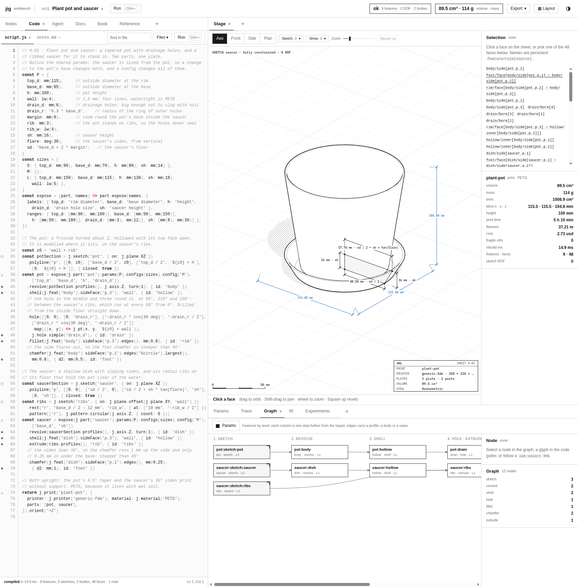
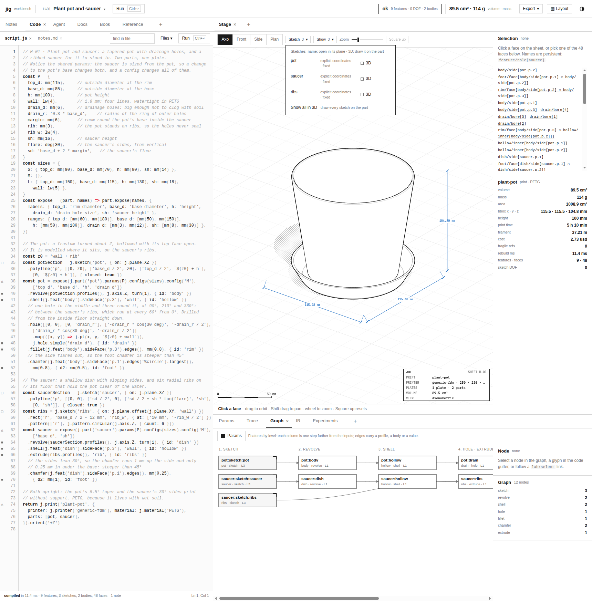
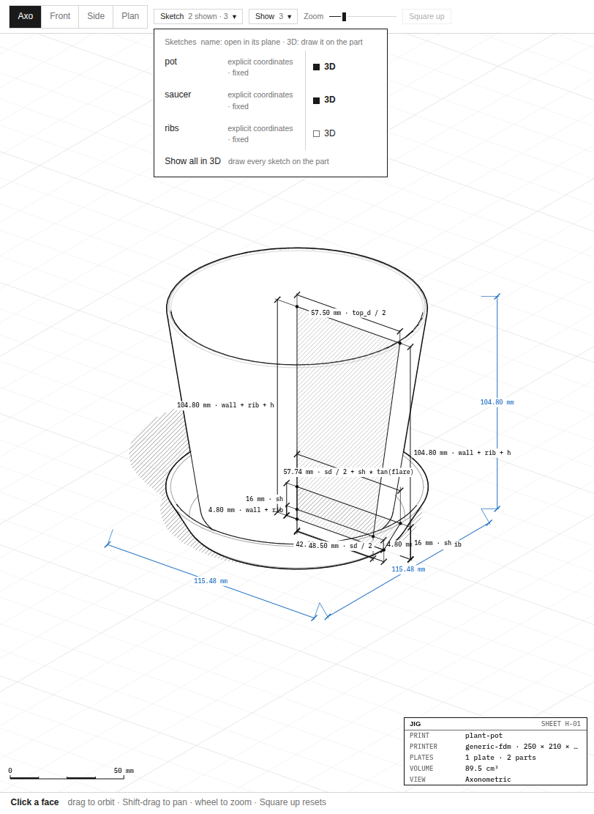
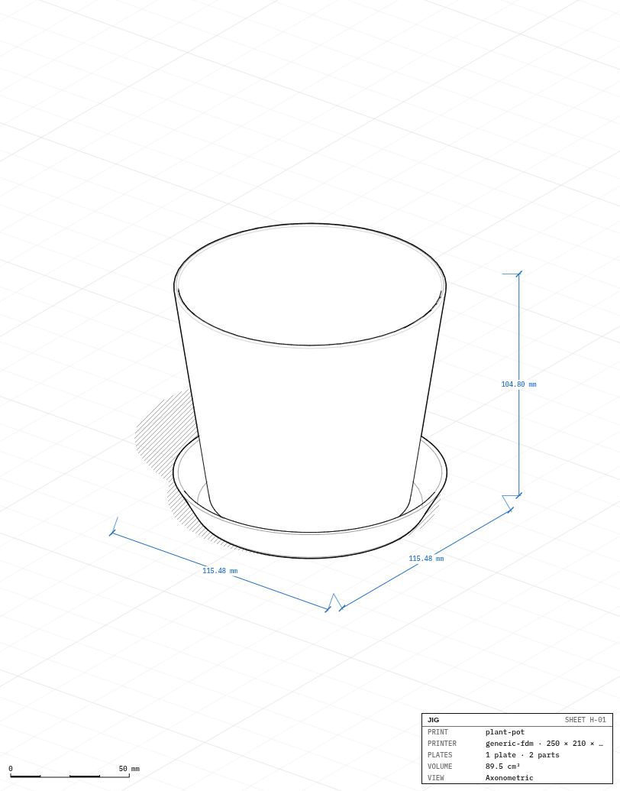

# jigcad: Sketches in the 3D Views, Opened or Shown

A jigcad sketch is a set of 2D curves on a plane, with dimensions and constraints, that a feature such as a revolve or an extrude turns into a solid. The workbench can open a sketch in its own plane, where the person selects and drags its entities. Ticket JIG-010 started from a report that mixed two observations. The person liked seeing a sketch drawn on the part in the axonometric view. They also noticed that it now stayed there after "back to the part", where it used to disappear. This report explains why the sketch stayed, a single `??` operator in the stage's view synchronisation. It then describes how the accidental behaviour became a deliberate one: a per-sketch "3D" checkbox in the Sketch menu.

> [!summary]
> - The stage copied the host's view with `v.sketch ?? cur.sketch`. When the host cleared the sketch by setting it to `null`, the `??` kept the stage's old value. The sheet drew any sketch that was set, in any view, so the sketch stayed on the part.
> - The view now has two separate pieces of state. `view.sketch` is the sketch open in its plane, drawn only in the sketch view, where it can be edited. `view.shown` is a set of sketch ids drawn on the part in the axonometric, front, side and plan views, for display only.
> - The Sketch menu keeps "open in its plane" on each sketch's name and adds a 3D checkbox per sketch, plus a "Show all / Hide all in 3D" row. The agent's lab gained `view.set({ sketches })`, so the agent can show a sketch before calling `look()`.

## 1. Reproducing the report

The report came with a screenshot: the H-01 plant pot's saucer section, hatched and dimensioned, drawn over the axonometric view of the pot. The reproduction was direct. Open the Sketch menu, choose "saucer", which switches to the sketch view, then click "back to the part". After that click, the host's view was `{ name: 'axo', sketch: null }`. The sheet still drew the saucer sketch with its status line, `SKETCH saucer · fully constrained · 0 DOF`.



## 2. The cause

The workbench keeps its state in a host object (`src/host/host.js`), and the canvas that draws the part, the stage, keeps a copy of the view for its own render loop. When the host emits a `view` event, the stage merges it into its copy. Each field of the host's view may be absent, meaning "keep what you have". The merge expressed that with the nullish-coalescing operator:

```js
// src/stage/stage.js, before
const nxt = { name: v.name ?? cur.name, yaw: v.yaw ?? cur.yaw, pitch: v.pitch ?? cur.pitch,
              zoom: v.zoom ?? cur.zoom, sketch: v.sketch ?? cur.sketch };
```

`a ?? b` returns `b` when `a` is `null` or `undefined`. That matches "absent means keep" for the camera fields, which are never `null`. For `sketch`, `null` is a meaningful value: it means no sketch. `null ?? 'saucer'` evaluates to `'saucer'`, so the host's instruction to clear the sketch was ignored.

On its own, a stale `view.sketch` would have been invisible if the drawing code had checked the view's name. It did not:

```js
// src/stage/sheet.js, before (simplified)
export function activeSketch(program, view) {
  const id = view.sketch;                       // set → drawn, whichever view is current
  …
}
```

Both pieces were needed for the symptom. The sync kept a value it should have dropped, and the sheet drew that value outside the view it belonged to.

## 3. Two meanings, two pieces of state

The simplest fix would have restored the old behaviour: the sketch disappears on "back to the part". The person, however, wanted to see sketches on the part. Seeing a sketch on the part and editing a sketch are different activities with different requirements:

| State | Meaning | Drawn in | Interaction |
|---|---|---|---|
| `view.sketch` | the one sketch open in its own plane | the sketch view | entities can be selected and dragged |
| `view.shown` | a set of sketch ids the person chose to see on the part | axonometric, front, side, plan | display only; clicks still pick faces of the part |

Keeping them separate means a click on the part in the axonometric view always picks the part, even with three sketches shown. It also means the sketch view always shows exactly one sketch.

### 3.1 The synchronisation

The merge now distinguishes an absent field from a `null` field and copies `shown`:

```js
const cur = { …, sketch: view.sketch ?? null, shown: [...(view.shown || [])].sort() };
const nxt = { …,
  sketch: v.sketch === undefined ? cur.sketch : v.sketch,      // null clears
  shown: v.shown ? [...v.shown].sort() : cur.shown };
```

The stage compares `cur` and `nxt` to decide whether anything changed. `shown` is a `Set`, which does not compare by value, so the comparison uses sorted arrays and converts back to a `Set` when it applies the view. When the stage itself changes the view, for example when the person orbits the camera, `pushView` sends `shown` back to the host so that the host's copy stays current.

### 3.2 Drawing

`activeSketch` now returns a sketch only in the sketch view, or the first sketch of a program that is only a sketch, as before. A second function returns the sketches to draw on the part:

```js
export function shownSketches(program, view, overrides) {
  if (view.name === 'sketch' || !view.shown || !view.shown.size) return [];
  const list = program && program.sketches || [];
  return [...view.shown]
    .map(id => (overrides && overrides.get && overrides.get(id)) || list.find(s => s.id === id))
    .filter(Boolean);
}
```

`overrides` holds sketches that the solver has re-solved after a drag, so a shown sketch is drawn at its solved position. Ids that no longer exist after an edit are skipped. In `draw()`, the shown sketches are drawn before the active one and without the hit-testing callback, which keeps them display-only:

```js
if (!thumb) for (const s3 of shownSketches(program, view, o.sketches)) if (s3 !== sk) drawSketch(ctx, C, cam, s3, has, {});
if (sk) state.sketchLayout = drawSketch(ctx, C, cam, sk, …, { dragging, hoverRef, selected });
```

Thumbnails skip shown sketches, because at that size a section drawing only adds noise.

### 3.3 The menu

The Sketch menu previously listed the sketches, and choosing one opened it in its plane. Each row now has two controls. The name still opens the sketch in its plane. A box labelled "3D" toggles whether the sketch is shown on the part. The box is a button with `role="checkbox"` and `aria-checked`, and an accessible name of the form "Show sketch saucer in the 3D views". It carries the `data-keep` attribute that the menu component uses to stay open, so several sketches can be ticked in a row. With more than one sketch, one more row reads "Show all in 3D", or "Hide all in 3D" once every sketch is shown. In the sketch view, a "Back to the part" row returns to the axonometric view with `sketch: null`, the value the old synchronisation ignored. The menu button shows the count, for example `Sketch 2 shown · 3`.



The host gained one method for the toggle:

```js
toggleSketchShown(id, on) {
  const s = new Set(this.view.shown || []);
  if (on ?? !s.has(id)) s.add(id); else s.delete(id);
  this.setView({ shown: s });
}
```

Here `??` is correct: `on` is either a boolean that forces the state or absent, in which case the call toggles. Loading a preset clears `shown`, because sketch ids belong to a program.



### 3.4 The agent's view

The workbench agent reads and changes the view through its lab scope. `view.get()` now includes `sketches`, the shown ids, and `view.set({ sketches: ['pot'] })` sets them. Unknown ids are refused with the list of valid ones, for example `view.set: no sketch lid (sketches: pot, saucer)`, so a typo fails instead of silently showing nothing. Together with `look()` from an earlier ticket, the agent can show a profile on the part and render the view to check a revolve against its section.

## 4. Verification

**In the browser.** On H-01 the sequence was: open pot in its plane, click "back to the part", tick pot and saucer.

- After "back to the part", the axonometric view showed the part alone, with no sketch status line.
- After ticking, both sections were drawn on the part and the menu stayed open.



**Unit tests.** `test/ui/sketch-shown.test.mjs` has four tests:

- The sketch view draws its sketch, and a leftover `view.sketch` is not drawn in the axonometric view.
- Shown sketches are drawn in the 3D views only, and unknown ids are skipped.
- A program that is only a sketch still opens on its sketch, and shown sketches use their solved overrides.
- `host.toggleSketchShown` adds, removes and forces.

`test/agent/scope.test.mjs` checks `view.set({ sketches })`, including the refusal of an unknown id. The stage's unit script passes 20 of 20.

## 5. What the ticket established

- **`??` means "null or undefined", not "absent".** When `null` carries meaning, write `x === undefined ? keep : x`. The bug was a one-character choice of operator in a merge that otherwise looked uniform.
- **A view-specific drawing must check the view.** A value left over in state is harmless when the drawing code checks where it applies. The sheet's missing check turned a stale value into a visible bug.
- **A bug report can describe a wanted feature.** The person liked the accidental behaviour. The fix kept it, made it explicit and per sketch, and restored the meaning of "back to the part".
- **Display and editing are different states.** Separating `shown` from `sketch` keeps hit-testing simple: the part is clickable in the 3D views, and the sketch is editable in its own view.

## 6. Files

- `import/jigcad/src/stage/stage.js`: the view synchronisation, and `shown` in `pushView`.
- `import/jigcad/src/stage/sheet.js`: `activeSketch` (sketch view only), `shownSketches`, the drawing order in `draw()`.
- `import/jigcad/src/host/host.js`: `view.shown`, `setView`, `toggleSketchShown`, and clearing on preset load.
- `import/jigcad/src/ui/views/stage.jsx` and `src/ui/kiln.css`: the Sketch menu rows.
- `import/jigcad/src/agent/scope.js` and `reference.md`: `view.get().sketches`, `view.set({ sketches })`.
- `import/jigcad/test/ui/sketch-shown.test.mjs`, `test/agent/scope.test.mjs`.
- Ticket `ttmp/2026/11/01/JIG-010-SKETCH-3D--…`: design doc, diary, screenshots.
- Commits: 7d25528 (code), 503a000 (docs).
- Related: [[PROJECT REPORT - jigcad - Architecture of a Browser CAD Workbench, from Script to Agent]], [[PROJECT REPORT - jigcad - Letting the Workbench Agent See, Images In and a look() Out]].
