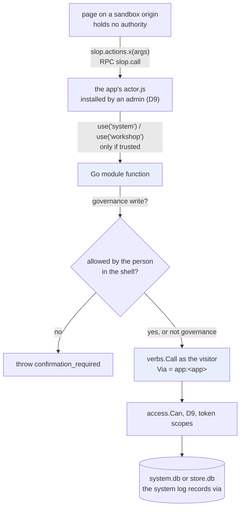
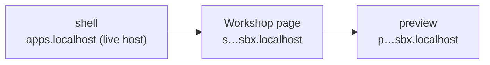
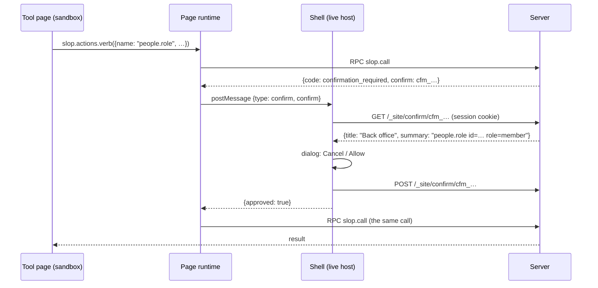
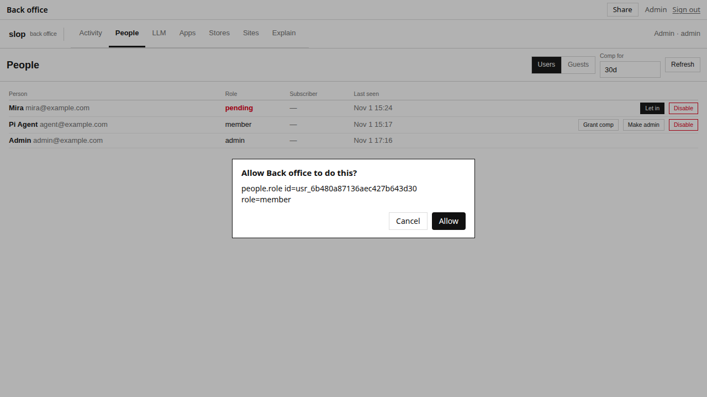
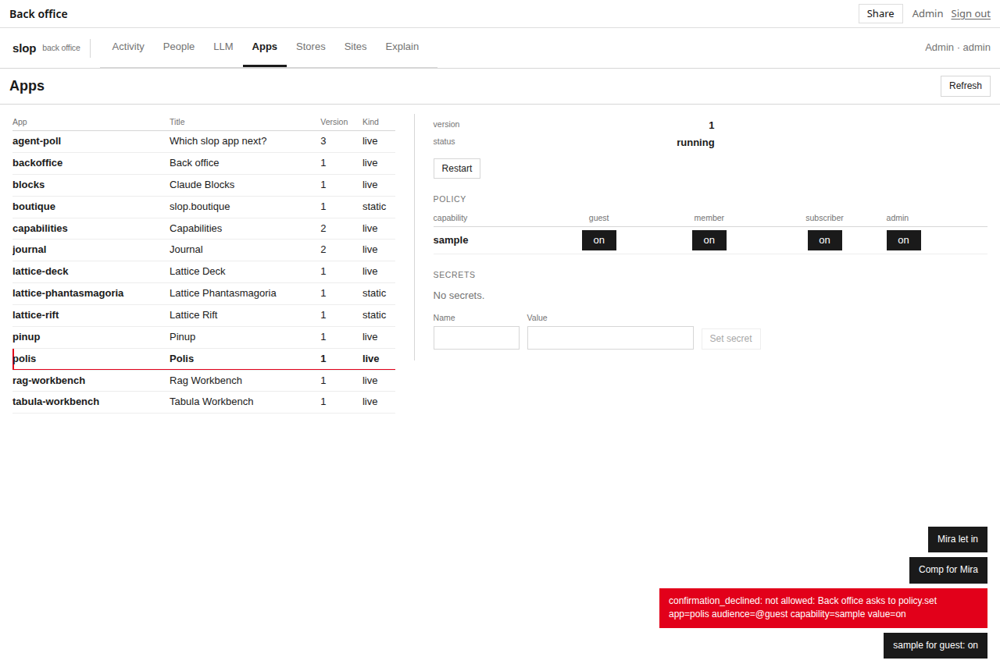
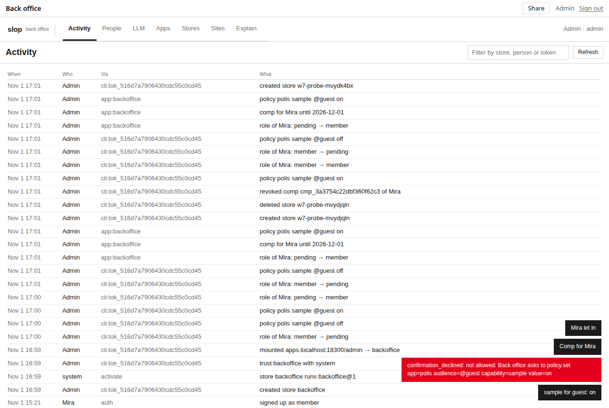
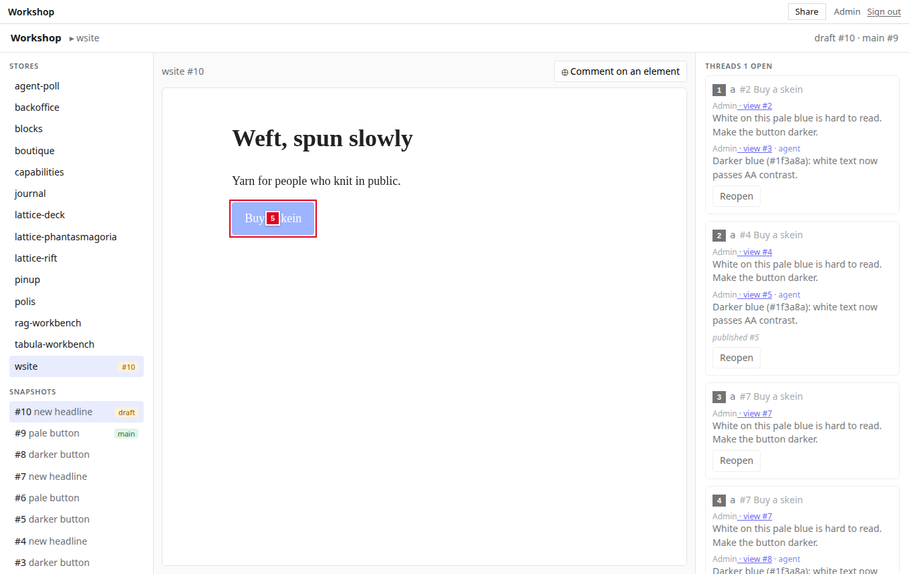
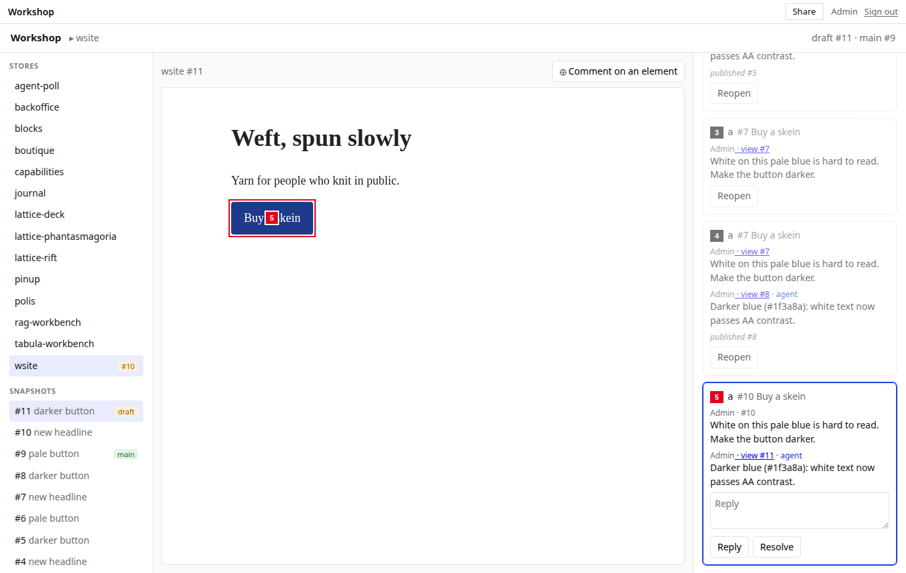
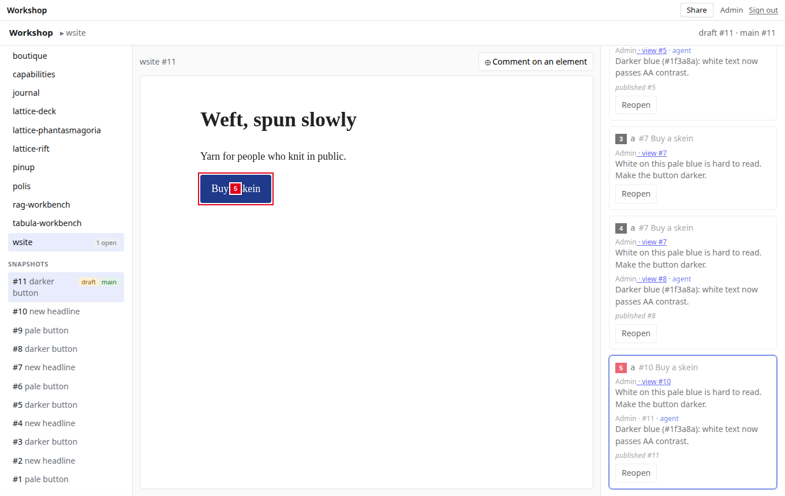

# slop v3: Tools as Apps — Trusted Go Modules, Confirmations and the Workshop — A Technical Deep Dive

slop v3 hosts small web applications, each backed by one SQLite store, and controls them through a table of operations called **verbs**. Until this project, its administrative tools were part of the server. The back office, which manages people, grants, mounts, policy and model budgets, was a React application compiled into the binary. The Workshop of slop-computer v2, in which a person reviews an agent's work by pointing at elements of a page and then publishes it, had not been ported at all. This report describes the change that turns such tools into ordinary apps: pushed, versioned and replaced like any other app, possibly written by agents, in as many variants as are useful.

The change rests on one mechanism. An administrator can **trust** an app with a **Go module**. The app's server-side JavaScript then receives an object whose functions each call one verb, as the person using the app, through every check that verb applies when called from the command line. Around that mechanism the project built seven further primitives and two apps. The work was done on 1 November 2026 in eight phases, W1 to W8, under ticket SLOP3-002. Each phase ended with integration tests, a commit and a diary entry, and the two apps were checked in a browser against a running server, with a coding agent taking part through the CLI.

The report follows the order in which the ideas depend on each other. Section 2 states the problem and why the obvious alternative was rejected. Section 3 summarises the parts of slop v3 the design builds on. Sections 4 to 11 explain the eight primitives. Sections 12 and 13 describe the back office and the Workshop as apps. The last sections cover verification, the course of the work, and the limits of the design.

> [!summary]
> - **A module function is a named verb call made as the visitor.** Trusted apps reach the platform only through Go functions that call verbs with a principal built from the person behind the event, labelled `app:<app>`. Every access check, the rule that only admins push code, token scopes and the audit log apply without new code paths.
> - **Trust is not a permission an app can grant itself.** It is a row in `system.db`, written only by an admin through `app.trust`. It is absent from the policy matrix, and absent from the module that can change the policy matrix.
> - **Governance changes need the person, not the page.** When app code changes roles, policy, model budgets, comps or secrets for a person, the call fails with `confirmation_required` until that person allows it. The person allows it in a dialog drawn by the shell, outside the app's frame, or from the CLI. The page's runtime then repeats the call.
> - **Two apps prove the primitives.** The back office runs as `apps/backoffice`, from the same React code as the built-in one. The Workshop runs as `apps/workshop`, with inspect previews on per-preview sandbox origins. In the browser check, an agent waits in `slop log wait`, pushes a draft and replies through `slop call`, and the person publishes the draft by moving `main`.

## 1. What exists, and where

| Item | Location |
|---|---|
| Repository | `/home/manuel/code/wesen/2026-10-31--slop-v3` (module `github.com/go-go-golems/slop`) |
| Ticket workspace | `ttmp/2026/11/01/SLOP3-002--tools-as-apps-go-modules-for-actors-the-workshop-and-the-back-office-as-apps/` |
| Design and implementation guide (705 lines, with as-built notes) | `design-doc/01-tools-as-apps-design-and-implementation-guide-for-interns.md` |
| Implementation diary (nine steps, 1,136 lines) | `reference/01-diary.md` |
| Browser checks | `scripts/01-w7-backoffice-e2e.mjs`, `02-w7-builtin-backoffice-smoke.mjs`, `03-w8-workshop-e2e.mjs`, `04-w6-confirm-dialog-shot.mjs` |
| Screenshots | `various/w6/`, `various/w7/`, `various/w8/` |
| The two apps | `apps/backoffice/`, `apps/workshop/` |
| Preceding report | [[PROJECT REPORT - slop v3 - A Store-Based Hosting Service from Design to Deployment - A Technical Deep Dive]] |

The change touches 56 files, with 2,748 lines added and 86 removed. These counts exclude the ticket documents and four built JavaScript and CSS files. The verb table grew from 76 to 84 verbs. Eight Go integration tests were added, one per phase, in `pkg/server/w1_test.go` to `w8_test.go`. The new and substantially changed files are:

| File | Phase | Purpose |
|---|---|---|
| `pkg/actor/registry.go` | W1 | the module registry, and `use()` for trusted modules |
| `pkg/system/modules.go`, `migrations/003_app_modules.sql` | W1 | the trust table and its audited writes |
| `pkg/server/modules.go` | W1, W6 | `actAs`, `callVerb`, argument mapping, the confirmation check |
| `pkg/server/modsystem.go` | W2 | the `system` module: 35 functions and `call` |
| `pkg/actor/sysreact.go` | W3 | reactors that follow the system log |
| `pkg/server/modworkshop.go` | W4 | the `workshop` module: 12 functions |
| `pkg/verbs/stores.go`, `pkg/verbs/actors.go` | W4 | `log.wait`, `app.follow`, `app.trust`, `app.untrust`, `app.modules` |
| `pkg/server/preview.go`, `pkg/verbs/preview.go`, `migrations/004_previews.sql` | W5 | inspect previews |
| `pkg/server/assets/bridge.js` | W5 | the pick-and-pin script, copied from v2 |
| `pkg/verbs/confirm.go` | W6 | confirmations and `confirm.approve` |
| `web/runtime/src/caps.ts`, `pkg/server/assets/shell.js` | W6 | the runtime's retry and the shell's dialog |
| `web/admin/src/api-app.js`, `web/admin/build.mjs` | W7 | the back office built as an app |
| `apps/backoffice/`, `apps/workshop/` | W7, W8 | the two apps |

## 2. The problem

### 2.1 Tools compiled into the server

A tool in slop v3 meant server code. The back office lived in `web/admin` and was served at `/` on the main host by `pkg/server/admin.go`. v2's Workshop consisted of several thousand lines of Go and TypeScript: a preview renderer, a `threads` and `comments` schema, a long-polling endpoint for agents and a review UI. Porting it the same way would have added all of that to the v3 binary, reviewed and deployed with it. Each variant of a tool, such as a narrower Workshop for one team or a back office that shows only billing, would again be server code.

The aim of SLOP3-002 was that a tool be an app. An app in slop v3 is a store whose file tree contains `app.json`. It is pushed with `slop push`, keeps every version as a snapshot, serves the snapshot its `main` ref points at, and can be rolled back by moving that ref. An agent can write one. The question was what an app needs in order to manage the platform, and how to give it that without giving it more.

### 2.2 What a tool needs that apps could not do

The requirements came from two concrete tools, the back office and the Workshop. The following table compares each requirement with what slop v3 offered before the change.

| A tool needs to… | Before SLOP3-002 |
|---|---|
| read and change people, grants, mounts, policy, model budgets | the `platform` module offered three operations (create a store, set a mount, set a grant), gated by the policy matrix |
| list stores, snapshots and refs; push files to another store; move `main` | nothing |
| show an unpublished snapshot of another store, with a way to pick elements | snapshot URLs existed, but the sandbox host served them only to anonymous visitors, and there was no pick script |
| let an agent wait for a new comment | `log.show` returned at once |
| run an app's draft against a scratch store | the store meta key `app_ref` existed, but no verb set it |
| update when someone changes a grant elsewhere | reactors followed only their own store's log |
| stop a compromised tool from acting with an admin's authority | nothing |

### 2.3 Why the platform's data is not exposed as a store

One design was considered and rejected early. It would expose the platform's state as a "system store" whose documents are grants, roles and mounts. Apps would edit those documents with the ordinary `db` capability, which every app already has for its own data.

The objection is that a document write is a far weaker interface than a verb. The verb `grant.set` checks several things before it writes:
- the caller holds `admin` on the store;
- the subject is a valid person, store or audience;
- the level is one of `view`, `interact`, `admin` and `owner`;
- the caller grants no more than their own level.

After the write, it records the change in the system log with its door. It also tells the server to review the open views of that store, so that someone who lost access loses their open page. Other rules apply when access is decided, not when the grant is written: the access check caps guests at `interact`, and a share link never lowers a level its holder already has. Representing grants as documents would require re-implementing all of these as validation of document writes. The rule language of the `db` capability (a minimum level per path prefix) cannot express them. The audit trail would also record "a document changed" instead of "Ada set @member to interact on notes, via app:backoffice". The design therefore keeps verbs as the only way to change the platform, and gives trusted apps Go functions that call them.

## 3. The parts of slop v3 the design builds on

This section summarises the parts of slop v3 that the primitives depend on. The preceding report covers them in full.

**Verbs.** Every operation is a Go value in a table (`pkg/verbs/verb.go`) with a name, arguments, a required token scope (`read`, `write` or `admin`), an `AdminOnly` flag and a `Run` function. The CLI, the HTTP API at `/api/v1/<verb>` and the `slop eval` scope are generated from the table. `verbs.Call(ctx, env, principal, name, args)` checks the scope, the admin flag, that guests do not write, and the required arguments, then runs the verb. Verbs that change `system.db` record the principal's person and **via** (the door the call came through, such as `cli:tok_…`, `page` or `auth`) in the system log.

**Principals and the access check.** A principal (`access.Principal`) is who a call acts as: a person, optionally through a token with scopes, labelled with a `Via`. `Checker.Can(ctx, principal, store, need, …)` computes the principal's level on a store from ownership, admin role, grants, audience caps and token scopes, and returns a trace of its reasoning.

**Actors and turns.** An app with `actor.js` has server code, run in a goja JavaScript runtime that one goroutine owns. Each event the actor handles is a **turn**: one SQLite transaction on the store. Events include an action called by a page, an HTTP route, a reactor or an alarm. An `await` on real I/O ends the turn; the code after the `await` runs in a new turn, posted as a continuation event. A handler receives `ctx`, and `ctx.visitor` describes the person the event acts for. For reactors and alarms the visitor is the store itself (`store:<id>`), and the person charged for model calls is the store's owner (`Visitor.Payer`).

**`use()`.** Actor code obtains capabilities with `use(name)`, implemented by `Actor.module` in `pkg/actor/modules.go`. Before this project, the catalog had two parts. The first was the store's own data (`sql`, `db`, `files`, `room`, `alarm`, `time`, `log`, `stores`). The second was four policy-gated capabilities (`fetch`, `secrets`, `sample`, `platform`), which are `null` unless the app declares them and the policy matrix allows them for some audience.

**Decision D9.** Only admins push app code: writing the tree of a store that contains `app.json` requires the person to be an admin (`needCodeRight`, `pkg/verbs/mounts.go`). Every line of actor code on a server was therefore installed by an admin. The trust design depends on this property.

**Hosts, views and the shell.** A live host serves a **shell**: a title bar and an iframe. The iframe shows the app on a **sandbox origin**, `s<label>.<sandbox host>`, where the label is an HMAC of the store and app identifiers. Each store and app pair therefore has its own browser origin, with no access to session cookies. The page reaches its actor through the page runtime (`claude.js`) over a per-view RPC endpoint. The shell runs on the live host's origin, outside the iframe, and already showed dialogs the page could not draw, such as consent to use a capability.

## 4. The layering

Every tool in this design has the same four layers. Figure 1 shows them.



*Figure 1. The path of a tool's request. The page calls an action of its app's actor. The actor reaches the platform only through Go module functions that the app has been trusted with. Each function calls one verb, as the person behind the event.*

The page holds no authority of its own. Its origin carries no session cookie, and its RPC secret lets it call only its own actor. The actor's code was pushed by an admin. It has no platform access beyond its store until an admin trusts its app with a module. A module function performs no access decision of its own: it builds a principal and calls a verb. The verb performs the same checks it performs for the CLI.

Two consequences follow from this structure, and later sections rely on them. A tool can never do more than the person using it could do directly, because the verb decides with that person's principal. Every change a tool makes is attributed twice in the system log: to the person in the `principal` column and to the app in the `via` column.

## 5. Primitive 1: declaring and trusting a module

### 5.1 Declaration and registry

An app lists the Go modules it needs in `app.json`:

```json
{ "title": "Back office", "actor": "actor.js",
  "slop": { "modules": ["system"] } }
```

`apps.Parse` rejects a name not in `apps.Modules` (currently `system` and `workshop`), in the same way it rejects an unknown entry in `slop.platform`. The names live in `pkg/apps` because the manifest parser must validate them and cannot import the server, which holds the implementations.

The implementations are registered in the actor manager (`pkg/actor/registry.go`):

```go
type Module struct {
	Name string
	Doc  string
	Load func(a *Actor) goja.Value // builds the module's object for one actor
}

func (m *Manager) Register(mod Module)
```

The server registers `system` and `workshop` when it starts (`Server.registerModules`). `use(name)` gains a final case: for any name not in the built-in catalog it calls `trustedModule`, which returns `Load(a)` only when three conditions hold.

```text
use('system') returns an object  iff
     "system" ∈ app.json slop.modules       (checked by apps.Parse)
  ∧  "system" is registered                 (Manager.Register in server.New)
  ∧  app_modules contains (app, "system")   (written by app.trust, admin only)
otherwise null, as for any undeclared capability
```

### 5.2 Trust

Trust is a table in `system.db`:

```sql
CREATE TABLE app_modules (
  app TEXT NOT NULL, module TEXT NOT NULL,
  granted_by TEXT NOT NULL, granted_at INTEGER NOT NULL,
  PRIMARY KEY (app, module));
```

Three verbs manage it. `app.trust <app> <module>` and `app.untrust <app> <module>` require the admin token scope and an admin person. Both write the system log with the change kind `module`, and both restart the app's running actors, because `use()` is evaluated when an actor starts. `app.trust` refuses a module the app does not declare, as `policy.set` refuses a capability the app does not declare. `app.modules [<app>]` lists the registry and the current trusts.

Two choices here need justification. First, trust belongs to the app store, not to a snapshot of it, so pushing a new version keeps the trust. This is safe only because of D9: the new version was also pushed by an admin. Second, trust is not a cell of the policy matrix. The `system` module can change the policy matrix. If trust were a policy cell, an app trusted with `system` could grant itself the `workshop` module, or grant any other app anything. For the same reason the `system` module has no function for `app.trust`, and its generic `call` refuses that verb.

## 6. Acting as the visitor

### 6.1 Building the principal

Each module function call builds a principal from the visitor of the current event (`pkg/server/modules.go`):

```go
func (s *Server) actAs(a *actor.Actor, write bool) *access.Principal {
	v := a.Visitor()
	person := v.ID
	if strings.HasPrefix(person, "store:") {
		if write {
			a.Throw("permission_denied", "a module write needs a person; reactors, alarms and other stores may only read")
		}
		person = v.Payer
	}
	// … look the person up; throw permission_denied if there is none …
	p := &access.Principal{Kind: access.KindUser, Person: &pp, Via: "app:" + a.App()}
	if pp.Kind == "guest" {
		p.Kind = access.KindGuest
	}
	if v.Scopes != nil {
		p.Kind, p.Scopes = access.KindToken, v.Scopes
	}
	return p
}
```

The function distinguishes three cases.

- **A person's event.** When a page or a CLI call invoked an action, the visitor is a person (`usr_…` or `vis_…`). The module acts as that person.
- **An event with nobody behind it.** A reactor or an alarm runs as the store itself. The module may read on behalf of the store's owner, but writes are refused. A reactor that changed grants as the owner would make a change nobody decided to make at that moment.
- **A call that came with a token.** The visitor carries the token's scopes, copied by `VisitorOf` into a new field, `Visitor.Scopes`, and the module builds a token principal with them.

The third case closes an escalation that the first version of the design overlooked. Consider an agent holding a token with the `read` and `write` scopes, for a person who is an admin. The agent cannot call `policy.set` directly, because that verb requires the `admin` scope. Without scope propagation, the agent could call an action of a trusted back office (`actor.call` needs only `write`), and that action would call `policy.set` with the person's full rights. `TestModuleTrust` makes this call and checks that the answer is `permission_denied: this token lacks the admin scope`.

### 6.2 Why module functions return promises

A verb can write a store. If the verb writes the actor's own store while the actor's turn holds that store's transaction, the verb waits for a lock its own goroutine holds, and the actor stalls. Module functions therefore never run their verb inside the turn. `callVerb` passes the call to `Actor.IO`:

```go
return a.IO(func() (any, error) {
	out, err := verbs.Call(withPrincipal(context.Background(), p), s.Env, p, name, args)
	if err != nil {
		ve := verbs.AsError(err)
		return nil, &actor.Error{Code: ve.Code, Message: ve.Message}
	}
	return out, nil
}, func(out any) (goja.Value, error) { return a.ToJS(out), nil })
```

`Actor.IO` returns a promise. The current turn commits when the handler returns or awaits; the work runs on another goroutine; the promise settles in a continuation turn that keeps the original visitor. App code therefore writes `await system.people.list()`. The principal is built before the I/O starts, so a refusal from `actAs` is thrown synchronously, inside the async function, and arrives as a rejection that the app can catch.

### 6.3 Mapping arguments

Verbs take named arguments; JavaScript functions are more natural with positional ones. Each module function declares the verb argument names its positional parameters fill, and the call is mapped by one rule. A single plain object is the argument object. Otherwise arguments fill the declared names in order, and a plain object after them adds options. `system.grants.set('notes', '@guest', 'view')` and `system.grants.set({store: 'notes', subject: '@guest', level: 'view'})` are the same call. `system.mounts.set(host, path, store, {type: 'blocks'})` passes the extra option. Two further fields per function cover the remaining cases. `Fixed` arguments are always passed (`publish` fixes `ref: "main"`), and `Default` arguments are passed unless given (`push` defaults `ref` to `draft`).

## 7. Primitive 2: the `system` module

The `system` module is a table of 35 functions over the governance verbs (`pkg/server/modsystem.go`). An excerpt:

```go
var systemFuncs = []modFunc{
	{JS: "people.list", Verb: "people.ls", Pos: []string{"kind"}},
	{JS: "people.setRole", Verb: "people.role", Pos: []string{"id", "role"}, Confirm: true},
	{JS: "grants.set", Verb: "grant.set", Pos: []string{"store", "subject", "level"}},
	{JS: "mounts.set", Verb: "mount.set", Pos: []string{"host", "path", "store"}},
	{JS: "policy.set", Verb: "policy.set", Pos: []string{"app", "capability", "audience", "value"}, Confirm: true},
	{JS: "llm.set", Verb: "llm.set", Pos: []string{"subject", "value", "budget"}, Confirm: true},
	{JS: "subs.grant", Verb: "sub.grant", Pos: []string{"person", "until", "note"}, Confirm: true},
	{JS: "secrets.set", Verb: "secret.set", Pos: []string{"app", "name", "value"}, Confirm: true},
	{JS: "stores.list", Verb: "store.ls", Fixed: map[string]any{"all": true}},
	{JS: "explain", Verb: "explain.can", Pos: []string{"store", "level", "subject"}},
	{JS: "log", Verb: "log.system", Pos: []string{"limit"}},
	// … 24 more: people, grants, links, mounts, policy, llm, subs, secrets, stores, apps, hosts
}
```

Nine functions carry the `Confirm` flag: changing a role, a policy cell, a model access row (set, remove, reset usage), a comp (grant, revoke) or a secret (set, remove). Section 11 explains what the flag does. Grants, links and mounts are not flagged. They are per-store publishing decisions, already limited by the person's level on the store, and the shell has always let store owners make them.

The module also offers `call(verb, args)`, for code that names verbs. Its purpose is the back-office port. Every button of the existing React UI calls `call(verb, args)` in `web/admin/src/api.js`, and a grep of `web/admin/src` showed that it uses 31 verbs, all of them in the table. `call` builds a map from verb to table entry and refuses any other verb with `permission_denied: system.call: <verb> is not in the system module`. The test sends `token.new`, `app.trust`, `files.push` and `sql.exec` through it and receives that refusal for each.

`TestSystemModule` also exposed a defect in the audit log that predated this project. After an admin let a pending person in through the app, the log entry read:

```text
summary: role of usr_…: pending → member    via: verb
```

`system.SetRole` (`pkg/system/people.go`) passed the literal string `"verb"` as the via, whatever the door, and `RevokeToken` did the same. The CLI, the HTTP API and the built-in back office had all been logged as `verb`, so the defect had gone unnoticed. Both functions now take the via from the principal, and the entry reads `via: app:office`.

## 8. Primitive 3: reactors that follow the system log

### 8.1 Selector, cursor and delivery

A tool's pages should update when someone changes a grant from the CLI or from another tool. Reactors provide this within a store: a handler under `on:` in `defineActor`, keyed by a selector such as `doc:threads/*`, runs once for each matching commit of the store's log. The project adds a second kind of selector, `system:<kind>`. Here `<kind>` is a change kind of the system log (`grant`, `person`, `mount`, `policy`, `llm`, `module`, and so on) or `*`.

```js
on: {
  'system:grant'(ctx, e) {   // e = {rev, at, principal, via, summary, changes: [{kind, key, op, before, after}]}
    db.doc('ui/changed').set({ rev: e.rev });
  },
}
```

Store reactors already keep their position in a `_cursors` table inside the store, one row per reactor, with a `source` column that had always held `'self'`. A system reactor uses a row with source `'system'`. When the app is activated, the row starts at the current head of the system log, so a new reactor follows what happens next and does not replay history. In each delivery turn, the reactor reads the system log after its cursor (at most 200 commits), calls the handler for each matching commit, and writes the new cursor position. Because the handler's writes and the cursor write belong to one store transaction, each commit is handled exactly once: if the handler fails, neither commits.

Waking reactors needs a signal from `system.db`. Every write to `system.db` already goes through `DB.Tx`; a search for `BeginTx` in `pkg/system` finds only `Tx` and the migration runner. `DB.Tx` now calls an `OnLog` hook after each commit. The actor manager installs the hook and runs one follower goroutine, woken through a channel with a buffer of one:

```text
DB.Tx commits → OnLog() → wake (one slot; extra wakes are dropped)
follower: LogHead() changed since last time?
  → for each running actor that followsSystem(): queueSystem(actor)
actor goroutine: reactSystem → cursor → LogAfter(rev, 200) → handlers → new cursor
```

`followsSystem` requires that the actor has `system:` reactors and that its app declares and is trusted with `system`. Only running actors are woken. An actor that is stopped queues one catch-up event when it next starts, and its cursor makes the delivery resumable. Starting every store's actor on every system commit would cost far more and gain nothing.

### 8.2 The data race the detector found

The W3 test passed on its first run. Under `go test -race`, it reported data races. The first stack pair, abridged:

```text
WARNING: DATA RACE
Read  … goja.(*templatedObject).materialiseProto() ← actor.(*Actor).fn() ← actor.(*Actor).react()  [actor goroutine]
Previous write … goja.(*templatedObject).materialiseProto() ← actor.(*Actor).fn() ← actor.(*Manager).Call()
               ← verbs.Call() ← server.(*Server).apiCall()                                         [HTTP goroutine]
```

`Manager.Call` looked up the action's function object in the actor's definition from the caller's goroutine, before queueing the event. `onCommit`, `MatchRoute` and `Serve` read the definition the same way. A goja runtime is not safe for concurrent use even for reads, because property access materialises prototypes lazily and so writes internal state. The new follower repeated the pattern, but the existing P3 tests showed it was older: running three of them under `-race` printed eight reports before any SLOP3-002 code ran.

The fix copies the shape of the definition into Go data when the actor is built, while only the building goroutine holds the runtime. The shape consists of the keys of each group (`actions`, `on`, `every`, `alarms`, `http`) and the level and audience options of each HTTP route. Code on other goroutines consults only that copy. The function objects are looked up inside the event, on the actor's goroutine. After the fix, `go test -race ./pkg/server` reports no races across the whole package.

## 9. Primitives 4, 6 and 7: the `workshop` module, `log.wait`, `app.follow`

The `workshop` module has twelve functions for review and publishing tools, each called as the visitor:

| JavaScript | Verb | Notes |
|---|---|---|
| `stores()`, `stores({all: true})` | `store.ls` | visible stores; every store for admins |
| `snapshots(store)`, `refs(store)` | `snap.ls`, `ref.ls` | |
| `files(store, at)`, `read(store, at, path)` | `files.ls`, `files.cat` | `at` is a snapshot number or a ref |
| `log(store, after, limit)` | `log.show` | |
| `push(store, files, opts)` | `files.push` | `ref` defaults to `draft` |
| `moveRef(store, ref, n)`, `publish(store, n)` | `ref.move` | `publish` fixes `ref: "main"` |
| `follow(store, ref)`, `status(store)` | `app.follow`, `app.status` | |
| `preview(store, at, parent)` | `preview.url` | Section 10 |

Pushing to `draft` by default is safe because of a property of serving that the test confirmed. A mount serves the snapshot of the ref its store follows (`res.run.N` in `pkg/server/site.go`), never the working tree. A push to `draft` replaces the working tree and creates a snapshot, but visitors keep receiving `main` until something moves it. In `TestWorkshopModule`, the static host serves "one" after a draft push of "two", and serves "two" after `publish`.

**`log.wait <store> --after <rev> [--timeout 55]`** returns a store's commits after a revision as soon as at least one exists, or an empty list after the timeout (at most 300 seconds). It lets an agent block until something happens, without polling. The verb must not miss a commit made between reading the log and starting to wait, so it subscribes to the kernel's commit feed for that store before it reads:

```go
woke := make(chan struct{}, 1)
stop := e.K.Subscribe(func(c *store.Commit) {
	if c.Store == s.ID {
		select { case woke <- struct{}{}: default: } // subscribers must not block
	}
})
defer stop()
for {
	list, err := s.Log(ctx, after, limit)
	if err != nil || len(list) > 0 { return list, err }
	select { case <-woke: case <-timer.C: return list, nil; case <-ctx.Done(): return list, nil }
}
```

The default timeout of 55 seconds stays below the 60-second idle limit common in HTTP proxies.

**`app.follow <store> <ref>`** sets a store's `app_ref` meta key. `Kernel.Running` already resolved the app snapshot through that key and activated the store when the snapshot changed: migrations, `setup` and `smoke`. Only a verb to set the key was missing. The verb is admin-only, because it runs app code that is not on `main`, and it refuses a ref the app store does not have, because `Running` treats a missing ref as "no app". In the test, a scratch instance of an app follows `draft`, the draft's `sql/002_tags.sql` migration runs, and the instance's tables are `["notes","tags"]`, while the app store itself still has only `["notes"]`.

## 10. Primitive 5: inspect previews

### 10.1 Constraints

A review tool must show a snapshot, often unpublished, inside its page, and let the person point at elements. Three constraints shape the design.
1. Preview content is arbitrary site code. It must never run on a host that holds a session cookie (the main or live host), so it must run on a sandbox origin.
2. A preview of a private store must not be readable by anyone else.
3. Sites written for a root use absolute paths. The boutique's pages load `/_slop/page.js` and `/_data/*.json`. A preview served under a path prefix would break them, so a preview must be served at the root of its origin.

The three constraints together determine the design: each preview gets its own origin.

### 10.2 Design

`preview.url(store, at, parent)` requires a person with `view` on the store. It resolves `at`, a ref or a snapshot number (default `draft`, else `main`), and records a row in a new `previews` table: a label, the store, the snapshot number, the person, the framing origin and an expiry one hour later. It returns `http://p<label>.<sandbox host>/`. The label is 24 random hexadecimal digits. The guide had proposed an HMAC, but the row is stored anyway, so the label only has to be unguessable. Store origins start with `s` and previews with `p`, so `serveSandbox` dispatches on the first letter of the host label.

On every request to a `p` origin, the server:
- loads the unexpired row;
- checks that its person may still read the store, so revoking a grant ends the preview at once;
- maps the path to a file of the snapshot (`/` to the entry page, a trailing slash to `index.html`, an extensionless path to `<path>/index.html`, a miss to the manifest's not-found page with status 404).

HTML responses get three tags at the start of the head:
- the boot data, `{"mode": "preview", "parentOrigin": "<parent>"}`;
- a stub `window.claude = {use: () => Promise.resolve(null)}`, because a preview has no view, so an app page receives the documented "unavailable" answer instead of a `ReferenceError`;
- the bridge script, `bridge.js`, copied from v2.

`parent` must be an origin of this server (the main host, a live host or a sandbox origin); `preview.url` refuses anything else.

### 10.3 The framing header

The first version sent `Content-Security-Policy: frame-ancestors <parent>`, and the Go test passed. It would have failed in a browser. CSP `frame-ancestors` is checked against every ancestor of the frame, not only its direct parent. A Workshop preview has three ancestors, shown in Figure 2.



*Figure 2. The frame chain of a preview. The `frame-ancestors` list of the preview must name every origin to its left.*

The header now lists the parent and the main and live origins: `frame-ancestors <tool origin> <main> <live hosts>`, with `Cache-Control: private, no-store`. No other sandbox origin may frame a preview. The test checks the exact header for a tool origin. The browser check in Section 13 then confirmed the nested framing in Chromium.

### 10.4 The bridge protocol

The bridge reports elements in pick mode and draws comment pins. It sends messages only to `parentOrigin`, and it accepts messages only from that origin:

| Direction | Message | Meaning |
|---|---|---|
| tool → preview | `{slop: 1, type: "pick", on}` | enter or leave pick mode |
| tool → preview | `{slop: 1, type: "pins", pins: [{id, n, selector, fx, fy, resolved, title}], focus}` | draw numbered pins |
| tool → preview | `{slop: 1, type: "focus", id}` | outline and scroll to a pin's element |
| preview → tool | `{type: "pick", selector, tag, text, fx, fy, box, styles}` | the element clicked in pick mode |
| preview → tool | `{type: "pin", id}` / `{type: "pins", found, missing}` | a pin was clicked; which pins matched an element |
| preview → tool | `{type: "ready", title}` / `{type: "nav", href}` | the page loaded; a same-site link was followed |

The selector is the shortest chain of `tag.class` parts, from the element upward, that matches only that element. `fx` and `fy` are the click's position within the element as fractions of its size, so a pin can be redrawn on a later version where the element has moved or resized.

## 11. Primitive 8: confirmation of governance changes

### 11.1 The threat

A back office that an admin has open can, through its actor and the `system` module, change roles and policy as that admin. Suppose the tool has an injection bug, for instance a store name rendered as HTML. An attacker's script then runs in the tool's page and can call the same actions. The layering of Section 4 limits the attacker to what the admin could do, but that includes promoting the attacker to admin. Confirmation adds a step that only the person can take, in a place the page cannot reach. That place is the shell, which runs on the live host's origin, outside the page's iframe.

### 11.2 The record and its key

When a module function with the `Confirm` flag is called, `callVerb` first runs the verb's static checks: scope, admin only, no guest writes, required arguments. These checks were factored out of `verbs.Call` as `verbs.Check`. A member is therefore refused at once instead of being asked to allow a call that cannot succeed. The first version of W6 asked first. `TestSystemModule` caught the mistake, because a member received `confirmation_required` where the test expected `people.role is for admins`.

The function then asks the confirmation book (`pkg/verbs/confirm.go`) whether the call is approved:

```go
c, ok := s.Env.Confirmations().Check(p.Person.ID, a.Visitor().View, a.App(), title, name, args)
if !ok {
	a.ThrowError(&actor.Error{Code: "confirmation_required", Message: title + " asks to " + c.Summary, Confirm: c.ID})
}
```

A confirmation is keyed by three values. The first is the person. The second is the view, the page instance the event came from, recorded in a new field `Visitor.View`; it is empty for CLI calls. The third is a hash, `sha256(verb + "\x00" + canonical JSON of args)`; `json.Marshal` sorts map keys, which makes the encoding canonical. An unapproved call creates a pending record, or reuses the pending record with the same key, and fails. An approval lasts two minutes for the same key. The first use does not consume it, which makes two things work. The page's retry is a plain repeat of the same call. An action that makes two governance calls fails on the first, is allowed and retried, fails on the second, is allowed and retried again, and then completes.

The server writes the summary from the verb and its arguments, so an app cannot describe a change as something else. Secret values are replaced by `(hidden)`. Records are kept in memory, because they last two minutes; a restart means the person is asked again.

### 11.3 The path through four error representations

The confirmation id must reach the page's runtime, and on the way it passes through four representations of an error. `actor.Error` gained a `Confirm` field. `errValue` sets `.confirm` on the JavaScript `Error` object that the app sees. If the action does not catch the error, `jsError` reads `.confirm` back when the rejection crosses back into Go. `rtFail`, the RPC error, carries it to the page as `{code, message, confirm}`. For `slop call`, `verbs.Error.Extra` carries it, and the message gains the hint `allow it with: slop confirm approve <id>, then repeat the call`. Figure 3 shows the browser path.



*Figure 3. A governance call from a tool page. The runtime repeats the original call after the shell reports approval; app code only awaits its action.*

The runtime's `slop.call` loops: on `confirmation_required` with an id it asks the shell, and either repeats the call or throws `confirmation_declined`. It gives up after four confirmations in one call, so an action that makes ever-new governance calls cannot loop forever.

The page knows the confirmation id, because it receives the error. It still cannot approve its own request. The `/_site/*` routes of the live host pass a same-origin guard that rejects requests whose `Sec-Fetch-Site` is not `same-origin` or whose `Origin` names another host. A request from the sandbox origin carries the sandbox origin. `TestConfirmations` sends such a POST and receives 403; it also checks that another person's session receives 404 for the same id.



*Figure 4. The confirmation dialog, drawn by the shell over the back office app after "Let in" was clicked. The summary is the server's: the verb and its arguments.*

## 12. The back office as an app

### 12.1 One UI, two API modules

The built-in back office is a React application whose views call `call(verb, args)` from `web/admin/src/api.js`. That function posts to `/api/v1/<verb>` with the session cookie and a CSRF token. The app version keeps every view unchanged and replaces only that module. `web/admin/src/api-app.js` exports the same interface:

```js
export async function call(verb, args = {}) {
  const slop = await slopP;                                // claude.use('slop')
  try { return await slop.actions.verb({ name: verb, args }); }
  catch (e) { const err = new Error(e.message); err.code = e.code || 'error'; throw err; }
}
export async function session() { /* role from (await claude.use('user')).me().audience */ }
export async function hosts() { return call('server.hosts'); }
export function onChange(fn) { /* db.doc('ui/changed').onSnapshot, first snapshot skipped */ }
export const signOut = null; // the shell's bar signs out
```

`build.mjs --app <dir>` bundles the same entry point with an esbuild plugin that resolves `./api.js` to `src/api-app.js`, and writes `app.js` and `styles.css` into the app folder. The plain build still produces the embedded back office. Three small additions to the shared code support both builds:
- `hosts()`: the built-in page reads the hosts from its boot data, while the app asks a new read verb, `server.hosts`, so that one build works on any server;
- `signIn()`;
- `onChange(fn)`: `useVerb` reloads whenever it fires.

The app's actor is short:

```js
const system = use('system');
const db = use('db');
defineActor({
  actions: {
    verb(ctx, { name, args }) {
      ctx.need('admin');
      if (!system) ctx.fail('unavailable', 'this app is not trusted with the system module (slop app trust <store> system)');
      return system.call(String(name), args || {});
    },
  },
  on: { 'system:*'(ctx, e) { db.doc('ui/changed').set({ rev: e.rev, at: e.at }); } },
});
```

The `system:*` reactor makes every open page reload when the platform changes anywhere, using primitive 3. Installation takes three commands: `slop push apps/backoffice --store backoffice`, `slop app trust backoffice system`, and `slop mount set <live host> /admin backoffice`. No grant is needed. Admins hold `admin` on every store, and the store grants nothing to anyone else, so nobody else can open it. The built-in back office stays at `/` on the main host as the recovery path.

### 12.2 The browser check

`scripts/01-w7-backoffice-e2e.mjs` signs in as an admin at `/admin` on the live host and drives the app:

```text
ok   signed out: only the view request failed (401 POST http://apps.localhost:18300/_site/views)
ok   the back office app opens at /admin on the live host
ok   let in: the shell asks "Allow Back office to do this? people.role id=usr_6b480a87136aec427b643d30 role=member Canc…"
ok   let in: Mira is a member after allowing
ok   grant comp: allowed in the shell, the row shows the comp
ok   policy: Cancel leaves the cell off and the app reports confirmation_declined
ok   policy: Allow turns sample on for guests
ok   activity: role, comp and policy changes are logged via app:backoffice
ok   activity: "w7-probe-mvydk4bx" created from the CLI appears without a reload
ok   signed in: no console errors or failed requests
```



*Figure 5. The Apps surface after the policy check. The red toast is the declined attempt, `confirmation_declined`, with the server's summary. The last toast is the allowed one.*



*Figure 6. Activity in the app. Changes made through the app read `app:backoffice`; changes made by the test's setup read `cli:tok_…`. The top row, a store created from the CLI, appeared without a reload.*

The first run of the script reported a console error, `Failed to load resource: … 401`. Logging failed responses showed its source. It was the shell's `POST /_site/views` made before sign-in, which the server correctly refuses to a guest on a store without grants. The script now checks that this is the only failure before sign-in and that nothing fails after it. A second script confirms that the built-in back office on the main host still signs in, reads its hosts from the boot data and lists mounts.

## 13. The Workshop as an app

### 13.1 Data and actions

The Workshop keeps threads as documents in its own store. An abridged thread from the browser check, with the box and timestamps illustrative:

```json
{ "store": "wsite", "n": 10, "status": "open",
  "anchor": { "selector": "a.cta", "tag": "a", "text": "Buy a skein", "fx": 0.5, "fy": 0.5, "box": [347, 303, 122, 48] },
  "comments": [
    { "by": "usr_…", "name": "Ada Admin", "agent": false, "text": "White on this pale blue is hard to read…", "n": 10 },
    { "by": "usr_…", "agent": true, "text": "Darker blue (#1f3a8a): white text now passes AA contrast.", "n": 11 } ],
  "createdAt": 1793570000000, "updatedAt": 1793570300000 }
```

A comment's `n` is the snapshot it refers to. For an agent's reply, `n` is the snapshot that answers the thread. The actor (`apps/workshop/actor.js`, 110 lines) has eight actions with levels checked on the Workshop store:

| Action | Level | What it does |
|---|---|---|
| `overview()` | view | stores the visitor can read that have `main` or `draft`, with refs and open thread counts |
| `store({store})` | view | the 30 newest snapshots and the refs |
| `preview({store, n, parent})` | view | `workshop.preview` |
| `comment({store, n, anchor, text})` | interact | a new thread, with the anchor's fields validated and truncated |
| `reply({thread, text, n, agent})` | interact | a comment; `n` names the answering snapshot |
| `resolve({thread, open})` | interact | close or reopen |
| `publish({store, n})` | admin | `workshop.publish`; notes "published #n" in the store's open threads |
| `follow({store, ref})` | admin | run a draft on a scratch instance |

The levels decide who may use the Workshop. The module decides what that person may do to the reviewed store, using the person's own level there. The Workshop therefore grants no rights over the stores it reviews.

The page (`app.js`, 217 lines of plain JavaScript, no build step) lists stores and snapshots, frames the preview and handles the bridge. It accepts a message only when both conditions hold: `e.origin` is the preview's origin and `e.source` is the preview's window. A `pick` message opens the composer with the anchor. A `pin` message focuses a thread. A `nav` message reloads the frame only if the resolved URL stays on the preview origin. A `ready` message re-sends the pins. Threads arrive through `db.collection('threads').where('store', '==', store).onSnapshot(…)`.

### 13.2 The agent loop

The agent's side uses four generic commands and nothing specific to the Workshop:

```text
slop log wait workshop --after <rev>                               # blocks until a thread changes
slop docs ls workshop threads -o json                              # read the open threads
slop push ./wsite --store wsite --ref draft -m "darker button"     # a new draft
slop call workshop reply '{"thread":"th_…","n":11,"agent":true,"text":"Darker blue (#1f3a8a)…"}'
```

`scripts/03-w8-workshop-e2e.mjs` runs both sides. It first builds a static site, `wsite`, whose `main` has a pale button and whose draft changes the headline. The admin signs in at `/workshop`, selects `wsite`, enables pick mode and clicks the button in the preview. Before the comment, the script starts the agent's `log wait` in a child process. When it returns, the agent reads the thread, pushes a darker button to `draft` and replies. The admin opens the reply's snapshot from the thread, publishes it, and the script fetches the stylesheet from the static host. The final run:

```text
ok   the Workshop opens at /workshop and lists wsite
ok   the preview shows draft #10 on its own origin (pe566a06…)
ok   pick: "On a Buy a skein" becomes thread 5, drawn as pin 5 in the preview
ok   agent: log wait woke after 1 commit(s); the thread anchors a.cta
ok   agent's snapshot #11 previews with the darker button (rgb(31, 58, 138))
ok   publish #11: the static host switched from the pale to the darker button
ok   the open thread notes the publication
ok   the thread is resolved
ok   no console errors
```



*Figure 7. The Workshop after the comment. The preview of draft #10 runs on its own origin, and the bridge draws pin 5 on the button and outlines it. Threads 1 to 4 are resolved threads from earlier runs of the same check.*



*Figure 8. The agent's reply, marked "agent", names snapshot #11. The admin opened it from the thread: `draft #11 · main #9`, and the preview shows the darker button.*



*Figure 9. After publishing, `main` and `draft` both point at the same snapshot, the thread records "published", and the thread can be resolved.*

### 13.3 What the Workshop exposed

The Workshop was the first app to append to an array inside a stored document, and that exposed a defect in the actor runtime. `TestWorkshopApp` failed: after `reply` and `publish`, the thread still held one comment, although its `updatedAt` had changed. Actor code receives document data through `toJS`. That function decoded JSON into Go values and passed them to `vm.ToValue`, which wraps a Go `map[string]any` and `[]any` instead of copying them into JavaScript objects. `push` on a wrapped slice that is not addressable appends to a copy, and the copy never reaches the map that is later serialized back to the store. Scalar fields such as `updatedAt` were written correctly; nested arrays were not. Any app that read a document and appended to a nested array would have lost data in the same way. `toJS` now parses the JSON with the runtime's own `JSON.parse`, which produces native objects and arrays:

```go
parse, ok := goja.AssertFunction(a.vm.Get("JSON").ToObject(a.vm).Get("parse"))
out, err := parse(goja.Undefined(), a.vm.ToValue(string(b)))
```

The browser runs found four smaller faults in the page and one in the script:
- **A stale snapshot list.** The page's list predated the agent's push, so "view #11" had no list entry to select. The page now reloads snapshots and refs when a thread names a snapshot it has not seen.
- **Pins blocking clicks.** A pin from an earlier run's resolved thread covered the button and received the pick click: `<button … title="White on this pale blue…">1</button> from <div id="__slop_pins"> subtree intercepts pointer events`. The page now draws pins only for open threads and the focused one.
- **Focus set too late.** A new thread's snapshot can arrive before the `comment` action resolves, so the thread was first drawn without focus and never redrawn. The composer now calls `focus(id)`, which redraws.
- **Numbering and stale matches in the script.** The script's pin check assumed thread 1, and its resolve check matched an older resolved thread. Both now read the focused thread.

## 14. Verification

| Check | What it establishes |
|---|---|
| `TestModuleTrust` (W1) | `use('system')` is null until trusted and again after untrust; members get the verb's own refusal; a write token cannot reach an admin-scope verb through an app; the log names the app |
| `TestSystemModule` (W2) | an admin's role change through the app is logged `via app:office`; `call` refuses verbs outside the module; one object argument is the argument object; a reactor reads and is refused a write |
| `TestSystemReactor` (W3) | a `system:grant` reactor runs once per CLI `grant.set`, not while untrusted, and catches up after a restart without delivering twice |
| `TestWorkshopModule` (W4) | a draft push leaves the mount's content alone and `publish` changes it; `log.wait` wakes on a commit within two seconds and times out empty; a scratch instance runs the draft's migration |
| `TestPreviews` (W5) | previews serve at the root with injection and the exact CSP; foreign parents are refused; unknown and expired labels and lost access give 404 |
| `TestConfirmations` (W6) | the CLI path and the shell path both require approval; approval is per person, view and call; another person and a cross-origin POST cannot approve; secret values are hidden |
| `TestBackofficeApp`, `TestWorkshopApp` (W7, W8) | the committed app folders install as documented and work through their actions |
| `go test -race ./pkg/server` | no data races in the package |
| scripts 01 to 03 | the two apps in Chromium, the shell dialog and runtime retry, live refresh, nested framing, and the agent loop |

Each phase ended with `GOWORK=off go test ./... -count=1`, which passed. Several things were not verified:
- confirmations across server restarts, or with several server processes;
- previews of apps with real capabilities (they serve files only, by design);
- the apps on the production deployment, which still runs slop-computer v2.

The copy of the guide on the reMarkable tablet predates the as-built notes added during implementation.

## 15. How the work was done

The ticket started with the guide. It was written for a new intern in five parts: slop v3 in the detail the change needs, the problem, the eight primitives, the two apps, and security, phases and tests. The implementation then followed the phases in order. Each phase had an exit test written from the guide's phase table, a code commit, and a diary step in a fixed investigation format. The format records what was asked, what was done, what failed with the exact diagnostic, what was learned, and how to review the change.

| Phase | Commit | Result |
|---|---|---|
| guide | `a5a7521` | ticket, guide, tasks; uploaded to reMarkable |
| W1 | `632cfaf` | registry, trust, `actAs`, asynchronous verb calls |
| W2 | `2405607` | `system` module; via fixed in `SetRole` and `RevokeToken` |
| W3 | `fe7db89` | `system:` reactors; definition shape copied to Go (race fix) |
| W4 | `1d619c5` | `workshop` module, `log.wait`, `app.follow` |
| W5 | `e7d4a7a` | inspect previews, `bridge.js`, ancestor-aware CSP |
| W6 | `7f4a42e` | confirmations, `verbs.Check`, runtime retry, shell dialog |
| W7 | `da05ae9` | `apps/backoffice`, `build.mjs --app`, `server.hosts` |
| W8 | `69c2316` | `apps/workshop`; native JavaScript values in `toJS` |

The guide changed as the code did. Module functions became asynchronous (Section 6.2). Preview labels became random (Section 10.2). The CSP gained the shell origins (Section 10.3). Static checks came to precede confirmation (Section 11.2). Each change was recorded in the guide as an as-built note, so the guide describes the code that exists.

Four of the defects fixed during the work predated the ticket and were found by its tests: the audit via, the goja data races, the no-op escaping in the page injector, and the lost array mutations. The no-op was `bytes.ReplaceAll(raw, "<", "<")`; `json.Marshal` already escapes `<`, so the line was replaced by a comment saying so. None of the four had shown up in the P0 to P8 tests, because those tests did not exercise the paths in question. They did not write grants through a non-CLI door, run under the race detector with concurrent callers, or append to nested document arrays.

## 16. What the design provides, and where it strains

The design gives slop one way to build administrative tools. A tool is an app that names the Go modules it needs. An admin trusts it once, and from then on it can do exactly what the person using it could do, with every change attributed to both. Governance changes cannot be made by a page alone. The primitives are general: none of them mentions the Workshop or the back office. A narrower back office, a billing dashboard or a second Workshop would need only app code.

Several points strain, and the diary records them for review:

- **Confirmations live in one process's memory.** That suits slop's single-process deployment and the two-minute lifetime. Several server processes would need a shared store.
- **Catch-up after trust replays the log since activation.** A `system:` reactor's cursor is set when the app is activated, so trusting an app long after installing it delivers everything in between, 200 commits per turn. Moving the cursors to the head on `app.trust` is the alternative.
- **The Workshop's overview costs one call per store.** It calls `workshop.refs` once per visible store, in parallel. This is fine for tens of stores and slow for hundreds.
- **`nav` links resolve against the preview root.** The bridge reports the `href` attribute, and the tool cannot read the frame's current URL across origins.
- **Token principals lose the token id in the log.** Module calls made with a token are labelled `app:<app>` without it; the person is still recorded.
- **Every `system:*` event reloads every surface.** In the back office app, any platform change reloads every open view. A busier tool should filter by change kind.
- **Built artifacts are committed.** `apps/backoffice/app.js` and `styles.css` sit next to their sources, as `pkg/server/admin` already did, and must be rebuilt after UI changes.

Three questions remain open. The first is whether the older `platform` module, which is gated by policy and acts as the store owner for reactors, should become a trusted module. The second is whether the claude.ai artifact contract's `comments` capability, which pages call but v3 does not implement, should be backed by Workshop threads. The third is when to shrink the built-in back office to a recovery page, with only the operations needed to revoke tokens, untrust an app and fix a mount.

## Key points

- A trusted module function is a named verb call with a principal built from the event's visitor. It inherits every access rule, D9, token scopes and the audit log without new code paths.
- Trust is an admin-only row in `system.db`, outside the policy matrix and outside the `system` module, so no app can widen its own powers.
- Writes need a person: reactors and alarms may read through modules but not write. Module calls are asynchronous so that a verb never waits on its own turn's transaction.
- The system log reaches actors through `system:` reactors, with store-side cursors and exactly-once delivery.
- Inspect previews get one sandbox origin each. `frame-ancestors` must list every ancestor of the frame, not only its parent.
- Governance calls made through apps need the person's approval in the shell. Approvals are keyed by person, view and call hash, last two minutes, and are requested only after the verb's static checks pass.
- The back office and the Workshop run as apps. The Workshop's review loop works end to end with a coding agent that uses only `log wait`, `docs ls`, `push` and `call`.

## Evidence and sources

- Repository: `/home/manuel/code/wesen/2026-10-31--slop-v3`, commits `a5a7521` to `eeeb6ca`.
- Ticket: `ttmp/2026/11/01/SLOP3-002--tools-as-apps-go-modules-for-actors-the-workshop-and-the-back-office-as-apps/`, including the guide, the diary, the browser scripts and their screenshots.
- Predecessor code consulted: slop-computer v2's `pkg/render/assets/bridge.js` and its Workshop bridge protocol, in `/home/manuel/workspaces/2026-10-28/slop-computer/slop-computer`.

## Related notes

- [[PROJECT REPORT - slop v3 - A Store-Based Hosting Service from Design to Deployment - A Technical Deep Dive]]
