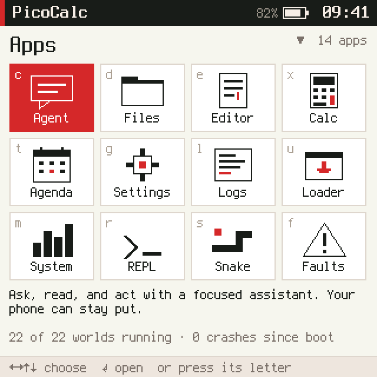
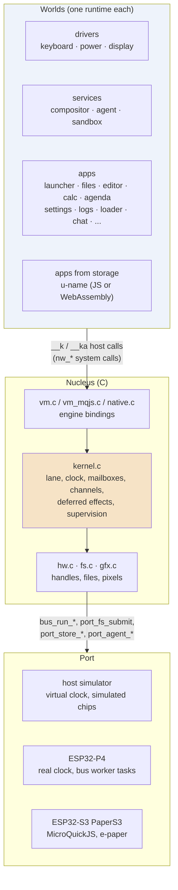
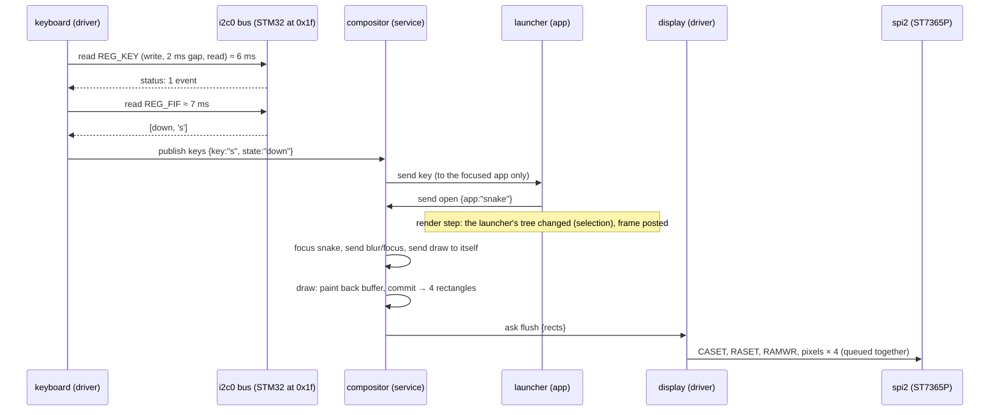
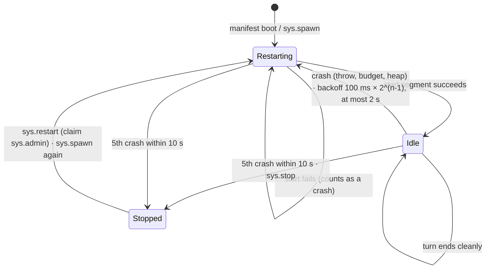
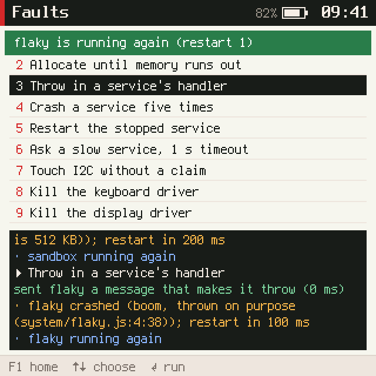
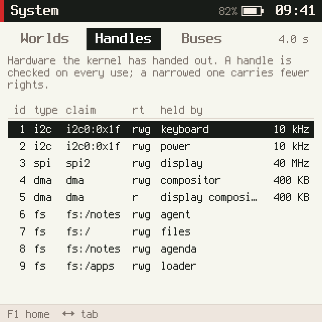
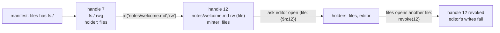
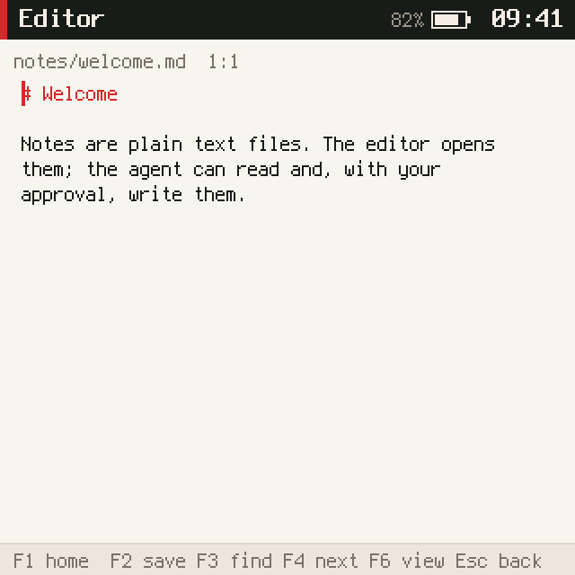
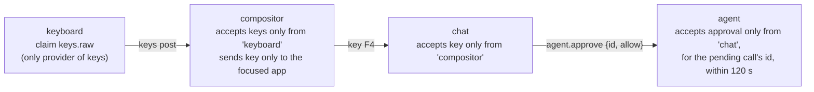

# picocalc-os: Worlds, Turns, Handles and Frames — A Technical Deep Dive

picocalc-os is an operating system for small devices in which the drivers, the window system and the applications are
separate JavaScript programs, and a C core of about 5,500 lines runs them one at a time. It runs on a PicoCalc
handheld whose RP2040 has been replaced by an ESP32-P4, on an M5Stack PaperS3 e-paper tablet, and on Linux against a
simulated PicoCalc. This report explains how the system works as a whole, as it stands on 2026-11-02 after sixteen
tickets and 122 commits: what a program is, how programs take turns, how they talk to each other and to hardware,
how a screen gets drawn, how failure is contained, and how C and WebAssembly programs join the JavaScript ones. The
per-ticket reports linked at the end record how each part was built; this one explains how the parts fit together.
The topic map for this and related projects is [[javascript-operating-systems]].

> [!summary]
> - **A program is a world.** Each driver, service and app runs in its own JavaScript runtime with its own heap
>   limit and time budget. Worlds share no memory; they exchange JSON messages, and the kernel stamps every message
>   with its sender.
> - **Effects are deferred to the end of a segment.** Messages, bus transfers, file writes and store writes that a
>   piece of code issues are applied only if that code finishes cleanly. A world that throws, overruns its budget or
>   exhausts its heap is discarded with everything it was about to do, and restarted.
> - **Authority comes from claims and handles.** The manifest says what each world may use. Hardware and files are
>   reached through handles, integers the kernel checks on every use, which can be narrowed, passed in messages and
>   revoked.
> - **Apps never draw.** An app returns a tree of plain objects; the compositor world lays it out, paints a
>   framebuffer, and asks the display driver world to send only the rectangles that changed.



## 1. The question the system answers

A microcontroller usually runs one firmware image. Every driver and every feature is compiled into it, shares one
address space with all the others, and can corrupt any of them; an uncaught fault restarts the whole device. That
arrangement is efficient, and it makes programming the device slow and failure expensive.

picocalc-os takes the opposite position. It treats a small device the way a desktop operating system treats a
computer: programs are written in a high-level language, they are isolated from each other, they get only the
resources they were granted, and a crash is an ordinary, recoverable event that is reported, logged and followed by a
restart. The cost of that position is memory and speed. Each world carries a whole JavaScript runtime, and all
communication is serialised as JSON. Much of the project's engineering consists of making those costs small enough
for a chip with 32 MB of PSRAM and a RISC-V core at 360 MHz, and measuring them where they are not.

The design rests on four decisions, each explained in its own section below:

1. **Isolation by runtimes, not by address spaces.** ESP-IDF runs all code on the ESP32-P4 in one address space in
   machine mode; there are no per-process address spaces to separate programs. A JavaScript runtime cannot address
   memory outside its own heap, so one runtime per program gives isolation in software (§3).
2. **One lane of execution.** Only one world runs at a time. The kernel never has to lock anything, and the order of
   events is reproducible (§4).
3. **Effects at segment boundaries.** What a piece of code does to the outside world is collected and applied when
   it ends. That makes a crash clean (§5, §6).
4. **Authority as data.** Access to hardware, files, the network, keystrokes and other apps' screens is granted by
   the manifest and carried by handles. Nothing is reachable by name alone (§7).

## 2. Vocabulary

The rest of the report uses a small set of terms. They depend on each other in this order.

| Term | Definition | Where it lives |
|---|---|---|
| **Nucleus** | The C core: kernel, engine bindings, handles, graphics, files. Everything else is a world. | `nucleus/` |
| **World** | One program in one runtime: a JavaScript file, or a binary (WebAssembly or machine code). It has a name, a kind (`driver`, `service`, `app`), a heap limit, a time budget and a mailbox. | `world_t` in `nucleus/nucleus.h` |
| **Manifest** | The JSON list of worlds the system boots, with each world's file, claims, budget and heap limit. | `js/system.json` |
| **Claim** | A string in the manifest that grants a world one kind of authority: `i2c0:0x1f`, `spi2`, `dma`, `fs:/notes`, `keys.raw`, `sys.spawn`, `net.agent`. | `world_t.claims` |
| **Message** | A JSON payload with a type, sent to a named world (`send`, `ask`) or posted on a channel (`publish`). The kernel records the sender. | `msg_t` |
| **Channel** | A named stream of posts. A world declares the channels it provides and needs; a post goes to every world that needs it. | `needs`, `provides` |
| **Turn** | The handling of one message, from start to finish. An async handler's turn lasts until its promise settles. | `world_t.in_turn` |
| **Segment** | One uninterrupted run of a world's code on the lane: a turn's first part, or its continuation after a promise settles. The time budget applies per segment. | `run_segment()` in `kernel.c` |
| **Lane** | The single thread of execution on which segments run, one at a time. | `kernel_run_until()` |
| **Deferred effect** | A side effect a segment issued (delivery, transfer, file job, store write, reply), queued and applied when the segment ends cleanly. | `deferred_t` |
| **Handle** | An integer that stands for a piece of hardware, a framebuffer or a file path, with rights `r`, `w`, `g` (grant). The kernel checks holder and rights on every use. | `handle_t` in `hw.c` |
| **Frame** | The JSON tree an app's `screen()` function returns, published after each of its turns when it changed. | `world_t.frame` |
| **Compositor** | The service world that owns the framebuffer, draws the focused app's frame and routes keys. | `js/system/compositor.js` |
| **Port** | The code that adapts the nucleus to a target: the Linux simulator, the ESP32-P4, the ESP32-S3. | `host/`, `sim/`, `port/` |

A common misreading is to take a world for a thread. A world never runs concurrently with another world, and it
never blocks: when its code waits on a promise, its segment ends, the lane moves on, and the world resumes in a new
segment when the kernel settles the promise. Another misreading is to take a turn for a single function call. A
turn of an async handler spans as many segments as the handler has awaits; while it lasts, the world takes no other
message from its mailbox.

## 3. The shape of the system



The worlds on the PicoCalc are listed in `js/system.json`. Twenty-two of them boot: three drivers, four services and
fifteen apps (`kind` is declared by each world's own code, not by the manifest). An excerpt shows the shape:

```json
{ "name": "keyboard",   "file": "drivers/keyboard.js",  "claims": ["i2c0:0x1f", "keys.raw"], "budget_ms": 20,  "mem_kb": 320 },
{ "name": "display",    "file": "drivers/display.js",   "claims": ["spi2"],                  "budget_ms": 30,  "mem_kb": 320 },
{ "name": "compositor", "file": "system/compositor.js", "claims": ["dma", "keys.raw", "frames.read"], "budget_ms": 80, "mem_kb": 768 },
{ "name": "agent",      "file": "system/agent.js",      "claims": ["net.agent", "sys.read", "fs:/notes"], "budget_ms": 100, "mem_kb": 1536, "store_kb": 16 },
{ "name": "files",      "file": "apps/files.js",        "claims": ["fs:/"],                                    "mem_kb": 384 },
{ "name": "editor",     "file": "apps/editor.js",                                                              "mem_kb": 512 },
{ "name": "loader",     "file": "apps/loader.js",       "claims": ["fs:/apps", "sys.spawn", "sys.read"],       "mem_kb": 384 },
{ "name": "sandbox",    "file": "system/sandbox.js",                                         "budget_ms": 200, "mem_kb": 512, "priority": 0 }
```

The manifest is the system's whole security policy. The editor has no file claim at all; it can still edit files,
because the Files app hands it one file at a time (§7.4). The sandbox, which evaluates whatever the REPL types, has
no claims, a 200 ms budget and priority 0, so it runs only when no other world is runnable.

### 3.1 How a world is written

A JavaScript world is written against a builder API that the *prelude* (`js/prelude.js`) defines. The prelude is
evaluated in each world's runtime before the world's own file. It turns two host functions, `__k` (operations that
finish now) and `__ka` (operations that return a promise), into the API, and then deletes them from the global
object so that the world's code can reach the nucleus only through the prelude's wrappers.

```js
app("snake")
  .title("Snake")
  .key("s").about("A game on a 22 x 18 grid, ticking on the virtual clock.")
  .icon([["fill", 2, 20, 26, 6], ["fill", 22, 8, 6, 18], ["fill", 22, 8, 14, 6], ["fill", 4, 6, 6, 6, "accent"]])
  .state({ score: 0 })                                  // the world's state, kept until it restarts
  .on("key", (s, payload, msg) => { /* ... */ })        // return a value to answer an ask; async is fine
  .every(110, (s) => { /* move the snake */ })          // timers coalesce: a busy world gets one tick, not a backlog
  .screen((s) => ui.col(ui.text(`score ${s.score}`), /* ... */))
  .hints("←→↑↓ steer");
```

The builder records a definition; it does not run anything. After the file has been evaluated, the binding calls the
prelude's `__init`, which returns the definition's metadata (kind, title, channels, timer periods, whether there is a
start handler and a screen). The binding copies that into `world_t` (`read_meta` in `vm.c`), and from then on the
kernel calls only two prelude functions: `__dispatch(kind, type, json, from, isAsk)` for each message and
`__render()` for the screen. The state object `s` lives inside the runtime and is passed to every handler; it is
created from a deep copy of `.state(...)` at each start, so a restart begins from the declared initial state, not
from whatever the previous instance had made of it.

Inside a world the following are available, all implemented in the prelude over `__k` and `__ka`:

| Group | Calls |
|---|---|
| Messages | `send(to, type, payload)`, `ask(to, type, payload, {timeout})`, `publish(ch, payload, {retain})` |
| Time | `now()` (virtual or real ms since boot), `sleep(ms)`, `Date` (wall clock), `clock.*` |
| Hardware | `hw.i2c(claim)`, `hw.spi(claim)`, `hw.fs(claim)`, `dma.alloc(w, h)`; handle methods `read`, `write`, `transfer`, `cmd`, `pixels`, `fill`, `text`, `commit`, `narrow`, `revoke`, `release`, `at`, `list`, ... |
| System | `sys.worlds(fields)`, `sys.stats()`, `sys.handles()`, `sys.log()`, `sys.fault/restart` (claim `sys.admin`), `sys.spawn/stop` (claim `sys.spawn`) |
| State | `store.get/set/remove/all/status` (one JSON record per world) |
| Network | `agentNet.start/poll/cancel` (claim `net.agent`), `net.info/scan/join` (claim `net.admin`) |
| Screen | `ui.col`, `row`, `box`, `text`, `list`, `table`, `lines`, `textarea`, `grid`, `kv`, `bar`, `spark`, `canvas`, `input`, `gap`, `sep` |

Two determinism measures are also in the prelude. `Math.random` is replaced by a xorshift generator seeded from a
hash of the world's name, and `Date` reads the kernel's wall clock (on the simulator, a fixed boot date plus virtual
time). Together with the virtual clock (§4) they make a run of the simulator reproducible to the pixel.

## 4. One lane and the clock

### 4.1 The main loop

The kernel keeps two kinds of pending work: an *event heap* ordered by time and sequence number (deliveries,
timer ticks, promise settlements, restarts, and internal callbacks), and per-world queues (the mailbox and the
settled promises). `kernel_run_until(t)` alternates between them:

```c
void kernel_run_until(vtime_t until) {
  for (;;) {
    if (K.halted) return;
    bool is_settle;
    world_t *R = pick(&is_settle);                         // a runnable world, or NULL
    vtime_t t_lane = K.vnow > K.lane_free ? K.vnow : K.lane_free;
    vtime_t t_ev = heap_n ? heap[0]->t : VT_INF;
    if (R && t_lane <= until && t_lane < t_ev) { K.vnow = t_lane; run_segment(R, is_settle); continue; }
    if (heap_n && t_ev <= until) { event_t *e = pop(); if (e->t > K.vnow) K.vnow = e->t; handle_event(e); continue; }
    break;
  }
  if (K.vnow < until) K.vnow = until;
}
```

An event due before the lane is free is handled first: it moves a message into a mailbox, queues a tick, or marks a
world ready to restart. When nothing is due earlier, the lane runs one segment of the world `pick()` chooses. The
choice is by priority, then by the time and sequence number of the world's oldest pending item:

| Priority | Who |
|---|---|
| 10 | A world that is starting (in manifest order) |
| 3 | Drivers |
| 2 | Services |
| 1 | Apps |
| 0 | The sandbox (manifest `priority: 0`) |

There is no preemption. Once a segment starts, it runs until its code returns, awaits, throws, exhausts its heap or
reaches its budget. The priority rule determines only which runnable world goes next. A consequence that the
simulator demonstrated early: while the sandbox spins for its 200 ms budget, nothing else runs. Priorities ensure the
REPL has drawn "evaluating…" before the sandbox starts, and the budget bounds how long the screen stays frozen.

### 4.2 Virtual time and real time

The same loop runs on two clocks. On the simulator, time is *virtual*: `K.vnow` advances only when the kernel says
so, and a segment costs what a device profile says it would cost on the ESP32-P4. On the device, `K.realtime` is
set, a segment costs what it took on the hardware clock, and the port calls `kernel_run_until(port_clock())`
repeatedly.

The virtual cost of a segment is computed from counted work:

```text
cost = turn_base_us                                  40 µs to enter and leave a world
     + steps × ns_per_step                            QuickJS work, counted exactly
     + K.seg_cost                                     what the host calls did:
         pixels filled × 2.5 ns, glyph pixels × 6 ns, framebuffer pixels compared × 1.2 ns,
         JSON bytes encoded or decoded × 25 ns, about 1 µs per host call
```

The step count comes from QuickJS's interrupt counter, which decrements on every loop back-edge and function call
and calls an interrupt handler when it reaches zero. picocalc-os patches QuickJS in three small places
(`third_party/quickjs/PATCHES`): the counter is reset to 1,000 instead of 10,000, so budgets are checked ten times as
often, and two accessors expose the counter so that the kernel can compute the exact number of steps a segment took.

The step's price comes from a measurement. An earlier firmware (`esp32-s3-m5/0101-esp32-p4-native-quickjs`) ran a
100,000-iteration loop in 133 ms on the ESP32-P4. The simulator counts 200,002 steps for that loop, so one step costs
665 virtual nanoseconds. `vm_calibrate()` recomputes this at every boot, and checks it against a second program:

```text
calibration: the 100k loop is 200002 steps, so a step is 665 virtual ns;
             fib(20) is 43783 steps = 29.1 virtual ms (31 ms on the device)
```

The model is linear and cannot know about caches or compiler flags, so it drifts where the hardware does something
the model does not represent. On the device at `-O2` the loop takes 115 ms in the calibration runtime and fib(20)
29 ms. The bus model is closer, because it models physics: an I2C transfer takes 9 clocks per byte at the handle's
clock rate, an SPI transfer takes its bits at 40 MHz plus 12 µs per 32 KiB DMA chunk, and transfers on one bus are
serialised. The simulator predicted that the keyboard's 20 ms poll at 10 kHz occupies about a third of the I2C bus;
the device measured 26–28%.

### 4.3 Budgets

A budget is per segment, set in the manifest (`budget_ms`, 50 ms by default) and raised to 600 ms while a world
starts. In virtual time, `vm_begin_segment` converts the budget into a number of interrupt-handler calls; in real
time, it records a deadline. The interrupt handler checks whichever applies:

```c
static int on_interrupt(JSRuntime *rt, void *opaque) {
  world_t *W = opaque;
  W->interrupts++;
  if (W->oom) return 1;
  if (K.realtime ? port_clock() > W->seg_deadline
                 : W->interrupts - W->seg_interrupts0 > W->budget_interrupts) { W->overrun = true; return 1; }
  return 0;
}
```

Returning 1 makes QuickJS throw an uncatchable interrupt exception, which unwinds the world's stack to the binding.
The kernel then treats the segment as a crash (§6). Memory is limited in the same spirit: the binding gives QuickJS
an allocator (`w_malloc`, `w_realloc`, `w_free`) that charges every block to the world and refuses an allocation
past `mem_kb`, setting `W->oom`. On the 64-bit host, a world's limit is scaled by 1.17 so that worlds fit or fail as
they would on the 32-bit device.

## 5. Turns, segments and deferred effects

### 5.1 Why effects wait

Consider a handler that sends a message, starts an I2C read and then throws. If the message had been delivered
immediately, the receiver would act on a request whose sender is about to be destroyed, and the I2C transaction
would run on behalf of a world that no longer exists. picocalc-os avoids both by collecting effects instead of
performing them. Every operation with an effect outside the world creates a `deferred_t` and appends it to the
kernel's list:

```c
void defer(deferred_t *d) {
  if (!K.cur) { d->run(d, apply_at >= 0 ? apply_at : K.vnow); free(d); return; }
  d->next = NULL;
  if (K.defer_tail) K.defer_tail->next = d; else K.defer_head = d;
  K.defer_tail = d;
}
```

When the segment ends, `run_segment` checks how it ended. A clean end calls `apply_deferred(K.lane_free)`, which runs
each effect at the virtual time the segment ended. A crash calls `discard_deferred()` first, so none of them happen.
The deferred kinds are:

| Effect | Created by | Applied as |
|---|---|---|
| Delivery | `send`, `publish`, `ask`, the render step's frame post | an `E_DELIVER` event at the segment's end time |
| Promise settlement | `sleep`, replies, file and spawn results | an `E_SETTLE` event, possibly later (`sleep`'s delay) |
| Bus transfer | `i2c`, `spi.cmd`, `spi.pixels` | handed to the port's `bus_run_*`, which settles the promise when the transfer ends |
| File job | handle `read`, `write`, `list`, ... | handed to `port_fs_submit`; on the P4 a worker task carries it out |
| Store write | `store.set`, `store.remove` | written to the port's store (NVS on the devices) |
| Admin action | `sys.fault`, `sys.restart`, `sys.spawn`, `sys.stop` | run against the target world |
| Network request | `agentNet.start`, `cancel` | handed to the port's agent transport |

Because deliveries are scheduled at the end time of the segment that sent them, causality and the virtual clock
agree: a message is never received before the virtual moment it was sent.

### 5.2 Synchronous and asynchronous turns

`__dispatch` calls the handler. If it returns a plain value, the turn is over in one segment; for an `ask`, the value
is the reply. If it returns a promise, the prelude tells the kernel (`turn.async`) and attaches callbacks that report
`turn.done` or `turn.fail` when the promise settles. Until then, `pick()` considers only the world's settled
promises, not its mailbox:

```c
if (W->settles) { t = W->settles->t; s = W->settles->seq; ok = true; set = true; }
if (!W->in_turn && W->mbox && /* older than the settle */) { /* take the next message instead */ }
```

This rule makes an async handler a critical section. The display driver's `flush` handler, for example, queues
`CASET`, `RASET`, `RAMWR` and the pixel transfer for every rectangle and awaits them all; no second flush can begin
in the middle. The cost is that a slow async handler delays every later message to the same world, which is why
long work (the agent's network request) is structured as a start-and-poll sequence instead of an await.

### 5.3 Asks, replies and timeouts

An `ask` is a message with an ask id and a promise in the sender. The kernel records `{id, from, from_epoch, to,
promise, deadline}`, delivers the message, and schedules a timeout callback (2 s by default). The receiver's turn
result settles the sender's promise; a handler that cannot answer calls `turn.reject` and the sender's promise
rejects without either world crashing. A world cannot ask itself, since it would wait for the end of its own turn. An
ask to a stopped world fails at once. When the receiver crashes during the turn that should answer, the ask fails
with the crash message, so an asker never waits on a world that has gone.

### 5.4 Epochs

Every world has an `epoch`, incremented whenever its runtime is torn down. Timer events, settlements and replies
carry the epoch of the instance that caused them, and the kernel drops any whose epoch is stale. Without epochs, a
restarted display driver would receive the result of an SPI transfer its previous instance started, or a tick
scheduled for the old instance's timers. Timers also carry a generation number, so `timer.set(i, false)` drops ticks
already scheduled, and a tick is queued only if the previous tick from the same timer has been handled: a world that
is behind gets one tick, not a backlog.

### 5.5 One key press, traced

The simulator can log every message with `-vv`. The following lines come from a run on 2026-11-02 that waits 2.5 s
after boot and presses `s` on the launcher (times in virtual milliseconds; payloads cut at 150 characters):

```text
[  2500.117] keyboard <- every 20 ms from kernel
[  2513.207] compositor <- keys from keyboard [key]
[  2513.289] keys <- keys from keyboard [key]
[  2513.356] launcher <- key from compositor [key]
[  2513.563] compositor <- open from launcher {"app":"snake"}
[  2513.639] compositor <- frames from launcher {"app":"launcher","title":"PicoCalc","frame":{"tree":{"t":"col",...
[  2514.760] compositor <- draw from compositor
[  2515.719] display <- flush (ask) from compositor {"rects":[[11,5,63,10],[8,30,303,17],[8,51,303,241],[8,307,239,11]]}
[  2516.154] launcher <- blur from compositor
[  2516.599] snake <- focus from compositor
```



Reading the trace against the code explains each gap. The keyboard world's 20 ms tick at 2500.117 performs two
register reads on the STM32, each one I2C transaction that holds the bus across a 2 ms gap; at 10 kHz the status read
takes about 6 ms and the two-byte FIFO read about 7 ms, so the `keys` post leaves at 2513.2. The `keys` channel goes
to the compositor and to the Keys app, the only worlds with the claim `keys.raw`. The compositor forwards the event to
the focused app as a `key` message. The launcher maps `s` to Snake and asks the compositor to `open` it; its own
render step then posts a new frame, because the selection changed. The compositor's `draw` message is one it sends
itself, which coalesces several changes into one paint. The commit finds four changed rectangles (the title, the
header row, the body, the hint bar), and the display driver sends them as sixteen SPI operations. Between the poll
and the flush request there are eight messages and two I2C transactions, and every message is in the log.

## 6. Failure and supervision

### 6.1 The crash path

A segment ends in a crash when the world's code throws (or rejects the promise of an async turn), exceeds its budget,
or exhausts its heap, or when its render step throws. `run_segment` names the reason and calls `crash()`:

```text
ran out of memory (its limit is 320 KB)
ran past its turn budget of 20 virtual ms
boom, thrown on purpose (system/flaky.js:4:38)
```

`crash_at()` then performs the same sequence for every world:

1. The segment's deferred effects are discarded.
2. The crash is logged and written to the UART as one *fault frame*, a line that starts with `#OCT1` followed by a
   JSON object, so that a program on the other end of the USB serial line can react to it without any network:

   ```text
   #OCT1 {"ev":"fault","t":3573.521,"world":"flaky","file":"system/flaky.js","handling":"boom","why":"boom, thrown on purpose (system/flaky.js:4:38)","crashes":1,"mem_kb":183,"limit_kb":256,"detail":"..."}
   ```

3. `teardown()` fails the ask the world was answering, disposes of its runtime, releases every handle it held,
   drops its pending settlements, its frame and its retained posts, and increments its epoch.
4. If the world has crashed five times within ten seconds, it is stopped and stays stopped until a world with the
   claim `sys.admin` restarts it. Otherwise it is scheduled to restart after 100 ms, doubling with each recent crash
   to at most 2 s.
5. The change is published on the `worlds.status` channel: `crashed` with the reason and the delay, later `running`,
   or `stopped`.



### 6.2 What other worlds see

The compositor needs `worlds.status` and shows each change as a banner over the focused app, so a crash is visible
the moment it happens. The Faults app exists to trigger each failure on demand: allocate until the heap runs out,
throw in a service's handler, crash a service five times, ask a slow service with a short timeout, use I2C without
a claim, kill the keyboard driver, kill the display driver.



Killing the display driver exercises the most involved recovery. The compositor gives the display driver a
read-only view of its framebuffer when the driver starts. When the driver restarts, `worlds.status` reports
`running`, and the compositor calls `attach()` again: it narrows a new view, sends it, invalidates its front buffer
so that the next commit returns every pixel, and repaints. The simulator found a race here early on: flushes queued
for the dead driver reached the new instance before the new attach. The driver now answers such a flush with
`{skipped: true}`, and the compositor invalidates and resends.

### 6.3 Retained posts: state that survives a restart

Some channel posts are events (a key was pressed); others are state (the battery is at 82%). A world that starts
after a state post would otherwise wait until the state changed again to learn it. `publish(ch, v, {retain: true})`
marks a post as state. The kernel keeps the latest retained post per publisher and channel (at most 4 KB per world,
and no handles in it), and replays them to a world that starts later and needs the channel, as deferred effects of
its start segment, so they arrive after its `start` message and before anything posted later.

The most important retained post is a world's frame. The kernel keeps each app's last frame (`W->frame`) and replays
every app's frame to a compositor that restarts. Before this existed (ticket PICOCALC-FRAMES), opening the Logs app
could crash the compositor, and afterwards Calc and Files showed "starting calc…" indefinitely: their frames had
been published once, to a compositor instance that no longer existed, and they had no reason to publish again.

## 7. Authority: claims, channels and handles

### 7.1 Claims

A claim is checked at the moment a world asks for something, against the manifest's list for that world. `hw.i2c("i2c0:0x1f")`
fails with `keyboard has no claim on i2c0:0x1f` in any world whose manifest entry lacks that string. The current
claims on the PicoCalc fall into a few groups:

| Claim | Grants |
|---|---|
| `i2c0:0x1f`, `spi2`, `dma` | A handle to the keyboard controller, the display bus, a framebuffer |
| `fs:/`, `fs:/notes`, `fs:/apps` | A handle to that directory and everything under it |
| `keys.raw`, `frames.read`, `touch.raw` | Use of the guarded channels `keys`, `frames`, `touch` |
| `sys.read`, `sys.log`, `sys.admin`, `sys.spawn`, `sys.clock`, `sys.power` | Reading the world list, reading the log ring, fault and restart, starting apps from storage, setting the time zone, switching the board off |
| `net.agent`, `net.admin` | The model transport; Wi-Fi scanning and joining |

### 7.2 Guarded channels

Channels were originally open: any world could declare `.needs("keys")` and receive every keystroke, including a
password typed into Settings. Ticket PICOCALC-SYS made three channels capabilities. The kernel refuses to start a
world that needs or provides `keys`, `frames` or `touch` without the matching claim, and it skips such worlds when it
delivers a post:

```c
static const struct { const char *channel, *claim; } GUARDED[] = {
  { "keys", "keys.raw" }, { "frames", "frames.read" }, { "touch", "touch.raw" },
};
```

The kernel also names the publisher of a frame itself (`frame_message()` builds `{"app": W->name, ...}`), and the
compositor discards a frame whose `app` differs from the message's sender. No world can therefore show a screen in
another world's name.

### 7.3 Handles

A handle is an entry in the kernel's table of 128, identified by a number that increases and is never reused while
the system runs:

```c
typedef struct {
  int id, type, rights, parent, minter;   // type: i2c, spi, dma, epd, adc, gpio, fs; rights: R_READ | R_WRITE | R_GRANT
  uint64_t holders;                       // one bit per world id
  bool live, revoked;
  char claim[NAME_LEN];
  int bus, addr, hz;                      // the device behind it
  int buf;                                // a framebuffer, shared by a handle and its children
  char path[FS_PATH_MAX]; bool file;      // a directory or one file
} handle_t;
```

Every operation that takes a handle goes through `handle_use(W, id, type, right)`, which checks five things in
order: the handle exists, `W` holds it, neither it nor any ancestor has been revoked, its type is the expected one,
and it carries the required right. A forged number is worthless, because the holder bit for the forging world is not
set.

Three operations change who can do what:

- **Narrowing** (`h.narrow("r")`, `dir.at("todo.txt", "rw")`) creates a child handle with the intersection of the
  parent's rights and the requested ones, and for a file handle a path under the parent's directory. The world that
  narrows is the child's *minter*.
- **Passing** happens inside a message. The prelude serialises a handle as `{"$h": 6}` and lists the ids it found;
  the kernel checks that the sender holds each one and may pass it (it carries `g`, or the sender minted it), and
  sets the receiver's holder bit when the message is delivered. The receiving prelude turns `{"$h": 6}` back into a
  handle object.
- **Revocation** (`h.revoke()`) is allowed only to the minter of a narrowed handle. It marks the child revoked;
  `handle_use` walks the parent chain, so revoking a handle disables every handle narrowed from it.



When a world is torn down, `handles_drop_world` clears its holder bit on every handle. A handle with no holders left
is freed, which also unwatches its interrupt pin and drops its framebuffer reference.

### 7.4 Files as handles: how the editor edits without a claim

Files (`fs:/`) is the only app that can see the whole filesystem. The editor has no file claim. To open a file,
Files narrows its root handle to that one file with rights `rw` and no `g`, offers it to the editor with an ask, and,
once the editor has accepted, revokes the handle it gave the editor before:

```js
// js/apps/files.js
const h = s.root.at(path, "rw");
let r;
try { r = await ask("editor", "open", { file: h, name: path }, { timeout: 3000 }); }
catch (e) { r = { ok: false, why: e.message }; }
if (r && r.ok) {
  if (s.given) { s.given.revoke(); s.given.release(); }
  s.given = h;
  send("compositor", "open", { app: "editor" });
} else { h.revoke(); h.release(); }
```



The editor can read and write exactly the file the user chose last. It cannot list the directory (a file handle has
no `list`), cannot reach a sibling (a file handle takes no path), cannot pass the file on (no `g`, and it is not the
minter), and loses access the moment Files opens a different file. The Loader app uses the same protocol to let the
editor change an app's source in `apps/`.



File operations are asynchronous and deferred like bus transfers. A segment that throws writes nothing, and a
restarted world never receives a result meant for its previous instance. On the ESP32-P4 the operations run on a
worker task pinned to the kernel's core below its priority, because ESP-IDF stops the other core while it erases
flash; an erase during a turn would otherwise stretch that turn past its budget.

### 7.5 Authenticated senders and the approval chain

Every message carries the name of the world that sent it, set by the kernel and not by the sender. A handler can
therefore decide on whom to believe. The agent's note-writing tool shows why that matters. A language model can ask
to save a note; the save must not happen unless the person holding the device presses F4. The approval travels
through four worlds, and each one checks the hop before it:



No world in this chain trusts content it cannot attribute. A model's output is data inside the agent world; it can
request a tool call but cannot produce the approval message, because only the chat world can send it and the chat
world sends it only on a key the compositor delivered while chat was in front. A compositor test
(`tests/compositor-auth.test.mjs`) runs the compositor's real handlers to check the first two hops, and the
loader ticket closed the requests that could have broken the third: an app from storage may no longer bring itself
to the front (it could take the rest of a password typed into another app), switch the screen off, or detach the
display's framebuffer.

## 8. The screen

### 8.1 Apps describe; the compositor draws

An app's `screen(state)` returns a tree of plain objects built with `ui.*`. After each of the app's turns the kernel
runs a *render step* as part of the same segment: it calls `__render()`, compares the resulting JSON text with the
app's previous frame, and only if they differ publishes `{app, title, frame}` on the `frames` channel. An app whose
state did not change visibly costs one render call and one string comparison, and produces no message.

The compositor keeps the latest tree of every app and draws only the focused one. Its paint is a function of the
state it holds:

```text
paint(s):
  fill the whole back buffer with paper
  status bar: the focused app's title, the battery level, the local time (or --:-- before SNTP)
  try   draw(fb, app.tree, 8, TOP + 6, W - 16, BODY - 10)       // measure + draw, recursively
  catch "<app>'s screen could not be drawn" and the reason        // a malformed tree costs only its own app
  a crash banner or notification over the body, if one is due
  hint bar: "F1 home" + the app's hints
```

Layout is two recursive passes. `measure(node, width)` returns the height a node wants at a width and whether it
takes leftover space (lists and text areas do); `draw(fb, node, x, y, w, h)` divides the space accordingly and calls
the framebuffer handle's `fill`, `rect`, `line` and `text`. Those are synchronous host calls that write into the
back buffer in C (`gfx.c`) and add their pixel counts to the segment's cost.

### 8.2 Sending only what changed

The framebuffer is a pair of buffers, back and front, and a 64-bit mask of dirty 16-row bands. `fb.commit()`
(`gfx_commit`) compares back with front band by band, finds the changed columns in each changed band, merges a band's
rectangle with the one above when the union is at most 30% larger than the two areas, copies the changed pixels into
the front buffer, and returns the rectangles. The compositor sends them in one `flush` ask; the display driver turns
each into four SPI operations that the port runs back to back on the bus. In the key-press trace above, opening Snake
changed four rectangles; the next frame from Snake changed one, 63 × 11 pixels.

The display driver is the C driver `picocalc_lcd.c` rewritten in JavaScript, with the same initialisation sequence:
software reset, sleep out, 16-bit colour, mirrored column order, inversion on, display on.

### 8.3 Native apps and the launcher

A world written in C can also show a screen (ticket PICOCALC-APPUI). `nw_screen(tree_json, hints)` hands the kernel a
tree of the same nodes as JSON, at most 16 KB, and the kernel publishes it after the event like a JavaScript frame.
The launcher has no list of apps. It asks `sys.worlds("name,kind,title,state,user,icon,about,key")` and shows every
world of kind `app` in manifest order, then the apps started from storage, each with the title, icon, description and
letter it declared. The kernel checks the shape of those declarations when the world starts (`kernel_present`: a
title of 1–31 bytes of plain text, an icon as a JSON array of at most 1,024 bytes, a description under 160 bytes, a
key in `a-z0-9`), and the launcher sanitises what an icon draws: four known operations, numbers clamped to the 40 × 30
box, palette colours or `#rrggbb`, at most 32 operations. An app from storage is labelled by its world name, gets no
letter and a mark in its tile's corner, so it cannot present itself as a system app.

### 8.4 On e-paper

The PaperS3's compositor solves a different problem with the same structure. An e-paper waveform pass costs about
the same whatever its size, so the display driver sends one update over the union of the damage, and chooses between
a clean and a partial refresh by tracking ghosting. Rendering every world after every turn wasted most of that
tablet's time, so its binding adds `sys.front(name)`: the compositor names the world on screen, and the kernel's
render step runs only for that world and for worlds that have not yet shown a frame. On the PicoCalc, which does not
call `sys.front`, every app still renders after each of its turns.

## 9. Persistent state and the log

Three kinds of state outlive a turn:

- **The world's state object** lives as long as the runtime. A restart begins from `.state(...)` again.
- **The store** is one JSON record per world (`store.get/set/remove/all`), with a quota from the manifest
  (`store_kb`, 16 KB by default, 8 KB for apps from storage). A write is a deferred effect, so a segment that faults
  saves nothing; `store.status()` reports on a later turn whether the write reached storage. On the devices the
  record lives in NVS.
- **Files**, reached through handles (§7.4).

The kernel keeps a ring of the last 256 log lines, its own and, on the device, ESP-IDF's, numbered so that a reader
can ask for the lines after the last one it has and see whether it missed any. The Logs app reads it with the claim
`sys.log`. Lines are stripped of colour codes and cut on a character boundary, and keystrokes are never logged, since
one of them may be part of a password.

## 10. Apps from storage

The Loader app lists `apps/*.js` and `apps/*.wasm` on the device's filesystem and starts them with `sys.spawn`, a
claim only the Loader holds. A spawned world is named `u-<name>` and gets fixed, small limits and no claims:

| Property | An app from storage |
|---|---|
| Name and title | `u-<name>`, always; the title cannot be changed |
| Claims | none: no files, network, log, raw keys, other apps' screens, spawning |
| Limits | 50 ms budget, 384 KB heap, 8 KB store |
| Source | JavaScript text (UTF-8, at most 64 KB) or a WebAssembly module (at most 256 KB, starts with `\0asm`) |
| Never | machine code: on the P4 it would run unisolated |

For a WebAssembly app the Loader passes a read-only file handle instead of the bytes, and the kernel reads the file
itself (`kernel_spawn_loaded`), so the module never passes through a JavaScript heap. Spawning the same name again
reuses the world's slot, because world ids are referenced by handles, asks and timers and must never change owner.

An app from storage can show a screen, get keys while it is in front, keep its small store and send messages. The
compositor ignores `open` requests from any `u-` world, so such an app comes forward only when the person opens it
from the launcher or the Loader.

## 11. Native worlds

### 11.1 The engine seam

A manifest entry may name an engine: `"js"` (the default), `"wasm"` or `"native"`. The kernel reaches every engine
through seven inline functions in `nucleus.h`:

```c
static inline int  eng_create(world_t *W)           { return W->engine == ENG_JS ? vm_create(W)  : nat_create(W); }
static inline int  eng_dispatch(world_t *W, msg_t *m){ return W->engine == ENG_JS ? vm_dispatch(W, m) : nat_dispatch(W, m); }
static inline char *eng_render(world_t *W)          { return W->engine == ENG_JS ? vm_render(W)  : nat_render(W); }
/* ... eng_dispose, eng_begin_segment, eng_steps, eng_settle ... */
```

`native.c` turns a kernel message into an `nw_event` for a backend, and carries out the binary's system calls in
`nat_syscall` with the same claim checks and deferred effects as the JavaScript operations. A native world is written
against `sdk/nw.h`: it defines `nw_init` (declarations: kind, channels, timers, title, icon) and `nw_on_event`, and
calls 21 functions for everything else (`nw_send`, `nw_ask`, `nw_publish`, `nw_reply`, `nw_i2c`, `nw_store_save`,
`nw_screen`, ...). Asynchronous calls return a token; the result arrives later as an `NW_SETTLE` event with that
token. The kernel treats everything a binary passes as untrusted: strings arrive with lengths and are copied,
declarations are accepted only during `nw_init`, and payloads must be strict JSON without `"$h"` keys, since a forged
handle reference would otherwise make a JavaScript receiver revive a handle it was never given.

### 11.2 Three backends, three kinds of isolation

| Backend | Where | Memory isolation | Call isolation | Time bound |
|---|---|---|---|---|
| Process (`host/native_proc.c`) | Linux host | Separate address space (MMU); `rlimit` on data and mappings | seccomp filter installed before `exec`: only descriptor 3 (a `SOCK_SEQPACKET` socket to the kernel), memory, clock; files, sockets, processes and other `exec`s kill it | Real time: the kernel waits for the answer until the budget is spent, then kills the process |
| WebAssembly (`nucleus/native_wasm.c`) | Host and P4 | The module addresses only its linear memory; WAMR checks every access; growth capped at `mem_kb` | Imports limited to `nw.call`, `nw.error`, WASI `fd_*` (which fail) and `proc_exit`; anything else refuses to load | Instruction count × 70 ns per op on the P4 profile |
| ELF (`port/esp32p4/optional/native_elf/`) | P4 firmware builds | None: machine mode, the PMP leaves RAM open | Linking limited to a listed C library subset; a contract, not a wall | Overrun detected only when the call returns |

The table determines policy. WebAssembly is the isolated option on the device and may be started from storage.
Machine code is about 26 times faster on the benchmark but trusted: it is accepted only from a second manifest
compiled into the firmware (`system.elf.json`), never from storage. `natives/dial.c` is one C source built all three
ways; it draws a gauge on a canvas node with a cosine table instead of a maths library, and one turn costs about
1.3 ms as machine code and about 20 ms as WebAssembly on the device.

## 12. The agent

The newest layer is a language-model agent, split across two worlds and a native transport:

- **`chat`** is the screen: a text view, an input line and the approval keys. It never waits for the network.
- **`agent`** owns the conversation, builds request bodies, validates responses, runs five local tools (calculate,
  device status, list, read and save notes) and enforces limits: at most 6 rounds and 8 tool calls per run, 48 KB
  per request, 64 KB per response, 180 s per run, 120 s for an approval.
- **`agentNet`** (claim `net.agent`) is a narrow transport: `start(body)` returns a ticket, `poll(ticket)` returns the
  result once it has arrived, `cancel(ticket)` abandons it. The port posts one bounded JSON body to one HTTPS
  endpoint configured over the serial console, and adds the bearer token itself. JavaScript never sees a URL, a key
  or a socket, and no JavaScript turn is held open during a request.

The agent keeps its run as OpenAI Responses items whatever the endpoint speaks. For a Chat Completions endpoint it
translates requests on the way out and responses on the way in, so the same validation applies to both. Notes are
plain files in `notes/`, shared with the editor and the agenda.

## 13. Ports and seams

The nucleus has been ported twice. Each port was done by finding the places where the core depended on something
specific to one target and moving them behind a small interface:

| Seam | What varies | Interface | Introduced by |
|---|---|---|---|
| Port | Clock, bus back ends, heaps, file loading, store, network | `port_*` and `bus_run_*` at the end of `nucleus.h` | PICOCALC-P4-PORT |
| Engine | QuickJS or MicroQuickJS | `vm_*` (one binding linked per build); manifest parsed by the binding | PAPERS3-PORT |
| Board | Which buses and handle types exist | `port_bus_names()`, handle types `epd`, `adc`, `gpio` | PAPERS3-PORT |
| Pixel | RGB565 or 8-bit gray | `pixel_t`, `NUCLEUS_GRAY8` | PAPERS3-PORT |
| Native engine | JavaScript or a binary | `eng_*`, `native_backend_t` | PICOCALC-NATIVE |

### 13.1 The simulator

The host build models the PicoCalc's chips at the register level: the ST7365P panel controller with its own memory
(`sim/st7365p.c`), the STM32 keyboard and power controller at I2C address 0x1F after clockworkpi's firmware
(`sim/stm32kbd.c`), and timed bus transfers (`sim/bus_sim.c`). The PNG captures are taken from the simulated panel's
memory, so they show what the glass would show, including the effect of a wrong `MADCTL`. A script is a list of
commands (`wait`, `key`, `type`, `capture`, `battery`, `crash`, `stats`), and because time is virtual and randomness
seeded, a script produces byte-identical captures on every run, in the 32-bit build (`make M32=1`) and under
AddressSanitizer (`make SAN=1`). One of the first faults the simulator found involved two drivers sharing the STM32:
the drivers split a register read into two transfers, and the power driver's battery answer was read by the keyboard driver as a key
press. A register read is now one transaction that holds the bus.

### 13.2 The ESP32-P4

On the device, the kernel task (core 1, 80 KB of internal RAM for the stack QuickJS recurses on) is the only task
that touches the kernel's data. Bus workers, the file worker and the console reader run on core 0 and hand results
back through one FreeRTOS queue:

```c
for (;;) {
  while (xQueueReceive(p4_kq, &m, 0) == pdTRUE) { /* console line, file result or bus result */ }
  kernel_run_until(port_clock());
  vtime_t wait = kernel_next_wake() - port_clock();
  if (wait <= 0) continue;
  if (wait > MS(50)) wait = MS(50);
  if (xQueueReceive(p4_kq, &m, pdMS_TO_TICKS((wait + 999) / 1000)) == pdTRUE) { /* handle it */ }
}
```

One worker per bus keeps a bus's transfers in issue order and makes each register read atomic. World heaps and
framebuffers are in PSRAM; pixels are byte-swapped into two 32 KiB DMA buffers in internal RAM. The `js/` tree is
compiled into the firmware. The UART is both the log and a console (`stats`, `worlds`, `key`, `type`, `crash`,
`shot`, `bench`, `trace`), and `tools/p4cap.py` drives it from the host and decodes screenshots streamed as
base64 run-length lines.

The device found faults the simulator could not: QuickJS miscompiled NaN-boxed values at `-O2` on 32-bit RISC-V
without `-fno-strict-aliasing`; ESP-IDF's heap returns 4-aligned blocks where QuickJS's arenas assume 8; `int32_t` is
`long` on RISC-V newlib. The most expensive finding (PICOCALC-SPEED) was a memory placement: ESP-IDF adds 32 KB of LP
SRAM to the heap as internal memory, an access there costs 994 ns against 14 ns elsewhere, and QuickJS blocks that
landed there made a runtime 2.8 to 14 times slower. One line in `sdkconfig.defaults` removes it.

### 13.3 The PaperS3

The PaperS3 build runs MicroQuickJS, a much smaller ES5 engine, behind its own binding (`vm_mqjs.c`). Each world's
context lives in one fixed arena of its heap limit, so exhausting the arena is the world running out of memory. The
engine has no promises, so the PaperS3 prelude keeps the callbacks and the kernel settles them through `__settle`; its
collector moves objects, so the binding never holds a JavaScript value across a call that could collect. The
prelude is compiled to bytecode once, which brought a world restart to 10–25 ms. The tablet's drivers are touch (on
the GT911's interrupt line, delivered as `irq` messages, one outstanding at a time), clock (the BM8563 RTC), power
and display, and a `standby` service switches the board off after ten idle minutes on battery and resumes the last
screen without a full refresh. Idle work fell from 23.2% of the lane to 0.4% once timers could stop and only the
world on screen rendered.

## 14. How it is tested

| Layer | Method | Where |
|---|---|---|
| Whole system | Scripts drive the simulator; captures are byte-identical between runs, so `git status out/` is a regression check | `scripts/*.txt`, `make shots` |
| JavaScript worlds | Node tests load a world's real source into `node:vm` against a fake runtime and call its handlers | `tests/*.test.mjs` (agent, chat, compositor, calc, editor, agenda, system apps) |
| Kernel paths | Python tests run the host binary with scripts and check logs, stores and captures | `tests/test_*_native.py` (files, clock, system, loader, agent, native worlds) |
| Memory safety | AddressSanitizer and UBSan builds | `make SAN=1` |
| Device | Console commands at set times, screenshots over UART, measurements | `tools/p4cap.py`, `tools/s3cap.py` |

The habit that held the project together is measuring before changing. Each performance ticket began with a
profile (per-world CPU, per-host-operation time, cache counters) and ended with a comparison against it.

## 15. Measurements

| Quantity | Simulator model | ESP32-P4 (PicoCalc) | ESP32-S3 (PaperS3) |
|---|---|---|---|
| 100k-iteration loop | 133 ms | 115 ms (calibration runtime, `-O2`) | interpreter-bound |
| fib(20) | 29.1 ms | 29 ms | — |
| I2C occupied by the keyboard poll | about 30% | 26–28% | — |
| Lane busy on the home screen | 1.9% over 3 s (host trace above) | about 8% | 0.4% idle |
| World restart | — | about 55 ms | 10–25 ms (bytecode prelude) |
| LP SRAM access | — | 994 ns (14 ns elsewhere) | — |
| Dial, one turn | — | 1.3 ms machine code, about 20 ms WebAssembly | — |

## 16. Key points

- Isolation is provided by runtimes, because the hardware has no MMU to provide it. Each world's heap is a separate
  allocator account with a hard limit, and nothing in one runtime can refer to an object in another.
- The single lane removes the need for locks inside the kernel and makes the order of events reproducible. Its cost
  is that a long segment delays everyone, which budgets bound and priorities order.
- Deferring effects to the end of a segment is what makes a crash clean. The same mechanism makes virtual time
  causal, since a delivery is scheduled at the end time of the segment that sent it.
- Authority is held in the manifest and in handles. Names are not authority: knowing that `i2c0:0x1f` exists does not
  let a world use it, and knowing a handle number does not let a world that does not hold it use it.
- Senders are authenticated by the kernel, so security checks can be written as "accept this only from that world",
  and a chain of such checks can carry a physical key press to a decision in another world.
- The screen is data. Apps return trees, the kernel keeps the last one, and the compositor draws only the focused
  app and sends only changed pixels.
- Ports are made by seams, not forks. The same nucleus and, for the PicoCalc, the same worlds run on the simulator
  and on the device; the PaperS3 shares the nucleus with a different engine binding, prelude and set of worlds.

## 17. Limitations and open questions

- **One lane on a dual-core chip.** The P4's second core runs only bus and file workers. A second JavaScript lane
  would need the kernel to stop assuming a single current world.
- **JSON at every boundary.** Every message is encoded and decoded, and every frame is a JSON string compared in
  full. It is simple and safe, and it costs time on a chip that emulates doubles in software.
- **The launcher's memory.** Since PICOCALC-APPUI the launcher's heap grew by 13–24 KB for reasons not yet explained.
- **Titles from JavaScript are truncated, not checked.** `read_meta` cuts a long title to 31 bytes, while a native
  world's long title is rejected.
- **Machine code is trusted.** ELF worlds can corrupt the kernel; they are restricted to the firmware's own manifest.
- **The Loader's 300 ms wait.** After spawning a WebAssembly app the Loader waits 300 ms before checking whether it
  declared itself an app, a timing assumption rather than a protocol.
- **The PaperS3 battery validation** (unplugged standby and resume) still needs a person at the device.

## Related notes

- [[javascript-operating-systems]] — the topic map: picocalc-os beside PULP OS, PBUI, browser sandboxes and the
  QuickJS embedding work.
- [[PROJ - picocalc-os - Project Overview - A JavaScript OS on Two Devices, With an Agent]] — the project's timeline
  and phases up to 2026-10-31.
- [[PROJ - picocalc-os on the ESP32-P4 - From Simulator to Hardware - Technical Project Report]] — the simulator, the
  port seam and the first device run.
- [[PROJ - picocalc-os on the M5Stack PaperS3 - E-Paper, MicroQuickJS and an Idle Tablet - Technical Project Report]]
  and [[PROJ - picocalc-os on the M5Stack PaperS3 - Follow-up - Faster Turns on a PSRAM-Bound Tablet]] — the engine,
  board and pixel seams and the idle work.
- [[PROJ - picocalc-os - PICOCALC-FS - Files and File Handles on the PicoCalc]],
  [[PROJ - picocalc-os - PICOCALC-EDIT - Editor, Files and Notes on the PicoCalc]] — file handles and the handover.
- [[PROJ - picocalc-os - PICOCALC-CALC - A Calculator and Plotter on the PicoCalc]],
  [[PROJ - picocalc-os - PICOCALC-SCI - A Graphing Scientific Calculator With Help Pages]],
  [[PROJ - picocalc-os - PICOCALC-AGENDA - Real Time and an Agenda on the PicoCalc]] — the applications.
- [[PROJ - picocalc-os - PICOCALC-SYS - Settings, Logs and Key Channels as Capabilities]],
  [[PROJ - picocalc-os - PICOCALC-LOADER - Apps from Storage, Without Claims]] — guarded channels and storage apps.
- [[PROJ - picocalc-os - PICOCALC-NATIVE - Native Worlds, Binaries in a Sandbox]],
  [[PROJ - picocalc-os - PICOCALC-NATIVE - WebAssembly and Machine Code on the P4]],
  [[PROJ - picocalc-os - PICOCALC-APPUI - Native Screens and Apps That Bring Their Own Icons]] — native worlds.
- [[PROJ - picocalc-os - PICOCALC-FRAMES and PICOCALC-SPEED - Retained Posts and a 70x Slower Heap]] — retained
  posts and the LP SRAM finding.

## Repository map

All paths are under `/home/manuel/code/wesen/2026-10-20--ds-js-os/picocalc-os`.

| Path | Contents | Lines |
|---|---|---|
| `nucleus/kernel.c` | lane, event heap, mailboxes, channels, retained posts, asks, supervision, spawn, reports | 1,000 |
| `nucleus/vm.c` | QuickJS binding: allocator, interrupt handler, the `__k`/`__ka` operations, manifest, calibration | 1,292 |
| `nucleus/vm_mqjs.c` | MicroQuickJS binding (PaperS3) | 1,039 |
| `nucleus/native.c`, `native_wasm.c` | native worlds: events, system calls, the WAMR backend | 693 |
| `nucleus/hw.c`, `fs.c`, `gfx.c` | handles and buses, file jobs, pixels and fonts | 818 |
| `nucleus/nucleus.h` | every structure and the port API | 528 |
| `js/prelude.js`, `js/system.json` | the world API and the PicoCalc manifest | 286 |
| `js/drivers/`, `js/system/`, `js/apps/` | 3 drivers, 4 services, 15 apps | about 4,900 |
| `js-papers3/` | the PaperS3's prelude, drivers, compositor, standby and apps | about 1,900 |
| `sdk/`, `natives/` | the native world SDK and examples (echo, battery, bench, probes, dial) | about 1,000 |
| `host/`, `sim/` | the script runner, PNG capture, the host port, simulated chips, the process backend | about 1,800 |
| `port/esp32p4/`, `port/esp32s3-papers3/` | the two device ports | about 2,600 |
| `tests/` | Node and Python tests | about 3,800 |

Tickets, intern guides and diaries are in `/home/manuel/code/wesen/2026-10-20--ds-js-os/ttmp/2026/10/*` and
`ttmp/2026/11/01/*`, one directory per ticket.
