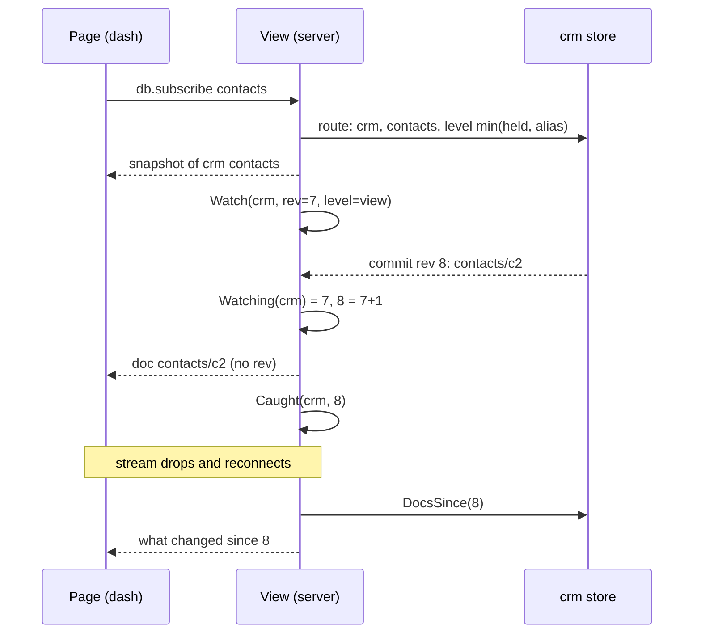
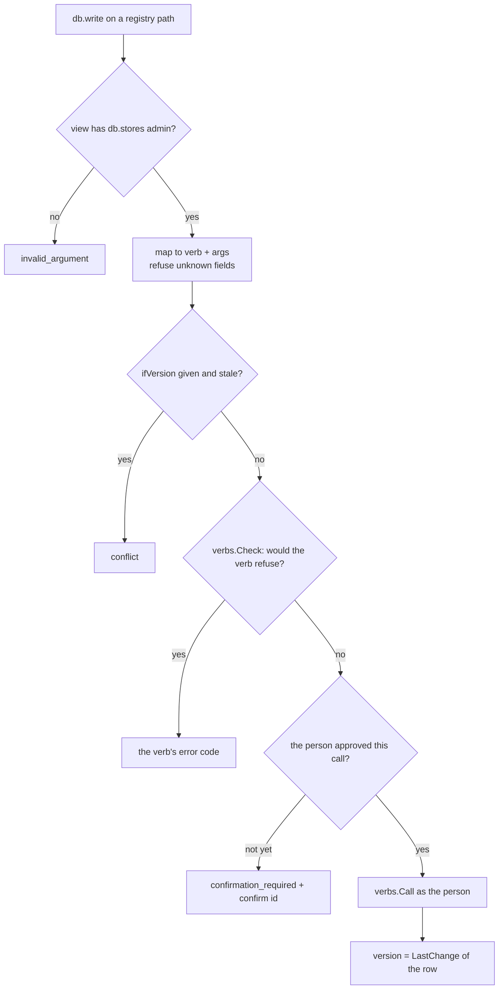

# slop v3: One Object Model — Paths Across Stores, Registry Documents and Durable-Object-Shaped Storage — A Technical Deep Dive

slop v3 hosts small web applications. Each application's data lives in one SQLite file called a **store**, and pages talk to their store through the same JavaScript API that claude.ai gives its artifacts: `claude.use('db')`, `db.collection(...)`, `onSnapshot`, and so on. Before this project, that API saw exactly one store. A page could not show a contact list that lived in another store. An administrator's console could not list stores or change grants through the API a page uses. And an author who thinks in Cloudflare Durable Objects had nothing familiar to write against. This report describes the change that removes all three limits without changing the API a page sees.

The change rests on one idea: **a page's database is a path space.** The page's own store stays at the root, exactly as the contract describes it. Two kinds of path reach further. An **alias** maps one top-level name, such as `contacts`, to a collection of another store, so a page written for claude.ai reaches it without knowing. The reserved prefix `_stores/<id>/…` reaches any store, for applications an administrator has allowed. The platform's own rows (stores, grants, aliases, people) then appear as documents under `_stores`, and actors on the server get a storage object shaped like a Durable Object's. The work was done on 2 November 2026 under ticket SLOP3-008, in five implemented phases on one branch, pull request #20. A sixth phase was deliberately not built.

The report follows the order in which the ideas depend on each other. Sections 2 and 3 define the parts of slop v3 the design uses and state the problem. Section 4 introduces the example that runs through the rest. Sections 5 to 9 explain the five phases, and section 10 explains why the sixth was not built. The last sections cover verification, the course of the work, and the limits of the design.

> [!summary]
> - **One path space per page.** A page path resolves to a store, a path in that store, and a ceiling. The page's own store is at the root; aliases and `_stores/<id>/…` reach other stores. Top-level names beginning with `_` belong to the platform.
> - **Always as the viewer.** No route grants anything. The level that applies is the lower of the viewer's level on the target store and the route's ceiling, under the target store's own rules. Another store's private documents are reachable by no route.
> - **The registry reads as documents, and writes through its verbs.** `_stores/<id>/_grants/@member` is the grant row; writing it runs `grant.set` as the person, after the person confirms in the shell, with `ifVersion` checked against the row's last system revision.
> - **Durable-Object-shaped, not Durable-Object-compatible.** `ctx.storage` has the shape of `DurableObjectStorage` (keys in UTF-8 order, transactions, `sql.exec` cursors, one alarm) over the store's documents, SQL and alarms. The differences are listed rather than hidden.

## 1. What exists, and where

| Item | Location |
|---|---|
| Repository | `/home/manuel/code/wesen/slop-computer` (module `github.com/go-go-golems/slop-computer`) |
| Branch and pull request | `task/slop3-008-data-assets`, [PR #20](https://github.com/go-go-golems/slop-computer/pull/20), 19 commits, 48 files, +3890/−216 lines |
| Ticket workspace | `ttmp/2026/11/02/SLOP3-008--one-object-model-apps-routes-data-and-events-served-to-unmodified-claude-artifacts/` |
| Design document | `design-doc/01-one-object-model-for-apps-routes-data-and-events.md` in the ticket |
| Implementation diary | `reference/01-diary.md` in the ticket, steps 1–12 |
| Path space (pure) | `pkg/rt/space.go`, `pkg/rt/views.go` |
| Path space (server) | `pkg/server/space.go`, `pkg/server/views.go`, `pkg/server/live.go` |
| Uploads across stores | `pkg/server/rtassets.go` |
| `files` capability | `pkg/server/rtfiles.go`, `web/runtime/src/caps.ts` |
| Registry documents | `pkg/server/registry.go`, `web/runtime/src/db.ts` (`writeRPC`) |
| Alias templates | `pkg/verbs/mounts.go`, `pkg/verbs/actors.go` (`checkAlias`), `pkg/system/migrations/010_mount_aliases.sql` |
| Durable-Object-shaped storage | `pkg/actor/storage.js`, `pkg/actor/storage.go`, `pkg/store/turn.go` (`QueryTable`) |
| Tests | `pkg/rt/space_test.go`, `pkg/server/pathspace_test.go`, `pkg/server/durable_storage_test.go` |

## 2. The parts of slop v3 the design uses

A reader who knows slop v3 can skip this section. The terms are introduced in the order the later sections need them.

A **store** is one SQLite file. It holds documents (`_docs`), files in a tree zone and an assets zone (`_files`), an append-only log of commits (`_log`, `_changes`), snapshots of the file tree, and the app's own SQL tables. A store has an id such as `crm` and an owner.

An **app** is a store whose files are code: an `index.html`, an `app.json` manifest, optionally an `actor.js` and SQL migrations under `sql/`. A data store can *run* an app store, which means its pages are that app's pages and its documents are that store's documents.

A **document path** follows the contract's parity rule. A path with an even number of segments is a document (`contacts/c1`), an odd number is a collection (`contacts`). Segments use the characters `[A-Za-z0-9_.~:@+-]`, at most 200 bytes each and 16 segments in total (`pkg/rt/paths.go`).

A **level** is what a person holds on a store: `view` < `interact` < `admin` < `owner`. Grants give levels to people and to audiences (`@guest`, `@member`, `@subscriber`, `@admin`). An app's **rules** (in `app.json`) set per-path minimum levels for reading and writing, with `{self}` for "each person's own document" and the level `self`, which nobody meets.

A **view** is one open page. When a browser opens a page, the server creates a view that records the store, the viewer, the level they hold, the app's capabilities and the policy decisions that apply. The page then talks to the server through RPCs (`db.get`, `db.query`, `db.write`, `db.subscribe`) and receives changes over a server-sent event stream. The stream resumes from a cursor, the store's revision.

The **system database** (`system.db`) holds the registry: the store rows, mounts (which store answers at which host and path), **bindings** (named references from one store to another), grants, people, policy cells, and its own `_log` and `_changes`. A **verb** is one operation on the platform, such as `grant.set` or `mount.set`. The CLI, the back office and trusted apps all call verbs, and every verb checks the caller's authority itself.

An **actor** is an app's server-side JavaScript, run in a goja VM. It handles one event at a time. Each event runs as a **turn**: one SQLite transaction that commits when the handler returns, or when it awaits real I/O. Inside a turn the actor reaches the store through modules: `use('db')`, `use('sql')`, `use('alarm')`.

## 3. The problem

The contract a claude.ai artifact is written against gives a page one database: its own. That is the right default, and slop implements it faithfully. Three kinds of application need more.

1. **An unmodified page that shows another store's data.** A contacts dashboard built in claude.ai against `db.collection('contacts')` should show the contacts kept in a separate `crm` store, without editing the page. The page also has data of its own (notes), which should stay in its own store.
2. **An administrator's console written as a plain artifact.** The back office lists stores, grants and people, and changes grants. Today it needs a trusted Go module. If the registry were readable as documents, the console could be ordinary contract code built in claude.ai against seeded documents.
3. **An app written in the Durable Object style.** Cloudflare's Durable Objects and slop's actors share the important properties: one writer per object, state next to code, writes atomic between awaits, objects addressed by name. An author who knows `ctx.storage.get/put/list/transaction/sql/setAlarm` should be able to write against that shape.

Two alternatives were considered and rejected during the design conversation. The first was a separate **system store** that would hold the registry as documents. It would have needed a second database API for pages and a copy of every registry row. The second was to map **mounts and hosts** into the path space as well. The user ruled that out: "yeah no need to map mounts into stores, nor hsots. It's really about data and assets at first." What remained is the path space described next. The user arrived at it in two messages: "we could actually just map them as stores/XXX/... and then the usual convention?" and "it's still possible to have the defafult store collections at the top level, maybe it should be _stores or so to make it easier to separate?"

The path `_stores/<id>` has two segments. Prefixing a store's paths with it therefore keeps every path's parity, so documents stay documents and collections stay collections, and the convention needs no translation.

## 4. The running example

The example is the dashboard used in the browser check, `scripts/02-dashboard/index.html` in the ticket. It was written the way claude.ai writes artifacts, and its manifest declares nothing beyond `db`:

```json
{ "title": "Contacts dashboard", "capabilities": { "db": {} } }
```

```js
const db = await window.claude.use('db');
db.collection('contacts').orderBy('name').onSnapshot((snap) => {
  for (const d of snap.docs) {
    const c = d.data();
    if (c.photo) img.src = '/_blob/' + c.photo;   // an upload, by bare id
    // … render c.name
  }
});
db.collection('notes').onSnapshot(/* … */);
form.onsubmit = () => db.collection('notes').add({ text, at: Date.now() });
```

Two stores are involved. `dash` runs the page. `crm` holds `contacts/c1` (Ada Lovelace, with a 32×32 PNG uploaded to `crm`'s assets zone) and later `contacts/c2` (Grace Hopper). The administrator connects them with one command:

```sh
slop bind set dash contacts crm --prefix contacts --assets
```

After that command, `contacts/…` in `dash`'s pages means `crm`'s `contacts/…`, and `notes/…` still means `dash`'s own `notes/…`. Every later section can be checked against this example.

## 5. Phase 1: the path space

### 5.1 Resolution

Every page path is resolved once, by a pure function with no I/O: `(*rt.Space).Resolve` in `pkg/rt/space.go`. A `Space` is the view's holder store, its aliases, and how far `_stores` reaches:

```go
type Space struct {
	Holder  string           // the page's own store
	Aliases map[string]Alias // top-level name → {Store, Prefix, Level, Assets}
	Stores  Level            // LevelNone: _stores is closed to this app
}

type Target struct {
	Store string // the store holding the document
	Path  string // its path in that store
	Own   bool   // Store is the holder
	Cap   Level  // the ceiling the route puts on the viewer's level
	Via   string // "", an alias name, or "_stores"
	Registry bool // a registry document (phase 3)
}
```

`Resolve` looks at the first segment of the path and decides in a fixed order:

| First segment | Example page path | Target |
|---|---|---|
| `_stores` | `_stores/crm/contacts/c1` | store `crm`, path `contacts/c1`, ceiling `db.stores` |
| `_stores` (registry) | `_stores/crm`, `_stores/crm/_grants/@member` | registry document (phase 3) |
| `_people` | `_people/usr_…` | registry document (phase 3) |
| any other `_…` | `_meta/x` | refused: `invalid_argument`, reserved |
| an alias name | `contacts/c1` | store `crm`, path `contacts/c1`, ceiling = alias level |
| anything else | `notes/n1` | the holder, `notes/n1`, ceiling `owner` |

An alias maps a collection to a collection, so ids are the same on both sides and only the prefix changes. A path under `_stores` may be up to 18 segments long, so a store's own 16-segment documents stay reachable. The runtime's client-side check (`web/runtime/src/util.ts`, `checkPath`) was widened to match.

The view's space is built when the view opens, by `spaceOf` in `pkg/server/space.go`. A binding becomes an alias only if it has a prefix: bindings without one keep their old meaning, a read alias for the actor's `use('stores').open`. `_stores` opens only when the app declares `capabilities.db.stores` *and* the new `stores` policy cell allows it for this viewer's audience. That cell is off by default and set by an administrator (`slop policy set console stores @admin on`).

### 5.2 The level that applies

A route never grants anything. The server turns a target into a **route**: the store, the viewer's level there, and that store's rules (`pkg/server/space.go`):

```go
d := s.Env.K.Access.Level(ctx, s.viewPrincipal(ctx, v), row) // the viewer on the target store
r.held = d.Level
r.level = min(d.Level, tgt.Cap)                              // capped by the route
if r.level == rt.LevelNone {
	return r, nil // reads find nothing, writes are refused
}
r.rules = s.Env.K.Rules(ctx, tgt.Store)                     // the target store's own rules
```

In the example, a guest with `view` on `crm` reading through a `view` alias reads at `view`. The same guest holding `interact` on `crm` still reads at `view`, because that is the alias's ceiling. A guest holding nothing on `crm` sees an empty collection, which is what the contract says a hidden document looks like. A write through an alias needs the write level on *both* sides: the viewer's level on `crm`, capped by the alias, must meet `crm`'s rule for that path.

One rule has no exception. Another store's private documents (`data/users/<id>/…`, readable by nobody but that person, and in the contract not even by the owner) are reachable by **no** route. `Space.target` returns `not_found` for them, and the server maps that to an empty result rather than an error, so their existence is not revealed:

```go
if _, private := privateOwner(path); private {
	return Target{}, pathErr("not_found", "another store's private documents are not reachable")
}
```

The reason is that such a document may only be read by its person, through that store's own app. An app reaching into the store has no way to act on that person's behalf there.

### 5.3 Reserving `_`

The path space needs names that no store can already be using. The design reserves every top-level segment beginning with `_` for the platform, in every store, for every writer: `validPath` refuses it, so neither pages, nor actors, nor verbs can write `_x/…`. That is a breaking change: before it, `segmentRe` allowed `_` as a first character. So before making it, a read-only script (`scripts/01-scan-reserved-paths.py`) listed every document path in all 112 production stores through the CLI. None began with `_`.

### 5.4 Where a change appears: `PagePaths`, and the shadowing bug

Resolution answers "where does this page path land?". The stream needs the inverse: given a change to document `path` in store `store`, at which page paths does that document appear for this view? `Space.PagePaths` computes it. The answer can have several entries: the own path, one per alias whose prefix contains the document, and `_stores/<store>/<path>` if `_stores` is open.

The unit tests for this function found the first real bug of the project. When the holder has its own `contacts` collection *and* an alias named `contacts`, the page path `contacts/c1` means the alias: the alias hides the holder's own collection. The first version of `PagePaths(holder, "contacts/c1")` still returned `contacts/c1`. A change to the hidden own document would have been delivered to subscribers of the aliased collection, under a path that resolves to another store. The fix is three lines: the own path is included only when no alias of the same name exists.

```go
if own {
	head, _, _ := strings.Cut(path, "/")
	if _, shadowed := sp.aliasNamed(head); !shadowed {
		out = append(out, path) // an alias of the same name hides it
	}
}
```

### 5.5 Live updates across stores

A page subscribed to `contacts` must see Grace Hopper appear when someone writes `crm`'s `contacts/c2`, without a reload. Two facts shaped the solution.

First, the runtime keeps **one cursor**, the holder store's revision, and advances it only from change events that carry a `rev`. Second, a store's revision numbers mean nothing in another store. A vector of cursors in the runtime would have worked, but would have changed the runtime's resume protocol. The implementation instead keeps the per-store cursors **on the server-side view**, which outlives stream reconnects. Changes from other stores travel without a `rev`, so the runtime's own cursor is never confused.



The stream handler in `pkg/server/views.go` handles a commit of a followed store in one of three ways. A commit at or below the view's cursor is ignored. The next commit in sequence is translated document by document. A commit past a gap triggers a catch-up from the cursor:

```go
remote := func(o rt.Out) error {
	from, ok := v.Watching(o.Store)
	switch {
	case !ok || o.Rev <= from:
		return nil
	case !s.confirm(ctx, v):
		return nil // the view was closed: its access or revoked event follows
	case o.Rev > from+1:
		return catchUpRemote(o.Store, from)
	}
	r := s.readerFor(ctx, v, o.Store)
	for _, c := range o.Changes {
		for _, d := range r.pageDocs(v, c.Path, docOut{…}) {
			writeSSE(w, "doc", d)
		}
	}
	v.Caught(o.Store, o.Rev)
	return nil
}
```

When a stream (re)connects, the same `catchUpRemote` runs for every store in `v.Remotes()`, so a page that was offline while `crm` changed sees those changes on reconnect. `readerFor` decides the viewer's level and that store's rules once per commit, and `pageDocs` drops documents the viewer may not read and maps the rest to page paths through `PagePaths`. The server's publish step finds the views to notify through `Registry.Reaching(store)`, which returns the store's own views *and* the views that follow it.

### 5.6 Revocation: the bug the browser found

The server tests drove the RPC protocol directly. The browser check ran the unmodified dashboard on a local server, as a guest, through the real runtime and shell. Reading, the picture, a live change and the page's own note all worked on the first run:


Then the check ran `slop grant rm crm @guest` with the page open. A contact added afterwards was correctly not delivered. But Ada and Grace stayed on screen until a reload. The view had been opened when the guest could read `crm`, and nothing told it that the guest no longer could.

For the view's *own* store, slop already handled this: a grant change calls `reviewViews(store)`, which rechecks every view of that store and closes the ones whose level changed. The shell then reopens the frame, and the page subscribes again under the new level. The fix extends that mechanism in three steps:

1. The view records, for each followed store, the level the viewer **held** there when it started following (`Watch(store, rev, level)`).
2. `recheck` also closes the view when any recorded level differs from the current one (`remoteLevelsMoved`).
3. `reviewViews(id)` walks `Reaching(id)` instead of the store's own views, so a grant change on `crm` reaches views of `dash` that read `crm`.

The level recorded is `route.held`, the viewer's own level before the route's ceiling, not the capped level. The capped level would hide a change above the ceiling: a guest's level on `crm` dropping from `interact` to `view` under a `view` alias leaves the capped level at `view`. But the documents a page shows depend on what the viewer holds, so that is what must be compared. After the fix, the page reopened within three seconds with no contacts and its own note intact:


### 5.7 Uploads by bare id

The dashboard renders `'/_blob/' + c.photo`, a URL relative to its own sandbox origin. Before this project, `serveAssetBlob` looked the id up only in the origin's own store, so the picture from `crm` would have been a 404.

A blob request is made by an `` element, so it carries no view credential. The server cannot check the viewer's level at fetch time, and the security model for uploads is therefore that **the URL is the capability**. That was already true for a store's own uploads. The fallback keeps it honest in two ways:

- it searches only stores whose alias was bound with `--assets`, which `bind.set` allows only to a caller holding `admin` on the target, in alias-name order;
- uploads reached through `_stores` are not served this way.

The design document had stated that asset ids were "8 characters". Reading the code showed `ids.New("a", 8)`, which is 8 random *bytes*: unique per store, but not designed to be unique or unguessable across stores. New ids are 16 random bytes (128 bits), written as `a` followed by 32 hex characters.

## 6. Phase 2: `files` over store trees

The contract's `files` capability reads "a Claude Code project's files": `list({path, recursive, cursor})`, `read(path, {offset, length}) → {bytes, size, revision}`, `download(path)`, and `asSampleTools()`, which hands the files to `sample` as tools. A file tree does not follow the parity rule (`a/b/c.js` would land on a collection), so source is not mapped into `_stores` as documents. Instead, the manifest's `files.project` names either `_stores` or one alias:

- `{"files": {"project": "_stores"}}` reads every store the viewer may open, as `<store>/<path>`. The top level lists the stores as folders. The app must also be allowed `_stores`.
- `{"files": {"project": "source"}}` reads the store bound as alias `source`, at most at the alias's level.

The "project" is the store's `main` snapshot, the same tree a mount serves (`pkg/server/rtfiles.go`). Snapshots hold files only, so folders are synthesized from paths. A non-recursive list returns each file directly in the folder plus one folder entry per first segment below it; listing a path that is a file is `bad_request`, a path with nothing below it `not_found`. Pages are 500 entries with an offset cursor. `revision` is the file's SHA-256. The contract promises only that the revision changes when the contents do, which a content hash satisfies without tracking snapshot numbers per file.

A viewer who cannot read a store gets `not_found`, indistinguishable from a missing file, as the contract requires. The runtime side (`web/runtime/src/caps.ts`) adds `download`, which reads the file in chunks, checks that the revision did not change between chunks, and then asks the viewer to save it. It also adds `asSampleTools`, which returns `list_project_files` and `read_project_file` tools.

## 7. Phase 3: the registry as documents

### 7.1 The documents

The registry tables stay tables. They need constraints, indexes and multi-row transactions that documents do not provide. What changes is how code *reads and writes* them. Each row reads as a document under the store it belongs to, in `_`-prefixed subcollections next to the store's own data (`pkg/server/registry.go`):

| Page path | Body | A write runs |
|---|---|---|
| `_stores` | the stores the viewer may open | — |
| `_stores/<id>` | `id`, `type`, `app`, `owner`, `createdAt`, the viewer's `level` | `update {type}` → `store.type` |
| `_stores/<id>/_grants/<subject>` | the `grant.ls` row | `set {level}` → `grant.set`; `delete` → `grant.rm` |
| `_stores/<id>/_bindings/<alias>` | the `bind.ls` row | `set {target, prefix?, level?, assets?}` → `bind.set`; `delete` → `bind.rm` |
| `_stores/<id>/_llm/budget` | `llm.usage` for `store:<id>` | read-only |
| `_people/<id>` | the `people.ls` row | read-only |

A grant that came through a share link reads as `<subject>~<via>`, so it never collides with a direct grant of the same subject. It is read-only: such a grant is changed by revoking the link.

### 7.2 Reads run the verb as the viewer

Every read runs the **listing verb that owns the row**, as the viewer, labelled `app:<app>` in the audit trail:

```go
func (s *Server) regRows(ctx context.Context, v *rt.View, verb string, args verbs.Args) []map[string]any {
	p := s.regPrincipal(ctx, v)           // personAs(ctx, v.User, "app:"+v.App)
	if p == nil {
		return nil
	}
	out, err := verbs.Call(withPrincipal(ctx, p), s.Env, p, verb, args)
	if err != nil {
		return nil // the verb refuses: the viewer may not see these rows
	}
	// … decode the verb's JSON rows
}
```

This keeps one place for every registry rule. `grant.ls` needs `admin` on the store, and `people.ls` needs a platform administrator, so the db path inherits both without restating them. A read the verb refuses yields an empty collection, which is what a hidden document looks like in the contract. In the tests, a guest opening the console sees `_stores/crm` (a store it may open, at level `view`) but an empty `_stores/crm/_grants` and an empty `_people`.

### 7.3 Writes: four gates and the verb

A write to a registry document passes four checks before the verb runs:



The order matters. `verbs.Check` runs *before* the confirmation, so nobody is asked to approve a write that would fail anyway. The confirmation is the mechanism slop already uses when an app's code changes governance for a person (`Confirmations().Check(person, view, app, app, verb, args)`). The person sees a dialog drawn by the shell, outside the app's frame, and the approval holds for that view and that exact call. The page's runtime handles the round trip without the page knowing (`web/runtime/src/db.ts`):

```ts
async function writeRPC(args: Record<string, unknown>): Promise<{ version: number }> {
  for (let asked = 0; ; asked++) {
    try {
      return await rpc<{ version: number }>("db.write", args);
    } catch (e: any) {
      if (e?.code !== "confirmation_required" || !e.confirm || asked >= 4) throw e;
      const r = await ask("confirm", { confirm: e.confirm }).catch(() => null);
      if (!r?.approved) throw fail("confirmation_declined", "not allowed: " + e.message);
    }
  }
}
```

So `await db.doc('_stores/crm/_grants/@member').set({level: 'interact'})` stays pending while the person decides. It resolves if they allow the change and rejects with `confirmation_declined` if they deny it.

### 7.4 Versions from the system change log

`ifVersion` needs a version per document. Adding a version column to every registry table would have been invasive. Instead, every registry verb already logs a change to `system.db`'s `_changes` with a stable key: `store`=id, `grant`="<store> <subject>", `binding`="<store> <alias>", `person`=id. A document's version is the highest system revision that changed its row:

```go
func (d *DB) LastChange(ctx context.Context, kind, key string) int64 // max(rev) from _changes
```

System revisions are totally ordered, so each row's version increases monotonically, which is all `ifVersion` needs. An administrator's console that overwrites a grant someone else just changed fails with `conflict` instead of undoing the other change.

### 7.5 A correction, and what is not live

The first version also made `_people/<id>` writable (`update {role}` → `people.role`). The design document's own answer to open question 2 said people should stay read-only. A role can make someone an administrator or disable them, which is account governance, not data, so the write was removed in a separate commit. The decision recorded is that grants, aliases and a store's type are writable through `db`, while people, the LLM budget, mounts, sessions and tokens are not.

Registry documents are **not live**, as the user decided ("no need to keep these live for now"). `get` and queries compute them on demand, and `onSnapshot` delivers one snapshot and then nothing. A console re-reads after its own writes. Live updates remain possible later without an API change: the `_changes` keys already name the affected store and subject, so mapping a change to a page path would feed `onSnapshot` directly.

## 8. Phase 4: alias templates on mounts

A **parameterised mount** such as `/d/:id` with `createApp dash` lets a signed-in member create a new store by visiting a URL. Before this phase, a dashboard created that way had no aliases, so its `contacts` collection was empty until an administrator bound each new store by hand. A mount now carries a template:

```sh
slop mount set apps.example /d/:id --storeParam id --createApp dash \
  --aliases '[{"alias":"contacts","target":"crm","prefix":"contacts","level":"view"}]'
```

The template entries have the same shape as `_bindings` documents and `bind.set`'s arguments. The question this phase had to answer is *whose authority* the template carries. The member who creates a store usually holds nothing on `crm`, and the store is created from the URL, long after the administrator set the mount.

The answer follows from section 5.2. An alias never grants anything: every read through it is made as the viewer, capped by the alias's level. So the only thing the template check must prevent is an administrator templating a ceiling they do not hold themselves. That is exactly what `bind.set` checks. The validation was moved out of `bind.set` into `checkAlias(ctx, env, principal, *Binding)` and is now called from both places, against the principal who sets the binding or the mount:

```go
need, why := level, "binding to"
if b.Assets {
	need, why = rt.LevelAdmin, "sharing the uploads of"
}
_, _, err := e.open(ctx, p, b.Target, need, why) // p holds `need` on the target, or the call fails
```

The template is stored in a new `mounts.aliases` column (migration 010) and written as ordinary bindings by `/_site/create`, so the new store's owner can change or remove them later. During implementation one path was nearly missed. `mount.undo` restores a mount by re-inserting the previous row with its own column list. Without updating that list, undo would have silently dropped a template. The test now replaces a mount without a template, undoes the change, and checks that the template is back.

## 9. Phase 5: Durable-Object-shaped storage

### 9.1 The shapes, side by side

The design document had already compared the two models (§6.1 there). Both have one writer per object, state next to code, writes atomic between awaits, and objects addressed by name. What was missing was the *API shape*. Phase 5 adds `use('storage')`, also available as `ctx.storage`, with the methods of Cloudflare's `DurableObjectStorage`:

| `DurableObjectStorage` | slop's `ctx.storage` | Underneath |
|---|---|---|
| `get(key)`, `get(keys[])` → value, `Map` | same; batches up to 128 keys | `db.doc('storage/<id>').get()` |
| `put(key, value)`, `put(entries)` | same; keys up to 2048 bytes | `db.doc(…).set({key, value})` |
| `delete(key)` → boolean, `delete(keys[])` → count | same | `db.doc(…).delete()` |
| `list({start, startAfter, end, prefix, reverse, limit})` → `Map` | same, ordered by UTF-8 bytes | `db.collection('storage').orderBy('key')` |
| `deleteAll()` | same (keys only) | |
| `transaction(async txn => …)` | same; buffered, all or nothing | JS overlay |
| `transactionSync(fn)` | same | overlay + SQL savepoint |
| `kv.get/put/delete/list` (sync) | same | |
| `sql.exec(query, …bindings)` → cursor | same cursor shape | `Turn.QueryTable` |
| `getAlarm/setAlarm/deleteAlarm`, `alarm()` handler | same; handler `alarms.alarm` | `use('alarm')`, alarm named `alarm` |

The adapter is written in JavaScript (`pkg/actor/storage.js`, 295 lines, embedded into the binary) as a factory over the actor's existing modules: `(db, sql, alarm, keyID, sqlTable)`. Only the last two arguments are new Go code.

### 9.2 Keys are documents

DO keys are arbitrary strings up to 2 KiB. Document ids are at most 200 bytes from a restricted alphabet. The adapter therefore stores each entry as a document whose body carries the real key, and derives the id from the key (`pkg/actor/storage.go`):

```go
func storageKeyID(key string) string {
	if !strings.HasPrefix(key, "~") && rt.ValidDocPath("storage/"+key) {
		return key                           // readable in the back office and in exports
	}
	sum := sha256.Sum256([]byte(key))
	return "~" + hex.EncodeToString(sum[:]) // anything else
}
```

The two forms never collide. A key used as its own id never begins with `~`, and every hashed id does. A key containing `/` would make `storage/a/b` a collection path, so `ValidDocPath` rejects it and it is hashed.

Documents were chosen over a kernel table because the design maps `storage.get/put` to `db` documents, and documents come with the log, exports, reactors and the back office. A hidden `_storage` collection was also considered. It would have required `Turn.SetDoc` to accept `_`-prefixed paths, which is exactly what phase 1 forbade for every writer. So the collection is the ordinary `storage/`, and the documentation says how to close it to pages with a rule that nobody meets: `{path: "storage", read: "self", write: "self"}`.

### 9.3 Order

Durable Objects order keys by their UTF-8 bytes. JavaScript compares strings by UTF-16 code units, and the two orders differ. U+FF01 (`！`, UTF-8 `EF BC 81`) sorts before U+1F600 (`😀`, UTF-8 `F0 9F 98 80`) by bytes, but after it by UTF-16 code units, because the emoji's first code unit is the surrogate `0xD83D`. The adapter avoids the difference twice:

- `list` outside a transaction sorts on the server with `orderBy('key')`. The server's `compare` uses Go's `strings.Compare`, which is byte order.
- Inside a transaction, the merged list is sorted in JavaScript by code point, which equals UTF-8 byte order:

```js
function cmp(a, b) {
  const x = Array.from(a), y = Array.from(b);   // iterates code points, not code units
  for (let i = 0; i < Math.min(x.length, y.length); i++) {
    const d = x[i].codePointAt(0) - y[i].codePointAt(0);
    if (d) return d;
  }
  return x.length - y.length;
}
```

The test stores both characters and checks that `list()` returns `…, "！", "😀"` and `list({reverse: true, limit: 2})` returns `"😀", "！"`.

### 9.4 Transactions: why a buffer, not a savepoint

The obvious implementation of `transaction` would wrap the closure in an SQL `SAVEPOINT` and `ROLLBACK TO` it on failure. That does not work for documents. The store's `Turn` records each document write in memory (`t.record(Change{…})`) as it happens, and those records become the commit's change events. Rolling `_docs` back under the Turn would leave records for writes that no longer exist, and pages would receive events for documents that were never committed.

The adapter therefore **buffers** a transaction's writes in JavaScript, in an overlay over the applied store:

```js
function transaction(closure) {
  const t = overlay();               // Map: key → {v} | null (deleted)
  let rolledBack = false;
  const txn = {
    get: settled((k) => get(t, k)),  // reads its own writes
    put: settled((k, v) => put(t, k, v)),
    delete: settled((k) => del(t, k)),
    list: settled((o) => list(t, o)), // base list merged with the buffer
    rollback() { rolledBack = true; },
    // … alarms
  };
  let r;
  try { r = closure(txn); } catch (e) { return Promise.reject(e); }
  return Promise.resolve(r).then((v) => {
    if (!rolledBack) t.commit();     // apply every buffered write, synchronously
    return v;
  });
}
```

A throw, a rejected promise or `txn.rollback()` discards the buffer, so nothing reaches the store. Applying the buffer is synchronous, so it cannot interleave with another event. `transactionSync(fn)` uses the same overlay and, in addition, runs `fn` inside the existing `sql.transaction` savepoint, so SQL written through `ctx.storage.sql.exec` inside `fn` rolls back together with the buffered keys. Rolling back app tables is safe, because the Turn only reports app tables as "written", and over-reporting a table is harmless.

### 9.5 Promises that stay in the turn

Every DO storage method returns a promise. In slop, an actor's turn ends when the handler awaits *real* I/O, such as `fetch` or `time.sleep`, and the continuation runs in a later turn. If storage methods ended the turn, `await storage.get(k)` would split a handler into many transactions. The adapter returns promises that are **already settled**:

```js
function settled(fn) {
  return function () {
    try { return Promise.resolve(fn.apply(null, arguments)); }
    catch (e) { return Promise.reject(e); }
  };
}
```

goja runs its job queue before control returns from the handler call, so awaiting a settled promise resumes within the same turn. An existing actor test already relied on this (`await Promise.resolve(1)` in `actors_test.go`'s `boom` action).

### 9.6 `sql.exec` cursors

DO's `sql.exec` returns a cursor with `toArray()`, `one()`, `raw()`, `columnNames`, `rowsRead`, `rowsWritten`, and iteration. The actor's existing `sql.all` returns rows as Go maps, which lose column order and collapse duplicate column names. A new `Turn.QueryTable` (`pkg/store/turn.go`) scans rows into arrays in column order and counts rows written from SQLite's `total_changes()`, read before and after the statement on the turn's writer connection:

```go
var before int64
t.s.w.QueryRowContext(t.ctx, `SELECT total_changes()`).Scan(&before)
rows, _ := t.s.w.QueryContext(t.ctx, q, args...)
// … scan each row into []any, BLOBs as strings
rows.Close() // before total_changes() on the same connection
var after int64
t.s.w.QueryRowContext(t.ctx, `SELECT total_changes()`).Scan(&after)
written = after - before
```

`total_changes()` is cumulative per connection, so the difference is what this one statement wrote. The first draft read `rows.Columns()` after the rows had already been closed by a helper. That would have failed with "Rows are closed", and the draft was rewritten before it ran.

### 9.7 The differences, stated

The adapter is described as Durable-Object-*shaped* because the differences are real, and the slop v3 design document lists them:

- Values are JSON. `Date`, `Map` and `ArrayBuffer` do not survive a round trip.
- Tables come from migrations (`sql/NNN_*.sql`). DDL in `sql.exec` is refused by the store's SQL authorizer, and the test checks that it is.
- `storage/` is an ordinary collection. Pages read it under the app's rules unless a rule closes it, whereas DO storage is private by construction.
- None of the Workers runtime comes with it: no `Request`/`Response` semantics, no `WebSocketPair`, no npm bundles. Running Cloudflare code unchanged would mean running `workerd` as a second executor. The design leaves that until a concrete app needs porting.

## 10. Phase 6: why one owning process per store was not built

The design's plan ends with "one owning process per store": views and subscriptions for a store are forwarded to the process chosen by the store's id, so a store's log keeps exactly one appender without a shared bus. This is the rule Durable Objects use across machines.

slop v3 runs one process. Every store therefore already has exactly one owner, and the broker that delivers commits to views is in-process. There is nothing to forward to, and no second process to test forwarding against. Code written now would be untested by construction. The rule stays in the design document (§5.7 and §9) for the day v3 runs more than one process.

## 11. Verification

Every phase ended with Go integration tests that drive the server through its real HTTP and RPC surfaces. Then each phase's important lines were deliberately broken, one at a time, to confirm that the tests detect the breakage. A test that still passes with its subject removed tests nothing.

| Phase | Broken on purpose | The test reported |
|---|---|---|
| 1 | no catch-up on reconnect; no level ceiling; no blob fallback; no remote-level recheck; `reviewViews` on the store's own views only | each made its intended test in `pkg/server/pathspace_test.go` fail (for the last two: `after losing crm: [map[_type:hello …]]`) |
| 2 | the level check in `filesStore` | `without a grant on crm: map[result:map[entries:[…]]]` |
| 3 | confirmation skipped | `a registry write without confirmation: map[result:map[rev:0 version:11]]` |
| 3 | `ifVersion` ignored | `stale ifVersion: map[error:map[code:confirmation_required …]]` |
| 3 | `db.stores` gate removed | `a registry write with stores view: … confirmation_required …` |
| 4 | template not applied | `the new store's bindings: []` |
| 4 | template not validated | `mount.set … alias:_stores …: want invalid_argument, got 200` |
| 5 | transaction commit skipped | `tx keys = {"k"}, want {"w"}` |
| 5 | no savepoint in `transactionSync` | `rows = [… "x" … "y"], want [… "y"]` |
| 5 | `~` keys not hashed | `docs.get storage/~t: want not_found, got 200` |

Beyond these, the full Go suite (`GOWORK=off go test ./... -count=1`), the runtime's tests (`pnpm test`, 12 pass) and type check (`pnpm check`), the build-stamp test that keeps the embedded `claude.js` in step with its sources, and `golangci-lint --new-from-rev=origin/main` all pass. The browser check of section 5.6 covered phase 1. The later phases have no browser check: their surfaces are RPCs and actor calls, which the integration tests drive directly.

## 12. How the work was done

The project began as a design question. The user asked how to "unify our data model on the backend, and serving apps that come straight out of claude without having to adapt them (and its DB API), while also allowing potentially custom apps to have more durable objects ike behaviour". An earlier review on the same subject, SLOP-008, turned out to describe slop **v2**: it cited files and tables that no longer exist. The user's response was "rebase main, and let's do it again, from scratch. kill that file."

The design was then written in a series of short decisions recorded in the diary as open questions:

- delegated reads were deferred, so every route reads as the viewer;
- mounts and hosts are not mapped;
- `_` is reserved after a production scan;
- paths under `_stores` may be 18 segments deep;
- registry documents are not live;
- uploads cross stores only through `--assets` aliases.

The user then asked for implementation ("Implement. commit at appropriate intervals and keep a detailed diary"). After phase 1, they asked for the remaining phases on the same branch: "do all phases, we don't need so many PRs".

Each phase followed the same loop:
1. Write the pure part with unit tests where one existed (`rt.Space` first).
2. Wire it into the server.
3. Write an integration test, then break the code on purpose.
4. Run lint and the full suite.
5. Commit, then write a diary entry in the investigation format: what was done, why, what failed with the exact diagnostic, what was tricky, and what a reviewer should look at.

The failures recorded there are mostly small. A `sed` edit matched a second test's line. A lint rule rejected a parameter named `cap`. A test helper aborted on an expected 404. Two failures were substantive: the shadowing bug in `PagePaths`, found by a unit test, and the stale contacts after revocation, found only by the browser.

## 13. What the design provides, and where it strains

The design delivers the three cases of section 3 without changing the contract a page is written against. An unmodified dashboard reads, watches and writes across stores and shows their pictures. A console can be written as ordinary contract code over `_stores` and `_people`. An actor can be written against `ctx.storage`.

It strains in these places, each recorded in the diary as a point for review:

- **Reopening is coarse.** Any change of the viewer's level on a followed store, including an increase, reopens the page. That matches the behaviour for the page's own store, and it is simple, but an increase does not strictly require it.
- **Template application is not atomic.** If writing a template's bindings fails after `/_site/create` has made the store, the store exists without them. The owner can bind it, but the two steps are not one transaction.
- **A guest sees owner ids.** `_stores/<id>` includes `owner`, a person id, for any store the viewer can open. The ids are opaque but stable.
- **`deleteAll` inside `transactionSync` bypasses the buffer.** An uncaught throw still rolls the whole turn back, but a caught one leaves the deletions applied.
- **Not built:** actors' `use('db')` still sees only its own store (actors keep `use('stores').open`). There are no delegated reads (`as: store`), and registry documents are not live. `app.describe` and `llm.set` cannot be written through documents, and stores cannot be created or deleted through `_stores`. The back office still uses its trusted `system` module.

## Key points

- A page path resolves to a store, a path there, and a ceiling; the page's own store stays at the root, so contract code runs unchanged.
- The applicable level is `min(viewer's level on the target, route ceiling)` under the target's rules; aliases and templates carry no authority of their own.
- Changes from other stores travel without a `rev`, with per-store cursors kept on the server-side view, so the runtime's resume protocol did not change.
- Revocation needs the level the viewer *holds*, not the capped level, and the review must reach views of other stores that read the changed one.
- Registry documents are computed by running the owning verbs as the viewer. Writes add a `db.stores admin` gate, a pre-check, the person's confirmation and an `ifVersion` derived from the system change log.
- `ctx.storage` buffers transactions in JavaScript because rolling back documents under the Turn's change records would publish events for writes that never happened.
- An already-settled promise keeps an `await` inside the turn; that is what lets a DO-shaped API coexist with slop's turn model.

## Evidence and sources

- Pull request: https://github.com/go-go-golems/slop-computer/pull/20
- Diary: `ttmp/2026/11/02/SLOP3-008--…/reference/01-diary.md`, steps 1–12 (investigation format from step 5 on)
- Design: `ttmp/2026/11/02/SLOP3-008--…/design-doc/01-one-object-model-for-apps-routes-data-and-events.md`, with as-implemented notes in §5.4–§5.6 and the plan in §9
- Browser check: `scripts/02-local-alias-dashboard.sh`, `scripts/02-dashboard/`, screenshots in `various/`
- Production scan: `scripts/01-scan-reserved-paths.py`
- Platform documentation updated: `doc/design/slop-v3.md` (§4.3 path space, §6 storage), `doc/claude-apis/README.md` (capability table)

## Related notes

- [[PROJECT REPORT - slop v3 - A Store-Based Hosting Service from Design to Deployment - A Technical Deep Dive]]
- [[PROJECT REPORT - slop v3 - Tools as Apps - Trusted Go Modules, Confirmations and the Workshop - A Technical Deep Dive]]
- [[PROJECT REPORT - slop Artifact Runtime - Hosting the claude.ai Artifact Contract Natively - A Technical Deep Dive]]
