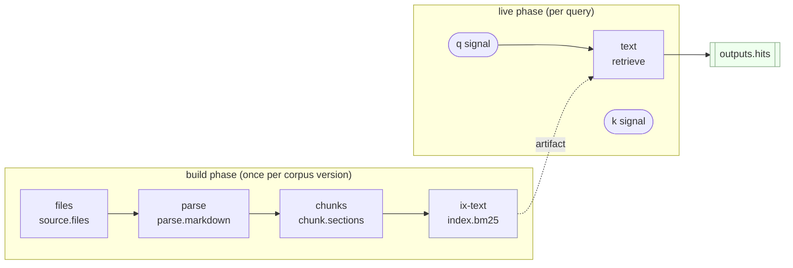
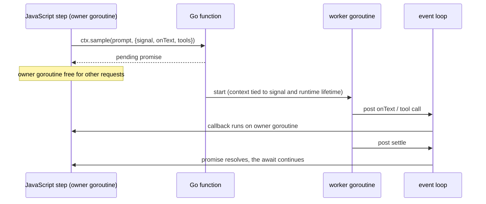
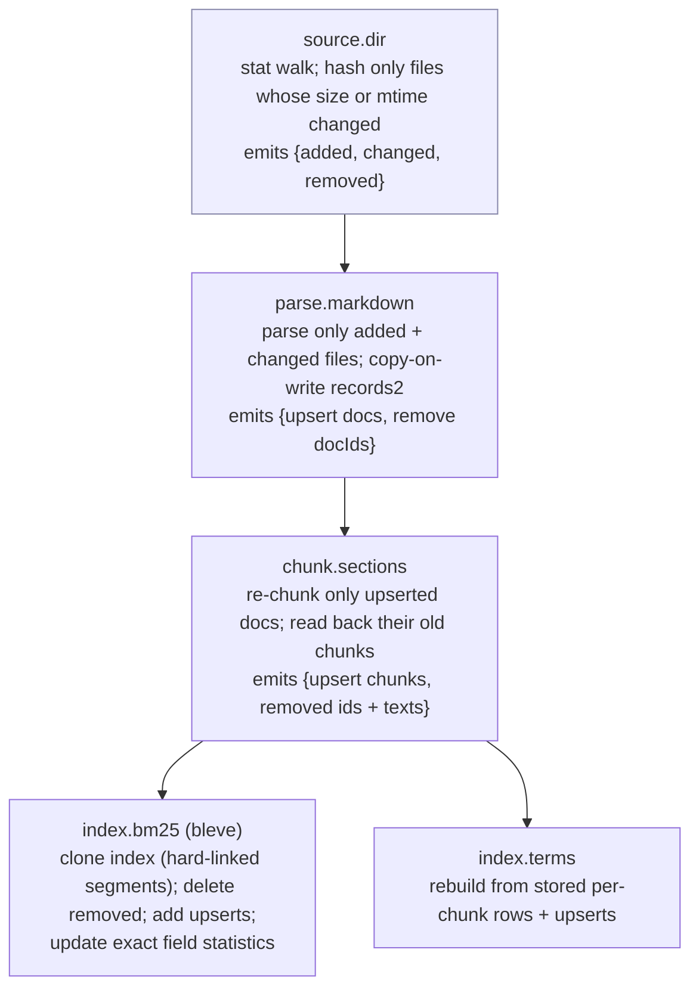
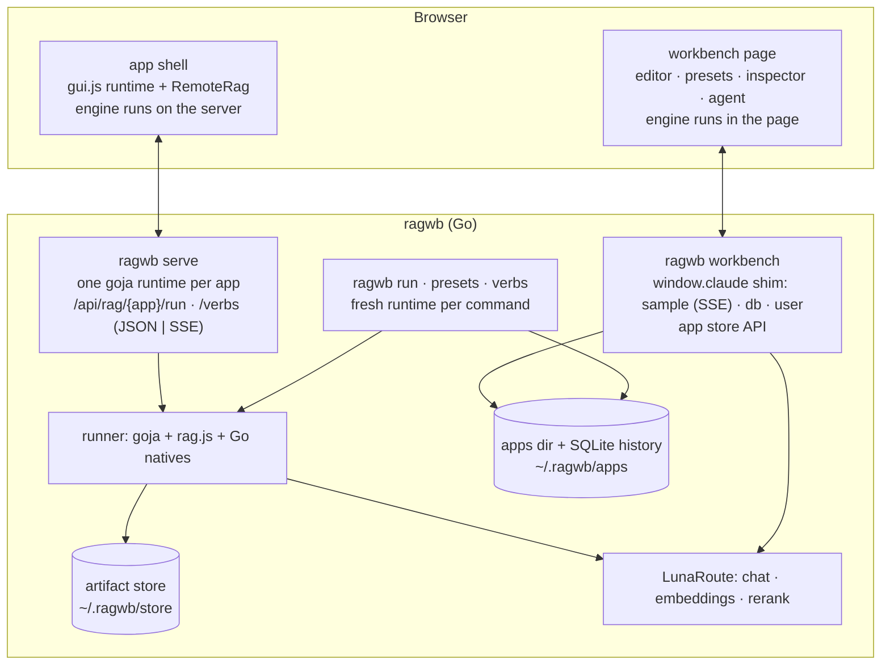
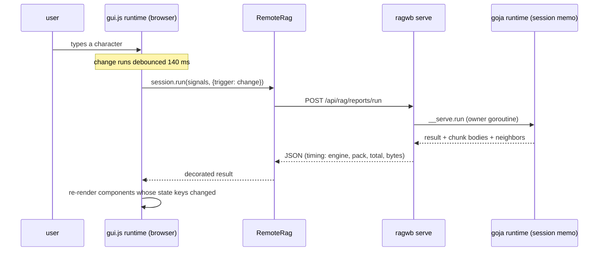

# rag-workbench: A Retrieval Workbench in JavaScript on a Go Runtime — A Technical Deep Dive

rag-workbench (the binary is `ragwb`) is a toolkit for building many small search-and-answer applications over personal technical material: an Obsidian vault of about 2,300 notes, a folder of project reports, a documentation tree. An application is written in JavaScript with a compact grammar. A *corpus* says how files become searchable pieces, a *plan* says how a query is answered, *evals* score a plan against known questions, and an *app* declares a user interface. The grammar and its engine were first built as a browser-only prototype; this project runs the same engine inside a Go program, replaces its expensive steps with Go code, stores what it builds on disk, rebuilds incrementally when files change, and exposes every plan as a command-line verb, a served web application and an HTTP endpoint that streams intermediate results.

This report explains the whole system to a reader who is technical but has never seen it. It starts with the retrieval concepts the system is built from, then follows a plan from source text to compiled graph, through the build of its indexes and the execution of a query, and then descends into the Go side: how JavaScript runs on a Go runtime, how Go components replace JavaScript ones without changing a single result, how build outputs are stored and reopened in milliseconds, how a one-note edit is absorbed without a full rebuild, how language models are called, and how the three user-facing surfaces are put together. Every section is grounded in the code and in measurements taken during development; where the report shows output, the output is real.

> [!summary]
> - **One engine, two runtimes.** `rag.js` (2,416 lines) compiles fluent JavaScript builders into a typed graph and executes it. The same file runs in a browser and inside `goja`, a JavaScript engine written in Go, so the browser workbench, the command line and the server compute identical results.
> - **Go where the time goes.** Parsing, chunking and indexing are Go components registered under the original component names and held to byte-identical output. On the whole vault, the JavaScript build takes 280–335 s and the Go build 4.2–4.4 s.
> - **Durable and incremental.** Build outputs are stored by content digest, opened lazily from disk (bleve indexes, sharded bbolt record files) and rebuilt by *delta* when sources change: a warm vault query process starts in 0.16 s with 90 MB of memory, and a one-note edit is searchable after about 0.2 s of rebuild work.
> - **Three surfaces over one runner.** The same plan runs as a CLI verb with structured output, as a browser app whose queries run on the server, and as an HTTP endpoint that streams engine events (hits per step, answer text, tool calls) over Server-Sent Events.

## 1. What the system is for, and where it came from

### 1.1 The goal

The project's founding design document states the goal directly: a toolkit for making "many small search-and-answer applications" over personal material. *Small* matters. Each application is a few files: one that describes the corpus, one with a few alternative plans, one that defines commands, one that declares a UI. Building a new one should take minutes, and running it on a real corpus — not a demo corpus — should be fast enough to use while typing.

The main target corpus is the go-go-parc Obsidian vault. A survey at the start of the project counted 2,441 Markdown files (about 84 MB), of which about 2,285 notes (81 MB) remain after excluding tooling directories; 82% of notes have YAML frontmatter, there are 11,600 wikilinks and 43,000 fenced code blocks, and 122 notes are larger than 100 KB (transcripts reach 546 KB). After chunking, the vault yields about 85,900 searchable pieces. The second corpus, used throughout this report because it is small enough to show in full, is a folder of 11 engineering project reports (540 KB) that produces 462 pieces.

### 1.2 The prototype

The grammar did not start in this repository. It was designed in a claude.ai artifact session titled "RAG workbench with fluent builder API" (2026-10-16): a single web page with a script editor, 29 example scripts called *presets*, an inspector that shows the compiled graph and per-step traces, and a chat agent that edits pipelines by running code in the page. The artifact runtime offered only one model capability, text generation (`sample`), and no embeddings, so the prototype was built on lexical search plus language-model steps. It consisted of `rag.js` (2,036 lines: grammar, compiler, engine, edit operations with undo, evaluations), `gui.js` (721 lines, about 45 UI components), `agent.js`, `app.js` (the page shell) and `kit.js` (shared helpers), with a ten-part textbook explaining it.

RAGWB-001 imported the prototype and asked what it would take to run it outside the browser. The answer shaped everything that followed, and it came from two measurements. First, `rag.js` runs unmodified inside goja, with one exception that is described in section 8.4. Second, indexing in pure JavaScript costs about 5–6.5 seconds per megabyte of Markdown; for the 81 MB vault that extrapolates to 9–10 minutes and 3–4 GB of memory. The engine's query-time overhead, by contrast, is a few milliseconds. The cost is concentrated in a handful of build steps.

### 1.3 The decision that shapes the code

Decision D1 of the design reads: keep the engine in JavaScript and move the heavy nodes to Go. The alternative — reimplementing the engine in Go and keeping JavaScript only as a builder syntax — would have produced two engines with two sets of semantics, and the browser workbench, the textbook and the server would have drifted apart. Keeping one engine means a plan behaves identically wherever it runs, and Go code is introduced only at the component boundary, where it can be held to the same outputs as the code it replaces.

The rest of the project is the consequence of that decision. Go components must produce byte-identical results (section 9). Build outputs must be stored in a form JavaScript can read lazily (section 10). Long-running Go work must not block the single JavaScript thread (section 8.5). And the browser-side UI runtime must be able to drive an engine that lives on a server (section 13.3).

### 1.4 Status

The repository holds 68 commits made between 2026-11-02 and 2026-11-04, organized in five tickets, each with a design document and a chronological diary:

| ticket | subject | outcome |
|---|---|---|
| RAGWB-001 | import the prototype; Go-backed runner, natives, workbench server, app store, persistence, `ragwb serve` | merged to `main` (PR #1) |
| RAGWB-002 | disk-backed retrieval: bleve as the default BM25 backend, bbolt record stores | implemented |
| RAGWB-003 | incremental re-indexing: delta builds over immutable artifacts | implemented |
| RAGWB-004 | query API endpoints with SSE streaming of intermediate results | implemented |
| RAGWB-005 | per-step trace details in the UI; asynchronous batched cross-encoder rerank | implemented |

RAGWB-002 to RAGWB-005 are stacked on branches above `main`. The codebase is about 17,900 lines of Go (including tests), the 2,416-line engine, an 848-line UI runtime, and about 1,800 lines of browser code for the workbench page.

## 2. Background: the retrieval vocabulary

The system is a *retrieval-augmented generation* (RAG) workbench. This section defines the terms the rest of the report uses, in the order they depend on each other.

A **document** is one source file, for example one Markdown note. Documents are too long to return as search results, so they are split into **chunks**: in this system, usually one heading section of a Markdown file, split further if it exceeds a size limit. A chunk carries its text, its document's title, its **heading path** (the list of headings above it, such as `5. The core's modules › 5.9 The rebalance law`) and metadata copied from the document's frontmatter.

An **index** is a data structure built from the chunks that answers queries quickly. A **lexical** index matches words. The standard lexical scoring function is **BM25**, which rewards chunks that contain the query's words often (term frequency), discounts words that occur in many chunks (inverse document frequency), and normalizes by chunk length; section 7.2 gives the exact formula. A **vector** index matches meaning: an **embedding model** maps each chunk's text to an array of numbers (here 768 of them), the query is mapped the same way, and chunks are ranked by the cosine of the angle between vectors.

A query against an index produces **hits**: chunk ids with scores, in rank order. Several retrievers can run for one query (for example, BM25 over text and a metadata index over tags); **fusion** merges their hit lists. This system's main fusion rule is **reciprocal rank fusion** (RRF), which ignores the incomparable raw scores and sums `1/(k + rank)` over the lists a chunk appears in. A **reranker** reorders the top hits with a more expensive judgment: a hand-written function, a language model asked to rank passages, or a **cross-encoder**, a model that reads the query and one passage together and outputs a relevance score.

For an answer, the top hits are **packed** into a context: their texts concatenated under labels `[E1]`, `[E2]`, … up to a size budget. A language model is asked to answer from that context only and to cite the labels. An **agentic** step instead gives the model tools (`search`, `read`) and lets it decide what to retrieve.

Quality is measured with **golden questions**: queries paired with the document and section that should be found. Three metrics recur. **hit@5** is the fraction of questions whose relevant chunk appears in the top 5. **MRR** (mean reciprocal rank) averages `1/rank` of the first relevant chunk. **nDCG@10** rewards relevant chunks by `1/log2(rank+1)` over the top 10, normalized by the best possible ordering.

## 3. The grammar: corpus, plan, signals, components

### 3.1 The smallest complete script

The `minimal` preset is a complete application in 15 lines. It is written in *workbench form*: the body of an async function that has `rag`, `gui`, `log` and `kit` in scope and returns what it defines.

```js
const corpus = rag.corpus('reports')
  .from(rag.files('*.md'))
  .parse(rag.markdown())
  .chunk(rag.sections({ maxTokens: 450 }))
  .index('text', rag.bm25());

const plan = rag.plan('minimal').over(corpus)
  .signals({ q: 'rebalance law', k: 10 })
  .retrieve('text', { k: 20 });

const app = gui.app('minimal').title('Minimal search').use(plan)
  .state({ selected: null })
  .view(v => v.row(r => r
    .col(c => c.searchBox('q', { placeholder: 'Search the reports…', submitLabel: 'Search' }).status().results(), { grow: 3 })
    .col(c => c.chunk(s => s.selected), { grow: 2 })));

const ops = []; // end ops
return { plan: plan.patch(ops), evals: kit.goldens(), app };
```

The **corpus** is a chain of *build* steps: take the files matching `*.md`, parse them as Markdown, cut them into heading sections of at most 450 tokens, and build a BM25 index named `text`. The **plan** is a chain of *live* steps over that corpus: it declares two **signals** — named inputs, here the query `q` and a result count `k`, with default values — and one step that retrieves the top 20 hits from the `text` index. The **app** declares a two-column page: a search box bound to the signal `q`, a status line and a result list on the left; on the right, the chunk whose id is in the UI state key `selected`. The script also returns `kit.goldens()`, the 12 golden questions for the reports corpus, so the workbench can score the plan.

Running this script headlessly produces a JSON report. The following is real output from `ragwb --no-store run --files examples/apps/reports/corpus --q "rebalance law" --k 3 examples/presets/minimal.js`, shortened:

```json
{ "build": { "ok": true, "ms": 581.8, "nodes": [
    { "id": "files",   "type": "source.files",   "count": 11,  "ms": 13.7 },
    { "id": "parse",   "type": "parse.markdown", "count": 11,  "ms": 8.6 },
    { "id": "chunks",  "type": "chunk.sections", "count": 462, "ms": 6.7 },
    { "id": "ix-text", "type": "index.bm25",     "count": 462, "ms": 86.6 } ] },
  "run": { "trigger": "change", "signals": { "q": "rebalance law", "k": 10 }, "ms": 0.6,
    "top": [ { "id": "project-report-pbui-workbench-core-…#5-9-the-rebalance-law", "score": 2.6226,
               "doc": "PBUI Workbench Core: A Headless Engine, a Pure Planner, and the Hard Cutover of the React Shell",
               "heading": "5. The core's modules › 5.9 The rebalance law" }, … ],
    "trace": [ "text ran 0.5ms 1→20" ] } }
```

Eleven files become 462 chunks; building the BM25 index is the most expensive step at 87 ms; the query itself runs in 0.6 ms. The rest of this report explains how each of those numbers comes about.

### 3.2 Components, phases, ports and triggers

Every step in a corpus or plan is a **component**: a registered type such as `parse.markdown`, `index.bm25`, `retrieve` or `fuse.rrf`. A component definition declares four things.

- **Phase.** `build` components turn files into artifacts once per corpus version. `live` components run per query.
- **Ports.** Inputs and outputs are typed. Build ports are `files`, `docs`, `chunks`, `index` and `value`; live ports are `queries`, `hits`, `context` and `answer`. A `hits*` input is variadic: it accepts every hit stream that is open at that point in the plan.
- **Trigger.** A live component runs either on `change` (every keystroke) or only on `submit` (Enter, or an explicit request). Components that call a language model default to `submit`, so typing never spends model calls.
- **Implementation.** A build component provides `map(item, ctx, p)` (called per input item, results memoized per item) or `all(inputs, ctx, p)` (called once). A live component provides `run(signals, ctx, input, p)`.

The built-in catalog in `rag.js`:

| phase | components |
|---|---|
| build | `source.files`, `source.inline`, `parse.markdown`, `chunk.sections`, `chunk` (lambda), `enrich` (lambda), `enrich.llm`, `index.bm25`, `index.terms`, `synonyms`, `bake` |
| live | `retrieve`, `rewrite`, `rewrite.llm`, `fuse.rrf`, `fuse.max`, `filter`, `filter.where`, `rerank`, `rerank.llm`, `limit`, `expand.neighbors`, `expand.links`, `pack`, `answer`, `agentic`, `map` |

The Go side adds `source.dir` (walks a directory tree under an allowlist), `index.vector` (embeddings) and `rerank.model` (cross-encoder), and replaces `parse.markdown`, `chunk.sections`, `index.bm25` and `index.terms` with Go implementations of the same names.

The fluent API is generated from this registry. `rag.define(type, def)` adds a component and regenerates the factories, so a plan created earlier immediately gains the new method. The `define-components` preset adds a boost step this way:

```js
rag.define('boost.tags', {
  phase: 'live', in: 'hits', out: 'hits', params: { factor: 2 }, reads: () => ['boostTag'],
  describe: p => `×${p.factor} when tagged s.boostTag`,
  run: (s, ctx, hits, p) => hits
    .map(h => ({ ...h, score: [].concat(((ctx.chunk(h.id) || {}).meta || {}).tags || []).includes(s.boostTag) ? h.score * p.factor : h.score }))
    .sort((a, b) => b.score - a.score),
});
```

after which every plan has `.boost.tags({ factor: 3 })`.

### 3.3 Lambdas are stored as source and run closed

Many components accept functions: a custom chunker, a rerank heuristic, a filter, or a parameter computed from signals such as `keep: s => s.k`. These **lambdas** are not kept as JavaScript closures. They are stored in the compiled graph as their source text (`{$fn: "s=>s.k"}`) and, when run, compiled with `new Function` inside a `with` block over a Proxy that rejects any identifier not on an allowlist of JavaScript built-ins. A lambda that refers to an outer variable fails with ``references free identifier `x` ``.

The reason is that the compiled graph is data. It is shown in the inspector, edited by undoable operations, serialized, compared by digest, and modified by the chat agent. A closure cannot be serialized; source text can. Running lambdas closed guarantees that the stored source is the whole behavior: the same text produces the same function in any runtime. Components registered with `rag.define` are ordinary functions and are not sandboxed, but their source text is folded into digests (section 5.1) so that changing their code invalidates their outputs.

### 3.4 A split-file application

Workbench form is convenient in an editor. For applications that live on disk and run as commands, the same grammar is used as CommonJS modules. The `reports` example app (`examples/apps/reports/`) is split by role:

```text
examples/apps/reports/
  corpus/          11 Markdown reports
  lib/corpus.js    the corpus, exported as a value
  lib/plans.js     six plans over it
  search.js        verbs: search, explain
  evals.js         verb: goldens
  index.js         verb: index
  app.js           the UI, plus an `ask` verb
```

`lib/corpus.js` defines a richer corpus than the minimal preset. It reads files with `source.dir` relative to the app directory, weights BM25 fields, and adds a metadata index over frontmatter keys:

```js
const corpus = rag.corpus("reports")
  .from(rag.source.dir({ root: "corpus", include: ["*.md"] }))
  .parse(rag.markdown())
  .chunk(rag.sections({ depth: 3, maxTokens: 450 }))
  .index("text", rag.bm25({ fields: { title: 2, headingPath: 3, callout: 2, text: 1 } }))
  .index("meta", rag.terms({ keys: ["type", "tags", "status", "aliases"] }));
const corpusDense = corpus.index("vec", rag.vector({ model: "emb-granite" }));
```

Builders are immutable, so `corpusDense` is a second corpus that shares every step with `corpus` and adds a vector index. `lib/plans.js` defines plans as plain exports; two of them show how retrievers combine:

```js
const fused = rag.plan("fused").over(corpus)
  .signals({ q: "", k: 10, filters: {} })
  .retrieve("text", { k: 30 })
  .retrieve("meta", { k: 30 })
  .fuse.rrf({ k: 60 })
  .filter.where({ field: "filters" })
  .limit();

const answer = rag.plan("answer").over(corpus)
  .signals({ q: "", k: 8, filters: {} })
  .retrieve("text", { k: 30 })
  .retrieve("meta", { k: 20 })
  .fuse.rrf({ k: 60 })
  .filter.where({ field: "filters" })
  .rerank.llm({ top: 20, keep: s => s.k })
  .pack({ budget: 30000 })
  .answer();
```

Two consecutive `retrieve` calls open two parallel hit streams. `fuse.rrf` has a variadic input and consumes both. Had the plan called `.limit()` directly after two retrievers, compilation would fail with `limit: 2 hit streams (text, meta) need a fuse step first, e.g. .fuse.rrf()`.

A verb file turns a function into a command. `search.js`:

```js
const { rag } = require("./lib/corpus");
const plans = require("./lib/plans");
__package__({ name: "reports", short: "Search the eleven bundled project reports" });

async function search(q, k, plan, trigger) {
  const r = await rag.run(plans[plan], { q, k }, { trigger });
  return r.top(k).map((h, i) => ({ rank: i + 1, score: h.score, doc: h.doc, heading: h.heading, id: h.id }));
}
__verb__("search", {
  short: "Run one query through a plan",
  fields: {
    q: { argument: true, help: "Query text" },
    k: { type: "int", default: 5, help: "Number of hits" },
    plan: { type: "choice", choices: ["lexical", "fused", "semantic", "hybrid", "hybrid-rerank"], default: "lexical" },
    trigger: { type: "choice", choices: ["change", "submit"], default: "submit" },
  },
});
```

`__verb__` is metadata read by the jsverbs scanner (section 13.1). The same function becomes `ragwb verbs --dir examples/apps/reports reports search "rebalance law" --plan fused`, and, under `ragwb serve`, `POST /api/rag/reports/verbs/reports/search`. A naming convention assigns roles: `*.wb.js` files are workbench scripts, files under `lib/` are libraries, any other `.js` file is a verb file.

## 4. From builders to a compiled graph

### 4.1 Builders accumulate nodes

A corpus or plan builder is an immutable object holding a list of nodes and a *cursor* that records the current output of each port type. `.parse(...)` adds a node that reads the cursor's `files` and moves the `docs` cursor; `.retrieve('text')` adds a node that reads the queries and appends its id to the open hit streams. Node ids are assigned deterministically: `retrieve('text')` gets the id `text` (the index name), a second one `text_2`; `fuse.rrf` gets `fuse`, `rerank.llm` gets `rerank`; indexes get `ix-` plus their name. These ids matter: they appear in traces, in fused hits' provenance, and as keys for fusion weights (`fuse.rrf({ weights: { text: 1, meta: 0.3 } })` weights by input node id).

### 4.2 `compile` produces the IR

`rag.compile(plan)` concatenates the corpus and plan nodes, applies any recorded edit operations, and runs `finalize`, which produces the **IR** (intermediate representation): a JSON graph that every other part of the system consumes. `finalize` performs these steps:

1. Adds a node of type `signal` for every signal, so signals are graph nodes with edges.
2. Validates ids (letters, digits, `_`, `-`; no dots) and rejects duplicates.
3. Resolves each node's phase and output type from its component definition, checks the number of inputs, and type-checks every input port. A build node may not read a live node.
4. Collects edges of three kinds: `data` (an ordinary input), `signal` (the node reads a signal) and `artifact` (a live node uses a build artifact, such as `retrieve` using `ix-text`).
5. Determines which signals each live node reads, by combining the component's declared reads with a static analysis of its lambdas' source (`s.name`, `s['name']`, destructuring).
6. Sorts the nodes topologically and reports any cycle.
7. Chooses the plan's **outputs**: the node whose hits are the plan's result (the last rerank if there is one, else the input of `pack`, else the last hit-producing node), the context and the answer.
8. Computes a digest of the whole graph.

The compiled minimal plan, in topological order, is `files → q → k → parse → chunks → ix-text → text`, with `outputs: {hits: 'text'}`. Its graph:



### 4.3 Operations and workspaces

The IR can be edited without editing source: `set` a parameter, `insert` a node after another, `remove` a node (its consumers are rewired), `replace` a component, change a node's `trigger`, `wire` an input, pin an `output`, `rename`. A **workspace** wraps an IR with a revision counter, history, undo and redo, branches and merges, and a dry-run that estimates how many model calls an edit would cost. The workbench inspector and the chat agent both edit plans through these operations, which is why presets end with `const ops = []; // end ops`: the workbench's "Keep in script" button writes the accumulated operations back into the source.

## 5. The build phase: digests, memoization and artifacts

### 5.1 Every build output is named by a digest

The build engine computes a **digest** for each build node, in topological order:

```js
const def = REG.get(n.t);
let extra = '';
if (n.t === 'source.files') extra = this.files().map(f => this.fileDigest(f)).join(',');
else if (def && typeof def.digest === 'function') extra = String(def.digest(n.p, this) || '');
const src = def && def.src ? [def.src] : [];
out.set(n.id, hash([n.t, n.p, n.in.map(i => out.get(i) || i), extra, ...src]));
```

A node's digest hashes its component type, its parameters, the digests of its inputs, a description of its source content (for `source.files`, a hash of each file's name and text; for Go's `source.dir`, a hash of every file's path, size and modification time), and, for components registered with `rag.define`, the component's own source code. Because input digests are part of the hash, any change propagates downstream: editing one Markdown file changes the source digest, which changes the parse digest, the chunk digest and every index digest. Changing only a live step changes no build digest at all, which is why editing a plan never rebuilds its indexes.

`hash` is a modified cyrb53, a fast non-cryptographic hash, producing 14 hexadecimal characters (56 bits). Its input is `stable(v)`, a canonical JSON serialization with sorted object keys in which functions serialize as their source and regular expressions as `/source/flags`, so two parameter objects that differ only in key order hash identically.

### 5.2 The build loop

`Engine.build(ir)` visits each build node and takes the first applicable path:

1. **Stored.** If an artifact store is configured and it holds an output under the node's store key (`hash([digest, component source])`), the engine records a *lazy* value: a function that loads and decodes the stored output when something first reads it. Nothing is read from disk yet.
2. **Memoized.** If the engine already holds an output for this digest in memory (another plan over the same corpus built it), it is reused.
3. **Deferred.** If the node costs language-model calls and the run has not allowed build-time calls, the node's partial output is reused or its items pass through unchanged. Headless runs default to `buildCalls: 'explicit'`: a script never spends model calls during a build unless the user passes `--build-calls`.
4. **Delta.** If the component supports incremental builds and a previous version of this node exists in the store, the engine tries to update that version (section 11).
5. **Computed.** Otherwise the node runs: `all(inputs)` once, or `map(item)` per item with up to three concurrent workers and a per-item cache keyed by `hash([type, params]) + ':' + hash(item)`.

The output is memoized under its digest and, if a store exists, saved. A failing node stops the build. The build report lists each node's id, type, item count, time and whether it was reused, stored, computed or built incrementally; `ragwb --timings` prints the same information as a profile. A cold run of the reports app's `fused` plan:

```text
timings (total 201.5 ms)
  startup (Go init, CLI, jsverbs scan)    8.5 ms    4.2%
  verb reports search (require, build, query)  192.2 ms   95.4%
      build ix-text                    87.5 ms  index.bm25 · computed, saved
      build chunks                     21.2 ms  chunk.sections · computed, saved
      build parse                      20.4 ms  parse.markdown · computed, saved
      build ix-meta                    13.6 ms  index.terms · computed, saved
      build files                       3.6 ms  source.dir · computed, saved
      compile fused                     1.4 ms  13 nodes
      run text                          0.6 ms  retrieve · ran · 1→26
      run fuse                          0.2 ms  fuse.rrf · ran · 2→26
```

and the same command a second time, against the populated store:

```text
timings (total 53.5 ms)
  verb reports search (require, build, query)   43.6 ms   81.5%
      load ix-meta                      0.8 ms  index.terms
      store index.terms                 0.8 ms  terms · read 0s · decode 1ms · 0.2 MB
      load ix-text                      0.4 ms  index.bm25
      store index.bm25                  0.3 ms  bleve · open 331µs · 1.2 MB on disk
      load chunks                       0.2 ms  chunk.sections
      store chunk.sections              0.2 ms  records2 · open 173µs · 462 chunks · 2.9 MB on disk
      run text                          0.4 ms  retrieve · ran · 1→26
```

No build node runs in the second process. The BM25 index is a directory opened in 331 µs; the chunks are a record file opened in 173 µs; the documents and the source file list are never loaded at all, because nothing in the query reads them.

### 5.3 Artifacts: what live steps see

When every build digest is satisfied, `Engine.artifacts(ir)` assembles the object that live steps read: `chunks` (a map from chunk id to chunk, or a Go-backed record view that behaves like one), `order` (each document's chunks in reading order, used to find neighbors), `indexes` (by name, without the `ix-` prefix), and lazily computed `docs` and `links` (wikilinks resolved by title, filename or alias). The artifacts object is keyed by the joined digests; if any digest changes, a new one is assembled.

Plans over the same corpus share build outputs because outputs are memoized by digest, not by plan. `buildShared` also deduplicates builds in flight: under the server, a second query that arrives while a build is running waits for the same promise instead of starting another build.

## 6. The live phase: running a query

### 6.1 Sessions and the live memo

A **session** executes a plan's live nodes for a set of signal values and keeps a memo of each node's last output. The memo is what makes typing fast. When the user types one more character, only the steps whose inputs actually changed run again; the others report `cached`.

For each live node, in topological order, `Session.run` reuses the memoized output only if all of the following hold:

- the node's definition is unchanged (`hash([type, params, trigger, component source])`);
- each input is *the same object* as last time (compared with `===`), which is cheap and sufficient because upstream nodes that were themselves cached return the identical object;
- every signal the node *actually read* last time has the same value now.

The last condition is recorded dynamically. The node's `run` receives the signals through a Proxy that records each property it reads:

```js
const sp = new Proxy(s, { get: (t, k) => { if (typeof k === 'string') reads[k] = stable(t[k]); return t[k]; } });
```

So a `limit` step that reads `s.k` reruns when `k` changes and is cached when only `q` changes; a step that never reads `filters` is unaffected by facet clicks. Query signals are coerced to arrays through an interning table, so the same query text always produces the same array object and identity comparison works for the first retrieval step as well.

### 6.2 Triggers

The trigger of a run decides which nodes are *wanted*. In a `change` run, `submit` nodes are skipped: a skipped node passes its input through (or outputs `null`, for answers), and the memo records a non-full entry. In a `submit` run, every node is wanted. The interaction is easiest to see on one reused session over a plan `text → rerank (submit) → limit → pack → answer (submit)`, observed while studying the code:

```text
trigger  signals    text    rerank   limit   pack    answer
change   {}         ran     skipped  ran     ran     skipped
submit   {}         cached  ran      ran     ran     ran
submit   {}         cached  cached   cached  cached  cached
change   {"k":1}    cached  skipped  ran     ran     skipped
```

The second row shows the purpose of the design: pressing Enter after typing reuses the retrieval computed during typing and runs only the model steps. The fourth row shows the read tracking: changing `k` reruns `limit`, which reads it, and leaves retrieval cached.

Two details surprise newcomers. `rag.run(plan, …)` creates a fresh session for every call, so consecutive `rag.run` calls never share a memo; long-lived memoization happens only where a session is kept, as in the browser runtime and in `ragwb serve`. And the `Session.run` default trigger is `submit`, while `rag.search`, evaluations, the headless harness and the server pass `change` explicitly.

### 6.3 What a step receives and returns

A live step's `ctx` gives it access to the artifacts and the host: `index(name)`, `chunk(id)`, `chunks(pred)`, `doc(id)`, `docs()`, `links(docId)`, `neighbors(id, {before, after})`, `sample` (the language model), `signal` (an abort signal), `note(text)` for trace annotations, `emit(text)` for streaming answer text, `partial(hits)` for intermediate rankings and `progress(done, total, unit)`.

Every hit-producing step returns an array of hits, normalized to carry at least `id`, `score` and `via` (the id of the node that produced it). Other fields record *why* a hit is there:

| field | set by | meaning |
|---|---|---|
| `why` | BM25, terms | matched query terms and their score contributions (top 5), or matched metadata values |
| `q` | `retrieve` | which query (of several, after rewriting) gave the best score |
| `parts` | `fuse.rrf` | the hit's rank in each fused input, e.g. `{text: 1, meta: 3}` |
| `reason` | rerankers | the model's reason, or `cross-encoder 0.972` |
| `of` | `expand.*` | the hit this neighbor or linked chunk was added for |

Each step also produces a **trace entry** `{node, t, ms, in, out, status, top?, notes?, calls?, error?}`, where `status` is `ran`, `cached`, `skipped` or `error`, and `top` keeps the first 50 hits with their explanations. The run result bundles everything: `{runId, trigger, signals, hits, context, answer, outputs, trace, errors, ms, calls}`, plus non-enumerable methods `top(n)`, `chunk(id)` and `explain(id)`.

`explain(id)` follows one chunk through every node of the plan. The reports app exposes it as a verb; this is its real output for the top hit of "rebalance law" under the `fused` plan:

```text
| node   | rank  | score   | terms                        |
|--------|-------|---------|------------------------------|
| text   | 1     | 1.7644  | {"rebalanc":1.13,"law":0.63} |
| meta   | <nil> | <nil>   |                              |
| fuse   | 1     | 0.01639 |                              |
| filter | 1     | 0.01639 |                              |
| limit  | 1     | 0.01639 |                              |
```

The lexical retriever ranked the chunk first with score 1.7644, composed of the stemmed term `rebalanc` (1.13) and `law` (0.63). The metadata retriever did not find it (no frontmatter value matched the query). Fusion gave it 1/(60+1) = 0.01639, which survived the filter and the limit. The next section explains each of these numbers.

## 7. How results are scored

### 7.1 Tokens

Both the JavaScript and the Go tokenizer find runs of letters, digits and underscores (`[\p{L}\p{N}_]+`). Each run is split on underscores and on camelCase boundaries; if it had several parts, the joined form is kept as well, so `fooBar` yields `foo`, `bar` and `foobar`. Words are lowercased; words shorter than two characters are dropped unless they contain a digit; about 110 English stopwords are dropped. Finally a light suffix stemmer runs: it removes `'s`, turns `ies` into `y`, strips plural `s`, `es`, `ing`, `ed` and `ly` under length conditions, undoubles a final consonant and removes a final `e`. It is not the Porter stemmer; it is a short hand-written rule list, and the Go port reproduces it exactly. "rebalance" becomes `rebalanc`, which is why the explain output above shows that term.

### 7.2 BM25 with field weights

The BM25 index scores a chunk by summing, over query terms `t`:

```text
score(t, c) = qw(t) · idf(t) · tf(t,c)·(k1 + 1) / ( tf(t,c) + k1·(1 − b + b·len(c)/avglen) )
idf(t)      = ln(1 + (N − df(t) + 0.5) / (df(t) + 0.5))
```

with `k1 = 1.2` and `b = 0.75`. `N` is the number of chunks and `df(t)` the number of chunks containing `t`. Fields are weighted in the BM25F style: each field of a chunk (title, heading path, callout, text, or any dotted path such as `meta.tags`) is tokenized separately, and every occurrence of a term in a field with weight `w` adds `w` to the term frequency and `w` to the chunk length. With the reports app's weights `{title: 2, headingPath: 3, callout: 2, text: 1}`, the word "rebalance" in a heading counts three times as much as in body text. A query term has weight `qw = 1`. If the corpus defines synonyms and a synonym key occurs in the query as whole words, its expansions are added with weight 0.5.

The project ships two implementations of this index, and they are not identical. The `memory` backend is an exact port of the JavaScript index described here. The default `bleve` backend (section 10.4) uses the bleve search library's BM25, which computes the inverse document frequency per field rather than over the merged field; its rankings differ slightly and were accepted behind a quality gate. The explain output in section 6.3 came from bleve, which is why the scores differ from the 2.6226 of the minimal preset's run (different field weights as well). For bleve, `why` is an approximation: the hit's score is split across the matched terms in proportion to occurrences times weights; the matched terms are exact.

### 7.3 The metadata index

`index.terms` indexes frontmatter values (by default the keys `type`, `tags` and `status`). A value matches a query when its words appear as a whole-word substring of the query, and each match adds `1/ln(2 + postings/10)` to every chunk carrying that value, so rare values weigh more than common ones. Its `why` records which key and value matched. In the explain example the metadata retriever found nothing, because no tag or type value in the reports occurs in "rebalance law".

### 7.4 Reciprocal rank fusion

`fuse.rrf` merges its input lists:

```js
const k = p.k ?? 60, w = p.weights || {}, acc = new Map();
lists.forEach((list, li) => {
  const src = ctx.node.in[li], wt = w[src] ?? 1;
  arr(list).forEach((h, r) => {
    const a = acc.get(h.id) || { id: h.id, score: 0, parts: {} };
    a.score += wt / (k + r + 1);
    a.parts[src] = r + 1;
```

The fused score is `Σ w_src / (k + rank_src)` over the sources a chunk appears in, with 1-based ranks and `k = 60`. A chunk ranked first by one source and absent from the others scores `1/61 = 0.01639`, the number in the explain output. RRF needs no score calibration between retrievers, which is why it is the default way to combine a BM25 list and a cosine-similarity list whose scores are on unrelated scales. `fuse.max` is the alternative: the maximum raw score per chunk.

### 7.5 Filters, packing and answers

`filter.where` reads a signal (by default `filters`), for example `{type: ['report'], tags: 'go'}`, and keeps hits whose chunk metadata matches: AND across keys, OR within a key's listed values, case-insensitive; the key `doc` matches the document id. This is how facet checkboxes in a UI filter results without rerunning retrieval.

`pack` turns hits into a context. It walks the hits in order, takes at most `maxPerDoc` (6) chunks per document, and stops at the first chunk that would exceed the budget (default 40,000 characters; the budget is measured in JavaScript string length, not bytes, and the first chunk is always taken). Each chunk becomes a labeled block:

```text
[E1] PBUI Workbench Core: … › 5. The core's modules › 5.9 The rebalance law
<chunk text>

---

[E2] …
```

and the output is `{text, evidence: [{label, id, docId, title, headingPath}], bytes}`.

`answer` sends the packed context to the language model with fixed instructions: "Answer the question using only the evidence below, drawn from a set of engineering project reports. Cite evidence inline as [E1], [E2]. If the evidence does not answer the question, say what is missing. Be specific and concise: under 200 words unless the question needs more. Use plain markdown." The citations are recovered with the regular expression `\bE\d+\b`, giving `cited`. If no evidence was retrieved, the step returns a fixed sentence without calling the model.

### 7.6 Model-based steps

`rerank.llm` sends the top 20 hits, each as `[pN] Title › path` plus the first 700 characters, and asks for JSON `{"ranking": [{"p": "p3", "score": 0.0-1.0, "reason": "under 12 words"}]}`; an empty ranking falls back to the original order. `rewrite.llm` asks for 2–6-word keyword queries and appends them to the user's query, so `retrieve` runs once per query and keeps each chunk's best score. `agentic` gives the model four tools — `search({query, index})` (8 hits with 220-character snippets), `read({id})` (assigns an evidence label, returns up to 6,000 characters, at most 8 reads), `outline({id})` and `documents()` — and returns the model's answer with the evidence it read and a log of its tool calls. `rerank.model` sends the top 30 passages to a cross-encoder; its asynchronous batched implementation is described in the RAGWB-005 report.

### 7.7 Evaluation in practice

The 12 golden questions of the reports corpus run as a verb. With the real embedding and rerank backends, scoring all five retrieval plans takes 10.9 seconds of wall time:

```text
| hit@5 | mrr   | n  | ndcg@10 | plan          | trigger |
|-------|-------|----|---------|---------------|---------|
| 1     | 1     | 12 | 0.884   | lexical       | submit  |
| 1     | 0.958 | 12 | 0.835   | fused         | submit  |
| 1     | 0.917 | 12 | 0.833   | semantic      | submit  |
| 1     | 1     | 12 | 0.904   | hybrid        | submit  |
| 1     | 1     | 12 | 0.872   | hybrid-rerank | submit  |
```

Every plan places the relevant section in the top 5 for all 12 questions, so hit@5 does not discriminate on this set. nDCG@10 does: hybrid (BM25 and vectors fused) is best at 0.904, and the cross-encoder rerank lowers it to 0.872. With 12 questions the differences are within the noise of a few rank changes, a limitation the project records explicitly: the golden set must grow before rerank parameters are tuned. An earlier measurement in RAGWB-001, with the memory BM25 backend, gave a different lexical row (MRR 0.933, nDCG 0.847); the change of the default backend to bleve moved these numbers, as the quality gate allowed.

## 8. Running JavaScript on a Go runtime

### 8.1 goja and the owner goroutine

goja is an ECMAScript engine implemented in Go. A `goja.Runtime` is not safe for concurrent use: exactly one goroutine may touch it at a time. The go-go-goja library, on which this project builds, wraps a runtime as `{VM, Require, Loop, Owner}`: a CommonJS `require` with native modules, an event loop that runs posted callbacks and resolves promises, and a **runtime owner** that serializes access. Code on any other goroutine — an HTTP handler, a model call that just returned — reaches the VM only through `Owner.Call(ctx, name, fn)` or by posting a callback to the event loop.

This constraint is the main fact about the Go side of the system. Every request to a served app runs its JavaScript on the same goroutine. JavaScript never runs in parallel with itself; requests interleave at `await` points. A Go function called from JavaScript runs on that goroutine too, so a Go function that blocks for 300 ms blocks every other request for 300 ms.

### 8.2 Loading the engine as modules

`pkg/ragjs/module.go` embeds `rag.js`, `gui.js` and `kit.js` with `go:embed` and registers them as native modules named `ragwb`, `ragwb/gui` and `ragwb/kit`. Each file is compiled once per process and evaluated once per runtime inside a wrapper:

```go
ragWrapperHead  = "(function (module, exports, globalThis) {\n"
rootWrapperHead = "(function (globalThis) {\n"
wrapperTail     = "\n})"
```

The prototype's files are UMD scripts that export to `module.exports` if it exists and otherwise attach to the global object. Passing `globalThis` as a parameter shadows the real global, so `rag.js` takes the CommonJS branch and `gui.js` and `kit.js` publish onto a private object instead of the runtime's global scope. After evaluation, the loader calls `rag.configure` with the host environment (a log function, the build-call policy, a timing callback, and the language-model `sample` function if a backend is configured) and installs the Go native components (section 9). Only then can a script `require("ragwb")`.

The same three files are served to the browser by both web servers (`GET /rag.js`), so the browser and the Go runtime execute byte-identical engine code. A store namespace includes a hash of `rag.js`'s source, so any engine edit starts a fresh set of stored artifacts.

### 8.3 Calling into JavaScript from Go

Go code that needs a JavaScript result calls `ragjs.Eval(ctx, rt, op, fn)`, which runs `fn` on the owner goroutine. If `fn` returns a promise, Go cannot block on the owner goroutine waiting for it, because the promise can only settle on that same goroutine. `awaitPromise` therefore polls: it schedules a short `Owner.Call` that reads the promise state, and between polls it sleeps, starting at 100 µs and doubling up to about 25 ms, until the promise settles or the context is cancelled. Results that cross back to Go are produced with `JSON.stringify` on the JavaScript side, so Go receives a string with known semantics rather than an exported object graph.

The headless harness for workbench-form scripts mirrors what the browser page does: it evaluates the script body with `new Function('rag', 'gui', 'log', 'kit', …)`, requires a returned `plan`, compiles and builds it, runs it with the requested signals, optionally runs the evaluations, and returns a JSON report. Because the browser page uses the same `new Function` form, a preset runs unchanged in both places, and `ragwb presets` runs all 29 as a regression sweep.

### 8.4 The `\p{L}` incident

The one obstacle to running `rag.js` unmodified was a silent one. The tokenizer matches words with `/[\p{L}\p{N}_]+/gu`, a Unicode property escape that every browser supports. goja at the pinned version did not: its regular-expression parser had no case for `\p`, so the class `[\p{L}\p{N}_]` became the literal character class `[p{L}{N}_]`. No error was raised. The tokenizer produced no tokens, every BM25 index was empty, and every search returned zero hits.

The investigation found that the bug had been fixed upstream in goja (PR #745, commit `e1fc788`) after the commit that go-go-goja v0.10.6 pinned. The fix took two routes. In the vendored engine, decision D6 replaced the literal escape with a feature-detected class body:

```js
const LN = (() => {
  try { if (new RegExp('^[\\p{L}\\p{N}]+$', 'u').test('é9')) return '\\p{L}\\p{N}'; } catch (_) { }
  return 'A-Za-z0-9\\u00AA\\u00B5…\\u4E00-\\u9FFF\\uAC00-\\uD7AF';
})();
```

which uses the real property classes where available and explicit ranges (Latin, Greek, Cyrillic, Hebrew, Arabic, kana, CJK, Hangul) elsewhere. Upstream, go-go-goja PR #106 moved to goja master, absorbed pending dependency updates (turning a dependency scan that had been failing since 2026-07-26 green), and was released as v0.10.7. rag-workbench now depends on v0.10.7, the fallback is dormant, and a test fails if `rag.util.LN` is ever the fallback again.

Moving to full Unicode exposed two more differences between the Go ports and JavaScript, both found by running parity tests over 804,846 distinct lines of the vault. The Go code counted string length in runes, while JavaScript counts UTF-16 code units, so a mathematical letter outside the Basic Multilingual Plane (𝐾) was treated as a one-character word and dropped. And Go's `strings.ToLower` differs from JavaScript's `toLowerCase` on the Greek capital sigma, which JavaScript lowercases to final sigma `ς` at the end of a word (8 of 1,609,692 tested pairs differed). The fixes were a UTF-16 length function and `jsLower`, a port of goja's `toLowerCase` including the Final_Sigma rule.

### 8.5 Asynchronous Go work: promise, goroutine, post back

Work that takes long — a model call, a batch of embeddings, a rerank — follows one pattern throughout the code. The Go function called from JavaScript creates a promise with `vm.NewPromise()`, derives a context from the runtime's lifetime, attaches a listener to the JavaScript abort signal that cancels that context, starts a goroutine, and returns the promise immediately. The goroutine does the work. Everything that touches JavaScript values — streaming text callbacks, tool executions, partial results, the final resolve or reject — is posted to the event loop with `PostWithLifetimeContext`, so it runs on the owner goroutine.



Because the event loop runs posted functions in order and the settle post is always made after every progress post, intermediate callbacks never arrive after the final result. The model bridge (`pkg/ragjs/sample.go`) and the cross-encoder rerank (`pkg/natives/rerank.go`) both follow this pattern. Query embedding in `index.vector` does not yet; it is one short, cached, synchronous request per distinct query.

## 9. Go natives and the parity discipline

### 9.1 How a Go component replaces a JavaScript one

A native is a Go type with `Install(vm, rag)`. Every native follows the same structure. Go builds a helper object `h` and attaches Go functions to it (`h.parse`, `h.chunk`, `h.build`, `h.buildBleve`, `h.deltaBleve`, `h.walk`, `h.diff`, …). It then evaluates a short JavaScript installer `(function (rag, h) { rag.define('<type>', {...}) })` and calls it with the real `rag` object and `h`. The JavaScript part of the definition handles parameter defaults and the JavaScript-specific work of extracting field values from chunk objects; the hot loop is a single call into `h`. An excerpt from the BM25 native:

```js
rag.define('index.bm25', {
  id: () => 'index', phase: 'build', in: ['chunks'], out: 'index',
  all: ([chunks], ctx, p) => { …
    if (backend === 'bleve') return wrap(h.buildBleve(chunks.map(c => c.id), chunks.map(c => c.docId), texts, spec, p.stem !== false, p.combined === true), fields);
    …
    return wrap(h.build(…, p.k1 ?? 1.2, p.b ?? 0.75, p.stem !== false), fields);
  },
  persist: { save: v => v.__ix, load: (ix, p) => wrap(ix, p.fields || DEFAULT_FIELDS) },
  delta: { apply(base, [chunksIn], ctx, p) { … } },
});
```

Defining a type that already exists replaces it in the registry, so scripts keep writing `rag.bm25()` and get the Go implementation. Go values travel on JavaScript objects as non-enumerable properties (`__go` on documents and chunk arrays, `__ix` on index wrappers, `__records` on record views), invisible to `JSON.stringify` and to the digest function. A Go component downstream of another Go component takes the fast path through these handles and never converts the data to JavaScript objects and back. The flag `--js-components` turns the ports off and restores the original JavaScript components, for debugging parity.

| kind | components |
|---|---|
| Go ports of `rag.js` components | `parse.markdown`, `chunk.sections`, `index.bm25` (memory and bleve backends), `index.terms` |
| Go-only components | `source.dir`, `index.vector`, `rerank.model`, and the artifact store hook |

### 9.2 Byte-identical, or it is a bug

The ports are held to a strict rule: their output must be byte-identical to what `rag.js` produces when run under goja. The parity tests build `source.dir → parse.markdown → chunk.sections` twice, once with JavaScript components and once with Go, for three chunking configurations, over the reports corpus and, when present, the vault, and compare the two JSON serializations character by character (ignoring only the byte ranges that Go adds to chunks). BM25, terms and tokenization have their own parity tests, including empty queries, stopword-only queries and digit runs.

Byte identity forces the Go code to reproduce JavaScript semantics that are rarely noticed:

- **String length** is counted in UTF-16 code units, and the chunker's token estimate is `ceil(length/4)` in those units.
- **Lowercasing** follows JavaScript's `toLowerCase`, including Final_Sigma.
- **Number formatting**: `toFixed` rounds the decimal expansion exactly, ties away from zero; the Go port uses `big.Float`.
- **Object key order**: JavaScript enumerates integer-like keys first, in numeric order, then other keys in insertion order. The `why` objects of BM25 hits depend on it.
- **Floating-point evaluation**: Go may fuse a multiply and an add into one instruction (FMA) with a different rounding; explicit `float64()` conversions prevent it.
- **Collation**: ties in the terms index are broken by `localeCompare`, reproduced with a Unicode collator over NFD.
- **Bugs**: `rag.js`'s token counter turns a block whose text is the empty string into the string `"[object Object]"` (15 characters, 4 tokens). The Go port counted 0, and one chunk group out of 85,880 in the vault ended up 20 tokens over the limit. Finding it took a whole-vault parity run of 1,034 seconds. The Go code now reproduces the quirk, with a comment.

The payoff is measurable. On the reports corpus, parse went from 754 ms to 15 ms, chunking from 1,853 ms to 11 ms and BM25 indexing from 1,678 ms to 67 ms. On the whole vault, the JavaScript side of the parity runs took 280–335 s and the Go side 4.2–4.4 s; the latest run compared 11.7 MB of output byte for byte. The sweep of all presets dropped from 133 s to 47 s.

### 9.3 Documents and chunks

The Markdown parser is a line-by-line port. It reads frontmatter (`key: value` pairs, `- item` lists, inline arrays, quoted strings, booleans, short numbers), then fences, headings, tables, quotes and Obsidian callouts (`> [!note]`), lists and paragraphs. The first level-1 heading becomes the title if frontmatter has none. Sections carry their heading path and blocks; `[[wikilinks]]` are collected. The Go parser additionally records each block's byte and line range in the source file, so a chunk can be traced to an exact slice of its file.

The section chunker groups sections up to `depth` (default 3): deeper sections fold into their parent as a paragraph holding their title. Mermaid diagrams are dropped by default. Blocks larger than `maxTokens` (default 450) are split: fences and tables are kept whole up to three times the limit and otherwise split by lines; paragraphs are split at sentence boundaries. Blocks are packed into parts while they fit, and a trailing part smaller than `minTokens` (30) is merged into the previous one.

Identity was revised in RAGWB-003. A document's id is the slug of its path relative to the source root, uncapped up to 160 characters and otherwise cut to 151 characters plus `-` plus 8 hexadecimal digits of the hash of the path. A chunk's id is the document id, `#`, and the slug of its last heading (or `intro`), with `-2`, `-3` for repeats within the document, plus an `ord` field giving its position in the document. The earlier rule capped document slugs at 64 characters. On the vault that mapped 2,287 files to 2,068 ids: 271 files shared an id with another file, and later files silently overwrote earlier ones. The new rule has no collisions on the vault and has a second property that incremental builds depend on: a chunk's id depends only on its own file, so editing one note never renames another note's chunks.

## 10. Persistence: the artifact store

### 10.1 Why opening a corpus was slow

With Go components, building the vault took about 17 s and 3.5 GB of memory. Persisting the build outputs was the obvious next step, and the first implementation produced no gain: a warm process still took 11 s. The outputs were stored as JSON and decoded eagerly with goja's `JSON.parse` over 147–205 MB of text, and serializing 85,000 chunks with goja's `JSON.stringify` alone took 131 seconds. The second implementation stored Go-encoded outputs and loaded them lazily; a warm vault query then took 2.6–2.8 s and 1.4 GB.

A heap profile of a served vault session explained the remaining cost. The live heap held 838.5 MB in 9.4 million objects. The chunk JavaScript objects accounted for 411 MB (metadata 156 MB, property slots 142 MB, heading paths 52 MB, ranges 42 MB), the Go chunk slice for 204 MB, the BM25 postings for 132 MB and the terms index for about 53 MB. In other words, opening the corpus meant materializing every chunk twice, once as Go structs and once as JavaScript objects, plus the whole index in memory. RAGWB-002 removed both: chunks stay on disk and are read one at a time, and the BM25 index stays on disk as a bleve index.

### 10.2 Layout and keys

The store lives at `~/.ragwb/store` (or `--store`, or `$RAGWB_STORE`) and is divided into **namespaces**, the first 16 hexadecimal digits of `sha256(natives.Version, mode, rag.js source)`, where the mode is `go`, `go+bleve` or `js`. Changing the engine, the Go component version or the backend therefore never reads incompatible outputs. Within a namespace, each output is stored under its store key:

```text
<store>/<ns>/<key[:2]>/<key>.json        metadata: type, codec, count, size, kind
<store>/<ns>/<key[:2]>/<key>.bin         a blob payload
<store>/<ns>/<key[:2]>/<key>.<codec>     a file or directory payload, opened in place
<store>/<ns>/lineage/<l[:2]>/<l>.json    versions of one pipeline node (section 11)
<store>/<ns>/.tmp-*                       build areas, renamed into place on save
```

After the cold run of section 5.2, the store for the reports app contains five outputs:

```text
| ns               | type           | codec    | count | mb  | key          |
|------------------|----------------|----------|-------|-----|--------------|
| 4f705622805b5aa5 | index.terms    | terms    | 462   | 0.2 | 6b5efd9f3a68 |
| 4f705622805b5aa5 | index.bm25     | bleve    | 462   | 1.2 | 463cc1bd077f |
| 4f705622805b5aa5 | chunk.sections | records2 | 462   | 2.8 | d92ef6f44646 |
| 4f705622805b5aa5 | parse.markdown | records2 | 11    | 2.1 | ec118146bc5a |
| 4f705622805b5aa5 | source.dir     | manifest | 11    | 0   | 281e8b7f4467 |
```

with metadata such as `{"key":"463cc1bd077fd2","type":"index.bm25","codec":"bleve","count":462,"size":1304839,"kind":"dir"}`. A key names a recipe — component, parameters, inputs, sources, component code — not a hash of the payload bytes. Two builds of the same recipe produce the same key, and the store keeps whichever payload arrived first.

Writes are ordered so that a reader never sees a partial output: the payload is written or renamed into place first, the metadata last, and `Has` checks that the payload's size and kind match the metadata. A build writes directory payloads into a `.tmp-` directory inside the namespace and renames them into place, which is atomic on one filesystem.

### 10.3 Codecs

| codec | payload | used for |
|---|---|---|
| `records2` | directory of 64 bbolt shards plus `index.json` | documents and chunks |
| `bleve` | bleve scorch index directory | `index.bm25` (default backend) |
| `bm25` | gob blob | `index.bm25` (memory backend) |
| `terms` | gob blob, including per-chunk value rows | `index.terms` |
| `vectors` | header plus gob metadata plus raw little-endian float32 | `index.vector` |
| `manifest` | JSON, written by Go | `source.dir` (file list with sizes, nanosecond mtimes, sha256) |
| `json` | the runtime's own JSON | components without a codec |

`records2` is the format that keeps chunks on disk. A record set is split into 64 shards by `fnv32a(docId) % 64`; each shard is a bbolt file (a single-file B+tree database) with three buckets: records keyed by `docId \0 position`, a map from record id to that key, and each document's ordered list of record ids. `index.json` lists the documents in canonical order, so iteration order never depends on how records are spread over shards. Shards open lazily, read-only, on first access.

On the JavaScript side a stored chunk set appears as a **record view**: an object with `get`, `has`, `size`, `values`, `order(docId)` and `toArray()`, which the engine accepts wherever it expected the in-memory map of chunks. It reads records in batches of 512 and keeps a FIFO cache of 4,096 decoded chunks. A query that returns 20 hits decodes about 20 chunks.

### 10.4 bleve as the BM25 backend

bleve is a full-text search library for Go with an on-disk index format (scorch: immutable segment files plus a small root database). Using it for BM25 meant deciding how much of bleve to use. The project indexes its *own* tokens: text is tokenized and stemmed by the Go port of the engine's tokenizer, joined with spaces, and indexed with a whitespace analyzer, so tokens are identical across backends. Each weighted field becomes one bleve field, named positionally (`f0`, `f1`, …) because field paths such as `meta.summary` would be read by bleve as nested documents, and field weights become query boosts. Term vectors are stored so that `why` can be approximated.

What differs is scoring. bleve computes inverse document frequency per field, where the engine's BM25F computes it over merged fields. The first design (D2) was to write a custom scorer over bleve's postings to keep exact parity. That changed when the project owner stated that rankings may change "as long as it's not completely wrong", and the decision became bleve's own scoring behind a quality gate: across 30 presets, hit@5 and MRR must stay within 0.05 of the memory backend and no preset's hit@5 may drop by more than 0.1. The result passed: preset hit@5 0.925 → 0.942, MRR 0.872 → 0.893, the largest per-preset drop −0.083, and vault self-recall@10 (does a query built from a chunk's own heading find that chunk) 0.725 → 0.755. A `combined` mode, which puts all fields in one bleve field with repeated tokens to restore BM25F's single IDF, stayed closer to the memory backend's rankings but recalled worse on the vault (0.635) and is opt-in.

RAGWB-003 found a subtler difference. bleve's per-field length statistic is computed from each segment's term dictionary, so the same documents split into segments differently — as happens after an incremental update — score differently: one hit scored 0.8293 after an incremental build and 0.5047 after a full build. The fix stores exact per-field token totals with the index and passes them to every search as pre-search BM25 statistics, so the average field length is exact and independent of segmentation.

The effect of RAGWB-002 on the vault was large:

| measurement | before | after |
|---|---|---|
| warm CLI query process | 2.2 s, 1.4 GB RSS | 0.16 s, 90 MB RSS |
| served app open | 2.15 s | 66–77 ms |
| live heap after open | 838.5 MB | 15.3 MB |
| BM25 query (mean) | 14–20 ms (memory) | 7–10 ms (bleve) |
| served query, median | 14.7 ms | 10.7 ms |

The cost is disk space (on the vault, 260 MB of chunk records and 140 MB of bleve index) and a slower first build: bleve indexing takes 15–17 s where the memory index took about 8 s, so a cold vault build went from about 17 s to about 28 s.

## 11. Incremental rebuilds: delta builds over immutable artifacts

### 11.1 The problem

With persistence, a warm start is cheap, but any change to any note changes the source digest, which changes every downstream digest, which forces a full 28-second rebuild that writes about 400 MB of new artifacts. RAGWB-003 set the target "edit one note, search it in under 2 seconds", with the constraint that the result must be identical to a full build.

### 11.2 Lineages and versions

A digest names one *version* of a node's output. Incremental builds need a second name for *the node itself across versions*: the **lineage**, computed like a digest but with the source's file statistics replaced by its canonical parameters (root, include and exclude globs). All versions of "chunks of the vault corpus with these chunking parameters" share a lineage; each has its own digest. The store keeps a lineage index listing the last 32 versions of each lineage with their digests and the digests of the inputs they were built from.

Artifacts are never modified in place (decision D1 of RAGWB-003). A delta build creates a new version from an old one, and the old one stays valid, which matters for a server: a query that started against the old version keeps reading it while the new one is built.

### 11.3 The delta protocol

A component opts in by providing `delta.apply(base, inputs, ctx, p)`. When the engine builds a node that has no stored output for its current digest, it looks for a base:

```js
const base = store.lineageList(lin).find(e => e.digest !== d && e.inputs.length === froms.length && e.inputs.every((x, i) => x === froms[i]));
```

that is, the newest stored version of this lineage that was built from exactly the input versions that the inputs' deltas start from. Each input carries a delta describing how its new version differs from its previous one; `apply` combines the base with those deltas and returns the new value, the delta it emits for its own consumers, and a summary. If `apply` returns null or throws, or no base exists, the engine builds the node in full. Deltas therefore chain down the graph:



- **Source.** `source.dir` stores a manifest: every file's relative name, size, modification time in nanoseconds and sha256. A diff walks the tree with `stat` only and reads and hashes just the files whose size or time changed, so touching a file without changing its bytes is not a change. If more than 20% of files changed, the diff reports a full change and the chain falls back to a full build. (The manifest is written by Go because nanosecond timestamps exceed the 2^53 range of JavaScript numbers.)
- **Records.** Parsing and chunking write their records with copy-on-write: the new version's directory hard-links the 63 untouched shards of the previous version and copies and modifies the one shard that holds the edited document. A one-note edit writes about 4 MB instead of hundreds.
- **bleve.** The index is cloned by hard-linking its immutable segment files and copying its small root database, opened writable, the touched documents' old chunks deleted and their new chunks added in one batch, and the exact field statistics updated by subtracting the removed chunks' token counts and adding the new ones. The phase-0 spike measured it on the vault: a fresh build of the edited corpus took 12.4 s; cloning the previous index took 294 µs and applying the change 70 ms, and all 48 test queries scored identically on both indexes (45 also had identical top-10 lists).
- **Terms.** The terms index stores each chunk's extracted metadata values, so a new version is rebuilt from those rows plus the upserted chunks in canonical order, which is equal to a full build by construction.

`index.vector`, the memory BM25 backend and lambda components have no delta and rebuild in full (vector rebuilds hit the embedding cache, so only new texts are embedded).

### 11.4 Proving equivalence

`TestDeltaBuildEqualsFullBuild` drives the reports corpus plus 40 generated notes through 8 seeded random steps: edits and appends, additions and removals, a rename and a touch, emptying a note, adding a subfolder. After each step the incremental build's documents, chunks, reading order and search results must equal those of a fresh full build. The test also requires that every step was incremental all the way through the indexes, that no stored file changed (immutability), and that corrupting the newest chunk version's `index.json` produces a correct full build instead of an error. This last requirement found a real bug: a count check that silently fell back to full builds, invisible until the test demanded that every step be incremental.

### 11.5 Results

On the reports corpus, appending a section to one of 11 files and rerunning the query gives:

```text
== cold
      build ix-text                    89.5 ms  index.bm25 · computed, saved
      build chunks                     22.8 ms  chunk.sections · computed, saved
      build parse                      20.3 ms  parse.markdown · computed, saved
      build ix-meta                    14.6 ms  index.terms · computed, saved
      build files                       3.7 ms  source.dir · computed, saved
== after appending a section to one of 11 files
      build ix-text                    26.3 ms  index.bm25 · computed, saved
      build chunks                      7.6 ms  chunk.sections · computed, saved
      build parse                       6.1 ms  parse.markdown · computed, saved
      build ix-meta                     3.5 ms  index.terms · computed, saved
      build files                       3.1 ms  source.dir · computed, saved
      store index.bm25                  0.4 ms  bleve · open 353µs · 1.2 MB on disk
      store chunk.sections              0.1 ms  records2 · open 86µs · 462 chunks · 2.9 MB on disk
      artifacts fused                   0.0 ms  463 chunks · 2 indexes (incl. loads)
```

The second run opens the previous versions as bases (the `store` lines) and produces 463 chunks in about 47 ms of build work instead of 150 ms. With `--full`, the same state rebuilds from scratch in 145 ms. On a corpus of 11 files the difference is small; on the vault it is the difference between 28 s and a fraction of a second:

| vault, one-note edit | full build | delta build |
|---|---|---|
| CLI process, wall time | about 28 s | 0.43–0.45 s, 257 MB RSS |
| `ragwb serve --watch` rebuild | — | 161–202 ms (files 18, parse 22, chunks 18, bleve 19, terms 85 ms) |
| edit visible to queries | — | about 1.2 s after saving (includes the watch interval) |

Immutability costs disk: each version adds about 35 MB on the vault (the copied shard, the bleve root, the terms blob), so `ragwb store gc --keep N` deletes all but the newest versions of each lineage, counting as freed only files whose hard-link count shows no other version uses them. Under the server, `Engine.gc` closes the Go handles of superseded versions one collection later, so a query that started before a rebuild is never cut off.

## 12. Language models, embeddings and reranking

### 12.1 The `sample` contract

The prototype called language models through the claude.ai artifact API, `sample(input, opts)`: input is a string or a list of `{role, content}` turns; options select a `modelTier` (`quick`, `default`, `complex`), declare `tools` (each with a name, a JSON schema and an `execute` function that runs locally), provide `onText` for streamed text and an abort `signal`; the result is `{text, truncated, modelTierApplied}`; `sample.json` parses the reply as JSON. Every model step in `rag.js` is written against this contract, so the Go side implements it rather than changing the steps.

`pkg/ragjs/sample.go` installs a JavaScript `sample` that normalizes the request and calls a Go function, which runs the backend on a goroutine using the pattern of section 8.5. Tool calls are posted to the event loop, executed in JavaScript, and their results returned to the backend through a channel; a tool that throws produces a tool result marked as an error, so the model sees the failure and the call continues. JSON replies are parsed tolerantly: the whole reply, then the body of the first code fence, then the span from the first `{` to the last `}`; failure yields the error code `invalid_json` with an excerpt.

### 12.2 The backend

The design proposed the geppetto library; the implementation is a direct OpenAI-compatible HTTP client for LunaRoute (`pkg/llm/lunaroute.go`), a model gateway. The key comes from `$LUNAROUTE_API_KEY` or a local configuration file and is never logged; upstream error bodies have it replaced with `<key>`. Tiers map to models (quick → `muse-spark-open`, default → `glm-5.3-flash`, complex → `glm-5.3`) with output budgets of 2,048, 8,192 and 16,384 tokens. The client runs the tool loop itself, up to 10 rounds; in the last round it withdraws the tools and adds a message forcing an answer, and it strips tool-call markup that some models leak into their text. Upstream calls are not streamed: `onText` fires once per round with that round's text, so answer "streaming" in the UI is per round with this backend. A deterministic fake backend (`--llm fake`) answers `[fake default answer to N chars]`, or a JSON stub when JSON is requested or the prompt mentions JSON, and can be slowed with `RAGWB_FAKE_STREAM="pieces,delay"` to test streaming UIs.

The probes of RAGWB-001 give a sense of scale: a chat call with tools took 1.49 s, an embeddings call 0.67 s, a rerank call 0.45 s; a 12-character JSON reply took 0.58 s on `muse-spark-open` and 20.8 s on `glm-5.3`. LLM steps are therefore always `submit`-triggered and never on the keystroke path.

### 12.3 Vectors

`index.vector` embeds each chunk's title, heading path and text (joined by blank lines) with `emb-granite` through the same gateway, in batches of 64 with four batches in flight, L2-normalizes the vectors, and searches by brute force: a dot product against every vector. Embeddings are cached in SQLite (`~/.ragwb/cache/embeddings.db`, keyed by model, dimensions and the hash of the text), so rebuilding an index after an edit embeds only new texts, and the reports corpus's dense index builds in 2,457 ms the first time and 24 ms from the cache. On the vault, 85,880 vectors of 768 float32 values take about 264 MB, and the first embedding of the whole vault took 944 s. The index is persisted with the `vectors` codec and rebinds to the current runtime's embedder on load, so a warm process embeds only the query.

`rerank.model` sends the top 30 passages to the cross-encoder `bge-rr-v2-m3`. Since RAGWB-005 it does so in batches of 8, two in flight, off the JavaScript thread, with progress and partial rankings after each batch and cancellation when the request is aborted.

## 13. The three surfaces

The founding design describes three surfaces over one runner: command-line verbs, a workbench server for editing, and a server for ad-hoc apps. A fourth, the verb endpoints, grew out of the third.



### 13.1 The command line

`ragwb run script.wb.js` runs a workbench-form script and prints the JSON report shown in section 3.1. `ragwb presets` runs every preset with its evaluations and prints one table row per preset, failing if any preset fails. `ragwb verbs --dir <app>` uses **jsverbs**, a go-go-goja facility that scans a directory of JavaScript files for `__verb__` declarations and generates a command per function: the `fields` declaration becomes typed flags and positional arguments (`int`, `choice`, `stringList`, sections of shared flags), and the function's return value becomes rows printed through the Glazed output framework as a table, JSON, CSV, YAML or Markdown. Each verb invocation creates a fresh runtime, requires the file and calls the function, so the persistent store is what makes repeated commands fast.

Global flags configure every surface: `--root` (directories `source.dir` may read; the working directory and the app directory are always allowed, and nothing else is), `--index-backend`, `--llm`, `--embed`, `--store`/`--no-store`, `--full`, `--build-calls`, `--js-components` and `--timings`.

### 13.2 The workbench page

`ragwb workbench` serves the prototype's page, ported almost unchanged, at `127.0.0.1:8790`. In the workbench, **the engine runs in the browser**. The page loads `rag.js`, `gui.js` and `kit.js` from the server, evaluates the editor's script with `new Function`, compiles and builds the plan in the page over the corpus files served at `/corpus.json` (or files the user drops in), and renders the inspector's DAG, trace, evaluation, history, corpus and IR tabs from the in-page workspace.

The Go server provides what the claude.ai artifact runtime used to provide, through a script injected as `/_rt/claude.js` that defines `window.claude.use(name)`:

- `sample`: `POST /_rt/sample` returns an SSE stream of `call`, `text`, `tool`, `result` and `error` events. The language-model loop runs on the server; when the model calls a tool, the server parks the call and sends a `tool` event, the page executes the tool and posts the result to `/_rt/sample/{call}/tools/{use}`, and the loop continues. A tool that does not answer within 3 minutes produces an error result.
- `db`: a document store with Firestore-like paths over SQLite, used for uploads, preset edits and conversations.
- `user` and `downloads`.

The agent (`agent.js`) is a chat whose only tool is `eval(code)`. The code runs as an async function in the page with `rag`, `gui`, `wb` (the workbench: script get/set/build, presets, files, search, evaluations, the app store), `ws` (the workspace), `ui` (switch tabs, select nodes, mount an app), `chat` (rich message parts: tables, charts, hit lists, DAGs) and `ref` in scope, and returns its result as YAML. Because the tool runs in the page, the agent sees and edits exactly the state the user sees. It has three modes: automatic, ask before each step, and read-only (mutating calls throw, and the workspace is wrapped in a Proxy that blocks edits). Every step is snapshotted so a whole answer can be undone.

Saving connects the page to the command line. The **app store** keeps saved files as plain files under `~/.ragwb/apps/<app>/` (decision D7: the directory is the source of truth, so jsverbs can scan it with no export step) and records every save as a version in SQLite with its hash and comment. A file saved outside the store is recorded as a "changed on disk" version before being overwritten. Each save runs checks for the file's role — syntax for workbench scripts with the same wrapper the runner uses, a jsverbs scan for verb files — and returns problems with line numbers and the commands that would run the file. A script the agent writes and saves can then run as `ragwb run notes/search.wb.js` or `ragwb verbs --app notes …`.

### 13.3 `ragwb serve`: apps whose engine runs on the server

`ragwb serve examples/apps/reports` opens each app once: it creates one long-lived runtime, requires `app.js`, builds the plan (a load, if the store has it), warms the artifacts so the first keystroke does not pay for loading, and creates one long-lived session. The app is served at `/apps/reports/` by a small shell page, and its queries run in that server-side session.

The shell mounts the unchanged `gui.js` runtime with a host object called **RemoteRag**, which implements the facade that `gui.js` expects from an engine (`session().run`, `ir()`, `chunk(id)`, `doc(id)`, `neighbors(id)`) over HTTP. One property of `gui.js` made this harder than it sounds: it calls `host.rag.chunk(id)` *synchronously* while rendering a result list, and an HTTP request cannot be synchronous. The server therefore sends, with every run result, the bodies of all chunks the result mentions and the neighbor links of the top 40 hits, and the shell answers synchronous lookups from that cache. A miss returns `null`, fetches the chunk in the background and re-renders. A query from the shell looks like this:



The `gui.js` runtime keeps the UI state, records which state keys each component read while rendering, and re-renders only components whose keys changed. A change to a signal key (`q`, `k`, `filters`) schedules a run: `change` runs after a 140 ms pause in typing, `submit` runs immediately, and a new run aborts the previous one. On the vault, the served query path took a median of 43 ms until the source digest was cached for a time-to-live instead of walking the directory tree twice per query (14.7 ms after), and 10.7 ms after RAGWB-002. With `--watch 2s`, the server re-checks the sources on that interval and rebuilds by delta (section 11.5).

Many requests share one runtime. JavaScript never runs concurrently, but a request awaiting a model call does not block a request that only needs BM25, because the model call runs on a goroutine and the owner goroutine is free while it waits.

### 13.4 Verb endpoints and streamed events

RAGWB-004 made every verb of a served app an HTTP endpoint. `GET /api/rag/reports/verbs` lists them with their parameter schemas; `POST /api/rag/reports/verbs/reports/search` with a JSON body (or a GET with query parameters) runs one and returns `{verb, params, result, runs, ms}`. Parameters are parsed with the verb's own field definitions, so a wrong type is a 400 response naming the field. With `Accept: text/event-stream`, the response is a stream of the engine's events. This is the beginning of a real stream from the server used in this report:

```text
event: start
data: {"seq":1,"t":0.1,"params":{"k":3,"plan":"lexical","q":"rebalance law","trigger":"submit"},"type":"start","verb":"reports search"}

event: run
data: {"seq":2,"t":7.9,"type":"run","plan":"lexical","trigger":"submit","signals":{"q":"rebalance law","k":3,"filters":{}},"run":1}

event: node
data: {"seq":3,"t":8.1,"type":"node","node":"text","component":"retrieve","phase":"start","run":1}

event: hits
data: {"seq":4,"t":8.9,"type":"hits","node":"text","total":20,"hits":[{"id":"…#5-9-the-rebalance-law","score":1.7644,"rank":1,…}]}

event: node
data: {"seq":5,"t":8.9,"type":"node","node":"text","component":"retrieve","phase":"end","status":"ran","ms":0.8,"in":1,"out":20,"calls":0,"run":1}
```

followed by the same pattern for `filter` and `limit`, a `runEnd`, and a final `result` event. For a plan with an answer step, `text` events carry the answer as it is produced, `tool` events report an agentic step's calls, and `progress` and partial `hits` events report a running rerank.

The difficult part was routing. All requests to an app share one runtime and interleave at `await` points, so an event emitted by a step must reach the request whose run produced it. The solution is a **request scope**: an object holding the request's event sink, its abort signal and its detail options. `rag.run` captures the current scope *synchronously*, before its first `await`, and threads it through the run's options; from then on the run's events go to that scope regardless of what else interleaves. A verb that awaits something before calling `rag.run` loses the implicit scope and must pass `{ scope: rag.scope() }`; the server logs a hint when a verb produced no events. Closing the connection aborts the scope, which stops the engine between steps and cancels an in-flight model call through its Go context. Measured on the vault copy, streaming costs nothing: the median request time is 9.3 ms with JSON and 9.3 ms with SSE, and the first hits event arrives after 8.7 ms. The details are in the RAGWB-004 report; the RAGWB-005 report describes the trace widget that renders these events per step in the browser.

## 14. Measurements in one place

| what | value | source |
|---|---|---|
| vault size | about 2,285 notes, 81 MB → about 85,900 chunks | RAGWB-001 survey, RAGWB-003 |
| reports corpus | 11 files, 540 KB → 462 chunks | this report |
| pure-JS indexing cost | about 5–6.5 s per MB of Markdown | RAGWB-001 step 7 |
| whole-vault build, JS vs Go components | 280–335 s vs 4.2–4.4 s, identical output | RAGWB-001 steps 11, 18; RAGWB-003 step 5 |
| reports build per node, JS → Go | parse 754 → 15 ms, chunk 1,853 → 11 ms, BM25 1,678 → 67 ms | RAGWB-001 step 8 |
| cold vault build with bleve | about 28 s, 3.8–4.0 GB | RAGWB-002, RAGWB-003 |
| warm vault CLI query, before/after disk-backed retrieval | 2.2 s / 1.4 GB → 0.16 s / 90 MB | RAGWB-002 step 6 |
| live heap of a served vault session | 838.5 MB → 15.3 MB | RAGWB-001 step 25, RAGWB-002 step 6 |
| served vault query, median | 43.3 → 14.7 → 10.7 ms | RAGWB-001 step 24, RAGWB-002 step 6 |
| bleve preset quality vs memory BM25 | hit@5 0.925 → 0.942, MRR 0.872 → 0.893 | RAGWB-002 step 4 |
| bleve clone + delta vs fresh build (spike) | 70 ms vs 12.4 s | RAGWB-003 step 2 |
| one-note edit, CLI / serve rebuild | 0.43–0.45 s / 161–202 ms | RAGWB-003 steps 6–7 |
| disk per delta version (vault) | about 35 MB | RAGWB-003 step 7 |
| verb endpoint, JSON vs SSE, median | 9.3 ms vs 9.3 ms; first hits event 8.7 ms | RAGWB-004 step 7 |
| dense index, whole vault, first build | 944 s | RAGWB-001 step 12 |
| cross-encoder rerank of 30, one request vs batch 8 × 2 | 310 ms vs 309 ms; first partial ranking at 158 ms | RAGWB-005 step 3 |
| reports goldens, five plans (12 questions) | hit@5 1.0 everywhere; nDCG@10 0.833–0.904 | this report |

## 15. Problems found during development

The diaries record each problem with its diagnostic. A selection, ordered by what they teach:

- **Silent failures are the expensive ones.** goja's missing `\p{L}` produced empty indexes without an error (section 8.4). An early BM25 benchmark of 0.12 s for the reports corpus was measured with the broken tokenizer; the real figure was 1.1 s. The project now has canary tests for both.
- **Parity requires reproducing semantics, including bugs.** UTF-16 lengths, Final_Sigma, `toFixed` rounding, integer-key ordering, FMA and the `"[object Object]"` token count were all found by parity tests over real data, several only at vault scale.
- **Persistence must avoid the slow paths of the host.** The first persistence implementation stored JSON and gained nothing, because goja's `JSON.parse` over 200 MB and `JSON.stringify` of 85,000 chunks (131 s) dominated. Go-side codecs and lazy record views fixed it.
- **Identity must be designed, not inherited.** 64-character document slugs collided for 271 vault files, silently dropping documents, and the same rule would have made incremental builds rename unrelated chunks.
- **Statistics leak implementation details.** bleve's per-segment field statistics made scores depend on how the index happened to be segmented; exact statistics passed per query fixed it.
- **Laziness is easy to defeat.** Spreading the build context with `{...ctx}` evaluated its getters and materialized all chunks (2.4 s) in a step that needed none of them.
- **Digests must include code.** The PR review of RAGWB-001 found that a defined component's source was not part of its downstream digests and that the session memo survived a change of artifacts; both would have served stale results after an edit.
- **A query path that touches the filesystem is slow.** The source digest was recomputed by walking the vault twice per query (about 16 ms each) until it was cached for a time-to-live.
- **Credentials appear in unexpected output.** During the LunaRoute probes, a token was printed in local tool output because redaction matched key names, not values; the token was flagged for rotation and the client now replaces the key in any upstream error body.

## 16. Limitations and open questions

- **No authentication.** Both servers bind to the loopback interface by design. The `/api/rag/{app}/run` endpoint used by the app shell has no concurrency cap; only verb endpoints are limited (8 in flight by default).
- **One runtime per app.** JavaScript work for an app is serialized. Long synchronous Go calls (query embedding for `index.vector`) still block it; model calls and the cross-encoder rerank do not.
- **No token streaming with the real backend.** LunaRoute calls are not streamed, so answers arrive per tool-loop round.
- **Small evaluation sets.** Twelve golden questions cannot separate plans that all reach hit@5 = 1.0. The `synthetic-evals` preset generates questions from sampled sections; growing the sets is the stated precondition for tuning rerankers.
- **Unreliable JSON from some models.** `rerank.llm` intermittently received `invalid_json` or an empty ranking on the quick tier; the root cause was not established.
- **Storage overhead.** The sharded record format is larger than its predecessor (436 MB versus 272 MB of chunks on the vault), and a terms-index delta still rewrites a 9 MB blob per version.
- **Planned API not built.** `corpus.store`, `rag.open` with stale-node reporting, explicit representations (`corpus.represent`), a low-level `require("ragkit")` module and packaging through the xgoja generator remain proposals. The design's converged renderer, in which server-driven widget pages host `gui.js` apps, is also future work.
- **Documentation drift.** `PROVENANCE.md` lists two local changes to the vendored engine; there are now many more (identity, deltas, garbage collection, scopes, events, record views).

## 17. Near-term next steps

- Grow the golden sets, then compare `rerank.model`, `rerank.llm` and hybrid fusion on them.
- Make query embedding asynchronous with the promise-and-post pattern.
- Add a concurrency cap to the shell's run endpoint, and per-tab sessions in `ragwb serve`.
- Reduce record-store size (fill factor, sorted bulk loads, compression) and make the terms index copy-on-write.
- Add a `store verify --against-full` mode that compares a delta-built version with a fresh build.
- Bring the vault app (`examples/apps/parc`) to the same feature level as the reports app: answer verb, trace details, watch mode.

## 18. Key points

- The system keeps one JavaScript engine for the browser and the server, and introduces Go only at the component boundary, where each Go component is tested for byte-identical output against the JavaScript it replaces.
- Plans compile to a typed graph whose build outputs are named by digests over type, parameters, inputs, sources and component code; that naming makes caching, sharing between plans, persistence and invalidation fall out of one mechanism.
- Live queries are fast because a session memoizes each step and reruns only steps whose inputs changed by identity or whose actually-read signals changed; model steps run only on submit.
- Opening a large corpus is cheap because nothing is materialized: chunks are read one at a time from sharded bbolt files, the BM25 index is a bleve directory opened read-only, and the 838 MB heap of the first server became 15 MB.
- Incremental rebuilds are safe because artifacts are immutable: a delta build creates a new version from an old one through copy-on-write records and cloned indexes, and a test proves it equal to a full build after every random edit.
- On a single-threaded JavaScript runtime, any long Go call must return a promise and post its results back through the event loop; this pattern makes model calls, streaming, tool execution, cancellation and batched reranking work under concurrent requests.

## 19. Important project docs

All under `/home/manuel/code/wesen/go-go-golems/rag-workbench/ttmp/2026/11/`:

- `02/RAGWB-001--…/design-doc/01-intern-guide-rag-workbench-on-go-architecture-apis-and-implementation-plan.md` — the founding design: concepts, architecture, decisions D1–D9, phases, implementation status; diary of 27 steps.
- `02/RAGWB-001--…/analysis/01-prototype-analysis-and-go-backend-reuse-map.md` — the prototype and the reuse analysis of neighboring Go projects.
- `03/RAGWB-002--…/design-doc/01-intern-guide-disk-backed-retrieval-with-bleve-and-lazy-record-stores.md` and `various/01-presets-quality-fields.txt` — bleve, records, the quality gate.
- `03/RAGWB-003--…/design-doc/01-intern-guide-incremental-re-indexing-with-delta-builds.md` — lineages, the delta protocol, measurements.
- `04/RAGWB-004--…/design-doc/01-intern-guide-query-api-endpoints-and-sse-streaming.md` — events, scopes, SSE.
- `04/RAGWB-005--…/design-doc/01-design-trace-details-widget-and-asynchronous-batched-rerank.md` — trace details, batched rerank.

Related vault notes: [[PROJECT REPORT - rag-workbench - Query Endpoints and Streamed Intermediate Results - A Technical Deep Dive]], [[PROJECT REPORT - rag-workbench - Per-Step Trace Details and an Asynchronous Batched Rerank - A Technical Deep Dive]].

## 20. File reference

| path | role |
|---|---|
| `pkg/ragjs/assets/rag.js` | the engine: grammar, registry, compiler, build and live engines, scoring, evals, scopes and events |
| `pkg/ragjs/assets/gui.js` | declarative UI builder and reactive runtime (`gui.app`, `Runtime`, `RENDER`) |
| `pkg/ragjs/assets/kit.js` | shared corpus, 12 golden questions, standard search app |
| `pkg/ragjs/module.go`, `await.go`, `sample.go` | engine as goja modules; promise bridge; `sample` on a Go backend |
| `pkg/natives/markdown*.go`, `chunk.go`, `jsstr.go`, `jslower.go` | Go ports of parsing and chunking, JavaScript string semantics |
| `pkg/natives/bm25*.go`, `bleve_bm25.go`, `terms*.go` | BM25 (memory and bleve), metadata index |
| `pkg/natives/sourcedir.go`, `manifest.go`, `delta.go` | directory source with allowlist, manifest and diff, parse/chunk deltas |
| `pkg/natives/records2*.go`, `persist.go` | sharded record store, codecs, record views, the store hook |
| `pkg/natives/vector*.go`, `embcache.go`, `rerank.go` | vectors, embedding cache, batched cross-encoder rerank |
| `pkg/artifacts/store.go`, `lineage.go` | content-addressed artifact store, lineage index, gc |
| `pkg/runner/runtime.go`, `script.go`, `serve.go`, `verbs.go` | runtime factory, workbench harness, served apps, verbs in scopes |
| `pkg/server/rag.go`, `verbs.go`, `sse.go` | `ragwb serve` routes, verb endpoints, SSE |
| `pkg/server/server.go`, `sample.go`, `docs.go`, `apps.go` | workbench server, `window.claude` sampling, doc store, app store API |
| `pkg/llm/lunaroute.go`, `fake.go` | model gateway client, fake backend |
| `pkg/store/apps.go`, `check.go` | saved apps on disk with SQLite history, save-time checks |
| `cmd/ragwb/cmds/*.go` | `run`, `presets`, `verbs`, `workbench`, `serve`, `apps`, `store` |
| `web/workbench/` | the ported workbench page, agent and `window.claude` client |
| `web/app-shell/shell.js` | RemoteRag and the served app shell |
| `examples/apps/reports/`, `examples/apps/parc/` | split-file example apps (reports corpus, Obsidian vault) |
| `examples/presets/` | 29 workbench presets, `index.json` |
