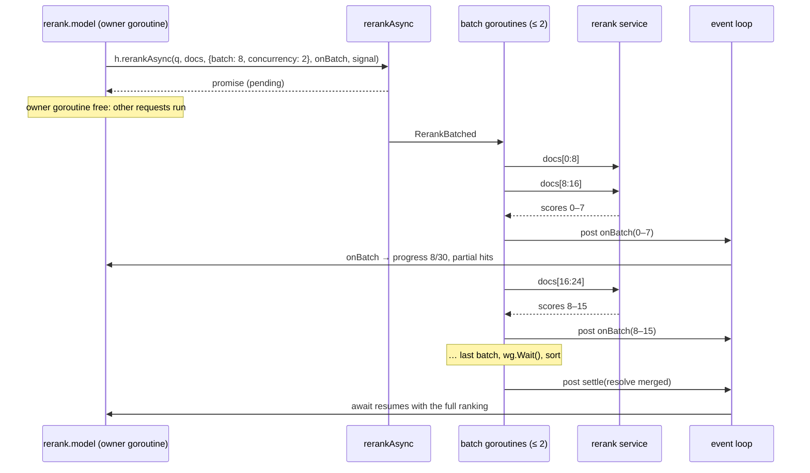
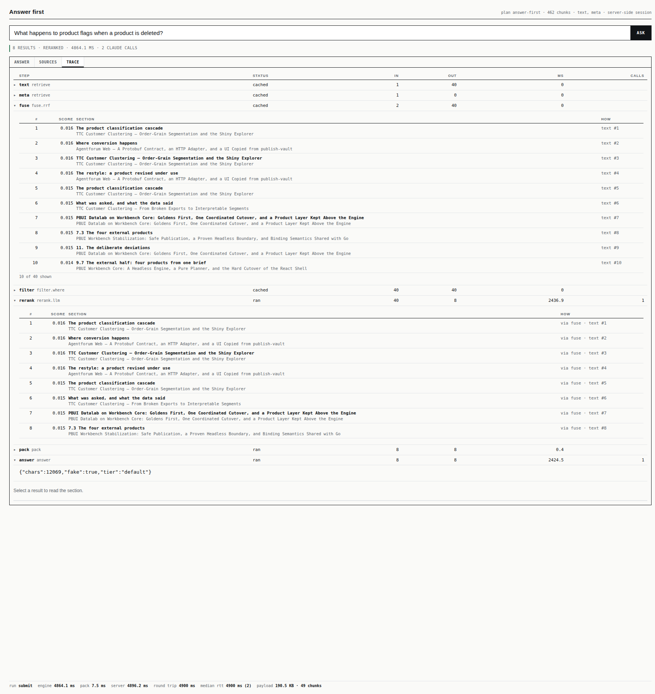
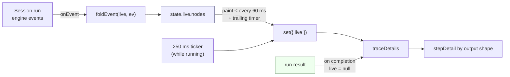
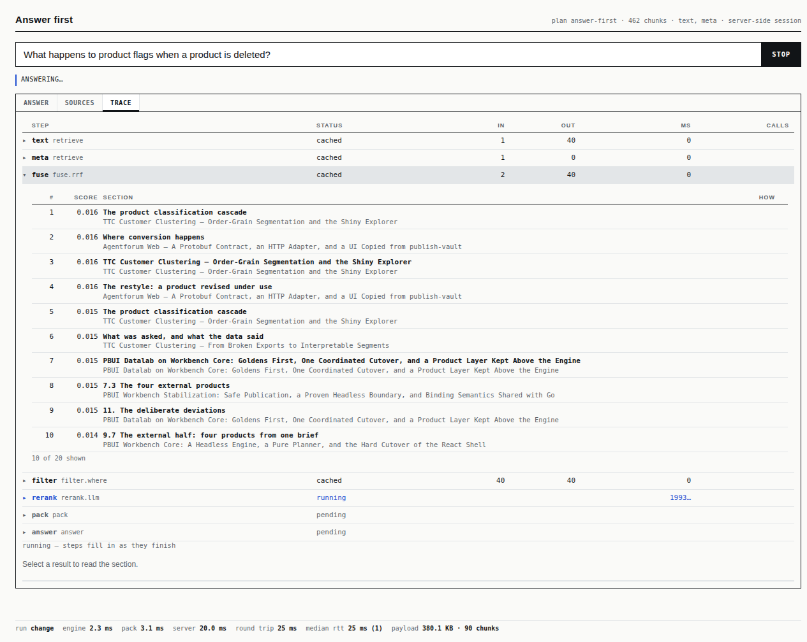
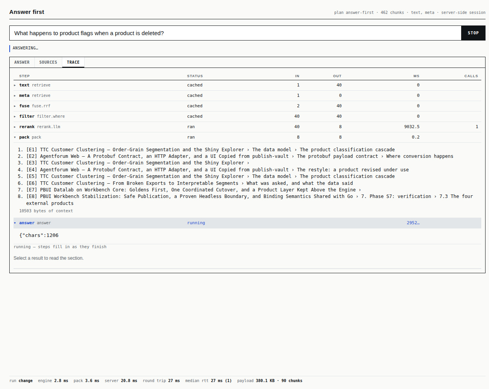

# rag-workbench: Per-Step Trace Details and an Asynchronous Batched Rerank — A Technical Deep Dive

rag-workbench (`ragwb`) runs retrieval plans written in JavaScript on a Go host. A plan is a chain of steps — retrieval from one or more indexes, fusion, filtering, reranking, packing evidence into a context, and an optional LLM answer — and every run of a plan produces a *trace*: one entry per step with its status, input and output counts, and time. The previous ticket, RAGWB-004, gave the engine an event stream that reports these steps while a query runs. This report covers RAGWB-005, which uses that stream for two things. The first is a trace view in the browser that shows *what each step produced*, not just how long it took, and fills in while a slow query is still running. The second is a rewrite of the cross-encoder rerank step, `rerank.model`, which used to block the whole server for the duration of one model call and now runs in batches off the JavaScript thread, reporting progress after each batch. Along the way, a premise stated in the previous ticket turned out to be wrong, and a defect in how cached steps were reported was found in the browser; both are described here.

> [!summary]
> - **`trace({ details: true })`.** Every row of the trace expands to the step's output: a ranked hit table with fusion parts, matched terms and rerank reasons; the pack's evidence; the answer's text. During a submit run, the rows fill in from engine events as steps finish.
> - **Cached steps describe their output.** A step served from the session memo now emits the same `hits`/`context` events as a step that ran, so the live view and SSE clients see every step's result.
> - **`rerank.model` is asynchronous and batched.** It was one synchronous request on the runtime's only thread. It now sends batches of 8 passages, two at a time, on Go goroutines, returns a promise, reports progress and partial rankings per batch, and is cancelled with the request.
> - **Measured on the real reranker:** median first progress after 158 ms of a 309 ms rerank (batch 8 × 2); a lexical query issued during the rerank completes in 6–18 ms; the order of all 30 passages equals the single-request order in 12 of 12 runs, with scores within 0.0006.

## Why this project exists

The work started with a question asked while RAGWB-004 was being built: whether the Trace tab of the answer app could show "details on each pipeline step and the results at that point". The trace table answered *how long* each step took. It could not answer the questions a person tuning a plan actually asks. Which sections did the lexical retriever find, and which did the metadata retriever find? Which of them survived fusion, and from which source did each come? What did the reranker move up? What exactly went into the LLM's context? All of this information existed in the run result; nothing displayed it.

The second follow-up came from the same ticket. RAGWB-004's task list said that `rerank.model` should report "progress per batch", on the stated assumption that its batches already ran inside Go. Reading the code to implement that showed that there were no batches at all, and that the rerank had a more serious property: it blocked the server. That turned a small progress feature into a concurrency fix.

The two pieces are independent in code but share a purpose. Both make the progress of a query visible while it is happening, and the second produces exactly the kind of intermediate result — a partial ranking after each batch — that the first displays.

## Current project status

Both parts are implemented on branch `task/ragwb-005-trace-details-rerank` of `/home/manuel/code/wesen/go-go-golems/rag-workbench`:

- `22afff8` — design doc; asynchronous batched `rerank.model` with progress.
- `62f1f89` — `trace({ details: true })`, per-step outputs, live from engine events; cached steps emit their outputs.

`go vet ./...` and `go test ./... -count=1` pass. The trace view was checked in a browser against `ragwb serve` with a slowed-down fake LLM, and the rerank was measured against the real `bge-rr-v2-m3` reranker through LunaRoute. The answer-first preset's Trace tab uses the new view.

## Background: plans, steps, sessions and the runtime

Three facts about rag-workbench are needed to follow the rest of the report.

**A plan compiles to a graph of steps.** The plan builder (`rag.plan(...).over(corpus).retrieve(...).fuse.rrf().rerank.model().pack().answer()`) compiles to an intermediate representation (IR) whose nodes have a *phase*. Build-phase nodes (parse, chunk, index) run once per corpus. Live-phase nodes run on every query. A live node also has a *trigger*: `change` nodes run on every keystroke; `submit` nodes, such as an LLM rerank or the answer, run only when the user presses Enter or Ask.

**A session memoizes live steps.** `Session.run(signals, opts)` walks the live nodes in order. For each node it checks a memo entry: if the node's definition, its input values (by identity) and the signals it read are unchanged, the stored output is reused and the trace entry says `cached`. The memo holds one entry per node, the output of the last run that computed it. This is what makes a keystroke run take a few milliseconds: only the steps whose inputs changed run again.

**One JavaScript runtime per app, one thread.** Under `ragwb serve`, each app is one goja runtime owned by one goroutine. Every request's JavaScript runs on that goroutine, interleaved at `await` points. Go code called from JavaScript runs on that goroutine too, unless it hands its work to another goroutine and returns a promise. Work that finishes on another goroutine re-enters the runtime by posting a function to the runtime's event loop (`runtimebridge` `PostWithLifetimeContext`), which runs posted functions in order.

RAGWB-004 added two more pieces. **Events**: `Session.run` reports `run`, `node` start and end, `hits` (the top hits of a hit-producing step, with a `partial` flag for intermediate rankings), `context` (the pack's evidence labels and size), `text` (answer deltas), `progress`, `tool` and `note` through an `onEvent` callback. **Request scopes** route each request's events to that request, and carry an `AbortSignal` that a step can read as `ctx.signal`.

## Part I: an asynchronous, batched `rerank.model`

### What a cross-encoder rerank computes

A retriever such as BM25 or a vector index scores a passage without looking at the query and the passage together: BM25 sums per-term weights, a vector index compares two independently computed embeddings. A *cross-encoder* reads the query and one passage as a single input and outputs one relevance score for that pair. This is slower — one model evaluation per passage — and more accurate, which is why it is applied only to the top *k* candidates of a cheaper retriever. `rerank.model` takes the first *k* hits (default 30), sends the query and the *k* passage texts to a rerank service, and reorders the hits by the returned scores.

The property that matters for batching is that the score of each pair depends only on that pair. Sending 30 passages in one request, or in four requests of 8, 8, 8 and 6, asks the model the same 30 questions. The scores, and therefore the order, are the same in exact arithmetic. Section "Measurements" shows how close the real service comes to that.

### The state before this ticket

The component was a few lines of JavaScript in `pkg/natives/vector.go` that called a Go helper:

```js
// before RAGWB-005 (simplified)
run: (s, ctx, hits, p) => {
  const head = hits.slice(0, k), docs = head.map(textOf);
  const ranked = h.rerank(model, s.q, docs);   // Go: Embedder.Rerank(context.Background(), …)
  return ranked.map(r => ({ ...head[r.index], score: r.score }));
}
```

`h.rerank` called `Embedder.Rerank` directly, with `context.Background()`, on the runtime's owner goroutine. Three consequences follow from the runtime model above:

1. **The server stalled.** While the HTTP request to the rerank service was in flight (typically 200–450 ms), the owner goroutine was blocked, so every other request to the same app — including keystroke searches that take a few milliseconds — waited for it.
2. **It could not be cancelled.** The request used a background context. A client that disconnected still paid for the rerank.
3. **There was nothing to report.** One request means one result; there is no intermediate state to show.

The design doc for this ticket records the correction explicitly, because the earlier task line ("progress per batch; the batches run inside Go") had been stated as fact.

### Batching in Go: `RerankBatched`

The batching is plain Go, independent of JavaScript, in `pkg/natives/rerank.go`:

```go
func RerankBatched(ctx context.Context, e Embedder, model, query string, docs []string,
	size, conc int, onBatch func([]llm.RerankResult)) ([]llm.RerankResult, error)
```

It splits `docs` into consecutive batches of `size`, and runs each batch's request on its own goroutine, with a buffered channel of capacity `conc` as a semaphore so that at most `conc` requests are in flight. Each request returns indexes relative to its batch; the goroutine adds the batch's offset so that every result refers to a position in the full `docs` slice. The goroutine then, under one mutex, appends its results to the merged list and calls `onBatch` with them. The mutex makes the `onBatch` calls serial even though they come from different goroutines.

```text
RerankBatched(ctx, docs, size, conc, onBatch):
  ctx, cancel = WithCancel(ctx)
  for lo in 0, size, 2·size, …:
      acquire semaphore (or stop if ctx is done)
      go:
          res, err = Rerank(ctx, docs[lo:lo+size])
          lock
            if err: remember the first error; cancel()       # the other batches stop
            else:   shift res indexes by lo; append to all; onBatch(res)
          unlock; release semaphore
  wait for all goroutines
  if first error: return it
  sort all by score descending, then index ascending
  return all
```

Two details make the result deterministic. Batches finish in whatever order the network delivers them, so the merged list is sorted at the end rather than kept in arrival order. And two passages can receive the same score (the real reranker returns scores like `0.0024` for several low-relevance passages), so the sort breaks ties by original position. A single request through the same function — `size ≥ len(docs)` — goes through the same sort, so a batched and an unbatched call use one ordering rule.

An error in any batch cancels the shared context, which aborts the requests still in flight, and is returned once all goroutines have finished. A backend that returns an index outside its batch is treated as an error rather than silently misplacing a passage.

### Crossing back into the runtime: `h.rerankAsync`

The JavaScript side cannot call `RerankBatched` directly, because it blocks until all batches are done. `rerankAsync` (same file) wraps it as a promise:

```text
h.rerankAsync(model, query, docs, {batch, concurrency}, onBatch, signal) → Promise
  promise, resolve, reject = vm.NewPromise()
  callCtx, cancel = WithCancel(services.Lifetime())      # dies with the runtime
  signal.addEventListener('abort', cancel)               # dies with the request
  go:
     cb = part => post("ragwb.rerank.batch",  vm => onBatch(part))
     res, err = RerankBatched(callCtx, …, cb)
     post("ragwb.rerank.settle", vm => err ? reject({code, message}) : resolve(res))
  return promise
```

The function returns immediately; the owner goroutine goes back to serving other requests. Everything that touches JavaScript values — calling `onBatch`, resolving or rejecting the promise — is *posted* to the event loop and therefore runs on the owner goroutine, never on a request goroutine.

The ordering of these posted functions matters. The JavaScript `onBatch` callback publishes a partial ranking; the promise resolution publishes the final one. If a partial ranking arrived after the final one, a client would display an incomplete result as the last word. The construction rules this out. Each batch's post happens inside `RerankBatched`, before that function returns. The settle post happens after it returns, which is after `wg.Wait()`, which is after every batch goroutine has finished, including its post. The event loop runs posted functions in the order they were posted. So every `onBatch` runs before the promise settles.

The rejection carries a code. If `callCtx` was cancelled while the runtime itself is still alive, the request was aborted, and the code is `cancelled`; the engine recognises that code, records the step as `error: the request was cancelled`, and stops the run instead of continuing to later steps. Any other failure is `rerank_failed` with the backend's message.

### The component

With the promise in place, `rerank.model` becomes an `async` step. The engine already awaited every step's `run`, so no engine change was needed:

```js
run: async (s, ctx, hits, p) => {
  const head = hits.slice(0, k), rest = hits.slice(k);
  const docs = head.map(x => [title, headingPath, text].join('\n\n'));
  const toHit = r => ({ ...head[r.index], score: +r.score.toFixed(4), reason: 'cross-encoder ' + r.score.toFixed(3) });
  const scored = [];
  const ranked = await h.rerankAsync(model, s.q, docs, { batch: p.batch ?? 8, concurrency: p.concurrency ?? 2 },
    part => {
      scored.push(...part);
      ctx.progress(scored.length, docs.length, 'passages');
      if (scored.length < docs.length)
        ctx.partial([...scored].sort((a, b) => b.score - a.score || a.index - b.index).map(toHit));
    },
    ctx.signal);
  return ranked.map(toHit).concat(p.keepTail === false ? [] : rest);
}
```

After each batch, the step reports `progress` (`8/30 passages`, `16/30`, …) and a partial ranking of the passages scored so far. Under a request scope these become `progress` events and `hits` events with `partial: true`; the final ranking is reported by the engine as the step's ordinary `hits` event when the step ends. The partial call is skipped for the last batch because the final event follows immediately.

The defaults, batch 8 and two in flight, give four requests for the default *k* of 30. That is enough intermediate results to show progress without multiplying per-request overhead; the measurements below show what smaller batches cost.



### What the tests establish

Two Go tests target `RerankBatched` with a fake ranker whose score is the number of query words a passage contains, and which returns each batch in reversed order so that the merge cannot rely on the backend's order:

- `TestRerankBatchedEqualsOneRequest`: 11 passages in batches of 3 with two in flight give exactly the same list as one request; four requests are made and four batches reported; the reported indexes cover all 11 passages, so they are global rather than per-batch; and passages with equal scores keep their original order.
- `TestRerankBatchedFailsOnABatchError`: a failing batch makes the call return that error.

Two runner tests drive the real component through a JavaScript runtime, with a ranker that sleeps 60–80 ms per request:

- `TestRerankModelBatchedAsyncWithProgress` reranks 12 passages in batches of 4, one at a time. It checks the progress events (`4/12`, `8/12`, `12/12`), the partial `hits` events (4 and then 8 hits), exactly one final `hits` event, and that the ranking equals a run with `batch: 99`. It also starts a lexical query *after the first progress event and before the rerank finishes*, and checks that the lexical query completes while fewer than three progress events have been seen. Under the old synchronous helper that is impossible, because the lexical query could not run until the rerank returned.
- `TestRerankModelCancelled` aborts the request scope after the first batch. The run's trace contains `rerank:error:the request was cancelled`, and the fake ranker records that a request saw its context cancelled.

### Measurements against the real reranker

The script `scripts/01-rerank-batching-bench.js` in the ticket builds a BM25 index over the 462-chunk reports corpus (`examples/apps/reports/corpus`), retrieves the top 30 for four queries, and reranks them with `bge-rr-v2-m3` through LunaRoute in three configurations. Each configuration runs once to warm up and once measured; during the measured run, the script starts a lexical query and records its latency. The sample is small (four queries, one measured run each, over a network), so the numbers show orders of magnitude, not precise ratios.

| configuration | requests | median rerank | median first progress | lexical query during rerank |
|---|---|---|---|---|
| one request (batch 30) | 1 | 310 ms | 332 ms (= the end) | 6–11 ms |
| batch 8, 2 in flight (default) | 4 | 309 ms | 158 ms | 6–8 ms |
| batch 4, 4 in flight | 8 | 558 ms | 198 ms | 6–18 ms |

Three observations follow.

**The server stays responsive.** In every configuration, a lexical query issued during the rerank finished in 6–18 ms, the same as with no rerank running. Before the change, it would have waited for the rerank's 200–450 ms.

**Batches of 8 cost nothing in total time and halve the wait for the first result.** Four requests, two at a time, take about as long as one request of 30. The first partial ranking arrives at about half the total time. Batches of 4 with four in flight are slower overall (558 ms median): eight requests pay eight times the per-request overhead, and four concurrent requests compete at the service.

**The ranking is the same, the scores almost.** In all 12 batched runs, the order of all 30 reranked passages equalled the one-request order. The scores did not always match exactly: the largest difference was 0.0006, while two one-request runs of the same query returned identical scores. The service's numerics evidently depend on how the passages are grouped into a request — consistent with padding or batched kernels — at the fourth decimal place. The first version of the benchmark compared `id:score` strings and reported 3 of 8 batched runs as different; comparing orders and score differences separately showed that only the scores drifted. Because tail passages can tie at four decimals (`0.0024`, `0.0024`), a different batching *could* swap two of them; in these runs it did not, and positions at the top are separated by far more than 0.0006.

## Part II: per-step details in the trace view

### What a run already returns

The browser's gui runtime (`pkg/ragjs/assets/gui.js`) renders declarative widgets — `results()`, `answer()`, `trace()`, `chunk()` — from a state object that includes `result`, the last run result. Everything the details view displays was already in that result:

- `result.outputs[nodeId]` is every step's output. For retrieve, fuse, filter and rerank steps it is a hit list, `[{id, score, via, parts?, why?, reason?}]`. `via` names the step that produced the hit; `parts` (fusion) maps each source to the hit's rank there, as in `{text: 3, meta: 1}`; `why` (BM25) maps matched, stemmed query terms to their contribution; `reason` is set by rerankers. For query-expansion steps it is a list of strings; for `pack` it is `{text, evidence, bytes}`; for `answer` and `agentic` it is `{text, evidence, cited, rounds?}`.
- `result.trace[i]` is `{node, t, ms, in, out, status, calls, notes, error, top}`, where `top` holds the first 50 hits of a hit step with their `why`, `parts` and `reason`.
- `rt.host.rag.chunk(id)` returns a chunk's title, heading path and text. Under `ragwb serve` the server sends the bodies of all chunks referenced by the outputs along with the result, so this lookup is local.

The finished view therefore needs no new data, only rendering. The live view needs the RAGWB-004 events.

### The widget: `trace({ details: true })`

`trace()` without options remains the compact table, so no existing preset changes. With `details: true`, each row gets a toggle (▸/▾). The set of expanded rows is runtime state, `traceOpen: {nodeId: true}`, so it survives re-renders and new runs: a user who expands `fuse` and `rerank` sees those two rows expanded for every subsequent query.

The detail view of a step is chosen by the *shape* of its output, not by the component type. Plans can define their own components, and a component that returns hits should be displayed as hits whatever it is called:

| output shape | detail view |
|---|---|
| array of objects with `id` | hit table: rank, score, section (heading in bold, document title below), and a *how* column: `via` (only when it differs from the step itself), fusion parts as `text #3 · meta #1`, the four largest `why` terms, and `↳ reason` |
| array of strings | numbered list (query expansions) |
| `{evidence, text}` without `cited` | evidence labels with document title and heading path, and the context size in bytes |
| `{text}` | the text rendered as markdown, the cited labels, and an agentic step's tool rounds |
| anything else | clipped JSON |
| notes, error | listed under the step |

Clicking a row of a hit table sets the `selected` state key — the same key `results()` and `chunk()` use — so the section opens in the chunk view below the trace. The answer-first preset's Trace tab is now:

```js
b.trace({ details: true }).chunk(s => s.selected).dag()
```



In the finished trace above, each fused hit's *how* column reads `text #1`, `text #2`, …: in this query the metadata retriever returned nothing, so every fused hit came from the lexical retriever at that rank. The rerank rows read `via fuse · text #n`, which records the path of each hit through the plan.

### Live mode: folding events into state

During a submit run the runtime passes `onEvent` to `session.run`, and folds each event into `state.live.nodes[nodeId]` with one function, `foldEvent`:

```js
function foldEvent(live, ev) {
  if (!ev || !ev.node || ev.type === 'build') return;
  const nd = live.nodes[ev.node] || (live.nodes[ev.node] = { status: 'running' });
  switch (ev.type) {
    case 'node':     if (ev.phase === 'start') { nd.status = 'running'; nd.t0 = Date.now(); }
                     else Object.assign(nd, { status, ms, in, out, calls, error, notes } /* from ev */);
                     break;
    case 'hits':     nd.hits = ev.hits; nd.total = ev.total; nd.partial = !!ev.partial; break;
    case 'context':  nd.evidence = ev.evidence; nd.bytes = ev.bytes; break;
    case 'text':     nd.text = (ev.reset ? '' : nd.text || '') + (ev.delta || ''); break;
    case 'progress': nd.progress = { done: ev.done, total: ev.total, unit: ev.unit }; break;
    case 'tool':     (nd.tools = nd.tools || []).push(ev); break;
    case 'note':     (nd.notes = nd.notes || []).push(ev.text); break;
  }
}
```

The function is pure with respect to the DOM, which is what makes it testable from Go: `gui.foldEvent` is exported, and `TestTraceFoldsRunEvents` folds the events of a real scoped run and checks that the retrieve step has its hits (with `out` equal to the event's `total`), the pack step its evidence, and the answer step a text equal to the final answer.

While `state.run.status` is `running`, `traceDetails` renders one row per live node of the IR: the nodes that have reported are shown with their folded state, the rest as `pending`. A running step's time column shows the elapsed time since its start event, `1991…`; a step with a `progress` record shows `running 16/30`. When the result arrives, `state.live` is cleared and the trace renders from `result.trace` and `result.outputs` as in the finished view.

Live mode is restricted to submit runs. Keystroke runs take 5–15 ms; they finish before a live view could paint, and collecting events for them would only add work to every keystroke.



**Repainting.** Events can arrive in bursts — a streamed answer produces a text delta every few milliseconds — so repainting on every event would rebuild the widget tree hundreds of times per second. The fold runs on every event; the repaint runs at most every 60 ms, with a trailing timer so that the last event before a pause is always painted. A run that has been superseded by a newer one never paints. A separate 250 ms interval repaints while the run is in flight, because the elapsed time of a running step changes even when no event arrives; the browser check showed why this is needed (below). The interval is cleared in a `finally` block, so a failed or cancelled run does not leave it running.





The two screenshots were taken against `ragwb serve` with the fake LLM slowed down (`RAGWB_FAKE_STREAM="60,150ms"`: 60 pieces, 150 ms apart), so that the LLM rerank and the answer each take about 9 s. The fake answer is a JSON stub because the prompt contains the word "json"; the content is not the point of the screenshots.

### Cached steps must describe their output

The first live capture showed a defect. The answer-first plan's retrieve, fuse and filter steps are `change` steps. By the time the user presses Ask, the keystroke runs have already computed them for the same query, so in the submit run they are served from the memo and the trace says `cached`. Expanding such a row during the live run showed "No output.": a cached step emitted only its `node` end event, never its `hits` or `context`.

There were two ways to fill the gap. The browser could show, for a cached step, the output from the previous result in `state.result`. That is not reliable: the memo holds the output of the last run that *computed* the step, while `state.result` is the last result the page *displayed*. The two differ when a run is superseded (its outputs enter the memo, its result is discarded), and under a server-side session they live in different processes. The other way is to have the engine describe a cached step's output exactly as it describes a computed one. That is what the change does. `Session.run` now has one helper,

```js
const describe = (n, out, entry) => {
  if (n.out === 'hits' && Array.isArray(out)) {
    entry.top = out.slice(0, 50).map(h => ({ id: h.id, score: h.score, why: h.why, parts: h.parts, reason: h.reason }));
    if (opts.onEvent) emit(hitsEvent(n.id, out, art, detail));
  }
  if (n.out === 'context' && out && opts.onEvent)
    emit({ type: 'context', node: n.id, evidence: out.evidence.map(e => ({ label: e.label, id: e.id })), bytes: out.bytes });
};
```

called both after a step runs and when a step is served from the memo with a complete output. As a result, the event stream contains every step's output by construction, the trace entry of a cached step has `top` like any other, and SSE clients of RAGWB-004 receive the same information. `TestCachedStepsReportTheirOutput` runs a change run and then a submit run of the same query in one session, folds the submit run's events, and checks that the retrieve and pack steps are `cached` and carry hits and evidence.

The memo semantics are worth stating precisely, because the first version of that test got them wrong. `rag.run(plan, …)` creates a new session for each call, so two `rag.run` calls never share a memo, and every step of the second call runs. The test therefore uses one explicit session, `rag.engine().session(rag.compile(plan))`, as the gui runtime does.

## Problems found during development

- **An earlier premise was false.** "The batches run inside Go" described code that did not exist; the rerank was one synchronous request. The design doc and the diary record the correction before the implementation.
- **The live elapsed time stopped.** The time column of a running step was computed when the table was painted, and the table was painted only on events. During a 9 s LLM rerank, which emits no events until it ends, the cell read `60…` for the whole duration. The 250 ms interval fixed it; the capture after the fix reads `1491…` and then `1991…`.
- **Cached steps were empty in the live view**, as described above.
- **Live evidence showed raw chunk ids.** The `context` event carries labels and ids only; the live view now resolves titles and heading paths through `rt.host.rag.chunk(id)`.
- **Numeric columns were misaligned.** Right-aligned numbers sat under left-aligned headers; numeric `th` cells now carry a `num` class.
- **The benchmark's first comparison was too strict**, comparing scores to four decimals rather than orders; see the measurements.
- **Screenshots of a finished run.** The fake LLM streamed too fast for a live capture. `--llm fake` now reads `RAGWB_FAKE_STREAM="pieces,delay"`.

## Limitations and open questions

- The live `hits` event is compact (id, score, rank, document, heading, `via`), so the *how* column of a hit table is empty while a run is in flight and fills in from `result.trace[].top` when the run ends. Adding `parts` to the event would close most of that gap at a small cost in event size.
- Cached steps now emit a `hits` event on every submit run. For an SSE client this is one extra capped event per cached hit step; `?events=` can exclude them.
- The 250 ms interval repaints every widget that depends on `live`. In the presets that is only the trace, but a page with many such widgets would repaint them all.
- Query embedding for `index.vector` is still a synchronous call on the owner goroutine. It is one short request per distinct query, cached, but it has the same structural problem the rerank had.
- The rerank's score drift across batch groupings (up to 0.0006 here) is a property of the service. A plan that needs bit-identical scores across runs should keep `batch ≥ k`.
- There is no DOM-level test of `traceDetails`; the tests cover the fold and the engine, and the rendering was checked in a browser.

## Near-term next steps

- Add `parts` (and possibly the top `why` terms) to the compact `hits` event.
- Move query embedding to the same promise-and-post pattern as `rerankAsync`.
- Use the details view in the other presets that expose a trace (fusion, compare-nodes, agentic).

## Key points

- A trace that reports *results*, not only timings, needs no new data source when the engine already returns each step's output and reports it as events; it needs rendering by output shape and a fold from events to state.
- A memoized step must be reported like a computed one. Otherwise every consumer of the event stream has to reconstruct cached outputs from older state, and some will do it wrongly.
- On a single-threaded runtime, any blocking call from JavaScript into Go blocks every request. The fix is a promise whose work runs on goroutines and whose results re-enter through the event loop; posting partial results before the settlement, in one FIFO queue, guarantees that the final result is the last one delivered.
- Batching a cross-encoder preserves the ranking because each score depends only on its (query, passage) pair. The real service agrees on order and differs in the fourth decimal of the scores.

## Important project docs

- Ticket: `ttmp/2026/11/04/RAGWB-005--per-step-trace-details-in-the-gui-and-an-asynchronous-batched-rerank-model-with-progress/`
  - `design-doc/01-design-trace-details-widget-and-asynchronous-batched-rerank.md`
  - `reference/01-investigation-diary.md` (steps 1 and 2)
  - `scripts/01-rerank-batching-bench.js` and `01-rerank-batching-bench.result.json`
- Previous ticket: [[PROJECT REPORT - rag-workbench - Query Endpoints and Streamed Intermediate Results - A Technical Deep Dive]] (events, scopes, SSE).

## File reference

| file | role |
|---|---|
| `pkg/natives/rerank.go` | `RerankBatched` (batches, semaphore, merge, first-error cancel), `rerankAsync` (promise, abort signal, posted callbacks) |
| `pkg/natives/vector.go` | `rerank.model` as an async step with `ctx.progress` and `ctx.partial` |
| `pkg/natives/rerank_test.go` | batched equals one request; a failing batch fails the call |
| `pkg/runner/rerank_test.go` | progress and partial events, a query served during the rerank, cancellation |
| `pkg/ragjs/assets/rag.js` | `describe` in `Session.run`: `top` and `hits`/`context` events for computed and cached steps |
| `pkg/ragjs/assets/gui.js` | `foldEvent`, `stepDetail`, `hitTable`, `traceDetails`, live `runNow` |
| `pkg/ragjs/trace_fold_test.go` | folding a run's events; cached steps report their outputs |
| `web/workbench/index.html` | `.g-trace-*` styles (served as `/gui.css`) |
| `examples/presets/answer-first.js` | Trace tab uses `trace({ details: true })` |
| `cmd/ragwb/cmds/roots.go` | `RAGWB_FAKE_STREAM` for a slow fake LLM |
