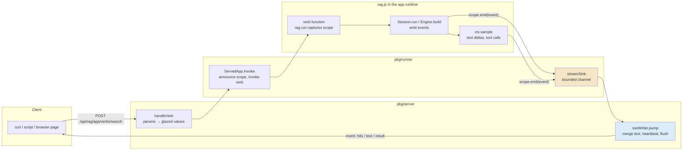
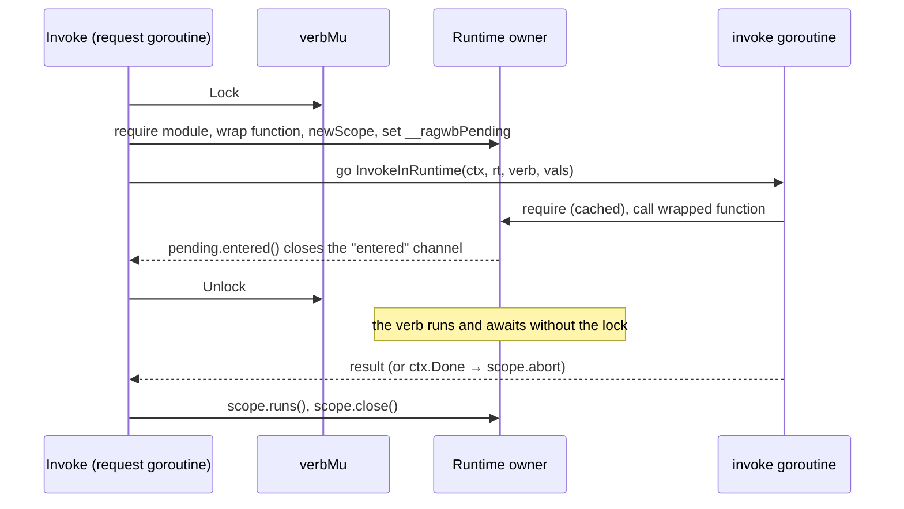
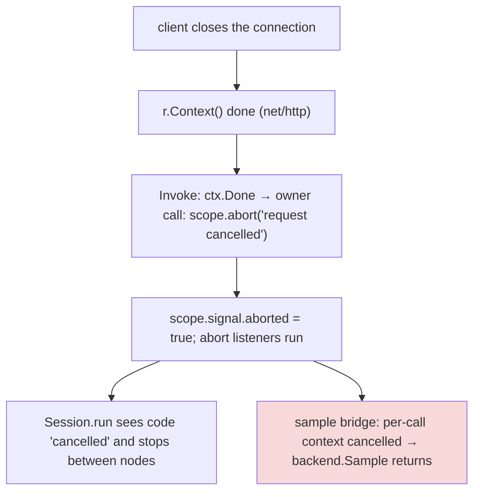

# rag-workbench: Query Endpoints and Streamed Intermediate Results — A Technical Deep Dive

rag-workbench (`ragwb`) runs retrieval plans written in JavaScript on a Go host. A plan describes how a corpus is turned into chunks and indexes, and how a query flows through retrieval, fusion, reranking, packing and an optional LLM answer. `ragwb serve` keeps one long-lived JavaScript runtime per app, builds the plan once, and answers each query by running only the query-time steps. Until this ticket, the only way to query a served app over HTTP was a private endpoint shaped for the app's own browser page. This report explains how RAGWB-004 turned the app's existing command-line *verbs* into public HTTP endpoints, and how those endpoints stream typed events while a query runs: which step started and finished, what each retrieval step produced, the LLM text as it is generated, and the tool calls of an agentic step. It covers the event model, the per-request scopes that make streaming correct when many requests share one runtime, the Server-Sent Events transport, cancellation down to the model call, and the measurements on a vault of 85,891 chunks.

> [!summary]
> - **Verbs become endpoints.** Every function an app declares with `__verb__` is a command (`ragwb verbs …`) and, under `ragwb serve`, an HTTP endpoint with the same parameters. Requests get JSON, or, with `Accept: text/event-stream`, a stream of events ending in the result.
> - **The engine emits events, scopes route them.** `Session.run` and `Engine.build` report node start/end, intermediate hits, text deltas, tool calls and builds through one callback. A request scope, captured when `rag.run` is called, sends each request's events to that request alone, although all requests share one single-threaded runtime.
> - **Cancellation reaches the model.** Closing the connection aborts the scope; the engine stops between steps and the in-flight LLM call is cancelled through a per-call Go context.
> - **Streaming is free on the vault.** Median request time is 9.3 ms with JSON and 9.3 ms with SSE; the first intermediate result arrives after 8.7 ms.

## Why this project exists

A retrieval plan is most useful when other programs can call it. A script that wants "search the vault for X" or "answer Y from the project reports", an agent that uses the vault as a tool, and a dashboard that shows how a query was answered all need a stable interface. Before RAGWB-004 they had three options, and none was adequate. They could start `ragwb verbs` as a subprocess, which loads or rebuilds the corpus in a new process every time. They could post raw query inputs to `POST /api/rag/{app}/run`, the endpoint the browser page uses, and parse a payload shaped for that page. Or they could reimplement the plan.

Long-running queries made the problem sharper. A query that ends in an LLM answer runs for seconds; a model rerank runs for hundreds of milliseconds; an agentic step runs several model rounds with tool calls between them. A caller saw nothing until the end, and a caller that gave up left the server spending model calls on an answer nobody would read.

The user set the requirements in two short exchanges:
- endpoints are derived from the verbs in the app directory, including `app.js`;
- they are served by `ragwb serve`;
- the transport is Server-Sent Events, and the browser page moves to it too;
- intermediate results carry ids and scores, with full chunks only on request;
- there is no authentication and no multi-tenancy, because serve listens on loopback.

## Current project status

All five phases of the design are implemented and committed on `task/ragwb-004-query-api-sse` (stacked on the RAGWB-003 incremental-reindex branch), with the full test suite passing:

| Commit | Phase |
|---|---|
| `0a6e9ab` | Engine events and request scopes in `rag.js` |
| `b1dfa7a` | Verbs run in the served runtime, in request scopes (`ServedApp.Invoke`) |
| `c512dd3` | HTTP endpoints, JSON and SSE, in `ragwb serve` |
| `413c954` | The browser page's run endpoint on SSE; NDJSON removed |
| `642e547` | Cancellation of LLM calls, an `ask` verb in `examples/apps/reports/app.js`, help text |

The change adds 2,086 lines and removes 94 across 16 files under `pkg`, `cmd`, `web` and `examples`; about a thousand of the added lines are the three new Go files (`pkg/runner/verbs.go`, `pkg/server/sse.go`, `pkg/server/verbs.go`). Two follow-ups remain open: progress events from the Go-backed `rerank.model` step, and a trace widget in the browser page that shows each step's results.

## Background: the parts this feature connects

Five pieces of rag-workbench meet in this feature. Each is defined here before the design uses it.

**Plans, build nodes and live nodes.** A plan is a directed graph of components. `rag.compile(plan)` turns it into an intermediate representation (IR): a list of nodes `{id, t, p, in, phase}`, where `t` is the component type and `p` its parameters. Build nodes (`phase: 'build'`: source, parse, chunk, index) depend only on the corpus; `Engine.build(ir)` runs them and stores their outputs on disk. Live nodes (retrieve, fuse, filter, rerank, pack, answer, agentic) run on every query; `Session.run(signals)` runs them in order, reading the built artifacts. Signals are the query inputs such as `q` and `k`.

**The runtime owner.** goja, the JavaScript engine, is not safe for concurrent use. go-go-goja gives every runtime an *owner*: all JavaScript executes inside `rt.Owner.Call(ctx, op, fn)`, which runs `fn` on one goroutine. `ragjs.Eval` calls into the runtime and, if the result is a promise, polls it with further owner calls until it settles. Between two owner calls, other callers may run. A request that is waiting for an LLM response has yielded the owner, and the JavaScript of another request runs in the meantime.

**The served app.** `runner.OpenApp` creates the runtime, runs a harness script that requires the app's `app.js`, compiles and builds its plan, and installs `globalThis.__serve`, an object of functions the Go side calls later (`run`, `chunk`, `doc`, `refresh`). `pkg/server/rag.go` maps HTTP routes onto those functions.

**Verbs.** jsverbs, a package in go-go-goja, turns annotated functions into glazed CLI commands. A file declares fields and sections next to the function, and the scanner reads them statically:

```js
async function search(q, k, plan, trigger) {
  const r = await rag.run(plans[plan], { q, k }, { trigger });
  return r.top(k).map((h, i) => ({ rank: i + 1, score: h.score, doc: h.doc, heading: h.heading, id: h.id }));
}
__verb__("search", {
  short: "Run one query through a plan",
  fields: {
    q: { argument: true, help: "Query text" },
    k: { type: "int", default: 5, help: "Number of hits" },
    plan: { type: "choice", choices: ["lexical", "fused", "semantic", "hybrid", "hybrid-rerank"], default: "lexical" },
    trigger: { type: "choice", choices: ["change", "submit"], default: "submit" },
  },
});
```

At run time, jsverbs replaces the runtime's module loader with one that serves only the scanned files, keyed by a module path such as `/search.js`, and appends to each file an *overlay* that stores the file's functions in `globalThis.__glazedVerbRegistry[modulePath]`. `Registry.InvokeInRuntime(ctx, rt, verb, values)` builds the argument list from parsed glazed values, requires the module, takes the captured function from that registry object, calls it, and waits for its promise.

**The default engine.** `rag.run(plan, signals, opts)` runs the plan on the runtime's default engine, which is also the engine the serve harness builds the app's plan with. A verb running inside the served runtime therefore reuses everything already built for its plan.

## Architecture

The design has three layers with one responsibility each. The engine (`rag.js`) produces events and knows nothing about HTTP. The host (`pkg/runner`) runs a verb inside a request scope and turns JavaScript events into Go values on a channel. The server (`pkg/server`) maps HTTP requests to verb parameters and events to JSON or to an event stream.



The HTTP surface added to `ragwb serve`:

| Route | Meaning |
|---|---|
| `GET /api/rag/{app}/verbs` | The app's verbs with their parameters (name, section, type, default, choices, required, help). |
| `POST /api/rag/{app}/verbs/{verb...}` | Run a verb with a JSON object of parameters. JSON envelope by default; Server-Sent Events with `Accept: text/event-stream` or `?stream=sse`. |
| `GET /api/rag/{app}/verbs/{verb...}?k=…` | The same, with parameters as query strings. |
| `POST /api/rag/{app}/run` | The browser page's endpoint, now streaming with SSE instead of NDJSON. |

Query options configure the response rather than the verb: `chunks=1` adds full chunk objects to intermediate results, `events=hits,text` restricts the event types, and `top=N` caps the hits per event (default 20).

## One request, traced

The clearest way to see the design is a real request. The reports example app (eleven project reports, 462 chunks) serves its `search` verb; the following is the first part of the stream for `q=rebalance law`, `k=3`, `plan=fused`, `top=2`, as printed by `curl -N` (hit lists shortened; the node events are shown with the field name `component`, which replaced `t` after this run, see "Problems found during development"):

```text
event: start
id: 1
data: {"seq":1,"t":0.1,"params":{"k":3,"plan":"fused","q":"rebalance law","trigger":"submit"},"type":"start","verb":"reports search"}

event: run
id: 2
data: {"seq":2,"t":4.8,"type":"run","plan":"fused","trigger":"submit","signals":{"q":"rebalance law","k":3,"filters":{}},"run":1}

event: node
id: 3
data: {"seq":3,"t":4.8,"type":"node","node":"text","component":"retrieve","phase":"start","run":1}

event: hits
id: 4
data: {"seq":4,"t":5.5,"type":"hits","node":"text","total":26,"hits":[{"id":"project-report-pbui-workbench-core-…#5-9-the-rebalance-law", …}],"run":1}

event: node
id: 5
data: {"seq":5,"t":5.6,"type":"node","node":"text","component":"retrieve","phase":"end","status":"ran","ms":0.6,"in":1,"out":26,"calls":0,"run":1}
```

The stream continues with the `meta` retriever (0 hits for this query), the reciprocal-rank fusion step, the filter, `runEnd`, and finally `event: result` carrying the verb's return value. Several properties are visible in these five events:

- Every event is a JSON object with a `type`. The server prepends `seq` (the position in the stream) and `t` (milliseconds since the request arrived); the engine adds `run`, the number of the `rag.run` call within the request, because a verb may run several plans.
- The `start` event echoes the parameters after parsing, including defaults the caller did not send (`trigger: "submit"` comes from the verb's field definition).
- A retrieval step reports its result before its own `end` event. The `hits` event says how many hits the step produced (`total: 26`) and carries the top two, as `top=2` asked, with ids, scores, document titles and headings but no chunk text.
- The first intermediate result arrives 5.5 ms into the request. A caller can render it long before an LLM answer at the end of the same plan would arrive.

For a plan that ends in an LLM answer, the same stream carries `context` (the evidence labels the pack step chose), `text` events with the answer's deltas, and `node` end events with the number of model calls. The reports app's `ask` verb, served with the fake LLM backend, produced this distribution of event types for one request:

```text
      1 event: context
      5 event: hits
     14 event: node
      1 event: result
      1 event: run
      1 event: runEnd
      1 event: start
      1 event: text
```

The five `hits` events are the text retriever, the metadata retriever, the fusion, the filter and the LLM rerank, which together show how the candidate list changed at each stage.

## The event model

The engine produces twelve event types. The table lists each with the condition that emits it and its fields; `run` and `node` fields are present wherever they apply.

| Type | Emitted when | Fields |
|---|---|---|
| `start` | the server accepted the request (host event) | `verb`, `params` |
| `run` | a `rag.run` begins | `plan`, `trigger`, `signals` |
| `build` | the run had to build a node first | `node`, `component`, `ms`, `count`, `reused`, `stored`, `incremental`, `delta`, or `waiting: true` |
| `built` | that build finished | `ok`, `ms`, `errors` |
| `node` | a live node starts or ends | start: `node`, `component`, `phase`; end: also `status`, `ms`, `in`, `out`, `calls`, `notes`, `error` |
| `hits` | a node whose output is a hit list finishes, or calls `ctx.partial` | `node`, `total`, `hits[]` of `{id, score, rank, doc, heading, via, reason, chunk?}`, `partial` |
| `context` | a `pack` node finishes | `node`, `evidence[]` of `{label, id}`, `bytes` |
| `text` | an LLM node produces text | `node`, `delta`, `reset` |
| `tool` | an LLM node's tool call starts or ends | `node`, `call`, `name`, `phase`, `input` or `ms`, `summary`, `isError` |
| `progress` | a long node reports progress | `node`, `done`, `total`, `unit` |
| `note` | a node calls `ctx.note`, or a verb emits its own | `node`, `text` |
| `runEnd` | the `rag.run` finished | `ms`, `calls`, `errors` |
| `result` / `error` | the verb returned / failed (host events) | the JSON envelope / `code`, `message` |

Three design choices in this table deserve explanation.

**Text is sent as deltas.** Before this ticket, the browser page received the whole answer so far in every frame, and the server dropped frames that arrived less than 50 ms after the previous one. That was safe only because each frame repeated everything before it. An SSE stream over one connection is ordered and loses nothing, so sending only the new text is both cheaper and simpler for clients. The concatenation of a node's `delta` values is its complete text. The components themselves were not changed: `answer` and `agentic` still call `ctx.emit(textSoFar)`, and the context computes the delta in one place.

**Hits are compact by default.** A retrieval step on the vault returns 20 to 40 hits. With ids, scores, titles and headings, a `hits` event is about 3 KB; chunk texts would add about 2 KB per hit. The user chose ids and scores by default and full chunks on request, which is `chunks=1`.

**Cached and skipped nodes get only an end event.** The session reuses a node's previous output when its inputs and the signals it reads have not changed, and skips submit-only nodes on keystroke runs. Such a node emits one `node` event with `status: "cached"` or `"skipped"` and no `hits`, so a client can tell which steps actually ran.

## Engine instrumentation

All engine events pass through one callback, `opts.onEvent`, which `Session.run` and `Engine.build` accept. The existing callbacks `onNode` and `onText` remain for the workbench and other callers. The changes to `Session.run` follow its node loop:

```js
const emit = safeEmit(opts) || (() => {});
emit({ type: 'run', plan: ir.id, trigger, signals: s });
for (const n of ir.nodes) {
  // … cached or skipped: emit({ type: 'node', node: n.id, component: n.t, phase: 'end', status, ms: 0, in, out }); continue;
  const ctx = this.ctx(n, ir, art, sample, s, notes, opts, opts.onEvent ? emit : null);
  emit({ type: 'node', node: n.id, component: n.t, phase: 'start' });
  let out = await def.run(sp, ctx, input, p);
  if (n.out === 'hits' && opts.onEvent) emit(hitsEvent(n.id, out, art, detail));
  if (n.out === 'context' && out && opts.onEvent) emit({ type: 'context', node: n.id, evidence: …, bytes: out.bytes });
  // …
  emit({ type: 'node', node: n.id, component: n.t, phase: 'end', status, ms, in, out, calls, notes, error });
}
emit({ type: 'runEnd', ms: result.ms, calls: result.calls, errors });
```

`safeEmit` wraps the callback so that an exception in a listener cannot fail the query. The node context gained three functions and changed one:

- `ctx.emit(textSoFar)` keeps its signature. It remembers the last text of its node and emits `{type: 'text', delta}` with the new suffix. If a text ever fails to extend the previous one, it emits `reset: true` followed by the whole text.
- `ctx.note(text)` still appends to the node's notes and now also emits a `note` event.
- `ctx.partial(hits)` lets a node publish an intermediate hit list before it finishes.
- `ctx.progress(done, total, unit)` lets a node report progress.

Tool calls are reported by wrapping the tools a node passes to `ctx.sample`. The wrapper is installed only when a listener exists, so runs without streaming pay nothing:

```js
execute: async (input, eo) => {
  const call = ++calls, t0 = now();
  emit({ type: 'tool', node, call, name: String(t.name), phase: 'start', input });
  try {
    const v = await t.execute(input, eo);
    emit({ type: 'tool', node, call, name: String(t.name), phase: 'end', ms: +(now() - t0).toFixed(1), summary: summarize(v) });
    return v;
  } catch (e) {
    emit({ type: 'tool', node, call, name: String(t.name), phase: 'end', ms: …, isError: true, summary: String((e && e.message) || e) });
    throw e;
  }
},
```

`summarize` reduces a tool result to `"8 results"` for an array or the first 120 characters otherwise, so that an agentic step reading whole sections does not put those sections into the stream.

When a query finds its plan unbuilt, `Session.run` builds it first and passes `onEvent` into that build. The first query against a new plan therefore streams the build: one `build` event per node, `progress` events from the parse and chunk steps, and `built`, before its `run` event. A test on a small inline corpus records exactly this sequence:

```text
build@files progress@parse progress@parse build@parse progress@chunks progress@chunks build@chunks build@ix-text built
run node:start@text hits@text node:end@text node:start@pack context@pack node:end@pack
node:start@answer text@answer text@answer text@answer text@answer node:end@answer runEnd
```

## Request scopes: routing events in a shared runtime

Producing events is the easy part. The hard part is delivering each event to the request that caused it, because every request to an app runs in the same JavaScript runtime.

### Why a global variable fails

The obvious implementation stores "the current request's event sink" in a global variable, sets it before calling the verb and clears it afterwards. The following sequence shows why that is wrong. Request A starts a verb that runs an LLM answer; request B starts a search while A waits for the model.

```mermaid
sequenceDiagram
  participant A as Request A (answer)
  participant O as Runtime owner
  participant B as Request B (search)
  A->>O: set current = A; call verb A
  O-->>A: verb A awaits the LLM (owner is free)
  B->>O: set current = B; call verb B
  O-->>B: verb B awaits nothing long, finishes
  Note over O: current is B (or cleared)
  O->>O: LLM text for A arrives, ctx.emit(text)
  Note over O: event is sent to B's sink, or dropped
```

The JavaScript that runs after an `await` resumes at an arbitrary later point, after any amount of other requests' code. A value that is "current" at the time of the call is not current when the continuation runs. goja has no equivalent of Node's `AsyncLocalStorage`, which would carry a value along an asynchronous call chain.

### Capture at call time

The design uses the one period in which no other request can run: the synchronous beginning of a call. The host makes a scope current only while the verb function starts, and `rag.run` copies the scope into the run's options at the moment it is called. From then on the scope travels inside `opts`, which already reaches `Session.run`, the triggered build, every node's context and `ctx.sample`.

```js
let currentScope = null;
function withScope(scope, fn) {
  const prev = currentScope;
  currentScope = scope || null;
  try { return fn(); } finally { currentScope = prev; }   // restored before any continuation can run
}
// scoped(opts): the options of a run started now, with the current (or an explicit opts.scope) scope
function scoped(opts = {}) {
  const sc = opts.scope !== undefined ? opts.scope : currentScope;
  if (!sc) return opts;
  const run = sc.nextRun ? sc.nextRun() : 0, prev = opts.onEvent;
  return {
    ...opts, scope: null, signal: opts.signal || sc.signal, detail: opts.detail || sc.detail,
    onEvent: ev => { if (prev) try { prev(ev); } catch (_) {} sc.emit(run ? { ...ev, run } : ev); },
  };
}
```

A scope is a plain object created by `rag.newScope(emit, detail)`. It has `emit`, a `signal` with the shape of an `AbortSignal` (`aborted`, `addEventListener('abort', f)`), `detail` (`top` and `chunks`), a run counter, `close()`, after which `emit` does nothing, and `abort(reason)`. `Engine.run` (which `rag.run` calls) and `rag.build` call `scoped(opts)`. Because `Engine.run` is an `async` function, its body up to the first `await` runs synchronously when called, so `scoped` executes while the scope is still current. The returned options carry `scope: null`, and the build that `Session.run` triggers is called with `scope: null` explicitly; without that, a run started inside `withScope` would count and emit its events twice.

The isolation is tested directly. Two runs are started inside their own scopes over a fake LLM that streams in pieces with a delay, so their events interleave on the owner:

```js
const sa = rag.newScope(ev => { a.push(ev); all.push('a'); }, { chunks: true });
const sb = rag.newScope(ev => { b.push(ev); all.push('b'); });
const pa = rag.withScope(sa, () => rag.run(plan, { q: 'rebalance law' }, { trigger: 'submit' }));
const pb = rag.withScope(sb, () => rag.run(plan, { q: 'widgets' }, { trigger: 'submit' }));
await Promise.all([pa, pb]);
```

The test asserts that the arrival order matches `/ab+a|ba+b/` (the runs really interleaved), that each sink saw only its own query in its `run` event, and that `detail.chunks` applied only to the scope that asked for it.

### The rule for verb authors

Capture at call time has one consequence that authors must know. `rag.run` must be *called* before the verb's first `await`. Every verb in the repository satisfies this, because each begins with `const r = await rag.run(…)`. A verb that awaits something else first takes the scope explicitly while it is still current:

```js
async function late(q) {
  const scope = rag.scope();          // first statement: still synchronous
  await null;                         // after this, the implicit scope is gone
  const r = await rag.run(plan, { q, k: 2 }, { scope });
  scope.emit({ type: "note", text: "custom" });   // verbs may emit their own events
  return r.hits.length;
}
```

A verb that breaks the rule still returns correct results; it only streams no run events. The server logs such requests with a hint: `(no rag runs streamed: call rag.run before the first await, or pass { scope: rag.scope() })`.

## Handing the scope to a verb

The scope must become current exactly while the verb function starts. `jsverbs.InvokeInRuntime` performs its own owner call to require the module and call the function, so the host cannot place `withScope` around that call from the outside. The design document proposed exporting jsverbs' argument builder from go-go-goja, so that the host could call the captured function itself. The implementation found a way that needs no upstream change.

The host wraps the captured function once. The wrapper takes a *pending scope* from a global, clears the global, signals the host that it has done so, and calls the original function inside `withScope`:

```js
globalThis.__ragwbWrapVerb = (entry, name) => {
  const f = entry && entry[name];
  if (typeof f !== 'function' || f.__ragwb) return typeof f === 'function';
  const w = function (...args) {
    const p = globalThis.__ragwbPending;
    globalThis.__ragwbPending = null;
    if (!p) return f.apply(this, args);
    p.entered();
    return rag.withScope(p.scope, () => f.apply(this, args));
  };
  w.__ragwb = true;
  entry[name] = w;
  return true;
};
```

A single pending slot is correct only if no second request can announce its scope before the first verb has taken it. `ServedApp.Invoke` guarantees this with a per-app mutex that is held from the announcement until the wrapper reports `entered`, and no longer:



The lock covers a few owner calls, not the verb's run, so a slow LLM answer does not delay other requests. If the invocation fails before the wrapper runs, for example because argument binding rejects the values, the host receives the error instead of `entered`, withdraws the pending scope under the same lock, and returns the error. With this arrangement, jsverbs' own argument binding is used unchanged, which keeps the CLI and HTTP behaviour of a verb identical.

Events cross from JavaScript to Go as strings. The scope's `emit` is a Go function that calls the VM's `JSON.stringify` on the event and passes `Event{Type, Data}` to the request's sink. Stringifying in JavaScript keeps the key order of the event and avoids walking the object with goja's exporter.

## Parameters: the verb's fields as the schema

Each verb already has a glazed schema, built by `registry.CommandDescriptionForVerb(verb)` from its `__verb__` fields and sections. `ParseVerbParams` uses that schema for HTTP parameters so that a request is validated exactly as the command line validates flags:

```text
JSON object (or query-string lists)
  → for each key: kebab(key) → field definition (sections may be nested: {"subset": {"include": […]}})
  → coerce: JSON numbers to int when the field is an integer (2.5 is an error), arrays to typed lists,
            strings through the field's own ParseField (query strings, "4" → 4)
  → sources.Execute(schema, values, sources.FromMap(m), sources.FromDefaults())
  → required fields without a value → error
```

`kebab` is a copy of jsverbs' field-name normalization, so a client may send either the name written in `__verb__` (`maxTokens`) or the command-line spelling (`max-tokens`). Errors are collected per field and returned as HTTP 400:

```json
{"error":{"code":"bad_params","fields":{"k":"Could not parse argument k as integer: strconv.Atoi: parsing \"a\": invalid syntax"},"message":"bad parameters: k: …"}}
```

The JSON response envelope contains the verb's full path, the parsed parameters, the verb's return value, a summary of each `rag.run` it made (built from the `run` and `runEnd` events), the chunks with `chunks=1`, and the elapsed time:

```json
{"verb":"reports ask","params":{"q":"product flags","k":2},"result":{"answer":"…","cited":[],"sources":[…]},
 "runs":[{"run":1,"plan":"answer","trigger":"submit","ms":8.1,"calls":2,"errors":[]}],"ms":19.7}
```

The result is the verb's return value as exported from JavaScript, not glazed rows. The HTTP API returns what the function returns.

## Transport: Server-Sent Events

Server-Sent Events is a text format over one HTTP response: blocks of `event:`, `id:` and `data:` lines separated by a blank line. It fits a query: the server sends, the client reads, and nothing flows the other way. It works with `curl -N` and, for GET requests, with the browser's `EventSource`.

### Keeping the runtime independent of the network

Engine events are emitted on the runtime's owner goroutine. If `emit` wrote to the network, a client that read slowly would stall every request of the app. The sink therefore only queues:

```go
func (s *streamSink) Emit(e runner.Event) {
	s.mu.Lock()
	defer s.mu.Unlock()
	if s.closed || s.slow {
		return
	}
	select {
	case s.ch <- e: // a queue of 256 events
		return
	default:
	}
	t := time.NewTimer(sseSlow) // 100 ms
	defer t.Stop()
	select {
	case s.ch <- e:
	case <-t.C:
		s.slow = true
		s.cancel() // a client that does not read is cut off, the request ends with error slow_client
	}
}
```

A separate pump goroutine reads the queue and writes the response. It prepends `seq` and `t` to each event's JSON, flushes after each event, and sends a `: ping` comment line every 15 seconds while idle. It also merges text deltas: a `text` event is held for up to 30 ms, and further deltas of the same node and run are appended to it. Merging concatenates strings, so no text is lost; it bounds the event rate when a model streams small pieces quickly. In the test with a fake model that produced 12 deltas 3 ms apart, the client received 2 `text` events.

### The end of the stream

Every stream ends with exactly one `result` or `error`, and it must come after every event the verb emitted. The handler enforces the order without concurrent writes: `Invoke` returns, the sink is closed, the handler waits for the pump to drain and exit, and only then writes the final event on the same writer. If the client disconnected, nothing is written and the log records `cancelled by the client`.

## Cancellation

A request that is abandoned should stop consuming model calls. The chain from the closed connection to the model request has four links:



The last link was missing before this ticket. The sample bridge (`pkg/ragjs/sample.go`) called the model with the runtime's lifetime context, and the JavaScript `signal` was checked only before the call started. The bridge now creates a context per call and cancels it from the signal:

```go
callCtx, cancelCall := context.WithCancel(services.Lifetime())
if sig, ok := call.Argument(3).(*goja.Object); ok {
	if add, ok := goja.AssertFunction(sig.Get("addEventListener")); ok {
		_, _ = add(sig, vm.ToValue("abort"), vm.ToValue(func() { cancelCall() }))
	}
	if a := sig.Get("aborted"); a != nil && a.ToBoolean() {
		cancelCall()
	}
}
go func() {
	defer cancelCall()
	res, err := backend.Sample(callCtx, lreq, onText, exec)
	// …
	} else if callCtx.Err() != nil && services.Lifetime().Err() == nil {
		failure = &llm.Failure{Code: "cancelled", Message: "the request was cancelled"}
	}
	// …
}()
```

The condition on the last branch distinguishes cancellation of one request from shutdown of the runtime, in which the lifetime context also ends; only the former is reported as `cancelled`, which `Session.run` already treats as an instruction to stop.

The test for this uses a model backend that emits a word every 10 ms until its context ends and records when that happens. The test cancels the request after the first `text` event and checks three things: `Invoke` returns `context.Canceled`, the backend observed the cancellation, and the runtime still answers a `search` afterwards. To confirm that the test measures the change, it was run once against the previous version of `sample.go`:

```text
--- FAIL: TestServedVerbCancelStopsTheModelCall (5.16s)
    verbs_test.go:290: the model call was not cancelled
```

With the new bridge it passes in 0.17 s.

## The browser page on the same transport

The page's run endpoint, `POST /api/rag/{app}/run`, keeps its request (`{signals, trigger}`) and its final payload (`{result, chunks, neighbors, packMs, timing}`). With `Accept: text/event-stream` it now streams the run's engine events through the same sink and pump, and ends with `event: result`. The NDJSON mode (`?stream=1`) was removed.

The page's client, `web/app-shell/shell.js`, cannot use `EventSource` because the endpoint takes a POST body, so it parses the stream from `fetch`:

```js
async function* sse(res) {
  const rd = res.body.getReader(), dec = new TextDecoder();
  let buf = '';
  for (;;) {
    const { done, value } = await rd.read();
    if (value) buf += dec.decode(value, { stream: true });
    let i;
    while ((i = buf.indexOf('\n\n')) >= 0) {
      const block = buf.slice(0, i); buf = buf.slice(i + 2);
      let event = 'message', data = '';
      for (const line of block.split('\n')) {
        if (line.startsWith('event:')) event = line.slice(6).trim();
        else if (line.startsWith('data:')) data += line.slice(5).trim();
      }
      if (data) yield { event, data: JSON.parse(data) };
    }
    if (done) return;
  }
}
```

The gui components of a page expect `onText(node, textSoFar)`, the cumulative text. The client rebuilds it from the deltas per node, so no component changed; pages may additionally pass `onEvent` to receive every engine event. Keystroke runs, which do not involve an LLM, stay plain JSON. In a browser test, the `answer-first` preset served with the fake LLM sent its submit with `Accept: text/event-stream`, received `Content-Type: text/event-stream`, and rendered the answer with eight reranked sources.

## Engine housekeeping for several plans

Serving verbs means that one engine now runs several plans: the app's own and whichever plans its verbs run. Two parts of the engine assumed a single plan and were changed.

**Garbage collection.** RAGWB-003 added `Engine.gc(ir)`, which, after a rebuild, drops memoized outputs whose build digest the app's IR no longer has and closes their file handles one collection later. A verb's plan has digests the app's IR does not have, so its outputs would have been retired and closed while the verb still used them. `Engine.run` now records each IR it runs in a list of the eight most recent (`noteIr`, `recentIrs()`), `gc` accepts a list, and the serve harness collects over `[appIr, ...eng.recentIrs()]`.

**Concurrent builds.** Two requests that find the same plan unbuilt would both build it. `Engine.buildShared` keeps the in-flight build promise per set of digests; a second caller awaits it and receives `{type: 'build', waiting: true}`. A failed build is removed from the map, so the next query retries.

## Measurements

The vault measurement used a copy of the go-go-parc markdown files (2,442 files, 85,891 chunks after the app's exclude rules), served with the parc app. `parc search` was called through `POST /api/rag/parc/verbs/search` with `k=8`, 24 requests per mode, after eight warm-up requests (`scripts/01-verb-sse-latency-bench.py` in the ticket):

| Mode | Median total | p90 | First `hits` event | Events per request |
|---|---|---|---|---|
| JSON | 9.3 ms | 11.2 ms | — | — |
| SSE | 9.3 ms | 10.9 ms | 8.7 ms | 13 |
| SSE, `chunks=1` | 11.0 ms | 12.5 ms | 9.5 ms | 13 |

Streaming costs nothing measurable on a lexical query: the engine emits about 13 small events, each a `JSON.stringify` and a channel send. Full chunks add about 1.7 ms. The verb's plan, `plan(subset.include, mode)` with the default include, compiles to the same digests as the app's plan, so verb requests reuse the app's build and indexes; a verb with another mode or subset builds its own plan on first use and streams that build.

On the reports app, one `reports ask` request through the fake LLM produced 23 events and took 19.7 to 23.7 ms end to end, with two model calls (rerank and answer).

## Problems found during development

Several defects were found by running the system rather than by reading it, and each changed the design slightly.

- **Duplicate `t` keys.** Node events first carried the component type as `t`. The SSE writer prepends `t` as elapsed milliseconds, so a curl of a real stream showed `"t":4.8,…,"t":"retrieve"` in one object. JSON parsers keep one of the two values without error. The engine field was renamed `component`.
- **Verb paths of `app.js`.** jsverbs names a file's verbs after the file, so the `answer` verb of `app.js` is `app answer`, and the endpoint `/verbs/answer` returned 404. Requests now resolve the full path first and fall back to a bare name when exactly one exposed verb has it; `__package__` in `app.js` sets the prefix.
- **Errors without a field.** glazed's map parser reported a bad integer as `Invalid value for field k: …` under no field, which became `fields: {"*": …}`. String values are now parsed per field with the field's own parser, so the error is attributed to `k`.
- **`app.js` with verbs, served without the jsverbs loader.** The serve harness requires `app.js` through the jsverbs loader when the app has verbs, because only that loader captures them and because it knows files only by module path (`/app.js`), not by absolute path. When no verbs are scanned, the default loader is used and `__verb__` is undefined; the reports app's `app.js`, which now declares `ask`, would throw `ReferenceError`. The harness defines `__package__`, `__section__`, `__verb__` and `doc` as no-ops when they are missing, as jsverbs' own prelude does.

## Limitations and open questions

- **The capture rule is a convention.** A verb that awaits before calling `rag.run` without passing `{scope}` streams nothing. The log hint makes this visible, but the engine cannot detect it.
- **Every verb is exposed.** Build verbs such as `parc index` become endpoints too unless tagged `internal`. The user accepted this for a loopback server; an opt-in mode may be wanted later.
- **The browser page's kept session is shared.** `/run` uses one `Session` for all browser tabs, as before this ticket. Two tabs' submits can interleave on it. A session per tab is a separate change.
- **`rerank.model` has no progress events.** Its batches run inside Go; reporting them needs a Go callback.
- **No replay.** A dropped stream is retried from the beginning; `Last-Event-ID` is not supported, by decision.

## Near-term next steps

- A `trace({ details: true })` widget in `gui.js`. The data for per-step inspection already exists in every run result (`result.outputs` per node and the top 50 hits per hit-producing step in the trace); the browser page could expand each step to show its hits with scores, match terms and rerank reasons, the packed evidence, or the answer text, and fill the rows live from `onEvent`.
- Progress events from `rerank.model`.
- Rebase onto `main` after the RAGWB-002 and RAGWB-003 branches merge, then open the pull request.

## Key points

- An app's verbs are the API. The same function serves `ragwb verbs` and `POST /api/rag/{app}/verbs/{verb}`, with the same parameter validation, because the glazed schema of the verb is used for both.
- The engine reports what happens during a query through one callback, and the transport is a separate layer. The same events drive the verb endpoints and the browser page.
- Request isolation in a shared single-threaded runtime is achieved by capturing a scope during the synchronous start of a call and carrying it in options, not by global state. The cost is one rule for verb authors.
- The host hands the scope to a verb by wrapping the function jsverbs captured, with a lock held only until the function has started. This needed no change to go-go-goja.
- Emitting on the runtime's goroutine and writing on a separate one keeps a slow client from stalling the app; a client that stops reading for 100 ms is disconnected.
- Cancellation is complete only when it reaches the model request. A per-call context tied to the scope's abort signal provides that, and a test that fails on the previous bridge shows it.

## Important project docs

- Design guide: `/home/manuel/code/wesen/go-go-golems/rag-workbench/ttmp/2026/11/04/RAGWB-004--query-api-endpoints-with-sse-streaming-of-intermediate-results/design-doc/01-intern-guide-query-api-endpoints-and-sse-streaming.md`
- Implementation diary (steps 1–7): `…/RAGWB-004--…/reference/01-investigation-diary.md`
- Latency benchmark: `…/RAGWB-004--…/scripts/01-verb-sse-latency-bench.py`
- Previous tickets this builds on: RAGWB-002 (disk-backed retrieval with bleve) and RAGWB-003 (incremental re-indexing, `Engine.gc`, `serve --watch`), in the same `ttmp/` tree.

## File reference

| File | Role |
|---|---|
| `pkg/ragjs/assets/rag.js` | Scopes (`newScope`, `withScope`, `scoped`), `Session.run` and `Engine.build` events, text deltas, tool wrapping, `buildShared`, `recentIrs`, `gc(irs)` |
| `pkg/runner/verbs.go` | `Event`, `EventSink`, `Detail`, `ParseVerbParams`, `DescribeVerb`, `ServedApp.Invoke` and the scope handoff |
| `pkg/runner/serve.go` | Serve harness: `__ragwbWrapVerb`, `__serve.run` with event callback and abort holder, verb declarations as no-ops without the loader, `ServedApp.Run(ctx, signals, trigger, sink)` |
| `pkg/server/verbs.go` | `GET /verbs`, `handleVerb` (JSON and SSE), parameter errors, run summary, request log line |
| `pkg/server/sse.go` | `streamSink` (bounded queue, slow-client cutoff), `sseWriter` (framing, heartbeat, delta merging) |
| `pkg/server/rag.go` | Routes; `/run` on SSE; `RagApp.MaxInflight` (503 `busy`) |
| `pkg/ragjs/sample.go` | Per-call model context cancelled by the abort signal |
| `cmd/ragwb/cmds/serve.go` | Verb scan per app, jsverbs loader, `--max-inflight`, help text |
| `web/app-shell/shell.js` | SSE parser over `fetch`; cumulative `onText` from deltas; `onEvent` |
| `examples/apps/reports/app.js` | The `ask` verb: retrieve, fuse, LLM rerank, pack, answer |
| `pkg/ragjs/events_test.go`, `pkg/runner/verbs_test.go`, `pkg/server/verbs_test.go` | Event sequence, scope isolation, parameters, cancellation, HTTP and SSE behaviour |
