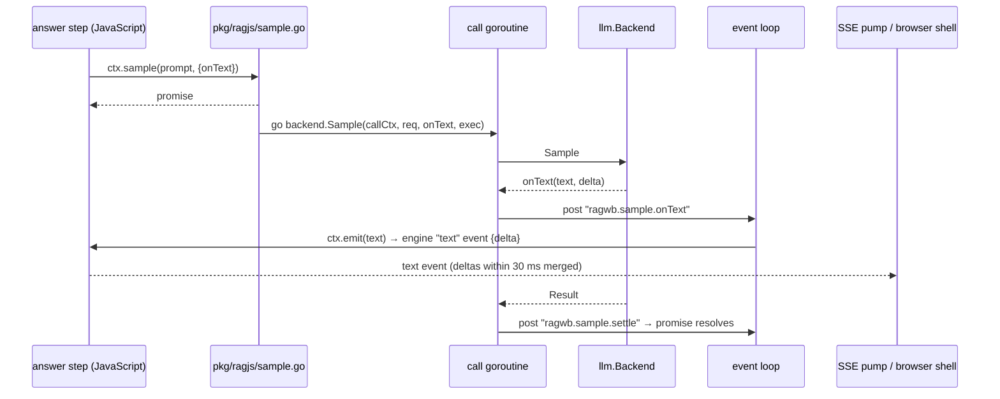
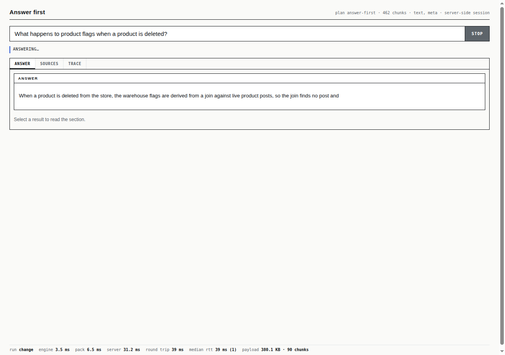

# rag-workbench: Streaming Model Calls Through Geppetto with Pi's Credentials — A Technical Deep Dive

rag-workbench (`ragwb`) runs retrieval pipelines written in JavaScript on a Go runtime. Several pipeline steps call a language model — a reranker, a query rewriter, an answer step, an agentic step with tools — and the browser workbench has a chat agent that calls one too. Since RAGWB-004, the system has had a complete path for showing a model's answer while it is being written: engine `text` events, Server-Sent Events (SSE) to HTTP clients, and a browser shell that repaints the answer as deltas arrive. This report describes RAGWB-006, which discovered that the path carried nothing incremental — the model client waited for each complete reply — and replaced the client with a backend built on Geppetto, the go-go-golems model library, configured from the Pi coding agent's own model catalog and credentials. Answers now stream token by token through every surface, and any model Pi is logged in to can be used.

> [!summary]
> - **The gap was one component.** The hand-written LunaRoute client sent non-streaming chat completions and reported text once per model round. Everything after it already streamed.
> - **Geppetto plus Pi.** A new `llm.Backend` (`pkg/llm/gepp`, 500 lines) reads `~/.pi/agent` through Geppetto's Pi provider, runs each call as rounds of one engine call, and forwards every provider text delta to the caller. `--llm pi` selects it.
> - **Same behavior, new transport.** Tiers, per-tier output budgets, the 10-round tool loop with a forced final answer, failure codes and cancellation are preserved; leaked tool-call markup is withdrawn with a correcting update.
> - **Measured end to end.** An answer over SSE arrived as 23 `text` events; in the browser it grew from 25 to 1,266 characters across ten repaints; the workbench's sampling endpoint delivered 35 `text` events for one call.

## Why this project exists

The ticket began with a question: how does token streaming work in rag-workbench? The previous report had stated that answers stream through engine events and SSE, and screenshots showed answers growing on screen. Those screenshots had been taken with the fake model backend, which splits its reply into pieces on purpose. Tracing the real path showed that with the production backend, an answer without tool calls reached the browser in one piece, after the model had finished.

A second limitation came with the first. The client spoke to one gateway, LunaRoute, and read one static API key from an environment variable or from Pi's `models.json`. The same machine has Pi logged in to eight providers, including an OAuth credential for LunaRoute that Pi refreshes on its own, and slop-computer already calls models through Geppetto with exactly those credentials. Moving rag-workbench onto the same library removes a private copy of provider logic and makes every authenticated model available by name.

## Current project status

Implemented on branch `task/ragwb-006-geppetto-llm` of `/home/manuel/code/wesen/go-go-golems/rag-workbench`, in five commits:

| commit | content |
|---|---|
| `645b882` | ticket, intern guide (uploaded to reMarkable), Geppetto v0.13.13 dependency and spike |
| `1359767` | `pkg/llm/gepp`: backend and scripted-provider tests |
| `e5284f2` | `--llm pi`, `--pi-agent-dir`, per-backend tier defaults, backend description in startup lines |
| `cb8da58` | `gepptest` helper package; streaming tests through the engine and over SSE |
| `6ee9fc3` | diary, guide implementation status, changelog |

`go vet ./...` and `go test ./... -count=1` pass. The change adds about 1,200 lines (500 of them tests and test fixtures) and touches no JavaScript.

## Background: how a model call travels

### The `sample` contract

Every model call in rag-workbench goes through one function with a contract inherited from the claude.ai artifact runtime where the project's prototype was written:

```ts
sample(input, { modelTier, model, tools, onText, signal }) → Promise<{ text, truncated, modelTierApplied }>
```

`input` is a string or a list of user and assistant turns; `modelTier` is `quick`, `default` or `complex`; `tools` are objects with a name, a JSON schema and an `execute` function; `onText({text, delta})` is called with the answer so far and the newly added part; `signal` aborts the call. `sample.json` parses the reply as JSON. On the Go side the contract is one interface:

```go
type Backend interface {
    Sample(ctx context.Context, req Request, onText OnText, exec ExecuteTool) (Result, error)
}
type OnText func(text, delta string)                                   // whole text so far, new part
type ExecuteTool func(ctx context.Context, call ToolCall) (ToolResult, error)
```

Two properties of this interface matter later. The backend runs the tool loop itself, calling `exec` for each tool call; `exec` executes the JavaScript tool. And `onText` receives the *whole* text as well as the delta, so a backend can replace earlier text, not only extend it.

### From a pipeline step to the browser

The JavaScript engine runs on goja, a JavaScript interpreter written in Go, and a goja runtime may be used by only one goroutine at a time. rag-workbench therefore runs every model call on its own goroutine and posts results back to the runtime's event loop. The path of one answer:



The answer step passes `onText: ({text}) => ctx.emit(text)`. `ctx.emit` remembers the previous text and emits a `text` event carrying only the new part, or a `reset` event when the new text does not extend the old one. Under `ragwb serve`, the request's event scope delivers those events to an SSE writer, which merges deltas of one step that arrive within 30 ms into one event. The browser shell accumulates deltas per step and the UI repaints the answer at most every 60 ms. The workbench page has a parallel path: its `window.claude.sample` is an SSE client of `POST /_rt/sample`, whose handler writes one `text` event per `onText` call.

### Where the deltas were lost

All of that machinery is driven by `onText`, and the LunaRoute client called it like this (`pkg/llm/lunaroute.go`):

```go
body := map[string]any{"model": model, "messages": msgs, "max_tokens": maxTokens}   // no "stream": true
var r oaResponse
if err := c.post(ctx, "/v1/chat/completions", body, &r); err != nil { … }
content := stripToolMarkup(ch.Message.Content)
if content != "" {
    delta := content
    if all.Len() > 0 { delta = "\n\n" + delta }
    all.WriteString(delta)
    if onText != nil { onText(all.String(), delta) }   // once per round, the whole round's text
}
```

One HTTP request per tool-loop round, without streaming, and one `onText` per round. For an answer without tools, the pipeline faithfully delivered one delta containing the entire answer.

## Pi's agent directory and Geppetto

### What Pi stores

Pi keeps its configuration in an agent directory, `~/.pi/agent` (or `$PI_CODING_AGENT_DIR`). Four files matter:

| file | content |
|---|---|
| `settings.json` | default provider and model, default thinking level, the list of enabled models |
| `models-store.json` | the model catalog Pi refreshes from providers: per model its id, wire API, reasoning flag, output limit, compatibility flags |
| `models.json` | user-defined providers: base URL, API, static key, headers, extra models |
| `auth.json` | one credential per provider: an API key, or an OAuth access token with refresh token and expiry |

A model is named by a reference `provider/id`, such as `lunaroute/glm-5.3-flash`. Each catalog entry names its wire API: `openai-completions`, `openai-responses`, `openai-codex-responses`, `anthropic-messages` or `google-generative-ai`. A thinking level (`off`, `minimal`, `low`, `medium`, `high`, `xhigh`) selects how much the model reasons. On this machine, 43 models were *available* — a supported API and a credential present — including the three LunaRoute models rag-workbench used by default.

### What Geppetto provides

Geppetto separates a conversation, a provider call and the observation of that call into distinct types:

- A **turn** (`turns.Turn`) is the conversation as a list of blocks: user text, assistant text, tool calls the model made, and tool results. Per-turn settings live in the turn's data map under typed keys.
- An **engine** (`engine.Engine`) has one method, `RunInference(ctx, turn) (turn, error)`. It performs exactly one provider call and appends the model's blocks; it does not execute tools.
- **Events** are published while an engine runs to every sink attached to the context with `events.WithEventSinks`. The relevant types are `EventTextDelta`, `EventReasoningDelta`, `EventProviderCallFinished` (stop reason, token usage) and `EventError`.
- **Tools** are offered by attaching a registry to the context (`tools.WithRegistry`); after a call, `toolblocks.ExtractPendingToolCalls(turn)` lists the calls the model made that have no result yet.
- **Inference configuration** (`engine.InferenceConfig`: output limit, reasoning effort, thinking type) set on a turn is merged field by field over the engine's defaults, so a per-turn output limit leaves the thinking settings intact.

Geppetto's Pi provider connects the two. `pi.LoadAgentDir(dir)` reads the four files. `Available()` lists models with a supported API and a credential. `Resolve(ctx, "provider/id", {Thinking})` produces an object whose `Engine()` returns a ready engine for that model, with the thinking level mapped onto the protocol's knobs and the credential supplied per request through a token source. For an OAuth credential, the source refreshes an expired token and writes it back to `auth.json` under Pi's own file lock, so rag-workbench and a running Pi share credentials without conflict.

### The spike

Before designing anything, a 100-line program (`scripts/01-geppetto-pi-spike/main.go` in the ticket) loaded the real agent directory, resolved a model, ran one inference with a counting sink, and printed timings — never credentials:

| model | thinking | text deltas | first delta | total | reasoning deltas | output tokens |
|---|---|---|---|---|---|---|
| `lunaroute/glm-5.3-flash` | off | 43 | 402 ms | 1.756 s | 0 | 112 |
| `lunaroute/muse-spark-open` | off | 13 | 1.348 s | 1.496 s | 81 | 474 |
| `lunaroute/glm-5.3-flash` | minimal | 44 | 335 ms | 1.811 s | 0 | 120 |

Loading the directory took 2 ms. Streaming worked with Pi's stored LunaRoute credential. The second row recorded a property that matters for configuration: `muse-spark-open`, the default `quick` model, reasons even at thinking level `off`, and spent 474 output tokens on an 80-word answer. Reasoning counts against the output limit, which is why the per-tier budgets of the old client had to be carried over rather than lowered.

## The backend

### Choosing a model

`gepp.New` loads the agent directory once and resolves one model per tier. A tier is configured with the existing flags `--llm-quick`, `--llm-default` and `--llm-complex`, which under `--llm pi` take Pi references. Resolution follows slop-computer's rules:

```text
lookup(ref):
  split off a trailing ":<level>" if <level> is a thinking level
  if ref is an available "provider/id": that model
  if ref has no "/" and exactly one available model has that id: that model
  if several do: error "model id %q is ambiguous (a/x, b/x): name the provider"
  otherwise: error "no authenticated Pi model %q"
```

An empty tier falls back to Pi's own default model when it is enabled and available. The defaults under `--llm pi` are the old client's models with an explicit provider: `lunaroute/muse-spark-open`, `lunaroute/glm-5.3-flash` and `lunaroute/glm-5.3`. An explicit `model` in a `sample()` call is resolved the same way and falls back to the tier if it is not available.

The thinking level of a call is the level the reference named, else `off` for the `quick` tier (used for small JSON tasks such as reranking and query rewriting), else the default level from Pi's settings (`minimal` on this machine). `--llm-complex openai-codex/gpt-6-luna:high` therefore selects both a different provider and a reasoning level from one flag.

### One call as rounds

`Sample` turns the request's turns into a Geppetto turn, registers the request's tools, and loops:

```go
for round := 1; ; round++ {
    last := round >= b.maxRounds
    offersTools := len(req.Tools) > 0 && exec != nil && !last
    if last && round > 1 && len(req.Tools) > 0 {
        turns.AppendBlock(t, turns.NewUserTextBlock(llm.ForcedAnswer))
    }
    limit := perRound                                   // llm.TierBudget[tier]: 2048 / 8192 / 16384
    engine.KeyInferenceConfig.Set(&t.Data, engine.InferenceConfig{MaxResponseTokens: &limit})
    eng, _ := resolved.Engine()
    rctx := ctx
    if offersTools { rctx = tools.WithRegistry(ctx, registry) }
    s := &sink{text: text}
    text.startRound()
    out, err := eng.RunInference(events.WithEventSinks(rctx, s), t)
    …                                                   // cancellation, errors, usage, truncation
    t = out
    calls := toolblocks.ExtractPendingToolCalls(t)
    if len(calls) == 0 || !offersTools { break }
    for _, c := range calls {                           // sequential, in call order
        r, err := exec(ctx, llm.ToolCall{ID: c.ID, Name: c.Name, Input: argsJSON(c)})
        … append NewToolUseBlock(c.ID, result) or NewToolUseBlockWithError
    }
}
```

The loop preserves three behaviors of the old client, each of which exists for a recorded reason. The output limit per round comes from the same per-tier budgets, sized in RAGWB-001 so that reasoning does not consume the whole answer. The loop is bounded at 10 rounds, because the workbench agent works in many small steps (a real session used 6). And the last round offers no tools and adds a user message — "The tool budget for this answer is used up. Answer now from what you have…" — because without it GLM models print their native tool-call syntax as answer text. The three values are now exported from `pkg/llm` (`TierBudget`, `ForcedAnswer`, `StripToolMarkup`) and shared by both backends.

Tools run sequentially, in the order the model requested them. slop-computer runs them in parallel, because its tools execute in browser pages. In rag-workbench every `exec` posts the tool to the same JavaScript event loop; parallel execution would only interleave the tools at `await` points and make their order — and therefore the conversation sent back to the model — nondeterministic.

### Streaming

The sink is where the transport changes:

```go
func (s *sink) PublishEvent(e events.Event) error {
    switch e := e.(type) {
    case *events.EventTextDelta:
        if e.Delta != "" { s.text.add(e.Delta) }
    case *events.EventProviderCallFinished:
        if stop ∈ {length, max_tokens, max_output_tokens, incomplete} { s.truncated = true }
        s.in += usage.InputTokens; s.out += usage.OutputTokens
    case *events.EventError:
        if s.failed == nil { s.failed = errors.New(e.ErrorString) }
    }
    return nil
}

func (s *stream) add(delta string) {        // under a mutex
    if !s.started && s.b.Len() > 0 { delta = "\n\n" + delta }   // a later round after earlier text
    s.started = true
    s.b.WriteString(delta)
    s.onText(s.b.String(), delta)
}
```

Geppetto calls `PublishEvent` on the goroutine running the inference, which is the goroutine the bridge started for this call, so `onText` is called directly; the bridge already posts each call to the event loop. Reasoning deltas are deliberately dropped: the `sample` contract has no channel for them, and reasoning text must not appear in answers. Text from successive rounds is separated by a blank line, as the contract specifies.

### Withdrawing leaked markup

A streaming backend cannot filter tool-call markup the way the old client did. The old client received the whole round and cut everything from `<tool_call>` onward before reporting it. A streaming backend has already forwarded the text that precedes the marker, and possibly part of the marker itself, before it can know that a marker is coming; filtering in the stream would require holding back every delta that might start one.

The backend therefore streams first and corrects afterwards. When the round loop ends, it applies `StripToolMarkup` to the accumulated text. If that changed anything, it calls `onText(clean, "")` once. This uses the property of the contract noted earlier: `onText` carries the whole text, and the engine's `ctx.emit` turns a text that does not extend the previous one into a `reset` event, which the shell and the trace view handle by replacing what they show. A client may see the leaked markup briefly; the final answer and every consumer's final state are clean.

### Errors and cancellation

Errors are mapped onto the contract's failure codes:

| condition | code |
|---|---|
| no Pi credential for the provider, HTTP 401/403, "unauthorized", invalid or expired key/token | `not_granted` |
| unsupported wire API | `invalid_request` |
| HTTP 429, "rate limit", "too many requests" | `rate_limited` |
| HTTP 413, context length, "prompt is too long" | `prompt_too_large` |
| HTTP 400/404/422 | `invalid_request` |
| empty final text | `empty_completion` (with "max_tokens spent on reasoning" when truncated) |
| anything else | `upstream_error` |

Provider error text can quote request content, so messages are capped at 300 characters, and a regular expression replaces anything after `bearer`, `api key` or `token` that looks like a credential with `<redacted>`. A test sends a 401 whose body contains a fake key and checks that neither that key nor the agent directory's test key appears in the failure. Each failure also carries the text produced before it failed.

Cancellation needed no new code. The bridge already cancels the call's context when the JavaScript abort signal fires — when a request scope is aborted because its HTTP client disconnected. Geppetto's provider request uses that context, and `Sample` returns `ctx.Err()`, which the bridge reports as `{code: 'cancelled'}`.

## Wiring and the dependency upgrade

Every command obtains its backend from one function, `cmds.LLM()`, so selecting the new backend is one new case:

```go
case "pi":
    return gepp.New(gepp.Config{AgentDir: piAgentDir, Tiers: tiersOr(gepp.DefaultTiers()), MaxRounds: maxRounds})
```

The tier flags posed a small problem: their defaults depend on the backend (bare ids for the direct client, `provider/id` references for Pi), and a command-line flag has one static default. The flags now default to empty, `tiersOr` fills empty tiers from the selected backend's defaults, and the help text names both sets. `serve` and `workbench` print the resolved tiers at startup:

```text
ragwb serve: llm pi (quick=lunaroute/muse-spark-open default=lunaroute/glm-5.3-flash complex=lunaroute/glm-5.3)
```

`--llm lunaroute` remains, as a fallback when Pi is not installed. Embeddings and cross-encoder reranking (`--embed lunaroute`) are unchanged: Pi's catalog contains no embedding or rerank models.

Adding Geppetto v0.13.13 had consequences outside the model code. Geppetto had already been an indirect dependency at v0.11.7, through go-go-goja. The upgrade raised the module's Go version to 1.26.6 and upgraded glazed, the command-line framework, from v1.3.5 to v1.4.3. glazed v1.4 renamed the structured-output flags of every jsverbs command: `--output` became `--format` (with a new `jsonl` choice) and `--fields` became `--output-fields`. One test used the old flag and failed with `unknown flag: --output`; external scripts that pass `--output` to `ragwb verbs` must be updated. One risk did not materialize: Geppetto declares go-go-goja v0.10.6, which pins a goja commit whose regular-expression parser silently ignores `\p{L}` (the bug that once emptied every BM25 index in this project). Go's minimal version selection keeps the higher v0.10.7 that rag-workbench requires, and the canary test `TestTokenizeUsesUnicodeClassesInGoja` passes.

## Testing

### A scripted provider

The unit tests need a model provider that streams, without the network. `pkg/llm/gepp/gepptest` provides one: an `httptest` server that answers request *i* with the *i*-th scripted reply — a stream of OpenAI Chat Completions chunks (`data: {"choices":[{"delta":{"content":"…"}}]}`), a tool call, or an HTTP error — and records each request body. It also writes a temporary Pi agent directory whose providers `lunaroute` (models `big` and `small`) and `other` (model `small`) point at that server with a fake key; `pi.WithLocalProviders()` allows the local URL. The fixture is a package rather than test-file code because three packages use it.

Eight backend tests cover deltas reaching `onText` one by one with the whole text so far, the per-tier output limit on the wire, the tool loop (the tool's id, name and JSON input; the result in the second request; the blank line between rounds), the forced last round (no tools offered, the forcing message present), tier lookup including the ambiguous id `small`, thinking levels per tier and an explicit model overriding a tier, failure codes with credential scrubbing, cancellation of a stream that stalls after its first delta, and withdrawal of leaked markup. To check that the tests discriminate, the budget was replaced by a constant and the markup correction removed; the two tests that cover them failed, and passed again once the code was restored.

### Through the engine and over SSE

Two integration tests follow the deltas downstream. `pkg/ragjs/stream_test.go` runs a plan with an answer step inside a request scope, with the Geppetto backend over a provider that streams three pieces, and checks that the scope received exactly three `text` events whose deltas concatenate to the answer, with its citation `E1`. `TestVerbSSEStreamsGeppettoDeltas` serves an app with an answer verb, has the provider pause 50 ms between four pieces — longer than the SSE writer's 30 ms merge window — and checks that an SSE client receives at least four `text` events adding up to the answer. The existing fake-backend test now shares the same helper, and still reports its 12 rapid deltas merged into 2 events.

## Measurements

With `--llm pi` against the real provider:

- **CLI.** `ragwb --no-store --llm pi verbs --dir examples/apps/reports reports ask "What happens to product flags when a product is deleted?"` returned an answer citing E1, E4 and E2 in 5.3 s of wall time, including an LLM rerank (`quick` tier, JSON) and the answer (`default` tier).
- **SSE.** The same question through `ragwb serve`'s verb endpoint produced 23 `text` events between 4.68 s and 6.35 s after the request; the concatenated deltas equal the final answer. The 4.7 s before the first text is the LLM rerank, which returns JSON and shows no partial output.
- **Browser.** In the answer-first app, sampling the Answer tab every 100 ms after pressing Ask gave these lengths in characters: 25 at 2.97 s, 133, 151, 220, 617, 621, 641, 980, and 1,266 at 5.51 s.
- **Workbench.** One call to `POST /_rt/sample` produced 35 `text` events.



## Problems found during development

- **The premise of streaming.** Earlier reports and screenshots suggested answers streamed; they did so only with the fake backend. The lesson is specific: a streaming pipeline must be measured with the production backend, because a test double that splits its output hides a producer that does not.
- **The glazed rename.** An upgrade forced by a transitive requirement changed a user-facing flag; the full test suite found it only because one test passed `--output`.
- **Static flag defaults.** Backend-dependent defaults required moving the default from the flag definition into the backend selection.
- **Shell quoting.** The first spike loop passed `"lunaroute/glm-5.3-flash off"` as one argument (zsh does not split a quoted variable), and `Resolve` reported an unknown model; running the binary with separate arguments fixed it.

## Limitations and open questions

- **Reasoning in the quick tier.** `muse-spark-open` reasons at thinking level `off`. If JSON steps begin to fail with truncated replies, the quick budget or the quick model must change.
- **One post per delta.** Each provider delta becomes one event-loop callback. Answers of a few hundred deltas showed no measurable cost; very long streams could merge deltas in Go before posting.
- **The silent first seconds.** The LLM rerank before the answer takes several seconds and produces JSON, so nothing streams during it. It could report progress notes.
- **Protocol coverage.** The tests cover the OpenAI Chat Completions protocol. Anthropic, Gemini and OpenAI Responses models are reachable through Pi references but are exercised only by live use.
- **Credential scrubbing is a heuristic.** Geppetto does not place credentials in errors, and the scrub is a second line of defense.
- **Default backend.** Whether `--llm pi` should become the default whenever an agent directory exists is undecided.

## Key points

- A streaming pipeline is only as incremental as its producer; here, every consumer already handled deltas and a single non-streaming client made the whole path deliver answers in one piece.
- Geppetto's separation of turns, one-call engines and event sinks makes a backend's job small: run rounds, forward text deltas from the sink, execute tools between rounds.
- Pi's agent directory is a usable source of models and credentials for other programs: references name models across providers, thinking levels are mapped per protocol, and OAuth tokens are refreshed under Pi's own lock.
- An interface that passes the whole text with every update lets a streaming producer correct what it already sent; that is how leaked tool markup is withdrawn without buffering the stream.
- Behavior that exists for recorded reasons — output budgets, the forced last round, markup stripping — was moved into shared exported values instead of being re-derived in the new backend.

## Important project docs

- Ticket: `/home/manuel/code/wesen/go-go-golems/rag-workbench/ttmp/2026/11/04/RAGWB-006--geppetto-llm-backend-with-pi-credentials-and-token-streaming/`
  - `design-doc/01-intern-guide-language-model-calls-in-rag-workbench-and-a-geppetto-backend-with-pi-credentials-and-token-streaming.md` (uploaded to reMarkable, `/ai/2026/11/04/RAGWB-006`)
  - `reference/01-investigation-diary.md` (steps 1–3)
  - `scripts/01-geppetto-pi-spike/main.go`
- Reference implementation: `/home/manuel/code/wesen/slop-computer/pkg/llm/gepp/`.
- Related: [[PROJECT REPORT - rag-workbench - A Retrieval Workbench in JavaScript on a Go Runtime - A Technical Deep Dive]], [[PROJECT REPORT - rag-workbench - Query Endpoints and Streamed Intermediate Results - A Technical Deep Dive]].

## File reference

| file | role |
|---|---|
| `pkg/llm/gepp/backend.go` | `New`, `Config`, `DefaultTiers`, tier lookup, `pick`, thinking `level`, `Describe` |
| `pkg/llm/gepp/sample.go` | `Sample` (rounds, tools, budgets), `stream`, `sink`, `classify` |
| `pkg/llm/gepp/gepptest/gepptest.go` | scripted OpenAI streaming provider and temporary Pi agent directory |
| `pkg/llm/gepp/gepp_test.go` | eight backend tests |
| `pkg/llm/llm.go` | `Backend`, `Request`, `Result`, `OnText`, `ExecuteTool`, `Failure` |
| `pkg/llm/lunaroute.go` | the direct client; exported `TierBudget`, `ForcedAnswer`, `StripToolMarkup` |
| `pkg/ragjs/sample.go` | the JavaScript `sample()` and its Go half (goroutine, posted callbacks, cancellation) |
| `pkg/ragjs/stream_test.go` | engine `text` events equal provider deltas |
| `pkg/server/verbs_test.go` | `TestVerbSSEStreamsGeppettoDeltas` |
| `cmd/ragwb/cmds/roots.go` | `--llm pi`, `--pi-agent-dir`, `tiersOr`, `DescribeLLM` |
