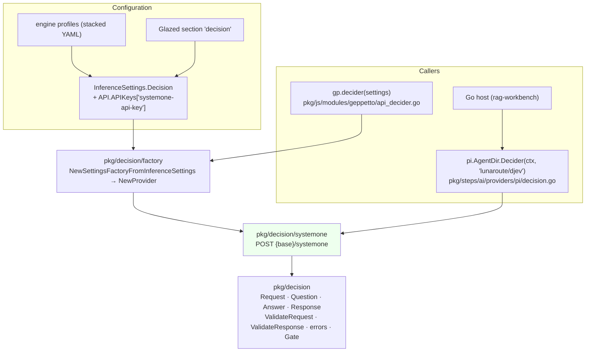

# rag-workbench and geppetto: Decision Models for Routing and Grading Retrieval — A Technical Deep Dive

A retrieval pipeline makes many small judgments. Does this question need documents at all? Which index suits it? Is this passage about the question, or does it only share words with it? Until now, rag-workbench had two ways to make such a judgment. It could hard-code it in the plan, or it could ask a language model to write the judgment as JSON and then parse it. This report describes a third way. A *decision model* is a model that does not generate text. It returns a probability distribution over an answer space the caller declares.

The work spans two repositories. In **geppetto**, the go-go-golems model library, decision models became a fourth model-service primitive beside chat inference, embeddings and reranking (ticket GEPPETTO-DECISION-001). In **rag-workbench**, decisions became part of the plan language: a `ctx.decide` API, a `classify` step, a `when` condition on any query-time step, decision-graded filtering and reranking, and build-time chunk classification (ticket RAGWB-007). The model behind it is `djev`, served by LunaRoute's gateway on an endpoint called System One.

> [!summary]
> 1. A decision model answers typed questions about a state: yes/no (*noul*), one of N options (*choice*), or a level on an ordered rubric (*score*). It returns probabilities, so there is no parse step and no answer outside the declared space. LunaRoute's `djev` answers three questions in about 0.4 s and twenty passage-relevance questions in about 1–2 s. It accepts at most 32 questions per request, a limit the documentation does not state.
> 2. Geppetto's `pkg/decision` copies the layering of `pkg/rerank`: core types and validation, a provider adapter, a settings factory, profile wiring, Pi credentials and a JavaScript binding. The design choice with the most consequences is that choice options are an ordered slice, written onto the wire in the caller's order, because these models are sensitive to option order.
> 3. rag-workbench routes with a node option, not a new graph construct. `when` reads a `classify` node's answers through an explicit IR edge, is evaluated before the memo, and fails open. Grading components batch noul questions over the top hits.
> 4. On the bundled reports corpus, grading separates answerable from unanswerable questions by two orders of magnitude: off-topic queries peak at p ≤ 0.006, answerable ones at 0.965–1.0. The golden questions are too easy to show more than small ranking changes.

---

## 1. The problem: judgments inside a fixed pipeline

A rag-workbench plan is a pipeline written in JavaScript:

```js
rag.plan("answer").over(corpus)
  .signals({ q: "", k: 8 })
  .retrieve("text", { k: 30 })
  .retrieve("meta", { k: 20 })
  .fuse.rrf({ k: 60 })
  .rerank.llm({ top: 20 })
  .pack({ budget: 30000 })
  .answer();
```

Every step runs for every query. A greeting goes through two retrievers, fusion, an LLM reranker and the packer before the answer step reports that the evidence is irrelevant. A question the corpus cannot answer gets the twenty best lexical matches, which are confidently wrong. The only judgment step, `rerank.llm`, prompts a chat model to rank passages and reply with JSON. That costs seconds, can return malformed JSON, and yields scores the model invented rather than probabilities.

The retrieval literature has names for the judgments that are missing:

- **Adaptive-RAG** (Jeong et al., 2024) classifies each query as needing no retrieval, single-step retrieval or multi-step retrieval, and routes it.
- **CRAG** (corrective RAG) grades retrieved documents with a lightweight evaluator and discards poor ones.
- **Self-RAG** has the generator decide when to retrieve and whether passages are relevant.

All three need a fast classifier that returns a usable confidence. Decision models are such classifiers, and they need no training.

---

## 2. What a decision model is

### 2.1 State, questions, answer spaces

A decision model takes a **state** and a set of **questions** about it. The state is a string or JSON value: the query, a passage, a chunk with its headings. Each question has a caller-chosen id, a type, instructions, and type-specific criteria that define its answer space. The model returns, for each id, a distribution over that space. It does not write text, and it cannot answer outside the space.

| Type | Answer space | Criteria | Answer |
|---|---|---|---|
| `noul` | a proposition, true or false | optional true/false descriptions | `noul`: probability that it is true |
| `choice` | 1–255 named options | option name → description | `choice`, `confidence`, `probabilities` per option |
| `score` | an ordered rubric, up to 10 levels | level descriptions, level 0 first | fractional `score`, `confidence`, per-level `probabilities` |

*Noul* is the vendors' word for a yes/no question. A score is not a choice with numbered options. Its levels are ordered, and the returned score is the expectation over level probabilities, so it can be fractional. Confidence, for choice and score, is derived from how peaked the distribution is. It is not a second prediction.

All questions in one request share the state, and the model reads the state once. That is why batching matters. Twenty "is this passage relevant to the query?" questions cost one request, not twenty.

### 2.2 A worked example

This is the first request sent to `djev` in the investigation. It asks three questions a retrieval pipeline would ask about an incoming query:

```json
{
  "model": "djev",
  "state": {
    "query": "how does the rebalance law preserve product placements?",
    "corpus": "engineering design notes for a warehouse slotting system"
  },
  "questions": {
    "route": { "type": "choice", "instructions": "Which retrieval strategy fits this query best?",
      "criteria": { "keyword": "Exact identifiers, names, error strings",
                    "semantic": "Conceptual question needing paraphrase matching",
                    "none": "Chit-chat or no retrieval needed" } },
    "needs_retrieval": { "type": "noul", "instructions": "Does answering require looking up documents?",
      "criteria": { "true": "Answer depends on corpus facts", "false": "Answerable without documents" } },
    "complexity": { "type": "score", "instructions": "How complex is the question?",
      "criteria": ["trivial lookup", "single fact", "explanation of one mechanism", "multi-document synthesis"] }
  }
}
```

The response arrived in 428 ms:

```json
{
  "answers": {
    "route": { "type": "choice", "choice": "semantic", "confidence": 0.907,
               "probabilities": { "keyword": 0.021, "none": 0.0000125, "semantic": 0.979 } },
    "needs_retrieval": { "type": "noul", "noul": 0.994 },
    "complexity": { "type": "score", "score": 1.9994, "confidence": 0.959,
                    "legend": { "0": "trivial lookup", "1": "single fact", "2": "explanation of one mechanism", "3": "multi-document synthesis" },
                    "probabilities": { "0": 0.0008, "1": 0.0034, "2": 0.9915, "3": 0.0044 } }
  },
  "model": "djev",
  "usage": { "input_tokens": 228, "output_tokens": 16 }
}
```

Three properties of this response drive the rest of the design:

- Answers are keyed by the caller's ids, not by position.
- Every probability distribution is complete over the declared space.
- `output_tokens` is 16 for three questions. The model is not writing.

### 2.3 What decision models do poorly

The published write-ups and our probes agree on the limits:

- They are weak at exact arithmetic, counting, date comparison and indirection.
- Results can depend on option order. One report saw a leading probability move from about 0.85 to about 0.95 when the options were reversed.
- The state is untrusted input. Constrained output does not protect against prompt injection.
- Model aliases can change behind a stable name, so thresholds tuned on one version may not hold for the next.

---

## 3. The System One protocol, as probed

LunaRoute documents the endpoint at `docs.lunaroute.com/api/systemone/`. Its documentation describes fields but gives few literal JSON shapes, so every claim below was checked with a probe script (`scripts/01-systemone-probe/probe.py` in the geppetto ticket). The script reads the key from Pi's `models.json` and never prints it.

**Endpoint and authentication.** `POST https://gw.lunaroute.com/v1/systemone`. The documented header is `LUNAROUTE-API-KEY`, and `Authorization: Bearer <key>` returned 200 as well. Geppetto uses the bearer form, because that is what its credential sources produce. Requests are buffered JSON, not streams. Compressed bodies get 415 and bodies over 8 MiB get 413.

**Discovery.** There is no decision-model listing. `GET /v1/models` lists decision models among chat models, with `"capabilities": {"systemone": true}`. The probe found two: `djev` (32 768-token context, vision) and `clef-flash` (8 192). `clef-flash` answered `502 systemone_backend_error` throughout. Pi's own catalog lists `lunaroute/djev` as an `openai-completions` model, because Pi has no notion of decision models.

**Errors.** Every error uses one envelope, `{"error": {"code", "message", "request_id"?}}`. Observed errors:

| Request | Status | Code | Message |
|---|---|---|---|
| extra top-level field `options` | 400 | `systemone_invalid_request` | `unknown parameter "options"` |
| chat model id `glm-5.3` | 400 | `systemone_invalid_request` | `the requested model cannot serve System One` |
| model `nope` | 404 | `model_not_found` | `the requested model was not found` |
| choice without criteria | 400 | `systemone_invalid_request` | `choice question "a" is missing "criteria"` |
| empty questions | 400 | `systemone_invalid_request` | `"questions" must contain at least one question` |
| 40 questions | 400 | `systemone_invalid_request` | `"questions" exceeds this model's max_questions of 32` |

The last row is the most important finding of the investigation. The documentation does not state it. It was found by the rag-workbench batch spike, and it fixes the batch size of every component that grades hits.

**Two documented details that do not hold.** `latency_ms`, listed as a response field, never appeared. `X-Request-Id`, not mentioned, appeared on every response, including errors.

**Sensitivity to the state.** Asked "does answering require documents?" about the same query, djev answered 0.994 when the state described the corpus and the question carried true/false criteria. With neither, it answered 0.084. A decision model judges what it is told. Every rag-workbench component that asks about relevance therefore takes a `corpus` description and puts it in the state.

---

## 4. Geppetto: decisions as a model-service primitive

### 4.1 The layering decisions copy

Geppetto already had three model-service primitives. Chat inference is the oldest (`pkg/inference/engine`). Embeddings keep their adapters in the core package (`pkg/embeddings`). Reranking (`pkg/rerank`) is the newest and most carefully specified, and its package comment states rules that a new primitive should follow. Decisions copy rerank's structure layer for layer:



Each layer has one responsibility:

- **The core** knows the question model and nothing about HTTP.
- **The adapter** knows one wire protocol.
- **The factory** is the only code that maps a `type` string to an adapter, and it lives in its own package to break the import cycle between core and adapters.
- **Configuration** keeps endpoints and keys in the shared `APISettings` maps, so profile stacking treats every primitive alike.

### 4.2 Core types and the reasons for their shape

```go
type Question struct {
	Type         Type     // Noul, Choice, Score
	Instructions any      // a non-empty string, or JSON-encodable object/array
	True, False  string   // Noul only: optional case descriptions
	Options      []Option // Choice only: {Name, Description}, in presentation order
	Levels       []string // Score only: level 0 first
}
type Request struct {
	Model     string
	State     any
	Images    []string            // data:image/{jpeg,png,webp};base64 URLs
	Questions map[string]Question // keyed by caller ids
}
type Answer struct {
	Type               Type
	Probability        float64            // Noul
	Choice             string             // Choice
	Probabilities      map[string]float64 // Choice
	Score              float64            // Score
	LevelProbabilities []float64          // Score, index = level
	Confidence         float64            // Choice and Score
}
type Provider interface {
	Decide(ctx context.Context, in Request) (Response, error)
	Model() Model
}
```

Three choices in these types are not obvious.

**Typed criteria rather than one `criteria` field.** The wire format overloads `criteria` with three shapes: a true/false object, an option-name-to-description object, and an array of levels. If Go callers built that field as `map[string]any`, every caller would carry the convention, and a mistake would surface only as a server 400. `Question` instead has one field per shape. Validation rejects a field that does not belong to the question's type: a choice question with `Levels` set is an error, not an ignored field. The adapter maps the fields to `criteria`. A second adapter for a protocol with different field names, such as OpenRouter's Decisions API for Jev (`options`, `legend`), would be a pure translation.

**Options are a slice.** Go maps have no order, and `encoding/json` writes map keys sorted. If options were a `map[string]string`, every request would present them alphabetically, whatever the caller wrote. Because decision models are order-sensitive, probabilities would then shift for reasons the caller cannot see. The adapter writes the `criteria` object byte by byte, in slice order, marshalling each key and value separately so that escaping stays correct:

```go
func encodeOptions(opts []decision.Option) json.RawMessage {
	var b bytes.Buffer
	b.WriteByte('{')
	for i, o := range opts {
		if i > 0 {
			b.WriteByte(',')
		}
		k, _ := json.Marshal(o.Name)
		v, _ := json.Marshal(o.Description)
		b.Write(k); b.WriteByte(':'); b.Write(v)
	}
	b.WriteByte('}')
	return b.Bytes()
}
```

A unit test sends the options `z`, `a`, `m` and checks the raw request body for `"criteria":{"z":"","a":"say \"hi\"","m":""}`. To confirm that the test guards the property, it was run once against a version that marshalled a map. It failed with the keys sorted to `a`, `m`, `z`.

**Score probabilities are a slice indexed by level.** The wire keys them `"0"`, `"1"`, …. The adapter converts them and rejects any key that is not the canonical decimal of an in-range level. A padded `"02"` cannot alias level 2.

A fourth fix came from testing. With `omitempty` tags, a noul answer whose probability is exactly 0 serialised as `{"type":"noul"}`, losing the one number that mattered. `Answer.MarshalJSON` now writes exactly the fields of the answer's type, zero values included.

### 4.3 Validation, errors and the safety contract

`ValidateRequest` enforces the question model before anything leaves the process:

- the request's model is empty or equals the configured model (no silent model drift, as in rerank);
- the state is non-empty;
- question ids are 1–64 bytes of `[A-Za-z0-9_.-]`, so they are safe to log;
- each question sets only its own type's fields;
- a choice has 1–255 uniquely named options, and a score has 1–10 non-empty levels;
- images are data URLs of the three accepted formats.

`ValidateResponse` enforces the other direction:

- exactly one answer per question, of the question's type;
- every probability, confidence and score is finite and within bounds, with a 1e-6 rounding tolerance;
- a choice names a declared option, and probabilities cover only declared options;
- a score has one probability per level.

Errors wrap sentinels, so callers classify them with `errors.Is`:

| Status | Sentinel |
|---|---|
| 400, 415 | `ErrInvalidRequest` |
| 401, 402, 403 | `ErrNotGranted` |
| 404 | `ErrModelNotFound` |
| 413 | `ErrRequestTooLarge` |
| 429 | `ErrRateLimited` (with `RetryAfter` from the header) |
| other non-2xx, transport, timeouts | `ErrUnavailable` |

The safety contract is rerank's: errors never contain the state, question text, an authorization header, endpoint userinfo or a raw body. One exception is deliberate. The provider's message is kept for 400 and 404 responses, capped at 200 bytes, because those messages are validation diagnostics (`choice question "a" is missing "criteria"`) and without them a caller cannot fix the request. Provider error *codes* pass through a filter that accepts only `[a-z0-9_]{1,64}`. A test plants `Bearer sk-12345` in the code field and checks that it never reaches the error string.

### 4.4 The adapter's call path

```mermaid
sequenceDiagram
  participant C as caller
  participant P as systemone.Provider
  participant V as pkg/decision
  participant G as gw.lunaroute.com
  C->>P: Decide(ctx, req)
  P->>V: ValidateRequest(req, Model())
  P->>P: encode (ordered criteria), check MaxRequestBytes (8 MiB)
  P->>P: token ← BearerTokenSource.BearerToken(ctx)
  P->>G: POST /v1/systemone, Authorization: Bearer …
  alt non-2xx
    G-->>P: {"error": {code, message, request_id}}
    P-->>C: *ProviderError (Status, Code, Message?, RequestID, RetryAfter)
  else 200
    G-->>P: {model, answers, usage}
    P->>P: read ≤ MaxResponseBytes (1 MiB); decode one JSON value
    P->>P: map wire answers; missing required field → ErrInvalidResponse
    P->>V: ValidateResponse(req, answers)
    P-->>C: Response{Provider, Model, Answers, Usage, Cost?, RequestID, DurationMs}
  end
```

The adapter takes rerank's precautions:

- base-URL validation (scheme, host, no userinfo, no query, no dot segments);
- the outbound URL policy (plain HTTP and local addresses only with explicit opt-in);
- redirect rejection on a cloned client;
- bounded reads;
- a generic message for transport errors, which can contain URLs.

It departs from the rerank adapters in one place. Those reject unknown fields everywhere. This one ignores unknown *top-level* response fields, because the protocol documents fields the gateway does not yet send. It still rejects trailing data and non-JSON bodies. Wire answers are decoded into pointer fields, so a noul answer without a `noul` value is an invalid response rather than a probability of zero.

### 4.5 Configuration, profiles and Pi

A decision profile looks like a rerank profile:

```yaml
profiles:
  djev:
    inference_settings:
      api:
        api_keys: { systemone-api-key: ${LUNAROUTE_API_KEY} }
      decision: { type: systemone, engine: djev }
```

`InferenceSettings` gained a `Decision` field, and each of the integration points rerank touched gained one addition: construction, clone, metadata, parsed-value decode, section registration, debug field paths. Two details differ from rerank:

- **An optional section.** Glazed's `DecodeSectionInto` fails with `section decision not found` when a host assembled its own section list without the decision section. `UpdateFromParsedValues` checks for the section first, so its absence means "not configured". Without the check, every existing host that builds its own sections would have broken.
- **Defaults.** Rerank seeds its section defaults from an empty struct, which zeroes the YAML defaults. The decision section seeds from `NewDecisionConfig()`, so the 8 MiB and 1 MiB limits are visible.

All YAML tags are `omitempty` from the start. Rerank needed a later fix (`c135b09a`) because an overlay that set only `engine` wrote `type: ""` and erased the inherited type. A profile-stack test covers that case for decisions.

`pi.(*AgentDir).Decider(ctx, "lunaroute/djev", opts)` is the entry point most callers use. It looks the model up in Pi's catalog and resolves the provider's credential with Pi's precedence (`auth.json`, then `models.json`'s `apiKey`, with `$ENV` and `!command` references). It applies `models.json` headers and builds a System One provider at the model's base URL. It does not check that the model is a decision model, because Pi cannot tell. A chat id fails at the server with `ErrInvalidRequest`.

### 4.6 JavaScript

`gp.decider(settings)` mirrors `gp.reranker`. It accepts only a registry-resolved settings object, so scripts never handle keys or endpoints. It returns `decide`, `decideAsync` (a promise settled on the runtime's owner goroutine) and `model`. Choice options may be an object, read in JavaScript insertion order through `goja.Object.Keys()`, never through `Export()`, which yields an unordered Go map. They may also be an array of names, or an array of `{name, description}`. Unknown keys are rejected so typos fail loudly. The generated TypeScript declarations gained the corresponding interfaces. A parity test failed (`extra: [decider]`) until they existed.

---

## 5. rag-workbench: decisions in the plan language

### 5.1 The engine, briefly

rag-workbench runs `rag.js`, a retrieval engine written in JavaScript, inside goja, a JavaScript interpreter written in Go. The same file runs in the browser workbench. Its pieces relevant here are:

- **Components** are registered with `build(type, def)` (indexing time) or `live(type, def)` (query time). A definition declares port types (`in`, `out`), a `run` (live) or `map` (build, per chunk) function, a trigger (`change` runs as the user types, `submit` only on an explicit run), and what a skipped node outputs.
- **Plans** are immutable builders. Each step connects to the most recent step producing its input type, so `.retrieve().fuse.rrf().pack()` needs no explicit wiring.
- **`finalize`** compiles a plan into an IR. It checks ports, collects lambdas and the signals they read, adds edges, sorts the nodes topologically and picks the outputs (`hits`, `context`, `answer`). Topological order is the only scheduler the live loop has.
- **Lambdas** are stored as source text and compiled in a guarded scope. They cannot close over variables.
- **The live loop** walks the IR in order. For each node it gathers inputs and decides whether the trigger wants the node. It reuses the memoized output when the node's digest, inputs and signal reads are unchanged. Otherwise it builds a context object (`ctx`) and runs the component. It records a trace entry and emits events (`node`, `hits`, `text`, `note`, `progress`, …) that the serve API streams as Server-Sent Events.
- **Model calls** go through `ctx.sample`. Go runs the backend on its own goroutine and settles the JavaScript promise back on the runtime's owner goroutine, because a goja runtime may only be touched from one goroutine.

### 5.2 The bridge: `ctx.decide`

`ctx.decide` follows the `ctx.sample` path exactly. `ragjs.Options.Decide` takes a geppetto `decision.Provider`. `configureHost` installs `env.decide(requestJSON, signal)`, which returns a promise of the response JSON. The provider runs on a goroutine, and an abort signal cancels it. Errors become the codes the sample contract already uses (`invalid_request`, `not_granted`, `rate_limited`, `cancelled`, …), plus `decide_unavailable` when no provider is configured.

The JavaScript side does the normalisation. It converts options to an ordered `[{name, description}]` array *before* `JSON.stringify`, so their order survives into Go's `[]decision.Option`. It converts the response to camelCase:

```js
const r = await ctx.decide({ state: { query: s.q, corpus: "engineering project reports" }, questions: {
  route: { type: "choice", instructions: "Which retrieval strategy fits?",
           options: { keyword: "identifiers, names, error strings", semantic: "concepts", none: "chit-chat" } },
  needs: { type: "noul", instructions: "Does answering require documents?" } } });
r.answers.route.choice;        // "semantic"
r.answers.needs.probability;   // 0.91
await ctx.decide.noul(state, "Is this passage relevant?");   // → 0.97
```

`ctx.decide` exists in both build and live contexts. Each call increments the same call counter as sampling, so build budgets and per-step call counts include decisions. In a live run, each call also emits a `decision` event with the node, model, latency and a compact form of each answer. `rag.decide` provides the same function to scripts and verbs outside a run. On the command line, `--decide pi|lunaroute|fake` selects the backend and `--decide-model` the model. `fake` is a deterministic word-overlap provider for tests and offline demos.

### 5.3 Routing: `classify` and `when`

The engine has no conditional nodes, and adding a branch construct would mean a new scheduler. Routing is instead two small pieces.

`classify` is a live component with no inputs and a new output type, `decision`. It asks a question set about the query and outputs the answers. It is a `submit`-trigger node, so typing does not spend a decision call per keystroke.

`when` is a node option, like `trigger`. It decides whether a live node runs in this run:

```js
plan
  .classify({ id: "route", corpus: CORPUS, questions: {
    needs: { type: "noul", instructions: "Does answering this question require looking up facts in the document collection?" } } })
  .retrieve("text", { k: 30, when: { decision: "route.needs", min: 0.5 } })
  .retrieve("meta", { k: 20, when: { decision: "route.needs", min: 0.5 } })
  .fuse.rrf({ k: 60 })
  .rerank.decide({ top: 20, keep: s => s.k, corpus: CORPUS, when: { decision: "route.needs", min: 0.5 } })
  .pack({ budget: 30000 })
  .answer({ direct: true });
```

The declarative form, `{decision: "node.question", in | not | min | max}`, exists because lambdas cannot capture variables. A lambda form, `(s, {decision}) => boolean`, exists for anything else. Five rules make the option predictable, and each one answers a specific failure:

1. **An IR edge orders the decision first.** `finalize` reads the referenced node id (the part before the dot, or `.decision('x')` calls in a lambda's source) and adds an edge `x → node`. Without it, a plan that called `.classify()` last could run the retrieve before its decision existed. A test builds exactly that plan and checks that `route` runs first. `finalize` also rejects a reference to a missing node or to a node that is not a decision node.
2. **Evaluate before the memo, and never write the memo.** The memo compares inputs and signal reads. It knows nothing about decisions, so a memoized output must not decide whether a node runs. A node skipped in one run can still reuse its earlier output in the next run, if its inputs are unchanged.
3. **Fail open.** If the decision is missing (a `change` run where `classify` did not run, a failed call, no backend), the node runs. A missing decision should never silently remove retrieval.
4. **Skipped outputs are typed.** A skipped node passes its input through when its input and output types match (a skipped reranker passes hits on). Otherwise it outputs the empty value of its type: a skipped retriever contributes `[]` to fusion, not its `queries` input.
5. **Include `when` in the digest, only where present.** The plan digest gains the condition for nodes that have one, so the digests of every existing plan stay where they were.

For choices, `min` and `max` compare probability *mass*. The mass is the summed probability of the `in` options, or of all options except `not`. `{decision: "route.strategy", in: ["semantic"], min: 0.3}` runs the dense retriever whenever P(semantic) ≥ 0.3, even when keyword won. That is the useful semantics for hedged routing.

A skipped node's trace entry reads `status: skipped, skippedBy: when` with a note such as `when: route.strategy = law 1.00`. The GUI shows "skipped (when)".

`answer({direct: true})` completes the Adaptive-RAG "no retrieval" class. When the context is empty, it asks the model to answer without documents, notes that it did so, and marks the answer `direct: true`.

### 5.4 Grading hits: `filter.decide` and `rerank.decide`

Both components share one function:

```text
gradeHits(s, ctx, hits, p):
    top     ← hits[0 : p.top ?? 20]
    state   ← { query: s.q, corpus: p.corpus }                    -- read once per batch
    batches ← top in groups of min(32, p.batch ?? 16)            -- djev: max_questions 32
    with ≤ p.concurrency ?? 2 batches in flight:
        questions ← { "h<i>": noul {
            instructions: { passage: "<title> › <headings>\n<text clipped to 1500>", question: "Does this passage help answer the query?" },
            true:  "The passage contains facts needed to answer the query",
            false: "The passage is off-topic or only loosely related" } }
        p_i ← ctx.decide({ state, questions }).answers["h<i>"].probability
        ctx.progress(graded, top.length, "passages")
    return top with p attached
```

`filter.decide` keeps graded hits with p ≥ `threshold` (default 0.5) in their original order. An optional `min` keeps the best k even below the threshold. `rerank.decide` sorts by p, with ties by original rank, sets `score = p` and keeps `keep ?? s.k`. Its id is `rerank`, so the IR picks it as the plan's hits output, as it does for the other rerankers.

The batch default is 16, not 32, because of the spike's latencies:

| Report sections in one request | Input tokens | Latency |
|---|---|---|
| 5 | 2 257 | 1 043 ms |
| 10 | 4 580 | 1 301 ms |
| 20 | 9 248 | 1 830 ms |
| 40 | — | `400 … max_questions of 32` |

Latency grows with input tokens, so two batches of ten in flight finish sooner than one batch of twenty. The live check graded 20 hits in 1 008 ms.

### 5.5 Classifying chunks at build time: `enrich.decide`

```js
corpus.enrich("kind", rag.enrich.decide({ questions: {
  topic: { type: "choice", instructions: "What is this section about?",
           options: { design: "design rationale", howto: "procedure", reference: "API or data reference" } },
  has_code: { type: "noul", instructions: "Does the section contain code or commands?" } } }))
  .index("kinds", rag.terms({ keys: ["kind.topic"] }));
```

`enrich.decide` is a build component that asks the questions about every chunk, with the chunk as the state. It stores compact answers (choice name and `<id>_p`, noul probability, score level) under `chunk[name]`. It also stores them under `chunk.meta[name]`, because both the terms index and `filter.where` read `meta`. It is marked as costing model calls, so the engine defers it until build calls are enabled, exactly like `enrich.llm`. Its results persist in the artifact store, so classification is paid once per chunk.

### 5.6 Hosts

The workbench in the browser runs the same `rag.js`, so it needs the same `env.decide` contract:

- `POST /_rt/decide` accepts the normalised request JSON and returns the response JSON. It maps errors to statuses: 503 `decide_unavailable`, 400 `invalid_request`, 403 `not_granted`, 429 `rate_limited`, 502 for everything else.
- The page's capability layer (`claude.js`) exposes `decide(requestJSON, signal)`. It posts the JSON unchanged, uses the run's abort signal for `fetch`, and unwraps the server's error envelope into the same `{code, message}` rejection the Go host produces.

`serve` and `workbench` print the decision backend in their startup lines (`decide systemone/djev`). `/healthz` reports `"decide": true`.

The GUI's per-step details render a `classify` step as one row per question: the answer, a ten-cell probability bar and the top alternatives. Graded hits show `↳ p=0.97` beside each section.

---

## 6. Results

All results below come from djev through `--decide pi`, on the reports corpus bundled with rag-workbench: eleven project reports, 462 chunks.

### 6.1 Routing

| Question (`ask --plan adaptive`) | `needs` | Path | Outcome |
|---|---|---|---|
| "hi there, how are you today?" | 0.00009 | both retrievers and the reranker skipped by `when` | direct answer, `direct: true`, no sources |
| "how does the rebalance law preserve placements?" | 0.914 | retrieve → fuse → `rerank.decide` → pack → answer | top source "5.9 The rebalance law" at p = 1.00; the answer cites [E1]; 4.5 s wall clock including the LLM answer |

### 6.2 Ranking on the golden questions

| Plan | hit@5 | MRR | nDCG@10 |
|---|---|---|---|
| lexical (BM25) | 1 | 1 | 0.884 |
| fused (BM25 + terms, RRF) | 1 | 0.958 | 0.835 |
| graded (fused + `rerank.decide`) | 1 | 0.958 | 0.855 |
| filtered (fused + `filter.decide`) | 1 | 1 | 0.837 |

The twelve golden questions are saturated: every plan finds a relevant section in its top five. Grading raises fused's nDCG@10 by 0.02, and filtering raises its MRR to 1. Neither beats plain BM25 on this set. These numbers support no claim about ranking quality, in either direction. They show only that decision grading does not damage a plan whose candidates are already good.

### 6.3 Rejection

The measurement that does discriminate is what happens to questions the corpus cannot answer. A probe app ran each query through fused retrieval and `rerank.decide`, and recorded the best p among the 20 graded hits:

| Query | Kind | max p | hits with p ≥ 0.5 |
|---|---|---|---|
| boiling point of water at sea level | off-topic | 0.003 | 0 / 20 |
| best pasta carbonara recipe | off-topic | 0 | 0 / 2 |
| who won the 1998 football world cup | off-topic | 0.006 | 0 / 20 |
| what is the bleve index used for | unanswerable | 0.058 | 0 / 20 |
| how does the rebalance law preserve placements | on-topic | 1.0 | 4 / 20 |
| how are delta builds stored | on-topic | 0.965 | 2 / 20 |
| what does the headless engine do in the PBUI workbench | on-topic | 0.999 | 8 / 20 |

BM25 returned twenty candidates for the boiling-point and world-cup questions, because they share words with engineering reports. The decision model rejected all of them. The bleve question was planned as on-topic. It scored 0.058, and `grep -il bleve` over the corpus finds no file: the reports never mention bleve. The model was right and the label was wrong. That result changed one example. The `filtered` plan originally used `min: 1`, which keeps one irrelevant hit for a question like this. It now has no minimum, so an unanswerable question returns no hits.

---

## 7. Problems met along the way

Each of these was found by a test or a probe, not by inspection.

- **The undocumented 32-question limit.** Found by sending 40 report sections in one request. It set the batching design.
- **A probability of zero vanished from JSON** because of `omitempty`. Fixed with type-specific marshalling.
- **Section defaults were zeroed** by seeding them from an empty struct, as rerank does. A flags-to-settings test caught it.
- **A missing Glazed section is an error, not an absence.** Guarded, so existing hosts keep working.
- **TypeScript declaration parity** failed until `decider` was declared.
- **Go maps converted to JavaScript objects have random key order.** A JS test that compared serialised answers passed or failed by chance until it extracted fields instead.
- **The repository's glazed-lint rejects raw Cobra flags and `os.Getenv` in CLI code.** The smoke example became a Glazed command.
- **goja has no `AbortController`.** The cancellation test uses an object with `addEventListener('abort')` and `aborted`, which is all the bridge reads.
- **Build progress events** outnumbered grading progress events 83 to 3 in one test, until the test filtered on `unit === 'passages'`.
- **A probe label was wrong** (§6.3). The model's answer led to checking the corpus.

---

## 8. Limitations and open questions

- **Calibration on our data is unmeasured.** The 0.5 thresholds are starting points chosen from a wide margin on one corpus. A harder eval with distractors and unanswerable questions is needed before tuning them, and before claiming ranking gains.
- **Option order.** It is preserved by construction, but no experiment here measured how much reversing options moves djev's answers on routing questions.
- **One provider.** Only LunaRoute's System One is implemented. Jev proper, through OpenRouter or TypeSafe, would need a second adapter. The core types were shaped so that it is a translation.
- **Unreleased dependency.** rag-workbench's `go.mod` pins geppetto v0.13.13. The decision code builds only inside the WSM workspace, whose `go.work` uses the local geppetto branch, until geppetto is released.
- **Smaller gaps:** plan patches do not carry `when` yet; Pi-built HTTP clients have no timeout of their own; capability discovery from `GET /v1/models` is not implemented.

---

## 9. Key points

- A decision model is the right tool when a pipeline needs a bounded judgment and a confidence, not prose. It answers over a declared space, returns probabilities, and costs a fraction of a chat call.
- Probe the protocol before designing against it. The documentation omitted the batch limit and described a field the gateway does not send.
- Preserve option order end to end. Go maps and `Export()` both destroy it, and the model is sensitive to it.
- Put decisions into an existing plan language as small, well-specified pieces: one output type, one node option, and edges for ordering. A new scheduler is not needed.
- Make routing fail open, and say in the trace why a step was skipped.
- Give the decision model context. A one-line corpus description moved a "needs documents?" answer from 0.08 to 0.99.
- On this corpus, the clearest value of decision grading is rejection. Questions the documents cannot answer are separated from answerable ones by two orders of magnitude in probability.

---

## 10. References

**Tickets** (each with an intern guide, a diary, probe scripts and recorded outputs):

- `geppetto/ttmp/2026/11/04/GEPPETTO-DECISION-001--decision-models-as-a-geppetto-modality-pkg-decision-and-the-lunaroute-system-one-adapter/`
- `rag-workbench/ttmp/2026/11/04/RAGWB-007--decision-models-in-rag-js-ctx-decide-routing-with-when-decision-filter-rerank-enrich-components/`

**Commits.**

- geppetto (`task/geppetto-decision-001`): `f637be88` core, `33f11d69` adapter, `dff707c9` settings and profiles, `a37bbe30` Pi, `bf13aeea` JavaScript, `4229f55f` docs and example.
- rag-workbench (`task/ragwb-007-decision-models`): `8d97d45` bridge, `dd417e1` classify and when, `d29f7a0` grading, `6306dd7` enrich.decide, `b5d1b9d` hosts and GUI, `6e43be3` measurements.

**Code.**

- geppetto: `pkg/decision/{decision,validate,errors,gate,answer_json}.go`, `pkg/decision/systemone/provider.go`, `pkg/decision/factory/settings_factory.go`, `pkg/decision/config/`, `pkg/steps/ai/settings/settings-inference.go`, `pkg/steps/ai/providers/pi/decision.go`, `pkg/js/modules/geppetto/api_decider.go`, `pkg/doc/topics/16-decisions.md`, `cmd/examples/decision-pi-smoke/`.
- rag-workbench: `pkg/ragjs/decide.go`, `pkg/ragjs/assets/rag.js` (search for `RAGWB-007`), `pkg/ragjs/assets/gui.js`, `pkg/decide/fake.go`, `pkg/server/decide.go`, `cmd/ragwb/cmds/roots.go`, `examples/apps/reports/lib/plans.js`.

**External sources.**

- LunaRoute: [System One API](https://docs.lunaroute.com/api/systemone/), [models](https://docs.lunaroute.com/models/), [Models API](https://docs.lunaroute.com/api/models/).
- [jevkit](https://pypi.org/project/jevkit/), an unofficial client for OpenRouter's Decisions API.
- [Jev: a decision model that classifies without generating text](https://www.getmaxim.ai/bifrost/blog/jev-a-decision-model-that-classifies-without-generating-text).
- [Adaptive-RAG overview](https://alphaxiv.org/overview/2403.14403v2).
