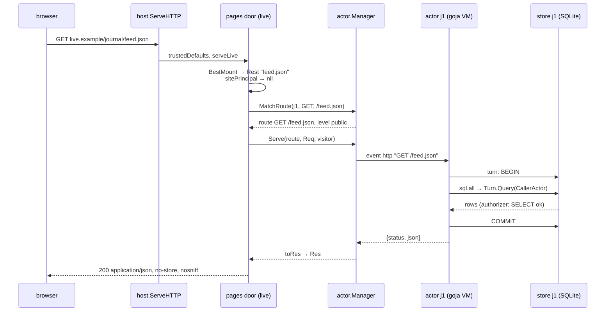
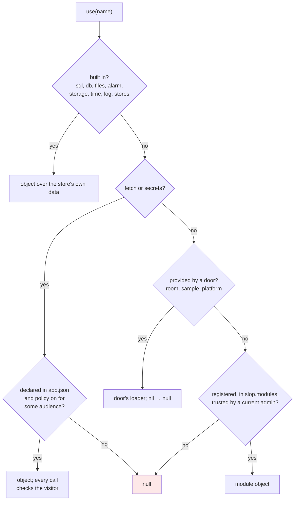
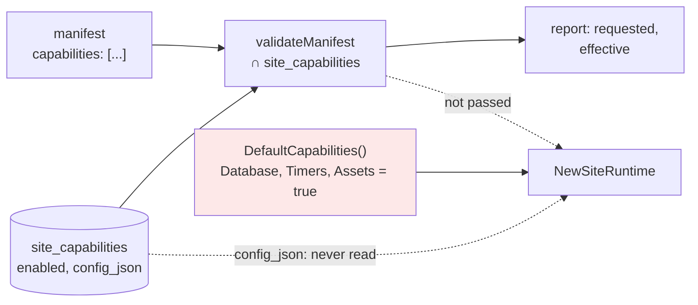
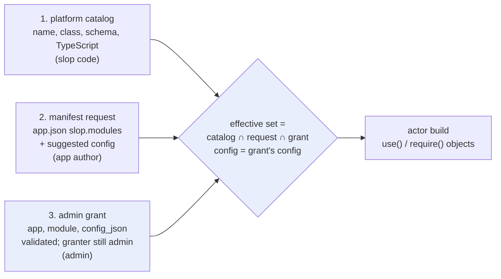
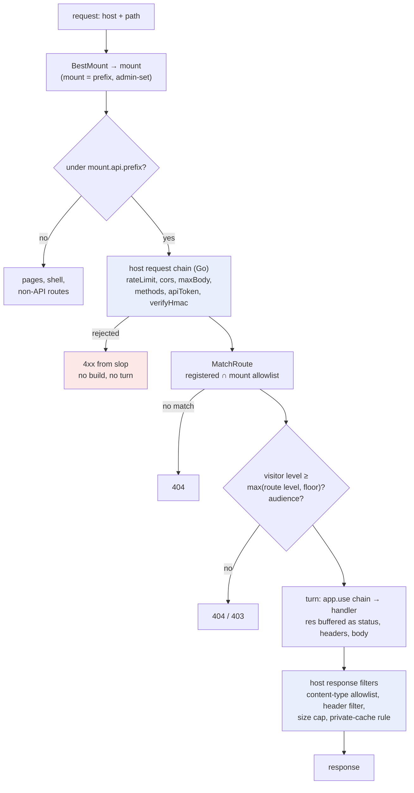

# slop v3: Per-App Modules — Safe Database and HTTP Endpoints for Sandboxed Actors — A Technical Deep Dive

slop v3 hosts small web applications. Each application runs on a store, which is a SQLite database with a versioned file tree, and an application may have server-side JavaScript, its **actor**, that runs in a goja runtime inside the slop process. The actor reaches the outside world through `use(name)`, which returns an object such as `sql` or `fetch`, or `null`. This report analyses how that catalog could become a per-app choice: each mounted app uses a set of modules that an administrator has granted it, each module configured for that app, with a database module and an HTTP-endpoint module built first.

The work is research and design, not implementation. It was done on 5 November 2026 under ticket SLOP3-011, in seven diary steps: reading slop's actor HTTP routes and its existing module catalog, two research passes over go-go-goja/xgoja and go-go-host, a question about whether per-app isolation already makes modules safe, and a design for database and HTTP endpoints. Every code claim below was checked against the source. Where the record of the research disagreed with the source, the source wins, and the differences are listed in the section *Notes on the research record*. Code marked **proposed** does not exist.

The report builds on [[PROJECT REPORT - slop v3 - Tools as Apps - Trusted Go Modules, Confirmations and the Workshop - A Technical Deep Dive]] (SLOP3-002), which introduced trusted Go modules, and on [[PROJECT REPORT - slop v3 - One Object Model - Paths Across Stores, Registry Documents and Durable-Object-Shaped Storage - A Technical Deep Dive]] (SLOP3-008), which defines bindings and aliases.

> [!summary]
> - **A module's safety comes from its backend, not from the VM.** Each store's actor has its own goja runtime and a five-second limit per turn, but a Go module runs with the slop process's privileges. go-go-goja's `fs`, `exec`, `database`, `fetch` and goja-bleve, registered as they ship, reach the data directory, any command, any SQLite file, any URL and any environment variable.
> - **Three decisions produce an app's module set.** The platform catalog says which modules exist and what class each one is. The app's manifest requests modules. An administrator's grant, with a configuration validated by slop, decides. The configuration that applies is the grant's, never the manifest's. go-go-host stores exactly this model but never consumes it at runtime. That gap is the lesson.
> - **`database` is go-go-goja's JavaScript API on slop's turn.** `query` and `exec` run through the turn's SQL authorizer as the actor, `begin()` is a savepoint, and `configure()` throws. The module takes no DSN and no store argument, so it has no handle to any other database.
> - **HTTP endpoints are an express-style builder compiled into the actor's route table.** The mount assigns the prefix. The mount's policy holds the route allowlist, the level floors, the host middlewares and the response types. `static`, `listen` and `mount` are absent by construction.

## What exists, and where

| Item | Location |
|---|---|
| slop repository | `/home/manuel/workspaces/2026-10-28/slop-computer/slop-computer` (module `github.com/go-go-golems/slop-computer`). Code was read at `origin/main` = `0f1991b`, in the worktree `/tmp/slop011` (branch `ticket/slop3-011`) |
| Ticket workspace | `ttmp/2026/11/05/SLOP3-011--per-app-modules-admin-selected-per-app-configured-capabilities-for-actors-and-pages/` |
| Diary (seven steps, 482 lines) | `reference/01-diary.md` in the ticket |
| go-go-goja | `/home/manuel/code/wesen/go-go-golems/go-go-goja`, tag `v0.10.7` |
| go-go-host | `/home/manuel/code/wesen/go-go-golems/go-go-host`, commit `4fa1bf0` |
| goja-bleve | `/home/manuel/code/wesen/go-go-golems/goja-bleve`, commit `d7cfc30` |
| Research work log (subagent tool calls) | `/tmp/claude-1000/-home-manuel-workspaces-2026-10-28-slop-computer/7fa934c5-45f7-43c5-9ffb-d734dcfbe139/scratchpad/subagent-worklog.md` |

No code was changed in any of these repositories.

## 1. The problem and the vocabulary

### 1.1 The request

The request was that each mounted app select a set of modules: go-go-goja modules such as a database, HTTP or goja-bleve, or APIs that a page reaches through the backend. An administrator controls which modules are exposed to the sandboxed scripts, and configures each module per app. The example given was a database module that works against stores, where the administrator chooses which stores it may reach. A later message narrowed the scope. Modules must either be configured safely or be slop's own sandboxed versions. There is no file system except an in-memory virtual one, and no handle to other databases. An interceptor or proxy may wrap other modules. The database and HTTP endpoints come first. A final refinement concerned HTTP. Static files and `listen` must be impossible. Only certain routes or route globs may be allowed. A configurable prefix gives different apps different subpaths for their API endpoints, and slop controls the endpoints and can add middlewares.

### 1.2 Vocabulary

The design is stated in slop's own terms. They are introduced here in the order in which they depend on each other.

- **Store.** A SQLite database plus a file tree with numbered snapshots and named refs such as `main`. On disk a store lives at `<data>/stores/<id>` (`pkg/kernel/kernel.go:87`). The data directory also holds `system.db` (`cmd/slop/cmds/serve.go:76`), the blob store (`pkg/kernel/kernel.go:58`) and `secret.key`, the server's HMAC key for sandbox labels and secrets (`pkg/config/config.go:56, 154-159`).
- **App.** A store whose tree contains `app.json`. A store **runs** an app at a snapshot number. The kernel records this as `Running{Store, App, N, Manifest, …}` (`pkg/kernel/apps.go:20-27`), so the store holding the code and the store holding the data may differ. The manifest is parsed by `apps.Parse` (`pkg/apps/manifest.go:52`).
- **Actor.** The app's server-side JavaScript, named by `app.json`'s `actor` field. There is one actor per store that runs the app, built on first use (`Manager.Get`, `pkg/actor/manager.go:140`).
- **Event and turn.** An actor handles one event at a time: an action called by a page, an HTTP request, a reactor, an alarm, or a continuation. Each event runs as a **turn**, which is one SQLite transaction on the store. An `await` on real I/O ends the turn, and the code after the `await` runs in a later continuation turn (`Actor.io`, `pkg/actor/actor.go:482-505`).
- **Visitor, level, audience.** The visitor is who an event acts for (`ctx.visitor`). Their **level** on the store is one of `none`, `view`, `interact`, `admin`, `owner`. Their **audience** is one of the person groups `guest`, `member`, `subscriber`, `admin`, or `store` for a store acting on its own in alarms and reactors (`pkg/policy/policy.go:24`).
- **Host and mount.** slop serves several kinds of host. A **live** host serves apps with sessions, a **static** host serves guests only, and **sandbox** hosts serve pages on per-app origins. A **mount** maps a host and a path pattern to a store (`registry.Mount`, `pkg/registry/mounts.go:14-27`). Only a platform admin sets mounts (`mount.set`, `pkg/commands/mounts.go:36-37`).
- **Page and view.** The app's HTML runs in an iframe on a sandbox origin. A **view** is one opened page with its granted capabilities, and it reaches its actor over a per-view RPC endpoint.
- **Binding and alias.** A binding names another store from this one: `Binding{Store, Alias, Target, Assets, Prefix, Level}` (`pkg/registry/bindings.go:15-22`). The actor opens it as `use('stores').open(alias)`, and pages read through it as an alias in their database path space. The One Object Model report covers aliases in full.
- **Verb.** One platform operation, such as `mount.set` or `app.trust`, with a scope, an `AdminOnly` flag and an authorization action. The CLI, the HTTP API and trusted modules all call verbs.
- **`use(name)`.** The global function an actor calls to obtain a capability object (`Actor.module`, `pkg/actor/modules.go:27-68`). It returns `null` for anything the app may not use.
- **Module, grant.** In this report a *module* is a named capability object that `use()` or `require()` returns. A *module grant* is an administrator's decision that one app may use one module with one configuration. It is distinct from a store grant (`grant.set`), which gives a person a level on a store.

### 1.3 One request, end to end

The journal example app serves a public JSON feed. Its actor declares one HTTP route:

`apps/examples/journal/actor.js:75-80`
```js
http: {
  'GET /feed.json': { level: 'public', run(ctx) {
    const items = sql.all("SELECT id, title, author, published_at FROM posts WHERE status = 'published' ORDER BY published_at DESC LIMIT 20");
    return { status: 200, json: { title: 'Journal', updated: ctx.now, items } };
  } },
},
```

To follow the request, take an illustrative setup: store `j1` runs the journal app and is mounted at `/journal` on the live host `live.example`. A browser without a session cookie requests `GET https://live.example/journal/feed.json`. The following steps happen, in this order.

1. `Server.ServeHTTP` classifies the host as live and calls `trustedDefaults`. This sets `Content-Security-Policy: frame-ancestors 'none'`, `X-Content-Type-Options: nosniff`, `Referrer-Policy: same-origin`, and `Strict-Transport-Security` under https (`pkg/host/host.go:164-166, 190-198`).
2. `serveLive` sees that the path is not under `/_slop/`, `/_s/` or `/_site/` and resolves the mount (`pkg/doors/pages/live.go:154-179`). `BestMount` matches `/journal` and everything below it, giving `Rest = "feed.json"` and `Base = "/journal"` (`pkg/registry/mounts.go:211-256`).
3. `sitePrincipal` finds no cookie and returns `nil` (`pkg/doors/pages/live.go:86-89`).
4. `serveActorRoute` asks `MatchRoute(ctx, "j1", "GET", "/feed.json")`. That call builds the actor if it is not running, then scores each `http` key. `GET /feed.json` has one literal segment, so it scores 2 (`pkg/actor/manager.go:572-629`). The route's level is `public`, so no level check applies (`pkg/doors/pages/actors.go:139`).
5. The request is reduced to `Req{Method, Path: "/feed.json", Base: "/journal", Query, Headers, Body}`. The body is read through `io.LimitReader(r.Body, 1<<20)`, and four headers are forwarded: `content-type`, `accept`, `user-agent`, `referer` (`pkg/doors/pages/actors.go:157-166`).
6. `Manager.Serve` queues an event of kind `http` named `GET /feed.json` (`pkg/actor/manager.go:632-646`). The actor opens a turn, starts a `TurnLimit` timer, and calls `run(ctx, req)` (`pkg/actor/actor.go:375-389`).
7. `sql.all` runs `Turn.Query(store.CallerActor, …)` (`pkg/actor/modules.go:175-179`). SQLite's authorizer allows `SELECT` and `READ` for the actor caller (`pkg/store/sqlpolicy.go:77-78`). The query returns at most 10,000 rows (`pkg/store/turn.go:216, 307-308`).
8. The turn commits. `toRes` turns the returned object into `Res{Status: 200, Type: "application/json", Body}` (`pkg/actor/manager.go:648-682`).
9. `serveActorRoute` copies the route's headers, sets `Content-Type` from `Res.Type`, sets `Cache-Control: no-store` because the route set none, sets `nosniff`, and writes the response (`pkg/doors/pages/actors.go:190-204`).

The response that results is shown below. It is derived from the code, not captured from a running server:

```
HTTP/1.1 200 OK
Content-Type: application/json
Cache-Control: no-store
Content-Security-Policy: frame-ancestors 'none'
Referrer-Policy: same-origin
Strict-Transport-Security: max-age=31536000
X-Content-Type-Options: nosniff

{"items":[{"author":"…","id":"p_…","published_at":…,"title":"…"}],"title":"Journal","updated":…}
```



*Figure 1. The journal's feed request. The actor reaches its data only through `sql`, which runs on the turn's transaction as the caller kind `actor`.*

The module question can now be stated precisely. In step 7 the actor used `sql`, an object that `use('sql')` returned when `actor.js` loaded. The design question is which names `use()` and `require()` resolve to for this app, who decides that, with what configuration, and how a module such as a database or an HTTP router fits steps 4 to 9 without adding a path that bypasses them.

## 2. What slop has today

### 2.1 The four kinds of `use()` names

`Actor.module` is a single switch (`pkg/actor/modules.go:27-68`). It distinguishes four kinds of name, and the order of the cases is part of the semantics.

| Kind | Names | Condition for a non-null object | Where |
|---|---|---|---|
| Built in | `sql`, `db`, `files`, `alarm`, `storage`, `time`, `log`, `stores` | always | `modules.go:29-44` |
| Declared, then checked by policy | `fetch`, `secrets` | the manifest lists origins (`slop.fetch`) or names (`slop.secrets`), and the policy allows the capability for at least one audience; each call then checks the turn's visitor | `modules.go:48-55` |
| Provided by a door | `room`, `sample`, `platform` | the door's loader returns non-nil | `modules.go:57-62`, `pkg/doors/actors/modules.go:32-41` |
| Trusted | `system`, `workshop` | registered, listed in `slop.modules`, and trusted by an admin | `modules.go:63-65`, `pkg/actor/registry.go:59-68` |

slop calls its entry points *doors*: the pages door, the API door, the actors door. `Manager.Provide` lets a door supply a name from outside the actor package, and provided names take precedence over trusted modules (`pkg/actor/registry.go:21-31`).



*Figure 2. How `use(name)` decides today (`pkg/actor/modules.go:27-68`).*

Two properties of this switch shape the design. First, `use()` usually runs while `actor.js` loads, before any visitor exists. The policy-checked names therefore answer only "allowed for some audience" at that point (`allowedAny`, `pkg/actor/manager.go:81-91`) and check the actual visitor on every call (`need`, `:95-99`). Second, `require` is a separate global. It loads only `.js` and `.json` files from the app's own tree (`pkg/actor/actor.go:176, 258-300`). A bare name such as `require("database")` is resolved as the tree path `database.js`, because a name without `./` or `../` is used as a path from the root and `.js` is appended (`actor.go:263-270`).

### 2.2 Trusted modules and their provenance

SLOP3-002 added the fourth kind. The manifest declares the module, `apps.Parse` rejects any name not in `apps.Modules` (`pkg/apps/manifest.go:49, 72-76`), and an admin runs `app.trust`. The verb is `AdminOnly` with the action `PlatformAdmin`. It refuses a module the app does not declare, writes the trust, and restarts the app's actors, because `use()` is evaluated when an actor starts (`pkg/commands/actors.go:79-98`). A trust counts only while the admin who made it is still an admin:

`pkg/policy/modules.go:52-58`
```go
func (d *Governance) Trusted(ctx context.Context, app, module string) bool {
	var one int
	// A trust row counts only while the admin who made it is still an admin
	// (SLOP3-007: trust has provenance, like a link and its creator).
	return d.QueryRowContext(ctx, `SELECT 1 FROM app_modules m LEFT JOIN people p ON p.id = m.granted_by
		WHERE m.app = ? AND m.module = ? AND (m.granted_by = 'system' OR p.role = 'admin')`, app, module).Scan(&one) == nil
}
```

The trust table `app_modules(app, module, granted_by, granted_at)` has no column for configuration. A trust is a yes/no per app and module (`pkg/policy/modules.go:13-18, 24-26`).

### 2.3 The audience policy matrix

The policy matrix has one cell per app, capability and audience. It covers seven capabilities: `assets`, `sample`, `user.email`, `fetch`, `secrets`, `platform`, `stores` (`pkg/policy/policy.go:20`). A cell without a row has a default, which is on only for `assets` and audiences from `member` up (`:28-30`). A cell that is on for a group also reaches the audiences inside it, so a cell on for `member` reaches subscribers and admins (`:46-53`). The matrix says *who* may use a capability through an app. It has no notion of *how* a capability is configured.

### 2.4 `fetch` and its origin list

`fetch` is the one existing module that reaches the network. Its configuration is the origin list in the manifest, checked on every call:

`pkg/actor/modules.go:692-700`
```go
		a.need("fetch")
		u, err := url.Parse(raw)
		if err != nil || (u.Scheme != "https" && u.Scheme != "http") {
			a.throw(fail("invalid_argument", "fetch needs an http(s) URL"))
		}
		origin := u.Scheme + "://" + u.Host
		if !slices.Contains(a.run.Manifest.Slop.Fetch, origin) {
			a.throw(fail("permission_denied", "%s is not in app.json slop.fetch", origin))
		}
```

The request runs on a goroutine through `a.io` with `&http.Client{Timeout: 30 * time.Second}`, and the response body is read up to 10 MiB (`modules.go:720-742`). Two facts matter for the design. The origin list is written by the app's author, and the admin only switches the policy cell, so the admin cannot narrow what an app requests. The client also sets no `CheckRedirect`. Go's default client follows redirects, so a response from a listed origin that redirects elsewhere is followed without the list being consulted again. This follows from reading the code and was not tested.

### 2.5 Other stores through bindings

`stores.open(alias)` is the existing model of scoped reach. The module looks up the binding, and every call through the returned handle decides again, in the calling turn, whether `store:<id>` may read the target:

`pkg/actor/modules.go:576-586`
```go
		fresh := func() (context.Context, rt.Level, func(string) bool) {
			cx := a.turn().t.Context()
			d, _, err := a.m.K.Access.Can(cx, me, target, rt.LevelView, "reading", true)
			a.check(err)
			if !d.OK {
				a.throw(fail("permission_denied", "store:%s cannot read %s (grant it view)", a.st.ID, target))
			}
			// the target's read rules hold for a store as for anyone at its level
			rules := a.m.K.Rules(cx, target)
			return cx, d.Level, func(path string) bool { return rules.CanRead(path, me.ID(), d.Level) }
		}
```

A handle kept across turns stops working as soon as the grant to `store:<id>` is removed. Uploaded files are described but never read by JavaScript: a route answers `{asset: {from, id}}` and the server sends the bytes (`modules.go:638-666`). This is the pattern the design reuses for any module that reaches outside the app's own store. The reach is a slop object (a binding) that an admin controls, and it is checked again on every call.

### 2.6 Page capabilities

Pages declare capabilities in the claude.ai artifact contract's vocabulary (`rt.ContractCaps`: `artifact`, `assets`, `comments`, `db`, `downloads`, `files`, `mcp`, `room`, `sample`, `self`, `user`, `slop`; `pkg/rt/manifest.go:39-40`). `grantedCaps` decides per view what the runtime may use. For example, `assets` needs at least `interact`, a user, and the policy cell, and `artifact` needs the visitor to be an admin viewing the app itself (`pkg/doors/pages/views.go:91-133`). Each runtime method is a row in `rpcTable` with an authorization action, such as `db.write` → `authz.DocWrite` or `slop.call` → `authz.ActorCall` (`views.go:552-579`). A page function backed by a module would be one more row in this table, or an actor action that the page calls with `slop.call`.

### 2.7 Actor HTTP routes

After `actor.js` runs, `readShape` copies the keys of the definition's `http` object into the route table. A route defaults to level `view` and may set `level` (`view`, `interact`, `admin`, `owner` or `public`) and `audience` (`pkg/actor/actor.go:242-254`). Matching handles methods, `:param` segments and a trailing `*` (`pkg/actor/manager.go:572-629`):

- A key's method must equal the request's, be `*`, or be `GET` for a `HEAD` request (`:581`).
- A literal segment scores 2, a parameter 1. The route with the strictly highest score wins, and among equal scores the first key in definition order wins (`:585`, `:615-620`).
- A trailing `*` binds the rest of the path, which may be empty. The pattern `/api/*` therefore matches `/api` as well as `/api/x/y` (`:608-610`).

`serveActorRoute` applies the level and audience. A visitor with no access gets 404, and a visitor with too little gets 403 (`pkg/doors/pages/actors.go:139-156`). The handler's answer may carry `status`, `headers`, and one of `json`, `html`, `text`, `body`, or `asset` (`manager.go:648-682`). On the way out, the server copies every header the handler set (`actors.go:190-192`), defaults `Cache-Control` to `no-store`, turns a `public` or `s-maxage` cache header into a private one unless anyone may read the store (`:196-201`), and sets `nosniff` (`:202`). Live hosts try actor routes before the shell and slop's favicon (`live.go:172-189`). Static hosts call `serveActorRoute` with a nil principal after checking that guests may read the store (`pkg/doors/pages/site.go:83-90`), so only `public` routes can answer there. That last point is inferred from the code and was not run.

### 2.8 Isolation facts

Each store that runs an app gets its own runtime: `build` creates `vm: goja.New()` (`pkg/actor/actor.go:159`), and the manager keys actors by store ID (`pkg/actor/manager.go:33, 140`). JavaScript time is bounded by `TurnLimit = 5 * time.Second` (`actor.go:32`), enforced with `time.AfterFunc(TurnLimit, func() { a.vm.Interrupt(…) })` around loading `actor.js` (`actor.go:195`), around every turn (`actor.go:384`), and around the activation hooks `setup` and `smoke` (`manager.go:407`). Three interrupted or panicked turns within a minute mark the actor broken (`actor.go:403-405, 507-520`). The code sets no limit on a runtime's memory. Scripts come only from the app's own snapshot, and only `.js`, `.json` and `.sql` files under 4 MiB are loaded (`manager.go:120-127`).

### 2.9 What is missing

slop has most of the model the request describes. There is a catalog (`use()`), a declaration (`app.json`), an admin decision with provenance (`app.trust`), per-audience policy, and scoped reach through bindings. What it lacks is a module *type* with its own configuration:

- **Modules are hard-coded.** Adding one means editing the `use()` switch, `apps.Modules`, and the `app.trust` verb's error message (`commands/actors.go:85`).
- **The configuration that exists is the author's.** The `fetch` origins and the `secrets` names live in the manifest. The admin's decision is a boolean, either a policy cell or a trust row.
- **Nothing describes a module.** No module carries a schema for its configuration or a TypeScript declaration that an app author or an agent could read.

## 3. Why "each app is its own sandbox" is not enough

### 3.1 What the VM boundary isolates

The question was asked directly: if each app is already isolated, are unsafe modules harmless? They are not. The isolation described in Section 2.8 is between JavaScript programs. One actor cannot read another actor's variables, and a loop is interrupted after five seconds. A native module, however, is Go code that the runtime calls. When JavaScript calls `fs.readFileSync("/x")`, goja calls a Go function. That function runs in the slop process, with the process's user, file descriptors, environment variables and network access. The VM does not observe what the Go function does. A module therefore grants whatever its Go code does, and per-app isolation does not reduce that.

### 3.2 What go-go-goja's modules would expose, as they ship

go-go-goja registers its modules in `init()` functions, with their default options. The table lists what each would give an actor if slop registered it unchanged. Every row was checked in go-go-goja v0.10.7 or goja-bleve.

| Module | Default as registered | What an app could reach | Source |
|---|---|---|---|
| `fs`, `node:fs` | `New()` uses `OSBackend{}` | every path the slop process can read or write, including `<data>/system.db`, every `<data>/stores/<id>` and `<data>/secret.key` | `modules/fs/backend.go:45-46`, `modules/fs/fs.go:315-316` |
| `exec` | `exec.Command(cmd, args...)` with no allowlist | any command, as slop's user | `modules/exec/exec.go:45-53` |
| `os`, `node:os` | `homedir`, `tmpdir`, `hostname`, … | host information | `modules/os/os.go:33-57` |
| `database`, `db` | `New()` with `allowConfigure: true` | `configure("sqlite3", path)` opens any SQLite file, including `system.db`, on a new connection that slop's SQL authorizer never sees | `modules/database/database.go:117-128, 241-257, 570-573` |
| `fetch` | `New()` with no origins and credentials from environment and files allowed | any URL, including internal addresses; any environment variable or file read into an `Authorization` header and sent | `modules/fetch/fetch.go:31-43, 316-317`; `config.go:51-53, 68-73`; `auth_builder.go:50-77` |
| goja-bleve | `create`/`open` take a host path | creates or opens an index directory anywhere writable | `goja-bleve/pkg/api_index.go:58-67`, `pkg/module.go:118-120` |
| `express` | needs a `*gojahttp.Host` | `app.static(prefix, dir)` serves a host directory through `http.FileServer(http.Dir(dir))` | `modules/express/express.go:199-205`, `pkg/gojahttp/host.go:94-96` |

The `fetch` row deserves its source. With the default policy, a credential builder can name an environment variable or a file, and the module reads it and sets it as a bearer token:

`modules/fetch/auth_builder.go:54-67` (go-go-goja v0.10.7)
```go
	case strings.TrimSpace(c.envName) != "":
		if err := c.policy.CheckCredentialEnv(c.envName); err != nil {
			return "", err
		}
		value := strings.TrimSpace(os.Getenv(c.envName))
		…
	case strings.TrimSpace(c.filePath) != "":
		if err := c.policy.CheckCredentialFile(c.filePath); err != nil {
			return "", err
		}
		data, err := os.ReadFile(c.filePath)
```

`New()` sets `Credentials: CredentialPolicy{AllowEnv: true, AllowFiles: true}` (`fetch.go:32`), and `CheckCredentialFile` accepts any path when `AllowedFiles` is empty (`config.go:71-73`). Since the origin list is also empty by default, `CheckURL` accepts any host (`config.go:51-53`). The default `fetch` can therefore send `secret.key` to any server.

### 3.3 The rule that follows

A module is safe for an app under one of two conditions:

- The module is **data-only**. It computes on its arguments and touches nothing outside the VM. go-go-goja's engine names `crypto`, `events`, `path`, `time` and `timer` with their `node:` aliases (`pkg/engine/module_specs.go:164`), and the xgoja core provider adds `yaml` (`pkg/xgoja/providers/core/core.go:20-29`).
- **Every resource the module reaches outside the VM comes from a backend that slop supplies and scopes to the app.** That backend might be the app's own store, an in-memory file system, an egress proxy, or a binding.

Module options are how the second condition is met, and go-go-goja already has the hooks: `fs.WithBackend`, `fetch.WithPolicy` and `WithHTTPClient`, `database.WithPreconfiguredDB`. In every unsafe module, however, the default is the unsafe choice. The design therefore never registers a go-go-goja module through its `init()` default. Two limits remain that options do not address. CPU is bounded by `TurnLimit` only while JavaScript runs, not while a Go function blocks. Memory is unbounded. Any module that buffers data, such as bleve indexes or `fetch` bodies, therefore needs its own byte caps in its configuration.

## 4. What go-go-goja and xgoja provide

### 4.1 `NativeModule` and the global registry

A go-go-goja module implements three methods:

`modules/common.go:28-32`
```go
type NativeModule interface {
	Name() string
	Doc() string
	Loader(*goja.Runtime, *goja.Object)
}
```

Modules register themselves in a process-wide registry from `init()` (`DefaultRegistry`, `modules/common.go:93-98`). `Registry.Enable` installs each module's `Loader` into a `goja_nodejs` `require.Registry` (`:86-90`). The registry holds one *instance* per name, and every runtime that enables it gets a loader closed over that same instance. Shared state follows from that. `DBModule.Configure` assigns `m.queryExecer` on the instance (`modules/database/database.go:241-257`), so in two runtimes that enable the default `database`, a `configure()` in one runtime changes the connection the other uses. This follows from reading the code and was not run. A registry of single instances cannot carry a configuration per app.

### 4.2 Choosing modules per runtime

go-go-goja's engine builds runtimes from a factory: `NewRuntimeFactoryBuilder` (`pkg/engine/factory.go:49`), `Build` (`:123`), `NewRuntime` (`:184`). There is no `engine.New()`. A factory can turn off the implicit default modules (`WithImplicitDefaultRegistryModules(false)`, `pkg/engine/options.go:68`), add specific instances (`NativeModuleRegistrar`, `pkg/engine/module_specs.go:52`), and filter the selection with middleware such as `MiddlewareOnly(names...)` or `MiddlewareSafe()`, which keeps the data-only list (`pkg/engine/module_middleware.go:23-48`). slop does not need the engine. slop builds its own VM per store and keeps its own turn, interrupt and require logic. What slop can use is the modules' constructors and options, and the xgoja contract described next.

### 4.3 xgoja's `providerapi.Module`

xgoja v2 adds the contract that the plain registry lacks: a module whose loader is built per instance, from a configuration.

`pkg/xgoja/providerapi/module.go:15-23, 44-51`
```go
type ModuleSetupContext struct {
	Context      context.Context
	Name         string
	As           string
	Config       json.RawMessage
	Host         HostServices
	RuntimeOwner runtimeowner.RuntimeOwner
	AddCloser    func(func(context.Context) error) error
}

type Module struct {
	Name             string
	DefaultAs        string
	Description      string
	ConfigSchema     json.RawMessage
	TypeScript       *spec.Module
	NewModuleFactory func(ModuleSetupContext) (require.ModuleLoader, error)
}
```

Four parts of this contract carry over to slop directly. `NewModuleFactory` receives the instance's `Config`, so two apps get two differently configured loaders. `As` lets the same module appear under another name. `TypeScript` gives an author or an agent the module's API. `AddCloser` releases resources when the runtime ends. The contract also has a gap: **`ConfigSchema` is declared but nothing reads it.** A grep of the whole repository outside `ttmp/` finds the two field declarations (`module.go:48`, `commands.go:89`) and five struct literals that set it, and no expression that reads `.ConfigSchema`. A configuration is decoded with plain `json.Unmarshal` (`pkg/xgoja/providers/host/host.go:349-357`), so unknown fields are dropped without error and the schema's constraints, such as `"const": true`, are not enforced.

### 4.4 The host provider's option mapping

`pkg/xgoja/providers/host/host.go` shows how xgoja maps a configuration onto each unsafe module's options. Its rules are the starting point for slop's module configurations, and also a list of the defaults slop must not inherit.

| Module | Configuration (`host.go`) | Effect |
|---|---|---|
| `fs` | `{allow}` or `{embedded: {allow, mounts: [{asset, mount, root}]}}`; both at once is an error | `allow` → `OSBackend{}`; `embedded` → `ReadOnlyFSBackend` over asset `fs.FS`s (`:117-145, 148-175`) |
| `fetch` | `{allow, allowedOrigins, timeout, maxResponseBytes, credentials: {allowEnv, allowFiles, allowedFiles}}` | `WithPolicy`; an empty `allowedOrigins` means any origin (`:189, 202-245`) |
| `exec` | `{allow, allowedCommands}` | an empty `allowedCommands` means any command (`:258-289`) |
| `database` | `{allowConfigure, driverName, dataSourceName}` | a DSN preconfigures with `WithPreconfiguredDB`; otherwise `configure()` is allowed or not (`:293-335`) |

The host provider's `fetch` builds a fresh `Policy`, so credentials from the environment and from files are off unless the configuration enables them (`:235-244`). That differs from `fetch.New()`. Combined with `json.Unmarshal`, though, a misspelled `"alowedOrigins"` yields an empty list, which allows any origin. slop's configurations must therefore be decoded strictly, with unknown fields rejected, and validated against the schema before a grant is stored.

### 4.5 The asynchronous model

A goja runtime may be used by one goroutine at a time. go-go-goja expresses that with a runtime owner:

`pkg/runtimeowner/types.go:21-27`
```go
type RuntimeOwner interface {
	Call(ctx context.Context, op string, fn CallFunc) (any, error)
	Post(ctx context.Context, op string, fn PostFunc) error
	WaitIdle(ctx context.Context) error
	Shutdown(ctx context.Context) error
	IsClosed() bool
}
```

Modules do not receive the owner as an argument. They look it up per VM: `runtimebridge.Store(vm, RuntimeServices{LifetimeContext, Loop, Owner})` and `Lookup(vm)` (`pkg/runtimebridge/runtimebridge.go:26-30, 140-161`). `CurrentOwnerContext(vm)` returns the context of the owner call in progress, or the runtime's lifetime context (`:191-201`). An asynchronous module follows one pattern. `fetch` creates a promise, does the work on a goroutine, and settles the promise by posting back to the owner:

`modules/fetch/fetch.go:222-250` (abridged)
```go
	promise, resolve, reject := vm.NewPromise()
	callCtx := runtimebridge.CurrentOwnerContext(vm)
	go func() {
		data, err := m.execute(callCtx, spec)
		if err != nil {
			_ = runtimeServices.PostWithCustomContext(callCtx, "fetch.reject", func(context.Context, *goja.Runtime) {
				_ = reject(vm.NewGoError(err))
			})
			return
		}
		_ = runtimeServices.PostWithCustomContext(callCtx, "fetch.resolve", func(context.Context, *goja.Runtime) { … resolve(value) })
	}()
	return vm.ToValue(promise)
```

`PostWithCustomContext` needs only `Owner.Post` and the lifetime context (`runtimebridge.go:83-105`). `database` is synchronous. Its exported functions only read `CurrentOwnerContext(vm)` for cancellation (`database.go:221-238`). go-go-goja itself contains a small adapter from a runtimebridge owner to a runtimeowner owner, in which `WaitIdle` and `Shutdown` are no-ops and `IsClosed` returns false (`modules/express/express.go:69-87`). That is the shape slop's adapter would take (Section 6.7). In v0.10.7, as in v0.8.3, the engine interrupts a VM only while closing the runtime (`pkg/engine/runtime.go:130-144`). slop's own `TurnLimit` interrupt remains the CPU bound.

### 4.6 Versions

| Repository | Go | goja | go-go-goja |
|---|---|---|---|
| slop-computer (`0f1991b`) | — | `v0.0.0-20251103141225-af2ceb9156d7` | not a dependency |
| go-go-goja v0.10.7 | `go 1.26.1`, toolchain `go1.26.10` | `v0.0.0-20261103151521-97b96e1e55f5`; goja_nodejs `v0.0.0-20260918173711-b481721df8a2` | — |
| go-go-host (`4fa1bf0`) | — | `v0.0.0-20260311135729-065cd970411c` | `v0.8.3` |
| goja-bleve (`d7cfc30`) | — | `v0.0.0-20260311135729-065cd970411c` | `v0.8.3` |

Importing any go-go-goja module moves slop's goja by a year, because Go's minimal version selection takes the highest required version.

## 5. What go-go-host provides

### 5.1 The data model

go-go-host hosts small server-side JavaScript sites, one goja runtime per site in one daemon. A site's bundle declares a flat list of capabilities in `go-go-host.json` (`internal/deploy/bundle.go:23-31`). The platform's default allowlist is

`internal/deploy/bundle.go:21`
```go
var SafeCapabilities = map[string]bool{"express": true, "ui.dsl": true, "database": true, "db": true, "time": true, "timer": true, "assets": true, "sqlite": true}
```

and a site's own policy is a table with a configuration column:

`internal/store/migrations/001_initial_schema.sql:69-76`
```sql
CREATE TABLE IF NOT EXISTS site_capabilities (
  site_id TEXT NOT NULL REFERENCES sites(id) ON DELETE CASCADE,
  capability TEXT NOT NULL,
  enabled BOOLEAN NOT NULL DEFAULT true,
  config_json JSONB NOT NULL DEFAULT '{}',
  updated_at TIMESTAMPTZ NOT NULL,
  PRIMARY KEY (site_id, capability)
);
```

When a bundle is uploaded, `siteCapabilityPolicy` reads the site's rows, or uses `SafeCapabilities` if the site has none (`internal/control/deployments.go:418-431`). `validateManifest` rejects a capability the policy does not permit (`bundle.go:236-240`), and the report records the requested and effective lists (`bundle.go:167-169`). An organisation owner, not a platform admin, writes a row through `UpsertCapability`. That function checks that `config_json` is valid JSON and writes an audit event (`internal/control/services.go:160-182`). The API exposes `GET` and `PUT /api/v1/sites/{site_id}/capabilities` and a read-only admin listing (`internal/httpapi/handler.go:69-70, 96`).

### 5.2 The gap: enforced at upload, ignored at runtime

The runtime does not see any of this. Every place that builds a runtime passes the same constant set:

`internal/runtime/runtime.go:45-53`
```go
type CapabilitySet struct {
	Database bool
	Timers   bool
	Assets   bool
}

func DefaultCapabilities() CapabilitySet {
	return CapabilitySet{Database: true, Timers: true, Assets: true}
}
```

`Capabilities: hostruntime.DefaultCapabilities()` appears at all three call sites (`internal/control/deployments.go:108, 129, 279`). The effective list from validation never reaches the runtime. `NewSiteRuntime` reads `Timers` and `Assets` (`runtime.go:95, 110`), and no non-test code reads `Database`. The database, `db`, express, `ui.dsl` and `db.guard` modules are therefore always registered (`runtime.go:87-98`). The only reads of `config_json` are in the store layer, the DTOs and the admin listings, such as `internal/httpapi/site_settings.go:140` and `internal/store/sites.go:81`. No runtime code consumes it.



*Figure 3. go-go-host decides capabilities when a bundle is uploaded, and the runtime receives a constant set.*

### 5.3 The principle, and the lesson

go-go-host's design document states the principle the code was meant to follow: "**Host-mediated capabilities.** Manifest permissions are requests; host policy grants the effective set" (`ttmp/2026/05/11/HOST-001-…/design-doc/01-go-go-host-v1-hosting-platform-intern-design-and-implementation-guide.md:1164`). It restates it at line 594: "The manifest requests capabilities; it does not grant them. The host intersects requested permissions with site policy." slop's `app.trust` already follows the principle. The lesson from go-go-host is about where the decision is made. The effective set and its configuration must be computed **where the runtime is built**, and consumed there, not only checked when the code is uploaded. In slop, that place is the actor's `build`, which already reruns after a trust change (`app.trust` → `RestartApp`).

## 6. The proposed design

### 6.1 Three module classes

Section 3.3's rule becomes three classes. Each module in the catalog has exactly one class, and the class determines what a grant may configure.

| Class | Definition | Examples | What its configuration may set |
|---|---|---|---|
| `data` | touches nothing outside the VM | go-go-goja `path`, `crypto`, `events`, `yaml`, `time` | nothing, or limits on output size |
| `own` | reaches only the app's own store, or memory owned by the actor | `database`, `express`, an in-memory virtual `fs` | read-only, row caps, byte caps, route limits |
| `scoped` | reaches outside the store only through a slop backend that the admin controls and that checks every call | `fetch` through an egress proxy, `stores` through bindings, bleve on the virtual fs or in memory | origins, bindings, byte caps, timeouts |

The classes are not a ranking of trust. They say where the module's boundary is enforced. A `data` module is safe because of what its Go code does. An `own` module is safe because slop implements it on objects that already exist only for this store, such as the turn and the route table. A `scoped` module is safe because its only path outward is a slop object with its own checks.

### 6.2 The module type

**Proposed.** The catalog entry adapts xgoja's `providerapi.Module` to slop's actor:

```go
// proposed: pkg/actor/catalog.go
type Class string

const (
	ClassData   Class = "data"
	ClassOwn    Class = "own"
	ClassScoped Class = "scoped"
)

// A CatalogModule is one module the platform offers to apps.
type CatalogModule struct {
	Name         string
	Class        Class
	Doc          string
	ConfigSchema json.RawMessage // JSON Schema; slop validates every grant against it
	TypeScript   *spec.Module    // go-go-goja tsgen spec, shown to authors and agents
	Default      json.RawMessage // the configuration a grant starts from
	New          func(SetupContext) (goja.Value, error)
}

// SetupContext is what a module gets when an actor is built.
type SetupContext struct {
	Actor  *Actor          // VM, Turn, IO, Visitor, Need, AfterCommit (modules.go:70-129)
	App    string
	Store  string
	Config json.RawMessage // the grant's configuration, already validated
}
```

`New` returns the JavaScript object directly, rather than a `require.ModuleLoader`, because slop's `use()` and `require()` are its own (Section 7.5). A go-go-goja module fits behind `New` by calling its loader on a fresh `module.exports` object:

```go
// proposed: adapting a go-go-goja NativeModule built with safe options
func fromLoader(load func(*goja.Runtime, *goja.Object)) func(SetupContext) (goja.Value, error) {
	return func(sc SetupContext) (goja.Value, error) {
		vm := sc.Actor.VM()
		module := vm.NewObject()
		_ = module.Set("exports", vm.NewObject())
		load(vm, module)
		return module.Get("exports"), nil
	}
}
```

The helpers that `Actor` already exports for modules provided by other packages, namely `Turn`, `VM`, `IO`, `Visitor`, `Need`, `AfterCommit`, `ToJS` and `FromJS` (`pkg/actor/modules.go:70-129`), are the services a module needs. The design adds no new privileged surface for modules.

### 6.3 Three decisions

An app's effective module set comes from three decisions, made by three different parties:

1. **The platform catalog**, in slop's code, says which modules exist, their class, schema and TypeScript. It replaces `apps.Modules = {system, workshop}`.
2. **The manifest request**, in `app.json`, lists the modules the app wants. It may also suggest a configuration. That suggestion is a request shown to the admin, never a configuration that applies.
3. **The admin grant** in `system.db` names the app, the module and a `config_json`. Before storing it, slop validates the configuration against `ConfigSchema` with unknown fields rejected. The grant keeps the provenance rule of `Trusted`: it counts only while its granter is still an admin.



*Figure 4. The three decisions. Only the grant's configuration applies.*

**Proposed** manifest and grant, for the journal:

```json
{ "title": "Journal", "actor": "actor.js",
  "slop": { "modules": ["database", "express", { "name": "fetch", "suggest": { "origins": ["https://api.example.org"] } }] } }
```

```sql
-- proposed migration: a grant carries its configuration
ALTER TABLE app_modules ADD COLUMN config_json TEXT NOT NULL DEFAULT '{}';
```

```
slop app grant journal fetch --config '{"origins":["https://api.example.org"],"maxResponseBytes":1048576}'
```

Three properties follow from this arrangement. An author cannot widen a module's reach, because the author writes only the request. An admin cannot grant a module the app did not ask for, because `app.trust` already refuses that (`commands/actors.go:91-93`). The admin can grant less than the app asked for, such as one origin out of three, because the grant's configuration is the only one that applies. The set is fixed when the actor is built. A grant change restarts the app's actors, as `app.trust` does today, so no turn ever sees a module set from both before and after the change.

### 6.4 The interceptor

**Proposed.** Every granted module's object passes through one wrapper before `use()` returns it. The wrapper replaces each exported function:

```go
// proposed: pkg/actor/intercept.go
func (a *Actor) intercept(g Grant, obj *goja.Object) *goja.Object {
	for _, k := range obj.Keys() {
		fn, ok := goja.AssertFunction(obj.Get(k))
		if !ok {
			continue
		}
		name := g.Module + "." + k
		_ = obj.Set(k, func(call goja.FunctionCall) goja.Value {
			a.needModule(g)       // grant still current, policy on for this turn's visitor
			m := a.meter(g, name) // counts the call; bytes, where the module reports them
			defer m.done()
			v, err := fn(call.This, call.Arguments...)
			if err != nil {
				panic(err)
			}
			return v
		})
	}
	return obj
}
```

The wrapper re-checks the grant and the audience policy for the turn's visitor, which is what `need` does for `fetch` today. It meters calls, and bytes where a module reports them, and it logs. It is a second layer of checks, not the first. It wraps only the object's own functions, and builder-style APIs return new objects whose methods the wrapper never sees: go-go-goja's `fetch` returns client and credential builders, and express returns route builders. A module of class `own` or `scoped` must therefore enforce its limits in its backend, and the interceptor adds uniform policy checks and accounting on top.

### 6.5 Configuring go-go-goja modules safely

Each unsafe go-go-goja module has an option that removes its access to the host. The design uses those options and never the defaults.

- **`fs` on a virtual file system.** `fsmod.New(fsmod.WithBackend(b))` accepts any implementation of the eleven-method `Backend` interface (`modules/fs/backend.go:5-17, 61`). go-go-goja ships two backends, `OSBackend` and the read-only `ReadOnlyFSBackend`, which takes any `io/fs.FS` (`modules/fs/backend_embed.go:14-38`). It has no in-memory writable backend. slop would provide one, with a byte cap and a file-count cap, owned by the actor and discarded when the actor stops. A read-only view of the app's own snapshot can use `ReadOnlyFSBackend` over an `fs.FS` built from `SnapshotFiles`.
- **`fetch` through an egress proxy.** `fetchmod.New(fetchmod.WithPolicy(p), fetchmod.WithHTTPClient(c))` (`modules/fetch/fetch.go:49-55`). The policy's `AllowedOrigins` comes from the grant and must be non-empty. `Credentials` has both `AllowEnv` and `AllowFiles` false, and `MaxResponseBytes` is set. The client's transport sends every request to slop's egress proxy, which resolves the name, refuses private and link-local addresses, and checks the origin again on every redirect. A credential that the app needs comes from `secrets`, not from the process environment.
- **bleve without host paths.** goja-bleve's `memory` mode needs no path (`goja-bleve/pkg/api_index.go:56-57`). A persistent index needs a directory that slop chooses inside the store's data and a byte cap. Its `create`/`open` modes are refused, or rewritten to that directory, by slop's provider.

### 6.6 Page-side modules

The request also mentioned APIs that a page reaches through the backend. In slop, page functions are already rows in `rpcTable` with an authorization action (Section 2.6), or actor actions that the page calls with `slop.call`. A module that serves pages adds rows with an action and a per-view check in `grantedCaps`, rather than a second execution environment in the browser. The admin grant is the same as for an actor module, and the view checks it when it opens.

### 6.7 The runtimebridge owner adapter

Asynchronous go-go-goja modules, such as `fetch` and `timer`, look up a runtime owner for the VM and settle their promises with `Post` (Section 4.5). slop's equivalent of `Post` already exists: `continueWith` queues a continuation event that resumes a parked handler (`pkg/actor/actor.go:473-478`). The adapter maps one onto the other. **Proposed:**

```go
// proposed: pkg/actor/bridge.go
type actorOwner struct{ a *Actor }

func (o actorOwner) Post(ctx context.Context, op string, fn func(context.Context, *goja.Runtime)) error {
	ev, ok := originEvent(ctx) // the event whose turn called the module
	if !ok {
		return fmt.Errorf("%s: no event to continue", op)
	}
	o.a.continueWith(ev, func() error { fn(ctx, o.a.vm); return nil })
	return nil
}

func (o actorOwner) Call(ctx context.Context, op string, fn func(context.Context, *goja.Runtime) (any, error)) (any, error) {
	if o.a.cur != nil {
		return fn(ctx, o.a.vm) // already on the actor's goroutine, inside a turn
	}
	return nil, fmt.Errorf("%s: calls into the actor from outside a turn are not supported", op)
}
```

When the actor is built, slop calls `runtimebridge.Store(vm, RuntimeServices{LifetimeContext: actorLifetime, Owner: actorOwner{a}})`. At the start of each turn, it runs the handler inside `runtimebridge.WithCallContext(vm, ctx, …)`, so that `CurrentOwnerContext` returns a context that carries the origin event. That context must outlive the turn. go-go-goja's `fetch` captures it and issues its request from a goroutine (`fetch.go:224-234`), and the request continues after the turn that started it has committed. The context is therefore the event's, bounded by `CallTimeout` (60 s, `actor.go:34`) and by the actor's lifetime, not the SQLite transaction's. Synchronous modules such as `database` need none of this.

### 6.8 The goja version

slop pins goja at `v0.0.0-20251103141225-af2ceb9156d7`. go-go-goja v0.10.7 requires `v0.0.0-20261103151521-97b96e1e55f5` (Section 4.6), so the first go-go-goja import moves slop's VM forward by twelve months of upstream changes. One such change is visible in go-go-goja's own code: a comment states that "goja (since 6ace4dd) converts a nil slice to null" (`modules/database/database.go:501-502`). slop's actor code returns slices from Go in many places, for example `toJS(rows)`. Before the bump, two things should be checked: whether that commit lies between the two versions, and whether slop returns nil slices where pages expect `[]`. The bump should land on its own, with slop's actor test suite, before any module depends on it. `database` and `express`, as designed in Sections 7 and 8, need no go-go-goja code at run time, only its API and its TypeScript specs, so the bump is not on their path.

## 7. Database first

### 7.1 What the module offers

`require("database")` offers go-go-goja's JavaScript API unchanged, so scripts written for go-go-host or xgoja keep working, and so does its TypeScript declaration (`modules/database/database.go:138-190`). The API has five functions: `configure(driverName, dataSourceName)`, `query(sql, ...args)`, `exec(sql, ...args)`, `begin()`, which returns `{query, exec, commit, rollback}`, and `close()`. Exec results have the shape `{success, rowsAffected?, lastInsertId?, error?}`.

### 7.2 The semantics, on the turn

Each function maps onto machinery the turn already has:

| Function | slop implementation | Notes |
|---|---|---|
| `query(sql, ...args)` | `Turn.Query(store.CallerActor, sql, args...)` | the authorizer applies; at most 10,000 rows (`turn.go:307-308`) |
| `exec(sql, ...args)` | `Turn.Exec(store.CallerActor, …)` → `{success: true, rowsAffected, lastInsertId}` | the shape of go-go-goja's `resultToMap` (`database.go:528-536`) |
| `begin()` | `SAVEPOINT db_spN`; `commit()` → `RELEASE`; `rollback()` → `ROLLBACK TO` + `RELEASE` | the turn already holds the transaction; among app callers, only the actor may open a savepoint (`sqlpolicy.go:127-131`) |
| `configure(…)` | throws `permission_denied` | the module is always this store's own database |
| `close()` | does nothing | the turn owns the connection |

Two details need care. go-go-goja flattens an array argument into positional parameters, so `query(sql, [1, 2])` binds two parameters (`database.go:558-568`). slop's `sql` instead encodes an array as a JSON string (`pkg/actor/modules.go:161-163`). For compatibility, the database module must flatten. Savepoint names need a prefix of their own, because `sql.transaction` numbers its savepoints `sp1`, `sp2`, … (`modules.go:197-198`).

**Proposed:**

```go
// proposed: pkg/actor/database.go — go-go-goja's API on slop's turn
func (a *Actor) databaseModule(cfg DatabaseConfig) goja.Value {
	o := a.vm.NewObject()
	caller := store.CallerActor
	if cfg.ReadOnly {
		caller = store.CallerActorRead // proposed: reads only, enforced by the authorizer
	}
	_ = o.Set("query", func(call goja.FunctionCall) goja.Value {
		rows, err := a.turn().t.Query(caller, call.Argument(0).String(), a.flatParams(call.Arguments[1:])...)
		a.check(err)
		if cfg.MaxRows > 0 && len(rows) > cfg.MaxRows {
			a.Throw("invalid_argument", fmt.Sprintf("more than %d rows", cfg.MaxRows))
		}
		return a.toJS(rows)
	})
	_ = o.Set("exec", func(call goja.FunctionCall) goja.Value {
		res, err := a.turn().t.Exec(caller, call.Argument(0).String(), a.flatParams(call.Arguments[1:])...)
		a.check(err)
		n, _ := res.RowsAffected()
		id, _ := res.LastInsertId()
		return a.toJS(map[string]any{"success": true, "rowsAffected": n, "lastInsertId": id})
	})
	_ = o.Set("begin", func() goja.Value { return a.savepointHandle(caller) })
	_ = o.Set("configure", func(string, string) {
		a.Throw("permission_denied", "database is this store's own database and cannot be configured")
	})
	_ = o.Set("close", func() {})
	return o
}
```

The read-only option cannot be a check in `exec` alone. `Turn.Query` runs any statement, so `query("UPDATE …")` or `INSERT … RETURNING` would write. Read-only has to be a caller kind that the authorizer refuses writes for, in the same way the existing `admin-read` kind serves `sql.query` (`pkg/store/sqlpolicy.go:14`).

Savepoint handles have three end states. A handle still open when the handler returns must be rolled back to its savepoint before the turn commits, which needs a before-commit hook in the turn (`AfterCommit` runs too late). A handle cannot span an `await` on real I/O. The await ends the turn, the before-commit hook rolls the savepoint back, and a later `commit()` throws "the transaction ended with its turn". A document write through `db` or `storage` while a savepoint is open must throw. The One Object Model report explains why: the turn records document changes in memory as they happen, so rolling `_docs` back under it would leave change events for writes that no longer exist (§9.4 of that report). slop's existing `sql.transaction` shares that property, and the new module should not carry it further.

### 7.3 Why not `DBModule` with `WithPreconfiguredDB`

go-go-host reuses go-go-goja's module by passing a preconfigured handle (`internal/runtime/runtime.go:86-88`). slop cannot do that safely, and the reason lies in how slop's SQL authorizer works. The authorizer is registered once, on the store's writer connection (`pkg/store/store.go:88-94`). It decides by the *current turn's caller kind*, which `Turn.Query` and `Turn.Exec` set for the duration of each statement (`pkg/store/turn.go:189-220`):

`pkg/store/sqlpolicy.go:52-58, 73-75`
```go
func (s *Store) authorize(action int, a1, a2, dbName string) int {
	t := s.cur
	caller := CallerKernel
	if t != nil {
		caller = t.caller
	}
	…
	if dbName == "temp" {
		return sqlite3.SQLITE_DENY
	}
```

`QueryExecer` requires `Query(…) (*sql.Rows, error)` and `Exec(…) (sql.Result, error)` (`database.go:17-20`), which means a raw `database/sql` handle. There are two ways to provide one, and both fail. A second connection to the store's file carries no authorizer at all. The store's own reader pool, for example, is opened `mode=ro` without one (`store.go:106`), and a writable second connection would let app SQL write kernel tables, run DDL and attach files. The writer connection used outside `Turn.Query` and `Turn.Exec` is authorized as `kernel`. That caller kind may read everything and write every kernel table, and may not write app tables. App-authored SQL would then run with the kernel's authority, which the store's design rules out ("no app-authored SQL runs as the kernel", `sqlpolicy.go:58-64`). `begin()` would also call `BeginTx` (`database.go:476-493`) on a connection whose turn already holds a transaction. SQLite rejects a nested `BEGIN`, and the authorizer denies `TRANSACTION` to every caller except the kernel (`sqlpolicy.go:138-139`). Wrapping `Turn` behind a type that satisfies `QueryExecer` is not possible either, because `Turn` returns maps, not `*sql.Rows`. The module is therefore slop's own code with go-go-goja's API, which is the only option that keeps the authorizer in place.

### 7.4 No handle to other databases

The module has no DSN argument and no store argument, so a script cannot name another database. Four facts make this hold at the SQL level too. The authorizer denies `ATTACH` to every caller except the kernel (`sqlpolicy.go:58-71, 138-139`), and the writer connection sets `SQLITE_LIMIT_ATTACHED` to 0, so no statement on it can attach a database (`store.go:93`). Statements against the `temp` schema are denied to the actor (`sqlpolicy.go:73-75`). Writes to kernel tables are denied, since only names that do not start with `_`, `sqlite_` or `slop_` count as app tables (`sqlpolicy.go:21-24, 79-89`). Other stores stay behind `stores.open(alias)`, through a binding that an admin set and that is checked again on every call (Section 2.5). The request's example of a database module configured to reach certain stores is therefore met with bindings, not with the database module. Choosing which stores an app may read is `bind.set`. The database module only ever sees its own store.

### 7.5 How `require("database")` resolves

The actor has both `use(name)` and `require(name)`. Today a bare `require("database")` loads `database.js` from the app's tree (Section 2.1). **Proposed:** names in the catalog resolve first, as native modules do in `goja_nodejs`, and tree files otherwise:

```go
// proposed: in Actor.requirer, before the tree lookup (actor.go:262-277)
if mod, ok := a.m.catalog[name]; ok {
	if v := a.granted(name); v != nil {
		return v // the intercepted object, built once per actor
	}
	panic(a.vm.NewGoError(fmt.Errorf("require: %s is not granted to %s", name, a.run.App)))
}
```

`use("database")` returns the same object or `null`, following the contract's rule for undeclared capabilities. `require("database")` throws when the module is not granted, because a `require` that returns `null` would surface far from its cause. No app in the repository has a root file named after a planned module (`database.js`, `db.js`, `express.js`, `http.js`), so the change breaks nothing that exists today.

### 7.6 The journal with `database`

```js
// proposed usage
const db = require("database");
defineActor({
  http: {
    'GET /feed.json': { level: 'public', run(ctx) {
      const items = db.query("SELECT id, title, author, published_at FROM posts WHERE status = 'published' ORDER BY published_at DESC LIMIT ?", 20);
      return { status: 200, json: { title: 'Journal', updated: ctx.now, items } };
    } },
  },
});
```

The trace of Section 1.3 is unchanged except at step 7, where `db.query` calls the same `Turn.Query(CallerActor, …)` that `sql.all` called. That is the point of the design: the module adds an API and adds no new path to the data.

## 8. HTTP endpoints second

### 8.1 The requirement

The refined requirement has four parts. The HTTP module must make static files, `listen` and similar functions impossible. Only certain routes, or route globs, may be exposed. A configurable prefix assigns each app its own subpath for API endpoints. slop controls the endpoints and can put middlewares in front of them.

### 8.2 Why not go-go-goja's express as is

go-go-goja's express is built around a `*gojahttp.Host` that owns the HTTP server, and every one of its central functions conflicts with slop's model:

- **It writes the response from inside the VM call.** A planned route runs its handler in `owner.Call` with a `Response` bound to the live `http.ResponseWriter` (`pkg/gojahttp/planned_dispatch.go:35-53`, `request_response.go:79-125`). In slop, a route answers by returning a value from its turn, and the server writes the response after the turn commits (Section 1.3).
- **It serves host directories and Go handlers.** `static(prefix, dir)` is `http.FileServer(http.Dir(dir))` (`express.go:199-205`, `gojahttp/host.go:94-96`). `mount(prefix, handler)` requires a Go `http.Handler` (`express.go:168-181`).
- **It has its own identity.** Its exports include `user`, `agent`, `sessionUser`, `oauth`, `anyOf`, `resource` and `rateLimit` (`express.go:89-110`). Its route builder is staged: `.public().handle(h)`, or `.auth(spec)` followed by `.allow(action)`, where the action is an action name (`modules/express/auth_builders.go:283-341`). slop's identity is the visitor and its level, decided by slop.
- **Its request carries everything.** The request object has every header, every cookie, the client IP and a session (`request_response.go:16-68`). slop forwards four headers and no cookies.

What carries over is the builder's surface: `app.get(pattern)`, `.public()`, `.handle(fn)` and the `(ctx, res)` handler signature (`planned_dispatch.go:46`), together with its TypeScript (`modules/express/typescript.go`). The `listen` function already throws in go-go-goja ("app.listen is not supported by the xgoja Express module", `express.go:229-231`).

### 8.3 A route builder compiled into the actor's route table

**Proposed.** slop's `express` is a route builder whose only output is entries in the actor's existing route table, the same table `readShape` fills from `http: {…}` (`actor.go:242-254`):

```js
// proposed usage
const db = require("database");
const app = require("express").app();

app.use((ctx, res, next) => { ctx.started = Date.now(); return next(); });   // app middleware, in the turn

app.get("/api/feed.json").public().handle((ctx, res) =>
  res.json(db.query("SELECT id, title FROM posts WHERE status = 'published'")));

app.post("/api/items").allow("interact").handle((ctx, res) => {
  const r = db.exec("INSERT INTO items(title) VALUES (?)", ctx.body.title);
  res.status(201).json({ id: r.lastInsertId });
});
// compiles to: http: { 'GET /api/feed.json': {level: 'public', run}, 'POST /api/items': {level: 'interact', run} }
```

The builder's methods map onto slop's route fields:

| Builder | Route table | Notes |
|---|---|---|
| `app.get/post/put/patch/delete(p)` | key `"METHOD p"` | same pattern syntax as `http:` keys |
| `app.all(p)` | key `"* p"` | `*` method (`manager.go:581`) |
| `.public()` | `level: "public"` | subject to the mount's floor (Section 8.6) |
| `.allow("view" \| "interact" \| "admin" \| "owner")` | `level` | slop's meaning; in go-go-goja `.allow` takes an action name after `.auth()` |
| `.allow("@member")` and the like | `audience` | an audience group |
| `.handle(fn)` | `run` | `fn(ctx, res)`; may return a promise |
| `.auth(…)`, `.resource(…)`, `.csrf(…)`, `user()`, `oauth()` | — | throw `not_supported`: identity is slop's |
| `static`, `staticFromAssetsModule`, `spaFromAssetsModule`, `mount`, `mountHandler`, `listen` | — | not defined; at most, a later opt-in `static(prefix)` could serve files from the store's own snapshot (the bytes the pages door already serves), never a host directory |

Routes register only while `actor.js` loads, that is, inside `build` before `readShape`. A `.handle()` called later throws, so the route table is a fixed list after load. Section 8.6 uses that property. A route defined both in `http:` and through the builder is a load error.

The handler's `res` is an adapter that **buffers**. It records `status`, the headers set with `set` or `type`, and one body from `json`, `send`, `html` or `end`. A `redirect` becomes a status with a `Location` header. When the handler returns, or its promise settles, the route's `run` returns `{status, headers, json | text | html | body}`, which `toRes` already understands (`manager.go:648-682`). A second body call throws. The handler's `ctx` mirrors go-go-goja's envelope where slop has the data: `ctx.request` (method, path, query, the forwarded headers), `ctx.params`, `ctx.body` (parsed JSON when the content type says so), `ctx.visitor` (slop's). The go-go-goja fields slop does not have, `cookies`, `ip`, `session` and `auth`, are absent. Reading one of them throws, so that a script written for go-go-host fails at the point where it differs.

### 8.4 The prefix is the mount

A mount already assigns a host and a path to a store:

`pkg/registry/mounts.go:14-27`
```go
type Mount struct {
	Host           string `json:"host"`
	Path           string `json:"path"`                     // /guestbook, /r/:store, /docs/*
	Store          string `json:"store,omitempty"`          // a fixed store
	StoreParam     string `json:"storeParam,omitempty"`     // or the path parameter naming it
	Type           string `json:"type,omitempty"`           // with StoreParam: the type required
	CreateApp      string `json:"createApp,omitempty"`      // live hosts: offer to create a store of this app
	CreateAudience string `json:"createAudience,omitempty"` // who may create: member, subscriber or admin
	Aliases   []Binding `json:"aliases,omitempty"`
	ChangedBy string    `json:"changedBy,omitempty"`
	ChangedAt int64     `json:"changedAt"`
}
```

Only a platform admin sets a mount (`commands/mounts.go:36-37`), and actor routes are already matched below the mount (`Req.Path` is the path below `Base`). Assigning an app an API subpath is therefore setting a mount. The prefix needs no new mechanism. The recommended layout puts API mounts on a dedicated API host, such as `api.example/journal`, so that API responses are not served on the origin that serves pages and holds sessions (Section 8.8). Within a mount, a module-level `prefix` is relative to the mount: pages at `live.example/journal`, endpoints only under `live.example/journal/api/`.

### 8.5 The HTTP policy lives on the mount

The same app may be mounted twice with different intentions, for example a public read API and an internal write API. Its HTTP policy therefore belongs to the mount, not only to the app's module grant. **Proposed** extension of `Mount`:

```json
{
  "host": "api.example", "path": "/journal", "store": "j1",
  "api": {
    "prefix": "/api",
    "routes": ["GET /api/*", "POST /api/items"],
    "floors": { "GET /api/feed.json": "public", "POST /api/*": "interact", "*": "view" },
    "middleware": [
      { "name": "rateLimit", "per": "visitor", "limit": 60, "window": "1m" },
      { "name": "cors", "origins": ["https://journal.example"] },
      { "name": "maxBody", "bytes": 65536 },
      { "name": "apiToken", "scope": "journal:read" }
    ],
    "responseTypes": ["application/json", "text/plain"],
    "forwardHeaders": ["content-type", "accept", "user-agent", "referer"]
  }
}
```

The fields mean the following:

- `prefix` is the subpath, below the mount, under which this mount exposes endpoints at all.
- `routes` is the allowlist, in the route table's own pattern syntax.
- `floors` gives the minimum level per glob. `public` is allowed only where a floor says `public`.
- `middleware` lists the host middlewares in order, each named and parameterised.
- `responseTypes` lists the content types the mount will send.
- `forwardHeaders` lists the request headers the actor sees. The default is today's four.

### 8.6 The effective route table

The routes an app can actually serve on a mount are the routes it registers intersected with the mount's allowlist. Both sides use the same patterns (`:param`, trailing `*`), and the allowlist is matched with `matchPattern` (`manager.go:596-629`). Because `/api/*` also matches `/api` (Section 2.7), an allowlist that means "strictly below `/api/`" must say `/api/:first/*`. The intersection is enforced twice:

1. **At load.** A registration outside the allowlist throws while `actor.js` loads. `build` returns an `actor_error`, which the manager records as the store's broken state with the message (`manager.go:185-194`). The app then shows as broken with "POST /api/admin is not in the API allowlist of api.example/journal", and does not run with a silently reduced table.
2. **At dispatch.** `MatchRoute` considers only keys that the request's mount allows. This check is the authoritative one.

The load check is less simple than it first appears. An actor belongs to a store, and a store can be served by several mounts: a fixed mount, a `StoreParam` mount such as `/r/:store` that serves every store of a type, or both. At load, the check can only use the **union** of the allowlists of the mounts that currently resolve to the store. The dispatch check uses the one mount the request came through. A `mount.set` that changes an API policy must also restart the actors of the stores it serves, in the same way `app.trust` restarts an app's actors, or the load-time result becomes stale.

Since routes register only at load, the effective table is a finite list, known after one build. A verb can show it to an admin, for example `slop mount routes api.example/journal`, and when a new app version registers routes the previous one did not, the version's activation can report the difference.

The level that applies to a route is the stricter of the app's and the mount's:

```
order:     public < view < interact < admin < owner
effective: max(route.level, floor(mount, route.key))
```

The floor of the most specific matching glob applies, scored as routes are. With the example policy, an app that declares `POST /api/items` as `public` is served at `interact`, and `GET /api/feed.json` stays public because its floor is `public`.

### 8.7 Middlewares

Two kinds of middleware run in different places, for different reasons.

**Host middlewares** are Go code, named and parameterised in the mount's `api.middleware`, and run by `serveActorRoute` before the actor does any work. They include `rateLimit` (per visitor or per IP), `cors` (allowed origins), `maxBody`, `methods`, `requireContentType`, `verifyHmac` (a webhook signature checked with a named slop secret), `apiToken` (a slop token with a scope, whose person becomes `ctx.visitor`), response headers and cache policy, and metering and logging. A request they reject costs no turn. One constraint from the code decides where they can sit: `MatchRoute` calls `Manager.Get`, which builds the actor, running `actor.js`, when it is not running (`manager.go:572-576`). A host middleware that must cost the actor nothing therefore runs before `MatchRoute`, and it can key only on the mount, the prefix and the request, not on the matched route. Per-route middleware parameters need the route table without a build. That means a table cached from the last build, or one declared in the manifest (Section 8.10).

**App middlewares**, `app.use(fn)` in JavaScript, run inside the turn, before the handler, as part of the compiled `run`. They can read the database and shape the response. They cannot widen anything the host decided.

The order is fixed:



*Figure 5. The request path of an express route on an API mount. Blue steps are slop's and configured on the mount. The actor runs only in the turn.*

### 8.8 Response policy

On an API prefix the mount sends only the content types it lists, JSON and plain text by default. HTML is sent only if the mount allows it, and then with `Content-Security-Policy: sandbox`, the policy slop already gives store bytes on trusted hosts (`pkg/doors/pages/storebytes.go:94-101`). The response filter drops headers outside an allowlist, including `Set-Cookie`, any `Content-Security-Policy` the app sets, and `Access-Control-*`, which belongs to the `cors` middleware. It caps the body size, and it keeps the existing private-cache rule (`actors.go:196-201`).

The current code gives a reason for this policy. **It is an observation to verify, not a confirmed vulnerability.** Today `serveActorRoute` copies every header the handler sets onto the response (`actors.go:190-192`) and adds only `X-Content-Type-Options: nosniff` (`:202`). On a live host the response starts from `trustedDefaults`, whose CSP is `frame-ancestors 'none'` (`pkg/host/host.go:190-198`), and the handler may replace even that header. A route that answers `{html: …}` is therefore served as `text/html` on the live host's origin, which other apps mounted on that host share. The live host trusts requests from its own pages. `sitePrincipal` names the person on unsafe requests unless they come from another origin, and `/_site/*` calls are accepted when they come from "this host's pages" (`pkg/doors/pages/live.go:77-101, 128-140`). Read together, the code suggests that script in an actor route's HTML would count as one of that host's pages. This was inferred from reading and not tested against a running server. It should be checked before or alongside the HTTP module, and the response policy above closes it for API mounts in either case.

### 8.9 Request policy

The headers forwarded to the actor stay an allowlist, `forwardHeaders`, with today's four as the default. `Cookie` and `Authorization` are never forwarded. Identity comes from slop. On a live host today, an actor route's principal comes only from the HttpOnly site cookie (`live.go:46-55, 82-101`). Bearer tokens are resolved only by `Sessions.Principal`, whose comment says "on the main host" (`web.go:42-49`). A non-browser client of a live-host route can therefore reach only `public` routes. The `apiToken` host middleware fills that gap without giving the actor a credential: it resolves a slop token with a scope and sets the person as `ctx.visitor`, so the level checks of Section 8.6 apply to API clients as they do to pages. The body limit becomes explicit. Today the body is read through `io.LimitReader(r.Body, 1<<20)` (`actors.go:157`), so a larger body is truncated without an error. `maxBody` answers 413 instead.

### 8.10 An optional manifest declaration

An app may also declare its routes in `app.json`, for example `"slop": {"http": {"routes": ["GET /api/*"]}}`, which the express builder checks its registrations against. This gives the host a route table without building the actor, for per-route host middleware, and lets an admin review an app's endpoints before granting anything. The mount's policy is still what is enforced. The declaration is a request, like every other manifest field.

### 8.11 The journal's feed on an API mount

With the mount of Section 8.5 and the actor of Section 8.3, the request `GET https://api.example/journal/api/feed.json` proceeds as follows:

1. `BestMount` matches `api.example` + `/journal` and gives `Rest = "api/feed.json"`. The path is under the prefix `/api`.
2. The host chain runs: `rateLimit` (one request for this visitor in this minute), then `cors` (no `Origin` header, nothing to do), then `maxBody` (no body), then `apiToken` (no token, so the visitor stays a guest).
3. `MatchRoute` finds `GET /api/feed.json`, scored 4. It is allowed by `GET /api/*`, and the effective level is `max(public, floor public) = public`.
4. A turn runs `app.use`, then the handler. `db.query` runs `Turn.Query(CallerActor, …)`, and `res.json(rows)` buffers `{status: 200, json: rows}`.
5. The filter checks `application/json` against `responseTypes`, drops no headers, and sets `Cache-Control: no-store`, then `nosniff`.

A `POST /api/admin` that the app tried to register would not have reached step 3. The actor would have failed to load, and `app.logs` would show the allowlist message.

## 9. Order of work, open decisions and risks

### 9.1 Order of work

1. **`database`**: slop's module with go-go-goja's API and TypeScript, the read-only caller kind, savepoint handles with a before-commit hook, and the `require` resolution of Section 7.5.
2. **`express`**: the route builder, the buffered `res`, `Mount.API` with allowlist and floors, the double enforcement, and the first host middlewares and response filters.
3. **The module type**: `CatalogModule`, grants with `config_json` validated against `ConfigSchema` with unknown fields rejected, admin verbs to grant, list and revoke, and the interceptor.
4. **go-go-goja imports**: after the goja bump, the data-only modules first, then `fetch` with a policy and the egress proxy, bleve in memory mode, and `fs` on a virtual backend.

Steps 1 and 2 need no go-go-goja code and no new grant table. They reach only what `sql` and `http:` already reach. That is why they can come first.

### 9.2 Open decisions

- **Are `database` and `express` on by default or granted?** They reach nothing that `sql` and `http:` do not already reach, which argues for on by default for every app with an actor. A grant would make them visible in the admin's list and allow per-app configuration such as read-only. This was asked of the user and is open.
- **Is a module grant per app or per mount?** Trust and policy are keyed by app today (`app_modules(app, module)`, `app_policy(app, capability, audience)`). The HTTP policy is proposed per mount. For other modules, a grant per app is simpler, and a grant per mount handles the same app installed for two audiences.
- **Who approves data-only modules?** A `data` module reaches nothing. It could be on for every app, granted by an admin, or approved once per module and platform.
- **Is HTTP policy per mount or per app?** Per mount is recommended (Section 8.5): the same app mounted twice may need a public read API and an internal write API.
- **Is there a dedicated API host?** A separate host keeps API responses off the origin that serves pages and holds sessions (Section 8.8). The cost is one more host in configuration and in TLS.
- **Which host middlewares come first?** The suggestion is `rateLimit`, `cors`, `maxBody` and `apiToken`: the four that every public API needs and that are useless when written in JavaScript inside a turn.

### 9.3 Risks

- **Absence claims.** Several findings say that something does not exist: no reader of `ConfigSchema`, no reader of `CapabilitySet.Database` or `config_json` in go-go-host, no `Interrupt` outside `Runtime.Close`, no memory limit. The first three were confirmed for this report with whole-repository greps. Absence claims of this kind should be checked again when the versions in question change.
- **Unbounded memory.** No runtime has a memory limit, so every module that buffers needs a cap in its configuration: bleve indexes, `fetch` bodies, the virtual file system, and route response bodies.
- **Semantics slop cannot honour.** Streaming responses, cookies, arbitrary headers, `req.ip`, and go-go-goja's `auth()` builders cannot have their go-go-host meaning in slop. Each must throw a clear error at the point of use, never behave slightly differently. The same applies to the body limit, which today truncates silently.
- **The goja bump.** Twelve months of upstream changes reach every actor at once (Section 6.8). It should be a separate change with the actor test suite and a check of nil-slice behaviour.
- **HTML on the live origin.** The observation of Section 8.8 should be checked independently of this design.

## Key points

- A goja runtime per store isolates JavaScript from JavaScript. A Go module runs with the slop process's privileges, so its safety depends on its backend alone.
- go-go-goja's unsafe modules all have safe options and unsafe defaults. slop must construct them with options and never register their `init()` defaults.
- The plain go-go-goja registry holds one module instance per process, so it cannot carry per-app configuration. xgoja's `providerapi.Module` can, but its `ConfigSchema` is never validated, and slop must validate it itself and reject unknown fields.
- go-go-host has the right data model, with manifest requests, per-site `enabled` and `config_json`, and an API and UI, but its runtime always receives `DefaultCapabilities()`. slop must decide and consume the module set where the actor is built.
- An app's module set is catalog ∩ manifest request ∩ admin grant. The grant's configuration is the only one that applies, and a grant change restarts the app's actors.
- `database` is go-go-goja's API on slop's turn. It runs through the authorizer as the actor and has no way to name another database. `WithPreconfiguredDB` would bypass the authorizer.
- `express` compiles into the actor's route table. The mount sets the prefix and holds the allowlist, the level floors, the host middlewares and the response types. `static`, `listen` and `mount` do not exist.

## Notes on the research record

The diary is accurate on almost every point checked. The differences found while verifying it were these:

- **Reserved paths.** The diary names `/_site/*` as reserved on live hosts. `/_slop/` and `/_s/` are also served before actor routes (`live.go:157-171`).
- **Where the `TurnLimit` interrupts apply.** The diary lists loading, turns and "other events (`manager.go:407`)". The third is specifically the activation hooks `setup` and `smoke`.
- **The data-only list.** The diary gives "path, crypto, events, time, timer, yaml, uidsl" and says it matches the core provider. The core provider's list is `path`, `yaml`, `crypto`, `time`, `timer`, `events` with `node:` aliases (`core.go:20-29`), without `uidsl`. The engine's data-only list (`module_specs.go:164`) also omits `yaml`.
- **express's `.allow`.** The design sketch maps `.allow(level|audience)`. In go-go-goja, `.allow(action)` takes an action name and is reachable only after `.auth(spec)` (`auth_builders.go:293-325`). The handler's first argument is a context envelope, not the request (`planned_dispatch.go:197-214`). slop's builder therefore changes `.allow`'s meaning, as Section 8.3 states.
- **`listen`.** go-go-goja's `listen` already throws (`express.go:229-231`). Under the refined requirement, slop's builder does not define it.
- **The body limit.** The diary calls it a 1 MiB limit. It is a silent truncation through `io.LimitReader` (`actors.go:157`).
- **Line references.** Some references point a few lines from the code they describe. The cache rule is at `actors.go:196-201`, not in `manager.go:650-690`. `app.trust`'s restart call is at `commands/actors.go:97`, while line 79 is the verb's definition.
- **Absence claims confirmed.** The diary flagged three absence claims as resting on limited greps. Whole-repository greps confirm all three: nothing reads `ConfigSchema` in go-go-goja; no non-test code reads `CapabilitySet.Database` in go-go-host; and in v0.10.7, as in v0.8.3, the engine calls `VM.Interrupt` only in `Runtime.Close`.

Verification also turned up facts that the diary does not record:

- `fetch.New()` allows credentials from environment variables and from any file by default.
- xgoja's `decodeConfig` drops unknown fields.
- slop's `fetch` follows redirects without checking the origin list again.
- `serveActorRoute` copies response headers without a filter.
- go-go-goja's `database` shares one instance, and its connection, across runtimes.
- go-go-goja flattens array arguments where slop encodes them as JSON.
- `MatchRoute` builds the actor before it can match a route.

## Evidence and sources

- slop-computer at `origin/main` `0f1991b`: `pkg/actor/{modules,registry,actor,manager}.go`, `pkg/apps/manifest.go`, `pkg/policy/{modules,policy}.go`, `pkg/doors/actors/modules.go`, `pkg/doors/pages/{actors,live,site,views,storebytes}.go`, `pkg/doors/web/web.go`, `pkg/host/host.go`, `pkg/registry/{mounts,bindings}.go`, `pkg/commands/{actors,mounts}.go`, `pkg/store/{sqlpolicy,store,turn}.go`, `pkg/rt/manifest.go`, `pkg/config/config.go`, `apps/examples/journal/{actor.js,app.json}`.
- go-go-goja v0.10.7: `modules/{common,exports}.go`, `modules/database/database.go`, `modules/express/{express,auth_builders}.go`, `modules/fetch/{config,fetch,auth_builder}.go`, `modules/fs/{backend,backend_embed,fs}.go`, `modules/{exec/exec,os/os}.go`, `pkg/engine/{factory,options,module_specs,module_middleware,runtime}.go`, `pkg/runtimeowner/types.go`, `pkg/runtimebridge/runtimebridge.go`, `pkg/xgoja/providerapi/module.go`, `pkg/xgoja/providers/{host/host,core/core,http/http}.go`, `pkg/gojahttp/{request_response,planned_dispatch,host}.go`.
- go-go-host `4fa1bf0`: `internal/deploy/bundle.go`, `internal/control/{deployments,services}.go`, `internal/runtime/runtime.go`, `internal/store/migrations/001_initial_schema.sql`, `internal/httpapi/handler.go`, the HOST-001 design document.
- goja-bleve `d7cfc30`: `pkg/{api_index,provider,module}.go`.
- The SLOP3-011 diary, Steps 1 to 7, and the work log reconstructed from the two research subagents' tool calls with go-minitrace.

## Related notes

- [[PROJECT REPORT - slop v3 - Tools as Apps - Trusted Go Modules, Confirmations and the Workshop - A Technical Deep Dive]]
- [[PROJECT REPORT - slop v3 - One Object Model - Paths Across Stores, Registry Documents and Durable-Object-Shaped Storage - A Technical Deep Dive]]
- [[PROJECT REPORT - slop v3 - A Store-Based Hosting Service from Design to Deployment - A Technical Deep Dive]]
