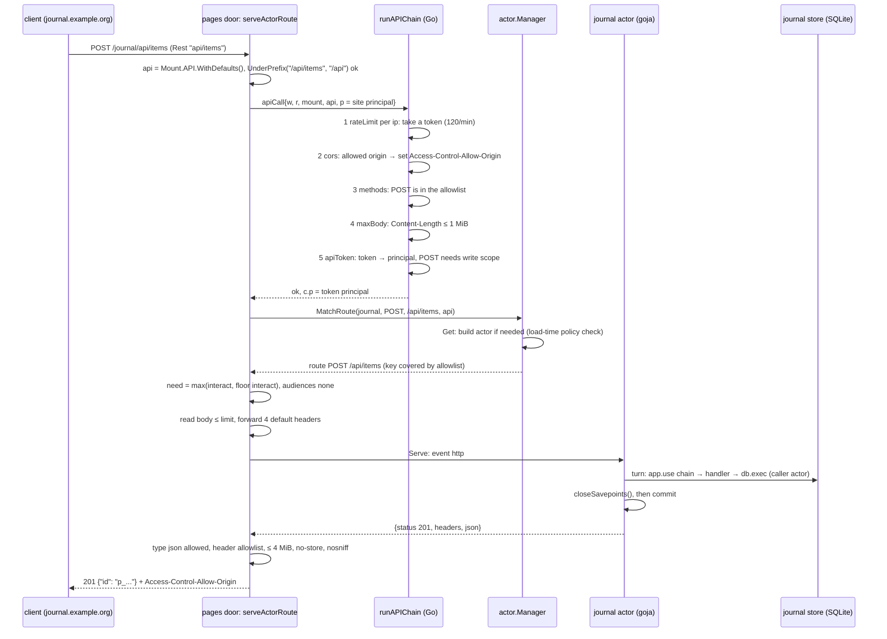
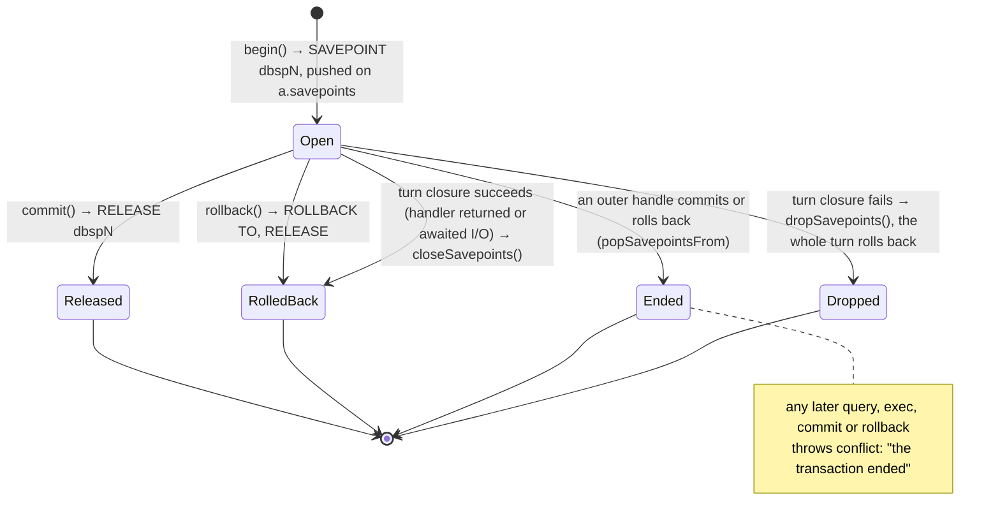
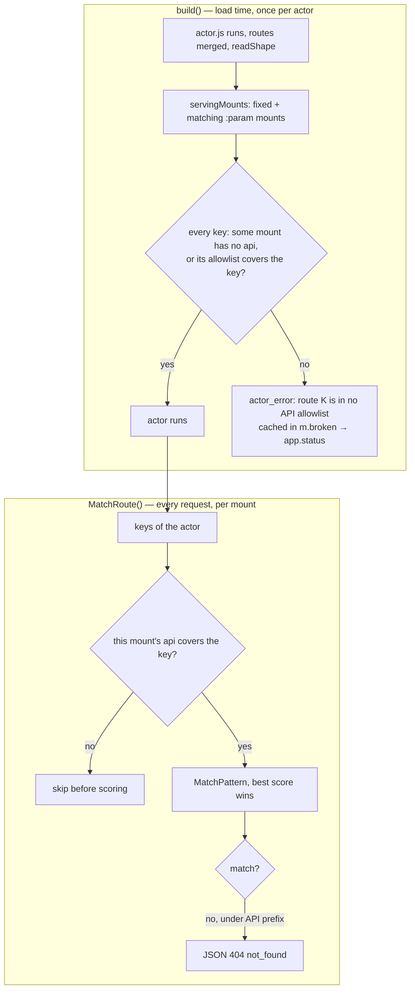

# slop v3: Per-App Modules Part 1 — Implementing database, express and Mount API Policies — A Technical Deep Dive

slop v3 hosts small web applications on **stores**, SQLite databases with a versioned file tree. An application may have server-side JavaScript, its **actor**, which runs in a goja runtime inside the slop process and reaches the outside world only through the objects `use(name)` returns. Pull request #31 of `go-go-golems/slop-computer` adds two such objects and the policy that bounds the second one. `database` gives actors go-go-goja's database API over their own store. `express` gives them go-go-goja's express-style route builder, compiled into the HTTP route table actors already had. A new **API policy on the mount** decides which of those routes a given mount exposes, at what level, behind which host-side checks, and with which response rules.

This report explains how that was implemented. The research and the arguments for the design are in [[PROJECT REPORT - slop v3 - Per-App Modules - Safe Database and HTTP Endpoints for Sandboxed Actors - A Technical Deep Dive]] (ticket SLOP3-011), which this report does not repeat; its predecessor on trusted Go modules is [[PROJECT REPORT - slop v3 - Tools as Apps - Trusted Go Modules, Confirmations and the Workshop - A Technical Deep Dive]]. The implementation is ticket SLOP3-012, part 1 (phases 1–4 of the intern guide's plan). Part 2, the module catalog and admin grants with per-app configuration, is not in this PR. Every `path:line` reference below was checked against the PR head, `cf99f05`. The test output quoted was produced by running the tests on that commit.

> [!summary]
> - **Both modules run on the actor's turn, not beside it.** `database.query`/`exec` go through `Turn.Query`/`Turn.Exec` as the `actor` caller, so the existing SQL authorizer, the 10,000-row limit and table reactors apply unchanged. `begin()` is a SQLite savepoint whose handle cannot outlive the turn that opened it, including across an `await`.
> - **One route table.** The express builder is about 150 lines of JavaScript; Go keeps only the checks (`register`) and the merge (`mergeRoutes`) into `def.http` before `readShape`. Builder routes and hand-written `http:` routes are matched, checked and served by the same code.
> - **The mount owns the API.** A mount's optional `api` block holds a route allowlist matched by *containment* against route keys, level floors, request and response rules, and host middleware configuration. It is enforced twice: at dispatch (authoritative, per mount) and at load (over the union of all mounts serving the store, so a misconfiguration is visible in `app.status`).
> - **Refusals cost nothing.** Rate limits, CORS, method and size checks and bearer tokens run in Go, in a fixed order, before `MatchRoute`, which is where the actor is built. A refused request builds no actor, takes no inbox slot and runs no turn, and the test asserts exactly that.

## What exists, and where

| Item | Location |
|---|---|
| Repository | `/home/manuel/workspaces/2026-10-28/slop-computer/slop-computer`, module `github.com/go-go-golems/slop-computer` |
| Pull request | https://github.com/go-go-golems/slop-computer/pull/31, "SLOP3-012 part 1: database and express modules, and mount API policies", open at the time of writing |
| Branch and range | `task/slop3-012-modules`, `origin/main` `ecb5df9` .. `cf99f05`; read in the worktree `/tmp/claude-1000/-home-manuel-workspaces-2026-10-28-slop-computer/7fa934c5-45f7-43c5-9ffb-d734dcfbe139/scratchpad/slop012` |
| Size | 34 files, +3,036 / −85 lines; 27 Go files, +2,508 / −79 |
| Ticket workspace | `ttmp/2026/11/05/SLOP3-012--per-app-modules-part-1-a-safe-database-module-and-mount-scoped-http-endpoints-for-actors/` |
| Implementation diary | `reference/01-diary.md` in the ticket (Steps 3–6 are the four phases) |
| Design | `design-doc/01-intern-guide-per-app-modules-the-database-module-and-mount-scoped-http-endpoints.md` (1,838 lines, 15 decisions) |
| Durable design doc | `doc/design/slop-v3.md` §6.2, §6.5, §7.1, §10.2 |

The commits follow the phases:

| Phase | Commit | What it adds |
|---|---|---|
| 1 | `106e72e` | `use('database')`, `require('database')`, the `actor-read` caller |
| 2 | `58285cd` | `use('express')`, route-key validation in `pkg/registry/routes.go` |
| 3 | `cb48952` | `registry.MountAPI`, migration 011, enforcement in the actor and the pages door, `mount.routes` |
| 4 | `a5f66cc`, `1b4cdcc` | the host middleware chain; then the read-token scope fix |

---

## 1. What changed and why

### 1.1 The problem

Before this PR, an actor could already answer HTTP. Its `defineActor({http: {...}})` block mapped route keys such as `'GET /feed.json'` to `{level, run}` objects, and the pages door served them on any mount of the store. Two things were missing. Scripts written for go-go-goja hosts (go-go-host, xgoja) call `require('database')` and `require('express')`, and slop had neither: its own `sql` module has a different surface, and go-go-goja's implementations cannot be imported safely, because they hold a `database/sql` handle and a `gojahttp.Host` respectively, both of which bypass slop's authorizer and response path. And no one but the app decided which routes were exposed: every route the app declared was served on every mount of its store, with whatever headers and content types the app chose.

The PR answers both with the smallest change to slop's existing machinery. The modules keep go-go-goja's JavaScript surface but are implemented on slop's turn and route table. The exposure decision moves to the mount, which an administrator already controls and which already determines the URL prefix an app lives under. Nothing in the actor's matching, serving or response conversion code (`MatchRoute`'s scoring, `Serve`, `toRes`) had to learn about express; and nothing in the express builder had to learn about policies.

### 1.2 Vocabulary

The terms below are introduced in dependency order. Each is used later without further definition.

- **Store.** One SQLite file at `<data>/stores/<id>`. Tables whose names begin with `_` (`_docs`, `_files`, `_log`, …) are **kernel tables**; tables created by the app's `sql/*.sql` migrations are **app tables**.
- **Turn.** One SQLite transaction on the store's single writer connection, run by `Store.Do`. Every change to a store happens in a turn. A turn that returns an error rolls back entirely.
- **Caller kind.** A label on the running turn that slop's SQLite authorizer reads while preparing each statement (`pkg/store/sqlpolicy.go`). `actor` may read everything and write app tables; it may not write kernel tables, run DDL, `ATTACH` or `BEGIN`. This PR adds `actor-read`: `actor` minus writes.
- **Actor.** The app's `actor.js`, run in a goja runtime, one per store. Every event (an action call, an HTTP request, a reactor, an alarm) runs as one turn. An `await` on real I/O ends the turn; the rest of the handler continues in a later turn.
- **Route key.** The string `"METHOD /pattern"` naming one HTTP route, for example `GET /api/items/:id`. Patterns have literal segments, `:name` parameters and an optional final `*`. The method may be `*` (any method). `pkg/registry/routes.go` now defines this syntax (`ValidRouteKey`, `routes.go:22-25`).
- **Level and audience.** A visitor's level on a store is one of `view`, `interact`, `admin`, `owner` (or none); a route may also say `public`. An audience is a group such as `member` or `subscriber`; a route may require one.
- **Mount.** A row of `system.db` mapping a host and a path pattern to a store (or to a `:param` naming the store, optionally restricted to a store type). A request under the mount yields `Rest`, the path below the mount, and `Base`, the matched prefix. Only a platform admin sets mounts, and every change is logged for `mount.undo`.
- **API policy.** The new optional `api` field of a mount, type `registry.MountAPI` (`pkg/registry/api.go:39-49`).
- **Floor.** A policy entry that raises the minimum level, or adds an audience, for the route keys its pattern covers.
- **Principal and visitor.** The principal is who the request is from (a site-cookie session, or with this PR a bearer token). `VisitorOf` turns it into the `ctx.visitor` the actor sees, including the level computed by the access layer.
- **Pages door.** slop's HTTP handler for page and live hosts, the package `pkg/doors/pages`. Its `serveActorRoute` (`actors.go:145`) is where an HTTP request becomes an actor event.

### 1.3 The running example

The example used throughout is the journal application from `apps/examples/journal`, rewritten with the two new modules and mounted with an API policy. **The rewrite is illustrative: this PR does not change the journal app.** It follows the design's §30 example, and every behaviour described for it below is behaviour of the code at `cf99f05`. The schema is the real one (`apps/examples/journal/sql/001_posts.sql`: `posts(id TEXT PRIMARY KEY, title, body, author, status, created_at, published_at)`).

```js
// illustrative: apps/examples/journal/actor.js, rewritten with database + express
const db = require('database');            // the same object as use('database')
const app = require('express').app();

app.get('/api/feed.json').public().handle((ctx, res) => {
  const items = db.query(
    "SELECT id, title, author, published_at FROM posts WHERE status = 'published' ORDER BY published_at DESC LIMIT 20");
  res.json({ title: 'Journal', updated: ctx.now, items });
});

app.post('/api/items').allow('interact').handle((ctx, res) => {
  const id = 'p_' + ctx.now.toString(36);
  db.exec('INSERT INTO posts (id, title, body, author, created_at) VALUES (?, ?, ?, ?, ?)',
    id, ctx.body.title, ctx.body.body || '', ctx.visitor.id, ctx.now);
  res.status(201).json({ id });
});

defineActor({ /* actions, on: {'table:posts': ...}, every: {...} as before */ });
```

The administrator mounts the store twice. The existing page mount `/journal` on the main live host has no policy and behaves exactly as before. A second mount on a live host `api.example.test` carries a policy:

```json
{ "host": "api.example.test", "path": "/journal", "store": "journal",
  "api": {
    "prefix": "/api",
    "routes": ["GET /api/*", "POST /api/items"],
    "floors": [ {"route": "GET /api/feed.json", "min": "public"},
                {"route": "POST /api/*", "min": "interact"} ],
    "middleware": [
      {"name": "rateLimit", "config": {"per": "ip", "limit": 120, "window": "1m"}},
      {"name": "cors", "config": {"origins": ["https://journal.example.org"]}},
      {"name": "apiToken", "config": {"required": false}} ] } }
```

Consider a script on `https://journal.example.org` that posts a draft with a bearer token: `POST https://api.example.test/journal/api/items` with `Authorization: Bearer <token>`, `Content-Type: application/json`, body `{"title":"Hello"}`. The browser first sends a CORS preflight. The figure traces the actual request.



*Figure 1. A POST on the journal's API mount at `cf99f05`. The preflight that precedes it is answered by step 2 with 204 and never reaches `MatchRoute`.*

Three properties of this trace recur through the report. The policy is applied with defaults filled in at request time (`WithDefaults`, `api.go:288-311`), so `mount.ls` shows exactly what the admin wrote. Everything above `MatchRoute` runs without the actor, which may not even be built. And the actor's answer passes through a filter before it reaches the client, so the app cannot set a cookie, a CSP or a content type the mount does not allow.

---

## 2. The `database` module

### 2.1 The module object

`database` is built once per actor and cached in `a.database` (`pkg/actor/database.go:42-79`), so `use('database')`, `require('database')` and a second `use('database')` return the same object; the test asserts the identity. Its `query` and `exec` are thin wrappers over the current turn:

```go
// pkg/actor/database.go:51-68
query := func(call goja.FunctionCall) goja.Value {
	rows, err := a.turn().t.Query(caller, call.Argument(0).String(), a.flatParams(call.Arguments[1:])...)
	a.check(err)
	if cfg.MaxRows > 0 && len(rows) > cfg.MaxRows {
		a.throw(fail("invalid_argument", "the query returned more than %d rows", cfg.MaxRows))
	}
	if rows == nil {
		rows = []map[string]any{}
	}
	return a.toJS(rows)
}
exec := func(call goja.FunctionCall) goja.Value {
	res, err := a.turn().t.Exec(caller, call.Argument(0).String(), a.flatParams(call.Arguments[1:])...)
	a.check(err)
	n, _ := res.RowsAffected()
	id, _ := res.LastInsertId()
	return a.toJS(map[string]any{"success": true, "rowsAffected": n, "lastInsertId": id})
}
```

`caller` is `store.CallerActor`, or `store.CallerActorRead` when `DatabaseConfig.ReadOnly` is set. Part 1 always passes the zero `DatabaseConfig` (`modules.go:31-32`); part 2 will take it from the administrator's grant. `configure()` throws `permission_denied`, and `close()` does nothing, because the turn owns the connection. There is no argument anywhere in the API that names a database, a file or a store.

Because every statement is a `Turn.Query` or `Turn.Exec`, three properties come for free. The authorizer refuses `DELETE FROM _docs` and `ATTACH` with `actor_error`, as the test checks. `Turn.Query`'s 10,000-row limit applies. And writes to app tables are recorded by the authorizer at prepare time, so the commit lists them and `on: {'table:posts': …}` reactors fire; the test counts at least three commits seen by a `table:items` reactor.

### 2.2 Why not go-go-goja's `DBModule`

SLOP3-011 settled this, and the implementation confirmed the reasons. go-go-goja's module wants a `QueryExecer` returning `*sql.Rows`. The store's writer connection, used outside `Turn.Query`/`Exec`, runs as the `kernel` caller, which may write kernel tables; a second connection has no authorizer at all; and `Turn` returns maps, so it cannot be wrapped as a `QueryExecer`. go-go-goja's `begin()` would also call `BeginTx` inside a transaction that is already open. The implementation therefore reimplements the API (about 180 lines in `database.go`) and imports nothing from go-go-goja.

### 2.3 Savepoint handles and their lifetime

`begin()` opens a SQLite savepoint and returns a handle `{query, exec, commit, rollback}`:

```go
// pkg/actor/database.go:83-94
func (a *Actor) begin(caller string, query, exec jsFunc) goja.Value {
	t := a.turn().t
	a.seq++
	sp := &savepoint{name: "dbsp" + strconv.Itoa(a.seq), t: t}
	_, err := t.Exec(caller, "SAVEPOINT "+sp.name)
	a.check(err)
	a.savepoints = append(a.savepoints, sp)
	live := func() {
		if sp.done || a.cur == nil || a.cur.t != t {
			a.throw(fail("conflict", "the transaction ended (with its turn, or by commit or rollback)"))
		}
	}
```

`commit()` runs `RELEASE dbsp<n>`; `rollback()` runs `ROLLBACK TO dbsp<n>` and then `RELEASE dbsp<n>` (`endSavepoint`, `database.go:114-122`). The prefix `dbsp` differs from the `sp<n>` names of the existing `sql.transaction` (`modules.go:202`), so the two cannot collide.

The name comes from a per-actor counter, `a.seq`, not from the design's `len(a.savepoints)+1`. The diary explains why. After an inner handle ends, the length-based name would be issued again while an outer savepoint of the same name might still be open, and SQLite resolves `RELEASE name` to the most recent savepoint of that name. A counter never repeats, so every name identifies one savepoint.

The rules for a handle are easiest to read as a state machine. Every arrow is a line of code in `database.go` or in the turn closure of `actor.go`.



*Figure 2. A `database.begin()` handle. No state survives the turn in which the handle was opened.*

The two end-of-turn transitions are wired into the closure that `handle` passes to `Store.Do`:

```go
// pkg/actor/actor.go:417-425
v, err := ev.run(a, ctxObj)
if err != nil {
	a.dropSavepoints()
	return err
}
// A database handle never outlives its turn: one still open
// (the handler returned, or awaited I/O) rolls back here.
a.closeSavepoints()
```

The order matters on both branches. When `ev.run` fails, `Store.Do` will roll back the whole transaction, so the savepoints disappear with it; `dropSavepoints` only marks the Go handles done and clears the slice. Issuing `ROLLBACK TO` at that point would run against a transaction that is about to be rolled back anyway. When `ev.run` succeeds, `closeSavepoints` rolls back to the outermost open savepoint and releases it, which ends every inner savepoint as well (SQLite's `ROLLBACK TO` and `RELEASE` affect all savepoints opened after the named one), and `popSavepointsFrom` marks them all done. An open handle can therefore never commit by accident: forgetting `commit()` loses the writes, visibly.

The `await` case follows from the same code. A handler that calls `await time.sleep(1)` returns from `ev.run` with a pending promise, so the closure ends successfully and `closeSavepoints` rolls back the handle's writes before the first turn commits. The continuation runs in a new turn with a different `*store.Turn`. `live()` compares the handle's turn with `a.cur.t`, so the next `tx.exec` throws `conflict` instead of running against a savepoint that no longer exists. The test `acrossAwait` asserts both halves: the call fails with `conflict`, and the row inserted before the `await` is absent.

Activation needed the same treatment. The `setup` and `smoke` hooks run in the activation turn, outside `handle`, so `activate` calls `a.closeSavepoints()` after them and defers `a.dropSavepoints()` for the failure path (`pkg/actor/manager.go:402, 426`).

### 2.4 The document and file guard

While a handle is open, document writes and file writes throw `conflict`:

```go
// pkg/actor/database.go:161-165
func (a *Actor) noOpenTransaction(what string) {
	if len(a.savepoints) > 0 {
		a.throw(fail("conflict", "%s cannot change while a database transaction is open: commit or roll it back first", what))
	}
}
```

The reason is the turn's change list. A document write appends a change event to the turn in memory at the moment it runs. If a later `ROLLBACK TO` undid the `_docs` row, the event would still be published at commit, describing a write that never happened. Refusing the write is simpler than teaching the turn to rewind its change list to a savepoint.

The guard is placed in `ownPath` (`modules.go:290`), the function every document writer resolves its path through, so `db.doc().set/update/delete` and `storage`'s writes, which are implemented over `db`, are covered by one call. The design named only `db` and `storage`. The implementation also guards `files.write` (`modules.go:462`), because `PutFile` records its change in the turn the same way. Reactors are unaffected: a reactor runs in its own turn, after the commit, with no handle open.

### 2.5 Array arguments

`flatParams` (`database.go:171-184`) spreads one level of array arguments into positional parameters, as go-go-goja does, and then applies slop's usual mapping (booleans to 0/1, objects and nested arrays to JSON strings). `db.query('SELECT ? AS a, ? AS b, ? AS c', [1, 2], true)` binds 1, 2, 1. The older `sql` module encodes an array argument as one JSON string; the two modules intentionally differ here, because `database` exists to run scripts written for go-go-goja.

### 2.6 `require` resolution

`require('database')` and `require('express')` now resolve to `use(name)` before any file in the app's tree, as native modules resolve before `node_modules` in goja_nodejs:

```go
// pkg/actor/actor.go:284-292
// Module names resolve before tree files, as native modules do
// in goja_nodejs: require('database') is use('database').
if reservedModules[name] {
	if v := a.module(name); v != nil && !goja.IsNull(v) {
		return v
	}
	panic(a.vm.NewGoError(fail("not_found", "%s is not available to %s", name, a.run.App)))
}
```

The reserved set is exactly `{"database", "express"}` (`database.go:38`). Relative paths are unaffected: the test app ships its own `database.js`, and `require('./database.js')` still loads it. When part 2 makes modules grantable, `a.module(name)` may return `null`; `require` then throws `not_found` at the line that asked, rather than returning `null` to fail somewhere later.

### 2.7 The `actor-read` caller

A read-only module cannot be enforced in `exec` alone, because `Turn.Query` runs any statement, including `UPDATE` and `INSERT … RETURNING`. The read-only option is therefore a caller kind. Writes needed no change in the authorizer, because the INSERT/UPDATE/DELETE branch already lists only `actor`, `migration` and `admin-write`; the only change is that `SQLITE_SAVEPOINT` is allowed for `actor-read` as well (`pkg/store/sqlpolicy.go:128-134`), since savepoints are harmless without writes. `TestAppSQLAuthorizer` gains the cases: `actor-read` may `SELECT`, `PRAGMA data_version` and use savepoints; it may not `INSERT`, `UPDATE`, `DELETE`, `INSERT … RETURNING`, `CREATE TABLE` or `ATTACH`.

Only the store-level caller is tested in part 1. No grant can yet set `ReadOnly` or `MaxRows`, so neither is exercised end to end through the module.

---

## 3. The `express` module

### 3.1 The division between JavaScript and Go

The builder is JavaScript, `pkg/actor/express.js`, embedded with `go:embed` and evaluated once per actor (`express.go:31-45`). It is a function that receives one Go callback, `register`, and returns `{app()}`. The reason for the split is what each side is good at. The builder composes functions: a middleware chain whose `next` may return a promise, a buffered response object, promise settling. That is direct in JavaScript and awkward through goja's Go bindings. The security-relevant decisions, by contrast, are few and must not be bypassable from JavaScript: whether a route key is valid, whether its level and audience exist, and whether registration is still allowed. Those live in Go.

### 3.2 `register` and the loading flag

A route must say who may call it before it can have a handler. `needsSecurity` (`express.js:42-57`) returns an object with only `public()`, `allow(level)` and an `auth` stub; `handle` exists only on what those return. `app.get('/x').handle(fn)` is therefore a `TypeError`, not an open route. `handle` calls `register(method, pattern, level, audience, compile(fn))`:

```go
// pkg/actor/express.go:48-68
func (a *Actor) register(method, pattern, level, audience string, run goja.Value) {
	if !a.loading {
		a.throw(fail("invalid_state", "routes register only while actor.js loads"))
	}
	key := method + " " + pattern
	if !registry.ValidRouteKey(key) {
		a.throw(fail("invalid_argument", "%q is not a route: METHOD /path with literal, :name and a final * segments", key))
	}
	if err := checkRouteLevel(level); err != nil {
		a.throw(fail("invalid_argument", "%s: %v", key, err))
	}
	if audience != "" && !sysdb.ValidGroup(audience) {
		a.throw(fail("invalid_argument", "%s: unknown audience %q (guest, member, subscriber, admin)", key, audience))
	}
	// ... duplicate check, then append to a.pending
}
```

`a.loading` is set to `true` only around `a.vm.RunScript(entry, src)` in `build` (`actor.go:207-209`). The diary records why the check is the flag and not `a.cur == nil`. Helper functions and `require`d files also run during load, so "no turn" is not the same as "loading"; and an action handler at run time has `a.cur` set, but so might other code paths in future. The flag states exactly the condition "actor.js is running". The test's `late` action registers a route from an action and receives `invalid_state`.

This validation also fixes a gap the guide had found in the existing code: `readShape` never validated an `http:` route's level, so a typo made the route unreachable rather than failing the load. Builder routes are now validated at registration. The test checks four load errors and their messages in `app.status`:

```text
twice:   actor.js: GET /a is defined both in http: and by express
level:   actor.js: Error: GET /a: level "superuser": use public, view, interact, admin or owner at ...(*Actor).register-fm (native)
pattern: actor.js: Error: "GET a/*/b" is not a route: METHOD /path with literal, :name and a final * segments at ...
group:   actor.js: Error: GET /a: unknown audience "vip" (guest, member, subscriber, admin) at ...
```

The `at …register-fm (native)` suffix is goja's frame for a Go function called from JavaScript. The diary left it in place, because stripping it would change every Go-thrown error, not only these.

### 3.3 One route table

After `actor.js` has run and `defineActor` has been called, `build` merges the pending routes into the definition before anything reads it:

```go
// pkg/actor/actor.go:218-229 (abridged)
if err := a.mergeRoutes(); err != nil {
	return nil, fail("actor_error", "%s: %v", entry, err)
}
if err := a.readShape(); err != nil {
	return nil, fail("actor_error", "%s: %v", entry, err)
}
if checkPolicy {
	if err := a.checkRoutePolicies(ctx); err != nil {
		return nil, fail("actor_error", "%v", err)
	}
}
```

`mergeRoutes` (`express.go:84-111`) creates `def.http` if the app has none, and writes each builder route as an object `{level, audience, run}`, which is the shape of a hand-written `http:` route. A key defined both ways is an error. From this point on there is one table. `readShape` reads it, `MatchRoute` scores it, `fn("http", key)` finds `run`, and `toRes` converts what `run` returns. The test mixes an express route and an `http:` route `GET /plain` on the same actor, and both answer.

### 3.4 The handler's `ctx` and `res`

`compile(fn)` (`express.js:61-74`) turns an express handler into the `run(ctx, req)` that `http:` routes have. It builds a buffered `res`, wraps `ctx` in an envelope, runs the `app.use` chain and then the handler, and returns `res.result(...)`, waiting for the promise if the handler is `async`:

```js
// pkg/actor/express.js:62-73
return function run(ctx, req) {
  const res = newRes();
  const c = envelope(ctx, req);
  let i = 0;
  const next = function () {
    if (i < chain.length) return chain[i++](c, res, next);
    return fn(c, res);
  };
  const v = next();
  if (v && typeof v.then === 'function') return v.then(function (out) { return res.result(out); });
  return res.result(v);
};
```

The envelope (`express.js:78-105`) is `Object.create(ctx)` with `request`, `params`, `query`, `body` and `rawBody` added. `body` is JSON-parsed when the forwarded `content-type` header is `application/json`; a body that does not parse throws `invalid_argument`. Because the envelope inherits from the actor's `ctx`, the accessor properties `now`, `rev` and `storage` still work: they are Go functions defined with `DefineAccessorProperty` (`actor.go:567-574`) that ignore `this`. The diary flags this as a constraint on future accessors: one that used `this` would see the envelope.

One consequence of the envelope reading only forwarded headers is easy to miss. On an API mount whose `forwardHeaders` list omits `Content-Type`, the actor never sees the request's content type, and `ctx.body` stays the raw string. `TestMountAPIPolicy` uses `forwardHeaders: ["Accept", "X-Trace"]` and reads `ctx.rawBody.length` for that reason.

`res` (`express.js:109-152`) buffers a status, headers and one body. `json(v)` gives `{json}`; `send(string)` gives `{text}` and `send(object)` gives `{json}`, with no HTML sniffing of strings; `html(v)` gives `{html}`; `redirect([code,] url)` sets `Location`; `end()` gives an empty body. A second answer throws `invalid_state`; a handler that returns nothing and never answered throws `invalid_state`; a returned string is sent as text; any other returned value throws `not_supported`. These errors are thrown in JavaScript with `e.code`, so the existing `jsError` turns them into coded errors and `serveActorRoute` writes them as JSON with status 500. No new error path was needed.

### 3.5 What throws `not_supported`

The builder keeps go-go-goja's names for what slop does not do, and each throws `not_supported` with slop's alternative in the message:

| Call | Message's alternative |
|---|---|
| `app.static`, `app.staticFromAssetsModule`, `app.spaFromAssetsModule` | serve files from the store, or return `{asset}` from a route |
| `app.mount`, `app.mountHandler` | one store has one route table; mount another store instead |
| `app.listen` | slop owns the server; an admin mounts the store |
| `.auth()` | use `.allow(level)` or `.audience(group)`; identity comes from slop |
| `ctx.cookies`, `ctx.session`, `ctx.auth`, `ctx.actor` | read `ctx.visitor` |
| `ctx.ip` | routes do not see client addresses; the mount's rate limits do |
| `ctx.resources`, `ctx.resource` | read the store |

The `ctx` stubs are non-enumerable getters, so they throw at the line that reads them, and a script that never touches them is unaffected. The test calls `ctx.cookies`, `app.static`, `app.listen` and `.auth()` from handlers and receives 500 `not_supported` for each.

---

## 4. The mount API policy

### 4.1 The types

`registry.MountAPI` is data and validation only; `pkg/registry/api.go` imports neither `net/http` nor goja.

```go
// pkg/registry/api.go:39-49
type MountAPI struct {
	Prefix           string       `json:"prefix,omitempty"`
	Routes           []string     `json:"routes"`
	Floors           []Floor      `json:"floors,omitempty"`
	DefaultMin       string       `json:"defaultMin,omitempty"`
	Middleware       []Middleware `json:"middleware,omitempty"`
	ResponseTypes    []string     `json:"responseTypes,omitempty"`
	ForwardHeaders   []string     `json:"forwardHeaders,omitempty"`
	MaxBodyBytes     int64        `json:"maxBodyBytes,omitempty"`
	MaxResponseBytes int64        `json:"maxResponseBytes,omitempty"`
}
```

A `Floor` is `{Route, Min, Audience}`. A `Middleware` is `{Name, Config json.RawMessage}`, and the config is decoded strictly by name into `RateLimitConfig{Per, Limit, Window, Burst}`, `CORSConfig{Origins, MaxAgeSeconds}` or `APITokenConfig{Required}`. `decodeStrict` (`api.go:144-157`) refuses unknown fields and trailing data. The defaults are applied by `WithDefaults` when a request is served: `DefaultMin` `view`, response types `application/json` and `text/plain`, forward headers `content-type`, `accept`, `user-agent`, `referer`, a 1 MiB body limit and a 4 MiB response limit (`api.go:23-36, 288-311`).

### 4.2 Validation

`checkMount` accepts an `api` block on live hosts only, since static hosts serve no actor routes to visitors, and then calls `ValidateAPI` (`pkg/commands/mounts.go:166-173`, `pkg/registry/api.go:196-284`). The function implements the guide's nine rules and adds three found while writing it:

- The prefix is empty or a literal mount path other than `/`, without `:` or `*`.
- `routes` is non-empty (an empty list would serve nothing; the error tells the admin to remove the block), every entry is a valid route key, and every entry's pattern is under the prefix.
- `defaultMin` and each floor's `min` are levels; each floor's route is a valid key; **a floor sets `min` or `audience`** (new); **a floor's audience is not `store`** (new, because `sysdb.ValidGroup` accepts `store`, which is meaningful only for store-to-store calls).
- Each middleware name is `rateLimit`, `cors` or `apiToken`, its config decodes strictly and passes its `Validate()`; **each middleware slot appears once** (new), where the slot of a rate limit is `rateLimit:<per>`, so one per-ip and one per-visitor limit are allowed together.
- A response type is a lowercase media type without parameters or wildcards.
- A forward header is a header name and never `cookie`, `authorization`, `proxy-authorization` or `set-cookie`.
- The byte limits are not negative and not above 8 MiB (body) and 32 MiB (response); 0 means the default.

CORS origins must be `http(s)://host[:port]`, with no path, wildcard or `@` (`validOrigin`, `api.go:135-141`). `TestValidateAPI` has 23 failure cases, each asserting its message, and `TestMountAPIPolicy` checks four at the verb level: a `Cookie` forward header, empty routes, a `*` CORS origin and an unknown field `bogus`.

### 4.3 Containment

An allowlist entry is compared with the app's **route keys**, not with request paths. The question asked is: does the entry allow everything this key can serve? The function that answers it:

```go
// pkg/registry/api.go:390-409
func Covers(allow, key string) bool {
	am, ap := SplitKey(allow)
	km, kp := SplitKey(key)
	if am != "*" && am != km && (am != "GET" || km != "HEAD") {
		return false
	}
	as, ks := segs(ap), segs(kp)
	for i, a := range as {
		if a == "*" {
			return true
		}
		if i >= len(ks) || ks[i] == "*" {
			return false
		}
		if !strings.HasPrefix(a, ":") && a != ks[i] {
			return false // a literal covers only the same literal
		}
	}
	return len(as) == len(ks)
}
```

Reading it segment by segment gives four rules. A final `*` in the entry covers the rest of the key, including a key's own `*`. A `:param` in the entry covers any single segment of the key, literal or parameter. A literal covers only the identical literal. A key that is wider at some position (its own `*` where the entry has a literal or a parameter) is not covered. Methods compare separately: `*` covers any method, `GET` covers `HEAD`, and a key with method `*` is covered only by an entry with method `*`.

The obvious alternative was to reuse the request matcher and ask whether the entry "matches" the key as if the key were a path. It fails on wildcards. Matching `GET /api/:x` against the key `GET /api/*` as a path would succeed, because `*` is one segment, yet the key serves `/api/a/b/c`, which the entry does not allow. Worked cases from `TestCovers` (`pkg/registry/api_test.go:35-65`):

| Entry | Key | Covered | Why |
|---|---|---|---|
| `GET /api/*` | `GET /api/items/:id` | yes | `*` covers the rest |
| `GET /api/*` | `GET /api` | yes | `*` binds the rest, which may be empty |
| `GET /api/:x` | `GET /api/feed.json` | yes | a parameter covers a literal |
| `GET /api/:x` | `GET /api/*` | no | the key serves deeper paths than the entry |
| `GET /api/feed.json` | `GET /api/:x` | no | a literal covers only itself |
| `GET /api/*` | `HEAD /api/x` | yes | GET routes answer HEAD |
| `HEAD /api/*` | `GET /api/x` | no | HEAD does not bring GET |
| `GET /api/*` | `* /api/x` | no | a key for any method needs an entry for any method |
| `GET /*` | `GET /` | yes | the root is the empty rest |

The second row has a practical consequence the design spells out: to allow only paths strictly below `/api/`, an admin writes `GET /api/:first/*`.

The pattern helpers moved with this change. `matchPattern` was deleted from `pkg/actor/manager.go` and is now `registry.MatchPattern` (`api.go:422-448`), unchanged in behaviour, so that the actor, the pages door and the verbs share one implementation of route syntax.

### 4.4 Floors

A floor raises the level a route needs on one mount. The effective level is the higher of the app's declared level and the floor's:

```text
floor(key)         = the covering floor with the highest pattern score
                     (literal 2, :param 1, * 0; the first wins a tie), else DefaultMin
effective level    = MaxLevel(route.level, floor.Min)
effective audience = the route's audience and the floor's audience, both required
```

`FloorOf` is at `api.go:335-353`, `MaxLevel` at `api.go:378-383`. `MaxLevel` returns an unknown level when either argument is unknown, so a typo that escaped validation fails closed: `rt.ParseLevel` rejects it at dispatch and the request is refused. With `DefaultMin` unset, a route declared `public` is served at `view` unless a floor says `public`. **An app cannot make an endpoint public on an API mount by itself.** The test shows the two mounts of the same store disagreeing: `GET /api/page`, declared `public`, answers 200 to nobody on the plain mount `/j` and 404 on the API mount `/japi`.

One property of `FloorOf` deserves attention from whoever writes policies. The most specific covering floor wins *whole*, and a floor that sets only an audience takes `DefaultMin` as its level, not the level of a broader floor. A short program against the branch's `registry` package shows it:

```text
floors: {GET /api/* min admin}, {GET /api/members audience subscriber}
FloorOf(GET /api/members) = {Route:GET /api/members Min:view Audience:subscriber}
FloorOf(GET /api/other)   = {Route:GET /api/* Min:admin Audience:}
```

So adding an audience requirement to one route under a broad `admin` floor lowers that route's floor to `view`. `TestFloorOf` encodes the audience-only behaviour (`api_test.go:98`), so it is intended, but it is the opposite of what "add a requirement" suggests. Combining floors (the maximum of all covering floors' levels, the union of their audiences) would remove the surprise; this is listed with the open questions in Section 8.

### 4.5 Persistence and undo

The policy is stored as JSON in a new column:

```sql
-- pkg/sysdb/migrations/011_mount_api.sql
ALTER TABLE mounts ADD COLUMN api TEXT NOT NULL DEFAULT '';
```

`''` means no policy, so every existing mount keeps its behaviour after the migration. `registry.Mount` gains `API *MountAPI` (`pkg/registry/mounts.go:25-27`); `mountCols`, `scanMount`, the `SetMount` upsert and the `UndoMount` re-insert all carry the column, and `apiJSON` writes `""` for `nil`. Because `mount_log` already stores the whole `Mount` as JSON before and after each change, `mount.undo` restores a previous policy without any further code. The test sets a policy that allows `text/html`, undoes it, and checks both the behaviour (HTML is refused again) and `mount.ls` (the stored policy has `maxBodyBytes: 10` and no `text/html`).

### 4.6 Enforcement at dispatch and at load

The allowlist is enforced in two places, for different reasons.

**At dispatch**, `MatchRoute` takes the mount's policy and skips uncovered keys before scoring them:

```go
// pkg/actor/manager.go:584-595 (abridged)
for _, key := range a.keys("http") {
	meth, pat, ok := strings.Cut(key, " ")
	if !ok || (meth != method && meth != "*" && (meth != "GET" || method != "HEAD")) {
		continue
	}
	if api != nil && !api.AllowsKey(key) {
		continue
	}
	params, score, ok := registry.MatchPattern(pat, p)
	...
}
```

Skipping before scoring matters. If an uncovered key were scored and then rejected, a more specific uncovered key could shadow a less specific covered one, and the request would fail even though an allowed route matches it. Filtering first means a request can reach only covered keys, and among them the usual best match wins. This check is authoritative and per mount.

**At load**, `build` calls `checkRoutePolicies` (`pkg/actor/routes.go:41-67`) after `readShape`. An actor belongs to a store, not to a mount, and a store can be served by several mounts: those that name it, and every `:param` mount whose type is empty or equal to the store's type (`servingMounts`, `routes.go:22-37`). At load the actor cannot know which mount a future request will come through, so the check is made against the union. A key fails only if *no* serving mount would serve it, and a mount without a policy serves every key.



*Figure 3. The load-time check makes a policy failure visible; the dispatch filter keeps an uncovered route off a particular mount.*

The two checks are complementary. The load check catches the case where the app registers an endpoint none of its mounts expose, which would otherwise answer 404 everywhere and be noticed only by a user. It reports the failure where an administrator looks, in `app.status`. But it cannot keep a route off a narrow API mount when the same store also has a plain mount, because the plain mount serves everything; only the dispatch filter does that.

The activation build also runs the check (`manager.go:392`). A new app version that adds a route outside every serving mount's allowlist therefore fails to activate, and the store keeps its previous version, which is how a failing migration already behaves.

### 4.7 Restarts after mount changes, and `app.status`

A mount change can invalidate a load result in either direction: narrowing a policy can break a running actor, and widening one can fix a broken actor. `mount.set`, `mount.rm` and `mount.undo` therefore read the mount before the change (`mountAt`) and call `restartServed(before, after)` afterwards (`pkg/commands/mounts.go:408-432`). For every store the old or new mount can serve, it restarts the actor if the change involves a policy on either side, or if the store is broken for any reason. The second condition lets an admin fix a store broken by a narrow policy by adding a plain mount, which itself has no policy. Restarting on every mount change would be simpler, but it would also kill parked handlers in every store a type-less `:param` mount serves, for changes that cannot affect them.

Two details came out of testing. First, a restart alone was not enough for the failure to be visible: the actor is built lazily, so a narrowed policy showed nothing until a request arrived. `restartServed` therefore calls `e.A.Get(ctx, id)` right after `Restart`, an eager rebuild, so the failure or its fix appears in `app.status` at once. Second, `app.status` did not show this kind of failure at all. It read `kernel.Running.Broken()`, which reports activation failures only, while a build failure after activation lives in the actor manager's `broken` map (`manager.go:191-194`). `app.status` now falls back to `e.A.Broken(store)` when the kernel reports nothing (`mounts.go:114-118`). Restart had to clear both records, and it does: `Restart` deletes `m.broken[id]` and calls `m.K.ClearFailure(id)` (`manager.go:262-272`). `RestartApp` does neither, which is why the code uses `Restart` per store.

The test exercises the whole cycle with a second store, `solo`, served only by an API mount whose allowlist omits one of its routes:

```text
mount.set /solo api.routes = ["GET /api/feed.json"]
app.status solo → broken: "... route GET /api/admin is in no API allowlist of the mounts serving solo (...)"
GET /solo/api/feed.json → not 200 (a broken actor does not answer)
mount.set /solo api.routes = ["GET /api/*"]
app.status solo → broken: ""          (no app.restart was needed)
GET /solo/api/admin → 200
```

### 4.8 `mount.routes`

The new admin-only verb `mount.routes host path [store]` lists, for each route key of the served store, whether the mount allows it, the level the app declared, the effective level with the floor, and the audiences required (`MountRoute`, `mounts.go:283-290`; `mountRoutes`, `mounts.go:436-476`). For a `:param` mount the store must be named. Listing must work exactly when it is most needed, for a store broken by its policy, so `Manager.Routes` (`routes.go:73-101`) rebuilds a broken actor once more with `checkPolicy` false, reads its routes and discards that build. In the test, `mount.routes` on `/japi` reports `GET /api/admin` as `allowed: false`, `GET /api/page` as declared `public` and effective `view`, and `GET /api/members` with audiences `["subscriber"]`.

---

## 5. The request path in the pages door

`serveActorRoute` (`pkg/doors/pages/actors.go:145-301`) is where all of the policy meets an HTTP request. For a mount without a policy, its behaviour is unchanged except for the body limit (Section 5.4). For a mount with one, the steps are as follows.

### 5.1 The prefix

The policy is first expanded with `WithDefaults`. If the path below the mount is not under the policy's prefix (`UnderPrefix`, `api.go:315-320`), `serveActorRoute` returns `false`, which means "not answered here", and the pages and the live shell answer as they always did (`actors.go:155-157`). The test checks that `/japi/outside` never reaches the actor's `GET /outside` route, while `/j/outside` on the plain mount does.

### 5.2 The JSON 404

Under the prefix, the path space belongs to the API. When `MatchRoute` finds no covered route, the answer is a JSON 404 `not_found`, never the page (`actors.go:167-174`). The design assumed a 404 but did not say where it would come from, and the first test run found the gap: the allowlist had filtered `GET /api/admin`, `MatchRoute` returned no match, `serveActorRoute` returned `false`, and the live host's page shell answered 200 with `index.html`. Apart from the wrong status, falling through would expose the app's page on paths the admin meant to be API-only.

### 5.3 Levels and audiences

The level check is the old one with the floor applied: `need = MaxLevel(route.Level, floor.Min)` (`actors.go:176-198`). A visitor with no access gets 404, so the endpoint's existence is not revealed; a visitor with some access but too little gets 403 `permission_denied` with the needed level. Audiences are now a list, the route's and the floor's, each checked, each failing with 403 `audience_required` naming the group (`actors.go:200-207`). In the test, bob holds `view` through `@member`, and `GET /api/members`, whose floor requires `subscriber`, answers 403 `audience_required`.

### 5.4 Body limits and 413

The body is read with `io.LimitReader(r.Body, limit+1)`, one byte past the limit, so that a longer body is detected and refused with 413 `payload_too_large` instead of being cut (`actors.go:208-221`). The limit is the policy's `maxBodyBytes` on an API mount and 1 MiB elsewhere. Before this PR the code read `io.LimitReader(r.Body, 1<<20)` and silently truncated longer bodies, and ignored read errors; now a read error is a 400. This 413 applies to **every** actor route on every mount, which is a behaviour change for existing apps (Section 8.2). The host middleware chain also refuses on `Content-Length` before the actor exists (Section 6), but the read-based check remains, because `Content-Length` can be absent, as with chunked bodies, or wrong.

### 5.5 Forwarded headers

The actor sees only the request headers in the policy's `forwardHeaders`, lowercased, or the four defaults (`actors.go:226-230`). Validation already refused `Cookie`, `Authorization`, `Proxy-Authorization` and `Set-Cookie`, so identity can only reach the actor as `ctx.visitor`, computed by slop. The test's `/api/echo` route returns its request headers and receives exactly `accept` and `x-trace`, and no `user-agent` or `cookie`, although the request carried both.

### 5.6 Response filters

After the actor answers, four rules apply on an API mount (`actors.go:258-290`):

1. **Type.** The response's media type, from the actor's `Content-Type` header if it set one and otherwise from its result kind, must be in `responseTypes`, or the answer is 500 `response_type_not_allowed`. An empty response with no type passes. An actor that returns `{text}` but sets `Content-Type: text/html` is treated as HTML.
2. **Size.** A body over `maxResponseBytes` is 500 `response_too_large`.
3. **Headers.** Only `Cache-Control`, `Content-Type`, `Content-Language`, `ETag`, `Last-Modified`, `Location`, `Retry-After`, `Link` and `Vary` set by the actor are copied (`apiResponseHeaders`, `actors.go:137-138`). `Set-Cookie`, a CSP, framing headers and `Access-Control-*` are dropped.
4. **HTML.** When `text/html` is allowed and the answer is HTML, slop adds `Content-Security-Policy: sandbox; default-src 'none'`.

The existing rules then apply on every mount: `Cache-Control: no-store` when the actor set none, `private` when it asked for shared caching of a store not everyone may read, and `X-Content-Type-Options: nosniff`. The header filter only skips the *actor's* headers; headers the middleware chain set earlier on `w.Header()` (CORS, `Retry-After`) survive, so `Access-Control-Allow-Origin` from the `cors` step reaches the client while an actor-set `Access-Control-Allow-Origin` does not.

Non-API mounts keep their response behaviour in part 1. That is a design decision, recorded in the guide, made for blocks-site: it serves HTML from actor routes and posts forms to its own `/_site` and `/_publish` routes, so a sandbox CSP on every actor route would break it.

### 5.7 Assets

A route may answer `{asset}`, naming an uploaded file of a bound store; the server streams it from the blob store without passing the bytes through JavaScript. `serveBoundAsset` now takes an `allow` function (`actors.go:315`), and on an API mount the file's stored type must pass `responseTypeAllowed`. The size limit does not apply to assets, which are streamed, only the type check.

---

## 6. Host middlewares

### 6.1 Why the chain runs before `MatchRoute`

`MatchRoute` calls `m.Get`, which builds the store's actor if it is not running: the app's files are read, a goja runtime is created and `actor.js` runs. After that, `Serve` puts an event in the actor's inbox (limited to 256 entries) and runs a turn. A rate limit checked inside the actor would therefore spend all of that on the very requests it exists to refuse. The chain runs in the pages door after the prefix check and before `MatchRoute` (`actors.go:158-164`), so a refused request costs a map lookup and a response. `TestMountAPIMiddleware` asserts this directly: it calls `h.a.Restart("mw")`, sends a preflight, a disallowed preflight, a `DELETE`, an oversized body and a bad token, and then checks `h.a.Running("mw") == nil`.

### 6.2 The fixed order

The policy enables and configures steps; it cannot order them. The order is code:

```go
// pkg/doors/pages/apichain.go:40-63
func (s *Door) runAPIChain(c *apiCall) bool {
	now := time.Now()
	limits := c.api.RateLimits()
	for _, rl := range limits {
		if rl.Per == "ip" && !s.limitStep(c, rl, "ip:"+s.Web.ClientIP(c.r), now) {
			return false
		}
	}
	if !s.corsStep(c) || !methodsStep(c) || !maxBodyStep(c) || !s.apiTokenStep(c) {
		return false
	}
	for _, rl := range limits {
		if rl.Per == "visitor" {
			key := "ip:" + s.Web.ClientIP(c.r) // nobody is keyed by address
			if c.p != nil {
				key = "who:" + c.p.ID()
			}
			if !s.limitStep(c, rl, key, now) {
				return false
			}
		}
	}
	return true
}
```

Each position has a reason. The per-ip limit is first because it is the cheapest refusal and applies to everything, preflights included. `cors` precedes `apiToken` because browsers send preflights without `Authorization`; a token check first would refuse every preflight. The method check precedes the body check so that a request for a method no route has is refused regardless of its body. The body check precedes anything that reads the body. The per-visitor limit is last because it needs the principal that `apiToken` settles. A configurable order would allow a policy to put `apiToken` before `cors` and break every cross-origin client, which is why the design chose a fixed order.

The answers of the chain:

| Step | Refusal |
|---|---|
| `rateLimit` (per ip, per visitor) | 429 `rate_limited`, `Retry-After: <seconds>` |
| `cors` | preflight from another origin: 403 `origin_not_allowed`; preflight for a method no route has: 403 `method_not_allowed`; allowed preflight: 204 |
| methods | 405 `method_not_allowed`, `Allow: <methods of the allowlist>` |
| `maxBody` | 413 `payload_too_large` when `Content-Length` exceeds the limit |
| `apiToken` | 401 `unauthenticated` with `WWW-Authenticate: Bearer realm="slop"`; 403 `insufficient_scope` |

The method set is derived from the allowlist (`allowedMethods`, `apichain.go:97-107`): every entry's method, with `GET` bringing `HEAD`, and `*` meaning any.

The chain also changes the principal. `serveActorRoute` receives the site principal from its caller; `apiToken` may replace it with the token's. The chain writes `c.p`, and `serveActorRoute` reads it back before `MatchRoute` (`actors.go:164`), so the visitor, the level and the audiences are computed for the token's person.

### 6.3 Token buckets

`rateLimit` is a token bucket per `(mount, rule, key)`, held in memory in the door (`pkg/doors/pages/ratelimit.go`). A bucket holds up to `burst` tokens (default `limit`) and refills continuously at

$$\text{rate} = \frac{\text{limit}}{\text{window in seconds}} \ \text{tokens per second}.$$

A request takes one token if at least one is available. Otherwise the time until one is available is $(1 - \text{tokens}) / \text{rate}$:

```go
// pkg/doors/pages/ratelimit.go:41-53
rate := float64(rule.Limit) / rule.WindowDuration().Seconds() // tokens per second
b := l.buckets[key]
if b == nil || b.rule != rule {
	b = &bucket{rule: rule, tokens: capacity(rule), last: now}
	l.buckets[key] = b
}
b.tokens = min(capacity(rule), b.tokens+now.Sub(b.last).Seconds()*rate)
b.last = now
if b.tokens >= 1 {
	b.tokens--
	return true, 0
}
return false, time.Duration((1 - b.tokens) / rate * float64(time.Second))
```

For `limit: 2, window: "1m"` the rate is 2/60 tokens per second. Two requests at the same instant empty the bucket; the third finds 0 tokens and is told to wait $1 / (2/60) = 30$ seconds, which is exactly what `TestRateLimiter` asserts, followed by a successful take at $t_0 + 30\,\text{s}$. `limitStep` rounds the wait up to whole seconds, at least 1, for `Retry-After` (`apichain.go:71-75`).

Three smaller decisions are visible in the code. A bucket whose rule changed (the admin edited the policy) starts full instead of carrying tokens computed under the old rate. Buckets idle for twice their window are dropped by `sweep` (`ratelimit.go:57-65`), which the door's `Tick` calls; the host's ticker calls `Tick` once a minute (`pkg/host/host.go:239-247`). A bucket idle that long would be full anyway, so dropping it loses nothing. And the bucket key contains the rule's `per`, so the per-ip and per-visitor buckets of an anonymous visitor, both keyed by address, are distinct.

The buckets are per process. A restart resets them, and several replicas would not share them. slop runs as a single pod today, so this was accepted; the diary records it for review. The per-ip key is `web.Sessions.ClientIP`, which is as trustworthy as the server's proxy configuration.

### 6.4 CORS without credentials

`corsStep` (`pkg/doors/pages/cors.go:17-67`) does nothing unless the policy enables it, the request has an `Origin`, and the request is cross-origin by slop's existing `crossOrigin` test. For a simple cross-origin request it adds `Vary: Origin` and, if the origin is listed, `Access-Control-Allow-Origin`; a disallowed origin receives no CORS headers, and the browser withholds the answer from the calling page. For a preflight it answers itself: 403 for a disallowed origin or method, else 204 with the origin, the allowed methods, the allowed headers (the forwarded headers plus `authorization`), `Access-Control-Max-Age` (default 600) and `Cache-Control: no-store`.

It never sends `Access-Control-Allow-Credentials`. The diary notes that this costs nothing, because of a property the live host already had: `sitePrincipal` treats an unsafe cross-origin request as nobody (`pkg/doors/pages/live.go:82-85`), so a cookie-authenticated cross-origin `POST` would act as an anonymous visitor even with credentials allowed. Cross-origin clients therefore authenticate with bearer tokens, which is what `apiToken` is for. One limitation is recorded for review: when the allowlist has a `*` method entry, the preflight advertises a fixed list, `GET, HEAD, POST, PUT, PATCH, DELETE`.

### 6.5 `apiToken` and the read-scope fix

Without the `apiToken` step, an `Authorization` header means nothing on a live host, as before; the test checks that a valid token on a mount without it is ignored and the anonymous request gets 404. With it, a bearer token is looked up with `People.TokenBySecret`, its person is resolved with `Web.PersonAs`, and the principal becomes a token principal with the token's scopes (`apitoken.go:17-53`). A header that is present but does not resolve is a 401, never a fallback to the site cookie: a client that sent a token meant to act as that token, and quietly acting as someone else would hide a client bug. With `required: true`, a request without a token is also a 401.

The second phase-4 commit, `1b4cdcc`, came from a self-review. A token's scopes (`read`, `write`, `admin`) do not cap its person's level on a store. That is deliberate in slop's access layer (`Access.Level` ignores scopes, a decision from SLOP3-005), and `VisitorOf` copies scopes into the visitor only for modules to consult (`pkg/actor/manager.go:338-340`). Without a further check, a token minted read-only by a person who holds `interact` on a store could `POST` to an `interact` route and run its writes. The fix states the rule in HTTP's own terms: unsafe methods need the `write` scope.

```go
// pkg/doors/pages/apitoken.go:42-51
// A token's scopes do not cap its person's level on a store; they cap
// what it may do: a read token makes safe requests only.
if !safeMethod(c.r.Method) && !p.HasScope(sysdb.ScopeWrite) {
	writeJSONError(c.w, 403, "insufficient_scope", c.r.Method+" needs a token with the write scope")
	return false
}
if !p.HasScope(sysdb.ScopeRead) {
	writeJSONError(c.w, 403, "insufficient_scope", "the token has no scope")
	return false
}
```

`HasScope(write)` is satisfied by `write` or `admin`; `HasScope(read)` by any scope (`pkg/access/principal.go:97-109`). The rule depends on routes respecting HTTP semantics: a `GET` handler that writes would still run for a read token. That is the same assumption the rest of slop's cross-origin handling makes.

---

## 7. How it was tested

### 7.1 Tests per phase

| Phase | Tests | What they establish |
|---|---|---|
| 1 | `TestAppSQLAuthorizer` (extended), `TestDatabaseModule` | the `actor-read` caller; query/exec results; array binding; `configure` and authorizer refusals; commit, rollback, a handle left open, a handle across `await`, nesting, a failed turn; the document guard; `require` identity and tree files; reactors |
| 2 | `TestExpressModule` | params, query, method, `app.use`; one table with `http:`; levels 404/403; JSON bodies; redirect; async; text; `invalid_state` and `not_supported` answers; registration after load; four load errors |
| 3 | `TestValidRouteKey`, `TestCovers` (20 cases), `TestMatchPattern`, `TestFloorOf`, `TestValidateAPI` (23 cases), `TestMountAPIPolicy` | containment; floors; validation messages; the whole request and response policy on two mounts of one store; `mount.routes`; undo; break-and-fix through mount changes |
| 4 | `TestRateLimiter`, `TestMountAPIMiddleware` | bucket arithmetic, rule change, burst, sweep; every chain refusal without building the actor; token principal, read-token refusal, per-visitor isolation, `required` |

Each phase ended with the full suite (`GOWORK=off go test ./...`, uncached at the end) and `golangci-lint run` reporting `0 issues.` The four integration tests, run on `cf99f05` for this report:

```text
$ GOWORK=off go test ./pkg/host/ -run 'TestDatabaseModule|TestExpressModule|TestMountAPIPolicy|TestMountAPIMiddleware' -count=1 -v
=== RUN   TestDatabaseModule
--- PASS: TestDatabaseModule (0.04s)
=== RUN   TestExpressModule
    express_module_test.go:140: twice: activation of badtwice@1 failed: actor_error: actor.js: GET /a is defined both in http: and by express
    express_module_test.go:140: level: activation of badlevel@1 failed: actor_error: actor.js: Error: GET /a: level "superuser": use public, view, interact, admin or owner at github.com/go-go-golems/slop-computer/pkg/actor.(*Actor).register-fm (native)
    ...
--- PASS: TestExpressModule (0.06s)
=== RUN   TestMountAPIMiddleware
--- PASS: TestMountAPIMiddleware (0.03s)
=== RUN   TestMountAPIPolicy
--- PASS: TestMountAPIPolicy (0.05s)
PASS
ok  	github.com/go-go-golems/slop-computer/pkg/host	0.198s
```

The unit tests in `pkg/registry`, `pkg/doors/pages` and `pkg/store` (`TestValidRouteKey|TestCovers|TestMatchPattern|TestFloorOf|TestValidateAPI|TestRateLimiter|TestAppSQLAuthorizer`) also pass.

### 7.2 Mutation checks

A passing test shows that the code does what the test checks; it does not show that the test checks the code. After each phase, the implementer disabled the central line of the phase and confirmed that the test failed, then restored the file:

| Phase | Line disabled | Failure |
|---|---|---|
| 1 | `a.closeSavepoints()` in `handle` | `after commit, rollback, leaveOpen: [one kept left-open], want [one kept]` |
| 2 | `if !a.loading` → `if false && !a.loading` | `actor.call map[action:late store:ex]: want invalid_state, got 200` |
| 3 | the `AllowsKey` filter in `MatchRoute` | `admin on the API mount: 200 map[admin:true]` |
| 4 | `if !s.runAPIChain(c)` | `third hit: 200 … {"level":"","who":null}` |

The phase-3 check is the instructive one, because the first attempt did not fail. The assertion requested `GET /api/admin` on the API mount anonymously and expected 404. With the allowlist filter disabled, the request still received 404, because the policy's default floor is `view` and an anonymous visitor has no level: the floor check refused it before the allowlist mattered. The assertion passed for the wrong reason. It was changed to run as bob, who holds `view`, so that only the allowlist stands between him and the route; the comment at `mount_api_test.go:70-71` records this. With the filter disabled, the test then failed as it should.

### 7.3 What the tests do not cover

- `DatabaseConfig.ReadOnly` and `MaxRows` are not exercised through the module, since nothing sets them before part 2.
- At `cf99f05`, no test sends an over-limit body without `Content-Length` to an API mount. In phase 3, `TestMountAPIPolicy`'s 413 came from `serveActorRoute`'s read. Since phase 4, its request (built from a `bytes.Reader`, so with a `Content-Length`) is refused earlier by `maxBodyStep`. The read-based check is still exercised on the plain mount (the 1 MiB + 10 bytes body), which runs the same code with a different limit.
- The floor combination of Section 4.4 (a broad level floor with a narrower audience-only floor) is tested only in the audience-only-to-default direction.

---

## 8. What the implementation taught

### 8.1 Departures from the plan

The code follows the guide's decisions, but testing and review changed six details. Each is small; together they are the difference between the plan and a system that behaves correctly at its edges.

| Plan | Implementation | Reason |
|---|---|---|
| An unmatched route on an API mount is "404" | JSON 404 `not_found` under the prefix, never the page | the live shell answered 200 with `index.html`; it would also expose the page on API-only paths |
| `app.status` shows a route-policy failure | `app.status` falls back to the manager's `broken` cache | `kernel.Running.Broken()` reports activation failures only |
| restart the served actors after a mount change | restart, then rebuild at once (`Get`) | actors build lazily; without the rebuild a failure (or its fix) appeared only at the next request |
| the document guard covers `db` and `storage` | also `files.write` | `PutFile` records its change in the turn as it runs, the same exposure |
| savepoint names `dbsp<len+1>` | `dbsp<counter>` | a length-based name can repeat while an outer savepoint of that name is open |
| token scopes as on the main host | unsafe methods need `write` on API mounts | scopes never cap a person's level, so a read token could run `interact` writes |

### 8.2 Behaviour changes for existing apps

- **413 on every actor route.** A request body over 1 MiB on a mount without a policy was silently truncated; it is now refused with 413, and a body read error is a 400.
- **Reserved `require` names.** `require('database')` and `require('express')` no longer load a root `database.js` or `express.js` from the app's tree; such an app must write `require('./database.js')`. The guide found no app in the repository with those files.
- **Both modules are on for every app.** `module()` returns them without consulting a grant (`modules.go:31-34`). Part 2 will make them grantable.
- **Builder routes are validated.** Hand-written `http:` routes are not, as before.
- **Mounts without a policy are otherwise unchanged:** every route served, actor headers passed through, no response type rule. The existing `TestExpressModule` and the plain `/j` mount in `TestMountAPIPolicy` confirm it.

### 8.3 Open decisions

The guide listed 15 decisions, and the PR implements them as written because the instruction was to implement the guide without changing them. The diary asks for the user to confirm them, in particular: `database` and `express` on by default in part 1; containment as the allowlist rule; the fixed middleware order before `MatchRoute`; 413 on every actor route; and reserved names resolving before tree files.

### 8.4 Points for review

- **Floor combination** (Section 4.4): the most specific floor wins whole, so an audience-only floor lowers a broader floor's level to `DefaultMin`.
- **Restart breadth:** a policy change on a `:param` mount without a type restarts and rebuilds every store, which is correct but may be many actors at once.
- **`sql.transaction`** still allows document writes inside its savepoint and has the change-list exposure that `database` guards against; out of scope here, recorded in the guide's risks.
- **The rolled-back write still reports a table change.** The authorizer records an app-table write at prepare time, so a write undone by `ROLLBACK TO` still lists the table in the commit, and its reactors fire once with nothing new. Reactors re-read, so this is harmless; `sql.transaction` behaves the same.
- **`ctx` envelope inheritance** depends on the actor's accessors ignoring `this`.
- **Forwarded headers and JSON parsing:** narrowing `forwardHeaders` without `Content-Type` disables `ctx.body` parsing.
- **Rate-limit state** is per process, and the per-ip key depends on the proxy configuration.

### 8.5 Follow-ups

Part 2 (phase 5 of the plan) adds the module catalog and admin grants with configuration: `DatabaseConfig` from a grant, and `use()`/`require()` returning `null`/`not_found` for modules an app was not granted. Three separate tickets are proposed in the diary: the shared live-host origin (all apps on a live host share one browser origin); `fetch` re-checking the `slop.fetch` origin list on redirects; and filtering response headers on non-API mounts, which part 1 deliberately left alone for blocks-site's sake.

---

## Notes on the implementation record

The implementation diary (`reference/01-diary.md`) was checked against the branch while writing this report. Its narrative and its claims about the code hold, with these exceptions:

- **Step 5** says "an 11-byte JSON body against a 10-byte limit gives 413". The test posts the string `"0123456789abc"`, which the harness JSON-encodes (`pkg/host/harness_test.go:217-219`), so the body is 15 bytes. The 4-byte figure for `"ok"` is right.
- **Step 3** places the read-pragma argument check at `sqlpolicy.go:123`; on the branch it is line 124 (line 123 is the `case sqlite3.SQLITE_PRAGMA:` line).
- **Step 5** describes the API mount's 413 as tested; since phase 4 that assertion is satisfied by `maxBodyStep` rather than by the read in `serveActorRoute` (Section 7.3). The diary does not note the change.

## Related notes

- [[PROJECT REPORT - slop v3 - Per-App Modules - Safe Database and HTTP Endpoints for Sandboxed Actors - A Technical Deep Dive]] — the SLOP3-011 research and design argument this PR implements.
- [[PROJECT REPORT - slop v3 - Tools as Apps - Trusted Go Modules, Confirmations and the Workshop - A Technical Deep Dive]] — trusted Go modules (SLOP3-002), the module model part 2 extends.
- [[PROJECT REPORT - slop v3 - One Object Model - Paths Across Stores, Registry Documents and Durable-Object-Shaped Storage - A Technical Deep Dive]] — bindings and `storage`, whose change-list behaviour motivates the document guard.
