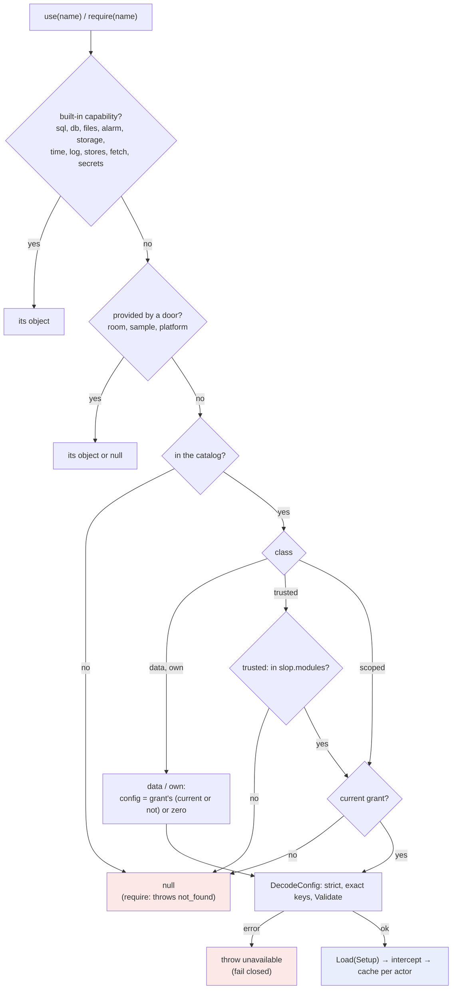
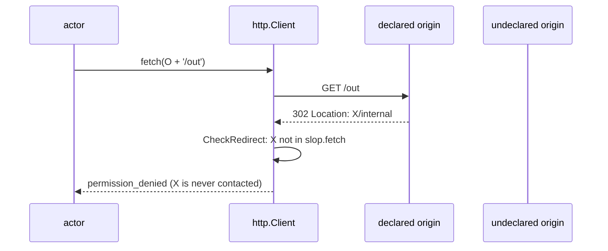

# slop v3: Per-App Modules Part 2 — The Module Catalog, Configured Grants and an In-Memory fs — A Technical Deep Dive

slop v3 hosts small web applications on **stores**. A store is a SQLite database with a versioned file tree. An application may run server-side JavaScript, its **actor**, in a goja runtime inside the slop process. The actor reaches anything outside its own variables only through the objects `use(name)` and `require(name)` return. Part 1 of ticket SLOP3-012 ([[PROJECT REPORT - slop v3 - Per-App Modules Part 1 - Implementing database, express and Mount API Policies - A Technical Deep Dive]], pull request #31) added two such objects, `database` and `express`, as fixed built-in names. Part 2, pull request #32, turns that fixed list into a **catalog**. Every module now has a class that says where its safety comes from, an optional configuration that an administrator sets per app, TypeScript declarations, and an interceptor that counts every call and, where a grant is required, re-checks it on each call. On top of the catalog, part 2 adds two modules the user named as examples of what slop should offer instead of host access: `fs`, go-go-goja's file API over a tree held in memory, and `path`. It also closes a hole in `fetch`: redirects were followed without checking their target against the app's declared origins.

This report also covers two pieces of work that followed in the same session. The first is pull request #33, which moves goja to the version go-go-goja uses. The second is the user's confirmation of the fifteen design decisions recorded in the ticket's intern guide.

Every `path:line` reference below was checked against the head of PR #32, `606997a`. The JSON and test output quoted were produced by running the code at that commit.

> [!summary]
> - **A class is a statement about authority.** `data` modules touch nothing outside the VM, `own` modules reach only the app's store or memory the actor owns, `scoped` modules reach further through a slop backend that checks each call, and `trusted` modules act as the visitor across the platform. The first two are on for every actor; the last two need an administrator's grant.
> - **A grant can be a privilege or a restriction, and the two lapse differently.** A grant of `system` stops working when the administrator who made it loses that role. A grant that makes `database` read-only keeps working, because letting it lapse would loosen the app. Configurations are decoded strictly, field names included, and a stored configuration that no longer decodes makes the module unavailable instead of unrestricted.
> - **`fs` follows the turn.** The tree is snapshotted at a turn's first change and restored if the turn fails, so a file write and a row write either both happen or neither does. The tree never touches the server's disk and is emptied when the actor restarts.
> - **Every hop of a `fetch` is checked.** Before part 2, a declared origin could answer with a redirect to any other address and the actor would read the response. The test shows exactly that, and the fix applies the first request's check to every redirect.

## What exists, and where

| Item | Location |
|---|---|
| Repository | `/home/manuel/workspaces/2026-10-28/slop-computer/slop-computer`, module `github.com/go-go-golems/slop-computer` |
| Pull request (part 2) | https://github.com/go-go-golems/slop-computer/pull/32, "SLOP3-012 part 2: module catalog, configured grants, in-memory fs, fetch redirect check", open, base `task/slop3-012-modules` (PR #31) |
| Branch and range | `task/slop3-012-part2`, `75e85e1` .. `606997a` |
| Size | 22 files, +1,854 / −137; 17 Go files, +1,558 / −111 |
| Pull request (goja) | https://github.com/go-go-golems/slop-computer/pull/33, base `main`, commit `4f05ec9`, `go.mod` and `go.sum` only |
| Ticket workspace | `ttmp/2026/11/05/SLOP3-012--per-app-modules-part-1-a-safe-database-module-and-mount-scoped-http-endpoints-for-actors/` |
| Implementation diary | `reference/01-diary.md`, Steps 7 (phase 5a), 8 (5b, 5c) and 9 (goja, decisions) |
| Design | `design-doc/01-intern-guide-per-app-modules-the-database-module-and-mount-scoped-http-endpoints.md`, §19–20 and §33 |
| Durable design doc | `doc/design/slop-v3.md`, the catalog paragraph in §6.2, rows in §7.1 |

The commits of PR #32 follow the sub-phases of the guide's phase 5:

| Sub-phase | Commit | What it adds |
|---|---|---|
| 5a | `301384d` | the catalog, classes, configured grants, migration 012, the interceptor, `app.trust --config`, `app.modules` |
| 5b | `b31d09b` | `fs` (in memory, turn-scoped) and `path` |
| 5c | `39b2daf` | `fetch` checks `slop.fetch` on every redirect |
| docs | `4a55c2f`, `606997a` | `slop-v3.md`, tasks, the confirmed decisions in the guide |

The new files carry most of the change:

| File | Lines | Content |
|---|---|---|
| `pkg/actor/catalog.go` | 329 | classes, `Module`, configuration decoding, resolution, interceptor, meters |
| `pkg/actor/builtins.go` | 127 | registration of `database`, `express`, `fs`, `path`; TypeScript declarations |
| `pkg/actor/memfs.go` | 505 | the in-memory tree and the `fs` module |
| `pkg/actor/pathmod.go` | 94 | the `path` module |
| `pkg/host/module_catalog_test.go` | 176 | `TestModuleCatalog`, `TestModuleInterceptor` |
| `pkg/host/fs_module_test.go` | 112 | `TestFSModule` |
| `pkg/host/fetch_redirect_test.go` | 60 | `TestFetchRedirects` |

---

## 1. The problem part 2 solves

### 1.1 The state after part 1

After part 1, `use(name)` in `pkg/actor/modules.go` was a `switch` over names. Some names were built-in capabilities that every actor gets (`sql`, `db`, `files`, `alarm`, `storage`, `time`, `log`, `stores`). Some were gated by the app's manifest and the platform's policy matrix (`fetch`, `secrets`). Part 1 had added two more cases, `database` and `express`, which always returned their objects. Names served by the actors door (`room`, `sample`, `platform`) came from a `Provide` table. Finally, two Go modules registered by the actors door, `system` and `workshop`, came from a registry. An app received them only if its `app.json` listed them under `slop.modules` and an administrator had run `app.trust`.

That structure had three limits that the user's request made visible. The request was that "an admin can control which modules are exposed to the sandboxed scripts", that each module can be configured "depending on how they are integrated", and that slop should offer "slop's own version that is sandboxed", with "no fs for example except against a virtual in memory fs".

- **A trust was a boolean.** The `app_modules` table had `app`, `module`, `granted_by` and `granted_at`. There was nowhere to store "read-only", "at most 100 rows" or "at most 1 MiB of files".
- **Only two kinds of module existed.** A module was either always on (the `switch` cases) or required a manifest declaration plus a trust (the registry). `database` was in the first group, so an administrator could not restrict it.
- **Nothing recorded why a module was safe.** The guide's §19 had argued that a Go module runs with the slop process's privileges, so the per-store VM isolates JavaScript from JavaScript and nothing else. The argument lived in prose, not in the code.

### 1.2 Vocabulary

The rest of the report uses these terms. Each depends only on terms defined before it.

- **Turn.** One event handled by an actor, inside one SQLite transaction on its store (`store.Do`). A turn commits or rolls back as a unit. A turn has a time limit of 5 seconds, enforced with `vm.Interrupt`.
- **Module.** A Go value, usually a JavaScript object, that an actor obtains by name with `use(name)` or `require(name)`. Its functions are Go code running with the server's full privileges.
- **Catalog.** The table of modules `Manager.Register` has filled (`pkg/actor/catalog.go:177`). It holds the four built-ins that the runtime registers in `New` and the two that the actors door registers in `Install`.
- **Class.** A field of a catalog module stating where its safety comes from: `data`, `own`, `scoped` or `trusted` (§2).
- **Default module.** A module whose class is `data` or `own` (`Class.Default`, `catalog.go:50`). It is available to every actor without a grant.
- **Grant.** A row in `system.db`'s `app_modules` table, written by the platform-admin verb `app.trust`, binding an app, a module and a configuration.
- **Configuration.** The JSON value stored with a grant, decoded into the module's Go configuration struct.
- **Current.** A grant is current while the person in its `granted_by` column is still an administrator, or when it was written by the system itself. This is SLOP3-007's provenance rule.
- **Interceptor.** The wrapper around each function of a catalog module's object (`intercept`, `catalog.go:259`).

### 1.3 The running example

One small app runs through the report. Its store `cat` has a table `items`, and its actor is this:

```js
const db = require('database');
defineActor({
  actions: {
    add(ctx, { name }) { return db.exec('INSERT INTO items (name) VALUES (?)', name).rowsAffected; },
    count() { return db.query('SELECT count(*) AS n FROM items')[0].n; },
    all() { return db.query('SELECT name FROM items').length; },
  },
});
```

This is `catalogActor` from `pkg/host/module_catalog_test.go`. Without any grant, `add` inserts a row and returns 1. An administrator then restricts the app:

```text
slop app trust cat database --config '{"readOnly":true,"maxRows":100}'
```

Sections 3 and 4 follow that command from the verb to the stored row, and from the row to the refusal the next `add` receives:

```text
permission_denied: the database module is read-only for cat (its app.trust configuration): not authorized
```

---

## 2. Classes

### 2.1 The four classes

A class answers one question about a module: what is the largest set of things its Go code can reach on behalf of the actor? The answer decides whether an administrator must approve the module before an actor can use it.

| Class | What its code reaches | Needs a grant | Needs `slop.modules` | Modules |
|---|---|---|---|---|
| `data` | nothing outside the VM | no; a grant can only configure it | no | `path` |
| `own` | the app's own store, or memory the actor owns | no; a grant can only configure it | no | `database`, `express`, `fs` |
| `scoped` | resources outside the store, only through a slop backend that checks every call | yes, current | no | none in this PR; the interceptor test registers one |
| `trusted` | the platform, by calling verbs as the visitor | yes, current | yes | `system`, `workshop` |

The table is not a ranking of usefulness. `database` gives an actor full SQL over its store, which is more power than `path` has. What `database` cannot do is reach a second database, because it is built on the turn's `Turn.Query` and `Turn.Exec` under the `actor` caller's authorizer. Part 1 made that structural: the module takes no DSN, and its `configure()` throws. The class records the structural fact.

### 2.2 Why `data` and `own` need no approval

A module whose code reaches only what the actor could already reach adds an API, not authority. `database` reaches the tables that `sql` already reaches. `express` writes into the route table that the `http:` key of `defineActor` already fills. `fs` holds bytes in the actor's memory, which the actor can already do with a JavaScript object. Requiring an administrator's approval for these would add a step without protecting anything. Open decision 6 of the guide asked who approves data-only modules, and the answer recorded on 2026-11-05 is that no one does.

The administrator's role for these classes is to restrict, not to permit. A grant of `database` with `{"readOnly": true}` takes away the write half of the API for one app.

### 2.3 Why `scoped` and `trusted` need a current grant

A `scoped` module reaches something outside the store. `stores` through bindings is the existing example in slop, and an egress-proxied HTTP client or a search index would be future ones. A `trusted` module calls the platform's verbs as the visitor, so it can read people, grants and logs that the visitor can read. For both classes, the administrator's grant is the permission itself, so the grant must be current. If the administrator who granted `system` to an app is demoted, the app loses `system`.

`trusted` also requires the app to ask. The manifest's `slop.modules` list is the app author's statement that the app wants platform access. The administrator's grant answers it. A `scoped` module has no such list, because its reach is bounded by the backend, and the grant alone expresses the administrator's decision.

### 2.4 Where the class is in the code

```go
// pkg/actor/catalog.go:38-50
type Class string

const (
	ClassData    Class = "data"
	ClassOwn     Class = "own"
	ClassScoped  Class = "scoped"
	ClassTrusted Class = "trusted"
)

func (c Class) Default() bool { return c == ClassData || c == ClassOwn }
```

`Register` gives a module without a class the class `trusted` (`catalog.go:177-185`). An unclassified registration therefore gets the strictest treatment, not the most permissive.

---

## 3. The module type and its configuration

### 3.1 The type

The catalog module type follows the guide's §20 proposal, with one simplification: its factory is a plain function that returns a `goja.Value`, not `(goja.Value, error)`. The actor's existing `throw` already turns Go errors into JavaScript exceptions.

```go
// pkg/actor/catalog.go:56-74
type Module struct {
	Name  string
	Class Class
	Doc   string
	// Config is a zero value of the module's configuration struct (nil: the
	// module takes none). A config may implement Validate() error.
	Config any
	// TypeScript declares the module for authors and agents (app.modules).
	TypeScript string
	// Load builds the module's object for one actor with its decoded
	// configuration (a pointer to a Config copy; nil when Config is nil).
	Load func(s Setup) goja.Value
}

type Setup struct {
	Actor  *Actor
	Config any // *T for the module's Config T, the grant's or the zero value
}
```

`Config` is a zero value, not a type. The catalog creates a fresh `*T` for each load with `reflect.New(reflect.TypeOf(mod.Config))`, so two apps with different configurations never share a struct. The built-ins show the pattern (`pkg/actor/builtins.go:23-37`):

```go
m.Register(Module{Name: "database", Class: ClassOwn, Config: DatabaseConfig{}, TypeScript: databaseTS,
	Doc:  "go-go-goja's database API (query, exec, begin) over the app's own store; ...",
	Load: func(s Setup) goja.Value { return s.Actor.databaseModule(*s.Config.(*DatabaseConfig)) }})
```

`DatabaseConfig` existed since part 1 with `ReadOnly` and `MaxRows`, but part 1 always passed its zero value. Part 2 adds `Validate` (`builtins.go:16-21`), which bounds `maxRows` to 0–10,000. 0 means the store's own limit, and 10,000 is that limit.

### 3.2 Strict decoding

The guide's decision for §20 was that configurations are Go structs decoded strictly, "with `DisallowUnknownFields` as `verbs.Def` decodes arguments". The point is that a misspelled key fails instead of being silently ignored. xgoja, studied in SLOP3-011, declares a schema that nothing checks and decodes with plain `json.Unmarshal`, so `{"readonyl": true}` there leaves the module read-write and reports success.

`Module.DecodeConfig` (`catalog.go:89-123`) runs these steps in order:

1. An empty, `null` or `{}` input is the zero configuration. A module with no `Config` accepts only those inputs and refuses anything else with "`<name>` takes no configuration".
2. A `json.Decoder` with `DisallowUnknownFields` decodes into the fresh `*T`, and `dec.More()` refuses trailing values.
3. `exactKeys` compares every key of the input with the struct's JSON names, recursively.
4. If the struct implements `Validate() error`, it runs.

The third step was not in the plan. It exists because of a test failure, described in §8.1. `encoding/json` matches object keys to struct fields without regard to case, even when `DisallowUnknownFields` is set, so `{"readonly": true}` sets `ReadOnly` and decodes without error. For verb arguments that is harmless, since the key reaches the intended field. For a security configuration it means two spellings are accepted for one field. Worse, a typo that differs only in case looks accepted in an audit log that shows the input. `exactKeys` makes the accepted spelling unique:

```go
// pkg/actor/catalog.go:127-160 (abridged)
func exactKeys(t reflect.Type, raw json.RawMessage) error {
	// ... t is dereferenced; non-structs and non-objects return nil
	fields := map[string]reflect.Type{}
	for i := range t.NumField() {
		f := t.Field(i)
		name, _, _ := strings.Cut(f.Tag.Get("json"), ",")
		if name == "-" || !f.IsExported() {
			continue
		}
		if name == "" {
			name = f.Name
		}
		fields[name] = f.Type
	}
	for k, v := range obj {
		ft, ok := fields[k]
		if !ok {
			return fmt.Errorf("no field %q", k)
		}
		if err := exactKeys(ft, v); err != nil {
			return err
		}
	}
	return nil
}
```

The resulting error, produced by running `app.trust cat database --config '{"readonly":true}'` at `606997a`, is:

```text
invalid_argument: database's configuration has no field "readonly"
```

`CanonicalConfig` (`catalog.go:164-174`) decodes and then encodes the struct again. The stored form is therefore always the struct's own JSON (`{"readOnly":true,"maxRows":100}`), never the administrator's original text with its whitespace, key order or omitted defaults.

### 3.3 The schema shown to authors

`app.modules` shows each module's configuration as JSON Schema, generated with the `invopop/jsonschema` reflector that the verb table already uses. Part 2 only exports it as `verbs.SchemaFor` (`pkg/verbs/def.go:153`). The `database` row of `app.modules`, as the server returns it:

```json
{
  "class": "own",
  "config": {
    "additionalProperties": false,
    "properties": {
      "maxRows": { "type": "integer" },
      "readOnly": { "type": "boolean" }
    },
    "type": "object"
  },
  "default": true,
  "doc": "go-go-goja's database API (query, exec, begin) over the app's own store; begin() is a savepoint. Config: readOnly, maxRows.",
  "name": "database"
}
```

The schema is for display. It does not carry the 0–10,000 bound on `maxRows`, which lives in `Validate`. The guide chose Go structs over a schema validator so that there is one source of truth, and the code that enforces it is `DecodeConfig`. A client that validates against the schema can still submit a configuration the server refuses.

The rows also carry `typescript`, the `.d.ts` text of each built-in (`databaseTS`, `expressTS`, `fsTS`, `pathTS` in `builtins.go`). `system` and `workshop` have none, because their surface is a generated list of verb calls.

---

## 4. Grants: storage, verbs and provenance

### 4.1 Migration 012

```sql
-- pkg/sysdb/migrations/012_app_module_config.sql
ALTER TABLE app_modules ADD COLUMN config TEXT NOT NULL DEFAULT '{}';
```

The guide had proposed this as migration 011. Part 1 took 011 for `mounts.api`, so it is 012. Existing grants of `system` and `workshop` receive `{}`, the configuration of a module that takes none.

### 4.2 Governance

`pkg/policy/modules.go` keeps its functions and changes their content:

- `AppModule` gains `Config` and `Current`.
- `TrustModule(ctx, actor, via, app, module, config)` upserts the row with its configuration, and its system-log entry records the old and new configuration as `Before` and `After` (`modules.go:29-46`). The log therefore shows a change from `{"readOnly":true}` to `{}`, where it used to show only "trusted".
- `ModuleGrant` (`modules.go:74-80`) returns the grant whether or not it is current.
- `Trusted` becomes `ModuleGrant(...).Current` (`modules.go:67-70`). The actors door still calls it in `callVerb`.

The provenance rule is a SQL expression shared by `ModuleGrant` and `AppModules`:

```go
// pkg/policy/modules.go:25
const currentSQL = `(m.granted_by = 'system' OR p.role = 'admin')`
```

Before part 2, this expression was a `WHERE` condition, so a lapsed grant was invisible. It is now a selected column, because part 2 needs to see lapsed grants, as the next section explains.

### 4.3 Privileges lapse; restrictions do not

The decision that most changed the shape of the code is how `Current` applies to each class. It is easiest to see by starting from the rule that existed and applying it everywhere.

SLOP3-007 introduced provenance for trust: a trust row counts only while its maker is still an administrator. The rule exists because a trust is a privilege granted on someone's authority, and when that authority ends, so should the privilege. Apply the same rule to `database {"readOnly": true}`. Ada, an administrator, makes the app read-only. Ada is later demoted. Her grant is no longer current, so under the SLOP3-007 rule it no longer counts. The app becomes read-write again. Nobody decided that. It happened as a side effect of a role change made for unrelated reasons.

The code therefore distinguishes the two meanings:

```go
// pkg/actor/catalog.go:219-253 (the decision part)
g, granted := a.m.grant(a.run.App, mod.Name)
if !mod.Class.Default() {
	// A privilege: declared by the app, granted by a current admin.
	if mod.Class == ClassTrusted && !slices.Contains(a.run.Manifest.Slop.Modules, mod.Name) {
		return goja.Null()
	}
	if !granted || !g.Current {
		return goja.Null()
	}
}
// A default module's grant restricts it, and keeps doing so after its
// admin steps down: it applies whether or not the grant is current.
cfg, err := mod.DecodeConfig(g.Config)
```

For `scoped` and `trusted` modules, a grant that is missing or not current means `null`. For `data` and `own` modules, any grant, current or not, supplies the configuration. A missing grant supplies `nil`, which decodes to the zero configuration. `app.modules` shows `current: false` on such a row, so an administrator can see that the restriction was set by someone who is no longer an administrator, and can replace it.

`TestModuleCatalog` runs this scenario. Ada is promoted, grants `{"readOnly": true, "maxRows": 1}`, and is demoted to member. After a restart, `add` is refused with `permission_denied`, `count` still works, and the grant row reads `current: false`.

### 4.4 Failing closed on a stale configuration

A stored configuration can stop decoding. A later version of a module might drop or rename a field, for example. `catalogModule` then has two choices: fall back to the zero configuration, or refuse. The zero configuration of a restricting module is its least restricted state, so falling back would lift every restriction exactly when nobody is looking. The code refuses instead:

```go
if err != nil {
	// The stored configuration no longer decodes (the module changed):
	// fail closed rather than fall back to the unrestricted default.
	a.throw(fail("unavailable", "%v; an admin must grant it again (app.trust)", err))
}
```

Because `use()` and `require()` run while `actor.js` loads, the throw fails the build. The test writes `{"gone":true}` directly through governance and restarts the actor. The next call returns `actor_error` whose message ends in "an admin must grant it again (app.trust)".

### 4.5 `app.trust` and `app.untrust`

`app.trust` (`pkg/commands/actors.go:80-116`) now looks the module up in the catalog instead of `apps.Modules`, and runs these steps:

1. An unknown name fails with a message that lists the catalog's names.
2. The store must be an app, meaning it has an `app.json`.
3. A `trusted` module must appear in the manifest's `slop.modules` (`actors.go:97`). Other classes need no declaration.
4. The `config` argument, a `map[string]any`, is re-encoded and passed to `CanonicalConfig`. Any error is `invalid_argument` (`actors.go:107`).
5. Governance stores the canonical form, and the app's actors restart.

The input type is a `map[string]any` rather than `json.RawMessage` so that the verb's own JSON Schema says "object". The verb decoder already reads numbers with `UseNumber`, and the re-encoding writes them unchanged.

`app.untrust` deletes the row. For a default module, that returns the module to its zero configuration. The verb's documentation now says so. Both verbs restart the app's actors, because `use()` runs at load and the catalog caches each module's object per actor (§5.3).

`apps.Modules`, the manifest parser's list of names that `slop.modules` may contain, is still `{"system", "workshop"}`. The manifest package is core and cannot see the actor runtime's catalog. `TestModuleCatalog` checks that the two lists agree: every `trusted` catalog module is in `apps.Modules`, and no other module is.

### 4.6 `app.modules`

With an `app` argument, `app.modules` now returns, in addition to the catalog rows, the app's grants with their configuration and currency, and its call counts. After the running example's grant and one `count`:

```json
{
  "app": "cat",
  "calls": { "database": 1 },
  "declared": [],
  "trusted": [
    {
      "app": "cat",
      "config": "{\"readOnly\":true,\"maxRows\":100}",
      "current": true,
      "grantedAt": 1793935223859,
      "grantedBy": "usr_894612477110a69dffb01a59",
      "module": "database"
    }
  ]
}
```

The single call is `count`'s `db.query`. `config` is a string because governance stores and returns the column as text, while `app.trust`'s result returns it as a JSON value.

---

## 5. Resolution and the interceptor

### 5.1 The order of names

`use(name)` still begins with the `switch` of built-in capabilities. The `database` and `express` cases are gone from it, and the `default` branch now ends in the catalog (`pkg/actor/modules.go:63`):



`require(name)` reaches the catalog first only for the reserved names. In part 1 those were `database` and `express`. Part 2 adds `fs` and `path` (`pkg/actor/database.go:39`), so scripts written for go-go-goja's module names run unchanged. Any other bare name is a file of the app's tree, as before. A reserved name that resolves to `null` makes `require` throw `not_found`.

### 5.2 The manager's hook

The runtime reads grants through a hook on the manager, as it read trust before, so the actor package does not depend on how governance stores them. Part 1's `Manager.Trusted func(ctx, app, module) bool` is replaced by a hook that returns the grant itself:

```go
// pkg/actor/manager.go
Grant func(ctx context.Context, app, module string) (Grant, bool) // app.trust: an app's grant of a catalog module
```

The actors door fills it from `Gov.ModuleGrant` (`pkg/doors/actors/modules.go:34-37`). Inside the runtime, `m.grant` and `m.trusted` wrap the hook, and `sysreact.go`, which decides whether an actor may follow the system log, now calls `a.m.trusted(app, "system")`.

### 5.3 Caching per actor

`catalogModule` stores each module's object in `Actor.loaded` the first time it is built, and returns the same object afterwards. Part 1's test `same()`, which asserts `require('database') === use('database')`, still passes. Caching is safe because every change to a grant restarts the app's actors, and a restarted actor starts with an empty cache.

A refusal is not cached. A `scoped` module that returns `null` re-reads its grant on the next `use()`. Since `use()` normally runs once, at load, this costs nothing in practice.

### 5.4 The interceptor

Checking a grant at `use()` time is not enough for privileges. An actor obtains `system` once, at load, and keeps the object for its lifetime, which can be days. If the grant is withdrawn, `app.untrust` restarts the actor, and the new actor sees `null`. If the granting administrator is demoted, nothing restarts the actor. SLOP3-007 handled this for `system` and `workshop` inside `callVerb`, which re-reads `Gov.Trusted` on every call (`pkg/doors/actors/modules.go:135`). A future `scoped` module that does not go through verbs would not have that check. The interceptor moves it into the catalog, so every non-default module gets it.

`intercept` (`catalog.go:259-294`) walks the object a module's `Load` returned. Each function-valued property is replaced with a Go function that:

1. increments the app's counter for the module;
2. for a non-default class, calls `m.trusted` and throws `permission_denied: <app> is no longer trusted with <module>` when the grant is gone or not current;
3. calls the original function with the same `this` and arguments;
4. if the original threw, panics with the returned `*goja.Exception`, which goja rethrows as the original JavaScript value with its `.code`.

The walk recurses into plain objects (`ClassName() == "Object"`), so the nested functions of `system.people.setRole` are wrapped as well. A `seen` set guards against cycles. Arrays, promises and class instances are left alone. The own properties of a wrapped function are copied onto its wrapper, so a module function that carries properties keeps them.

`TestModuleInterceptor` registers a `scoped` module named `probe` from the test (`h.a.Register(...)`). Its object has `ping()`, returning `"pong"`, and `inner.deep()`, returning `7`. The test runs these steps:

| Step | Result |
|---|---|
| no grant; `use('probe') !== null` | `false` |
| ada (an admin) runs `app.trust pr probe`; `p.ping() + p.inner.deep()` | `"pong7"` |
| `h.a.ModuleCalls("pr")["probe"]` | `2` (the nested function is counted too) |
| ada demoted to member; the same call, with no restart | `permission_denied … no longer trusted with probe` |

### 5.5 Meters

The counters are `atomic.Int64` values in a map keyed `"<app> <module>"`, guarded by a mutex only for creation (`catalog.go:297-329`). Each actor obtains its counter once per module, when the interceptor wraps it, so a call costs one atomic increment. Several stores run turns concurrently, which is why the counters are atomic rather than plain integers protected by the actor's single-threadedness. The counts live in memory and reset when the process restarts; `app.modules` says "since the process started".

---

## 6. `fs`: a file tree that follows the turn

### 6.1 What it is

`fs` gives an actor the file API of go-go-goja's `fs` module, with the same function names and Node's error codes, over a tree that lives in the actor's memory. It never reaches the server's disk: there is no code path from `memFS` to the `os` package. The tree is created on the first `use('fs')` and lives as long as the actor. A restart, including the one `app.trust` causes, empties it. Durable files remain `use('files')`, the store's versioned tree, and `use('db')`.

Its operations, each available as `xSync` and as `x` returning a promise:

| Operation | Behaviour |
|---|---|
| `readFile(path, enc?)` | a `Uint8Array`, or a string in `utf8`, `base64` or `hex` |
| `writeFile(path, data, enc?)`, `appendFile` | `data` is a string, `ArrayBuffer` or typed array; the parent directory must exist |
| `exists(path)` | boolean |
| `mkdir(path, {recursive})` | `EEXIST` unless `recursive` and the directory exists |
| `readdir(path)` | sorted names of direct children |
| `stat(path)` | `{size, mtimeMs, isFile(), isDirectory()}` |
| `unlink(path)` | a file; `EISDIR` for a directory |
| `rm(path, {recursive, force})` | `ENOTEMPTY` for a non-empty directory without `recursive`; `force` ignores a missing path |
| `rename(from, to)` | moves whole subtrees; refuses moving a directory into itself |
| `copyFile(from, to)` | |
| `isReadOnly()` | `false` |

Configuration, from the grant: `FSConfig{MaxBytes, MaxFiles}` (`memfs.go:26-45`). The defaults are 8 MiB and 1,000 entries, and `Validate` caps them at 64 MiB and 10,000. `"/"` and directories count as entries. Exceeding either limit is `ENOSPC`.

### 6.2 The data structure

```go
// pkg/actor/memfs.go (abridged)
type memFile struct {
	data  []byte // never changed in place: a write stores a new slice
	dir   bool
	mtime int64
}

type memFS struct {
	cfg   FSConfig
	nodes map[string]*memFile // absolute clean paths; "/" always exists
	bytes int
	snap      map[string]*memFile
	snapBytes int
	inTurn    func() bool
}
```

Every path is made absolute and clean before use (`fsPath`: `path.Clean("/" + p)`). A NUL byte or an empty path is `EINVAL`. `"data/a.txt"` is `/data/a.txt`, and `/../../etc/passwd` is `/etc/passwd` in the tree, which does not exist there. The test asserts both `ENOENT` and `existsSync('/etc/passwd') === false`.

A flat map from full paths to entries makes lookups and limits simple. Listing a directory means scanning for keys with the directory's prefix and no further `/`. Moving a subtree means rewriting keys with the old prefix. With at most 10,000 entries, a linear scan is acceptable.

### 6.3 Why it follows the turn

A store's writes are transactional per turn. An actor's memory is not. Without extra work, a turn that writes a file and a row and then throws would lose the row but keep the file. If the event is retried, it would then find half of its own failed attempt.

The tree is therefore snapshotted at a turn's first change and restored if the turn fails:

```go
// pkg/actor/memfs.go:94-110
func (f *memFS) touch() {
	if f.snap == nil && f.inTurn() {
		f.snap, f.snapBytes = maps.Clone(f.nodes), f.bytes
	}
}

func (f *memFS) end(ok bool) {
	if f == nil {
		return // the actor never used fs
	}
	if f.snap != nil && !ok {
		f.nodes, f.bytes = f.snap, f.snapBytes
	}
	f.snap = nil
}
```

`maps.Clone` copies the map, not the entries. That is a consistent snapshot only because entries are never modified in place: `write` stores a new `*memFile` with a cloned slice, and `rename` moves pointers between keys. A turn's changes therefore leave the snapshot's entries untouched. A turn with no changes takes no snapshot.

`end` must run when the store's outcome is known, which is after `store.Do` returns, not when the handler returns. A handler can succeed and the commit still fail. The two call sites:

```go
// pkg/actor/actor.go:437, after a.st.Do(...) returns err
a.fs.end(err == nil) // the fs module's writes follow the turn

// pkg/actor/manager.go:405 and :430, the setup/smoke hooks inside activation
defer a.fs.end(false)    // likewise for the fs module (a no-op after end(true))
...
a.fs.end(true)
```

The setup path differs because it runs inside the kernel's activation turn rather than its own `store.Do`. A successful setup ends the snapshot with `true`, and the deferred `end(false)` then finds no snapshot and does nothing. A failed setup returns early, and the deferred call restores the tree.

`inTurn` is `a.cur != nil`. Writes made while `actor.js` loads happen outside any turn and are not snapshotted. If the build fails, the actor and its tree are discarded together.

```mermaid
sequenceDiagram
  participant H as handler (JS)
  participant F as memFS
  participant S as store.Do
  S->>H: run the turn
  H->>F: writeFileSync('/data/rolled', 'x')
  F->>F: touch(): snap = clone(nodes)
  F->>F: nodes['/data/rolled'] = new entry
  H-->>S: throw Error('boom')
  S-->>S: ROLLBACK
  S->>F: end(false)
  F->>F: nodes = snap; snap = nil
  Note over F: '/data/rolled' is gone, as the turn's rows are
```

### 6.4 Errors in Node's shape

go-go-goja's `fs` throws Go errors carrying `code`, `syscall` and `path` properties with Node's codes. `memFS` returns `*fsError{code, op, path}`, and `throwFS` turns one into the same shape with `vm.NewGoError` plus the three properties. The message follows Node's format: `ENOENT: no such file or directory, open '/missing'`.

One case needed a second look. Reading `/data/a.txt/x`, where `/data/a.txt` is a file, first returned `ENOENT`. A real filesystem returns `ENOTDIR`, because the path runs through something that is not a directory. `missing` (`memfs.go:113-120`) now walks a missing path's ancestors and returns `ENOTDIR` if one of them is a file. All six lookup-failure sites use it.

### 6.5 Promises that are already settled

The promise forms run the synchronous operation at once and return a promise that is already resolved or rejected. `catch` (`memfs.go:405-424`) recovers a thrown JavaScript value into a rejection. Awaiting an already-settled promise does not end a slop turn, because only real I/O starts a new turn (`slop-v3.md` §6.3, rule 3). So `await fs.writeFile(...)` stays inside the same transaction as the surrounding code. The test's `promised` action writes, reads back `"async"`, and catches `ENOENT` from an awaited read of a missing file.

### 6.6 Bytes

slop has no Node `Buffer`. Without an encoding, `readFile` returns a `Uint8Array` built from a fresh `ArrayBuffer` (`encodeBytes`, `memfs.go:450-469`). The round-trip test reads `"hello world"` back as 11 bytes whose first is `104`. Writes accept strings, `ArrayBuffer` and any typed array, which `dataBytes` reads through `buffer`, `byteOffset` and `byteLength` (`memfs.go:473-505`). Code written for Node that calls `buf.toString()` on the result gets the typed array's comma-joined bytes, not text. It must pass `'utf8'`.

---

## 7. `path` and `fetch`

### 7.1 `path`

`path` (`pkg/actor/pathmod.go`) is the `data` module of the catalog: string functions with POSIX semantics over Go's `path` package, with `join`, `resolve`, `normalize`, `dirname`, `basename`, `extname`, `isAbsolute`, `relative`, and the constants `sep`, `separator` and `delimiter`. `resolve` resolves against `/`, the root of `fs`, because an actor has no working directory. Three results from the test show the details that differ from a naive use of Go's `path`:

| Call | Result | Note |
|---|---|---|
| `path.extname('.profile')` | `""` | a leading dot is not an extension, as in Node |
| `path.normalize('a//b/./c/')` | `"a/b/c/"` | a trailing slash is kept |
| `path.relative('/a/b/c', '/a/d')` | `"../../d"` | computed by `relPath` from common prefix segments |

### 7.2 The redirect hole in `fetch`

`fetch` checks the request's origin against the app's `slop.fetch` list before sending. Its HTTP client was `&http.Client{Timeout: 30 * time.Second}`, and Go's client follows up to 10 redirects by default without asking anyone. A declared origin could therefore answer `302 Location: http://10.0.0.5/admin`, and the client would fetch that address and hand the response to the actor. This was noted as a separate fix at the end of part 1. Part 2 closes it with a `CheckRedirect` that applies the first request's check to every hop:

```go
// pkg/actor/modules.go:696-708
func (a *Actor) fetchRedirect(req *http.Request, via []*http.Request) error {
	if len(via) >= 10 {
		return fail("unavailable", "fetch stopped after 10 redirects")
	}
	u := req.URL
	origin := u.Scheme + "://" + u.Host
	if (u.Scheme != "https" && u.Scheme != "http") || !slices.Contains(a.run.Manifest.Slop.Fetch, origin) {
		return fail("permission_denied", "fetch was redirected to %s, which is not in app.json slop.fetch", origin)
	}
	return nil
}
```

The client wraps a `CheckRedirect` error in a `*url.Error`. `fetch` uses `errors.As` to recover slop's `*Error` and returns it as it is (`modules.go:749`), so the actor sees `permission_denied` rather than the generic `unavailable` used for network failures.



`TestFetchRedirects` is the first test of actor `fetch` in the repository. It starts two `httptest` servers. The declared one serves `/ok`, a same-origin redirect `/hop`, a redirect `/out` to the second server, and a self-redirecting `/loop`. The second server counts its requests. The results: `/hop` returns `{"ok":true}`; `/out` is `permission_denied` naming the second server's origin, with zero requests counted there; `/loop` is `unavailable … 10 redirects`. With `CheckRedirect` removed, the `/out` call returns `200 {"secret":true}`, the second server's response. That is the hole, shown in the test output.

---

## 8. What the implementation found

### 8.1 Failures during the work

Each of these is recorded with its diagnostic in the diary's Steps 7–8:

- **The interceptor changed an existing test's error.** `TestTrustEndsWithItsAdmin` expected "no longer trusted" and got `tool is no longer granted system`. The interceptor now refuses before `callVerb` does, so its wording became the visible one. The wording was changed to "no longer trusted with", so `system` and `workshop` refusals read the same as before.
- **`readonly` was accepted.** `app.trust {"config":{"readonly":true}}` returned 200 with `config: {readOnly: true}`. This is `encoding/json`'s case-insensitive matching (§3.2). The fix is `exactKeys`.
- **The read-only refusal was an `actor_error`.** The SQL authorizer's refusal reaches JavaScript as SQLite's `not authorized`, which `asError` maps to `actor_error`. Part 1 had the same mapping for its own denials, such as `DELETE FROM _docs`. Under `readOnly`, `database` now maps it to `permission_denied` and names the grant (`pkg/actor/database.go:56`).
- **`ENOENT` where Node says `ENOTDIR`** (§6.4).
- **A limit test with wrong arithmetic.** After the grant restarted the actor, `actor.js` wrote its 6-byte boot file again, so 94 bytes fit under `maxBytes: 100`, not 100. The test now states why.
- **Lint.** `nonamedreturns` flagged `catch`, which had used named results to report a recovered panic. It now relies on an inner function returning its zero value, `false`, after recovery. staticcheck's `SA5011` flagged a possible nil dereference after `throwFS` in `stat`, because it does not know that `throwFS` panics, so an unreachable `return` follows the call.

### 8.2 Mutation checks

Each guard was disabled in turn, the tests were run, and the file was restored from a backup and compared with `cmp`:

| Guard disabled | Test and line | Observed |
|---|---|---|
| `exactKeys` | `TestModuleCatalog`, line 80 | `readonly` accepted (200) |
| a lapsed grant's configuration ignored | `TestModuleCatalog`, line 99 | `add` returned 1 instead of `permission_denied` |
| the per-call re-check | `TestModuleInterceptor`, line 172 | `pong7` after demotion |
| `fs.end(err == nil)` replaced by `end(true)` | `TestFSModule`, line 90 | "a failed turn's write stayed" |
| the `fs` byte limit | `TestFSModule`, line 96 | 9 MiB written under the 8 MiB default |
| `CheckRedirect` | `TestFetchRedirects`, line 52 | `200 {"secret":true}` |

The uncached suite (`GOWORK=off go test ./... -count=1`) passes in every package, and `golangci-lint run ./...` reports `0 issues`.

### 8.3 What the tests do not cover

- No test registers a module whose `Load` returns a non-object, such as a function, or `nil`. The catalog handles both: `nil` becomes `null`, and a function is cached but not intercepted.
- No test covers the `trusted` path's manifest check on its own. It is covered indirectly by the existing `TestModuleTrust`.
- `TestFSModule` does not cover `fs` writes in `setup`. The two `end` call sites in `manager.go` are covered by inspection, not by a test.

---

## 9. goja, and the confirmed decisions

### 9.1 The goja bump (PR #33)

slop pinned goja `af2ceb9156d7` from 2025-11-03. go-go-goja, whose modules slop may later import (task `uwr5`), pins `97b96e1e55f5` from 2026-11-03. PR #33 moves slop to go-go-goja's version. It does not move to the newest upstream commit, `2413f2132ac8`, which was from 00:25 UTC on the day of the bump. go-go-goja's version is the one its modules are tested with, and it is the version Go's minimal version selection would choose anyway once slop imports go-go-goja.

| Module | Before | After |
|---|---|---|
| `github.com/dop251/goja` | `v0.0.0-20251103141225-af2ceb9156d7` | `v0.0.0-20261103151521-97b96e1e55f5` |
| `github.com/dlclark/regexp2` (indirect) | `v1.11.5` | `github.com/dlclark/regexp2/v2 v2.11.0` |
| `github.com/goccy/go-yaml` (`go.sum`) | none | `v1.19.2` |
| `github.com/Masterminds/semver/v3` (`go.sum`) | `v3.3.0` | `v3.5.0` |

A `diff -rq` of the two goja trees in the module cache shows the scale: a year of changes, with new files for iterator helpers (`builtin_iterator.go`), `base64.go` and `float16.go`, and changes to the compiler, `builtin_promise.go`, `builtin_regexp.go` and most built-ins. The suite passes in all 17 packages with tests on `main` with the bump, and lint is clean. The same holds with the bump cherry-picked onto PR #32 in a throwaway worktree, which covers the code that depends on goja most directly: the interceptor's rethrow, `fs`'s promises and `Uint8Array`s, `express.js` and the savepoint handles.

The first attempt at that second check did not test anything. The commit hash had been captured in a shell variable in the same compound command, the variable came out empty, `git cherry-pick` printed its usage, and the tests that followed ran PR #32 on the old goja. The diary records this, and the reported results come from the rerun with the hash given directly.

The risk that remains is behaviour the tests do not reach. Regular expressions are the clearest case, since goja's engine moved to a new major version and slop's tests exercise little regex code.

### 9.2 The decisions

The intern guide recorded fifteen decisions: nine with the status "proposed", and six open questions in its §33. The user confirmed them on 2026-11-05 ("confirm design decisions"). Each one's default answer stands, and the code already implemented every default, so confirmation changed only documents. The nine status lines now read "accepted (confirmed by the user, 2026-11-05)", each with where it is implemented. §33 records the answers:

| Question | Answer |
|---|---|
| `database` and `express` on by default, or granted? | On by default; part 2 makes them, `fs` and `path` configurable by a grant that only restricts |
| A module grant per app or per mount? | Per app for modules (`app_modules`); per mount for HTTP (`Mount.API`) |
| A dedicated API host? | No; an API mount uses a second `hosts.live` entry. A host kind `api` stays a possible later change |
| Which host middlewares, in what order? | `rateLimit` per ip, `cors`, methods, body limit, `apiToken`, `rateLimit` per visitor; module calls are metered; `requireContentType`, `verifyHmac` and HTTP metering later |
| 413 on every actor route? | Yes; 1 MiB on non-API mounts, `maxBodyBytes` on API mounts |
| Who approves data-only modules? | No one; `scoped` modules need a grant per app, `trusted` also `slop.modules` |

---

## 10. Points for review and follow-ups

### 10.1 Points for review

- **Two checks per `system` call.** `system` and `workshop` calls now check the grant twice, in the interceptor and again in `callVerb`. Each check is a SQL query on `system.db` joining `app_modules` with `people`. The second check could go, but it also protects verb calls that do not come through the catalog.
- **A query per call for `scoped` modules.** A future `scoped` module called in a tight loop pays one query per call. A short-lived cache would change how quickly a demotion takes effect, which is the property the check exists for.
- **The interceptor wraps once.** It wraps functions present when `Load` returns. A module that adds functions to its object later would have those calls neither counted nor checked. Functions on objects that a module function returns, such as the handle from `database.begin()`, are not wrapped either.
- **A string match.** The read-only mapping matches the string `not authorized` in SQLite's authorizer error.
- **Bytes and schemes.** `fs` returns `Uint8Array`, not `Buffer` (§6.6). The redirect check allows `http` and `https` exactly as listed, so an `https` origin that redirects to its own `http` origin is refused unless both are declared.

### 10.2 Follow-ups recorded in `tasks.md`

- `verbs.decodeArgs` matches argument names case-insensitively, for the same `encoding/json` reason. Verbs should match them exactly, as module configurations now do.
- The two review findings from the part 1 report: floors do not combine (an audience-only floor takes the default level), and `ctx.body` parsing depends on `content-type` being forwarded.
- Filtering response headers on mounts without an API policy.
- go-go-goja imports, now unblocked by PR #33: chosen go-go-goja modules wrapped as catalog entries of the right class, for example `yaml` and `crypto` as `data`, and scoped modules such as a search index.
- The shared live-host origin, as a separate ticket.

---

## Notes on the implementation record

This report was written from the implementation diary (Steps 7–9), the branch at `606997a`, and the output of running its tests. The `app.modules` JSON in §3.3 and §4.6 and the error messages in §1.3 and §3.2 come from a temporary test, run at that commit and then deleted, that called the verbs and printed their results. The diary's earlier steps (3–6) contain three small errors that the part 1 report's writer found. They are corrected in Step 8 rather than edited in place, so the record shows both the original claim and the correction.

## Related notes

- [[PROJECT REPORT - slop v3 - Per-App Modules Part 1 - Implementing database, express and Mount API Policies - A Technical Deep Dive]]: PR #31, the modules and mount policies this part builds on.
- [[PROJECT REPORT - slop v3 - Per-App Modules - Safe Database and HTTP Endpoints for Sandboxed Actors - A Technical Deep Dive]]: SLOP3-011, the research and the design arguments, including the xgoja and go-go-host comparison.
- [[PROJECT REPORT - slop v3 - Tools as Apps - Trusted Go Modules, Confirmations and the Workshop - A Technical Deep Dive]]: the origin of `system`, `workshop`, trust and its provenance.
