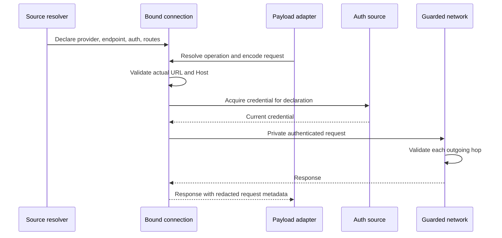

# Geppetto: Bound API Connections and Credential Authority

An authenticated HTTP request combines several decisions: which service receives it, which credential authenticates it, how the protocol encodes it, and which client sends it. Geppetto previously distributed these decisions across settings maps, provider bridges, factories, SDK constructors, and request methods. The resulting failures were combinations of individually plausible choices: a gateway key selected in one place and a vendor endpoint default selected elsewhere.

This project reorganized those decisions around an opaque bound API connection. A trusted configuration boundary selects the credential and endpoint together. The connection retains that declaration and owns authentication, routing constraints, default headers, redirects, and bounded unauthorized replay. Chat, embedding, reranking, decision, transcription, and SDK service implementations consume the resulting request capability.

> [!summary]
> - Destination authority is established from the declared endpoint before routing or credential acquisition.
> - Payload adapters receive one bound connection; request methods no longer independently assemble a key, base URL, and HTTP client.
> - Atomic configuration overlays prevent a local credential from inheriting an unrelated endpoint.
> - The implementation is committed locally through `b8566b6e`. Focused validation and downstream builds pass; full socket-based test execution and the complete repository lint wrapper remain limited as described below.

## 1. The project and its evidence

The work continues the credential scoping ticket `GEPPETTO-CREDSCOPE-001`. Its first design and implementation accompanied [PR #445](https://github.com/go-go-golems/geppetto/pull/445), built on [PR #444](https://github.com/go-go-golems/geppetto/pull/444). The original LunaRoute fallback issue predated the latter PR; review exposed the broader class of failures.

The continuation lives in `/home/manuel/workspaces/2026-11-02/rag-workbench/geppetto-bound-connections`, branch `task/geppetto-bound-connections-001`, based on `47984a78`. Seven commits implement and document the new design. These continuation commits have not been published as a new PR, so PR #445 alone does not contain the complete implementation described here.

The ticket directory is `ttmp/2026/11/05/GEPPETTO-CREDSCOPE-001--credentials-scoped-to-their-origin-no-key-reaches-a-host-it-was-not-issued-for/`. Within it, `design-doc/01-intern-guide-credential-scoping-in-geppetto-analysis-design-and-implementation.md` explains the initial inventory and fix; `design-doc/02-bound-connections-atomic-credential-ownership-and-request-execution.md` records this continuation. `reference/01-diary.md` contains the chronological evidence: steps 1–6 cover the original implementation, and steps 7–13 cover bound connections.

This report describes that committed source and recorded validation. It does not infer production deployment, provider acceptance, or independent security review from a successful local test.

## 2. Define the authority before examining the API

A **credential declaration** associates a credential source with the endpoint for which the application intends to use it. The declaration is supplied by trusted configuration. Static API keys generally do not expose a machine-verifiable issuer URL, so the library cannot reconstruct that association from a key's bytes.

An **origin** is the combination of scheme, host, and normalized port. Paths are outside this security boundary. Two endpoints at the same origin may represent different tenants, but an origin check alone cannot isolate them. Conversely, a different scheme or port is a different origin even if the hostname is unchanged.

A **bound connection** is the runtime representation of that declared authority. It can obtain a fresh token, resolve an operation's path, and send an encoded request, but it cannot be rebound to another origin through its public API. A **payload adapter** understands a service's request and response schema. Keeping these responsibilities separate lets protocol implementations share transport behavior without selecting credential authority.

The principal law is:

```text
origin(actual outgoing URL) = origin(declared endpoint)
```

Two additional laws are needed. Credential lookup must describe the original provider and endpoint, rather than whatever URL a route selected. Configuration layering must select an entire credential binding before constructing the connection. Otherwise the runtime guard may faithfully enforce an accidentally assembled declaration.

## 3. Why the previous organization failed

`settings.APISettings` represented credentials and endpoints as separate maps. That representation permitted callers to retrieve each field with different precedence and fallback rules. The implementation then had to remember the relationship at every use site.

| Failure | How the relationship was lost |
|---|---|
| Compatible provider inherited a vendor endpoint | Protocol identity was treated as provider identity. |
| Embedding request went to the SDK default | The adapter supplied a key but ignored the configured OpenAI base URL. |
| Responses used fields from different slots | Credential and URL precedence were evaluated independently. |
| Redirect forwarded a secret | The later outgoing hop was outside the initial validation point. |
| Local embedding key inherited a top-level URL | Independent configuration merges erased the source boundary. |
| Profile stack changed only half a binding | Generic deep merge treated related fields as unrelated data. |
| A route selected its own authorized origin | Pinning after route resolution accepted the route's result as authority. |

The original PR added origin pinning, credential-source scoping, provider-keyed endpoint selection, and several pairing fixes. Its regression matrix grew to 38 passing cases. Those changes established an important network check, but callers still handled separate keys, endpoints, clients, and request setup. The continuation therefore addressed the construction pattern that made omissions recurring.

## 4. The new ownership boundary

`pkg/steps/ai/connection/connection.go` defines `Config` and an opaque `Connection`. Configuration contains provider identity, base URL, named routes, authentication, default headers, a host HTTP client, outbound URL policy, and optional strict redirect rejection. Runtime fields are private.

The constructor validates an absolute HTTP(S) endpoint and rejects embedded user information, queries, and fragments. Authentication belongs in an explicit carrier, rather than a URL that may enter logs. It computes the fixed origin before any protocol route is selected. It copies the route table, header containers, authentication rule slices, and HTTP client struct. If the client has no transport, it captures the current default transport during construction.

This is a snapshot of configuration containers, not a deep copy of every injected object's internals. Credential sources, custom transports, and callback closures remain shared trusted code and must be safe for concurrent use.

The following illustrates the delivered public API. Error handling is abbreviated after construction to keep the ownership transition visible.

```go
conn, err := connection.New(connection.Config{
    Provider: "gateway",
    BaseURL:  "https://gateway.example/v1",
    Routes: connection.Routes{
        "chat": connection.Relative("chat/completions"),
    },
    Auth:       connection.StaticBearer(secret),
    HTTPClient: hostClient,
})
if err != nil {
    return err
}

req, err := conn.NewRequest(ctx, "POST", "chat", body)
if err != nil {
    return err
}
resp, err := conn.Do(req)
```

Named operations are resolved through the configured route table. `NewRequest` does not itself attach credentials. `Do` validates and authenticates immediately before execution. There is no public credential getter, transport getter, origin setter, or rebind operation.

A host can pass the same connection into several compatible payload clients. The connection's named routes must include the operations those adapters require, and its policy must authorize their use. Sharing a connection does not make incompatible wire protocols interchangeable.

## 5. Follow one request through execution

Consider an embedding request to an authenticated gateway. Source resolution first selects a complete binding for that provider. The embedding adapter receives the connection alongside model and dimensionality settings, encodes the input, and submits a request.



The source receives the originally declared provider and base URL through private binding context. An SDK-generated URL or custom route cannot substitute its own destination for that lookup. A foreign target is refused before the source is consulted.

Authentication modifies a request copy. Default and authentication headers are validated, and restricted header writers prevent middleware from writing undeclared or framing-sensitive fields. `DoWithObserver` exposes redacted diagnostics. The returned response's request metadata is also redacted, covering a secondary place where an authenticated request could otherwise escape.

The actual network transport is guarded separately. This matters because Go's redirect processing creates later requests and can invoke host callbacks that alter them. A check made only when entering `Do` would not cover those later changes. The guard compares every actual outgoing URL and Host authority with the original declaration immediately before calling trusted transport code.

A foreign redirect is refused. The implementation does not attempt to enumerate and strip secret headers before following it. Arbitrary declared authentication headers make stripping fragile, and silently converting an authenticated operation into another request changes its meaning. Some service contracts reject all redirects, including same-origin redirects, through source-level configuration.

## 6. Authentication renewal and request lifetime

`connection/auth.go` provides opaque authentication values for static bearer credentials, renewable bearer sources, named token headers, and restricted middleware. Combining authentication also combines declared header rules; conflicting sensitivity declarations fail construction.

A shared connection can serve concurrent requests. Authentication attempt state therefore belongs to one `Do` invocation. An unauthorized response may trigger one refresh and replay, provided the source supports that behavior and the request body can be reproduced. The rejected response body is closed before replay. An empty body or a valid replay mechanism is required; a consumed non-replayable body cannot be retried safely by assumption.

This replay occurs before payload decoding and streaming delivery. It is not a mechanism for restarting partially delivered streams. It is also not a general retry policy for ambiguous effectful requests after transport failures. Those require service-specific idempotency decisions.

OAuth token grants have their own connection to the configured token endpoint and reject redirects. Resource API authority and token issuer authority are separate declarations. OAuth2 authentication-style detection can make two same-issuer probes, such as trying HTTP Basic and form credentials. That library behavior is distinct from the connection's single unauthorized replay budget; the source tests account for both without allowing a foreign endpoint.

## 7. SDK integration without parallel authentication ownership

An SDK is useful for payload types and service methods, but accepting its default client would restore another request path. `SDKClient()` returns an HTTP client facade whose private transport executes SDK-created requests through the bound connection.

The inner connection owns redirects, timeout behavior, cookies, and authentication. The outer facade must not follow redirects or process cookies a second time. SDK constructor configuration also avoids retaining the real key: the OpenAI SDK accepts an empty token, while modern Gemini requires an inert nonempty placeholder. Actual authentication is installed by the connection at send time.

`providers/openaisdk` and `providers/geminisdk` centralize setup. Modern Gemini generation, caches, token counting, embeddings, and file operations share the configured API client. The migration removes obsolete legacy Gemini setup rather than retaining another client path. Recording tests exercise the service methods directly; constructor inspection alone would not prove that all SDK subservices use the intended client.

## 8. What now uses the connection

The change covers more than chat inference. The ownership contract reaches public factories, direct constructors, credential-source HTTP, and auxiliary API families.

| API family | Delivered integration |
|---|---|
| OpenAI chat and Responses | Engines accept `WithConnection`; duplicate send/auth/replay setup is removed. |
| Anthropic messages and counting | Low-level API client takes a connection; API key, bearer subscription, and gateway auth modes bind at construction. |
| Gemini | Modern SDK setup receives the facade; generation, caches, counting, embeddings, and files share it. |
| Embeddings | OpenAI, Cohere, and Ollama constructors take connections and return errors. |
| Transcription | Whisper uses `NewTranscriptionClient(connection)` through shared OpenAI SDK setup. |
| Reranking | Cohere, llama.cpp, and Qwen3 accept complete connections; source construction also binds once. |
| Decisions | SystemOne request execution uses a bound connection. |
| Pi | Resolution captures a provider binding; `Resolved.Connection()` enables reuse without exposing raw credential ownership. |
| OAuth and Umans | Grants bind their token endpoint; Umans has an issuer-specific dual-auth connection. |
| Factories and counters | Explicit connections bypass settings credential lookup; invalid construction fails early. |

This table describes implemented paths, not every capability offered by each external provider. For example, using the modern Gemini SDK for embedding operations does not imply a new standalone Gemini embedding factory was added.

The generic engine factory now validates payload requirements when a connection is supplied, rather than demanding credential maps it will not use. Model and chat configuration remain necessary. `PayloadSettings` snapshots model/configuration without carrying credential maps and the host network client into payload-only consumers.

Pi no longer needs to place Anthropic or Gemini keys into public resolved settings. Changing those settings after resolution cannot rebind the captured connection. Provider endpoint defaults are centralized in `providers/defaults/endpoints.go`; an unfamiliar provider cannot acquire the protocol vendor's endpoint merely by selecting its protocol.

## 9. Configuration merging must preserve declarations

An immutable runtime object cannot repair configuration that was incorrectly combined before its constructor ran. Suppose an inherited profile declares a gateway endpoint and its key. A local layer changes only the key. A generic map merge produces a new pair, but no source declared that pair together.

`settings.OverlayCredentialSlots` handles these fields as credential units. Replacing an existing authenticated slot requires both credential and endpoint. Empty values do not count as replacements. A model-only overlay inherits the intact binding. Anonymous URL-only declarations remain possible. An initial source declaration can use its own provider default where the source contract permits it.

Embedding-local and per-call authentication overrides use stricter paired selection: an override must supply both key and URL. Section provenance is retained during parsing so a local field is not decoded into an unrelated section and mistaken for inherited configuration. Engine profile stack merging uses the atomic helper for API and embedding credentials while retaining normal recursive merging for ordinary model data.

This deliberately changes some configuration behavior. Users who previously changed only a key over an authenticated profile must now declare the intended endpoint as well. It also changes public constructors and counter error returns. No compatibility layer was added.

## 10. Implementation sequence and difficult findings

The work was divided at ownership boundaries, with the diary recording commands, failures, decisions, and review notes for each step.

| Commit | Result |
|---|---|
| `565dc266` | Second design, implementation tasks, and diary plan. |
| `9b8a0f48` | Connection core, authentication, routes, executor, SDK facade, adversarial tests. |
| `aa77b9b3` | Inference engines, counters, Pi, and transcription. |
| `5b0386c9` | Remaining provider families, atomic embedding overrides, provider defaults. |
| `4739946b` | OAuth grant binding and issuer-specific Umans setup. |
| `dd84c625` | Factory cleanup and atomic profile credential overlays. |
| `b8566b6e` | Public usage documentation, compiled examples, and final evidence. |

Several findings made the final design more precise. The source lookup context needed to remain tied to the declaration even when an SDK supplied a longer resource URL. Capturing a nil client's default transport only at send time would leave behavior dependent on later global mutation, so construction captures it. Request copies with nil header maps required initialization before authentication. Relative routes needed to reject empty queries such as a trailing `?`, not only nonempty query strings.

Provider integration also exposed differences in error contracts. Whisper's existing transcription result can carry an error inside the result object, so tests had to inspect that contract instead of assuming every failure used the separate returned error. The public counter constructors now return construction errors immediately, and factory-only credential checks were removed where an explicit connection made them redundant.

The original checkout's Git metadata was outside writable filesystem roots. An initial staging attempt failed on its index lock, so the continuation used an isolated sibling clone. That is why the report names a different local repository path. The original checkout and parent workspace definition were preserved.

## 11. Validation and what it establishes

The successful gate is `scripts/02-validate-bound-connections.sh` in the ticket. Its receipt is `sources/05-bound-connection-validation.txt`. The original 38-path regression matrix expanded to 64 cases, including direct provider paths and refused configuration cases. Recording transports verify the intended host and marker credential, so a row cannot pass merely because it never attempted the relevant request.

The core checks cover all common redirect statuses, hostile redirect callbacks, same-origin behavior, Host overrides, foreign routes before source acquisition, configuration mutation, redaction, replayable and non-replayable bodies, cancellation, and concurrent request attempts. Additional tests exercise modern Gemini service methods, Whisper multipart requests, Pi settings mutation, OAuth grants, issuer-specific Umans authentication, connection-only factories, embeddings, and profile overlays.

A process-wide default-transport tripwire prevents accidental ambient network use in the regression matrix. This is a concrete response to an earlier test incident recorded in the original diary: three requests reached `api.openai.com` with only the dummy marker `MATRIX-SECRET` while reproducing the old code's behavior. They did not carry real credentials. The continuation's recorders require no external API calls.

Focused suites and race checks passed, all repository test packages compiled, and the repository built. The downstream rag-workbench build also succeeded using a temporary workspace file that selected the isolated implementation; `sources/07-rag-workbench-build.txt` records it. The parent `go.work` was not changed.

There are two material validation limits. Existing socket-based tests cannot execute in this environment because binding a local test socket is refused; package compilation is not equivalent to running them. The configured golangci-lint analyzers report zero issues, but the repository's separate custom vet reports six unchanged generated `turns.DataK` calls in `pkg/inference/engine/turnkeys_gen.go`. The lint wrapper stops there, so a complete `make lint` pass is not claimed. `sources/06-bound-connection-lint.txt` records that distinction.

## 12. Trust limits and future use

The pattern makes routine credential/endpoint recombination difficult by removing those separate inputs from request code. It does not prove that a trusted initial declaration names the true credential issuer. Already merged settings from another application have lost their provenance; this library must treat the resulting declaration as trusted input.

Custom transports, middleware, and sources are trusted in-process code. A malicious transport can rewrite a URL after the final wrapper check or send a separate request. Origin binding also does not pin DNS, establish trust in a proxy operator, enforce path-based tenancy, or verify cryptographic token audiences. Those are distinct policies with different enforcement points.

There is no newly implemented secret-URI service or named connection registry. Those were possible configuration representations discussed during design. The delivered abstraction works with existing settings and Pi entries and addresses runtime ownership without requiring another secret backend.

For a new authenticated adapter, the construction rule is now clear: resolve one declaration, accept or construct a bound connection, define supported routes, and keep payload/model settings separate. The request method should encode, execute through the connection, and decode. Add a recording regression row that proves the intended operation carries its marker to the declared origin and refuses an attempted foreign hop.

The reusable architectural account is [[Research/Software Architecture Garden/geppetto/designs/01-bound-api-connection|Bound API Connection]]. It describes the forces, pseudocode, variations, and consequences independently of Geppetto's public API. The project remains ready for review and actual usage feedback; the recorded checks establish the tested boundaries without claiming every external provider behavior has already been observed.
