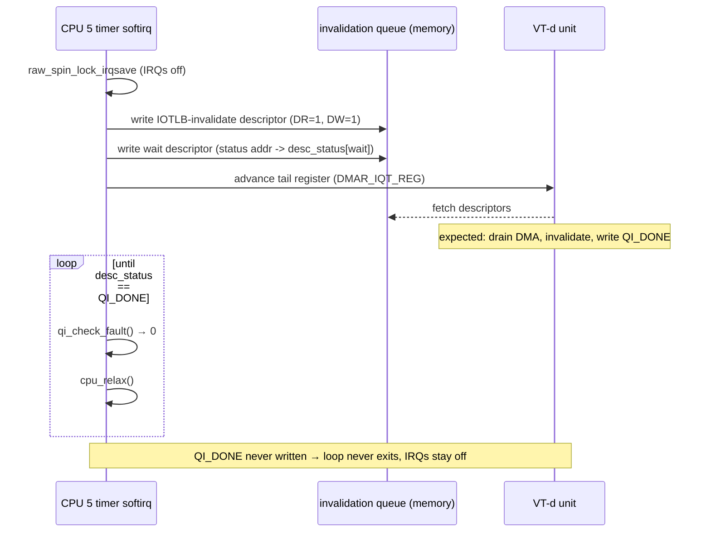
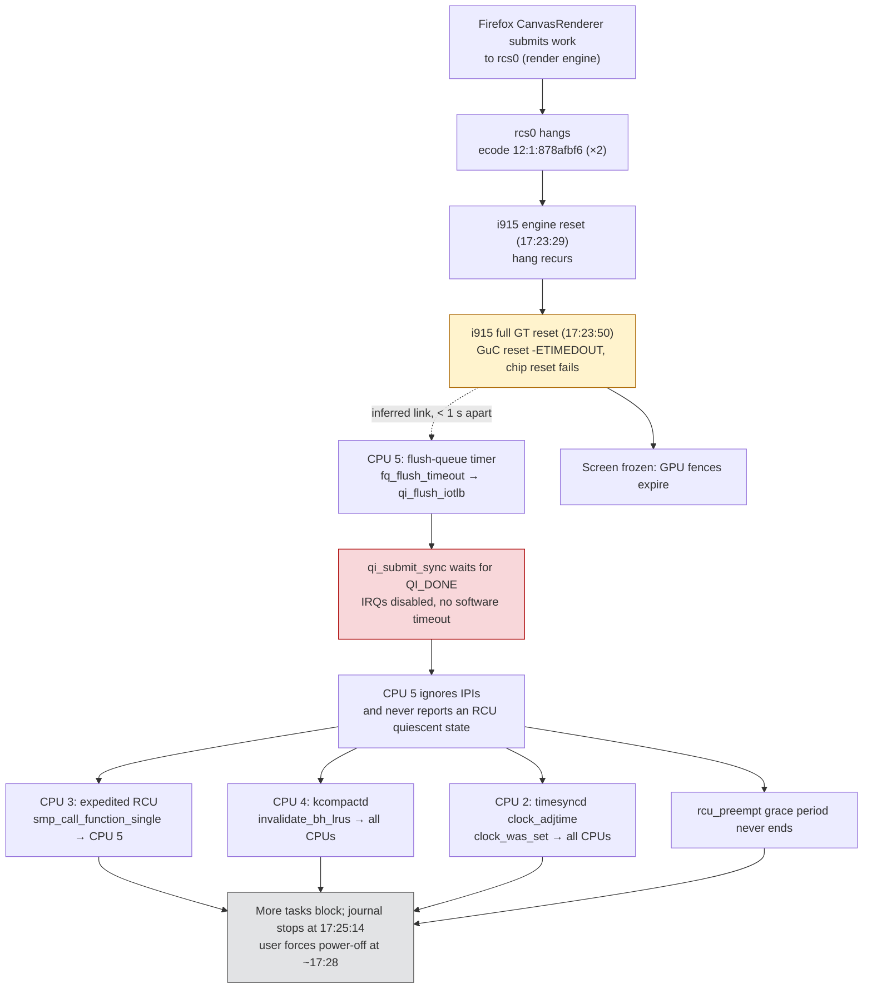
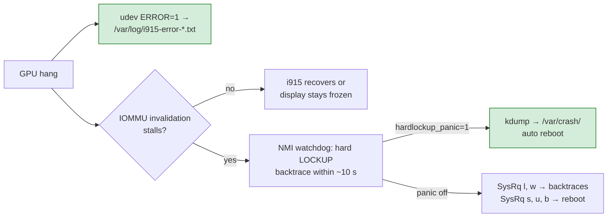

# Framework Laptop: A GPU Hang That Froze the Kernel Through the IOMMU — A Technical Deep Dive

On 6 November 2026 at 17:23 the Framework Laptop (11th-generation Intel, Tiger Lake) stopped responding and had to be powered off. This report reconstructs what happened from the kernel log of that boot. It explains each kernel mechanism involved, separates what the log proves from what it only suggests, and records what the web research found about the bug. It closes with the remedies and the instrumentation that will make the next occurrence diagnosable.

The short version: Firefox submitted work to the integrated GPU that hung the render engine. The i915 graphics driver tried to reset the GPU and failed. About one second later, a CPU running a routine IOMMU maintenance timer asked an IOMMU to invalidate its translation cache, and the invalidation never completed. That CPU spun forever with interrupts disabled. Every other CPU that then needed to run a function on it (to adjust the clock, compact memory, or finish an RCU grace period) spun waiting for an answer that never came. The machine did not crash; it gradually stopped making progress.

> [!summary]
> - **The GPU hang was the trigger, not the freeze.** The render engine hung in Firefox's `CanvasRenderer` thread twice, 21 seconds apart. A full GPU reset then failed with `-110` (`ETIMEDOUT`). A failed GPU reset on its own should leave a black or frozen screen, not a frozen kernel.
> - **The freeze came from the IOMMU.** CPU 5 sat in `qi_submit_sync`, waiting for an IOTLB invalidation that never completed. In Linux 6.8 that wait has no software timeout and runs with interrupts disabled, so the CPU stopped answering inter-processor interrupts.
> - **One stuck CPU stalled three others.** CPUs 2, 3 and 4 were blocked in cross-CPU function calls (`clock_adjtime`, memory compaction, expedited RCU) that wait for every target CPU, CPU 5 included.
> - **The bug is known but unfixed in public.** The closest upstream report is drm/intel issue #6638 (Tiger Lake, a lockup in `qi_submit_sync`). No report gives a root cause. The practical defences are a BIOS update, `intel_iommu=igfx_off`, and capturing the GPU error state the next time it happens.

## What exists, and where

| Item | Value |
|---|---|
| Machine | Framework Laptop, board `FRANBMCP0B`, Intel Core i7-1165G7 (Tiger Lake, 4 cores / 8 threads), 62 GiB RAM |
| GPU | `00:02.0` TigerLake-LP GT2 [Iris Xe Graphics], driver `i915` |
| BIOS | Insyde `03.07`, dated 2021-12-14 |
| OS / kernel | Ubuntu 24.04.2 LTS, `6.8.0-147-generic` |
| Kernel command line | `quiet splash module_blacklist=hid_sensor_hub nvme.noacpi=1 mem_sleep_default=deep loglevel=6 nvme_core.default_ps_max_latency_us=0 i915.enable_psr=0` |
| IOMMU mode | Intel VT-d on by default (`CONFIG_INTEL_IOMMU_DEFAULT_ON=y`), DMA domains translated, TLB invalidation policy **lazy** (`CONFIG_IOMMU_DEFAULT_DMA_LAZY=y`); the GPU's IOMMU group has type `DMA-FQ` |
| Browser | Firefox snap (version `159.0-1` installed when this report was written), two profiles running |
| Affected boot | journal boot `-1`, ID `aa35adfdb46f47109c5e529adbe19aab`, 2026-11-05 10:03:53 → last entry 2026-11-06 17:25:14 |
| Next boot | 2026-11-06 17:28:42 (the forced power cycle) |
| Log excerpt | `_assets/framework-gpu-iommu-hang-2026-11-06-kernel-excerpt.log` (kernel messages from 17:23:29 to the last entry, register dumps removed) |
| Commands used | `journalctl --list-boots`, `journalctl -b -1 -k -o short-precise`, `/sys/class/iommu/*`, `/sys/kernel/iommu_groups/*/type`, `/boot/config-6.8.0-147-generic`, `fwupdmgr get-devices` |

The five boots before this one contain no `soft lockup`, `rcu_preempt detected stalls`, `GPU HANG` or `Failed to reset` messages. As far as the retained journal shows, this was the first occurrence.

## 1. What the user saw

The desktop froze while Firefox was open and the machine stopped responding to input. After waiting, the user forced a power-off and booted again. The question was why.

The answer is in the persistent journal. `journalctl --list-boots` shows that the previous boot's last entry was at 17:25:14 and the new boot started at 17:28:42. Nothing reached the journal in the three and a half minutes between them, although by the kernel's own reports the machine was still running at least until 17:25:13. The kernel log in the final two minutes contains three kinds of message, in this order:

1. i915 messages: a GPU hang, two reset attempts, and the failure of the second.
2. `watchdog: BUG: soft lockup` messages for CPUs 3, 4 and 2, repeated with increasing durations (23 s, 49 s, 75 s).
3. One `rcu: INFO: rcu_preempt detected stalls on CPUs/tasks` report naming CPU 5, with a backtrace of that CPU obtained by NMI.

Understanding why the second and third groups follow from the first requires five pieces of background: how i915 handles hangs, what an IOMMU and its IOTLB are, how Linux batches IOTLB invalidations, how the Intel IOMMU driver waits for an invalidation, and how CPUs ask each other to run functions.

## 2. Background

### 2.1 GPU engines, hangs and resets in i915

The Tiger Lake GPU executes command buffers on several **engines**. `rcs0` is the render engine, which runs 3D and compute work, including the shaders a browser uses for accelerated canvas and WebGL. Each process that uses the GPU submits work through one or more **contexts**.

The i915 driver watches for engines that stop making progress. It has two detectors that appear in this log:

- **Preemption timeout.** When the driver needs to switch the engine to another context, it asks the running context to yield. If the engine does not yield within a time limit, the driver resets the engine. The log line is `Resetting rcs0 for preemption time out`.
- **Heartbeat.** The driver periodically submits a tiny high-priority request to each engine. If a heartbeat request does not complete, the engine is considered dead. The log line is `Resetting rcs0 for stopped heartbeat on rcs0`.

Reset escalates. The driver first resets the single engine. If that does not recover it, the driver resets the whole graphics tile (`GT0: Resetting chip`), which resets all engines and the embedded microcontrollers, including the **GuC** (graphics microcontroller). If the full reset also fails, the GPU is unusable until the driver is reloaded or the machine reboots.

Each hang is reported with an **error code** such as `ecode 12:1:878afbf6`. The first field is the graphics IP version (12, the Xe-LP architecture of Tiger Lake). The second is the mask of hung engines (`1` is `rcs0`). The third is a signature computed from the hung engine's registers. Two hangs with the same ecode stopped in the same state.

On a hang, i915 also captures a detailed **error state** (registers, ring contents, the batch buffer being executed) and exposes it at `/sys/class/drm/card1/error`. That file lives only in memory and is lost at reboot. In this incident it was lost.

### 2.2 The IOMMU and the IOTLB

A device that reads or writes main memory directly (**DMA**) uses bus addresses. Without an IOMMU, a bus address is a physical address. With an IOMMU, the device uses an **I/O virtual address** (IOVA), and the IOMMU translates each IOVA to a physical address through page tables that the kernel controls. A device can then reach only the memory the kernel mapped for it. On Intel platforms the IOMMU is called **VT-d**, and each hardware unit is a **DMA remapping hardware unit** (DRHD), which Linux names `dmarN`.

This laptop has six units. The mapping from unit to device, read from `/sys/class/iommu/dmar*/devices`, is:

| Unit | Register base | Devices |
|---|---|---|
| `dmar0` | `0xfed90000` | `0000:00:02.0` (the GPU) only |
| `dmar1`–`dmar4` | `0xfed84000`–`0xfed87000` | `00:07.0`–`00:07.3` (Thunderbolt PCIe root ports), one each |
| `dmar5` | `0xfed91000` | everything else (`INCLUDE_PCI_ALL`, `flags: 0x1`) |

The GPU has an IOMMU unit to itself. That fact matters in section 7.

Walking page tables on every DMA access would be slow, so each unit caches translations in an **IOTLB** (I/O translation lookaside buffer). When the kernel removes a mapping, it must also remove any cached translation of it. Until it does, the device can still reach memory that the kernel may already have reused for something else. Removing cached translations is called **IOTLB invalidation**.

### 2.3 Lazy invalidation and the flush queue

Invalidating the IOTLB on every unmap is expensive. Linux therefore offers a **lazy** policy, which is the default on this kernel (`iommu: DMA domain TLB invalidation policy: lazy mode` in the boot log). Under the lazy policy, an unmapped IOVA range is not freed immediately. It is placed on a per-CPU **flush queue**. The queue is emptied, and the ranges freed, after a single invalidation of the whole domain's IOTLB. That invalidation happens when a queue fills (256 entries per CPU) or when a timer expires, whichever comes first. The timer is 10 ms (`IOVA_DEFAULT_FQ_TIMEOUT` in `drivers/iommu/dma-iommu.c`).

The timer path, from `drivers/iommu/dma-iommu.c` in Linux 6.8, is:

```c
static void fq_flush_iotlb(struct iommu_dma_cookie *cookie)
{
	atomic64_inc(&cookie->fq_flush_start_cnt);
	cookie->fq_domain->ops->flush_iotlb_all(cookie->fq_domain);
	atomic64_inc(&cookie->fq_flush_finish_cnt);
}

static void fq_flush_timeout(struct timer_list *t)
{
	struct iommu_dma_cookie *cookie = from_timer(cookie, t, fq_timer);
	...
	fq_flush_iotlb(cookie);
	... /* free the queued IOVA ranges on every CPU */
}
```

The timer function runs in **softirq** context: after a hardware timer interrupt, on whichever CPU armed the timer, before the CPU returns to what it was doing. Domain type `DMA-FQ` in sysfs means a translated DMA domain with a flush queue. The GPU's group (group 4) has that type, so every GPU buffer unmap goes through this path.

For Intel VT-d, `flush_iotlb_all` is `intel_flush_iotlb_all`, which calls `qi_flush_iotlb` for each IOMMU unit the domain uses.

### 2.4 Queued invalidation and `qi_submit_sync`

A VT-d unit receives invalidation requests through the **invalidation queue**, a ring of descriptors in memory. Software writes descriptors into the ring and advances the tail register. Hardware processes descriptors in order. To learn when its request has finished, software appends an **invalidation wait descriptor**. When hardware reaches that descriptor, it writes a status value (`QI_DONE`) to a memory location that software chose.

`qi_flush_iotlb` builds an IOTLB invalidation descriptor. If the unit advertises the **drain read** and **drain write** capabilities, it sets the corresponding bits. Those bits tell the hardware to complete the invalidation only after DMA reads and writes already in flight have drained. Both capability bits (bits 55 and 54 of the capability register) are set on every unit in this machine. For `dmar0` the register is `cap 1c0000c40660462`. The function then calls `qi_submit_sync`.

`qi_submit_sync` (in `drivers/iommu/intel/dmar.c`) takes the queue lock with interrupts disabled, writes the descriptors and the wait descriptor, advances the tail, and spins until the wait descriptor's status becomes `QI_DONE`. The wait loop, verbatim from Linux 6.8:

```c
raw_spin_lock_irqsave(&qi->q_lock, flags);
...
while (qi->desc_status[wait_index] != QI_DONE) {
	/*
	 * We will leave the interrupts disabled, to prevent interrupt
	 * context to queue another cmd while a cmd is already submitted
	 * and waiting for completion on this cpu. This is to avoid
	 * a deadlock where the interrupt context can wait indefinitely
	 * for free slots in the queue.
	 */
	rc = qi_check_fault(iommu, index, wait_index);
	if (rc)
		break;

	raw_spin_unlock(&qi->q_lock);
	cpu_relax();
	raw_spin_lock(&qi->q_lock);
}
```

The loop has two exits. The hardware writes `QI_DONE`, or `qi_check_fault` finds an error bit in the unit's fault status register. It checks three bits: IQE (an invalid descriptor), ITE (an invalidation timeout) and ICE (an invalidation completion error). ITE is defined only for **device-TLB** invalidations, which require PCIe ATS. This platform reports `DMAR: No ATSR found`, and an ordinary IOTLB invalidation does not raise ITE. ICE is logged but does not end the loop.

The consequence is the central fact of this incident. **If a VT-d unit never completes an IOTLB invalidation, `qi_submit_sync` spins forever, with interrupts disabled on that CPU.** The code relies on the hardware to finish. It does not limit the wait in software.



### 2.5 Cross-CPU function calls

Some kernel operations must run code on other CPUs. Examples: invalidating per-CPU caches, re-programming every CPU's timer after the wall clock changes, and asking a CPU for its RCU state. The mechanism is `smp_call_function_*`. The calling CPU places a request in the target CPU's call queue, sends it an **inter-processor interrupt** (IPI), and, for synchronous calls, spins until the target has run the function. That spin is `csd_lock_wait` and it has no timeout (`CONFIG_CSD_LOCK_WAIT_DEBUG` is off in this kernel).

An IPI is an ordinary maskable interrupt. A CPU with interrupts disabled does not handle it. A synchronous cross-CPU call aimed at such a CPU therefore waits for as long as that CPU keeps interrupts disabled.

### 2.6 The detectors that reported the freeze

Three kernel watchdogs can report a stuck CPU. Only two of them were active.

| Detector | What it detects | Default threshold | Active in this boot? |
|---|---|---|---|
| Soft lockup | A CPU running kernel code without scheduling | 2 × `watchdog_thresh` = 20 s (reported at ~23 s) | Yes |
| RCU CPU stall | A CPU that has not passed through an RCU quiescent state for the current grace period | `CONFIG_RCU_CPU_STALL_TIMEOUT=60` s | Yes |
| Hard lockup (NMI watchdog) | A CPU whose timer interrupts have stopped (interrupts disabled) | `watchdog_thresh` = 10 s | **No**, see 4.4 |

**RCU** (read-copy-update) is a synchronization mechanism. A **grace period** ends only when every CPU has passed through a **quiescent state**, such as a context switch or idle. A CPU spinning with interrupts disabled never does. When RCU detects a stall, it sends a **non-maskable interrupt** (NMI) to the stalled CPU and prints that CPU's backtrace. An NMI is delivered even when interrupts are disabled. That is how the log contains a stack trace from CPU 5.

## 3. Timeline

All times are local (EST) on 2026-11-06, with microseconds from `journalctl -o short-precise`. Rows marked *derived* are computed from the durations the detectors report.

| Time | CPU | Event |
|---|---|---|
| 17:23:29.511 | — | `i915 ... Resetting rcs0 for preemption time out` |
| 17:23:29.557 | — | `GPU HANG: ecode 12:1:878afbf6, in CanvasRenderer [20371]` |
| 17:23:41–17:23:43 | — | 60 `Fence expiration time out` messages for Xorg (8150), Firefox `Renderer` (20350) and `CanvasRenderer` (20371) |
| 17:23:50.572 | — | Second `GPU HANG`, **same ecode** `12:1:878afbf6` |
| 17:23:50.573 | — | `Resetting rcs0 for stopped heartbeat on rcs0` |
| 17:23:50.575 | — | `GT0: Resetting chip for stopped heartbeat on rcs0` |
| 17:23:50.577 | — | `*ERROR* GT0: Failed to reset GuC, ret = -110` |
| 17:23:50.770 | — | `*ERROR* GT0: Failed to reset chip`; `CI tainted:0x9 by intel_gt_reset` |
| 17:23:50.881 | — | `CanvasRenderer[20371] context reset due to GPU hang` |
| 17:23:50.88–.97 | — | Xorg re-reads the panel EDID; both Firefox processes (20198, 9029) start writing crash minidumps |
| ≈17:23:51.6 | 5 | *Derived:* the RCU grace period that CPU 5 never completed starts (60.002 s before the stall report) |
| ≈17:23:54 | 3 | *Derived:* `kworker/3:1` (expedited RCU) starts spinning |
| 17:24:17.011 | 3 | `soft lockup - CPU#3 stuck for 23s! [kworker/3:1:750541]` |
| 17:24:33.744 | 4 | `soft lockup - CPU#4 stuck for 23s! [kcompactd0:71]` |
| 17:24:45.740 | 2 | `soft lockup - CPU#2 stuck for 23s! [systemd-timesyn:2002]`; CPU 3 now at 49 s |
| 17:24:51.628 | 5 | `rcu_preempt detected stalls`; NMI backtrace of CPU 5 in `qi_submit_sync` |
| 17:25:01–17:25:13 | 2, 3, 4 | Soft lockups repeat at 49 s and 75 s |
| 17:25:14.475 | — | Last journal entry of the boot |
| 17:28:42 | — | Next boot starts |

The key interval is the gap between the failed chip reset at 17:23:50.770 and the start of CPU 5's stall at about 17:23:51.6, less than one second. The log does not prove the two events are causally linked, but the timing strongly suggests it.

## 4. Reading the evidence

### 4.1 The GPU hang and the failed reset

The hung context belongs to thread 20371, named `CanvasRenderer`. Firefox uses that thread for accelerated canvas and WebGL work. The AppArmor messages earlier in the log label PID 20198 as `snap.firefox.firefox`, and 20198 is one of the two processes that started a crash dump at 17:23:50. The other, 9029, belongs to a second Firefox profile (`Q01czeBA.Profile 1`). Both crash reporters announced minidump paths in the journal. Neither file exists on disk now. The most likely reason is that the dumps were not finished before the system stopped making progress.

The first reset, at 17:23:29, was an engine reset and reported no error. Twenty-one seconds later the same engine hung with the same ecode. The driver then escalated to a full GT reset. The GuC reset step returned `-110`, which is `-ETIMEDOUT`: the driver asked the hardware to reset the GuC unit and the hardware did not acknowledge the request within the driver's timeout. The chip reset as a whole then failed. i915 marked the kernel with `TAINT_WARN` (`CI tainted:0x9`; bit 9 is the `W` flag, which appears in every later `Tainted:` line).

This boot logs no GuC or HuC firmware load. Only the DMC display firmware (`tgl_dmc_ver2_12.bin`) was loaded. On Tiger Lake, GuC-based command submission is not the default, so the GuC that failed to reset was the microcontroller as part of the reset domain, not a submission backend in use. This matters for one of the workarounds found online (section 6).

A failed GPU reset explains a frozen screen. The X server's rendering fences expired from 17:23:41 onwards, so nothing new was being drawn. It does not by itself explain why the kernel stopped scheduling.

### 4.2 CPU 5: the root of the kernel freeze

The NMI backtrace of CPU 5, condensed (`?` frames removed):

```text
CPU: 5 PID: 0 Comm: swapper/5
RIP: 0010:qi_check_fault+0x51/0x3f0
 <IRQ>
  qi_submit_sync+0x318/0x4a0
  qi_flush_iotlb+0x84/0xb0
  intel_flush_iotlb_all+0x78/0x150
  fq_flush_iotlb+0x26/0x40
  fq_flush_timeout+0x2d/0x100
  call_timer_fn+0x27/0x160
  __run_timers+0x262/0x300
  run_timer_softirq+0x1d/0x40
  handle_softirqs+0xd8/0x340
  __irq_exit_rcu+0xd9/0x100
  sysvec_apic_timer_interrupt+0x92/0xd0
 </IRQ>
 <TASK>
  cpuidle_enter+0x2e/0x50
  ...
  do_idle+0x97/0x100
  start_secondary+0x129/0x160
```

Read from the bottom up, the trace says this. CPU 5 was idle (`swapper/5`, `cpuidle_enter`). A local APIC timer interrupt woke it. On the way out of the interrupt it ran pending softirqs. The timer softirq ran `fq_flush_timeout`, the 10 ms flush-queue timer of section 2.3. That called into the Intel IOMMU driver to invalidate a domain's whole IOTLB, and the driver was inside the `qi_submit_sync` wait loop, executing `qi_check_fault`, when the NMI arrived.

The RCU report adds the evidence that CPU 5 was not merely slow:

```text
rcu:   5-...0: (1 GPs behind) idle=9f3c/1/0x4000000000000002 softirq=9967672/9967691 fqs=21408
rcu:                  hardirqs   softirqs   csw/system
rcu:          number:        0          0            0
rcu:         cputime:        0          0            0   ==> 30000(ms)
```

During the last 30 seconds of sampling, CPU 5 handled zero hard interrupts, zero softirqs and zero context switches. That is what a CPU spinning in `qi_submit_sync` with interrupts disabled looks like from the outside. The softirq counter moved by only 19 since the grace period started, so the CPU ran a few softirqs and then stopped in this one.

What the trace does not say is which domain and which VT-d unit were being flushed. `intel_flush_iotlb_all` iterates over every unit attached to the domain whose timer fired. The GPU's domain is the likeliest candidate. GPU buffer unmaps are frequent, the GPU domain uses the flush queue, and the stall began within a second of the failed GPU reset. But that is an inference, not something the log records.

### 4.3 CPUs 2, 3 and 4: blocked waiting for CPU 5

The three CPUs reported by the soft-lockup detector were each in a synchronous cross-CPU call (section 2.5), each needing CPU 5.

| CPU | Task | Instruction pointer | Call path | Why it needs CPU 5 |
|---|---|---|---|---|
| 3 | `kworker/3:1` (workqueue `rcu_gp`) | `smp_call_function_single+0xb0` | `wait_rcu_exp_gp` → `sync_rcu_exp_select_cpus` → `__sync_rcu_exp_select_node_cpus` | An expedited RCU grace period asks each CPU in turn for its state; CPU 5 never answers |
| 4 | `kcompactd0` | (in `on_each_cpu_cond_mask`) | `kcompactd` → `proactive_compact_node` → `compact_zone` → `migrate_pages` → `__buffer_migrate_folio` → `invalidate_bh_lrus` | Migrating a page that holds buffer heads requires every CPU to drop its buffer-head LRU cache |
| 2 | `systemd-timesyncd` | `smp_call_function_many_cond+0x143` | `clock_adjtime` → `do_adjtimex` → `timekeeping_inject_offset` → `clock_was_set` | A wall-clock step requires every CPU to re-program its high-resolution timer (`retrigger_next_event`) |

The order in which they stuck follows from how often each operation runs. The expedited RCU worker was first (≈17:23:54), because expedited grace periods are requested constantly by subsystems that call `synchronize_rcu_expedited`. Proactive memory compaction came next (≈17:24:10). `systemd-timesyncd` came last (≈17:24:22), when its periodic clock adjustment fell due.

None of these three tasks did anything wrong. Each is spinning with preemption disabled, so each CPU is also lost for running other work. Once a fourth or fifth CPU needed a cross-CPU call or a synchronous RCU grace period, it would join them. The journal's last entry at 17:25:14 and the 3.5 minutes of silence before the power-off are consistent with the remaining CPUs blocking one by one, journald among the blocked tasks.



### 4.4 Why the hard-lockup detector said nothing

CPU 5 had interrupts disabled from about 17:23:51 onward. That is exactly what the hard-lockup detector exists to catch. It uses a performance-counter NMI to check whether a CPU's timer interrupt count has advanced in the last `watchdog_thresh` seconds (10 s here). It would have printed `Watchdog detected hard LOCKUP on cpu 5` with a backtrace within about ten seconds, forty seconds before RCU did.

It was off. The boot log shows `NMI watchdog: Enabled. Permanently consumes one hw-PMU counter.` at 10:03:53, but `kernel.nmi_watchdog` reads `0` now. The machine runs a `powertop.service` unit with `ExecStart=/usr/local/sbin/powertop --auto-tune`. One of powertop's auto-tune actions is disabling the NMI watchdog, to save the power that the performance counter consumes. No other configuration under `/etc` mentions `nmi_watchdog`. Powertop is therefore the most likely reason the detector was off.

This did not cause the freeze, but it delayed and weakened its diagnosis. It also removes the option of making the kernel panic, and so capture a crash dump, on a hard lockup (`kernel.hardlockup_panic=1`).

### 4.5 What was not involved

Several items in the log look suspicious but are unrelated, and it is worth recording why:

- `cros_ec_lpcs cros_ec_lpcs.0: packet too long (28931 bytes, expected 0)` at 17:00:58 is from the embedded controller interface, 22 minutes earlier, with no follow-on errors.
- The once-a-minute AppArmor `DENIED` messages are Firefox's snap confinement refusing a D-Bus call to NetworkManager. They run all session long.
- The `U`, `O` and `E` taint flags predate the incident. `U` comes from the `i915.enable_psr=0` boot option (`Setting dangerous option enable_psr - tainting kernel`). `O` and `E` come from the out-of-tree, unsigned VirtualBox modules.
- No external display was connected after the reboot (all `DP-*` connectors `disconnected`). The journal shows no display hot-plug in the minutes before the hang, so the docked-display trigger reported on the Framework forum (section 6) does not apply here.

## 5. What is proven and what is inferred

| Claim | Status | Evidence |
|---|---|---|
| The render engine hung twice in Firefox's `CanvasRenderer` context | Proven | Two `GPU HANG` lines with the same ecode |
| The full GPU reset failed | Proven | `Failed to reset GuC, ret = -110`, `Failed to reset chip` |
| CPU 5 was spinning in `qi_submit_sync`, called from the flush-queue timer | Proven | NMI backtrace |
| CPU 5 had interrupts disabled throughout | Proven by code plus counters | `raw_spin_lock_irqsave` in `qi_submit_sync`; zero hardirqs in the RCU report |
| CPUs 2, 3 and 4 were stuck because of CPU 5 | Proven by code | Each trace is a synchronous cross-CPU call; the RCU report names only CPU 5 as stalled |
| The IOTLB flush that hung was for the GPU's domain on `dmar0` | Inferred | Timing, and the fact that the GPU is the only device whose state had just failed. The trace does not name the domain |
| The failed GPU reset left the GPU or its VT-d unit unable to complete an invalidation with drain bits set | Hypothesis | Consistent with all evidence. Not testable from this log |
| Firefox content caused the hang | Partly | The hung context is Firefox's. Whether the page content, Mesa, or i915 is at fault is unknown without the error state |

The hypothesis in the seventh row deserves one more paragraph, because it decides which remedies are worth trying. With drain-read and drain-write set, an IOTLB invalidation is ordered after DMA requests that the remapping unit has already accepted. A GPU whose engines were half-reset may have left requests outstanding that the unit can never retire. Alternatively, the reset may have left the GPU's dedicated remapping hardware itself unresponsive. Either way, the result is the same: the wait descriptor is never written. Both variants predict that taking the GPU out of IOMMU translation would prevent the kernel freeze, while leaving the GPU hang itself unchanged.

## 6. Is this a known issue?

The research used two web searches: one for the IOMMU call chain and one for the i915 reset failure on Framework hardware. It found related reports but no root cause and no fix.

**The IOMMU side.**

- [drm/intel issue #6638, "i915 lockup in qi_submit_sync on 6.0.0-rc1"](https://gitlab.freedesktop.org/drm/intel/-/issues/6638) is the closest match. It is on **Tiger Lake**, the same platform. The CPU is stuck in `qi_submit_sync` under the IOTLB invalidation path, and `fq_flush_timeout` appears in the same trace. The reporter could not reproduce it.
- [drm/intel issue #3575](https://gitlab.freedesktop.org/drm/intel/-/issues/3575) shows a soft lockup in `qi_submit_sync` through `qi_flush_iotlb`, together with an i915 global reset timeout (`intel_gt_reset_global timed out`). That is the same pairing as here: a failed GPU reset and a stuck IOMMU invalidation. The report does not establish which caused which.

**The GPU side.**

- GuC reset failures followed by repeated `rcs0` reset timeouts appear in Ubuntu bug reports on other Intel laptops, for example [Launchpad #2046986, "i915 GuC hang, engine reset failed"](https://bugs.launchpad.net/bugs/2046986).
- A related but different Ubuntu bug, GuC/HuC initialization failing at boot, has a fix committed for the Noble 6.8 kernels ([Launchpad #2061049](https://bugs.launchpad.net/bugs/2061049)). It does not match this incident, which happened 31 hours after boot.
- The Framework community has long freeze threads, mostly about the 12th-generation boards ([tracking thread](https://community.frame.work/t/tracking-hard-freezing-on-fedora-36-with-the-new-12th-gen-system/20675?page=6)). Two workarounds recur there. One is `i915.enable_guc=2`, which changes how GuC firmware is used. It is aimed at platforms where GuC submission is the default, and this boot loaded no GuC firmware at all, so it is unlikely to matter here. The other is avoiding docks and external displays, which were not in use here.

**Conclusion of the research.** The combination of a failed i915 reset and a CPU stuck forever in `qi_submit_sync` has been reported upstream on this exact platform at least once. It was never diagnosed. Nothing found suggests that a newer 6.8 point release fixes it.

## 7. Remedies

The remedies fall into three groups. Some prevent the GPU hang, some stop a GPU hang from freezing the kernel, and some only reduce exposure.

| Remedy | Targets | Cost | Recommendation |
|---|---|---|---|
| BIOS update 3.07 → 3.19 | GPU hang and reset failure (firmware, microcode, CSME) | 15 minutes, a USB stick, small bricking risk | Do now |
| `intel_iommu=igfx_off` | The kernel freeze (removes GPU from IOMMU translation) | GPU DMA no longer isolated by the IOMMU | Do if it recurs |
| Newer kernel (`linux-generic-hwe-24.04`) | Both, through upstream i915 and VT-d fixes | Driver regressions possible | Do if it recurs after the above |
| Firefox hardware acceleration off | Exposure to the specific trigger | Slower rendering, higher CPU use | Only if a trigger page is identified |
| `iommu.strict=1` | Nothing useful here | Slower DMA unmaps | Do not use: strict mode still calls `qi_submit_sync`, only from a different context |

### 7.1 The BIOS update

The installed firmware is Insyde `03.07` from December 2021. Framework's [11th-gen BIOS release page](https://knowledgebase.frame.work/framework-laptop-bios-releases-S1dMQt6F) lists **3.19** (released 31 August 2023) as the current version. Its notes include an updated Intel CSME (`5.0.42.2235v2 Corporate`), a newer embedded-controller branch shared with the 12th and 13th generation, and Insyde security fixes.

`fwupdmgr get-devices` sees the firmware as `System Firmware 0.0.3.7`, updatable, but offers only a Secure Boot `dbx` revocation update. 3.19 is not on LVFS, because LVFS cannot deliver its CSME update. According to a community post, the newest 11th-gen version ever published there was 3.17. The supported path is the **EFI shell updater**:

```bash
# 1. Download the EFI-shell zip from
#    https://resources.frame.work/downloads/laptop-13/11th-gen-intel-core/3.19
# 2. Put it on a FAT32 USB stick (check the device name first)
lsblk
sudo mkfs.vfat -F 32 /dev/sdX1
sudo mount /dev/sdX1 /mnt
sudo unzip ~/Downloads/<update>.zip -d /mnt
sudo umount /mnt
# 3. Connect the charger (a battery must be present), reboot, press F12,
#    boot the stick; the script runs and may reboot several times.
#    If Secure Boot refuses the stick, disable it in F2 setup for the update.
```

The [3.19 release thread](https://community.frame.work/t/11th-gen-intel-core-bios-3-19-release/36119) and a [report of trouble updating from 3.04](https://community.frame.work/t/responded-trouble-upgrading-to-bios-3-19-from-3-04-on-framework-13-from-nixos-linux/37516) should be read before updating from a version as old as 3.07. If the fwupd route is ever used instead, Framework notes that current fwupd defaults to capsule-on-disk updates, which this BIOS does not support. Setting `DisableCapsuleUpdateOnDisk=true` in `/etc/fwupd/uefi_capsule.conf` is required for those updates to apply.

### 7.2 `intel_iommu=igfx_off`

With `igfx_off`, the Intel IOMMU driver does not enable translation for the integrated GPU. A VT-d unit whose only device is the GPU is ignored altogether. On this machine that unit is `dmar0`. The GPU then performs DMA to physical addresses, no GPU unmaps reach a flush queue, and no CPU ever waits in `qi_submit_sync` for `dmar0`. If the hypothesis in section 5 is right, a future GPU hang with a failed reset would leave a frozen display but a working kernel, recoverable by SSH or a switch to a text console.

The cost is isolation. The GPU, and any code that can drive it (the kernel driver and, through it, user-space command buffers that i915 validates), can reach all of physical memory by DMA. i915 itself already logged `VT-d active for gfx access` at boot, meaning it adapts its own behaviour when translation is on. With `igfx_off`, the driver runs in the configuration most Intel laptops used before VT-d was enabled by default. The parameter is added to `GRUB_CMDLINE_LINUX_DEFAULT` in `/etc/default/grub`, followed by `sudo update-grub`.

## 8. Catching it next time

This incident was diagnosable only because the journal is persistent and the kernel kept running long enough to log the RCU stall. Two pieces of evidence that would answer the open questions were lost: the i915 error state and the Firefox minidumps. The following changes keep them, at little cost.

**Save the GPU error state automatically.** On a hang, i915 sends a `change` uevent with `ERROR=1` for the DRM device. A udev rule can copy the error state to disk at that moment. The following rule is proposed and has not been tested on this machine. In udev rules, `$$` and `%%` are literal `$` and `%`.

```text
# /etc/udev/rules.d/99-i915-hang.rules
ACTION=="change", SUBSYSTEM=="drm", KERNEL=="card[0-9]", ENV{ERROR}=="1", \
  RUN+="/bin/sh -c 'cp /sys/class/drm/$kernel/error /var/log/i915-error-$kernel-$$(date +%%s).txt'"
```

**Turn the NMI watchdog back on.** Either stop `powertop --auto-tune` from disabling it, or run `sysctl kernel.nmi_watchdog=1` after powertop. With it on, a CPU spinning with interrupts disabled is reported after about ten seconds, with a backtrace taken at that moment.

**Enable the diagnostic SysRq keys.** `kernel.sysrq` is `176` (sync, remount read-only, reboot). With `kernel.sysrq=1` the debugging keys work too. During a freeze, `Alt+SysRq+l` logs backtraces of all CPUs and `Alt+SysRq+w` logs tasks blocked in uninterruptible sleep. `Alt+SysRq+s`, `u`, `b` then sync, remount read-only and reboot more cleanly than the power button.

**Optionally, capture a full crash dump.** Install `linux-crashdump` (kdump), and set `kernel.softlockup_panic=1` and, once the NMI watchdog is on, `kernel.hardlockup_panic=1`. The next freeze then becomes a panic, kdump boots a second kernel that writes the memory image to `/var/crash`, and the machine reboots without intervention. The image contains the VT-d unit's fault status, the queue state and the i915 state. The cost is a reservation of about 256 MiB of RAM, which is negligible on 62 GiB.

**Record context.** Write down which tabs were open. The hang happened in a canvas/WebGL context, and a page that reproduces it turns a one-off into a debuggable bug.

**Report upstream with evidence.** With an error state and the kernel log, file at the i915 kernel issue tracker on gitlab.freedesktop.org (`drm/i915/kernel`). Reference issue #6638 and include the BIOS version, the kernel version and the IOMMU configuration from the table at the top of this note.



## 9. Open questions

- Which domain and VT-d unit did CPU 5 flush? A crash dump would answer this directly. Today's evidence makes `dmar0` (GPU) the strong candidate.
- Does the VT-d driver in current mainline kernels still wait for IOTLB invalidation completion without a software timeout? Linux 6.8 does. A bounded wait would turn this freeze into a logged error.
- What did the `CanvasRenderer` context execute? Only the i915 error state (batch buffer and ring contents) can show whether the hang was a Mesa or shader problem, a hardware state problem fixed by newer firmware, or something else.
- Does BIOS 3.19 change the GPU reset behaviour? It updates CSME and Insyde components. Whether it touches the graphics reset path is not documented.

## 10. Key points

- A GPU hang and a kernel freeze are different failures. The GPU hang froze the display. The kernel freeze came from a CPU that waited forever, with interrupts disabled, for an IOMMU invalidation to complete.
- `qi_submit_sync` in Linux 6.8 exits only when the hardware writes `QI_DONE` or reports a fault bit. An IOTLB invalidation that never completes therefore stops that CPU permanently.
- Synchronous cross-CPU calls propagate a single stuck CPU to the whole machine. The three CPUs the soft-lockup detector reported were waiting on CPU 5 in RCU, memory compaction and clock adjustment, not failing on their own.
- The detector that would have caught the root CPU first was disabled by `powertop --auto-tune`. Power-saving tools can silently remove diagnostic coverage.
- The most valuable artifact for an upstream report, the i915 error state, lives only in memory and must be copied off before reboot. A udev rule does that automatically.
- The defensive order is: BIOS update now; capture tooling now; `intel_iommu=igfx_off` if it recurs; a newer kernel if it recurs after that.

## Sources

- Kernel log of boot `aa35adfdb46f47109c5e529adbe19aab`, excerpt in `_assets/framework-gpu-iommu-hang-2026-11-06-kernel-excerpt.log`
- Linux v6.8 `drivers/iommu/intel/dmar.c` (`qi_submit_sync`, `qi_flush_iotlb`, `qi_check_fault`) and `drivers/iommu/dma-iommu.c` (`fq_flush_timeout`, `fq_flush_iotlb`, `IOVA_DEFAULT_FQ_TIMEOUT`), github.com/torvalds/linux at tag `v6.8`
- [drm/intel #6638 — i915 lockup in qi_submit_sync on 6.0.0-rc1](https://gitlab.freedesktop.org/drm/intel/-/issues/6638)
- [drm/intel #3575](https://gitlab.freedesktop.org/drm/intel/-/issues/3575)
- [Launchpad #2046986 — i915 GuC hang, "engine reset failed"](https://bugs.launchpad.net/bugs/2046986)
- [Launchpad #2061049 — Fix random HuC/GuC initialization failure of Intel i915 driver](https://bugs.launchpad.net/bugs/2061049)
- [Framework community — tracking hard freezing on Fedora 36 with 12th gen](https://community.frame.work/t/tracking-hard-freezing-on-fedora-36-with-the-new-12th-gen-system/20675?page=6)
- [Framework Laptop BIOS and Driver Releases (11th Gen Intel Core)](https://knowledgebase.frame.work/framework-laptop-bios-releases-S1dMQt6F)
- [11th Gen BIOS 3.19 download](https://resources.frame.work/downloads/laptop-13/11th-gen-intel-core/3.19)
- [11th Gen Intel Core BIOS 3.19 release thread](https://community.frame.work/t/11th-gen-intel-core-bios-3-19-release/36119)
- [Trouble upgrading to BIOS 3.19 from 3.04](https://community.frame.work/t/responded-trouble-upgrading-to-bios-3-19-from-3-04-on-framework-13-from-nixos-linux/37516)
- [Firmware upgrade process tips](https://community.frame.work/t/firmware-upgrade-process-tips/65957)
