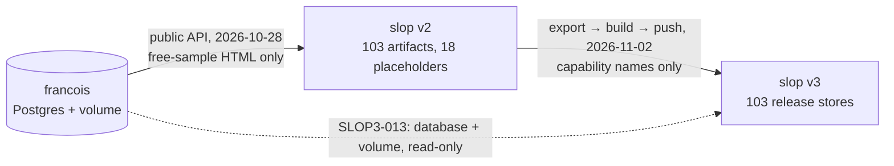
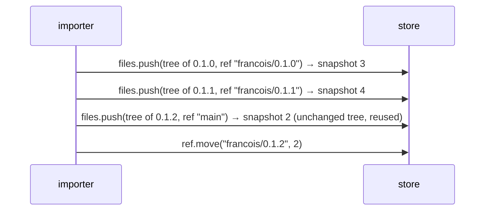

# slop v3: Importing the francois Catalog — Real Releases, Verbatim Capabilities and Paid Access — A Technical Deep Dive

francois is the server behind slop.boutique. It hosts about a hundred single-file HTML applications, called **artifacts**, and sells access to some of them. slop v3 is its successor, deployed at slop.yolo.scapegoat.dev. Before this work, every francois artifact already had a slop **store** that served it at `https://apps.slop.yolo.scapegoat.dev/f/<id>/`. Those stores came out of two earlier migrations, and each migration had lost something: eight stores served a placeholder page instead of the app, six declared different runtime capabilities from the original, and all of them, paid apps included, were open to anonymous visitors. Ticket SLOP3-013 replaced that state with a faithful copy. It reads francois's database and release volume without writing to either, computes the desired content of each store, and applies the difference. The result was checked on all 103 stores, and a second run plans no change.

This report explains the two systems as far as the import touches them, the reasoning behind each decision, the code that implements it, and the failures found along the way. Repository paths without a prefix are in `go-go-golems/slop-computer` at `5e4ecc3`. Paths prefixed `francois:` are in `go-go-golems/francois` at `4bab7f1`. Every number quoted comes from a command whose output is saved in the ticket's `various/` directory.

> [!summary]
> - **The source of truth is francois's database and its blob volume, not its API.** The public download route refuses API tokens and serves paid HTML only to an entitled browser session, which is why the first import produced placeholders.
> - **The import is a reconciliation, not a copy.** For each store it computes a desired tree (path → SHA-256) and desired grants, compares them with what slop holds, and writes only the difference. Running it again plans "0 pushes, 0 grant changes".
> - **Access is per release on francois and per store on slop.** slop serves every snapshot of a store to anyone who can reach the store's sandbox origin, so a paid release may never sit in a public store, even outside `main`. That rule decides both who may open the eight paid apps and why no older release was imported.

## 1. The two systems

### 1.1 francois's catalog

francois began as a localhost host for saved Claude artifacts. An artifact is one HTML file that calls a browser runtime, `window.claude`, for capabilities such as `sample` (model calls), `db` (shared JSON documents), `room` (presence) and `downloads`. The deployed instance runs francois's catalog mode (`francois: pkg/catalog`): a storefront with accounts, Stripe billing, a creator studio, and per-subscriber hosted copies of each app called **instances**.

Four Postgres tables describe what the import moves (`francois: pkg/catalog/store/migrations/001_core.sql`, `006_videos_attachments.sql`):

| Table | One row is | Columns the import reads |
| --- | --- | --- |
| `catalog_artifacts` | an app in the catalog | `id`, `title`, `description`, `tags`, `visibility` |
| `releases` | one immutable published version | `id`, `artifact_id`, `version`, `state`, `free_sample`, `manifest`, `changelog`, `published_at` |
| `release_files` | the release's HTML, or its manifest file | `role`, `name`, `size`, `sha256`, `storage_key` |
| `release_attachments` | an extra download, usually a source zip | `name`, `label`, `size`, `sha256`, `storage_key`, `position` |

The `manifest` column holds the release's capability manifest, for example `{"sample": {"images": true}, "downloads": true}`. It has the shape claude.ai uses for artifacts. It is a contract: a page receives the capabilities the manifest declares, configured as declared, and nothing else.

The bytes are not in Postgres. A `storage_key` such as `blobs/58/583af21e…70e6` names a file under `/var/lib/francois/releases` on the `francois-data` volume. The file's name is its SHA-256. `Blobs.Read` (`francois: pkg/catalog/releases/releases.go:169`) refuses to return a file whose hash does not match its row.

Who may download a release is decided by `mayDownload` (`francois: pkg/catalog/routes.go:264`):

```go
if rel.FreeSample { return true }
if p == nil { 401 login_required }
if !entitlement.CanRun(artifact, doc) { 403 plan_required }
```

Two facts follow from these lines, and both shape the design. First, access is a property of a **release**, not of an artifact: `lattice-deck` 0.1.0 and 0.1.1 are paid, while 0.1.2 is a free sample. Second, the route is registered as `guard(public, noToken, …)`, so an API token is refused before `mayDownload` runs. No API caller, not even an administrator, can fetch paid HTML.

### 1.2 slop's stores, snapshots and grants

A slop **store** is one SQLite database holding a versioned file tree, documents, and history (`doc/design/slop-v3.md` §4). The store records each file's path, hash, size and type, and the bytes live once in a shared blob store keyed by SHA-256. A **snapshot** freezes the tree; snapshots are numbered per store. A **ref** names a snapshot. `main` is the ref pages serve.

A store is an **app** when its tree holds `app.json` (`pkg/apps/manifest.go`):

```json
{"title": "Hypercore Studio", "page": "index.html",
 "capabilities": {"db": {"rules": [...]}, "sample": {"images": true}}}
```

`capabilities` keeps the claude.ai shape, so a francois manifest can be copied into it without translation. `rt.ParseManifest` (`pkg/rt/manifest.go`) checks it when the app activates; a manifest that fails the check stops the app from running.

Access is decided per store by **grants**: a subject (`@guest` for anyone, `@member`, `@subscriber`, or one person) and a level (`view`, `interact`, `admin`, `owner`), set with the `grant.set` verb (`pkg/commands/stores.go:223`).

One mount serves every imported app: `apps.slop.yolo.scapegoat.dev/f/:id`, restricted to stores of type `release`. The mounted page is a **shell**. It asks the server for a view (`POST /_site/views`). If the visitor may open the store, the server answers with a URL on the store's **sandbox origin**, `s<label>.sbx.slop.yolo.scapegoat.dev`, where `label` is an HMAC of the store id and app id under a server key (`pkg/doors/pages/views.go:69`). The app runs in an iframe on that origin, so each app has its own localStorage and cookies.

The sandbox serves `/v/<n>/…`, the files of snapshot `n`, for any `n` (`pkg/doors/pages/sandbox.go:115`). It does not check who is asking. The label is unguessable, but every viewer of the app learns it, because it is the iframe's origin. This property is central to §4.3.

Every operation is a **verb** in one table. The HTTP door exposes each verb as `POST /api/v1/<verb>` with a JSON body and a bearer token. The importer uses ten of them (§6).

## 2. How the stores got their earlier state



The first import (ticket SLOP-002) ran against slop v2. It read francois's catalog with an administrator's API token. Because of the token refusal described in §1.1, every release that was not a free sample became an 850-byte placeholder page.

The second import (SLOP3-004) moved v2's content into v3 during the cutover. Its builder, `04-build-import.py`, had only the list of capability **names** that v2 recorded, so it rebuilt each capability's configuration from a fixed table:

```python
CAP_BLOCK = {"downloads": True, "user": {"scopes": ["profile"]}}
caps = {c: CAP_BLOCK.get(c, {}) for c in imp["capabilities"] if c != "slop"}
```

Every setting not in that table became `{}`. Its pusher, `06-push-import.py`, created each store with type `release`, granted `@guest interact`, and turned on model calls (`sample`) for members, subscribers and administrators.

## 3. Measuring the gap

The import began with an inventory of both sides, read without writing.

francois was read in a Postgres session whose transactions are all read-only, connecting as the container's superuser over the local socket so that no password leaves the cluster (`scripts/01-inventory.sh`):

```sh
kubectl exec -i -n postgres postgres-0 -- sh -c \
  'PGOPTIONS="-c default_transaction_read_only=on" psql -v ON_ERROR_STOP=1 -U "$POSTGRES_USER" -d francois -At -f -'
```

The result, `various/inventory-2026-11-06.json`, holds 104 artifacts, 113 releases (110 published, 3 withdrawn), 113 HTML files totalling 99,531,690 bytes, and 18 attachments totalling 63,806,193 bytes. One artifact, `aasd`, has no release. The query leaves out user ids; the file contains no `@` and no `usr_`.

slop was read through its verbs: `store.ls` for the stores, then `files.ls`, `snap.ls`, `grant.ls` and `files.cat app.json` for each of the 103 release stores. Comparing the two sides by hash gave this table:

| Finding | Stores |
| --- | --- |
| `index.html` matches the latest published release's HTML | 95 |
| `index.html` is a placeholder (730–898 bytes); all are paid | 8 |
| `app.json` capabilities differ from francois's manifest | 6 |
| Attachments present and matching | all 17 releases that have them |
| Grants | `@guest interact` on all 103 |
| Older releases absent | 8 published (all paid), 3 withdrawn |

The comparison had to be by hash. Each store's only snapshot carried the message `imported from v2 (rel_…)`, and in all 103 stores that id named the correct latest release. A check based on messages would have reported every store as correct, placeholders included.

The capability drift is not cosmetic. `hypercore-studio` and `living-comic-studio` declare:

```json
{"rules": [{"path": "chatlog", "read": "view", "write": "owner"},
           {"path": "chatlog/{self}", "write": "interact"}]}
```

These rules let every visitor write only their own `chatlog/<id>` document. After the cutover the two apps ran with `db: {}`, which means slop's default rules. Four other apps lost `sample.images`. `lattice-arena` and `lattice-arena-ds` gained a `profile` scope on `user` that their authors had not declared.

## 4. Design

### 4.1 Reconcile, do not recreate

slop has an `import.folder` verb, but it always creates a new store (design §4.7). A new store means a new id, a new sandbox origin (so visitors' localStorage is orphaned), new mounts, and the loss of any documents visitors had written. The existing stores were mostly right. The import therefore keeps them and computes, for each one, a **desired state**: the files its tree should contain, by path and hash, and the grants it should carry. Then it applies the difference.

Writing only the difference has a second benefit. The planner can print the exact changes before anything is written, and a run after a successful import prints "0 pushes", which shows that the import is complete.

### 4.2 The desired tree

Each store's tree is built from the artifact's **latest published release** (`desired_tree` in `scripts/03-import.py`):

| Path | Content |
| --- | --- |
| `index.html` | the release's HTML blob, byte for byte |
| `app.json` | `{"title", "page": "index.html", "capabilities": <francois manifest unchanged>}` |
| `francois.json` | provenance: artifact metadata and release id, version, state, `freeSample`, manifest and file hashes |
| `attachments/<name>` | each attachment, byte for byte |

```python
def desired_tree(art, rel):
    h = html_of(rel)
    tree = {"index.html": {"path": "index.html", "sha256": h["sha256"], "size": h["size"], "key": h["storageKey"]}}
    for a in rel["attachments"]:
        p = "attachments/" + safe_name(a["name"])
        tree[p] = {"path": p, "sha256": a["sha256"], "size": a["size"], "key": a["storageKey"]}
    app = {"title": art["title"], "page": "index.html", "capabilities": rel["manifest"]}
    for p, v in (("app.json", app), ("francois.json", provenance(art, rel))):
        t = jtext(v)   # json.dumps(sort_keys=True, indent=2, ensure_ascii=False) + "\n"
        tree[p] = {"path": p, "text": t, "sha256": sha(t.encode()), "size": len(t.encode())}
    return tree
```

Three details in this function make the comparison stable from run to run:

- **Generated files are canonical.** Keys are sorted and the encoding is fixed, so the same input always produces the same bytes. The importer computes their hash itself for the comparison and sends the same bytes inline.
- **`francois.json` contains nothing that changes between runs.** It has no import timestamp. A field like that would give the file a new hash on every run, and every store would be pushed again.
- **Attachment names are sanitised as francois sanitises them.** `safe_name` replaces characters outside `[A-Za-z0-9._-]` with `_`, using francois's `safeName` pattern (`francois: pkg/catalog/routes.go:258`). The paths already in slop were built the same way, so they compare equal.

`francois.json` gives each store a record of its origin that tools can read; before, it existed only as free text in a snapshot message. Here is the file for `hypercore-studio` as it is on production now, with the description shortened:

```json
{
  "artifact": {"id": "hypercore-studio", "title": "Hypercore Studio", "visibility": "listed",
               "tags": ["comics", "3d", "generative"], "description": "The Living Comic engine in deep space: …"},
  "release": {"id": "rel_1f2e4d75e0e486e413d0f284", "version": "0.1.0", "state": "published",
              "freeSample": false, "publishedAt": "2026-10-22T02:51:41.863494+00:00", "changelog": "",
              "html": {"name": "hypercore-studio-0.1.0.html", "sha256": "5e06b612…23ac2", "size": 8179289},
              "manifest": {"db": {"rules": ["…"]}, "downloads": true, "room": {}, "sample": {"images": true},
                           "user": {"scopes": ["profile"]}},
              "attachments": [{"name": "hypercore-studio-source.zip", "label": "Source (zip)",
                               "sha256": "54958a3a…f6081", "size": 6800896}]},
  "source": "https://slop.boutique"
}
```

### 4.3 Access follows the release

On francois, access belongs to a release. On slop it belongs to a store, and §1.2 showed that a store's sandbox serves every snapshot to anyone holding its origin. Combining these facts gives one rule:

> A store's grants follow its `main` release. A free sample gets `@guest interact`. A paid release gets `@subscriber interact` and no `@guest` grant. A paid release is never written into a store whose `main` is free.

The first two sentences decide the eight paid apps: anonymous visitors and members without a subscription lose access, as they would on francois, where they get `401 login_required` or `403 plan_required`. Administrators keep access, because an administrator has a level on every store (`pkg/access/principal.go:77`).

The third sentence decides the release history. Ticket SLOP3-006 had an open task, `2ghn`: import older releases as snapshots. The importer implements it. Each older release is pushed to a ref named `francois/<version>`, oldest first, and `main` ends on the latest:



The data rules this out today. All eight older published releases are paid, and in every case the artifact's latest release is a free sample, so each one would land in a public store. A visitor to `lattice-deck`, which is free, could then load the paid 0.1.0 at `/v/3/` on the same origin. The three withdrawn `rag-workbench` releases were taken down by their author and are not on slop.boutique at all. The planner therefore lists all eleven with a reason and imports none:

```
skip lattice-deck      rel_08a7a6168371c71f285397d6 0.1.0   paid release in a public store
skip rag-workbench     rel_48bc7b49c104ed89526e6249 0.1.0   withdrawn
```

The mechanism is still built and was tested (§5.3). It will act as soon as an older release is free, or is paid in a paid store.

### 4.4 Ordering writes so that a stop is safe

A store needs up to three kinds of write: blob uploads, one push, and grant changes. The order matters when a run stops between them. If a paid store were pushed first and its grants changed afterwards, a stop between the two would leave paid HTML public. The importer therefore orders the writes by the kind of store:

```
paid store:  grant.set @subscriber interact → grant.rm @guest → push
free store:  push → grant.set @guest interact (if missing)
```

A paid store that stops midway is closed and still holds its placeholder. §7 shows that this case occurred on production.

### 4.5 Moving only the missing bytes

Most of the bytes were already in slop's blob store. `files.push` names files by hash and, when it lacks some, refuses with the exact list (`pkg/commands/files.go:352`):

```json
{"error": {"code": "missing_blobs", "message": "send these blobs", "extra": {"missing": ["5e06b612…"]}}}
```

The importer uses that refusal as its fetch list:

```mermaid
sequenceDiagram
  participant I as importer
  participant S as slop
  participant K as francois pod
  I->>S: files.push(store, files by sha256)
  S-->>I: 409 missing_blobs [sha…]
  loop each missing sha
    I->>K: kubectl exec … tail -c +off | head -c 4 MiB
    K-->>I: bytes; length checked, whole-file sha256 checked
  end
  I->>S: files.blobs(store, {sha: base64}) in batches of at most 32 MiB
  I->>S: files.push(store, …) → {n, files, removed}
```

slop checks as well. `putBlobs` (`pkg/commands/data.go:326`) refuses a blob whose bytes do not hash to its key. A corrupt file therefore cannot be stored under a wrong name; the importer's own check exists to give a clearer error, and to stop before spending an upload.

## 5. The rehearsal

Before writing to production, the scripts ran against a local slop built from the same code (`slop serve --local --listen 127.0.0.1:18413`). The rehearsal needed an administrator's token without a browser. The script signed in through the development form (`POST /auth/local`), read the session's CSRF token from `GET /auth/session`, and called `token.new` with that token in the `X-CSRF-Token` header, which `pkg/doors/api/api.go:36` requires for cookie sessions.

`scripts/02-rehearsal-fixtures.py` rebuilt seven stores the way SLOP3-004 had left them: SLOP3-004's `CAP_BLOCK` table, placeholders for paid releases, `@guest interact`, the `sample` policies and the `/f/:id` mount. The script refuses any server that is not local.

### 5.1 Truncated reads from `kubectl exec`

Building the fixtures stopped on the hash check:

```
blob 20d3fc5a…cdb7: bytes hash to 1673683f…434f
```

The file was intact on francois's volume; `sha256sum` inside the pod matched its name. The stream had lost bytes:

```
kubectl exec … cat …/20d3fc5a… | wc -c    →  10780672   (expected 12848209)
```

`kubectl exec` had ended the stream early and exited with status 0. `Blobs.fetch` now reads in 4 MiB pieces. Each piece is the output of `tail -c +<offset> | head -c <n>` in the pod; its length is checked, and a short piece is retried. The whole file's SHA-256 is still checked at the end.

### 5.2 Corrected assumptions

The rehearsal corrected three things in the first version of the scripts and guide:

- **The `missing_blobs` list sits in `error.extra.missing`, not in `error`.** The first retry therefore uploaded nothing and failed again with the same error.
- **`snap.ls` lists snapshots newest first.** The plan's "before" snapshot, which is what a rollback restores, had been taken from the end of that list, and so named the oldest snapshot. It now comes from `ref.ls`, which returns `{"main": n, "francois/0.1.0": n, …}`.
- **An unchanged push does not add a snapshot.** The guide had said it did. `Turn.Snapshot` (`pkg/store/files.go:183`) looks up the ref's current snapshot by tree hash and returns it when the tree is unchanged. In the history test, the final push of `lattice-deck`'s latest tree returned snapshot 2 rather than creating a fifth.

### 5.3 Results

| Step | Output |
| --- | --- |
| dry run | `7 pushes ({'app.json': 7, 'provenance': 7, 'html': 2}), 2 grant changes, 0 history snapshots, 5 skipped` |
| apply | 7 stores to snapshot 2; `hypercore-studio` uploaded 8,179,289 B, `polis` 245,339 B, the others 0 B |
| order of writes for paid stores | `grant.set @subscriber`, then `grant.rm @guest`, then `push` |
| second dry run | `0 pushes, 0 grant changes` |
| history (test inventory with lattice-deck marked free) | refs `{"francois/0.1.0": 3, "francois/0.1.1": 4, "francois/0.1.2": 2, "main": 2}`; rerun is a no-op |
| verifier | `7 stores, 0 failing; anonymous view status: {('free', 200): 5, ('paid', 401): 2}` |

The first verifier was wrong in an instructive way. It requested `GET /f/<id>/` anonymously and expected a non-200 status for paid apps, but both paid apps returned 200. That URL returns the shell page, and the shell page is the same for every visitor. Access is decided when the shell requests a view. The verifier now makes the shell's request:

```
POST /_site/views {"path": "/f/polis/"}   →  401 {"error":{"code":"unauthenticated","message":"sign in to open this"}}
POST /_site/views {"path": "/f/weft/"}    →  200 {"view": "…", "version": 2, "url": "https://s….sbx…/v/2/", …}
```

For a free app, this request creates a visitor record (`vis_…`) and sets a session cookie. A production run of the verifier therefore keeps one cookie jar, so the whole run creates a single visitor, and it closes every view it opens with `DELETE /_site/views/<id>`.

## 6. Verbs and sources used

| Interface | Used for |
| --- | --- |
| `store.ls {"all": true}` | find the release stores |
| `files.ls`, `files.cat` | current tree; read `app.json` and `francois.json` |
| `snap.ls`, `ref.ls`, `ref.move` | snapshot messages; `main` and history refs; rollback |
| `grant.ls`, `grant.set`, `grant.rm {"via": "direct"}` | access; links made by people (`via: lnk_…`) are left alone |
| `files.push`, `files.blobs` | write the tree; upload missing blobs |
| `POST /_site/views`, `DELETE /_site/views/<id>` | verification only |
| francois Postgres, read-only session | metadata |
| `kubectl exec -n francois deploy/francois` | blob bytes, read with `tail` and `head` |

## 7. The production run

The session crashed while the first production dry run was running, and `/tmp` was cleared with it. That removed the scratch worktree, the blob cache and the local server. Nothing had been written to production, because a dry run only reads. The ticket, guide, scripts and inventory had been committed at each checkpoint (`6fa32c2`, `46d440c`), so recovery meant recreating the worktree and running the dry run again.

The production dry run printed:

```
plan: 103 pushes ({'app.json': 103, 'provenance': 103, 'html': 8}), 8 grant changes, 0 history snapshots, 11 skipped
```

This matched the prediction written in the guide before any code existed. A scratch Go program then ran slop's own `apps.Parse` and `Entry()` on the 103 generated `app.json` files and reported `103 app.json files, 0 rejected`.

The first apply was limited to `polis`, which is paid, hidden on francois, and had a missing HTML blob. That made it the store most likely to fail. It went to snapshot 2 and switched to `@subscriber`, and the verifier showed anonymous access refused.

The full run stopped after 38 stores:

```
subprocess.CalledProcessError: Command '['kubectl', 'exec', '-n', 'francois', 'deploy/francois', '--', 'sh', '-c',
 'tail -c +4194305 "$0" | head -c 3715454', '/var/lib/francois/releases/blobs/a7/a7562f22…f6fd']' returned non-zero exit status 1.
```

This is the second failure mode of `kubectl exec`. The rehearsal had found a silent short read; this was an outright exit with status 1, on the second piece of `living-comic-studio-0.1.0.html` (7,909,758 bytes). The retry loop had been written for short reads and called `subprocess.run` with `check=True`, so the error was raised at once instead of being retried.

The stop happened in the case §4.4 was designed for. The log shows the paid store closed before its push began:

```json
{"store": "living-comic-studio", "action": "grant.set", "subject": "@subscriber", "level": "interact", "at": "2026-11-06T22:42:45Z"}
{"store": "living-comic-studio", "action": "grant.rm", "subject": "@guest", "at": "2026-11-06T22:42:45Z"}
```

`living-comic-studio` was closed to the public and still held its placeholder, so no paid HTML was exposed. After the fix (a non-zero exit is treated like a short read, with up to six tries and a growing pause), the run was simply started again. Because the plan is computed from current state, it covered only the stores left:

```
plan: 64 pushes ({'html': 4, 'app.json': 64, 'provenance': 64}), 3 grant changes, 0 history snapshots, 11 skipped
living-comic-studio   main 0.1.0 → snapshot 2 (html, app.json, provenance; uploaded 7,909,758 B)
…
applied
```

Verification and a third dry run closed the work:

```
103 stores, 0 failing; anonymous view status: {('free', 200): 95, ('paid', 401): 8}
plan: 0 pushes ({}), 0 grant changes, 0 history snapshots, 11 skipped
```

In a browser that was not signed in, `craftkit-workbench` (a free app whose `sample.images` was restored) ran normally, and `hypercore-studio` (paid) stopped at "Opening…" after a 401. The user then confirmed, signed in as an administrator, that `polis` renders.

Undoing a store takes one call. The apply log records each store's `main` before and after the push, so `ref.move <store> main <before>` restores the previous tree, and a grant change can be reversed the same way.

## 8. Points for review

- **The sandbox serves any snapshot without a viewer check.** This is a property of slop, not of the import. A subscriber who shares a paid app's sandbox URL shares its HTML, in about the same way a francois subscriber can share a downloaded file. A viewer check on `/v/<n>/`, or grants per snapshot, would let paid history be imported safely and would close this.
- **`@subscriber` depends on billing.** slop decides subscriber standing from Stripe subscriptions projected into `system.db`, or from complimentary grants (`sub.grant`) (`pkg/kernel/billing.go:22`). The production configuration sets no Stripe keys, so today only complimentary grants make anyone a subscriber, and the eight paid apps are effectively for administrators.
- **Visitor data written under the wrong rules remains.** The import pushes only the tree. Documents that visitors wrote to the two `chatlog` apps between the cutover and this import were written under default rules. The declared rules apply from the next activation; existing documents are not rewritten.
- **francois keeps publishing.** The import is not scheduled. Running `01-inventory.sh` and then `03-import.py --apply` again picks up new releases, and does nothing when there are none.

## 9. What the work showed

The plan-then-apply structure decided the outcome more than any single line of code. Because the plan is computed from the current state of both systems, a crash cost a rerun of a dry run, a stop in the middle cost a rerun of the apply, and the end of the work can be stated as a fact: a fresh plan contains no changes. The second decision that mattered was the order of writes for paid stores. It made the one production failure harmless.

The hash checks found what a status check would have missed. Snapshot messages said all 103 stores held the right release, and `kubectl exec` exited 0 while delivering five-sixths of a file. In both cases the SHA-256 recorded at the source was the only reliable check, and the import uses it for every byte it moves.

## Notes on the implementation record

The ticket is SLOP3-013 in `slop-computer`, at `ttmp/2026/11/06/SLOP3-013--import-slop-boutique-s-francois-artifacts-into-slop-v3-properly-real-html-verbatim-capabilities-release-history-paid-access/`. It contains the intern guide (`design-doc/01-…`), the diary (steps 1–3), the scripts `01-inventory.sh`, `02-rehearsal-fixtures.py`, `03-import.py` and `04-verify.py`, and the evidence in `various/`: the inventory, plans, apply outputs and JSONL log, the verification report, and a screenshot. Commits on main: `6fa32c2` (ticket and guide), `46d440c` (scripts and rehearsal), `5e4ecc3` (production run).

## Related notes

- [[PROJECT REPORT - slop v3 - Per-App Modules Part 2 - The Module Catalog, Configured Grants and an In-Memory fs - A Technical Deep Dive]]
- [[PROJECT REPORT - slop v3 - Per-App Modules Part 1 - Implementing database, express and Mount API Policies - A Technical Deep Dive]]
