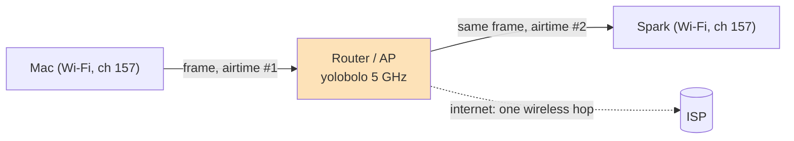
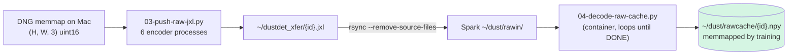

# Debugging: Slow Wi-Fi Between a Mac and a DGX Spark — Moving 76 GB of Raw Scans

This note records one evening's investigation into why copying a dataset from a MacBook to a DGX Spark on
the same Wi-Fi ran at 11 MB/s, what each test ruled out, and how the transfer was made usable without
changing the network. The trigger was the film-dust detector project (ticket DUST-002): training had to
move to the Spark, and the Spark needed the 722 raw scans (76 GB of uncompressed 16-bit DNGs) that live on
the Mac. The lessons generalise to any "two machines on the same Wi-Fi, why is this slow" problem.

> [!summary]
> - Nothing was misconfigured. Two Wi-Fi clients talking through one router send every byte over the air
>   twice; the clean Mac→Spark rate was **98–120 Mbit/s** while each machine reached the internet at
>   220–490 Mbit/s. It was not the wrong access point, not power saving, not ssh, not Tailscale.
> - Half the early measurements were wrong because they ran **while the transfer was running**. Pause the
>   competing traffic, then measure raw TCP in both directions.
> - Raw scans do not compress with zlib (ratio 1.04) but do with **lossless JPEG-XL** (1.76×, bit-exact),
>   which turned a two-hour copy into about 75 minutes. The real fix is a cable.

## Why this note exists

The symptom looked like a configuration problem: two modern machines, both reporting 800–960 Mbit/s Wi-Fi
link rates, both on the same 5 GHz network, copying at the speed of a 2010 laptop. That invites a long list
of suspects — the wrong access point, power saving, the VPN, ssh encryption, the source disk — and it is
easy to chase them with measurements that are themselves contaminated. This note keeps the order of the
tests, what each one showed, and the measuring discipline that finally gave a clean answer, so the next
investigation can start from the end.

## The setup

| | MacBook Pro (source) | DGX Spark `bling.local` (target) |
|---|---|---|
| CPU / GPU | Apple M1 Max, 64 GB | NVIDIA GB10, 20 Arm cores, 121 GB unified |
| Network | Wi-Fi `en0`, 802.11ax, ch 157 (5 GHz, 80 MHz), Tx rate 816 Mbit/s | Wi-Fi `wlP9s9`, ch 157, rx 960 / tx 865 Mbit/s, wired `enP7s7` **down** |
| LAN address | 192.168.0.24 | 192.168.0.65 |
| Data | 722 DNGs under `~/Dropbox/Photos/RAW/Scans`, 76.4 GB | target `~/dust/scans`, 3.3 TB free |

The DNGs are VueScan linear scans: one uncompressed 16-bit RGB image per file, contiguous strips. The
training code memory-maps them, so on the Spark they can live either as DNGs or as plain `.npy` arrays.

## The investigation, in order

The first copy was a plain `rsync -a --files-from=list` over ssh. It reported nothing, so progress was
measured from the target side: `du -sm` twice, 30 seconds apart.

```bash
a=$(ssh bling 'du -sm ~/dust/scans | cut -f1'); sleep 30
b=$(ssh bling 'du -sm ~/dust/scans | cut -f1'); echo "$(( (b-a)/30 )) MB/s"
# → 11 MB/s
```

At 11 MB/s the copy would take about two hours. Every hypothesis below was tested against that number.

| # | Hypothesis | Test | Result | Verdict |
|---|---|---|---|---|
| 1 | The source disk is slow (Dropbox folder, online-only files) | `cat file.dng > /dev/null`, timed | 860 MB/s | ruled out |
| 2 | Compression would help | `zlib.compress(level=1)` on 50 MB of a DNG | ratio **1.04** | not with zlib (see below) |
| 3 | ssh/CPU is the limit | `dd if=/dev/zero | ssh bling 'cat >/dev/null'` | 6.3 MB/s (with the rsync running) | inconclusive — contaminated |
| 4 | Linux Wi-Fi power saving on the Spark | `iw dev wlP9s9 get power_save` | `on`; user turned it off: no change | ruled out |
| 5 | One TCP stream is window-limited at 10–25 ms RTT | 4 parallel ssh streams | 7.4 MB/s total | ruled out |
| 6 | The machines are on different access points (mesh) or bands | `nmcli dev wifi list` on the Spark; Mac channel | one 5 GHz BSSID `12:A7:93:03:99:3F` ch 157; the other is the same router's 2.4 GHz radio; Mac on ch 157 | ruled out |
| 7 | Traffic goes through Tailscale | `route -n get`, `ssh -v`, `ip route get`, `ss -tn` peers | LAN path `en0` ↔ `wlP9s9`; peers `192.168.0.24 ↔ 192.168.0.65`; Spark `RouteAll: false`, no exit node | ruled out |
| 8 | It is simply the Wi-Fi relay | clean raw TCP both ways, transfer paused, vs internet rates | Mac→Spark 98–120 Mbit/s, Spark→Mac 141 Mbit/s; internet 220–490 Mbit/s | **confirmed** |

### The measurement mistake

Tests 3 and 5, and the first round of internet speed tests, ran while the rsync was still pushing data.
On a shared half-duplex medium the test and the transfer split the airtime, so every number came out low
and noisy, and the comparison between them meant nothing. The user's "something is off here" was right:
the numbers were not *wrong*, but they could not distinguish the hypotheses.

The clean round paused the transfer first (`pkill -STOP` on the pusher, its `rsync` and the `ssh` child;
`pkill -CONT` afterwards — TCP survives a pause of a minute or two) and then measured raw TCP with a
twenty-line Python socket pair, which removes ssh, rsync and the disk from the path:

```python
# receiver (on the target): discard everything
import socket
s = socket.socket(); s.setsockopt(socket.SOL_SOCKET, socket.SO_REUSEADDR, 1)
s.bind(("0.0.0.0", 5201)); s.listen(1)
c, _ = s.accept()
while c.recv(1 << 20): pass

# sender (on the source): 300 MB of zeros, timed until the receiver has read everything
import socket, time
s = socket.create_connection(("192.168.0.65", 5201)); buf = b"\0" * (1 << 20)
t = time.time()
for _ in range(300): s.sendall(buf)
s.shutdown(socket.SHUT_WR); s.recv(1)
print(300 / (time.time() - t), "MB/s")
```

`iperf3` would have done the same job, but it was installed on neither machine (the Spark only had the old
`iperf`), and a script that exists in both Pythons removes one variable.

### The clean numbers

| Path | Throughput |
|---|---|
| Mac ← internet (`networkQuality`) | 490 Mbit/s |
| Mac → internet | 127 Mbit/s (likely the ISP's upload cap) |
| Spark ← internet (`curl` a 100 MB file; two mirrors) | 219–292 Mbit/s |
| **Mac → Spark, raw TCP** | **98–120 Mbit/s** (12–15 MB/s) |
| **Spark → Mac, raw TCP** | **141 Mbit/s** (18 MB/s) |
| ping Mac → router / Mac → Spark (idle) | 3–5 ms / 5–13 ms |

Each machine talks to the router two to four times faster than they talk to each other. That is the
signature of the relay.

## Core mental model: why two Wi-Fi clients are slow together

Wi-Fi is a shared, half-duplex medium. Clients do not talk to each other directly in infrastructure mode;
every frame goes to the access point, which retransmits it to the destination. A file copied from one
client to another therefore occupies the channel twice.



The link rate printed by the OS (816, 960 Mbit/s) is the PHY rate of a single frame, not the throughput.
Real TCP goodput on one 80 MHz 802.11ax hop is typically 50–60 % of PHY, so a client might reach 400–500
Mbit/s to the router — which is what the Mac's internet download showed. Two hops share that airtime:
roughly half, 200–250 Mbit/s, before counting the AP's own forwarding cost, the 10–25 ms of queueing
under load, and other devices on channel 157. The measured 100–140 Mbit/s is lower than the ideal but in
the expected regime. There is no setting that removes the second hop.

What does remove it:

- **One cable** (either machine to the router) makes the copy one wireless hop: expect roughly 300–500
  Mbit/s.
- **Both cabled**, or a **direct cable** between the Mac's Ethernet adapter and the Spark's port: about
  940 Mbit/s on gigabit, more on the Spark's faster ports. The whole 76 GB then takes about ten minutes.

## The workaround: lossless JPEG-XL for raw arrays

With the network fixed at about 11–15 MB/s, the remaining lever was sending fewer bytes. The obvious
compressors fail on raw scans: the data is 16-bit samples interleaved as RGB, with sensor and film-grain
noise in the low bits, so byte-oriented compressors see near-random bytes.

| Codec (on a 2048² crop of a raw scan) | Ratio | Speed (one core) |
|---|---|---|
| zlib level 1 on the DNG bytes | 1.04 | 46 MB/s |
| PNG level 1 (16-bit) | 0.97 | 69 MB/s |
| zstd level 3 on byte-planar data | 1.28 | 260 MB/s |
| **JPEG-XL lossless, effort 1** (`imagecodecs.jpegxl_encode(a, lossless=True, effort=1)`) | **1.72** (1.76 over the whole set) | **349 MB/s** |

JPEG-XL wins because it models the image as an image: it predicts each sample from its neighbours, per
channel, and entropy-codes the residual, so only the noise is paid for, not the structure. The round trip
was checked bit-exact on a full 7390 × 7336 scan (`np.array_equal(a, jpegxl_decode(c))`).

The pipeline that replaced the plain rsync:



- The encoder skips images the Spark already has, either as a complete DNG (size compared) or as a
  `.jxl` / `.npy`, so it can be stopped and restarted at any time.
- Images go in split order — train, then val, then test — so training can start before the test scans
  (needed only for evaluation) arrive.
- The decoder checks every array's shape against the dataset metadata and writes `{id}.tmp.npy` before
  renaming, so a half-written file is never visible to the training code.
- The training library prefers `$DUSTDET_RAW_CACHE/{id}.npy` over the DNG when it exists; both give the
  same `(H, W, 3)` uint16 memmap.

The effective rate became about 20 MB/s of scan data (7–8 scans a minute), and the transfer estimate
dropped from about two hours to about 75 minutes. At the time of writing (21:44), 240 of 643 remaining
scans had been sent and 241 decoded; the train split was due around 22:10 and the full set around 22:35.

## Spark-side gotchas found on the way

These are not network problems, but they cost time in the same session and belong with it.

- **The NGC PyTorch image was untagged** (`nvcr.io/nvidia/pytorch:<none>`, id `222d8b18e671`, a 26.05
  build). It was tagged locally as `nvcr.io/nvidia/pytorch:26.05-py3` so a Dockerfile can name it. Extra
  packages are installed under a pip constraint generated from the image (`pip freeze | grep torch`), so
  pip never replaces NGC's CUDA build of torch.
- **`docker run` without `--gpus all`** prints "The NVIDIA Driver is present, but CUDA failed to
  initialize" — harmless for a package check, alarming at first sight.
- **Root-owned outputs.** The first containers ran as root and created `~/dust/dustdet/runs` as root;
  the next `rsync` from the Mac failed with `mkdir … Permission denied (13)`. Fix: chown once through a
  container, then always run with `--user "$(id -u):$(id -g)" -e HOME=/tmp`.
- **Eager encoding.** `ProcessPoolExecutor.map` runs ahead of the consumer: the encoders finished hundreds
  of files long before the network could send them, parking about 50 GB of `.jxl` in the staging
  directory. Harmless with 224 GB free, but on a fuller disk the queue needs a real bound (submit futures
  in a window rather than `map`).
- **Speed-test endpoints.** `speed.cloudflare.com/__down?bytes=…` returned HTTP 403 to `curl` from the
  Spark; `proof.ovh.net/files/100Mb.dat` and `ash-speed.hetzner.com/100MB.bin` worked.

## Side finding: two Tailscale daemons on the Mac

While ruling out Tailscale, `ps` showed both the Tailscale.app system extension (which reports "Logged
out") and a separate `/usr/local/bin/tailscaled`. One of them owns `utun12` with `100.113.140.75` and a
scoped default route. They did not affect the LAN copy (the route to `192.168.0.0/24` is `en0`), but two
daemons competing for routes and DNS is worth cleaning up before it causes a stranger problem.

## Working rules

- **Measure the network with the competing transfer paused.** Contaminated measurements are the most
  expensive mistake in this kind of debugging, because they make every hypothesis look half-true.
- **Measure raw TCP in both directions before blaming ssh, rsync, crypto or disks**, and compare it with
  each machine's own internet throughput. "Both fast to the internet, slow to each other" means the path
  between them, not either machine.
- **Prove the path, not just the address.** Check the route on the sender, the route back on the
  receiver, and the peer addresses of the live connections (`ss -tn`); a VPN shows up as `100.x` peers.
- **Do not read PHY link rates as throughput.** Halve them for TCP on one hop, halve again for
  client-to-client.
- **For image-like binary data, try an image codec before giving up on compression.** zlib's verdict on
  raw sensor data says nothing about what a predictive lossless codec can do.
- **For anything over ~20 GB between two machines in the same room, use a cable.**

## Toolbox

```bash
# pause / resume a running transfer (sender side)
pkill -STOP -f "rsync -a"; pkill -STOP -f "ssh .*rsync"      # … measure …
pkill -CONT -f "ssh .*rsync"; pkill -CONT -f "rsync -a"

# path checks
route -n get 192.168.0.65                       # Mac: which interface
ssh -v host true 2>&1 | grep "Authenticated to" # which address ssh really used
ssh host 'ip route get 192.168.0.24; ss -tn state established "( sport = :22 )"'

# Wi-Fi state on the Linux side
ssh host 'iw dev wlP9s9 link; iw dev wlP9s9 get power_save; nmcli -f IN-USE,BSSID,SSID,CHAN,RATE,SIGNAL dev wifi list'

# internet throughput
networkQuality -s -c                            # macOS
curl -sL -o /dev/null -w "%{speed_download}\n" https://proof.ovh.net/files/100Mb.dat
```

## Related notes

- [[PROJECT REPORT - Film Dust Dataset - Part 0 - What Lightroom Knows About Your Dust - A Technical Deep Dive|Film Dust Dataset, Part 0]] — the dataset whose scans were being moved.
- [[PROJECT REPORT - Film Dust Dataset - Part 8 - The Gold Set and the Annotation Tool - A Technical Deep Dive|Film Dust Dataset, Part 8]] — the last dataset phase before the detector work.
- Ticket DUST-002 in the repo: `ttmp/2026/11/07/DUST-002--film-dust-detector-model-exploration/` — diary Step 3 (the move to the Spark), scripts `03-push-raw-jxl.py`, `04-decode-raw-cache.py`, and the intern guide's Chapter 11.
