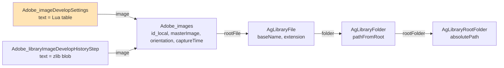
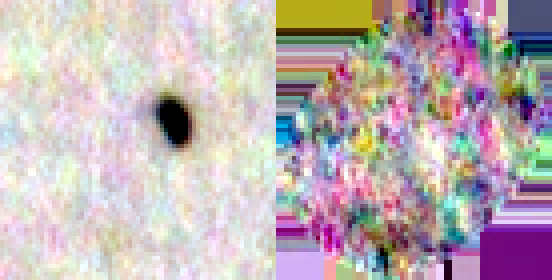
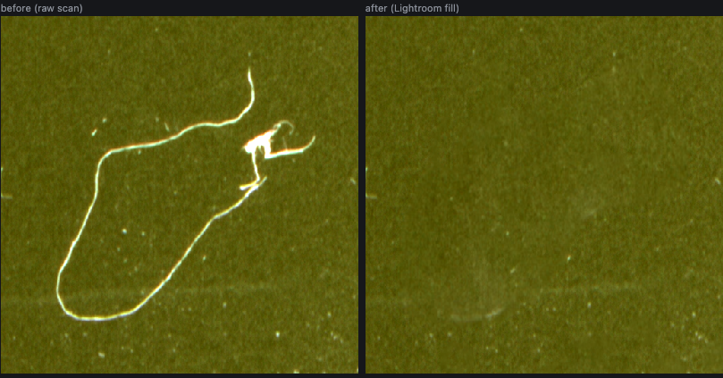
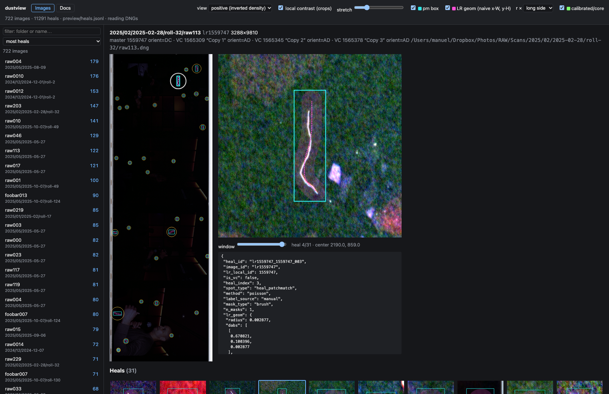

# Film Dust Dataset, Part 0: What Lightroom Knows About Your Dust — A Technical Deep Dive

This is the first of five reports on building a training and evaluation dataset for a film-dust detector out of an existing photo archive. The archive consists of film negatives scanned on an Epson Perfection V600 with VueScan into linear DNG files, and of a Lightroom Classic catalog in which dust on many of those scans was removed by hand over two years. Every removed speck is a human judgement, made with full attention, that says "there was dust here, about this big". The project's premise is that eleven thousand such judgements are a dataset waiting to be extracted, and that extracting them carefully is worth more than any model trick applied later.

This report covers Phase 0, the discovery phase. Its job was to find out, with evidence and without assumptions, where Lightroom keeps the heals, in what coordinates, on which files, and what the scans themselves contain. It also covers the most consequential discovery of the project: Lightroom stores the actual fill pixels of every heal in a side database next to the catalog, which gives a pixel-exact before/after for each heal without running Lightroom at all.

> [!summary]
> - **Heals are parameters, not pixels, in the catalog.** Every heal is a Lua-table entry (`RetouchAreas`) in `Adobe_imageDevelopSettings.text`, holding a circle or a brush stroke in normalized coordinates plus a pixel bounding box (`pm_target_*`) in the raw image grid.
> - **The scans are simple.** All 2,327 readable scan DNGs are uncompressed 16-bit LinearRaw RGB with no black level, white level or linearization table, so decoding is the identity function.
> - **Lightroom keeps its fills.** The `.lrcat-data` folder beside the catalog is a RocksDB whose keys are the `pm_patch` digests of the heals and whose values are JPEG XL TIFFs of the filled pixels. All 11,287 Remove heals on scans have one.

## 1. The question Phase 0 answers

A detector for film dust needs examples of dust, at native resolution, with masks. Drawing those masks by hand is slow and inconsistent. But the photographer has already done a version of this work: every time a speck was removed in Lightroom, a person looked at the image, decided that something was dust, and placed a circle or painted a stroke over it. The question is whether those decisions can be recovered precisely enough to serve as labels.

"Precisely enough" has a concrete meaning. A speck of dust on a 2400 dpi scan is often three to ten pixels across. If the recovered position is off by five pixels, the label lands next to the dust instead of on it, and a detector trained on such labels learns noise. So Phase 0 does not only ask *where are the heals stored*; it asks *in which coordinate system*, *relative to which image*, and *how can we prove it*. The rule throughout was the one stated in the project's specification: do not assume field names or conventions, print what is there.

The work happened on a macOS desktop with Lightroom Classic 15.0 and against a copy of the catalog. The live catalog was never opened. The copy was made while Lightroom was closed, checked by SHA-256, made read-only, and opened through SQLite's URI form with `mode=ro&immutable=1` so that not even a journal file could be created next to it.

```bash
cp -p "~/Pictures/Lightroom/Lightroom Catalog-v13-4.lrcat" ~/dustds/catalog_copy/
shasum -a 256 <live> <copy>        # 8c9e5870…1e66 for both
sqlite3 "file:$HOME/dustds/catalog_copy/Lightroom%20Catalog-v13-4.lrcat?mode=ro&immutable=1" …
```

## 2. The catalog as a database

A Lightroom Classic catalog is an SQLite database. Four tables connect a photo to its file on disk, and one table holds its develop settings:



Virtual copies are rows in `Adobe_images` whose `masterImage` points at the original; they share the file but have their own develop settings. That detail matters later: a strip of three frames scanned as one DNG is split into frames by giving each virtual copy its own crop, and heals can be made on any of the copies.

The catalog holds 27,411 photos, of which 3,377 are DNGs. Restricting to the scan folders (`~/Dropbox/Photos/RAW/Scans/...`) leaves 2,903 DNG photos, and 847 of them carry heals. The first query that suggests itself is wrong. `Adobe_imageDevelopSettings` has a column called `hasRetouch`, and filtering on `hasRetouch = 1` returns nothing at all. The column is not a boolean; it holds bit-strings such as `'00110'` and `'00101'`. The only reliable test is to look for the key in the settings text itself.

| Question | Query result |
|---|---|
| Settings rows containing `RetouchAreas` | 976 |
| Rows containing `RetouchInfo` | 23,895, but always `RetouchInfo = { }` |
| Scan DNG photos with heals | 847 (657 masters, 190 virtual copies) |
| Heals on those photos | 11,291 |
| Heals on scan TIFFs / JPGs | 403 / 1 |

*Table 1. Where the heals are, from the catalog copy.*

## 3. The anatomy of a heal

Develop settings are stored as a Lua table literal: `s = { Key = value, ... }`. Rather than use a Lua runtime, the project parses it with a small tokenizer and recursive-descent parser (`dustds/luatable.py`, about 100 lines), which handles quoted strings, numbers, booleans and nested tables, and returns lists for array tables and dicts for keyed ones. It parsed all 978 relevant rows without an error.

A single heal from the Remove tool looks like this (some fields elided):

```lua
{ Masks = { { What = "Mask/Paint", Radius = 0.008233, Flow = 1,
              Dabs = { "d 0.580299 0.485250", "d 0.580299 0.486902", ... } } },
  Method = "poisson", SpotType = "heal_patchmatch", fill_method = "firefly",
  pm_patch = "3EE5AD4FEB834A9E8F22A63AB8857ECE",
  pm_patch_variations = { { pm_patch_variation = "A994..." }, { ... } },
  pm_remap_info_0 = "0.141786829,0.378606856,0.000000000,1.000000000",
  pm_target_left = 2012, pm_target_top = 1676, pm_target_right = 2078, pm_target_bottom = 1752,
  pm_whole_image_right = 3528, pm_whole_image_bottom = 3516, ... }
```

Three families of fields matter.

**The spot type.** 11,931 of the 11,965 heals in the whole catalog are `heal_patchmatch`, Lightroom's current Remove tool (the develop history names the step "New Remove Spot" 11,098 times). The remaining 34 are the legacy `heal` and `clone` tools. A `fill_method = "firefly"` marks Generative Remove, used 69 times on scans.

**The mask.** A heal has one mask (ten have two or three). It is either `Mask/Ellipse`, with a center `X, Y` and a size `SizeX, SizeY` (always equal for heals), or `Mask/Paint`, a brush stroke. The brush is stored as a list of strings that turns out to be a small instruction stream, not a list of points:

| Token | Meaning | Count in catalog |
|---|---|---:|
| `d x y` | place a dab at normalized (x, y) | 201,197 |
| `r R` | change the brush radius from now on | 17,592 |
| `f F` | change the flow | 2,259 |
| `h H` | change the hardness (presumably) | 379 |

*Table 2. Tokens of the `Dabs` stream.* A parser that treats every entry as a point fails on the first `"r 0.011250"`; one that ignores the radius changes draws strokes of the wrong width. The stream has to be decoded with state:

```python
def dabs(stream, r0):
    out, r = [], r0
    for tok in stream:
        p = tok.split()
        if p[0] == "d":   out.append((float(p[1]), float(p[2]), r))
        elif p[0] == "r": r = float(p[1])
    return out
```

**The `pm_*` fields.** These belong to the patch-match engine behind the Remove tool. `pm_target_*` is the bounding box of the area being filled, in *pixels*, and `pm_whole_image_*` is the size of the pixel grid that box lives in. For every healed scan the whole-image grid equals the width and height of the DNG's raw image. This is the first strong hint about coordinates: Lightroom itself records, per heal, a pixel box in the stored, unrotated raw grid. Part 3 of this series uses it to prove the coordinate transform; here it is enough to note that the box exists.

### Where the heals are not

Lightroom can also store develop settings as XMP, either in sidecar files, embedded in DNGs, or in the catalog's `Adobe_AdditionalMetadata.xmp` column. None of these hold heals for this archive. The XMP column holds about 700 bytes of basic metadata without any `crs:` settings, there are no `.xmp` sidecars under the scans, and 0 of 40 sampled DNGs carry embedded XMP. The catalog is the only source of heal geometry. The specification's cross-check against XMP was therefore replaced by a cross-check against the develop history (`Adobe_libraryImageDevelopHistoryStep`), whose `text` column is a zlib stream prefixed by a four-byte big-endian length.

Lightroom Classic has offered an automatic AI Dust Removal since late 2025. It is not stored as heals: it appears as a `FilterList` filter named "Dust Removal", containing rendered alpha patches and no geometry. It was used on two JPEGs from a digital camera and on no scans, so it plays no role in this dataset.

## 4. What was healed

The specification's stop conditions included "heals made on derived files", such as positive TIFFs exported from Negative Lab Pro, because those would live in a different pixel grid. The counts settle it: 96.6% of scan heals are on DNGs. The 403 heals on TIFFs sit on VueScan's own 8-bit grayscale TIFFs and on Negative Lab Pro positive exports; the user chose to exclude them.

| Extension | Scan photos with heals | Heals |
|---|---:|---:|
| dng | 847 (657 master + 190 virtual copy) | 11,291 |
| tif | 35 | 403 |
| jpg | 1 | 1 |

*Table 3. Heals by file type, scan folders only.*

The virtual copies deserve a closer look because they reveal how the strips were handled. 227 DNG masters have 574 virtual copies, mostly two or three each, and 547 of those copies have a crop that differs from their master's. The scans come in five layouts, from square 6×6 frames to strips of three 35mm frames at around 3300 × 9800 pixels, and the multi-frame files are exactly the ones with copies. A copy is a frame. Heals were made on masters and on copies, and 447 heals on copies duplicate a heal on the master (the same center within 0.002 normalized units), because syncing settings between copies copies the heals too. Part 2 deduplicates them.

## 5. The scans

The DNG structure was checked in two passes: a full IFD dump of thirteen random files, then a header-only census of all 2,329 masters referenced by the catalog (two seconds, since only tags are read). The result is unusually uniform.

| Property | Value | Files |
|---|---|---:|
| Scanner / software | Epson Perfection V600, VueScan 9.8.37–9.8.45 | 2,321 |
| Raw IFD | one SubIFD, NewSubfileType 0, PhotometricInterpretation 34892 (LinearRaw) | 2,327 |
| Samples, bits, compression | 3 × 16 bit, uncompressed, chunky | 2,327 |
| BlackLevel / WhiteLevel / LinearizationTable | absent | 2,326 |
| IFD0 orientation | 1 (as stored) | 2,327 |

*Table 4. Header census of the scan DNGs.* The outliers have no heals: one DNG written by Lightroom itself (a 26,236-pixel merge with a black level of 256), six contact sheets from an ET-8550, and two catalog entries whose files no longer exist.

Absent tags mean the DNG defaults apply: black level 0, white level 65535, no linearization. Decoding a scan is therefore the identity function on the stored 16-bit values. And because every raw IFD stores one row per strip with contiguous strip offsets, the raw image can be memory-mapped directly at the first strip offset without copying anything. That fact later saved 76 GB on a disk that was 94% full.

Rotation is never stored in the file. IFD0 orientation is 1 everywhere, while the catalog's per-photo `orientation` field takes all eight values (`AB` as stored, `BC`, `CD`, `DA` for rotations, the reversed codes for mirrored variants). Whether heal coordinates refer to the stored or to the displayed image is exactly the question Part 3 answers.

## 6. Lightroom keeps its fills

The project's original plan for before/after pairs was a Lightroom plugin that creates virtual copies, clears the heals on one of them, and exports both as 16-bit TIFFs overnight. It was never needed, because of something found while exploring a field that looked like noise: `pm_patch`, a 32-character hex digest present on every Remove heal.

Next to the catalog file lies a folder, `Lightroom Catalog-v13-4.lrcat-data/`, with files named `000795.blob`, `000854.sst`, `MANIFEST-000871`, `OPTIONS-000873` and a `LOCK`. That file layout belongs to RocksDB with blob files. A plain byte search for one heal's digest found it inside `000795.blob`, followed by sixteen bytes and then the four bytes `II*\0`, the header of a little-endian TIFF. Decoding that TIFF with `tifffile` and `imagecodecs` gave a 76 × 66 × 3 array of 16-bit values, compressed with code 52546 (JPEG XL). The heal's `pm_target` box is 66 pixels wide and 76 high. The patch is the fill.

A byte search is not a database reader, and it showed its limits at once: masks were found for only 10 of 300 heals. Opening the store properly with `rocksdict` in read-only mode (on a temporary copy, because even the read-only open writes a `rocksdict-config.json` into the directory) showed 12,233 keys and explained the gap. Every one of the 11,287 Remove heals on scans has its `pm_patch` in the store, but only Generative Remove heals carry a `pm_patch_mask`; for ordinary heals Lightroom recomputes the mask from the geometry, so it never stored one.

```python
from rocksdict import Rdict, AccessType, Options
db = Rdict(tmp_copy, options=Options(raw_mode=True), access_type=AccessType.read_only())
v = db.get(b"3EE5AD4FEB834A9E8F22A63AB8857ECE")      # 16-byte header + TIFF
patch = tifffile.TiffFile(io.BytesIO(v[v.find(b"II*\0"):])).pages[0].asarray()
```

### What the patch values mean

The patch is not stored in raw units. Its values span the full 0–65535 range even where the raw pixels span a narrow band, and each heal carries three strings `pm_remap_info_c = "lo,hi,0,1"`, one per channel. The obvious reading is that the patch is normalized into `[lo, hi]`. Which curve sits in between is not obvious, and it was settled empirically. If the mapping is right, the fill must continue the surrounding image without a step at the edge of the healed area. So for 300 heals the median of the mapped fill in a two-pixel band just inside the footprint was compared with the median of the raw image in a ring just outside it.

| Curve applied to `p / 65535` before remapping | Median relative step at the boundary |
|---|---:|
| linear | 0.032 |
| gamma 1.8 | 0.010 |
| gamma 2.4 | 0.005 |
| gamma 2.2 | 0.004 |
| sRGB transfer function | 0.004 (bias −0.0005 per channel) |

*Table 5. Boundary continuity of the decoded fill under different curves.* The sRGB curve gives an unbiased join, so

```text
raw / 65535  =  lo_c + (hi_c − lo_c) · srgb_to_linear(p / 65535)
```

Over all 11,287 heals the resulting step has a median of 0.39% and a 90th percentile of 2.4%.

The first version of the extractor got this wrong in an instructive way. It fitted a per-heal affine correction on the pixels *outside* the heal footprint, which had worked on the one Generative Remove heal used for exploration. On ordinary heals it produced flat grey blobs. Placing the decoded patch next to the raw box explained why: the patch carries real film grain inside the footprint and smeared edge pixels everywhere else. Fitting against junk drives the slope towards zero.



*Figure 1. The patch is only valid inside the footprint.*

With the plain remap model and a rasterized footprint as the mask, compositing the patch into the raw scan reproduces Lightroom's result. The viewer built for this project shows the two side by side.



*Figure 2. Raw scan and Lightroom's fill, composited from the catalog's store.*

The same data answered a second question in passing. For the 23 heals whose mask *is* stored, the stored mask can be compared with a mask rasterized from the heal geometry under different assumptions about how the radius is normalized. Normalizing by the long side of the image matches best (median IoU 0.934, against 0.915 for the width, 0.889 for the height and 0.722 for the short side). Part 3 confirms this on all 3,705 circle heals.

## 7. A viewer, early

A dataset built from eleven thousand human decisions has to be looked at, not only counted. The project therefore got a viewer in its first hours: `dustview`, a Go program of about a thousand lines that serves a small web interface over the dataset root. It reads the DNGs directly with a minimal TIFF parser that seeks to individual rows, so an overview of a 194 MB strip renders in about half a second and a crop reads only the rows it needs.

The interface shows each healed image with its heals drawn as overlays, a zoomed detail of the selected heal next to Lightroom's fill, a contact sheet of all heals on the image, and the project's markdown documents. Two display decisions made it useful for dust in particular. Crops are shown as *inverted density*, so dust, which blocks light and is dark on the negative, appears bright; and each crop can be stretched to its own percentile range, because a global stretch hides a faint speck in a dark night scene.



*Figure 3. The viewer with Lightroom's pixel box (cyan) and the decoded brush footprint (magenta).*

## 8. Grouping, and what discovery left open

The last discovery question was how to group scans into rolls and scan sessions, because dust on the scanner glass repeats across a session and a random frame-level split would leak it from training into test. The folder layout looks informative (`Scans/2025/05/2025-10-07/roll-49/`), keywords are sparse (`film:120`, `film:6x4.5`, camera names on about a hundred photos), and there is no film-stock or film-type metadata at all. Part 1 shows that folder dates are not scan dates, and that several folders mix films.

The key points from Phase 0:

- Heals live only in the catalog's develop settings, as Lua tables with normalized geometry and a pixel box in the raw grid; `hasRetouch` and the XMP column are useless for finding them.
- Brush strokes are a stateful instruction stream whose radius changes mid-stroke, and must be decoded as such.
- The scans need no decoding beyond reading 16-bit values, and can be memory-mapped in place.
- The catalog's RocksDB side store holds Lightroom's own fill for every Remove heal, which turns "before/after" from a rendering problem into a lookup.

The next report, Part 1, builds the inventory on top of these facts: a hash-identified table of the 722 healed DNGs, the scan sessions recovered from capture times, and a film-base and film-type estimate for every scan.

## Sources

- Repository: `/Users/manuel/code/wesen/2026-11-07--dust-scanning`
- Ticket: `ttmp/2026/11/07/DUST-001--film-dust-dataset-from-lightroom-heals/` — `reference/03-discovery.md` (the Phase 0 answers), `reference/01-diary.md` (Steps 1–5), `reference/02-build-instructions.md` (the specification)
- Probe scripts: `scripts/00-catalog-probes.sh`, `01-survey-retouch.py`, `02-survey-scans.py`, `03-probe-dng.py`, `04-dng-header-census.py`, `08-extract-lr-patches.py`
- Code: `dustds/luatable.py`, `dustds/lrpatches.py`, `dustds/rawio.py`, `dustview/`
