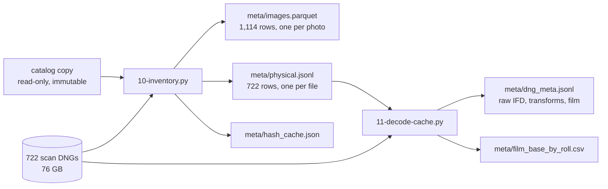
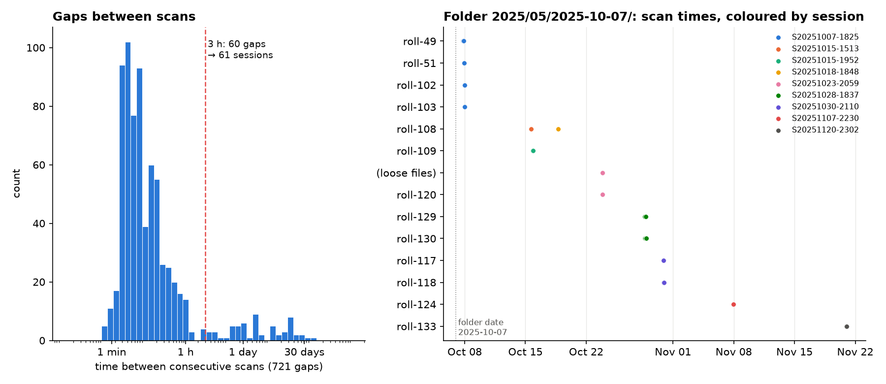
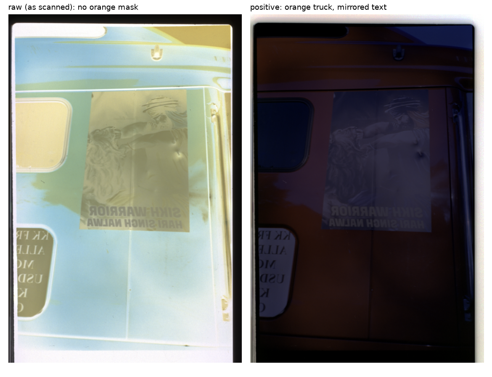
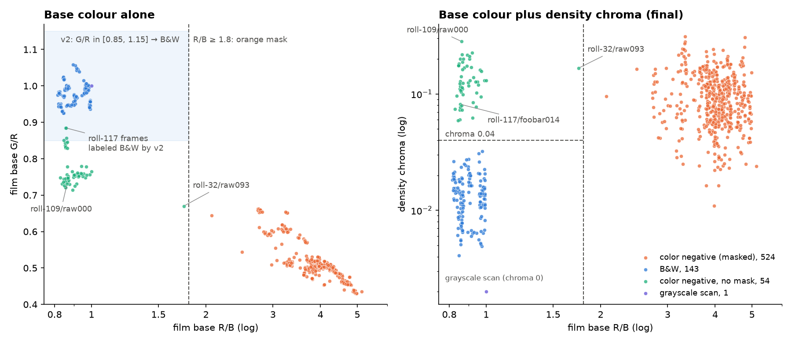

# Film Dust Dataset, Part 1: Inventory, Scan Sessions and the Color of Unexposed Film — A Technical Deep Dive

This is the second of five reports on building a film-dust dataset out of a Lightroom Classic catalog and the Epson V600 / VueScan DNG scans it manages. [[PROJECT REPORT - Film Dust Dataset - Part 0 - What Lightroom Knows About Your Dust - A Technical Deep Dive|Part 0]] established the facts: where Lightroom stores heals, that the scans are uncompressed 16-bit LinearRaw with no black or white level, and that Lightroom keeps its own fill pixels in a RocksDB next to the catalog. This report covers Phase 1, which turns those facts into the tables every later phase joins on.

Phase 1 answers three questions for every healed scan. *Which file is it*, in a way that survives renames and moves? *When was it scanned, and with which other scans*, so that dust which repeats across a scan session cannot leak from training into test? And *what is the unexposed film like*, its transmission per channel and whether it is color or black-and-white, because every dust measurement later on is made in optical density relative to that film base. None of the three has the obvious answer. Folder names are not scan dates, the spec's "estimate the base from the rebate" fails on frames with no rebate, and the color of the base does not tell color film from B&W.

> [!summary]
> - **Identity is content.** `image_id` is the first 16 hex characters of the DNG's SHA-256: 722 physical DNGs, 1,114 catalog photos (392 virtual copies), 11,291 heals, no collisions, byte-identical reruns.
> - **Sessions come from the clock, not the folders.** Capture time is VueScan's scan time; consecutive scans more than 3 h apart start a new session, giving 61 sessions. One folder dated 2025-10-07 holds rolls scanned over six weeks.
> - **The film base is the brightest film, not the brightest pixel.** I_base is the p99.5 of 8×8 block means after removing saturated holder gaps and dark holder areas; 716 of 722 estimates are high-confidence.
> - **Film type needs the image, not just the base.** An orange mask (R/B ≥ 1.8) means color negative; otherwise the *density chroma* inside the frame separates B&W (median 0.014) from mask-less color film (≥ 0.059). Final counts: 524 / 143 / 54 / 1.

## 1. What Phase 1 produces

The specification's Phase 1 is short: an inventory table keyed by `image_id`, a raw cache of one `.npy` per DNG, a `dng_meta` record with every decode transform, and a per-image film base with a confidence flag. Two scripts implement it, both in the ticket's `scripts/` folder and both driven by `~/dustds/config.yaml`.



*Figure 1. Phase 1 data flow. Nothing is written next to the DNGs or the catalog.*

The scope was narrowed by the user's answers at the end of Phase 0. Only DNG heals are used (the 403 heals on TIFFs sit on derived positives or 8-bit files), and only scans with at least one heal are processed, because every roll has dust and an unhealed frame is therefore not a clean negative example. A physical DNG is in scope if its master *or any of its virtual copies* carries a heal, and then all of its copies are included, because their crops define the frame rectangles even when the copy itself has no heal.

| Quantity | Value |
|---|---:|
| Physical DNGs in scope | 722 |
| Catalog photos (rows of `images.parquet`) | 1,114 |
| of which virtual copies | 392 |
| DNGs with no virtual copy / with copies | 576 / 146 |
| Heals on those photos (before deduplication) | 11,291 |
| Roll folders | 41 |
| Scan sessions | 61 |
| Copies with a non-zero `CropAngle` | 67 |
| Bytes hashed | 76.4 GB |

*Table 1. The inventory.*

The heal count is the raw catalog count. Heals that were copied between a master and its virtual copies by syncing settings are still counted twice here; Part 2 deduplicates them.

## 2. An identity that survives the file system

Every later artifact, from heal records to label maps to train/test splits, has to refer to an image. The catalog offers `id_local`, and the file system offers a path. Neither is a good key. `id_local` is an internal row number of one catalog: a re-import, a catalog upgrade or a merge renumbers it, and a virtual copy has its own `id_local` even though it shares the master's pixels. A path changes whenever the photographer reorganizes folders, which, as Section 3 shows, this archive has been doing.

The specification's answer is to name a file by its content. `image_id` is the first 16 hex characters of the DNG's SHA-256, that is, 64 bits of the digest. A master and all its virtual copies share one `image_id`, which is correct, because they share one raw array; they differ in `lr_local_id`, crop and develop settings, which are columns of the photo row. Two paths holding byte-identical files would collapse to one id, and the inventory asserts that this never happens (it does not: 0 duplicates). With 722 files, the chance of a random 64-bit collision is about 1.4 × 10⁻¹⁴.

Reading 76 GB on every run would make the inventory slow to iterate on. The inventory therefore keeps `meta/hash_cache.json`, keyed by path and validated by size and modification time in nanoseconds:

```python
def sha(path):
    st = os.stat(path)
    key = f"{st.st_size}:{st.st_mtime_ns}"
    if hc.get(path, {}).get("key") == key:
        return path, hc[path]["sha256"], key, st.st_size
    with open(path, "rb") as f:
        return path, hashlib.file_digest(f, "sha256").hexdigest(), key, st.st_size
```

With a warm cache the run hashed 722 files (76.4 GB) in 12 s on 8 threads. The outputs are sorted by `image_id` and `lr_local_id`, so two runs produce byte-identical `images.parquet` and `physical.jsonl`; that equality is the test the diary records (`shasum` of both files before and after a rerun).

Each photo row carries the columns the spec asks for: `image_id`, `lr_local_id`, `is_virtual_copy`, `master_lr_local_id`, `copy_name`, `path`, `width` and `height` of the raw IFD, the catalog `orientation`, `n_heals`, the five crop parameters, `keywords`, `collections`, `capture_time`, `roll_guess`, `folder_date`, `session_guess` and the full `sha256`. The crops matter more than they look. Sixty-seven copies have a non-zero `CropAngle`, so a frame rectangle can be rotated inside the raw grid, and the "outside the crop" label of Phase 4 has to rasterize rotated rectangles.

## 3. Folder dates are not scan sessions

Dust on the scanner glass, the film holder or the anti-Newton-ring glass stays put for a while and lands on every frame scanned in that period. If one frame of a session sits in the training set and its neighbour in the test set, a detector can score well by memorizing the session's specks. The split in Phase 5 must therefore keep each scan session in one fold, which requires knowing the sessions.

The first implementation (`dustds/catalog.py:roll_and_session`) took the obvious route. The roll is the folder below `Scans/`, with helper subfolders such as `split` dropped, and the session is the deepest `YYYY-MM-DD` path component, the "scan day":

```python
def roll_and_session(path):
    rel = path.split("/Scans/", 1)[-1]
    parts = rel.split("/")[:-1]
    while parts and parts[-1] in ("split",):
        parts = parts[:-1]
    roll = "/".join(parts)
    dates = [m.group(1) for p in parts for m in [_DATE.search(p)] if m]
    return roll, (dates[-1] if dates else None)
```

It failed on its first input that did not fit: `2025/01/2025-02/roll-17` has a month folder and no day, so the session came back `None` for all 107 DNGs under `2025/01/2025-02/`. Looking for a replacement led to the catalog's `captureTime`. A VueScan DNG has no camera; the capture time it records is the time the scan was made. Printing rolls against capture dates showed that folder dates are organizational buckets, not dates of anything physical:

| Folder | Scans | First scan | Last scan |
|---|---:|---|---|
| `2024/10/2024-10-05/` | 18 | 2024-10-09 16:34 | 2024-10-11 00:06 |
| `2024/12/2024-12-07/` | 38 | 2024-12-07 14:06 | 2025-01-02 16:29 |
| `2025/02/2025-02-28/roll-32/` | 125 | 2025-02-28 19:04 | 2025-03-15 23:38 |
| `2025/05/2025-05-27/` | 61 | 2025-05-27 10:34 | 2025-07-20 18:00 |
| `2025/05/2025-10-07/roll-49/` | 10 | 2025-10-07 18:25 | 2025-10-07 21:03 |
| `2025/05/2025-10-07/roll-133/` | 14 | 2025-11-20 23:02 | 2025-11-21 00:09 |

*Table 2. Folder dates against VueScan scan times (excerpt).* Of the 615 physical DNGs whose folder carries a full date, 469 were scanned on a different day. The `2025/05/` month folder even contains folders dated August to October.

The folder `2025/05/2025-10-07/` is the clearest case. It holds twelve roll folders and two loose files, scanned between October 7 and November 21. Day boundaries are no better than folder dates: on October 7, roll-102 ends at 23:57 and roll-103 starts at 00:17 the next morning, in the same sitting.



*Figure 2. Left: time between consecutive scans over all 722 DNGs. Right: the rolls of one folder, placed at their scan times and coloured by the session the 3 h rule assigns.*

The left panel of Figure 2 is the argument for a gap rule. Gaps between consecutive scans fall into two populations: a large mode between about thirty seconds and an hour, which is the scanner working through a holder, and a sparse tail of gaps from hours to weeks, which are the breaks between sittings. A session is then a maximal run of scans in which no gap exceeds a threshold. The inventory sorts physical DNGs by capture time and starts a new session at every gap over `config.inventory.session_gap_hours = 3`; each session is named after its first scan, as in `S20251007-1825`.

```python
gap = pd.Timedelta(hours=3)
phys = phys.sort_values(["t", "image_id"])
starts = phys.t.diff().isna() | (phys.t.diff() > gap)
phys["session_guess"] = phys.t.where(starts).ffill().dt.strftime("S%Y%m%d-%H%M")
```

The threshold sits where the histogram is thin, and the result is not sensitive to it within a reasonable range:

| Gap threshold | 1 h | 2 h | **3 h** | 4 h | 6 h | 12 h | 24 h |
|---|---:|---:|---:|---:|---:|---:|---:|
| Sessions | 76 | 65 | **61** | 58 | 55 | 53 | 40 |

*Table 3. Number of sessions as a function of the gap threshold.* Between 3 h and 6 h only six sessions merge; below one hour the count climbs quickly, to 115 sessions at 30 minutes, because the rule starts cutting into the main mode of the histogram.

The user had said that the exact session definition did not matter to them, so 3 h is a judgement call, and Phase 5 shows the resulting groups for confirmation. The sessions disagree with the folders in both directions. Eleven roll folders span more than one session (roll-32 spans 6, `2025-05-27/` spans 10), and six sessions span more than one folder: `S20251007-1825` covers roll-49, roll-51, roll-102 and roll-103 in one six-hour sitting. A rule does not cap a session's length; chained short gaps produced two sessions of about eight hours (`S20250105-1521`, `S20250301-1518`).

## 4. A cache that copies nothing

The spec asks for one decoded `.npy` per physical DNG, so that later phases can memory-map the raw array instead of parsing TIFF on every access. Part 0 had already shown that for these files decoding is the identity: no `BlackLevel`, `WhiteLevel` or `LinearizationTable`, 16-bit unsigned samples, uncompressed, chunky RGB. Materializing a cache would have meant copying 76 GB of pixels unchanged onto a disk that was 94% full, with 238 GB free.

`dustds/rawio.py` checks the one further property that makes a copy unnecessary: whether the raw IFD's strips are stored back to back. If every strip starts where the previous one ends, and the strips together hold exactly `H × W × 6` bytes, then the whole raw image is a single C-ordered array at the first strip offset, and NumPy can map it in place:

```python
contiguous = all(offs[i + 1] == offs[i] + cnts[i] for i in range(len(offs) - 1)) \
             and sum(cnts) == h * w * 6
...
return np.memmap(path, dtype="<u2", mode="r", offset=info["data_offset"],
                 shape=(info["height"], info["width"], 3))
```

All 722 DNGs pass, and in all 722 the data starts at byte offset 8, directly after the TIFF header. The cache mode is therefore `dng_memmap`: `open_raw` returns a read-only view into the DNG, and `mode: npy` in the config still materializes `cache/{image_id}.npy` for machines with disk to spare. Because the view is opened with `mode="r"`, no code path can write to an original. This is the one deliberate deviation from the spec in Phase 1, recorded in `NOTES.md`.

`scripts/11-decode-cache.py` writes one `dng_meta` record per DNG. The decode part records what was found and what was applied, and would flag any of the absent tags as `UNEXPECTED_*` if it appeared; none did. One record, abridged:

```json
{"image_id": "000d5322755cac3b", "roll": "2024/12/2024-12-07", "session": "S20241207-2134",
 "raw_ifd": {"height": 7326, "width": 7256, "samples": 3, "bits": [16, 16, 16], "compression": 1,
             "photometric": 34892, "data_offset": 8, "contiguous": true,
             "black_level": null, "white_level": null, "linearization_table": false,
             "software": "VueScan 9 a64 (9.8.39)", "model": "PerfectionV600"},
 "cache_mode": "dng_memmap",
 "transforms": {"black_level": 0, "white_level": 65535, "scale": 1.0, "orientation_applied": false,
                "note": "no BlackLevel/WhiteLevel/LinearizationTable tags: identity decode"},
 "film": {"I_base": [59806.5, 38976.9, 18356.5], "plateau_blocks": 9975, "base_confidence": "high",
          "rb_ratio": 3.2581, "gr_ratio": 0.6517, "density_chroma": 0.0851, "film_type": "color_negative"}}
```

The whole pass over 722 files, which reads every pixel once for the film estimate, takes about 85 s on 6 threads, and a rerun is byte-identical.

## 5. The film base

Dust blocks light. On a negative it appears as a spot that is *denser* than its surroundings, and how much denser is the natural measure of how much dust there is. Density is defined against the film itself: with `I` the scanned transmission and `I_base` the transmission of unexposed, developed film, the density of a pixel is

```text
D_c = log10( I_base,c / max(I_c, 1) )        for each channel c
```

The film base is therefore the reference every later threshold depends on. The spec describes how to find it: take a robust high percentile over the *rebate*, the unexposed strip between and around frames, and exclude the holder gaps where there is no film at all, which are brighter still.

### What the borders contain

A probe (`scripts/07-probe-film-base.py`) printed log₂ histograms of 8×8 block means outside every crop rectangle for a handful of scans. Three populations showed up. Holder gaps are clipped: VueScan writes 65534 there, in all three channels. The holder itself and the black edges are dark, a few hundred counts. Between them sits the film base, with a characteristic color. On a 35mm color strip from roll-32 (raw113, 3288 × 9810, 13.7% border) the bright border blocks have a median of (55663, 27430, 17056), an R/B ratio of 3.26: the orange mask. On a B&W frame of the same folder (raw229) they are (54716, 54347, 63009), R/B 0.87, a neutral base with a slight blue cast.

The probe also showed why the border alone cannot be trusted. Many frames have no border outside their crops (166 of 722 have fewer than 50 usable border blocks), and in roll-32/raw093 the holder gap is not saturated: it sits at about 58,000 counts, inside the range of real film, and a border-only estimate takes it for the base.

### The estimator

`dustds/filmbase.py:estimate` drops the requirement that the base be found in the border. The brightest *film* anywhere on the scan is the least dense film, and every frame of a negative contains some: the rebate if it is visible, otherwise the deepest shadows of the scene, which on a negative are nearly clear. The procedure is:

1. Compute 8×8 block means of the raw array, in chunks of 1,024 rows so memory stays bounded on 194 MB strips.
2. Drop blocks with any channel ≥ 63,000 (holder gaps) and blocks with any channel < 600 (holder and opaque areas).
3. Take `I_base` as the per-channel 99.5th percentile of the remaining blocks.
4. Count the *plateau*: valid blocks whose every channel is at least 97% of `I_base`. A real rebate or clear-film area contributes hundreds to hundreds of thousands of blocks; a percentile that landed on a few stray bright blocks has almost none.
5. Grade confidence from the plateau: high at ≥ 200 blocks, medium at ≥ 20, low below.

The border-only estimate is still computed and stored as `base_border`, but it is not used.

| Confidence | DNGs | Example |
|---|---:|---|
| high (plateau ≥ 200) | 716 | `2024-12-07/raw0027`: plateau 9,975 |
| medium (20–199) | 5 | `2025-09-06/raw011`: plateau 56 |
| low (< 20) | 1 | `2025-08-24/raw012`: plateau 2 |
| fail (< 50 valid blocks) | 0 | |

*Table 4. Film base confidence.* The single low-confidence frame is a mask-less color negative; its `I_base` of (59961, 45302, 61738) agrees with its border estimate (58077, 45440, 62921) to within 4%, so the value is usable even though the plateau is small.

## 6. Color or black-and-white

The user asked for film type to be "detected from color", meaning the color of the film base: an orange base is color negative film, a neutral base is B&W. Film type matters to the dataset in two ways. Dust looks different in density on a color negative, where the three dye layers respond differently, than on silver, which is neutral; and the split in Phase 5 should be stratified so that test is not all one kind of film. It took three versions to get right.

**Version 1: R/B only.** An orange mask makes the base red-heavy and blue-poor, so a threshold on `I_base` R/B should separate masked color film from the rest. It mislabeled frames in both directions: roll-32/raw093, with R/B 1.75, and raw012 of `2025-08-24/`, with G/R 0.76 and obviously colored content, came out as B&W or unknown.

**Version 2: R/B and G/R.** A B&W base should have roughly equal channels, so B&W was restricted to G/R in [0.85, 1.15], anything else non-orange became "unknown". That produced 50 unknowns. Opening one of them, roll-109/raw000, in the viewer's positive mode settled what they were.



*Figure 3. roll-109/raw000: a color negative without an orange mask. The base is cool and nearly neutral (R/B 0.86, G/R 0.73), the positive shows an orange truck and mirrored lettering.*

The frame is a color negative whose base carries no orange mask. Its base is bluish with a weak green deficit, neither orange nor neutral, and no rule on the base color decides whether the dyes above it are color dyes. The left panel of Figure 4 shows the consequence. Roll-109 at G/R ≈ 0.73 is separable, but four frames of roll-117 (foobar014, 023, 025, 033) have G/R between 0.851 and 0.885, inside the B&W band, and version 2 labeled them B&W while the rest of roll-117 was "unknown". Re-running the version 2 rule on the final data reproduces both numbers: 50 unknown and 4 roll-117 frames as B&W.

**Version 3: density chroma.** The decisive property of B&W film is not its base but its image. Silver is neutral, so at every point of a B&W frame the three channels have densities in fixed proportions; a darker area is darker in all three by the same factor. In a color negative the proportions change with the color of the scene. `filmbase.py` measures this directly. For blocks inside the crops with mean density above 0.15, it divides each channel's density by the block's mean density, takes the standard deviation of that ratio across blocks per channel, and averages over the channels:

```python
D = np.log10(I_base / np.maximum(flat[sel], 1.0))   # blocks inside the crops
Dm = D.mean(1)
keep = Dm > 0.15
chroma = float(np.std(D[keep] / Dm[keep, None], axis=0).mean())
```

On B&W this number is close to zero; on color film it is not. The final rule applies the orange-mask test first and the chroma test only to non-orange film:

```text
R = G = B in > 99% of sampled pixels   → bw_gray   (grayscale scan stored as RGB)
I_base R/B ≥ 1.8                       → color_negative
density chroma < 0.04                  → bw
otherwise                              → color_negative_unmasked
```



*Figure 4. Left: base color alone. The four roll-117 frames sit inside the version 2 B&W band. Right: base R/B against density chroma. B&W and mask-less color film fall into two groups with an empty band between them.*

| Film type | DNGs | Base R/B (p10–p90) | Base G/R (median) | Density chroma (median; range) |
|---|---:|---|---:|---|
| `color_negative` | 524 | 3.31–4.69 | 0.50 | 0.089; 0.011–0.311 |
| `bw` | 143 | 0.83–0.99 | 0.98 | 0.014; 0.004–0.032 |
| `color_negative_unmasked` | 54 | 0.85–0.96 | 0.75 | 0.126; 0.059–0.282 |
| `bw_gray` | 1 | 1.00 | 1.00 | 0 |

*Table 5. Final film types.* The B&W maximum is 0.032 and the unmasked minimum is 0.059, so the threshold at 0.04 lies in an empty interval. The four roll-117 frames have chroma 0.082, 0.104, 0.108 and 0.175, and are now color like the rest of their roll.

Two details of Table 5 justify the order of the tests. Masked color film reaches a density chroma as low as 0.011, inside the B&W range; chroma alone would call those B&W, and the orange-mask test has to come first. And the single `bw_gray` file, `2024-10-05/raw0002`, is a scan stored with identical R, G and B values, for which chroma is zero by construction.

The rule has one visible error. roll-32/raw093 is a masked color negative whose frame fills the scan; its raw overview is orange. Its brightest film is the deep sky of the scene, not a rebate, so `I_base` is (39380, 26381, 22531) with R/B 1.75, just under the 1.8 threshold, and the frame is labeled `color_negative_unmasked`. Color against B&W, the distinction that matters for density measurements, is correct; the masked/unmasked label for this frame is not.

### Folders mix films

With film types per frame, the folder-as-roll assumption fails a second time. Six of the 41 folders contain more than one film type. `2025-05-27/` holds 30 masked color frames and 31 B&W frames; roll-32 holds 96 masked color frames, 28 B&W frames on a bluish base (R/B about 0.86) and raw093; `2024-10-05/` holds 15 B&W, 2 color and the grayscale scan. A "roll" in this dataset is a storage folder, not a strip of film, and `meta/film_base_by_roll.csv` lists the per-folder mix so that Phase 5 can split rolls into (folder, film type) groups where needed.

## 7. What Phase 1 leaves behind

The outputs are small and stable. `images.parquet` is 149 KB, `physical.jsonl` 388 KB and `dng_meta.jsonl` 847 KB, and all three are byte-identical across reruns. The viewer, `dustview`, merges `dng_meta.jsonl` into its image records by path, shows the film type and base in the title, and marks each image in the list as C, C* or BW, so a reviewer can scan the classifier's output roll by roll. Opening roll-109 and roll-117 there is how versions 2 and 3 were checked.

Three decisions are open for later phases and are recorded in the ticket. The 3 h session rule awaits the user's look at the groups in Phase 5. The 0.04 chroma threshold sits in a wide empty band on this archive, but a B&W frame toned in post or a very low-contrast color frame could land near it. And `I_base` for mask-less color film with a small plateau, such as `2025-08-24/raw012`, may be biased low, which would shift every density on that frame by a constant.

The key points from Phase 1:

- An image is identified by its content hash, which is stable under renames, catalog renumbering and virtual copies, and makes reruns byte-identical.
- VueScan's capture time is the scan time; folder dates are filing decisions, and sessions defined by a 3 h gap in scan times give 61 groups that cross folders in both directions.
- The scans need no cache: their raw strips are contiguous, so a read-only memory map at offset 8 serves as the decoded array and saves 76 GB.
- The film base is the 99.5th percentile of film blocks after removing saturated holder gaps and dark holder areas, with a plateau count as its confidence; 716 of 722 are high-confidence.
- Base color identifies an orange mask but cannot tell B&W from mask-less color film; the neutrality of silver, measured as density chroma inside the frame, can.

Part 2, "Turning Catalog Entries into Labels", takes the 11,291 heal entries counted here, deduplicates them across virtual copies, and turns each into a heal record keyed by the `image_id` defined in this phase.

## Sources

- Repository: `/Users/manuel/code/wesen/2026-11-07--dust-scanning`
- Ticket: `ttmp/2026/11/07/DUST-001--film-dust-dataset-from-lightroom-heals/` — `reference/01-diary.md` (Steps 6–8), `reference/02-build-instructions.md` (Phase 1 of the specification)
- Dataset notes: `~/dustds/NOTES.md`, `~/dustds/config.yaml`
- Code: `dustds/catalog.py` (`roll_and_session`, `scan_photos`), `dustds/rawio.py` (`raw_info`, `open_raw`), `dustds/filmbase.py` (`block_means`, `estimate`)
- Scripts: `scripts/07-probe-film-base.py` (output `various/07-film-base-probe.txt`), `scripts/10-inventory.py`, `scripts/11-decode-cache.py`
- Data: `~/dustds/meta/images.parquet`, `physical.jsonl`, `dng_meta.jsonl`, `film_base_by_roll.csv`
- Figures: `scripts/40-report-p1-film-type-figure.py`, `41-report-p1-sessions-figure.py`, `42-report-p1-roll109-figure.py`
