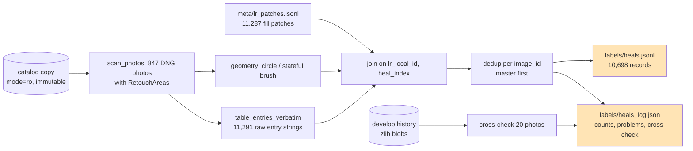
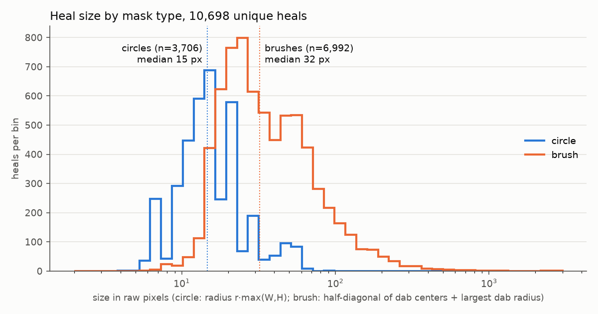
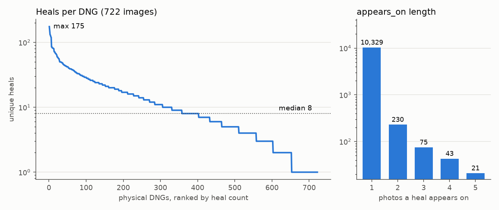
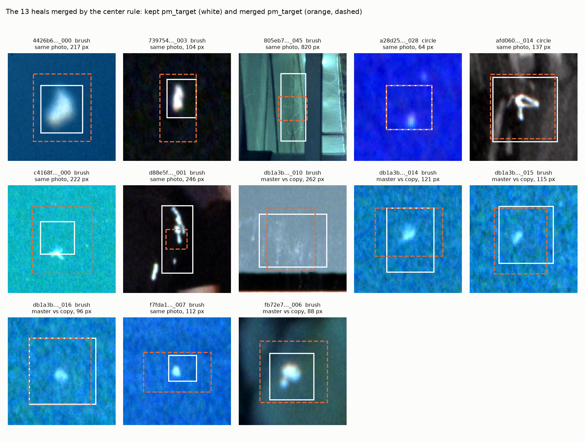

# Film Dust Dataset, Part 2: Turning Catalog Entries into Labels — A Technical Deep Dive

This is the third of five reports on building a film-dust dataset from the heals in a Lightroom Classic catalog. [[PROJECT REPORT - Film Dust Dataset - Part 0 - What Lightroom Knows About Your Dust - A Technical Deep Dive|Part 0]] established where Lightroom stores a heal and what a heal looks like. [[PROJECT REPORT - Film Dust Dataset - Part 1 - Inventory, Scan Sessions and the Color of Unexposed Film - A Technical Deep Dive|Part 1]] gave every healed DNG a content-hash identity, a scan session and a film type. This report covers Phase 2, which turns the 11,291 heal entries found in the catalog into `labels/heals.jsonl`: 10,698 records, one per distinct heal on a physical scan file, each carrying its parsed geometry, its provenance, and the untouched catalog text it came from.

Phase 2 looks like bookkeeping, and most of its code is. The decisions inside it are not. A catalog entry is not the same thing as a label: the same speck can be recorded several times because virtual copies share a file, an entry can carry more than one mask, a brush stroke has to be decoded as a program rather than read as a list, and a label file that silently differs from the catalog is worse than no label file. Each section below takes one of these problems, shows the numbers that defined it, and shows what the extractor does about it.

> [!summary]
> - **One record per unique heal on the physical DNG.** 11,291 entries on 847 catalog photos collapse to 10,698 heals on 722 DNGs. 580 duplicates share Lightroom's `pm_patch` digest; 13 more are merged because their centers lie within 0.002 normalized units. Every record lists the photos it `appears_on`.
> - **Nothing is lost on the way.** Each record keeps the verbatim Lua text of its entry (`raw`), which re-parses to exactly the parsed settings for all 11,291 entries, and 20 of 20 sampled photos match their latest develop-history step.
> - **The labels are almost all hand-placed.** 10,628 heals come from the Remove tool, 69 from Generative Remove and 1 from the legacy Heal tool; 6,992 are brush strokes and 3,706 circles.

## 1. What Phase 2 has to produce

The specification asks for a script that writes `labels/heals.jsonl`, "one line per heal, with the parsed fields plus the original record untouched". It names the fields to keep (image, Lightroom photo id, heal index, spot type, method, opacity, feather, mask type, normalized geometry), asks for a `label_source` classification, requires that heals belong to the physical DNG rather than to a catalog photo, and closes with a rule that shaped the whole implementation: *never drop entries silently*.

The phrase "one line per heal" hides the central modelling question: what is a heal? The catalog's answer is "an entry in the `RetouchAreas` list of one photo's develop settings". The dataset's answer has to be "a place on a scan where a person decided there was dust", because a detector is trained on pixels, and pixels belong to files. These two answers differ whenever a DNG has virtual copies. Part 0 showed that strips of three 35mm frames are scanned into one DNG and split into frames by giving each virtual copy a different crop, and that syncing settings between copies copies the heals too. If each catalog entry became a label, the same speck would appear two to five times in the training data, and the same pixels would be counted as several independent examples. Phase 2 therefore defines a heal as a unique geometric decision on a physical file, and keeps the catalog entries it came from as provenance.



*Figure 1. Data flow of `scripts/12-extract-heals.py`.* The inputs are the read-only catalog copy, the Phase 1 inventory (`meta/images.parquet`, which maps Lightroom photo ids to content-hash `image_id`s and gives image dimensions) and the Phase 0 patch extraction (`meta/lr_patches.jsonl`).

## 2. A heal entry, briefly

Part 0 described the format in detail; the extractor needs only three facts from it. An entry in `RetouchAreas` is a Lua table literal. Its `Masks` list holds a `Mask/Ellipse` (center `X, Y` normalized per axis of the unrotated raw image, radius `SizeX = SizeY`) or a `Mask/Paint` brush whose `Dabs` field is a stream of instructions. And an entry made by the Remove tool carries the `pm_*` fields of Lightroom's patch-match engine: the pixel box `pm_target_*`, the grid size `pm_whole_image_*`, and the digest `pm_patch` that keys the filled pixels in the catalog's RocksDB side store.

## 3. Keeping the original text

The specification asks for "the original record untouched". The obvious implementation serializes the parsed Python dict back to JSON, and that is not the original record. A parser normalizes: it decides whether `1` is an integer or a float, folds Lua's mixed array/keyed tables into one shape, drops the ordering of keys, and unescapes strings. If the parser has a bug, the "original" stored next to the parsed fields would carry the same bug, and nobody could detect it later. The only way to keep the record untouched is to keep the bytes the catalog stored.

`dustds/luatable.py:table_entries_verbatim` does this with a scanner that is deliberately simpler than the parser. It finds `RetouchAreas = {`, then walks the text tracking brace depth, and records the source span of every table that opens at depth two. The one subtlety is that braces inside quoted strings must not count, so the scanner tracks whether it is inside a string and honours backslash escapes:

```python
while i < n and depth > 0:
    c = text[i]
    if in_str:
        if c == "\\": i += 1            # skip the escaped character
        elif c == '"': in_str = False
    elif c == '"':  in_str = True
    elif c == "{":
        depth += 1
        if depth == 2: start = i        # an entry begins
    elif c == "}":
        if depth == 2 and start is not None:
            entries.append(text[start:i + 1])
        depth -= 1
    i += 1
```

Two independent code paths now describe the same entry, and they can be checked against each other. The extractor checks that both produce the same number of entries per photo; the report script `47-report-p2-verify-verbatim.py` goes further and re-parses every verbatim string:

```text
{'photos': 847, 'count_equal': 847, 'entries': 11291, 'reparse_equal': 11291, 'has_brace_in_string': 0}
```

All 11,291 verbatim strings parse to exactly the dict that the full-settings parse produced. None of them contains a brace inside a string, so the quote handling is never exercised on this catalog; it is there because the masks carry free-form IDs and a future Lightroom version could put anything in a string. The cost of keeping `raw` is modest: the median entry is 1,292 characters, the 99th percentile 3,949, and the longest, a brush stroke with hundreds of dabs, 46,220.

## 4. Geometry

`dustds/heals.py:geometry` reduces an entry to a mask type, a geometry dict in Lightroom's normalized units, and a list of problems. Circles are direct: `cx, cy, rx, ry` plus the mask's `Alpha`, `CenterValue` and `PerimeterValue`, with a problem logged if `rx ≠ ry` (it never is). Brushes require decoding. The `Dabs` stream mixes positions (`d x y`) with state changes (`r R` for radius, `f F` for flow, `h H` for hardness), so each dab is stored as `[x, y, r]` with the radius in effect at that point of the stream, together with the starting radius, flow and the count of modifiers seen. Phase 4 rasterizes footprints from these triples without re-reading the stream.

Two derived values make the records easy to use before any rasterization: `lr_center`, the center of a circle or the midpoint of a brush's dab bounding box, and `lr_extent`, a rough size. Figure 2 shows the size distribution in raw pixels, with circle radii scaled by the long image side (the normalization that Part 3 confirms) and brush sizes computed per axis.



*Figure 2. Heal size by mask type.* Circles are small and narrowly distributed; brushes span three orders of magnitude, from single dabs to strokes along a scratch the full height of a frame.

| Mask type | Heals | p10 | median | p90 | p99 | max |
|---|---:|---:|---:|---:|---:|---:|
| circle (radius, px) | 3,706 | 9.0 | 14.6 | 29.8 | 55.1 | 85.3 |
| brush (half-diagonal + dab radius, px) | 6,992 | 16.9 | 32.1 | 90.8 | 257.0 | 2,608 |

*Table 1. Heal sizes in raw pixels, from `scripts/45-report-p2-stats-figures.py`.* The circle histogram is comb-shaped because circle radii take only 412 distinct normalized values; the most common, 0.004626, occurs 121 times. A brush has a median of 6 dabs, a 90th percentile of 37 and a maximum of 1,962; only 67 of the 6,992 brushes change radius, flow or hardness mid-stroke, but those are exactly the long strokes where the change matters.

`lr_extent` is a convenience value, not a measurement. It adds the normalized diagonal of the dab bounding box to the largest dab radius, and the diagonal mixes `x / W` with `y / H`. Multiplying it by the long side overstates the size of strokes that run along the short axis: for the median brush the error is 5%, for the longest stroke it reports 3,291 pixels where the per-axis computation gives 2,608. Phase 2 uses `lr_extent` only to order and filter; Phase 4 works from the dabs.

### Entries with more than one mask

Five entries hold more than one mask, and the extractor logs each of them as a problem ("2 masks (only the first is used)"). All five are Generative Remove brushes. The first mask is the largest in four of them, and the additional masks are short touch-ups of 3 to 21 dabs that lie partly or entirely outside it. The fifth, heal `dab2ef3827893ca9_003` on `2024-10-05/raw0051`, is different: three strokes of 536, 754 and 216 dabs, of which the first covers x = 241–667 inside a `pm_target` box that spans x = 226–992. Using only the first mask loses more than half of that heal. The decision to keep the first mask was made to keep one geometry per record; the `raw` field holds all three, and the log names the heal, so Phase 4 can revisit it.

## 5. Where each label came from

The specification asks for a `label_source` drawn from manual, lr_auto_dust, content_aware, generative or unknown. Part 0 already showed that two of these do not occur on scans: Lightroom's automatic Dust Removal stores rendered patches, not heals, and was never applied to a scan; and the content-aware fill of older versions is now part of the Remove tool. The rule in the extractor follows the fields that exist:

| Condition on the entry | `label_source` | Heals |
|---|---|---:|
| `fill_method = "firefly"` | generative | 69 |
| `SpotType = "heal_patchmatch"` | manual | 10,628 |
| `SpotType = "heal"` or `"clone"` | heal_legacy / clone_legacy | 1 / 0 |
| anything else | unknown | 0 |

*Table 2. Label sources after deduplication.* Every generative heal is a brush. Every circle except one is a manual Remove heal; the exception is the single legacy heal, `81960b98d767120c_036`, made with `Method = "gaussian"`. It has no `pm_*` fields and therefore no pixel box and no stored fill.

The distinction between manual and generative matters for the masks built later. A manual Remove heal is placed over a speck with a circle or a short stroke; a generative heal is painted over a larger region and lets a model invent the content. The generative heals are labels of the same kind, but they are coarser, and 3 of the 69 have no computed fill at all (section 8).

## 6. Deduplication

Deduplication runs per physical image. The candidates for one `image_id` are sorted master first, then virtual copies by Lightroom id, and each candidate is compared with the heals already kept for that image. It is merged into a kept heal if either rule matches:

1. **Same `pm_patch` digest.** The digest identifies Lightroom's computed fill. Two entries with the same digest refer to the same fill of the same pixels, whatever their masks look like.
2. **Same mask type, centers within 0.002 normalized units on both axes.** This is the specification's rule, and it catches duplicates whose fill was recomputed.

A merged candidate is not discarded. Its `[lr_local_id, heal_index]` is appended to the kept heal's `appears_on` list, and if its `pm_patch` differs, it is also recorded in `dup_variants` with its own digest and label source. The kept heal then receives its `heal_id`, `{image_id}_{nnn}`, numbered in the order heals were kept.

| Step | Count |
|---|---:|
| Entries on inventory DNGs | 11,291 |
| Merged: same `pm_patch` digest | 580 |
| Merged: center within 0.002 (and different digest) | 13 |
| Unique heals written | 10,698 |
| … kept from a master photo / from a virtual copy only | 8,596 / 2,102 |
| … with a decoded Lightroom fill (`lr_patch.written`) | 10,694 |

*Table 3. Deduplication, from `labels/heals_log.json`.* The digest rule does almost all of the work: 580 of 593 merges. Lightroom copies the computed fill when it syncs heals between copies, so the digest survives. 2,102 heals are kept from a virtual copy because they were made on that copy alone, which is the expected case for a strip where each frame was cleaned separately.



*Figure 3. Left: unique heals per DNG, ranked. Right: the length of `appears_on`.* The median DNG has 8 heals and the 90th percentile 34; 70 DNGs have a single heal, and the three busiest have 175, 153 and 131. The top tenth of the images hold 39.6% of the heals, which is a fact the Phase 5 split has to respect. 10,329 heals appear on one photo; 369 appear on two to five.

### What the center rule merged

The 13 merges made by the center rule are few enough to inspect one by one, and they turn out to be two different things. Figure 4 draws the `pm_target` box of the kept entry and of the merged one over the scan.



*Figure 4. The 13 heals merged by the center rule (crops from `dustview`, positive rendering).* Five merges are across master and copy (`db1a3b…` four times, `fb72e7…` once): the same speck healed independently on two photos of the same file, with different strokes and therefore different fills. These are the duplicates the specification had in mind. The other eight are within a single photo: a speck healed twice, usually a second, larger or smaller stroke over a first one, as with the hairs in `805eb7…_045` and `d88e5f…_001`, or two identical circles stacked on each other, as in `a28d25…_028`.

Merging both kinds is correct for a dust label, because each pair marks one physical object. It does lose geometry: the kept heal is whichever came first, and in `4426b6…_000` and `c4168f…_000` the merged stroke is the larger one. `dup_variants` preserves the identity of every merged entry, and its full geometry is one lookup away through `appears_on` and `raw` of the catalog entry, so a later phase can take the union if it needs to.

## 7. The record

A complete record, here a circle on a three-frame strip that was synced to all three copies (`raw` shortened):

```json
{
 "heal_id": "0274201a78810d68_001", "image_id": "0274201a78810d68",
 "lr_local_id": 2367915, "heal_index": 1, "is_vc": false,
 "appears_on": [[2367915, 1], [2371779, 1], [2371833, 1]],
 "label_source": "manual", "spot_type": "heal_patchmatch", "method": "poisson",
 "mask_type": "circle", "n_masks": 1,
 "lr_geom": {"cx": 0.095177, "cy": 0.773203, "rx": 0.00253, "ry": 0.00253,
             "alpha": 0, "center_value": 1, "perimeter_value": 0},
 "lr_center": [0.095177, 0.773203], "lr_extent": 0.00253,
 "pm_target": [290, 5549, 327, 5587], "pm_whole": [3240, 7201],
 "pm_patch": "882C82ABD2A260456EB37A98D576CBAB", "pm_patch_mask": null,
 "lr_patch": {"written": true, "stored_mask": false,
              "boundary_rel_step": [-0.00796, -0.00498, -0.00331], "mask_area": 1043},
 "opacity": 1, "feather": null, "seed": 2, "source_state": "sourceAutoComputed",
 "source_xy": [0, 0], "fill_method": null, "current_variation_index": null,
 "dup_variants": null,
 "raw": "{ Masks = { { Alpha = 0,\nCenterValue = 1, … X = 0.095177,\nY = 0.773203 } },\nMethod = \"poisson\", … pm_target_left = 290, … spotType = \"heal_patchmatch\" }"
}
```

The record is internally consistent in a way that can be checked by hand. The image is 3,240 × 7,201 pixels, so the circle's radius in pixels is 0.00253 × 7,201 = 18.2, and its center is at (0.095177 × 3,240, 0.773203 × 7,201) = (308.4, 5,567.8). Lightroom's own box is 37 × 38 pixels centred at (308.5, 5,568). Part 3 turns this hand check into a proof over 10,694 heals.

The fields fall into four groups, and the grouping explains the shape.

| Group | Fields | Why it is there |
|---|---|---|
| Identity | `heal_id`, `image_id`, `lr_local_id`, `heal_index`, `is_vc`, `appears_on` | `heal_id` is stable across runs because `image_id` is a content hash and kept heals are numbered in a deterministic order; the Lightroom ids make every record traceable to the catalog. |
| Label | `label_source`, `spot_type`, `method`, `fill_method`, `mask_type`, `n_masks`, `lr_geom`, `lr_center`, `lr_extent`, `opacity`, `feather` | Everything a later phase needs to rasterize the heal, in Lightroom's units, without interpreting them yet. |
| Lightroom's pixels | `pm_target`, `pm_whole`, `pm_patch`, `pm_patch_mask`, `lr_patch` | The independent pixel-space evidence used to prove the coordinate transform, and the join to the before/after fills of Part 0. |
| Provenance | `dup_variants`, `raw`, `seed`, `source_state`, `source_xy`, `current_variation_index` | What was merged, and the untouched text from which every other field can be re-derived. |

*Table 4. The record's field groups.* Two choices deserve a remark. Geometry stays in Lightroom's normalized units, not pixels, because at the time Phase 2 ran the transform into pixels was a hypothesis; Phase 3 tested it, and Phase 4 is the first place that converts. And `source_xy` looks up `sourceX, sourceY` first and falls back to `SourceX, OffsetY`, which looks like a typo but is not: the legacy heal stores its source as `SourceX = 0.753541` and `OffsetY = 0.470675`, with the same values repeated in lowercase `sourceX` and `sourceY`.

## 8. Checking the extraction against the history

The specification asked for a cross-check of 20 photos against the XMP in `Adobe_AdditionalMetadata`. Part 0 showed that the XMP holds no develop settings for this archive, so the cross-check uses the other place where Lightroom records heals: `Adobe_libraryImageDevelopHistoryStep`, one row per entry in a photo's develop history. For 20 photos sampled with the project's global seed, the latest history step's `RetouchAreas` must equal the current settings' `RetouchAreas`.

The first attempt failed on the first row:

```text
TypeError: cannot use a string pattern on a bytes-like object
```

The settings `text` column is a string, but the history `text` column is a blob. Its first bytes, `00 00 09 db 78 9c cd 56 …`, read as a four-byte big-endian length (0x09db = 2,523) followed by `78 9c`, the header of a zlib stream at the default compression level. `dustds/catalog.py:decode_blob_text` decompresses the stream and asserts that its length equals the declared one. With that in place, all 20 photos match. 19 of the latest steps are named "Camera Raw Settings"; the other is an export step ("Export - Epson Print Layout"). The check is narrow by design: it confirms that the current settings are what Lightroom last recorded and that the parser reads both sources the same way, not that the history holds no older heals.

## 9. The bug that was not in Phase 2

Phase 2 also changed the viewer so that it reads the real outputs, pairing `meta/physical.jsonl` from Phase 1 with the new `labels/heals.jsonl`. The viewer is written in Go, and it refused to start:

```text
images: invalid character 'N' looking for beginning of value
```

707 of the 722 lines in `meta/physical.jsonl` contained the token `NaN`, written by Phase 1 for missing values such as `copy_name` or `crop_angle`. pandas represents a missing value as a float NaN, and Python's `json.dumps` writes it as the bare token `NaN` by default. That token is not JSON. Python's own `json.loads` accepts it without complaint, which is why every check run in Python had passed:

```python
>>> json.loads('{"a": NaN}')
{'a': nan}
>>> json.dumps(float("nan"))
'NaN'
```

Go's `encoding/json` follows the standard and rejects it. The fix in `scripts/10-inventory.py` maps NaN and NA to `None` through a small `nn()` helper and writes with `json.dumps(..., allow_nan=False)`, so a future NaN raises in Python instead of producing invalid output. Every JSONL output of the project was then scanned for `NaN` and `Infinity`, and none remained. The guard is not yet everywhere: the heal extractor itself still writes with the default `json.dumps`, and its output is clean only because none of the values it writes is a pandas missing value. The lesson generalizes beyond this project: a validator written in the same language as the writer shares the writer's leniencies, and a consumer in a second language is a better test of a file format than any amount of self-checking.

## 10. What Phase 2 hands on

`labels/heals_log.json` records every condition that was noticed and not silently handled. Four of them carry forward:

- Three generative heals on `2024-10-05/raw0051` (`dab2ef3827893ca9_000` to `_002`) have `pm_target = [0, 0, 0, 0]` and `pm_whole = [0, 0]`. Lightroom never computed their fill, so they have no patch and no pixel box; these are the 3 `pm_whole_mismatch` entries in the log.
- The single legacy heal has no `pm_*` fields at all. Together with the three empty generative heals it explains why 10,694 and not 10,698 heals have a decoded fill.
- Five generative entries carry two or three masks and are reduced to the first; one of them loses more than half its area.
- The 13 center-rule merges keep the first entry's geometry, even where the merged stroke was larger.

The key points from Phase 2:

- A label is a decision on a physical file, not a catalog entry. Deduplicating per `image_id` turned 11,291 entries into 10,698 heals, and `appears_on` keeps the link back to every photo.
- Lightroom's `pm_patch` digest is a better duplicate key than geometric proximity: it accounts for 580 of 593 merges, and the 13 proximity merges are a mix of copy duplicates and same-photo re-heals.
- Keeping the verbatim entry is cheap and turns the parser into something that can be audited; all 11,291 verbatim strings re-parse to the parsed settings.
- Geometry stays in Lightroom's units until the transform is proven, and brush strokes are stored as decoded `[x, y, r]` dabs so that later phases never re-interpret the instruction stream.
- A file format is tested by a strict reader. Python accepted `NaN` in JSONL; Go did not, and that is how the bug was found.

The labels now exist in Lightroom's coordinates. Whether those coordinates map onto the raw pixels by the identity, which side of the image normalizes the radius, and how close a heal lands to the speck it removed, is the subject of Part 3 - Proving the Coordinate Transform.

## Sources

- Repository: `/Users/manuel/code/wesen/2026-11-07--dust-scanning`
- Ticket: `ttmp/2026/11/07/DUST-001--film-dust-dataset-from-lightroom-heals/` — `reference/01-diary.md` (Step 9, with Steps 2 and 5 for context), `reference/02-build-instructions.md` (Phase 2 specification)
- Dataset notes: `~/dustds/NOTES.md` (Phase 2 entry)
- Code: `dustds/luatable.py` (`parse`, `table_entries_verbatim`), `dustds/heals.py` (`geometry`, `center`, `extent`), `dustds/catalog.py` (`connect`, `decode_blob_text`)
- Scripts: `scripts/12-extract-heals.py` (the extractor), `scripts/10-inventory.py` (the NaN fix); report scripts `scripts/45-report-p2-stats-figures.py` (Table 1, Figures 2 and 3), `46-report-p2-center-merges.py` (Figure 4), `47-report-p2-verify-verbatim.py` (verbatim re-parse and history blob header)
- Data: `~/dustds/labels/heals.jsonl`, `~/dustds/labels/heals_log.json`, `~/dustds/meta/lr_patches.jsonl`, `~/dustds/meta/physical.jsonl`
