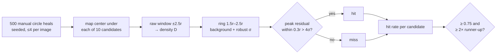
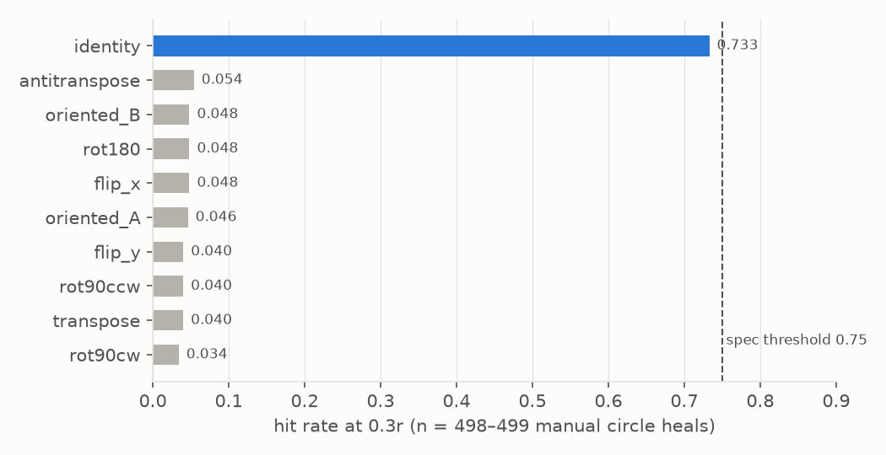
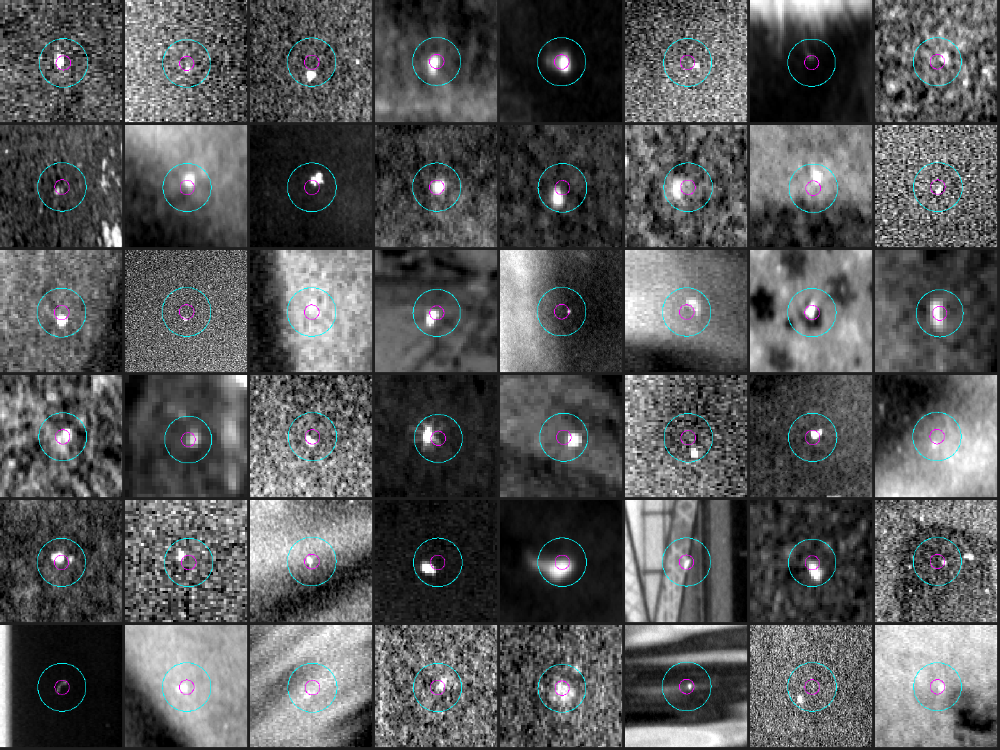
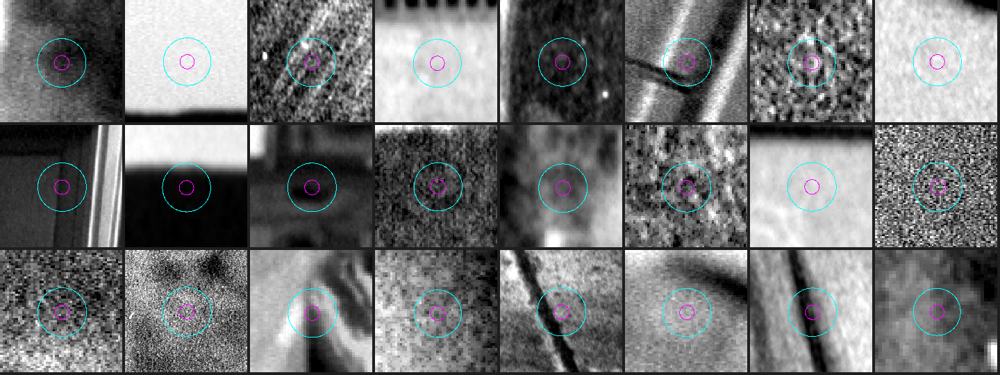
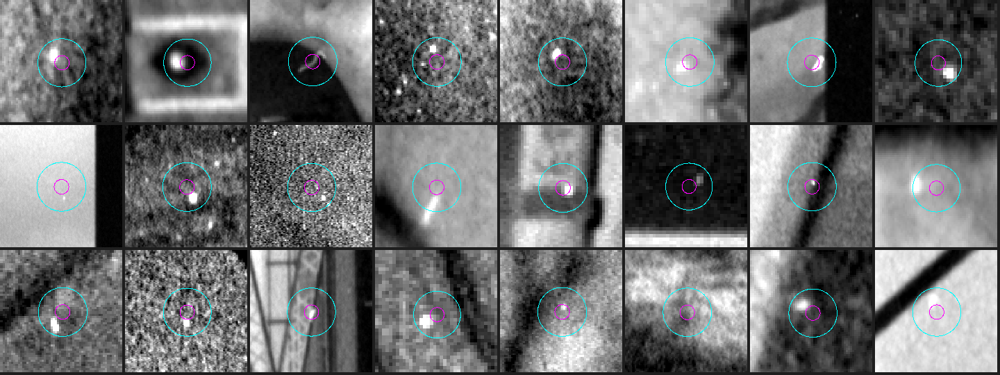
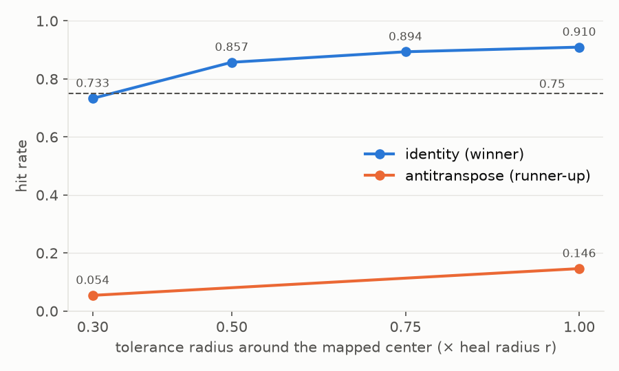
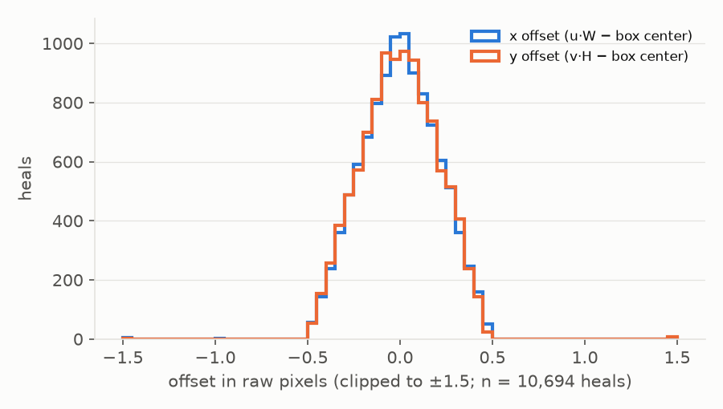
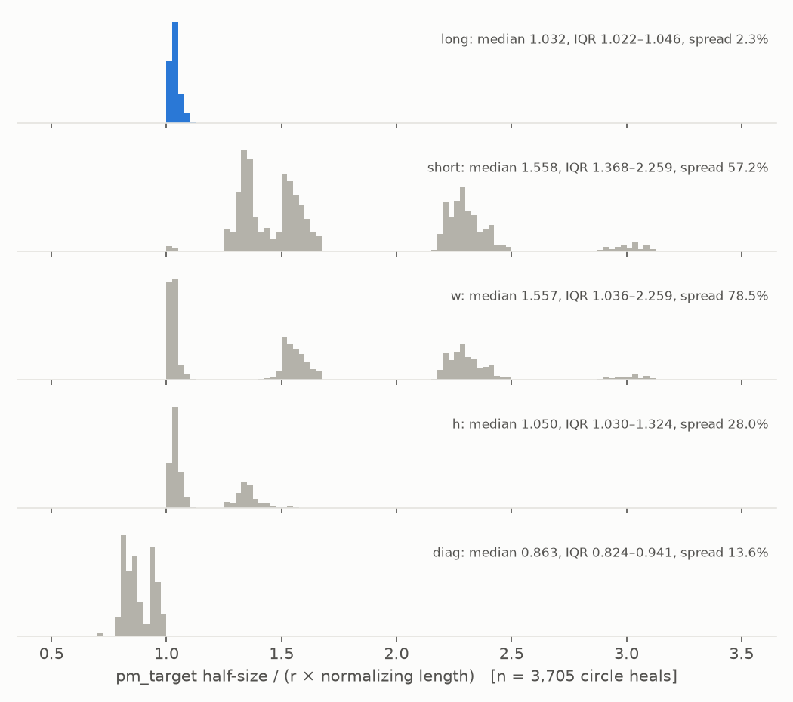
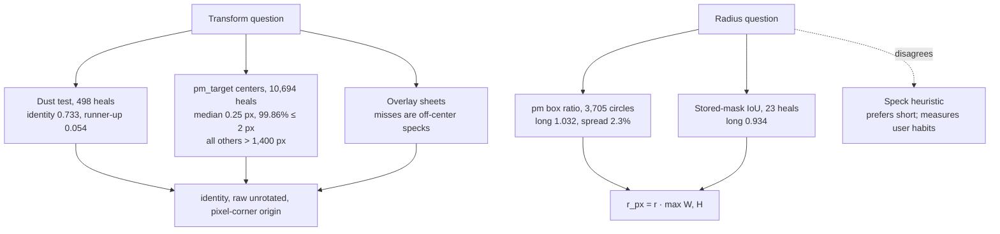

# Film Dust Dataset, Part 3: Proving the Coordinate Transform — A Technical Deep Dive

This is the fourth of five reports on building a film-dust dataset from the heals in a Lightroom Classic catalog. [[PROJECT REPORT - Film Dust Dataset - Part 0 - What Lightroom Knows About Your Dust - A Technical Deep Dive|Part 0]] found where Lightroom stores each heal and noticed that a pixel box recorded with every heal seemed to agree with the obvious reading of the coordinates. [[PROJECT REPORT - Film Dust Dataset - Part 2 - Turning Catalog Entries into Labels - A Technical Deep Dive|Part 2]] turned the catalog entries into 10,698 deduplicated heal records in Lightroom's normalized units. Neither report put a single heal on a pixel with proof. That is the job of Phase 3.

The phase answers two questions. Given a heal center `(x, y)` in `[0, 1]²`, which pixel of the stored raw scan does it refer to? And given a heal radius `r`, normalized by some length, which length? The answers look obvious after the fact, and an informal check in the project's viewer had already suggested them. The point of the phase is that "looks right on two frames" is not evidence for ten thousand labels, and that the right answer has to win a fair contest against every plausible wrong one.

> [!summary]
> - **The transform is the identity in raw space.** `px = x·W`, `py = y·H` on the stored, unrotated raw grid, with the origin at the pixel corner. Photo orientation is ignored.
> - **The radius is normalized by the long side.** `r_px = r · max(W, H)`. Lightroom's own pixel box around each circle heal is the circle plus 3.2%, with an interquartile range of 1.022–1.046 over 3,705 heals.
> - **The spec's dust test missed its bar, and the transform is still proven.** The identity scored 0.733 against a 0.75 threshold (13.6× the runner-up). Lightroom's `pm_target` boxes agree with the mapped centers to a median of 0.25 px on 10,694 heals, while every other transform is more than 1,400 px off.

## 1. Why the transform has to be measured

A heal in the catalog is a circle `X, Y, SizeX` or a brush stroke of dabs, all in normalized coordinates. Normalized coordinates are fractions of *some* image, and Lightroom shows the user several images that are all, in some sense, "the photo": the raw grid as stored in the DNG, the same grid after the default crop, and the displayed image after the photo's orientation has been applied. The scans in this archive are almost never displayed as stored. Of the 3,706 circle heals, only 46 sit on a photo whose orientation is `AB` (as stored); 1,330 are on `AD`, 830 on `CB`, 733 on `BA`, and the rest spread over the other four codes. If the heal coordinates were relative to the displayed image, the identity mapping would be wrong for 98.8% of circle heals.

The radius has the same problem in a different form. A circle in normalized units only becomes a circle in pixels if a single length is used for both axes, and Lightroom could plausibly use the width, the height, the shorter side, the longer side or the diagonal. On a 6×6 frame these differ by a few percent. On a strip of three 35mm frames at 3432 × 9778 pixels, the long side is 2.85 times the short side, so a wrong choice makes every label nearly three times too large or too small.

A wrong transform does not announce itself. Every mapped center lands on *some* pixel, and a crop around it shows film grain, which can look like a faint speck if one wants it to. The specification therefore insisted on a measurement: map every center under every candidate transform, ask the scan whether there is dust there, and require a clear winner.

| Family | Candidates | Count |
|---|---|---:|
| Dihedral transforms of the raw grid | identity, flip_x, flip_y, rot180, transpose, rot90cw, rot90ccw, antitranspose | 8 |
| Undo the photo's orientation | two conventions mapping the orientation code to the inverse dihedral transform (`oriented_A`, `oriented_B`) | 2 |
| Normalizing rectangle | full stored image, DefaultCrop area, oriented image | 3 → 1 |
| Radius normalization | width, height, short side, long side, diagonal | 5 |

*Table 1. The hypothesis space.* The DefaultCrop candidate collapses to the full image because no scan DNG carries DefaultCrop tags (Part 0, Table 4), and the oriented image is covered by the two orientation conventions.

The dihedral group of the square has eight elements, and they are written in the script as plain functions on normalized coordinates:

```python
D8 = {"identity": lambda x, y: (x, y),         "flip_x":   lambda x, y: (1 - x, y),
      "flip_y":   lambda x, y: (x, 1 - y),     "rot180":   lambda x, y: (1 - x, 1 - y),
      "transpose": lambda x, y: (y, x),        "rot90cw":  lambda x, y: (1 - y, x),
      "rot90ccw": lambda x, y: (y, 1 - x),     "antitranspose": lambda x, y: (1 - y, 1 - x)}
ORIENT_A = {"AB": "identity", "BC": "rot90ccw", "CD": "rot180", "DA": "rot90cw",
            "BA": "flip_x", "CB": "transpose", "DC": "flip_y", "AD": "antitranspose"}
```

`ORIENT_B` swaps the two rotation directions and the two diagonal reflections. Lightroom's documentation does not say which convention its orientation codes follow, so both are tested rather than one being chosen by argument.

## 2. Scoring a transform with the scan itself

The scoring rule follows from what dust is on a negative. A speck blocks light, so in transmission it is darker than its surroundings in every channel, and in density `D = −log10(I / I_base)` it is a compact positive bump. If a transform is right, a typical heal center lands on such a bump. If it is wrong, it lands on random image content.

### 2.1 The measurement

`dustds/density.py` implements the measurement in two functions. `density()` converts a raw window to per-channel density using the film-base transmission `I_base` estimated in Part 1. `ring_residual()` estimates the local background from a ring between 1.5r and 2.5r around the candidate center, where a heal of radius r should contain no dust of its own, and subtracts it:

```python
ring = (d >= 1.5 * r) & (d <= 2.5 * r)
bg   = np.median(D[ring], axis=0)                 # per-channel background
res  = np.median(D - bg, axis=2)                  # median across channels
rr   = res[ring]
sigma = 1.4826 * np.median(np.abs(rr - np.median(rr)))   # robust sigma (MAD)
```

Three choices in these lines do real work. The median across channels keeps only bumps present in all three channels, which suppresses colored image detail and single-channel noise. The median absolute deviation, scaled by 1.4826 to match a Gaussian standard deviation, makes the noise estimate insensitive to an edge or a second speck crossing the ring. And the ring scales with r, so a large heal is judged against a wider neighbourhood than a small one.

A heal is a *hit* under a candidate if the largest residual within `max(0.3r, 1.5 px)` of the mapped center exceeds 4σ. With the median circle radius at 14.6 px, the tolerance disc is about 4.4 px in radius, a little over 60 pixels in which the peak is sought.

### 2.2 The sample

The sample is 500 circle heals with `label_source = manual`, drawn with a fixed seed from the 3,705 such heals, at most four per image, which spreads them over 204 images. Brush heals are excluded because their center is the middle of a stroke, not a speck. Heals whose 2.5r window would cross the image border are skipped, and since that depends on where a transform maps the center, each candidate is scored on 498 or 499 heals.

The radius used for the ring and the tolerance during scoring is the long-side radius. That is an assumption at this point, made on the Phase 0 evidence; Section 5 settles the radius without using any pixels, so the order of the two tests does not make the argument circular.



*Figure 1. The specification's calibration test as implemented in `scripts/13-calibrate.py`.*

## 3. The result



*Figure 2. Hit rate of each candidate transform at the specification's 0.3r tolerance.*

The identity scores 0.733. The runner-up, the antitranspose, scores 0.054, and the other eight candidates sit between 0.034 and 0.048. The two "undo the orientation" conventions, the hypotheses that Lightroom stores coordinates relative to the displayed image, score 0.046 and 0.048, no better than an arbitrary flip.

The losing scores are informative in their own right. They measure how often the test fires at a random place: a 4σ peak somewhere within a 60-pixel disc of textured image or grain happens about one time in twenty. That is the false-positive floor of the test, and the identity sits 13.6 times above it.

| Criterion (spec Phase 3, step 4) | Required | Measured | Met |
|---|---|---|---|
| Winner's hit rate | ≥ 0.75 | 0.733 (identity) | no |
| Winner vs runner-up | ≥ 2× | 13.6× (0.733 / 0.054) | yes |

*Table 2. The specification's acceptance criteria.* The winner misses the absolute bar by 1.7 percentage points: 365 hits out of 498, where 374 were needed, so nine heals. The specification says that in this case the work stops and the result is reported, and that is what happened.

### 3.1 Reading the overlay sheets

The specification also asked for a visual check: contact sheets of random heals with the mapped circle drawn on top. Each tile is a crop of inverted density, so dust, which raises density, shows as a bright spot. The tile spans about ±2.5r around the mapped center, so the ring used for the background is the outer band of the tile. The cyan circle is the heal circle at radius r; the small magenta circle is the 0.3r tolerance disc in which the test looks for the peak.



*Figure 3. 48 random sampled heals under the winning transform and the long-side radius.*

Under the identity, nearly every tile has a bright compact spot inside the cyan circle. Many sit in the magenta disc; a noticeable number sit inside the circle but beside the disc, at roughly half the radius from the center. A few tiles show nothing obvious at this stretch, which are faint specks that a person saw at Lightroom's display contrast.



*Figure 4. 24 of the same heals under the runner-up transform.*

Under the antitranspose, the tiles show grain, building edges, flat sky and the occasional unrelated speck off to the side. This is what "random image content" looks like, and the contrast with Figure 3 is the visual counterpart of 0.733 against 0.054.

### 3.2 The misses

The 133 heals that the identity transform missed are where the threshold was lost, so they get their own sheet.



*Figure 5. 24 random misses under the identity transform.*

Most misses are not misses in any useful sense. The speck is there, inside the heal circle, but off-center, outside the 0.3r disc. The rest are faint specks against strong structure (a dark line through the tile, an edge of a frame) where the ring background is a poor model and σ is inflated. In none of the 24 tiles is the heal plainly in the wrong place.

The tolerance curve quantifies this reading. Widening the disc in which the peak may lie moves the identity's hit rate quickly, and the runner-up's slowly:

| Tolerance | 0.3r | 0.5r | 0.75r | 1.0r |
|---|---:|---:|---:|---:|
| identity | 0.733 | 0.857 | 0.894 | 0.910 |
| antitranspose (runner-up) | 0.054 | — | — | 0.146 |

*Table 3. Hit rate against the tolerance radius.* The runner-up was measured at the two ends only.



*Figure 6. Tolerance curve for the winner and the runner-up.*

Going from 0.3r to 0.5r adds 12.4 points for the identity. A wrong transform gains hits only as the disc grows and catches more random peaks, which is the slow rise of the runner-up; a right transform with off-center specks gains them fast as the disc reaches the specks. The reason specks are off-center is the size of the heal circles. Under the long-side radius, the median heal circle is 3.4 times the radius of the speck it covers. A person placing a circle that generous has no reason to center it carefully, and a speck anywhere inside the circle is removed just the same.

## 4. An independent proof from Lightroom's own pixel box

The dust test is indirect: it infers the transform from what the scan looks like. Part 0 noticed that every Remove heal carries `pm_target_left/top/right/bottom`, the pixel bounding box of the area the patch-match engine fills, in a grid whose size `pm_whole_image_*` equals the raw DNG's width and height. This box is Lightroom's own statement of where the heal is, in pixels, and it is recorded for 10,694 of the 10,698 heals (one legacy heal has no box, and three generative heals have an all-zero box because their fill was never computed). Comparing the mapped center with the box center needs no pixels at all.

A worked example shows the size of the effect. Heal `15786e19cb8b6b87_020` is a circle on roll-32/raw199, a strip of 3432 × 9778 pixels with orientation `CB`. Its stored values are `cx = 0.600483`, `cy = 0.9006`, `r = 0.00371`, and its box is `[2024, 8769, 2098, 8843]`, centered at (2061, 8806).

| Hypothesis | Mapped center (px) | Distance to box center |
|---|---|---:|
| identity | (2060.86, 8806.07) | 0.16 px |
| `oriented_A` (CB → transpose) | (3090.86, 5871.52) | 3,110 px |
| `oriented_B` (CB → antitranspose) | (341.14, 3906.48) | 5,193 px |
| rot180 | (1371.14, 971.93) | 7,864 px |

*Table 4. One heal under four hypotheses.*

Over all heals the picture is the same, with no exceptions among circles:

| Candidate | Median distance | 95th percentile | Within 2 px | n |
|---|---:|---:|---:|---:|
| identity | 0.25 px | 0.47 px | 99.86% | 10,694 |
| oriented_A | 1,446 px | 4,817 px | 1.32% | 3,705 |
| oriented_B | 1,460 px | 4,615 px | 1.30% | 3,705 |
| flip_x | 1,524 px | 4,691 px | 0.05% | 10,694 |
| antitranspose | 1,599 px | 5,862 px | 0.09% | 10,694 |
| rot180 | 2,931 px | 7,405 px | 0.00% | 10,694 |

*Table 5. Distance between the mapped heal center and the `pm_target` box center.* The remaining dihedral candidates have medians between 1,658 and 2,086 px. The orientation conventions are evaluated on circles only; their 1.3% within 2 px are almost all of the 46 circle heals on `AB` photos, where both conventions coincide with the identity.

The 15 heals that the identity places more than 2 px from the box center are all brush strokes, the worst a generative brush at 183 px. For a brush, the stored center is the middle of the dab extent, while the box covers the painted area including a radius that can change mid-stroke, so the two centers need not coincide. Every one of the 3,705 circle heals is within 0.69 px.



*Figure 7. Signed per-axis offsets under the identity, all heals.*

The shape of the residual says something about the convention as well. The signed offsets have a median of +0.003 px in x and 0.000 px in y, and 99.9% lie within ±0.5 px on each axis, in a triangular distribution. That is the distribution of the average of two independent rounding errors, which is what rounding both edges of a box to whole pixels produces. A half-pixel convention error, measuring from pixel centers instead of pixel corners, would shift the whole triangle by 0.5 px; it is not there. The formula recorded in `calibration.json` is accordingly `px = u·W, py = v·H (raw, unrotated, pixel-corner origin)`.

## 5. The radius, and a heuristic that measured the wrong thing

The specification's step 5 proposed a heuristic for the radius: measure the speck inside each hit, and pick the normalization under which the heal radius is 1 to 4 times the speck radius most often. The script measured the speck as the 4σ core at the center grown into 2σ neighbours and took `speck_r = √(area / π)`. On the 365 hits, the heuristic chose the short side.

| Normalization | Median heal r / speck r | Fraction in [1, 4] | pm box half / r_px (median, IQR) | Relative spread | Stored-mask IoU |
|---|---:|---:|---|---:|---:|
| long | 3.43 | 0.625 | 1.032 (1.022–1.046) | 2.3% | **0.934** |
| short | 2.05 | **0.800** | 1.558 (1.368–2.259) | 57.2% | 0.722 |
| w | 2.23 | 0.748 | 1.557 (1.036–2.259) | 78.5% | 0.915 |
| h | 3.06 | 0.677 | 1.050 (1.030–1.324) | 28.0% | 0.890 |
| diag | 4.04 | 0.490 | 0.863 (0.824–0.941) | 13.6% | 0.859 |

*Table 6. Three tests of the radius normalization.* The speck ratio uses the 365 identity hits; the pm box ratio uses all 3,705 circle heals; the stored-mask IoU uses the 23 generative heals for which Lightroom stored its mask (Part 0).

The heuristic and the two other tests disagree, and the disagreement has a clean explanation. The heuristic asks how large the user's circle is relative to the dust, then picks the normalization that makes that relation look like a prior of "1 to 4 times". It therefore measures the user's habits, not Lightroom's arithmetic. This user draws generous circles, a median of 3.4 times the speck radius under the correct normalization, so a fair share of true ratios exceed 4, and any normalization that shrinks the radii (short, then width) pulls more of them into the window. The speck measurement adds a bias in the same direction: it counts only pixels above 2σ, so it misses the faint blur halo and underestimates the speck, which makes the true ratio look even larger.

The pm box asks a question that has nothing to do with the user. If Lightroom fills a square around the circle, the box half-size divided by the correct pixel radius must be the same constant for every heal, whatever the image shape. Under the long side it is: 1.032 with an interquartile range of 1.022–1.046, a relative spread of 2.3%. Under every other normalization the ratio wanders with the image.



*Figure 8. pm_target half-size divided by the heal radius under each normalization, 3,705 circle heals.*

The wrong normalizations are not just wide, they are multimodal, and the modes are the scan layouts. Under the short side, a heal on a square 6×6 frame gives the true ratio of about 1.03, while a heal on a three-frame 35mm strip gives about 1.03 times the strip's aspect ratio of roughly 2.85, which is the cluster near 3.0. The clusters near 1.35, 1.55 and 2.3 belong to the intermediate layouts. Width and height each reproduce some of these clusters: a normalizer that happens to be the long side of a file gives the true ratio, and one that is the short side gives the aspect-ratio cluster. Only the long side removes the image shape from the ratio. On the worked example of Table 4, the box half-size is 37 px; the long-side radius is 36.28 px (ratio 1.020), the short-side radius 12.73 px (ratio 2.91).

The script therefore selects the radius normalization by the smallest relative spread of the pm box ratio, reports the speck heuristic alongside it, and records `r_px = r_norm · long` in `calibration.json` and `config.yaml`. The stored-mask IoU of Part 0 (0.934 for long, against 0.915 for the next best) agrees, on independent data.

## 6. A bug the calibration surfaced

The first run of the calibration script failed before scoring anything:

```text
ValueError: ... not a contiguous uncompressed 16-bit RGB raw ({... 'bits': ['16', '16', '16'] ...})
```

The raw reader refuses any DNG that is not uncompressed 16-bit RGB, which is correct. The file was fine; its metadata was not. `rawio.raw_info()` returned the BitsPerSample tag as numpy integers, and the Phase 1 script that wrote `meta/dng_meta.jsonl` serialized it with `json.dumps(..., default=str)`. A numpy integer is not a JSON number, so `default=str` turned each one into a string, and the check `bits == [16, 16, 16]` failed on `['16', '16', '16']`. The fix converts the values to plain `int` in `raw_info()`, makes the check compare `int(b) == 16`, and regenerates `dng_meta`. The lesson is general: `default=str` is a silent type change, and it surfaced only when a later phase read the data back with a strict check.

## 7. The decision

The calibration ended at the gate the specification defined: the winner did not reach 0.75, so the work stopped and the evidence went to the user. The report to the user put the three kinds of evidence side by side.



*Figure 9. How the evidence supports the two decisions.*

The user replied "Alright, 4-8", which was taken as acceptance of the calibration and approval to run Phases 4 to 8. The acceptance is recorded in `~/dustds/NOTES.md` and as `accepted_by_user: true` in the `calibration:` block of `config.yaml`, next to `criteria_met: false`, so that nobody later reads the configuration as a test that passed.

The key points from Phase 3:

- Heal centers map to raw pixels as `px = x·W`, `py = y·H` on the stored, unrotated grid with a pixel-corner origin, and the photo's display orientation plays no role.
- Heal radii are normalized by the long side of the raw image, `r_px = r · max(W, H)`.
- The specification's dust test separates the right transform from the wrong ones by a factor of 13.6, but its 0.3r tolerance is too strict for circles that are 3.4 times the speck they cover, which is why the absolute score is 0.733.
- Lightroom's `pm_target` box is pixel-free ground truth for both questions: it centers on the mapped heal within rounding error and is the heal circle plus about 3%.
- A heuristic that compares labels with image content measures the labeler as much as the coordinate system, and should not decide a question that the data's own bookkeeping can answer exactly.

The misses carry the instruction for the next phase. Specks sit anywhere inside the heal circle, often half a radius from its center, so the search for the dust core cannot be a disc around the center. Part 4, "Finding the Dust Inside the Heal", searches the whole footprint and uses Lightroom's before/after difference to find the speck.

## Sources

- Repository: `/Users/manuel/code/wesen/2026-11-07--dust-scanning`
- Ticket: `ttmp/2026/11/07/DUST-001--film-dust-dataset-from-lightroom-heals/` — `reference/01-diary.md` (Steps 3, 5, 10, 11), `reference/02-build-instructions.md` (Phase 3), `reference/03-discovery.md`
- Code: `dustds/density.py`, `dustds/rawio.py`, `scripts/13-calibrate.py`
- Report figures: `scripts/50-report-p3-figures.py` (re-derives the pixel-free checks from `labels/heals.jsonl` and `meta/physical.jsonl`)
- Data: `~/dustds/calibration/calibration.json`, `~/dustds/calibration/overlay_*.png`, `~/dustds/config.yaml` (`calibration:` block), `~/dustds/NOTES.md`
