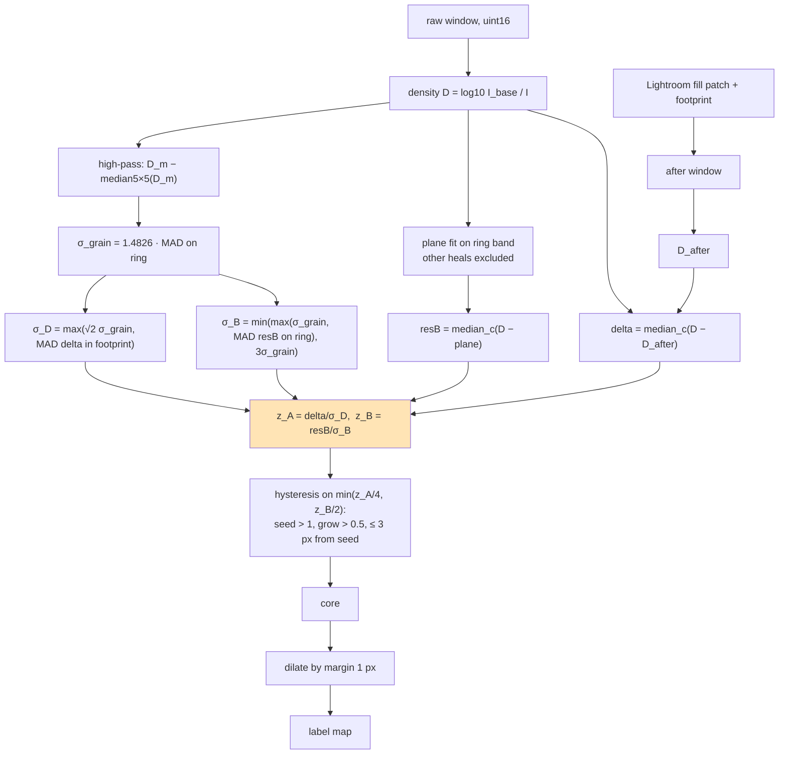
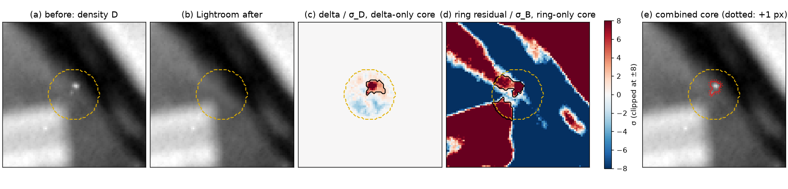
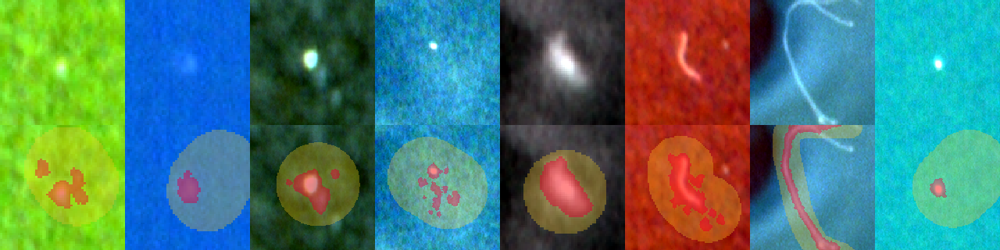
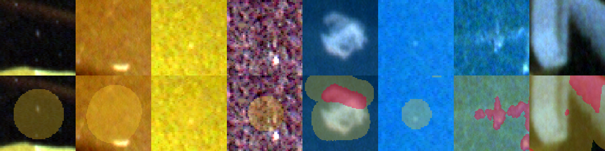
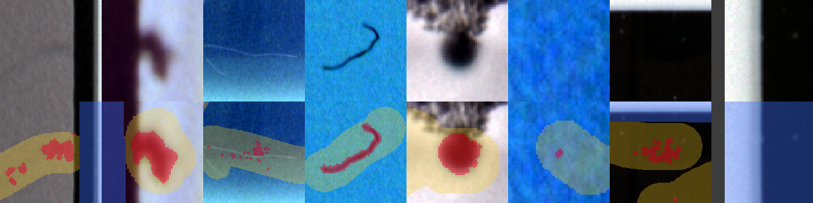

# Film Dust Dataset, Part 4: Finding the Dust Inside the Heal — A Technical Deep Dive

This report covers Phase 4 of the film-dust dataset project: turning each of the 10,698 Lightroom heals into a pixel mask of the dust it removed, and writing one label map per scan that a detector can train on. Earlier phases established where the heals are ([[PROJECT REPORT - Film Dust Dataset - Part 0 - What Lightroom Knows About Your Dust - A Technical Deep Dive|Part 0]]) and proved that their coordinates land on the raw scan with sub-pixel accuracy ([[PROJECT REPORT - Film Dust Dataset - Part 3 - Proving the Coordinate Transform - A Technical Deep Dive|Part 3]]). A heal, however, is not a label. It is a circle or brush stroke drawn generously around a speck, and on a median manual circle the drawn radius is 3.7 times the radius of the dust inside it. Training on the whole footprint would teach a detector that dust is a disc of film grain with a dark spot somewhere in it.

The phase took five tuning iterations before the rule was frozen, and those iterations are the heart of this chapter. Each one failed in a specific, measurable way, and each failure pointed at a wrong assumption about noise. The final rule is short: a pixel is dust if Lightroom removed it *and* it stood out from its surroundings in the original scan. Getting there required three different noise estimates, a cap, and a change of units.

> [!summary]
> - **Two signals, one rule.** The Lightroom delta (original minus Lightroom's own fill) says what was removed; the ring residual (original minus a plane fitted around the heal) says what was anomalous. A core seeds where delta > 4σ_D *and* ring residual > 2σ_B, and grows at half those thresholds within 3 px of a seed.
> - **Noise is the whole problem.** Film grain σ comes from a high-pass image; the ring σ is grain or ring structure, capped at 3× grain; the delta σ is √2·grain or the delta's own spread, whichever is larger. Each choice fixes a failure seen in a previous iteration.
> - **Result.** Cores are found for 97.95% of manual circles and 98.9% of brushes, with a 1 px margin. The 722 label maps hold 4.61 million dust pixels (0.036%), 37.0 million ignore pixels inside heals, and 1.77 billion ignore pixels outside the frames.

## 1. Why a heal is not a mask

A heal is drawn by a person who wants the speck gone, not by a person drawing a segmentation. The circle is placed by eye, usually with room to spare, so that the Remove tool's fill covers the speck and its blur halo. Brush strokes are painted with a brush wide enough to be comfortable at the zoom level in use. Neither shape was meant to say "exactly these pixels are dust".

The numbers from the frozen run make the gap concrete. For the 3,629 manual circles with a detected core, the heal radius has a median of 14.7 px (10th–90th percentile 9.1–29.8 px), while the core, converted to the radius of a disc of equal area, has a median of 4.0 px (2.0–7.9 px). The ratio of the two has a median of 3.67 and an interquartile range of 2.73 to 5.30. In area, the core covers a median of 9.1% of its heal's footprint, and over all heals the dust pixels make up 8.2% of the footprint pixels.

| Quantity (manual circles with a core) | p10 | median | p90 |
|---|---:|---:|---:|
| Heal radius, px | 9.1 | 14.7 | 29.8 |
| Core radius (√(area/π)), px | 2.0 | 4.0 | 7.9 |
| Heal radius / core radius | 2.73 (p25) | 3.67 | 5.30 (p75) |

*Table 1. How much larger a heal is than the dust inside it.*

A detector trained on footprints would therefore label about eleven pixels of clean film as dust for every pixel of actual dust. The phase exists to remove that error. It also has to be honest about what it cannot resolve: pixels inside a heal that are not core are not reliably background, because a faint part of the speck may lie below the detection threshold. They become an *ignore* class, not negative examples.

## 2. Two signals

Phase 4 works in density, D = log10(I_base / I), where I is the raw linear value and I_base is the film-base value measured per scan in Phase 1. Dust blocks light, so it lowers I and raises D. Density makes a speck's contrast roughly independent of how bright the surrounding image is, and it makes per-channel signals comparable. Every signal below is computed per channel and combined by the median over the three channels, because dust darkens all channels and a colour detail in the image usually does not.

Two independent pieces of evidence exist for each heal.

**Signal A, the Lightroom delta.** Part 0 showed that the catalog's side store holds Lightroom's own fill for every Remove heal, decodable to raw units. Pasting it into the raw scan inside the footprint gives the "after" image, and

```text
delta = median_c( D_before − D_after )        (zero outside the footprint)
```

is exactly what the user's edit removed. Its weakness is that the fill is a synthesized texture. Even where there was no dust, the fill's grain differs from the original's grain, so the delta is never zero inside the footprint.

**Signal B, the ring residual.** This is the specification's original method. Take a band around the footprint (from 0.5 to 1.5 times the heal radius outside its edge, at least 1.5 to 4 px, minus the footprints of all other heals), fit a plane per channel to D on that band, and subtract it:

```text
resB = median_c( D − plane_c(x, y) )
```

The specification asked for the ring *median*; the plane replaces it so that a smooth gradient across the heal does not show up as a one-sided residual. The ring residual knows nothing about the edit. It says only which pixels inside the heal differ from a smooth background, which includes the dust, and also every piece of image structure that happens to pass through the heal.



*Figure 1. The per-heal computation in `dustds/masks.py:tighten`.*

Both signals are thresholded the same way: by *hysteresis*. Pixels above a high threshold seed a core; connected neighbours (8-connectivity) above a low threshold join it; components without a seed are discarded; a core needs at least 2 pixels. Hysteresis keeps a faint tail attached to a strong centre without letting isolated noise pixels count. The thresholds were fixed by the specification at 4σ and 2σ. Everything that follows is about what σ should be.

## 3. The iterations

All runs processed all 10,698 heals in about 110 seconds and were judged on two things: the fraction of manual circles with a core, and contact sheets of random heals with their label overlays. The sheets mattered more than the rate. A rate of 99% is worthless if the cores are blobs covering the whole disc.

| # | Noise model and rule | Manual circles with core | Other observations | Diagnosed cause |
|---|---|---:|---|---|
| 1 | Spec: ring residual only, σ = ring-median MAD | 82.6% | margin 1 px; obvious specks missed | ring MAD inflated 2.5–6× by image structure |
| 2 | σ_grain from high-pass for both signals, plane background | 98.95% | heal/core 2.83, bright 721, IoU with ring core 0.49, margin 3 px | delta picks up fill-texture differences |
| 3 | Separate floors: σ_D = max(√2·grain, delta MAD), σ_B = max(grain, ring MAD) | 98.65% | margin 1 px; cores blobby, polarity wrong in places | each signal alone still admits non-dust |
| 4 | Combined: delta > 4σ_D AND ring > 2σ_B | 95.5% | tight cores, bright 112, IoU 0.71 | ring σ 7–100× grain where rings cross film edges |
| 5 | σ_B capped at 3·grain | 97.95% | bright 129, margin 3 px, cores spread onto structure | margin measured in capped-σ units; unbounded growth |
| 6 | Margin in grain units (median), growth ≤ 3 px from seeds (frozen) | 97.95% | brushes 98.9%, margin 1 px, heal/core 3.67 | — |

*Table 2. The tuning history of Phase 4, from the project diary (Steps 12 and 13).*

### 3.1 Iteration 1: the specification's ring noise

The specification estimated σ as 1.4826 times the median absolute deviation (MAD) of the ring around the heal. The MAD is a robust spread estimate, and the factor 1.4826 makes it equal the standard deviation for Gaussian data. On a flat patch of sky this is exactly the grain noise. Real heals are not on flat patches of sky. The ring around a speck on a branch, a window frame, or the edge of a face contains structure, and the MAD of structure is large.

The first full run found cores for 82.6% of manual circles, and the contact sheets showed obvious specks without one. On three such heals the ring MAD was 0.0115–0.0276 density units, while the grain σ measured on a high-pass image was about 0.0045. The noise estimate was inflated 2.5 to 6 times, so a speck four grain-σ above the background was barely one "ring-σ" above it.

The fix was a better estimate of grain. A 5×5 median filter removes features larger than a few pixels while keeping grain, so the high-pass image `D_m − median5×5(D_m)` on the ring contains grain and little structure. Its MAD is the grain σ:

```python
Dm = np.median(D, axis=2)
hp = Dm - ndimage.median_filter(Dm, size=5, mode="nearest")
sg = max(1.4826 * float(np.median(np.abs(hp[ring] - np.median(hp[ring])))), 1e-4)
```

On the frozen data, σ_grain has a median of 0.0046 density units (10th–90th percentile 0.0024–0.0089), and the plane-fitted ring MAD is a median of 2.21 times larger, with a 90th percentile of 20.9 times. Iteration 1's diagnosis holds across the whole dataset, not only on the three heals examined.

### 3.2 Iteration 2: grain for everything, and over-detection

Using σ_grain for both signals raised the rate to 98.95%. It also broke almost everything else. The median ratio of heal radius to core radius fell to 2.83, meaning cores had grown by a third in radius. The number of heals whose core was *brighter* than the background rose to 721. The IoU between the delta core and the ring core fell to 0.49, and the margin estimate (Section 5) rose to 3 px.

The cause sits in the delta. Before and after both carry grain, so even a perfect fill would give a delta with noise √2·σ_grain. But Lightroom's fill is not a perfect continuation of the original grain; it is texture borrowed from elsewhere, and it differs from the original by more than grain does. Measured against grain alone, those texture differences crossed 4σ, in both directions, all over the footprint. The detector was finding the fill, not the dust.

### 3.3 Iteration 3: separate noise floors

The third iteration gave each signal its own floor, taking the larger of a physical lower bound and an empirical spread:

```text
σ_D = max( √2 · σ_grain ,  1.4826 · MAD(delta over the footprint) )
σ_B = max( σ_grain ,       1.4826 · MAD(resB over the ring) )
```

Using the MAD of the delta over the footprint works because dust covers only a small fraction of the footprint (a median of 9%, Table 1), so the MAD is dominated by fill-texture differences, which is the noise the delta must be measured against. On the frozen data σ_D sits at its √2·grain floor for 56.3% of heals, and above it for the rest, with a 90th percentile of 4.5 times grain.

This gave 98.65% and a margin of 1 px. The sheets still showed blobby cores, and the polarity (dark or bright) was chosen by whichever core had the larger area, which was wrong wherever a bright texture blob outgrew a small dark speck. The diagnosis was that each signal, even with a correct floor, admits a class of non-dust: the delta admits fill texture, the ring residual admits image structure.

### 3.4 Iteration 4: requiring both

The two classes of false positive do not overlap. A place where the fill merely differs in texture is not anomalous in the original scan; a piece of image structure crossing the heal is usually reproduced by Lightroom's fill, so the delta there is small. Dust is the thing that is both. Iteration 4 made that the rule, by running hysteresis on the minimum of the two normalized signals:

```python
zA, zB = delta / sd, resB / sB
coreC_dark = hysteresis(np.minimum(zA / 4, zB / 2), 1.0, 0.5, fp, max_dist=3.0)  # max_dist added in iteration 6
```

A pixel seeds a core when z_A > 4 *and* z_B > 2, and joins a core when z_A > 2 *and* z_B > 1. The ring threshold is half the delta threshold because the ring signal is the cross-check, not the primary evidence: the delta already says the pixel was removed, and the ring only has to confirm that the original pixel was unusual. Polarity was also changed from "larger area" to "stronger peak": both polarities are computed, and bright wins only if its core exists and its peak of min(z_A, 2z_B) is more than 1.5 times the dark peak, since dust on a negative is almost always dark.

Cores became tight, IoU between the combined core and the ring-only core rose to 0.71, and bright cores fell to 112. The rate fell to 95.5%, and the sheets showed why: obvious specks lying near a film edge, a frame border, or a strong density step had no core. There the ring crosses the edge, the plane fit cannot model a step, and the ring σ_B was 7 to 100 times grain. With σ_B that large, z_B never reached 2 and the AND could not be satisfied. On the frozen data, 19.7% of heals have a ring MAD above 7 times grain.

### 3.5 Iteration 5: capping the ring σ

The ring floor was capped at three times grain:

```python
sB = min(max(sg, sg_ring), 3.0 * sg)
```

The cap is safe because of the AND. The ring signal no longer has to reject structure on its own; the delta does most of that, so a ring σ that underestimates the noise near edges only lets the ring condition pass, and the delta still has to agree. On the frozen data, 36.6% of heals hit the cap.

The rate returned to 97.95% of manual circles (98.5% overall), with 129 bright cores. Two problems remained. The margin estimate jumped to 3 px, with a measured edge profile of [7.25, 4.45, 3.31, …]σ, and some cores spread from the speck onto image structure next to it.

### 3.6 Iteration 6: the right yardstick, and compact growth

The 3 px margin was an artifact of units. The edge profile was measured in units of the capped σ_B, which near structure is three times grain, while the signal just outside a core near structure is the structure itself. Measured in those units, everything near an edge looked like blur. The profile has to be measured in grain units, `resB / σ_grain`, because blur is an optical property of the scanner and should be compared with grain, the noise of the film. Taking the median over cores instead of the mean also stops a few cores next to strong structure from dominating. The result was [1.93, 0.84, 0.50, 0.22, 0.11] grain σ at distances 1 to 5 px, and a margin of 1 px (Section 5).

The spread onto structure was a growth problem. Hysteresis grows a component as far as the low threshold allows, and next to an edge both z_A and z_B can exceed half their thresholds along the edge for many pixels. Growth was therefore restricted to pixels within 3 px of a seed pixel (`max_dist=3.0`). Round specks are unaffected, because their seeds cover their centre; hairs and scratches are followed along their length, because seeds occur all along a hair and each seed licenses growth around itself. With these two changes Phase 4 was frozen.

## 4. A worked example

One heal shows the whole mechanism. Heal `eb7bfe5744e38208_012` is a manual circle of radius 14.7 px on a frame from the 2025-09-08 folder. The speck sits just inside a strong diagonal density edge.



*Figure 2. One heal through `tighten`. The dashed yellow line is the heal footprint (680 px). Panels (c) and (d) use the same diverging scale, clipped at ±8σ, with the single-signal cores outlined in black.*

The noise estimates for this heal show why each step of the history was needed:

| Quantity | Value | In grain units |
|---|---:|---:|
| σ_grain (high-pass MAD on the ring) | 0.00083 | 1 |
| Plane-fitted ring MAD | 0.0547 | 66 |
| σ_B (capped) | 0.0025 | 3 |
| σ_D (MAD of delta in the footprint) | 0.0085 | 10.2 |
| Delta-only core / ring-only core / combined core | 70 / 204 / 32 px | — |
| Peak delta / peak ring residual | 27.6σ_D / 83.2σ_B | — |

*Table 3. The worked example's numbers, reproduced exactly by `scripts/56-p4-worked-example.py`.*

The ring crosses the edge, so the ring MAD is 66 times grain. Without the cap, σ_B would have been 0.0547 and the speck's peak ring residual 3.8σ_B instead of 83.2σ_B; this bright speck would still have seeded, but a speck one fifth as strong would not have, which is exactly the failure iteration 4 showed. With the cap, the ring residual (panel d) is enormous everywhere the edge is, and the ring-only core (204 px) spreads up into the edge and down into the bright corner of the footprint. The delta (panel c) is clean outside the footprint by construction, but inside it the fill's texture differences enlarge the delta-only core to 70 px, a blob around the speck. The combined core (panel e) is 32 px, the intersection that is both removed and anomalous, and it sits on the speck. Its IoU with the ring-only core is 0.146, one of the low values in the dataset-wide distribution (median 0.686, 25th percentile 0.425).

## 5. The margin

A core found at 2σ still misses the outermost, faintest pixels of the speck, where blur from the scanner's optics spreads the shadow of the dust. The specification asked for a dilation of the core by m pixels, with m measured rather than guessed.

Pass 1 of `scripts/14-build-masks.py` samples 400 manual heals (seeded), finds cores for 396 of them, and for each core measures the mean ring residual, in grain σ, on the one-pixel-wide rings at distances 1, 2, …, 5 px outside the core. The per-distance median over cores is the edge profile:

| Distance outside core | 1 px | 2 px | 3 px | 4 px | 5 px |
|---|---:|---:|---:|---:|---:|
| Median residual, grain σ | 1.93 | 0.84 | 0.50 | 0.22 | 0.11 |

*Table 4. The frozen edge profile, stored as `masks.edge_profile_sigma` in `config.yaml`.*

The margin is the number of rings whose residual is still at least 1σ: here only the first, so m = 1. In code, it is the first distance below 1σ minus one, clamped to [1, 3]. That "minus one" was itself a bug fixed during the first trial run (diary Step 11): taking the first distance below 1σ as the margin gave 2 px for a profile of [1.74, 0.76, …], where only one ring is above 1σ.

The margin applies to every heal (`margin_px = 1` on all 10,698 records). Dilating a median core of 137 px by one pixel gives a median core-plus-margin of 198 px.

## 6. The frozen rule and its results

The full rule, as implemented in `dustds/masks.py:tighten` and `scripts/14-build-masks.py:process`:

1. Rasterize the footprint in the raw grid (circle with radius r·max(W, H), or the union of brush dabs, `dustds/lrpatches.py:footprint`); use Lightroom's stored mask for the 23 generative heals that have one.
2. Build the ring band, excluding all other footprints on the image, and compute D, the plane background, resB, and σ_grain.
3. Paste Lightroom's fill into the footprint, compute the delta and σ_D, and σ_B with its cap.
4. Seed where z_A > 4 and z_B > 2; grow where z_A > 2 and z_B > 1, within the footprint, within 3 px of a seed; keep cores of at least 2 px.
5. Choose polarity (dark unless bright is clearly stronger), dilate by 1 px, record the per-heal fields.

Four heals have no Lightroom patch; for those the ring signal alone decides (`core_source = "ring"`). Two have a ring too small to fit (`ring_too_small`), and one has a zero-area `pm_target` box.

| Group | Heals | Core found |
|---|---:|---:|
| Manual circles | 3,705 | 97.95% |
| Manual brushes | 6,923 | 98.92% |
| Generative Remove (brush) | 69 | 89.86% |
| Legacy heal (circle) | 1 | 100% |
| **All** | **10,698** | **98.52%** |

*Table 5. Core detection on the frozen run.*

| Field | Distribution |
|---|---|
| polarity | dark 10,411 · bright 129 · none 158 |
| quality | ok 10,538 · no_core 158 · check 2 |
| core_area_px | p10 23 · median 137 · p90 752 |
| contrast_sigma (peak z_A in core) | p10 9.1 · median 21.7 · p90 54.6 |
| elongation (√ eigenvalue ratio) | median 1.72 · p90 4.55 · p99 15.0 |
| core_iou_ring | median 0.686 · p25 0.425 (n = 10,537) |

*Table 6. Per-heal fields in `labels/heals_tight.jsonl`.*

Each record in `labels/heals_tight.jsonl` is the Phase 2 heal record extended with the pixel centre and equivalent radius of the core, its area with and without margin, polarity, peak contrast, elongation, bounding box, all four noise estimates, the peak of each signal, the ring-only core area, flags (`edge` 63, `multi_mask` 5, `no_lr_patch` 4, `zero_pm_target` 3, `ring_too_small` 2) and a quality grade. The noise estimates are kept so that a later phase can re-threshold without rerunning the pipeline.

### 6.1 The heals without a core

158 heals have no core: 76 manual circles, 75 manual brushes and 7 generative heals. They are mostly faint. Their peak delta has a median of 3.66σ_D, just under the 4σ seed threshold, and a 25th percentile of 3.02σ_D. The ring signal is weaker still (median 4.21σ_B, 25th percentile 2.04). A few are heals over structure where Lightroom's fill changed something that was not anomalous in the scan. None of them are discarded: their footprints stay label 2 (ignore), so the faint speck that the user saw and removed is never presented to a detector as clean background.

### 6.2 Bright polarity

129 cores are brighter than the surrounding film, meaning the marked object let *more* light through than the film around it. On a negative that is not dust but missing density: a pinhole in the emulsion, a scratch that removed emulsion, or a defect in the film itself. They are mostly brushes (93 manual and 11 generative, against 25 circles), and they are more elongated than dark cores (median elongation 2.17 against 1.72), which fits scratches. They stay in the dataset with `polarity = "bright"`, so a later phase can include or exclude them as a separate class.

## 7. Label maps

Every physical DNG gets one label map, `labels/{image_id}_label.png`: 8-bit greyscale, the same height and width as the raw image, in the stored (unrotated) orientation that Part 3 established for the heals.

| Value | Meaning | Pixels | Share |
|---:|---|---:|---:|
| 0 | background: not marked as dust (may still hide unmarked dust) | 10,894,557,205 | 85.73% |
| 1 | dust core plus 1 px margin | 4,609,452 | 0.036% |
| 2 | ignore: inside a heal footprint but not core, or a heal with no core | 36,992,185 | 0.29% |
| 3 | ignore: outside every crop, holder gaps, opaque holder | 1,772,141,878 | 13.95% |

*Table 7. Label semantics and totals over the 722 maps (`labels/label_counts.json`).*

The values are written in a fixed order: label 2 for every footprint, then label 1 for every core plus margin, then label 3 last, overriding everything else. Overlapping heals and the label-3 override explain why label 1 holds 4.61 million pixels while the per-heal core-plus-margin areas sum to 4.90 million. The imbalance is the defining property of the dataset: there is one dust pixel for every 2,360 background pixels.

Label 0 deserves its caveat. It means "not marked", not "clean". Not every scan was cleaned, and the ones that were may have specks the user did not bother to remove. Phase 5 and the gold set of Phase 8 deal with that; the label map only records what the heals say.

### 7.1 Frames and crop polygons

Label 3 starts with the crops. A multi-frame strip is split into frames in Lightroom by giving each virtual copy its own crop (Part 0), and the area outside every copy's crop is rebate, holder or a neighbouring frame that was never looked at for dust. The 722 DNGs carry 1,114 frames: 576 images have one, 50 have three, 76 have four, and four have ten or eleven. `labels/{image_id}_frames.json` stores each copy's normalized crop, its crop angle, the polygon in pixels and its bounding rectangle.

Crops are stored in the raw, unrotated normalized space, like the heals; `NOTES.md` records the evidence (on one 3288 × 9810 strip the copies' crop tops and bottoms tile the long raw axis). 67 crops on 62 images are rotated, by a median of 0.24° and at most 1.21°. For those, the code assumes that Lightroom's `CropAngle` rotates the rectangle about its own centre, positive clockwise in image coordinates. This is an assumption, not a measurement, and it is still open. If the sign is wrong, a corner of a frame 3,000 px long is displaced by twice the angle times 1,500 px: about 13 px at the median angle and 63 px at the largest. That error affects only which border pixels are label 3, not any dust core.

### 7.2 Holder and gap mask

The second part of label 3 is the holder. The image is reduced to 8 × 8 block means (the same blocks used for film-base estimation in Phase 1); a block is "bad" if any channel mean is at least 63,000 (light through a gap, no film) or below 600 (opaque holder). The first version marked every bad block, and thin dark lines inside the image (a cable, a black window frame) became rows of blocky label-3 squares. The fix keeps only connected regions of at least 64 bad blocks, which is 4,096 pixels, so holder areas survive and image detail does not.

## 8. Reading the check sheets

Three contact sheets were made from the frozen labels by `scripts/15-mask-check-sheets.py`, which picks eight random heals per group and fetches two crops of each from the dustview viewer. Each sheet has eight tiles of 160 × 160 px. The **top row** is the raw scan rendered as a positive with a local contrast stretch; the **bottom row** is the same window with the label map overlaid: **red** is label 1 (dust core plus margin), **yellow** is label 2 (ignore inside a heal), **blue** is label 3 (ignore outside the crop or holder). The window is three times the heal radius, at least 48 and at most 400 px, centred on the core, so small heals are shown more magnified than large ones. Because the overlay draws the label map, not a single heal, a tile shows every label in its window, including the cores of neighbouring heals.

In positive mode dust appears *bright*: it is dark on the negative, and inverting the negative makes it light.



*Figure 3. Heals with a dark core. The red cores sit on the bright specks inside much larger yellow footprints; the seventh tile is a hair loop painted with a brush, and the core follows the hair along its length.*

The found sheet shows what the rule was tuned for: the red regions sit on the visible specks, and the yellow footprints around them are three to four times wider. Two tiles show cores split into several small fragments around one speck on textured film, which is the expected appearance of a core grown only within 3 px of separate seeds.



*Figure 4. Heals without a core. Most tiles show a uniform yellow footprint over a speck that is barely visible or not visible at all; red regions in some tiles belong to neighbouring heals.*

The no-core sheet confirms Section 6.1: the specks are faint, or the heal covers image detail rather than an isolated speck. They remain ignore regions, which is the safe outcome.



*Figure 5. Bright-polarity heals. In positive mode they appear dark, because they were light on the negative. Several are real emulsion damage (a dark hair-like scratch, a round pinhole); some tiles at film or holder edges show scattered small cores and blue label-3 regions.*

The bright sheet is the least clean. Real pinholes and scratches are there, with cores that follow them, but tiles near film borders and holder edges show scattered cores that look like residue of the edge rather than defects. With 129 heals, about 1.2% of the dataset, this group is small enough to review by hand or to exclude.

## 9. What remains open

Phase 4 is frozen, but three items are recorded for later review:

- The crop-rotation convention for 67 rotated crops is assumed, not verified; it needs one visual check of a rotated frame boundary against the viewer.
- The 158 no-core heals are faint specks just below the 4σ seed threshold; they are kept as ignore regions, and a lower threshold or the Phase 8 gold set could recover some of them.
- The bright-polarity group contains real pinholes and scratches and some edge artifacts; it is kept separate so that later phases can decide how to use it.

The key points from Phase 4:

- A heal is about 3.7 times the radius of the dust inside it, so footprints are not labels; the non-core part of each footprint is an ignore class, never background.
- No single noise estimate works. Ring statistics are inflated by structure, grain alone is too small for the Lightroom delta, and the ring σ explodes at film edges; each estimate needs a floor, and the ring σ needs a cap.
- Requiring both signals is what makes cores tight. The delta rejects image structure, the ring residual rejects fill texture, and dust is what passes both.
- Units matter as much as thresholds. The 3 px margin was an artifact of measuring blur in capped-σ units; in grain units the edge profile is [1.93, 0.84, 0.50, …] and the margin is 1 px.
- The label maps are extremely imbalanced (one dust pixel per 2,360 background pixels), and label 0 means "not marked", not "clean".

The next phase, Phase 5, splits the dataset by roll and by scan session, never by frame, because dust on the scanner glass repeats across a session and a frame-level split would leak it from training into test.

## Sources

- Repository: `/Users/manuel/code/wesen/2026-11-07--dust-scanning`
- Ticket: `ttmp/2026/11/07/DUST-001--film-dust-dataset-from-lightroom-heals/` — `reference/01-diary.md` (Steps 5, 11, 12, 13), `reference/02-build-instructions.md` (Phase 4 specification)
- Code: `dustds/masks.py` (`tighten`, `hysteresis`, `ring_mask`, `margin_profile`), `dustds/lrpatches.py` (`footprint`), `scripts/14-build-masks.py`, `scripts/15-mask-check-sheets.py`
- Report support scripts: `scripts/55-p4-report-stats.py` (recomputes every frozen-run number above), `scripts/56-p4-worked-example.py` (Figure 2)
- Data: `~/dustds/labels/heals_tight.jsonl`, `~/dustds/labels/label_counts.json`, `~/dustds/labels/*_label.png`, `~/dustds/labels/*_frames.json`, `~/dustds/config.yaml` (`masks` block), `~/dustds/NOTES.md`
- Check sheets: `various/14-masks-found.png`, `14-masks-nocore.png`, `14-masks-bright.png`
