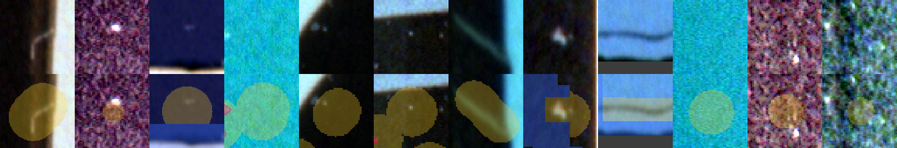
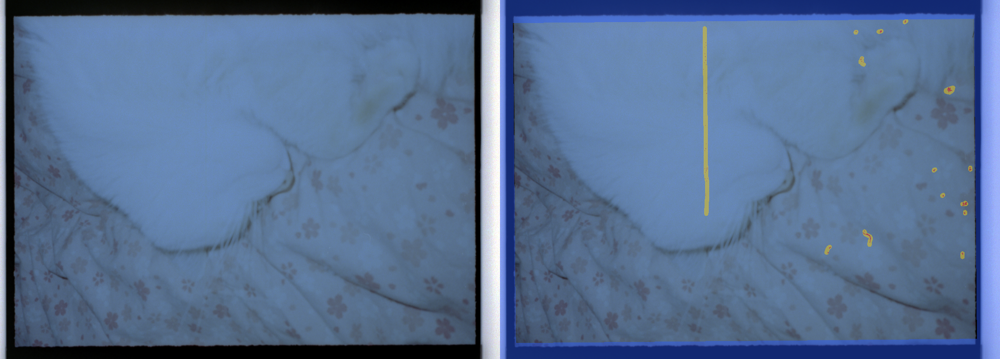
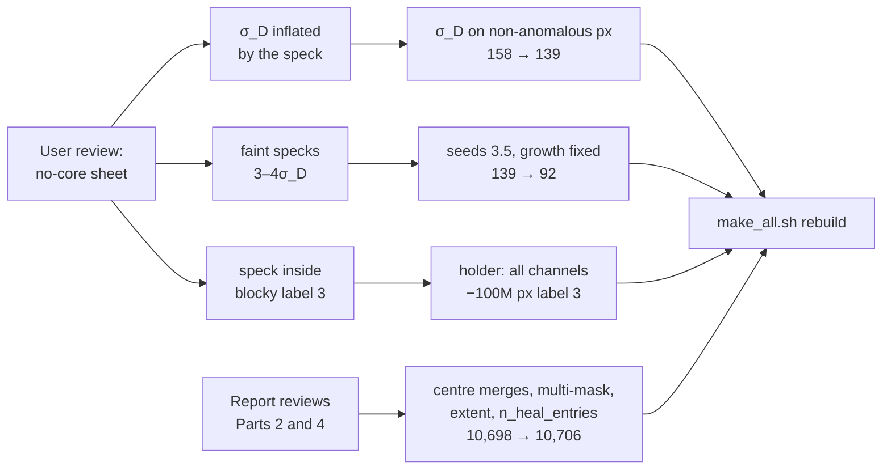

# Film Dust Dataset, Part 4b: What Changed After Review — A Technical Deep Dive

This note is a follow-up to [[PROJECT REPORT - Film Dust Dataset - Part 4 - Finding the Dust Inside the Heal - A Technical Deep Dive|Part 4]] and, for a few heal counts, to [[PROJECT REPORT - Film Dust Dataset - Part 2 - Turning Catalog Entries into Labels - A Technical Deep Dive|Part 2]]. Both reports describe the pipeline as it was frozen at the time and remain correct descriptions of that run. After they were written, two reviews changed the pipeline. The first was the user's: looking at a contact sheet of heals for which no dust core had been found, he wrote that "most of these have a reasonably well visible core inside the heal". The second was the report writing itself, which re-derived every number from the data and found four defects in Phase 2. This note explains each change, why it was needed and what it did to the numbers. Where this note and Parts 2 or 4 disagree, this note is current.

The changes are small in code and uneven in effect. Two lines in the noise estimate and one new function for the thresholds reduced the heals without a core from 158 to 92. One character of logic in the holder mask (`all` instead of `any`) returned 100 million pixels from the ignore class to film. The Phase 2 fixes added 8 heals. Every number below was recomputed from the current outputs in `~/dustds`, and the noise-floor and threshold changes were replayed on all 10,706 heals to separate the effect of each step.

> [!summary]
> - **The noise floor of the delta was measured on the dust.** σ_D was the MAD of the Lightroom delta over the whole footprint; a large or blurry speck raised it and hid itself. It is now the MAD over footprint pixels that are *not* anomalous in the scan (|ring residual| < 2σ_B). No-core 158 → 139.
> - **Seeds at 3.5σ, growth unchanged.** Lowering the delta seed from 4 to 3.5σ_D recovers faint specks; growth thresholds had to be decoupled from the seed level, or every existing core grew. No-core 139 → 92; manual circles with a core 97.95% → 98.76%.
> - **The holder rule needed all channels.** Label 3 marked a block as holder if *any* channel was saturated or dark, which caught clear colour-negative base and dense highlights. Requiring *all* channels returned 100.1 million pixels (5.6% of label 3) to film.
> - **Phase 2 fixes.** Same-photo re-heals are no longer merged by centre, multi-mask brushes use the union of their masks, `lr_extent` is measured in pixels, and the per-image count is renamed `n_heal_entries`. Unique heals 10,698 → 10,706.

## 1. What changed, in numbers

Table 1 lists every number from Parts 2 and 4 that moved. Numbers not listed did not change: the margin is still 1 px on every heal, the edge profile and σ_grain are untouched, and the label semantics are the same.

| Quantity | Part 2 / 4 | Now | Source of the change |
|---|---:|---:|---|
| Unique heals | 10,698 | 10,706 | centre merges only across photos (§5.1) |
| Centre-rule merges | 13 | 5 | same |
| Manual circles / brushes | 3,705 / 6,923 | 3,707 / 6,929 | same |
| Heals with a Lightroom patch | 10,694 | 10,702 | same |
| Heals without a core | 158 | 92 | σ_D on background, seeds 3.5 (§2, §3) |
| Core found: manual circles | 97.95% | 98.76% | same |
| Core found: manual brushes | 98.92% | 99.36% | same |
| Core found: generative | 89.86% | 97.10% | same |
| Core found: all heals | 98.52% | 99.14% | same |
| Polarity dark / bright | 10,411 / 129 | 10,473 / 141 | same |
| σ_D at its √2·grain floor | 56.3% | 75.5% | σ_D on background |
| Core area, median (p90) | 137 (752) px | 153 (902) px | σ_D on background |
| Heal radius / core radius, manual circles, median | 3.67 | 3.43 | same |
| Peak contrast in core, median | 21.7σ_D | 24.6σ_D | same |
| core_iou_ring, median | 0.686 | 0.672 | same |
| Label 1 (dust) pixels | 4,609,452 | 5,766,740 | larger cores, new cores, holder rule |
| Label 2 (ignore in heal) pixels | 36,992,185 | 36,103,081 | cores took footprint pixels |
| Label 3 (ignore outside) pixels | 1,772,141,878 | 1,672,062,026 | holder rule (§4) |
| Background pixels per dust pixel | 2,360 | 1,907 | all of the above |
| Phase 3 calibration hit rate (0.3r) | 0.733 | 0.727 | seeded sample drawn from the new heal list |

*Table 1. Before → after. "Now" values are recomputed from `labels/heals_tight.jsonl`, `labels/heals_log.json`, `labels/label_counts.json` and `qa/integrity.json` by `scripts/60-p4b-report-stats.py`; the calibration value is from `qa/integrity.json`.*

The rows group into three causes, and the rest of this note takes them in order: the delta noise floor and the seed threshold (Sections 2 and 3), the holder rule (Section 4), and the Phase 2 fixes (Section 5).

## 2. The noise floor that measured the dust

Part 4 Section 3.3 defined the noise of the Lightroom delta as

```text
σ_D = max( √2 · σ_grain ,  1.4826 · MAD(delta over the footprint) )
```

and justified the second term by noting that dust covers a median of 9% of the footprint, so the MAD of the delta is dominated by the fill's texture differences. The median is right; the tails are not. On a large or out-of-focus speck the dust covers a large share of the footprint, and on a heal drawn tightly around a speck it can cover more than half. The MAD then measures the speck, σ_D grows, and z_A = delta / σ_D shrinks until no pixel reaches the seed threshold. The rule had been built so that a heal could not find its dust exactly when the dust was largest.

The diagnosis was quantitative. Diary Step 21 measured σ_D / (√2·σ_grain) on the 155 no-core heals that have a delta: the median was 1.00, but the 75th percentile was 1.90, against 1.41 for heals with a core. The replay in `scripts/61-p4b-rule-variants.py` reproduces both values on the current heals (1.00 and 1.90 for the 155; 1.41 for found heals). Roughly half the no-core heals had an inflated floor; the other half sat at the floor and were simply faint, with a delta peak between 3 and 4σ_D.

The fix uses the ring residual, which is already computed, to decide which footprint pixels are background. A pixel whose ring residual is within 2σ_B of the plane is not anomalous in the original scan, so whatever the delta does there is fill texture, which is exactly the noise σ_D is meant to measure:

```python
# dustds/masks.py:tighten
bgfp = fp & (np.abs(resB) < 2.0 * sB)
dfp = delta[bgfp] if bgfp.sum() >= 20 else delta[fp]
sd = max(math.sqrt(2.0) * sg, 1.4826 * float(np.median(np.abs(dfp - np.median(dfp)))))
```

The fallback to the whole footprint applies when fewer than 20 background pixels remain. With this change σ_D changed on 4,425 of the 10,700 heals that have a delta, with a median ratio new/old of 0.81 (10th percentile 0.44). The share of heals at the √2·grain floor rose from 56.2% to 75.5%. No-core fell from 158 to 139, and the 33 heals that gained a core have a median core of 757 px: large specks, as the diagnosis predicted.

Two side effects are not in the diary. First, the new floor is lower for most changed heals, so z_A is higher and existing cores grow: 37% of cores changed area, with a median ratio of 1.000 but a 90th percentile of 1.30 and a 99th of 2.90. This is the main reason the median core area rose from 137 to 153 px and label 1 grew by 25%. Second, the floor can also rise: where the background pixels are noisier than the footprint as a whole, σ_D goes up, and 14 heals lost their core under fix 1. The net count is 33 gained minus 14 lost, which gives 158 → 139. Two of the 14 are recovered by the lower seed of Section 3; for the other 12, σ_D rose by 1.9 to 14.8 times and they remain without a core.

## 3. Seeds at 3.5σ, and why growth had to be decoupled

The remaining no-core heals with a flat noise floor were faint specks whose delta peaked between 3 and 4σ_D. The second change lowered the delta seed from 4 to 3.5σ_D, keeping the ring seed at 2σ_B.

The first attempt did more than that. In Part 4 the combined core was hysteresis on one signal, `min(z_A/4, z_B/2)`, with seed > 1 and growth > 0.5, so the growth thresholds were *derived* from the seed thresholds: growth at z_A > 2 and z_B > 1. Replacing the 4 by 3.5 moved delta growth to 1.75σ_D as well, and every existing core grew. The diary records a median area ratio of ×1.086 and a 99th percentile of ×1.94 for that attempt. The replay, measured against the fix-1 cores on the current heal list, gives ×1.065 and ×1.81, with 90% of cores changing; the two measurements were taken on different baselines, but both show a systematic inflation of cores that had nothing to do with faint specks.

The fix is a hysteresis on two signals with four independent thresholds:

```python
# dustds/masks.py
def hysteresis_two(a, b, seed_a, seed_b, grow_a, grow_b, allowed, max_dist=3.0, min_area=2):
    seeds = (a > seed_a) & (b > seed_b) & allowed
    grow = (a > grow_a) & (b > grow_b) & allowed
    grow &= ndimage.distance_transform_edt(~seeds) <= max_dist
    ...
coreC_dark = hysteresis_two(zA, zB, 3.5, 2.0, 2.0, 1.0, fp)
```

Seeds need z_A > 3.5 and z_B > 2; growth still needs z_A > 2 and z_B > 1, within 3 px of a seed. A seed threshold decides *whether* a speck is found; a growth threshold decides *how large* its core is. Coupling the two meant that a decision about recall silently changed every mask in the dataset.

With the decoupled rule, cores relative to fix 1 have a median area ratio of ×1.006 and a 90th percentile of ×1.12, both as in the diary; 47 heals gained a core, with a median of 9 px, and none lost one. No-core fell from 139 to 92. The rejected coupled attempt would have reached 90.


*Figure 1. The rule variants replayed on all 10,706 heals (`scripts/61-p4b-rule-variants.py`, `62-p4b-variants-figure.py`). Panel (b) shows how each step changed the cores that existed before it. A curve that rises vertically at 1 means the step left cores alone; the dashed orange curve, shifted right as a whole, is the coupled attempt that inflated every core. The blue curve's long right tail is the σ_D fix enlarging cores whose noise floor dropped, and its short left tail the cores that shrank where σ_D rose.*

The replay recomputes the per-heal arrays of `tighten` once and applies four rules to them. Its final variant agrees with the stored `core_area_px` on all 10,700 heals that have a Lightroom patch, which validates the replay before it is used to say anything about the intermediate rules. Its first variant is Part 4's rule applied to today's heal list, and it gives exactly Part 4's 158 no-core heals.

| Rule | Delta σ_D from | Seeds (z_A, z_B) | Growth (z_A, z_B) | No-core |
|---|---|---|---|---:|
| Part 4 (frozen) | whole footprint | 4, 2 | 2, 1 | 158 |
| Fix 1 | non-anomalous footprint pixels | 4, 2 | 2, 1 | 139 |
| First attempt (rejected) | same | 3.5, 2 | 1.75, 1 | 90 |
| Final | same | 3.5, 2 | 2, 1 | 92 |

*Table 2. The four rules and their no-core counts. Counts include the 3 heals that have no usable delta (two with a ring too small to fit, one zero-area pm box decided by the ring alone).*

The ring-only cores, which are used for the 4 heals without a Lightroom patch and for `core_iou_ring`, also use `hi = 3.5` now, since `tighten`'s default seed changed; they still grow at 2σ_B.

### 3.1 The 92 heals that still have no core

The remaining no-core heals are 46 manual circles, 44 manual brushes and 2 generative heals. Their delta signals fall into three groups:

- 57 have a delta peak below 3.5σ_D: Lightroom's fill removed nothing that stands out from its own texture.
- 32 have a delta peak of at least 3.5σ_D, but the ring residual does not confirm it at the same pixels; the fill changed something that was not anomalous in the original scan.
- 3 have no usable delta (`ring_too_small` twice, one zero-area pm box).

The contact sheet the user's comment led to shows what these look like.



*Figure 2. No-core heals after fix 1 (139 no-core state), from `various/14-masks-nocore-after-fix.png`. Read each column as one heal: the top tile is the scan as a positive, where dust appears bright; the bottom tile overlays the label map (yellow: heal footprint without a core; red: dust from neighbouring heals; blue: label 3).*

The tiles separate into the causes the diary lists. In the second, third, fifth and sixth columns a small bright speck is visible inside the yellow disc, on a very dark or very busy area; these are the faint specks, and the 3.5σ_D seed of Section 3 was aimed at them. In the eleventh and twelfth columns the speck lies beside the disc, not in it. In the fourth and tenth columns nothing is visible at all. In the first and seventh the heal covers a line-like feature rather than an isolated speck, and in the ninth a band of density at a frame border. The eighth column is the one that exposed the holder bug: a clear speck inside a blocky blue region, on near-clear film, where label 3 had overwritten the frame (Section 4).

Part of the remainder cannot be recovered from inside the footprint. When the user placed a heal next to the speck rather than on it, Lightroom's fill removed whatever fell inside the circle, and the speck itself lies outside the footprint, where it is label 0. Diary Step 21 records this as a possible follow-up: search for the speck just outside the footprint.

## 4. The holder rule

Label 3 marks pixels that no one looked at for dust: everything outside every crop, and the holder. Part 4 Section 7.2 detected the holder on 8 × 8 block means, marking a block as bad if *any* channel mean was at least 63,000 (light through a gap, no film) or below 600 (opaque holder), and keeping connected regions of at least 64 bad blocks.

The rule is wrong for colour negatives. A gap in the holder passes unfiltered light, and all three channels saturate together; the opaque holder blocks all three together. Film does neither, but a single channel of film can come close. The red channel of clear orange-masked base reaches about 61,000, which is within noise of the threshold on thin negatives, and the blue channel of a dense highlight can fall below 600. On such frames large regions of image were flagged as holder, merged into components far above 64 blocks, and became label 3. Every dust core inside them was overwritten, because label 3 is written last.

```python
# scripts/14-build-masks.py
bad = ((bm >= fb["saturated"]).all(2) | (bm < fb["dark"]).all(2))   # was .any(2)
```

The effect is visible in the totals: label 3 fell by 100,079,852 pixels, 5.6% of its previous size, and label 0 grew by 99.8 million. Some of the 1.16 million new label-1 pixels are cores that the old rule had overwritten, but without the old label maps that share cannot be separated from the core growth of Section 2. The diary counts 148 images in which more than 1% of the area changed. The largest change is image `dd2e03f0af57f5b7`, a thin, nearly clear negative, which regained 62% of its area; it now has 17.9% label 3.



*Figure 3. Image `dd2e03f0af57f5b7` after the fix, from `various/14-holder-rule-fix.png`. Left: the scan as a positive. Right: the label overlay; blue is label 3, yellow is heal footprint, red is dust. Under the "any channel" rule most of the frame interior was blue; now only the rebate and the holder are.*

The figure shows only the corrected state. The frame interior is uncovered film, with a vertical brush stroke along a scratch and a dozen small heals on the right, each with a red core inside a yellow footprint. Before the fix, those cores existed in `heals_tight.jsonl` but were invisible in the label map.

Phase 1's film-base estimator still excludes blocks with *any* channel saturated or dark. That is harmless there, since it only removes candidate blocks from a percentile, but it is now inconsistent with the label rule.

## 5. The Phase 2 fixes

The Part 2 and Part 4 report writers each found defects while re-deriving their numbers. They were logged as known issues so that the published numbers stayed valid, and fixed together before the first full rebuild with `make_all.sh` (diary Step 22).

### 5.1 Centre merges within one photo

Phase 2 deduplicates heals that appear on a master and its virtual copies, first by identical `pm_patch` digest (580 merges) and then by centres within 0.002 in normalized coordinates (13 merges). The Part 2 writer found that 8 of those 13 had all their entries on the same `lr_local_id`: the same speck healed twice on one photo, not a copy duplicate. In two of them the dropped stroke was the larger one, so footprint area was lost.

The centre rule now requires `h["lr_local_id"] != k["lr_local_id"]`. The 5 remaining centre merges are all across photos (four on `db1a3bfc0316c183`, one across three photos on `fb72e756972fcfa6`). The 8 same-photo pairs are now separate heals, which raises the count from 10,698 to 10,706 (2 circles, 6 brushes). In 7 of the 8 pairs both heals have a core; in `c4168f7e7561b5c4` the smaller stroke has none and is kept as ignore.

### 5.2 Multi-mask brushes

Five heals have more than one mask, all generative brushes painted in several passes. Phase 2 used the first mask only. For `dab2ef3827893ca9_003` the first mask spans x 241–667 of a pm box spanning 226–992, so more than half the heal was lost. `dustds/heals.py:geometry` now checks that every mask is an additive paint mask (`What = "Mask/Paint"`, `MaskValue` 1, not inverted) and concatenates their dabs, inserting an `r <Radius>` token before each mask so that each pass keeps its own brush radius. All 5 multi-mask heals are of this kind, and `heals_log.json` now records them as "additive paint masks (union of dabs)". `dab2ef3827893ca9_003` now has a 40,213 px footprint and a 2,792 px core.

### 5.3 Extent in pixels

`heals.extent()` measured a brush stroke's half-diagonal from normalized coordinates, `hypot(Δx/W, Δy/H)`, and the report multiplied it by the long side. For a stroke along the short axis this overstates the length. The function now measures in pixels, `hypot(Δx·W, Δy·H) / max(W, H)`. Recomputed on the current brushes, the old formula overstates by a median of 5.2% and a 90th percentile of 30%; the extreme case, `fb72e756972fcfa6_005`, falls from 3,291 to 2,608 px. No pipeline step reads `lr_extent`, so no label changed.

### 5.4 n_heals counted entries

`meta/physical.jsonl` had a field `n_heals` that counted catalog `RetouchAreas` entries including copy duplicates, which sum to 11,291, not the number of unique heals. The field is renamed `n_heal_entries`, and the viewer computes the unique count per image from the heals file. On the current data the two differ for 19 images.

## 6. Reading the current state

The revised rule, stated once in full:

1. σ_grain from the high-pass MAD on the ring; σ_B = min(max(σ_grain, ring MAD), 3σ_grain) (unchanged).
2. σ_D = max(√2·σ_grain, MAD of the delta over footprint pixels with |resB| < 2σ_B), falling back to the whole footprint below 20 such pixels.
3. Seeds: z_A > 3.5 and z_B > 2. Growth: z_A > 2 and z_B > 1, connected to a seed and within 3 px of one; at least 2 px.
4. Polarity, 1 px margin and label order as in Part 4.
5. Label 3: outside every crop, or in a connected region of at least 64 blocks where *all* channels are ≥ 63,000 or *all* are < 600.



*Figure 4. Where each change came from.*

The rebuild propagated all of this downstream: the diary records 7,248 sprites, 101,698 tiles and a reselected gold set of 50 tiles from 14 rolls, with all QA checks passing, and a second full run reproduced all 30,181 output files byte for byte. Those phases are the subject of the later reports.

The key points:

- A noise estimate taken over a region that contains the signal measures the signal; σ_D is now measured only where the scan says there is no anomaly.
- Seed thresholds and growth thresholds answer different questions, recall and mask size, and must be set independently; coupling them inflated every core when only recall was meant to change.
- The σ_D fix did change existing cores, contrary to the diary's summary: 37% changed area, cores grew by a median of 3% from the Part 4 rule to the final rule, and 12 heals that had a core in Part 4 have none now. Label 1 is 25% larger than in Part 4, mostly for this reason.
- A per-channel threshold has to match the physics it detects: a holder gap or the opaque holder affects all channels at once, while film base and dense highlights affect one channel strongly.
- No-core is now 92 heals (0.86%); most are heals with no removable signal or placed beside the speck, and all stay label 2.

## Sources

- Repository: `/Users/manuel/code/wesen/2026-11-07--dust-scanning`
- Ticket: `ttmp/2026/11/07/DUST-001--film-dust-dataset-from-lightroom-heals/` — `reference/01-diary.md` (Steps 16, 21, 22, 23), `reference/06-diary-report-writer-part-2.md`, `reference/08-diary-report-writer-part-4.md`, `reference/10-diary-report-writer-part-4b.md`
- Code: `dustds/masks.py` (`tighten`, `hysteresis_two`), `dustds/heals.py` (`geometry`, `extent`), `scripts/12-extract-heals.py`, `scripts/14-build-masks.py`, `scripts/10-inventory.py`
- Report scripts: `scripts/60-p4b-report-stats.py` (every "now" number in Table 1 and Sections 3.1 and 5), `scripts/61-p4b-rule-variants.py` (replay of the four rules on all heals), `scripts/62-p4b-variants-figure.py` (Figure 1)
- Data: `~/dustds/labels/heals_tight.jsonl`, `~/dustds/labels/heals_log.json`, `~/dustds/labels/label_counts.json`, `~/dustds/meta/physical.jsonl`, `~/dustds/qa/integrity.json`, `~/dustds/NOTES.md`
- Figures: `various/14-masks-nocore-after-fix.png`, `various/14-holder-rule-fix.png`
