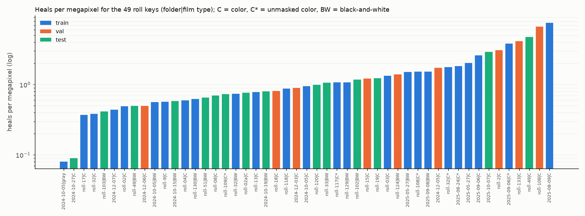
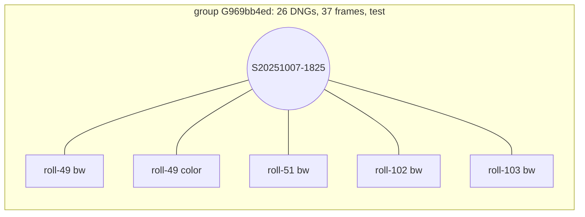
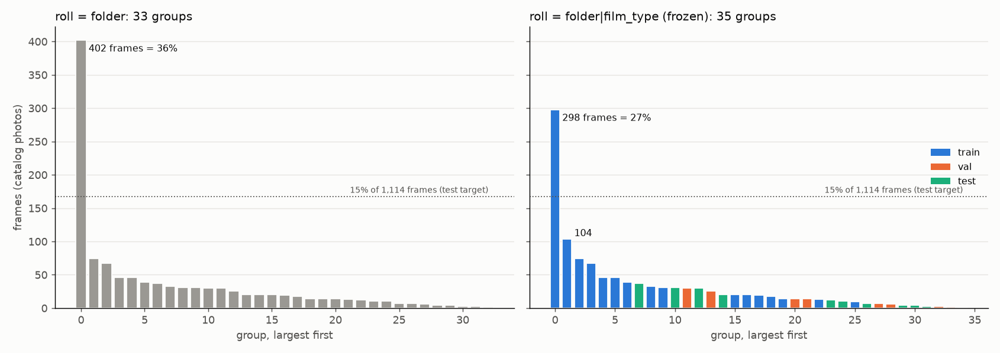
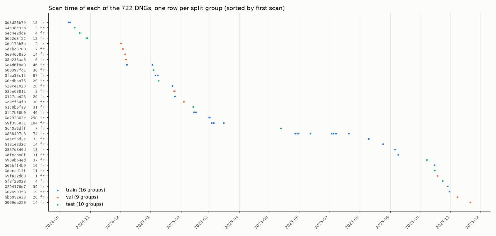
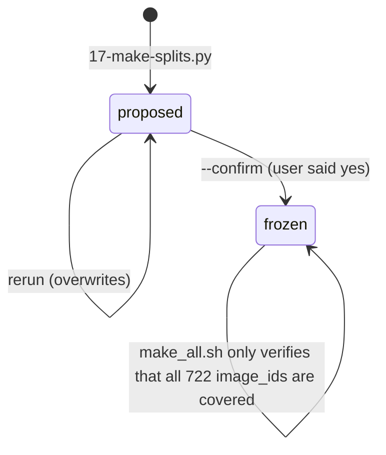

# Film Dust Dataset, Part 5: Splitting by Roll and Scan Session — A Technical Deep Dive

This report covers Phase 5 of the film-dust dataset project: dividing the 1,114 healed frames into train, validation and test sets in a way that a detector cannot cheat on. [[PROJECT REPORT - Film Dust Dataset - Part 1 - Inventory, Scan Sessions and the Color of Unexposed Film - A Technical Deep Dive|Part 1]] recovered the two facts this phase needs for every scan: the folder ("roll") it is filed in, and the scan session it was made in, defined by gaps of more than three hours in VueScan's scan times. [[PROJECT REPORT - Film Dust Dataset - Part 4b - What Changed After Review - A Technical Deep Dive|Part 4b]] described the fixes that changed the heal count after the split was frozen; this report shows how much that matters (it does not change any assignment) and where the numbers in `splits.json` are stale. The background on what a heal is and where Lightroom stores it is in [[PROJECT REPORT - Film Dust Dataset - Part 0 - What Lightroom Knows About Your Dust - A Technical Deep Dive|Part 0]].

The phase is short in code, about 140 lines in `scripts/17-make-splits.py`, but it contains three decisions that determine whether every later evaluation number means anything: what unit is never split, what a "roll" is in an archive whose folders mix films, and how whole groups of very different sizes are packed into a 75/10/15 split.

> [!summary]
> - **The split unit is a connected component, not a frame.** Union-find over roll and session joins two scans if they share either; whole components go to one split. 722 DNGs form 35 groups.
> - **A roll is a folder *and* a film type.** With roll = folder, one component holds 402 of 1,114 frames (36%), more than the whole test target. Splitting folders by film type cuts it into 298 + 104 frames, and is still leak-safe because scans that share a session merge anyway.
> - **Greedy packing, largest group first, against a squared-error cost per (split, film type).** Result: train 852 frames (76.5%), val 103 (9.2%), test 159 (14.3%); no roll key and no session crosses splits.
> - **The split is frozen.** The user confirmed it; `--confirm` set `status: "frozen"`, the script refuses to overwrite a frozen file without that flag, and `make_all.sh` only verifies it. Its summary heal counts (10,698) predate the 8 heals added later (10,706 now).

## 1. Why a frame-level split leaks

A random split by frame is the default in most image datasets, and it is wrong here for a physical reason. Dust that sits on the scanner glass, on the anti-Newton-ring glass of the holder or on the holder itself does not move between frames. It lands in the same place on every frame scanned until someone cleans the glass, which in practice means for the rest of a sitting. The specification states this as the rule for the whole phase: *split by roll and by scan session, never by frame or tile.*

If one frame of a session is in train and its neighbour in test, a detector can score well on the test frame by recognizing specks it has already seen at the same pixel positions. The resulting test score measures memorization of a session's dust, and it would be highest exactly for the sessions with the most persistent dust. Nothing in the test number would reveal this.

The second reason is that dust density varies so much between rolls that the roll itself is a strong feature. Figure 1 shows heals per megapixel for each of the 49 (folder, film type) keys, computed on the current label file.



*Figure 1. Heals per megapixel for each roll key (pooled heals over pooled raw megapixels of its DNGs), on a log scale. Bars are colored by the split the key landed in.*

The pooled rate ranges from 0.081 heals per MP (the single grayscale scan of `2024-10-05`) to 7.65 (`2025-08-09`), a factor of 95; restricted to keys with at least five DNGs it is still 0.090 to 7.65, a factor of 85. The diary's statement in Step 19, "more than 40×", was read off the QA report's chart of *median per-image* rates and understates the spread. A model evaluated on frames from rolls it has trained on would be rewarded for learning each roll's base rate. Keeping rolls whole removes that.

## 2. Groups by union-find

A roll and a session are two different partitions of the same scans, and they disagree in both directions. Part 1 found eleven folders spanning more than one session (roll-32 spans six) and six sessions spanning more than one folder (`S20251007-1825` covers roll-49, roll-51, roll-102 and roll-103 in one six-hour sitting). Keeping rolls whole and keeping sessions whole at the same time requires the transitive closure: if scan *a* shares a roll with *b*, and *b* shares a session with *c*, then *a* and *c* must land in the same split.

That closure is the set of connected components of a bipartite graph whose nodes are scans, roll keys and sessions, with an edge from each scan to its roll key and to its session. Union-find computes it in one pass:

```python
for r in phys.itertuples():                     # one row per physical DNG (722)
    union(("img", r.image_id), ("roll", r.roll_key))
    union(("img", r.image_id), ("ses", r.session))
roots = {r.image_id: find(("img", r.image_id)) for r in phys.itertuples()}
```

`find` uses path halving and `union` attaches one root to the other; at this size neither optimization matters, but the structure makes the invariant obvious. Every component gets a stable name, `G` plus the first eight hex digits of the SHA-1 of its sorted member `image_id`s, so the same scans always produce the same group name regardless of iteration order.



*Figure 2. One group as a graph. A single six-hour session touches five roll keys in four folders, so all of them form one component and go to test together.*

The units deserve precision because the spec counts in frames and the data has three levels. A *physical DNG* (722) is one file and one `image_id`; the union-find runs over these, because roll and session are properties of a file. A *frame* (1,114) is one catalog photo, a master or a virtual copy, each with its own crop; a strip DNG of three frames contributes three. Targets and the result tables count frames. *Megapixels* are summed over physical DNGs (raw width × height), not over crop areas, so a strip is counted once.

## 3. What a roll is

The first probe, `scripts/16-probe-groups.py`, ran the union-find with the obvious roll definition, the folder below `Scans/`. The output was decisive:

```text
=== roll = folder: 33 groups; largest 402 frames = 36.1% of 1114
(ses, S20250315-2140)  images 125  frames 402  heals 1628  rolls 1  sessions 6
                       films {'bw': 28, 'color_negative': 96, 'color_negative_unmasked': 1}
```

One group, roll-32, holds 36% of all frames. It is larger than the whole 15% test target and the whole 10% validation target combined, so it must go to train, and the remaining 34 groups have to carry both evaluation sets. A single group of that size also makes the split fragile: any change to the session rule that merges one more session into it moves the balance by several percent.

Part 1 had already shown why roll-32 is so large. The folder is not a roll of film: it holds 96 masked color scans, 28 B&W scans on a bluish base, and one masked color frame whose dense sky makes it read as unmasked. These were scanned in different sittings. Defining the roll key as `folder|film_type` separates the films:

```text
=== roll = folder+film: 35 groups; largest 298 frames = 26.8% of 1114
(ses, S20250301-1518)  images 97  frames 298  heals 944  rolls 1  sessions 2   films {color_negative 96, unmasked 1}
(ses, S20250315-2140)  images 28  frames 104  heals 684  rolls 1  sessions 4   films {bw 28}
```

The color scans of roll-32 sit in two sessions (`S20250228-1904`, `S20250301-1518`) and the B&W scans in four others (from `S20250303-2004` to `S20250315-2140`); the two sets share no session. Figure 3 shows both distributions side by side.



*Figure 3. Frames per group, largest first. Left: roll = folder (33 groups). Right: roll = folder|film_type (35 groups), each bar colored by its frozen split. The dotted line is the 15% test target.*

Is the finer key safe? The risk of splitting a folder is that two films scanned together could land in different splits and share glass dust. They cannot, because the session edge is still in the graph: two scans in the same session are merged whatever their film. The folder edge only adds merges for scans that are in different sessions, where the leak argument does not apply. The finer key therefore removes merges that were never required for leak safety and keeps every merge that was. The one folder whose films did land in different splits is roll-108: its single masked color frame (session `S20251018-1848`) went to val and its ten unmasked frames (`S20251015-1513`) to train, three days apart.

The finer key does not separate two films of the same type in one folder. That case can occur in the 14 date folders that are used as rolls instead of `roll-NN` folders (for example `2024/12/2024-12-07` or `2025/05/2025-05-27`). It errs on the safe side: such a folder stays merged and is one larger group.

## 4. Assignment: greedy packing with a squared-error cost

With 35 groups whose sizes run from 298 frames down to 1, an exact partition into 75/10/15 percent is a bin-packing problem with a stratification constraint. The spec also asks that the film-type mix be similar in each split. At this size a greedy rule is enough and has the advantage of being readable: sort the groups by frame count, largest first, and put each group into whichever split leaves the overall allocation closest to target.

"Closest" is defined by this cost function, quoted from `17-make-splits.py`:

```python
TARGET = {"train": 0.75, "val": 0.10, "test": 0.15}

def cost(al):          # al[split][film] = frames allocated so far
    c = 0.0
    for s, t in TARGET.items():
        for f in films:
            c += ((al[s][f] - t * tot_film[f]) / max(tot_film[f], 1)) ** 2
        c += 2 * ((sum(al[s].values()) - t * tot_film.sum()) / tot_film.sum()) ** 2
    return c
```

The cost has two kinds of terms. For each split *s* and each film type *f*, the first term is the squared shortfall or excess of that film's frames in that split, measured as a fraction of all frames of that film. Normalizing by the film's own total means that missing 10% of the B&W frames in test costs as much as missing 10% of the color frames, although there are 280 B&W frames and 779 color frames. The second term is the squared deviation of the split's total frame fraction, weighted 2, so overall proportions dominate when they conflict with the per-film mix. Because the cost is evaluated over all three splits at once, including targets not yet reached, putting a group into a split that is still empty is rewarded in proportion to how far that split is from its target.

The order matters. Large groups go first because they are the hardest to place; small groups at the end fill gaps. Groups of equal size are ordered by a draw from `random.Random(seed)` with `seed = 20261107` from `config.yaml`, so ties are broken the same way on every run. The greedy loop is then:

```python
order = sorted(G.group, key=lambda g: (-frames[g], rnd.random()))
for g in order:
    s = argmin over ("train", "val", "test") of cost(alloc with g added to s)   # first minimum wins
    alloc[s] += frames_by_film[g]
```

`scripts/65-p5-report-stats.py` replays this loop with the frozen inputs and prints the cost of each choice. It reproduces all 35 frozen assignments with zero mismatches. The first steps:

| Step | Group | Frames | cost if train | cost if val | cost if test | Chosen |
|---:|---|---:|---:|---:|---:|---|
| 1 | Ga292863c (roll-32 color) | 298 | **2.4566** | 3.6719 | 3.5784 | train |
| 2 | G9f355831 (roll-32 B&W) | 104 | **1.8747** | 2.5004 | 2.4446 | train |
| 3 | G838497c8 (2025-05-27) | 74 | **1.6709** | 1.8391 | 1.8092 | train |
| 8 | G969bb4ed (S20251007-1825) | 37 | 1.3285 | 1.3390 | **1.3230** | test |
| 11 | G1c8b6fa8 (roll-19) | 31 | 1.2606 | 1.2566 | **1.2525** | test |
| 12 | Gc9ff54f0 (roll-18) | 30 | 1.2409 | **1.2370** | 1.2391 | val |
| 35 | G9fa32d68 (roll-108 color) | 1 | 0.1130 | **0.1129** | 0.1129 | val |

*Table 1. Selected steps of the greedy assignment, replayed by `65-p5-report-stats.py`. The bold cost is the minimum. The final cost is 0.11287.*

The first seven groups all go to train, because each is large enough that putting it into val or test would overshoot those small targets more than leaving train short. The eighth, the 37-frame group of Figure 2, is the first that fits a test target of 167 frames well, and from there the choices alternate. The margins late in the sequence are small (step 35 decides by 0.0001), which is expected: a one-frame group barely moves the cost.

## 5. The result

| Split | Groups | DNGs | Frames | Frame share | MP (raw) | Heals frozen | Heals now | Heals now / MP |
|---|---:|---:|---:|---:|---:|---:|---:|---:|
| train | 16 | 497 | 852 | 76.5% | 9,579.0 | 7,456 | 7,462 | 0.78 |
| val | 9 | 86 | 103 | 9.2% | 1,055.0 | 1,665 | 1,666 | 1.58 |
| test | 10 | 139 | 159 | 14.3% | 2,074.3 | 1,577 | 1,578 | 0.76 |
| **total** | 35 | 722 | 1,114 | 100% | 12,708.3 | 10,698 | 10,706 | 0.84 |

*Table 2. The frozen split. "Heals frozen" is the `summary` block of `splits.json`, written when the split was confirmed; "Heals now" is recomputed from the current `labels/heals_tight.jsonl`, after the Step 22 fixes added 8 heals (6 in train, 1 each in val and test). The heals-with-core counts in the summary are stale too, because the Step 21 noise-floor, seed and holder fixes and the Step 22 additions both came after the freeze: frozen 7,350 / 1,649 / 1,541, now 7,402 / 1,656 / 1,556.*

The frame shares miss their targets by 1.5, 0.8 and 0.7 percentage points, which is as close as 35 indivisible groups allow given that one of them is 26.8% of the data. The heal counts do not follow the frame counts. Validation holds 9.2% of the frames but 15.6% of the heals, because its groups include some of the dustiest rolls in Figure 1 (roll-2, roll-133, the 2024-12-05 folder). Heals per megapixel in val is twice that of train and test. The cost function balances frames by film type and knows nothing about heals; a metric computed on val will therefore see denser dust than one computed on test.

| Split | color negative | B&W | unmasked color | grayscale |
|---|---:|---:|---:|---:|
| train | 588 (69.0%) | 220 (25.8%) | 43 (5.0%) | 1 (0.1%) |
| val | 77 (74.8%) | 26 (25.2%) | 0 | 0 |
| test | 114 (71.7%) | 34 (21.4%) | 11 (6.9%) | 0 |
| all | 779 (69.9%) | 280 (25.1%) | 54 (4.8%) | 1 |

*Table 3. Film-type mix in frames per split.* There is no slide film in the archive, the third stratum the spec mentions.

The color and B&W proportions agree within five points across the three splits. The unmasked color film does not reach val at all. The 54 unmasked frames sit in six groups: one frame inside roll-32's large color group, and 7, 10, 11, 11 and 14 frames in five smaller groups. Val's target share is 5.4 frames, so any of these groups overshoots it, and at the moment each was placed the greedy rule found train or test cheaper.

Figure 4 places every DNG on a time axis, one row per group. Each row is either a single short sitting or a run of sittings tied together by a shared roll key, and no two rows of different color share a session by construction.



*Figure 4. Scan times of the 722 DNGs, one row per group, ordered by first scan. Rows such as G838497c8 (2025-05-27 folder, ten sessions over two months) show how a folder ties distant sittings into one group.*

## 6. Integrity, confirmation and freezing

The script checks its own output before writing it. For both the roll key and the session it asserts that each value maps to exactly one split:

```python
for key in ("roll_key", "session"):
    bad = phys.groupby(key).split.nunique()
    assert (bad == 1).all(), f"{key} crosses splits: {bad[bad > 1].index.tolist()}"
```

The QA phase repeats both checks independently and stores them in `qa/integrity.json`: "no roll (folder|film_type, the split unit) crosses splits: 0 crossing", "no session crosses splits: 0 crossing", and as information "folders whose films landed in different splits: roll-108". Its first version compared folders rather than roll keys and reported one crossing, roll-108; the diary (Step 19) records the fix. The same report checks that every sprite comes from train (7,248 sprites) and that clean tiles come only from train and val (91,726 and 9,972), which are the two places where Phases 6 and 8 consume the split.

The spec requires the user to confirm the groups before they are fixed. The split was first written with `status: "proposed"`, and Phases 6 to 8 ran on it provisionally, as announced. When the user asked what remained to confirm, the answer was the split; the user replied "yes", and

```bash
.venv/bin/python ttmp/.../scripts/17-make-splits.py --confirm
```

rewrote the file with `status: "frozen"`. The algorithm is deterministic, so the frozen assignment is identical to the proposed one; a `diff` of `various/17-splits-proposed.json` and `17-splits-frozen.json` with the status field removed is empty. The sprites and tiles built on the proposal stayed valid.



*Figure 5. The life cycle of `splits.json`.*

Two mechanisms keep the freeze. The script itself exits with `splits.json is frozen; refusing to overwrite (spec: never reassign)` if the existing file is frozen and `--confirm` is absent. `make_all.sh`, which rebuilds the whole dataset, does not call the split script at all when the file is frozen; it only asserts that the frozen file covers every `image_id` of the current inventory, and stops if a new scan has appeared. The guard has one gap worth knowing: running the script *with* `--confirm` on a frozen file recomputes and overwrites it. Since the inputs are deterministic this reproduces the same assignment today, but it would silently reassign if the inventory or film types changed.

The frozen file is the contract for all later phases. Besides the summary it maps each group to its split and members, each of the 722 `image_id`s to a split, and each of the 1,114 frames (`image_id:lr_local_id`) to a split. Later phases read `images` or `frames` and never compute a split themselves.

## 7. Limitations

Four properties of this split should be kept in mind when reading evaluation numbers.

- Validation has no unmasked color film. A model's behavior on mask-less color negatives can only be measured on test (11 frames, all from roll-109).
- The `summary` heal counts in `splits.json` are from freeze time (10,698 heals). The assignment does not depend on heals, so it is unaffected, but anyone quoting heals per split should recompute them from `heals_tight.jsonl`, as Table 2 does.
- Fourteen folders used as rolls are date folders. Two films of the same type in one such folder share a key and are merged; this costs balance, not safety.
- The spec's "fully cleaned rolls go to test first" was not applied. No such list exists: the user stated that all rolls have dust (`NOTES.md`). Test therefore contains dust that was never healed, which is what the Phase 8 gold set measures.

The key points from Phase 5:

- The unit of splitting is the connected component of scans under shared roll or shared session, computed by union-find, because dust repeats within a session and dust density differs by up to 95× between rolls.
- A folder is not a roll. Keying rolls by folder and film type cut the largest group from 36% to 27% of the frames without weakening leak safety, because the session edges still merge any scans that shared the glass.
- Whole groups are assigned greedily, largest first with seeded tie-breaks, to the split that minimizes a squared deviation per (split, film type) plus a doubly weighted total-frames term; the result is 76.5 / 9.2 / 14.3 percent of frames.
- The split balances frames, not heals: val carries twice the heal density of train and test.
- The file is frozen after the user's confirmation; reruns refuse to overwrite it, and the full rebuild only verifies coverage.

The next report, Part 6 - Dust Sprites and Clean Tiles, uses this split for the first time: sprites are cut only from train heals, and the clean-tile index draws only on train and validation frames.

## Sources

- Repository: `/Users/manuel/code/wesen/2026-11-07--dust-scanning`
- Ticket: `ttmp/2026/11/07/DUST-001--film-dust-dataset-from-lightroom-heals/` — `reference/01-diary.md` (Steps 7, 8, 17, 19, 20, 22, 23), `reference/02-build-instructions.md` (Phase 5 of the specification), `reference/09-acceptance-checklist.md`
- Dataset notes: `~/dustds/NOTES.md`, `~/dustds/config.yaml` (`seeds.global`, `inventory.session_gap_hours`)
- Scripts: `scripts/16-probe-groups.py` (roll-definition probe), `scripts/17-make-splits.py` (assignment, integrity asserts, freeze), `scripts/make_all.sh` (frozen-split verification), `scripts/22-qa-report.py` (integrity checks)
- Data: `~/dustds/splits.json` (frozen; identical to `various/17-splits-frozen.json`), `various/17-splits-proposed.json`, `~/dustds/meta/images.parquet`, `meta/physical.jsonl`, `meta/dng_meta.jsonl`, `labels/heals_tight.jsonl`, `qa/integrity.json`
- Report statistics and figures: `scripts/65-p5-report-stats.py` (greedy replay, current heal counts), `66-p5-groups-figure.py`, `67-p5-timeline-figure.py`, `68-p5-heals-per-mp-figure.py`
