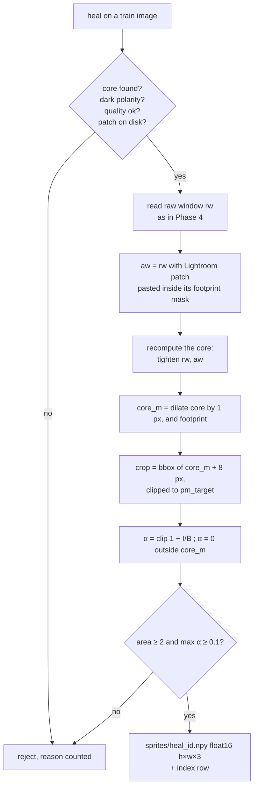
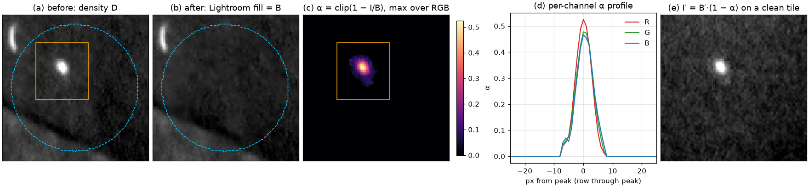
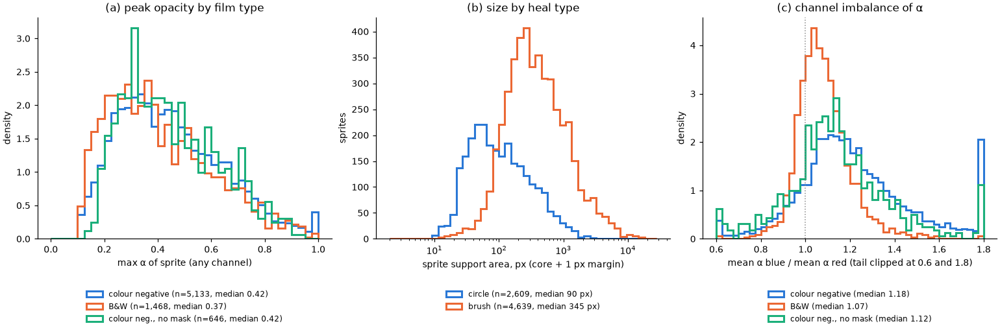
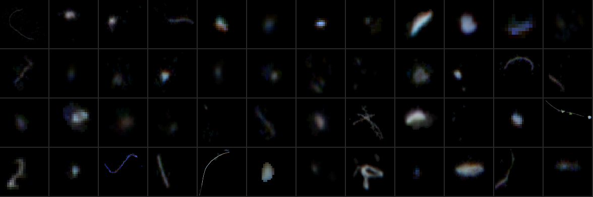
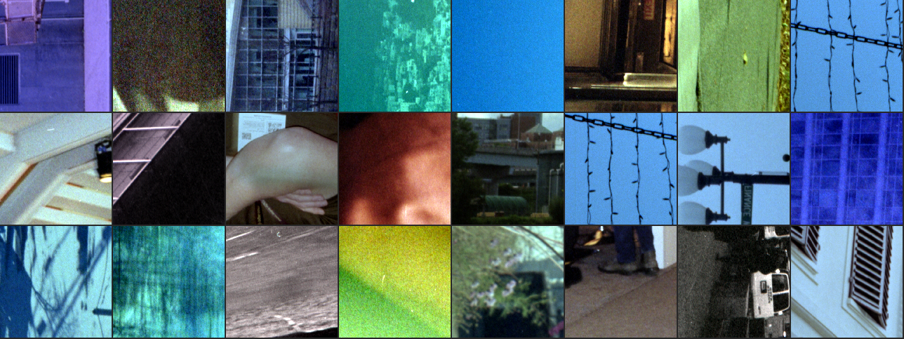
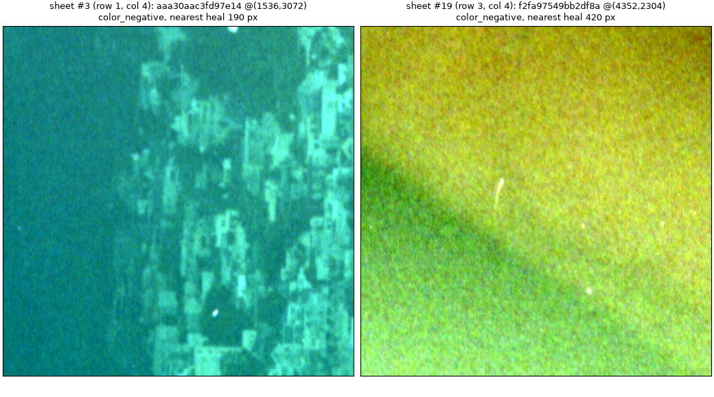

# Film Dust Dataset, Part 6: Dust Sprites and Clean Tiles — A Technical Deep Dive

This report covers Phase 6 of the film-dust dataset project, which produces the two ingredients for synthetic training: a library of real dust particles stored as opacity maps ("sprites"), and an index of 512 px tiles of scan that carry no dust label and can serve as backgrounds. Earlier phases turned every Lightroom heal into a tight dust core ([[PROJECT REPORT - Film Dust Dataset - Part 4 - Finding the Dust Inside the Heal - A Technical Deep Dive|Part 4]]) and split the scans by roll and scan session so that nothing from a test roll can reach training ([[PROJECT REPORT - Film Dust Dataset - Part 5 - Splitting by Roll and Scan Session - A Technical Deep Dive|Part 5]]). Phase 6 consumes both. Its outputs live in `~/dustds/sprites/` and `~/dustds/tiles/`, and every number below was recomputed from those files after the final reproducible rebuild.

The phase has one design decision that departs from the specification, and it is worth understanding before anything else. The specification computed each sprite's background by inpainting the dust with OpenCV's Telea algorithm. The implementation instead uses Lightroom's own fill, the pixels the photographer accepted when the speck was removed, which [[PROJECT REPORT - Film Dust Dataset - Part 0 - What Lightroom Knows About Your Dust - A Technical Deep Dive|Part 0]] showed are stored for every heal in the catalog's side database.

> [!summary]
> - **A sprite is α per channel in linear transmission.** For each training heal, α_c = clip(1 − I_c / B_c, 0, 1) inside the dust core plus a 1 px margin, where I is the raw scan and B is Lightroom's fill. Compositing it onto any clean background B′ as I′ = B′·(1 − α) reproduces the speck.
> - **7,248 sprites from 493 training images.** 7,462 heals lie on training images; 214 are rejected with recorded reasons (bright polarity 107, no core 60, max α < 0.1: 45, no patch 1, quality 1). Median support is 229 px, median peak opacity 0.415.
> - **101,698 tiles, 78,548 clean candidates.** Tiles are 512×512 at stride 256 on training and validation images, never touching a holder or rebate pixel. "Clean" means "no heal within 64 px", which is not the same as "no dust"; the gold set of Phase 8 exists because of that gap.

## 1. What synthetic training needs

Real labels are scarce at the scale a detector wants. The dataset has about ten thousand heals on 722 scans, and the test and validation rolls must stay untouched. The background advice the user provided at the start of the project (`sources/01-modeling-and-lightroom-advice.md`) proposes the standard remedy: cut real dust out of the training scans, paste it onto clean scan regions in random positions, orientations and opacities, and generate a fresh batch every step. The quoted recipe is short:

```text
1. Real dust shapes: inside each heal, find the speck, fill in the background on the raw scan,
   and save how much light the speck blocked (α = 1 − I/B per channel).
2. Clean backgrounds: tiles from cleaned frames, well away from any heal.
3. Combine in linear space: I′ = B·(1 − α). Randomize rotation, flip, size and opacity, match the
   number of specks per tile to the real dust density, add scanner noise back where α is high.
4. Split the dust shapes by roll too.
```

The compositing model follows from what dust physically does on a scanner. A particle on the film or the glass blocks a fraction of the light that would otherwise reach the sensor at that pixel. The scanner records linear transmitted light, so if B is the value the pixel would have had without the particle and α is the blocked fraction, the recorded value is I = B·(1 − α). The model is multiplicative in linear units, which is why it must be applied to the raw DNG values and not to a gamma-encoded or inverted image. In density units, D = log10(I_base / I), the same speck adds a constant −log10(1 − α) whatever the background. A speck with α = 0.415, the median peak in this library, raises density by 0.23 at its center on a bright sky and on a dark shadow alike, which is the property the detector is meant to learn.

Inverting the model gives the sprite: α = 1 − I/B. Everything about Phase 6 follows from having to know B, the background under the dust, at pixels where the dust hid it.

## 2. The background under the dust

The specification's answer was to inpaint the dilated core on the linear image with Telea, per channel, with a radius of 3–5 px. Inpainting propagates values from the boundary inward; it produces a smooth surface with no grain, biased towards whatever structure lies at the edge of the hole. Lightroom's Remove tool solved the same problem when the photographer healed the speck, and its answer is on disk. Part 0 established that the catalog's RocksDB side store holds the fill for all 11,287 Remove heals on scans, and that `raw = lo + (hi − lo)·srgb_to_linear(p)` decodes it to raw counts with a median boundary step of 0.39%.

| Property | Telea inpainting (spec) | Lightroom fill (implemented) |
|---|---|---|
| Source of B inside the core | propagated from the hole boundary | patch-match texture chosen by Lightroom |
| Film grain inside the core | none, a smooth surface | present, from a source region of the same frame |
| Who accepted the result | nobody | the photographer, at full attention |
| Computation per sprite | inpaint on a window | paste a stored PNG through a stored mask |
| Known bias | towards boundary structure | unbiased at the footprint edge (median step 0.39%); unverified at the center |

*Table 1. Two ways to estimate the background B.*

The case for the fill is twofold. It is a decision a person approved: if the fill had left a visible bump or hole, the heal would have been redrawn. And it carries grain, so the per-pixel α of a sprite is the dust's own opacity plus grain noise of the right magnitude, instead of dust plus the full grain amplitude of the original measured against a grain-free surface. The caveat is precise. The boundary-continuity test only measures the join between fill and scan at the edge of the footprint. Nothing measures whether the fill is unbiased at the center of a large footprint, where patch-match copies texture from elsewhere. A fill that is systematically a little brighter than the true background would make every α a little larger. The diary flags this for a second look, and it is the first thing to check if synthetic specks turn out systematically too strong.

## 3. Computing one sprite

`scripts/18-build-sprites.py` processes the 497 training images in a pool of eight workers, in about 32 s. For each heal on a training image, it applies the following steps.



*Figure 1. The per-heal pipeline of `18-build-sprites.py`.*

Three details in this pipeline deserve explanation.

**The core is recomputed, not loaded.** Phase 4 stores per-heal statistics in `heals_tight.jsonl` and writes the union of all cores into one label map per scan, but it does not store each heal's core as its own mask. Where two heals overlap, the label map cannot say which pixel belongs to which. The sprite builder therefore calls `dustds.masks.tighten` again with exactly the same window, the same exclusion of neighbouring footprints and the same "after" image, and takes the dark core `C_dark` from it. Phase 4 is deterministic, so the recomputed core is the stored one. In the first Phase 6 run, two generative heals produced a mismatch, because Phase 4 had used Lightroom's stored mask for them and the recomputation passed none; after the rebuild that reject count is zero.

**α is defined only on the core plus the margin.** Outside `core_m`, the core dilated by the 1 px margin from Part 4 and intersected with the footprint, α is set to zero. Inside it, α is clipped to [0, 1]. Grain makes `1 − I/B` fluctuate around zero everywhere, and keeping those fluctuations outside the core would turn every sprite into a speck surrounded by a square of copied grain.

**The crop stays inside `pm_target`.** The crop is the bounding box of `core_m` padded by 8 px, but clipped to Lightroom's pixel box, because B is only known where the patch exists. The padding is zero-valued α and exists so that rotation and scaling during synthesis do not cut the sprite's edge.

```python
I = rw[cy0:cy1, cx0:cx1].astype(np.float64)
B = aw[cy0:cy1, cx0:cx1].astype(np.float64)
alpha = np.clip(1.0 - I / np.maximum(B, 1.0), 0.0, 1.0)
alpha[~core_m[cy0:cy1, cx0:cx1]] = 0.0
```

Each sprite is saved as `sprites/{heal_id}.npy` in float16, h × w × 3, and gets one row in `sprites/index.parquet` with its heal, image, roll, session, film type, label source, mask type, polarity, elongation, crop size, support area, max α, mean α overall and per channel, crop origin (`x0`, `y0`) in raw pixels, contrast and grain σ. The 7,248 files take 198 MB.

## 4. A worked example

Heal `6947f82fdba4ad45_023` is a manual circle on a colour negative, typical in size and opacity. Its footprint covers 5,308 px inside the 83 × 83 `pm_target` box; the sprite crop is 37 × 34 px, the support (core plus margin) is 254 px, and the peak α is 0.525. `scripts/71-p6-worked-sprite.py` rebuilds the before and after images from the DNG and the patch store, recomputes α in the saved crop, and compares it with the stored `.npy`: the largest difference is 1.2·10⁻⁴, the rounding of float16.



*Figure 2. Heal `6947f82fdba4ad45_023`. (a) The scan in density, with the footprint (dashed cyan) and the sprite crop (orange). (b) Lightroom's fill, used as B. (c) α, maximum over channels. (d) α along the row through the peak, per channel. (e) The same α composited onto a clean tile of another colour-negative training image with I′ = B′·(1 − α).*

Panels (a) and (b) show why the heal is generous: the speck occupies a few percent of the circle. Panel (c) shows the sprite as a soft blob with a small tail, and panel (d) shows its profile: roughly 16 px wide at the base, with R peaking at 0.525 and G and B near 0.47. The profile also shows a property of every sprite in the library. At the edge of `core_m`, α drops from about 0.04 to zero in one step, because pixels outside the support are set to zero instead of tapering. On composited data that step is far below grain (α = 0.04 is a density change of 0.018), but a synthesis stage that scales opacity up should taper the edge rather than amplify the step. Panel (e) is the purpose of the whole phase: the speck on a background it never touched, at its original size and opacity.

## 5. Rejects

The specification requires that rejects be counted with reasons. All 7,462 heals on training images are accounted for: 7,248 became sprites and 214 were rejected.

| Reason | Count | Meaning |
|---|---:|---|
| `bright_polarity` | 107 | Core is lighter than the surround on the negative (pinholes, scratches); α = 1 − I/B would be negative. |
| `no_core` | 60 | Phase 4 found no core inside the footprint (faint speck, or heal placed next to the speck). |
| `max_alpha_lt_0.1` | 45 | Core exists but blocks less than 10% of the light in every channel. |
| `no_patch` | 1 | No Lightroom fill on disk for this heal. |
| `quality_check` | 1 | Phase 4 quality flag is not `ok`. |
| `core_mismatch`, `area_lt_2` | 0 | Recomputed core missing or under 2 px. |

*Table 2. Rejected training heals, from `sprites/rejects.json`.*

Bright-polarity heals are excluded rather than inverted. They are not dust in the sense of the compositing model; a pinhole adds light, and modelling it needs a different equation. Four training images contribute no sprite at all: they hold one, three, one and one heals, and each of those was rejected.

## 6. What the library contains

The distributions below come from `scripts/70-p6-report-stats.py`.

| Quantity | p10 | median | p90 | p99 |
|---|---:|---:|---:|---:|
| Support area (core + 1 px margin), px | 44 | 229 | 1,198 | 4,930 |
| Crop height × width, px | 21 × 21 | 37 × 35 | 94 × 87 | 289 × 235 |
| Max α (any channel) | 0.213 | 0.415 | 0.716 | 0.947 |
| Mean α over the support | 0.059 | 0.114 | 0.237 | 0.434 |
| Elongation | 1.19 | 1.68 | 4.09 | 13.7 |

*Table 3. Sprite statistics, 7,248 sprites.*

| Group | Sprites | Median support, px | Median max α |
|---|---:|---:|---:|
| Colour negative | 5,133 | 234 | 0.424 |
| Black-and-white | 1,468 | 210 | 0.373 |
| Colour negative without orange mask | 646 | 280 | 0.419 |
| Grey B&W (single scan) | 1 | 228 | 0.825 |
| Brush heals | 4,639 | 345 | 0.414 |
| Circle heals | 2,609 | 90 | 0.417 |
| Manual / generative label source | 7,196 / 52 | | |

*Table 4. Mix by film type, mask type and label source.*



*Figure 3. (a) Peak opacity by film type. (b) Support area by heal type, log scale. (c) Ratio of mean α in the blue and red channels, per sprite.*

Panel (a) shows that peak opacity does not depend much on film type; B&W sprites are slightly fainter (median 0.37 against 0.42). Most dust is semi-transparent at scan resolution: only 134 sprites reach α ≥ 0.9 and 47 reach 0.99. A detector trained only on opaque specks would miss the bulk of real dust. Panel (b) separates the two heal types. Circles are small specks, median 90 px of support; brushes are hairs and fibres, median 345 px and median elongation 1.81, with a tail beyond 10,000 px. Brushes outnumber circles almost two to one in the library, so a synthesis stage that samples sprites uniformly will place mostly fibres; it should sample by type to match the target mix.

Panel (c) shows that α is not grey. If dust were a neutral occluder, the three channels would have equal α and the ratio would be 1. On B&W film the median blue/red ratio is 1.07; on colour negative it is 1.18, with a long tail past 1.5. The median per-channel mean α over all sprites is 0.084, 0.090 and 0.098 for R, G and B. The data record this asymmetry but do not explain it; the scanner's per-channel blur and the orange mask's low blue transmission both plausibly contribute. For synthesis the consequence is direct: sprites must be composited per channel, as stored, and a "random tint" augmentation would destroy a real signal.

The QA sheet makes the shapes visible.



*Figure 4. Forty-eight random sprites (`scripts/20-sprite-sheet.py`, seed 7), α as RGB, white = opaque. Each sprite is scaled to fill its 96 px cell, so the cells do not show relative size.*

The sheet shows specks, fibres, curled hairs and one branched fibre, with soft edges and visible colour fringes, the per-channel differences of Figure 3c. Several cells are nearly black: faint specks whose peak α is near the 0.1 floor. The blue hair in the bottom row and the blue block in the top row are the extreme end of the colour-negative channel imbalance.

## 7. The train-only rule

Sprites come only from training images. The rule exists because dust on the scanner glass repeats across a scan session: the same particle can appear on dozens of frames. If a sprite cut from a test-roll frame were pasted into training data, the detector would see that exact particle before being tested on it. Part 5 assigned whole rolls (folder plus film type) and whole sessions to one split; Phase 6 inherits that assignment through `splits.json`.

| Split | Images | Heals | Used for sprites | Used for tiles |
|---|---:|---:|---|---|
| train | 497 | 7,462 | yes (7,248 sprites, 493 images) | yes (91,726 tiles) |
| val | 86 | 1,666 | no | yes (9,972 tiles) |
| test | 139 | 1,578 | no | no |

*Table 5. Split usage in Phase 6.*

The 3,244 heals on validation and test images are never touched by the sprite builder, and no test image appears in the tile index. The QA report of Phase 7 checks both conditions as integrity tests. Validation images contribute background tiles, so that validation-time synthetic data can be built from validation backgrounds, but never dust shapes.

One naming detail matters for anyone filtering sprites by roll. The index's `roll` column holds the scan folder (19 distinct values among sprites), not the split's roll key, which is folder plus film type. The split membership is in the `split` column and is correct; grouping by `roll` merges, for example, the B&W and colour films of the `roll-32` folder.

## 8. The clean tile index

The second output is an index, not a set of images: `tiles/index.parquet` describes every candidate background tile by its image and position, and a training loader reads the pixels from the DNG on demand. `scripts/19-build-tiles.py` builds it for the 583 training and validation images in about two minutes.

The grid is 512 × 512 px at native resolution with a stride of 256, so neighbouring tiles overlap by half. A tile is kept only if it contains no label-3 pixel, which means it lies entirely inside a frame, away from the rebate and the holder. For each kept tile the script records the number of dust (label 1) and ignore (label 2) pixels, the distance to the nearest heal pixel, mean density, a texture score and the image's heals per megapixel.

Counting label pixels in each of roughly 175 tiles per scan would be slow if done by slicing. The script builds an integral image (a two-dimensional cumulative sum) of each label once per scan, after which any box sum is four lookups:

```python
ii1 = np.pad((lab == 1).astype(np.int32).cumsum(0).cumsum(1), ((1, 0), (1, 0)))
def box(ii, x, y):
    return int(ii[y + T, x + T] - ii[y, x + T] - ii[y + T, x] + ii[y, x])
```

The distance to the nearest heal uses a Euclidean distance transform, but not at full resolution: the heal map (labels 1 or 2) is max-pooled by 4 so that a block counts as "heal" if any of its 16 pixels is, the EDT runs on that grid, and the result is multiplied by 4. The error is at most about 4 px, which is irrelevant for a 64 px threshold, and max-pooling errs on the safe side, never placing a heal further away than it is. Density and texture are computed on a 2× strided read of the raw image (every second row and column), with D taken as the median over channels. Texture is the standard deviation of the high-passed density, D minus a Gaussian blur of σ = 2 px at half resolution, which corresponds to 4 px at full resolution.

The clean-candidate rule is the specification's: no label-1 or label-2 pixel in the tile and the nearest heal at least 64 px away.

| Split | Images | Tiles | Clean candidates | Tiles with dust pixels |
|---|---:|---:|---:|---:|
| train | 496 | 91,726 | 72,238 | 14,141 |
| val | 86 | 9,972 | 6,310 | 2,843 |
| total | 582 | 101,698 | 78,548 | 16,984 |

*Table 6. Tile index counts, from `tiles/index.parquet`.*

Of the 23,150 tiles that are not clean, 18,236 contain a heal pixel and 4,914 are excluded only by the 64 px distance. One training image (1680 × 3652 px, `7fad2b5e9e72db4f`) has no tile at all, because every 512 px window on it touches label 3. Thirty tiles lie on images without any heal; their distance is recorded as 10⁶. Texture has a median of 0.011 (p10 0.006, p90 0.026) and mean density a median of 0.28 (p10 0.05, p90 0.60), and the clean candidates have the same texture distribution as the tile population as a whole. Clean candidates are by film type 64,945 colour negative, 10,895 B&W, 2,617 colour negative without mask and 91 grey B&W, so the background mix is more strongly colour-negative than the sprite mix.

## 9. "Clean" means "not marked"

The tile rule can only use the labels it has. A tile is a clean candidate when nobody healed anything within 64 px of it. It is not a statement that the tile contains no dust. The photographer healed the dust that mattered for a particular print or export, on the frames that were worth the effort; specks in out-of-focus areas, on frames that were never printed, or simply missed, have no heal and therefore label 0.



*Figure 5. Twenty-four random clean candidates (`scripts/21-tile-sheet.py`, seed 11), positive view with per-tile stretch, label overlay on. The colours are dustview's unbalanced positive, not a colour-corrected rendering.*

Most tiles in Figure 5 are what a background should be: sky, wood, skin, a façade. Several show small bright marks, which on the positive view means something that blocked light on the negative. Two of them at full size:



*Figure 6. Clean candidates #3 and #19 from Figure 5 at full resolution (`scripts/73-p6-unmarked-specks.py`). Left: two bright specks, at the top edge and in the lower centre, 190 px from the nearest heal. Right: a short fibre and two dots on a green field, 420 px from the nearest heal.*

These are unhealed dust. If such tiles are used as backgrounds, the synthetic labels will mark the pasted sprite as dust and the real speck beside it as background, and the detector will be penalised for finding real dust. The effect is bounded: unmarked specks are rare per tile and small, so the error is a few hundred wrongly-negative pixels among 262,144. But it cannot be fixed with the labels that exist, and it has two consequences in the plan. Evaluation needs a set in which every speck has been checked by eye, which is the gold set of Phase 8, selected from test-split tiles only. And training should eventually include hard-example rounds, in which the detector's confident detections on "clean" tiles are reviewed and either labelled as dust or confirmed as background.

## 10. What the rebuild changed

Phase 6 first ran on the Phase 4 labels of the initial freeze. The user's review of the no-core sheet in the QA report led to three Phase 4 fixes (a robust delta noise floor, seeds at 3.5σ, and a holder rule that requires all channels), and Phase 6 was rebuilt with everything downstream. A second full `make_all.sh` run reproduced all outputs byte for byte.

| Quantity | First run | Final rebuild |
|---|---:|---:|
| Sprites | 7,215 | 7,248 |
| Rejects: no core / bright / max α < 0.1 / core mismatch | 106 / 95 / 36 / 2 | 60 / 107 / 45 / 0 |
| Median support area, px | 202 | 229 |
| Tiles (train + val) | 99,264 | 101,698 |
| Clean candidates | 76,716 | 78,548 |

*Table 7. Phase 6 before and after the Phase 4 fixes.*

The tile count rose because the corrected holder rule returned 100 million pixels from label 3 to label 0, so more windows lie entirely inside frames. The sprite count rose by 33, mainly because 46 fewer training heals were rejected for having no core: the robust noise floor recovered large, blurry specks whose own signal had inflated the delta noise estimate, and the 3.5σ seed recovered faint ones. Existing cores barely changed (median area ratio 1.006, p90 1.12 in the Phase 4 comparison), so the larger median support reflects the changed population of sprites rather than grown cores. More training heals were rejected as bright or below the α floor, because some of the newly found cores fall into those classes.

## Key points

- A sprite is the per-channel opacity α = 1 − I/B of one real speck, in linear transmission, so that I′ = B′·(1 − α) pastes it onto any background with the right physics.
- B is Lightroom's own fill, not an inpainting. It carries grain and was accepted by the photographer; it is verified unbiased at the footprint edge and unverified at the center.
- α is set to zero outside the core plus a 1 px margin, which leaves a small step at the sprite edge that a synthesis stage should taper if it scales opacity.
- The library holds 7,248 sprites from training images only, and every one of the 7,462 training heals is either a sprite or a counted reject.
- Real dust is mostly semi-transparent (median peak α 0.415) and not grey (blue α exceeds red α by a median 18% on colour negative), so sprites must be composited per channel as stored.
- The tile index lists 101,698 tiles on training and validation images, 78,548 of them clean candidates, computed with integral images and a 4× max-pooled distance transform.
- A clean candidate is a tile nobody marked, not a tile without dust; visible unhealed specks in the QA sheet are the reason the gold set exists.

The next report, Part 7 — "The QA Report and Reproducible Rebuilds", covers Phase 7: the offline HTML report that the user reviewed before any training, its integrity checks (including the train-only rule above), and the `make_all.sh` script whose second run reproduced 30,181 output files byte for byte.

## Sources

- Repository: `/Users/manuel/code/wesen/2026-11-07--dust-scanning`
- Ticket: `ttmp/2026/11/07/DUST-001--film-dust-dataset-from-lightroom-heals/` — `reference/01-diary.md` (Steps 5, 18, 21, 22), `reference/02-build-instructions.md` (Phase 6 specification), `sources/01-modeling-and-lightroom-advice.md` (synthetic data recipe)
- Code: `scripts/18-build-sprites.py`, `scripts/19-build-tiles.py`, `scripts/20-sprite-sheet.py`, `scripts/21-tile-sheet.py`, `dustds/masks.py` (`tighten`, `heal_window`, `footprint_in_window`)
- Report support scripts: `scripts/70-p6-report-stats.py` (every number above), `71-p6-worked-sprite.py` (Figure 2), `72-p6-sprite-distributions.py` (Figure 3), `73-p6-unmarked-specks.py` (Figure 6); Figures 4 and 5 regenerated with scripts 20 and 21 from the final rebuild
- Data: `~/dustds/sprites/index.parquet`, `~/dustds/sprites/*.npy`, `~/dustds/sprites/rejects.json`, `~/dustds/tiles/index.parquet`, `~/dustds/splits.json`, `~/dustds/labels/heals_tight.jsonl`
